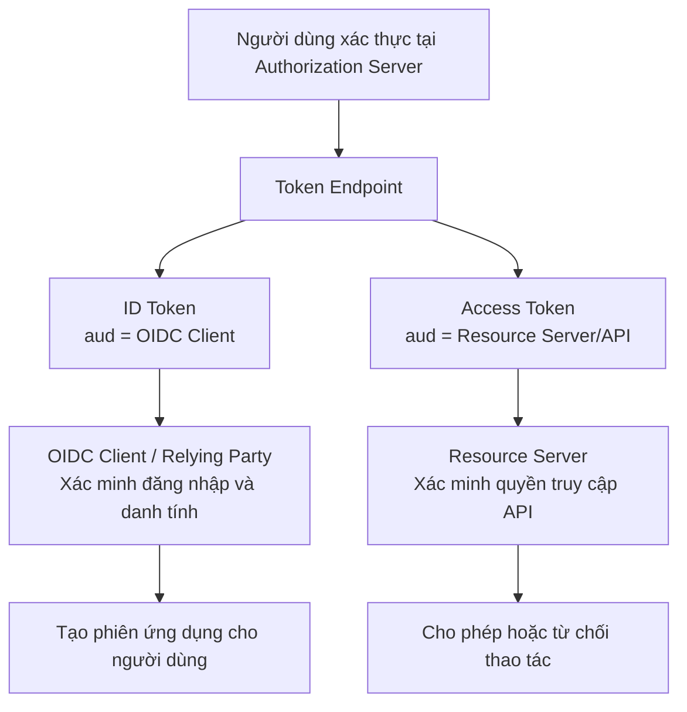
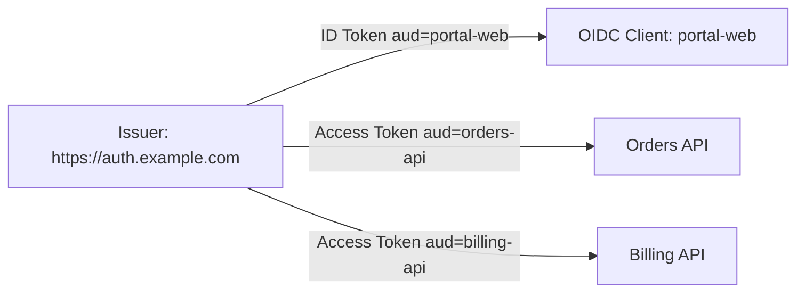
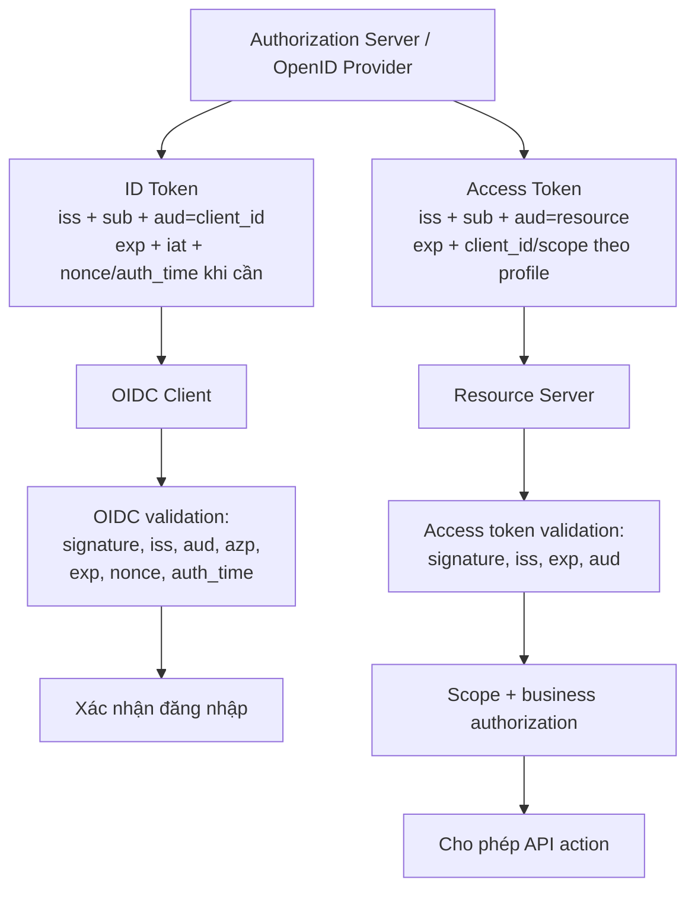

# Phân biệt các claims của access token với claims của ID Token

## 1. Mục tiêu và phạm vi

Trong chương **Token và claims** của module **SPRING_SECURITY_OAUTH2_OIDC_AUTHORIZATION_SERVER**, một Authorization Server triển khai bằng **Spring Security**, **Spring Authorization Server (SAS)** và **Spring Boot** có thể phát hành nhiều loại token cho những bên nhận khác nhau. Hai token thường gặp nhất trong OpenID Connect là **access token** và **ID Token**. Cả hai có thể được biểu diễn dưới dạng JWT, có các claim như `iss`, `sub`, `aud` và `exp`, nhưng chúng có **mục đích, bên nhận và quy tắc xác minh khác nhau**.

Bài học giúp bạn thiết kế, cấu hình, bảo mật, kiểm thử và vận hành Authorization Server bằng cách phân biệt rõ:

- **Access token:** credential để client truy cập Resource Server/API trong phạm vi được cấp.
- **ID Token:** assertion của OpenID Connect để client/Relying Party xác minh kết quả xác thực và danh tính người dùng.
- **Claims:** các thuộc tính có tên trong token, được diễn giải theo profile/giao thức và ngữ cảnh sử dụng.
- **Audience:** bên nhận dự kiến của token; access token hướng tới resource/API, ID Token hướng tới OIDC client.

Sau bài học, bạn có thể:

- Phân biệt vai trò của access token và ID Token, kể cả khi cả hai đều là JWT.
- Nhận diện các claim chuẩn, claim có điều kiện và claim mở rộng trong từng loại token.
- Hiểu cách `iss`, `sub`, `aud`, `exp`, `scope`, `nonce`, `auth_time`, `azp` và `client_id` được sử dụng.
- Thiết kế JWT access token theo profile phù hợp, ví dụ RFC 9068, và không giả định mọi access token đều là JWT.
- Tùy biến claims trong Spring Authorization Server mà không trộn dữ liệu của access token với ID Token.
- Xác minh access token tại Resource Server và ID Token tại OIDC Client đúng vai trò.
- Giảm thiểu PII, kiểm thử audience mismatch, nonce mismatch, token substitution và các lỗi cấu hình thường gặp.

**Phạm vi phiên bản:** Ví dụ sử dụng API thường gặp của **Spring Authorization Server 1.x / Spring Security 6.x / Spring Boot 3.x**. Cần đối chiếu đúng phiên bản dự án vì cách cấu hình JWT generator, token customizer và OIDC có thể thay đổi. Bài tập trung vào Authorization Code Flow với OIDC, đồng thời giải thích khác biệt khi dùng Client Credentials hoặc opaque access token.

## 2. Hai token có thể cùng là JWT nhưng không thể dùng thay nhau



| Đặc điểm | Access token | ID Token |
| --- | --- | --- |
| Giao thức | OAuth 2.0; có thể được dùng trong OIDC | OpenID Connect |
| Mục đích | Ủy quyền truy cập resource/API | Truyền kết quả xác thực và thông tin danh tính đến client |
| Bên nhận chính | Resource Server/API | OIDC Client/Relying Party |
| Audience điển hình | ID/API identifier như `orders-api` | `client_id` của OIDC client |
| Nội dung điển hình | Scope, client, subject, audience resource, thời hạn | Issuer, subject, audience client, thời điểm xác thực và profile claims được phép |
| Nơi xác minh | Resource Server, thường bằng JWT decoder hoặc introspection | OIDC Client bằng OIDC library/validator |
| Có thể dùng để gọi API? | Có, nếu đúng audience và quyền | **Không** dùng thay access token |
| Có thể dùng để đăng nhập client? | Không dùng thay ID Token | Có, sau khi client xác minh đầy đủ |
| Có nhất thiết là JWT? | Không; có thể opaque/reference token | ID Token là JWT theo OIDC |
| Chứa scope? | Thường có scope/permissions theo token profile | Scope yêu cầu thuộc authorization request; không phải claim authorization API mặc định của ID Token |

**Quy tắc nhớ:** access token trả lời câu hỏi *“client được phép làm gì tại API nào?”*. ID Token trả lời câu hỏi *“Authorization Server đã xác thực subject nào và đang khẳng định điều gì với OIDC client?”*.

Không được giải mã một JWT rồi chỉ nhìn thấy `sub`/`email` là kết luận token có thể dùng để đăng nhập hoặc gọi API. Phải xác định **token type/profile, issuer, audience và mục đích của bên nhận**.

## 3. Vì sao không nên dùng ID Token làm Bearer token cho API?

Giả sử một OIDC client nhận ID Token có `aud` là `portal-web`. Client gửi token đó đến `orders-api`:

```http
GET /orders/123 HTTP/1.1
Host: api.example.com
Authorization: Bearer <OIDC_ID_TOKEN>
```

Orders API phải từ chối vì token được phát hành cho **OIDC client**, không phải cho Orders API. Ngay cả khi chữ ký hợp lệ và `exp` chưa hết hạn, audience không khớp thì credential không được chấp nhận.

Ngược lại, access token có `aud=["orders-api"]` không thể được dùng làm bằng chứng đăng nhập tại `portal-web` chỉ vì nó được ký bởi cùng issuer. Client phải xử lý OIDC authentication bằng ID Token theo OIDC Core.

### 3.1. Rủi ro token substitution

Nếu API chấp nhận ID Token, có thể xảy ra:

- Token có audience là client nhưng bị dùng tại API.
- API nhầm claim xác thực người dùng thành quyền truy cập resource.
- Một ID Token có profile claims bị dùng như credential Bearer ngoài mục đích.
- Client hoặc gateway bỏ qua kiểm tra token type/audience và chấp nhận token sai ngữ cảnh.

Nếu client chấp nhận access token làm ID Token, nó có thể bỏ qua các kiểm tra OIDC như `nonce`, `azp` và audience client. Đây là lỗi thiết kế xác minh, không phải lỗi do JWT ký yếu.

## 4. Claims chung và claims đặc thù

JWT định nghĩa một số **registered claims** trong RFC 7519, chẳng hạn `iss`, `sub`, `aud`, `exp`, `nbf`, `iat` và `jti`. OIDC Core và JWT Access Token Profile (RFC 9068) định nghĩa thêm ý nghĩa/điều kiện trong từng loại token.

| Claim | Ý nghĩa khái quát | Trong access token | Trong ID Token |
| --- | --- | --- | --- |
| `iss` | Issuer phát token | Xác định AS tin cậy | Xác định OP phát ID Token |
| `sub` | Subject của token | Chủ thể theo grant/profile; có thể là user hoặc client | Subject người dùng được xác thực; định danh ổn định trong issuer |
| `aud` | Intended audience | Resource Server/API | OIDC client ID |
| `exp` | Hạn cuối token | Giới hạn thời gian truy cập API | Giới hạn thời gian chấp nhận assertion đăng nhập |
| `iat` | Thời điểm phát token | Hữu ích cho audit/age policy | Thời điểm phát ID Token, claim bắt buộc theo OIDC |
| `nbf` | Chưa được dùng trước thời điểm | Có thể có | Có thể có |
| `jti` | ID duy nhất của JWT | Có thể hỗ trợ audit/revocation strategy | Có thể có, không thay thế nonce |
| `client_id` | OAuth2 client đã xin token | Được yêu cầu trong JWT Access Token Profile RFC 9068 | Không phải claim nhận diện chuẩn bắt buộc của ID Token |
| `scope` | Phạm vi ủy quyền | Thường mô tả quyền API | Không phải claim xác thực danh tính mặc định |
| `nonce` | Giá trị ràng buộc OIDC request | Không phải claim chuẩn của access token | Bắt buộc trong ID Token nếu authorize request đã gửi nonce |
| `auth_time` | Thời điểm user được xác thực | Có thể được đưa vào theo policy, không phải quyền API | Có điều kiện; quan trọng với `max_age` |
| `acr`/`amr` | Ngữ cảnh/phương thức xác thực | Có thể xuất hiện theo profile/policy | Claims OIDC dùng để mô tả mức/phương thức xác thực |
| `azp` | Authorized party | Không phải claim chuẩn phổ biến của access token | Dùng trong ID Token khi có nhiều audience/authorized party |
| `email`/`name` | Thuộc tính hồ sơ | Thường nên tránh nếu API không cần | Có thể được trả khi scope/claim policy cho phép |

**Một tên claim giống nhau không có nghĩa cùng một ngữ nghĩa.** Ví dụ `aud` có trong cả hai token, nhưng giá trị dự kiến của nó khác nhau. Cũng không nên mặc định mọi claim trong bảng đều luôn xuất hiện; điều kiện phụ thuộc chuẩn, grant, scope, request parameters và policy.

## 5. Các claim cốt lõi của ID Token theo OIDC

OIDC Core định nghĩa ID Token là JWT chứa claims về **xác thực**. Một ID Token điển hình trong Authorization Code Flow có dạng minh họa:

```json
{
  "iss": "https://auth.example.com",
  "sub": "00u8f3a1b2c4d5e6",
  "aud": "portal-web",
  "exp": 1790000600,
  "iat": 1790000000,
  "auth_time": 1789999900,
  "nonce": "CLIENT_NONCE_BOUND_TO_LOGIN",
  "acr": "urn:example:loa:2",
  "amr": ["pwd", "otp"]
}
```

Đây là payload minh họa, không phải token có chữ ký thực. Các claim `auth_time`, `nonce`, `acr` và `amr` chỉ xuất hiện theo điều kiện và khả năng của OP; không phải tất cả đều bắt buộc trong mọi ID Token.

### 5.1. Những claim bắt buộc

| Claim | Quy tắc OIDC cốt lõi |
| --- | --- |
| `iss` | Issuer Identifier của OpenID Provider; client phải so khớp chính xác với issuer được tin cậy |
| `sub` | Subject Identifier của người dùng; là định danh cục bộ ổn định trong phạm vi issuer |
| `aud` | Audience phải chứa `client_id` của client; client xác minh mình là bên nhận |
| `exp` | Thời điểm hết hạn; client không chấp nhận token sau thời điểm này (có thể có clock skew nhỏ theo policy) |
| `iat` | Thời điểm ID Token được phát hành |

`sub` không nên là email hoặc username có thể đổi tùy tiện. OIDC dùng subject identifier để client liên kết tài khoản; email có thể thay đổi, trùng hoặc được xác minh lại. Subject có thể là **public** hoặc **pairwise** theo chính sách OP.

### 5.2. `nonce`: ràng buộc request với ID Token

Nếu client gửi `nonce` trong Authentication Request, OP phải đưa đúng giá trị tương ứng vào ID Token. Client kiểm tra nonce khi xác minh ID Token.

Nonce giúp chống replay/token substitution trong ngữ cảnh OIDC. Client phải lưu nonce theo đúng authorization transaction và không dùng chung một giá trị giữa các flow không liên quan.

**Nonce không thay `state` và không thay PKCE:**

- `state` liên kết callback với yêu cầu client đã khởi tạo.
- PKCE liên kết việc đổi authorization code với client đang giữ `code_verifier`.
- `nonce` liên kết ID Token với Authentication Request OIDC.

### 5.3. `auth_time` và `max_age`

`auth_time` biểu thị thời điểm người dùng thực sự được xác thực. Khi client gửi `max_age` trong Authentication Request, OP phải đáp ứng yêu cầu độ mới xác thực và ID Token cần có `auth_time` để client kiểm tra.

Đừng suy rằng session đăng nhập còn sống nghĩa là user vừa xác thực. Một session có thể tồn tại lâu hơn yêu cầu xác thực mới. Nếu nghiệp vụ cần step-up/MFA, cần chính sách authentication phù hợp, không chỉ tăng thời hạn ID Token.

### 5.4. `acr` và `amr`

- `acr` (*Authentication Context Class Reference*) mô tả mức/ngữ cảnh xác thực theo scheme được OP và client thỏa thuận.
- `amr` (*Authentication Methods References*) mô tả phương thức xác thực đã sử dụng, ví dụ mật khẩu hoặc OTP nếu OP có bằng chứng phù hợp.

Không tự gán `acr=high` hoặc `amr=["mfa"]` chỉ vì một customizer muốn hiển thị thông tin đẹp hơn. Các claim này phải phản ánh **sự kiện xác thực thực tế** và được quản lý bởi authentication subsystem đáng tin cậy.

### 5.5. `azp`, `at_hash` và `c_hash`

- `azp` (*authorized party*) xác định party mà ID Token được phát hành cho trong một số trường hợp. Khi `aud` có nhiều giá trị, client cần áp dụng quy tắc OIDC về `azp` và xác minh giá trị nếu claim xuất hiện; OIDC khuyến nghị có `azp` trong tình huống nhiều audience.
- `at_hash` ràng buộc access token với ID Token trong các response type/profile có yêu cầu. Không phải claim luôn có trong mọi Authorization Code Flow.
- `c_hash` ràng buộc authorization code với ID Token trong các flow/profile thích hợp như Hybrid Flow. Không tự thêm hoặc bỏ qua kiểm tra khi client đang sử dụng flow cần claim này.

Với **Authorization Code Flow thuần**, ID Token thường được nhận ở Token Endpoint; đừng áp dụng điều kiện của Implicit/Hybrid Flow một cách máy móc.

## 6. Các claim thường gặp của access token

OAuth 2.0 core không bắt buộc access token phải là JWT. Access token có thể là chuỗi opaque/reference; Resource Server kiểm tra qua introspection hoặc cơ chế tương đương. Khi AS dùng JWT, các claim và cách xác minh phụ thuộc profile được lựa chọn.

Một access token JWT minh họa cho Orders API:

```json
{
  "iss": "https://auth.example.com",
  "sub": "orders-worker",
  "aud": ["orders-api"],
  "client_id": "orders-worker",
  "scope": "orders.read orders.export",
  "iat": 1790000000,
  "exp": 1790000300,
  "jti": "b4b2e7a0-6a31-4d3c-9d7a-9f4e0a000001"
}
```

Đây là ví dụ **JWT access token profile** mang tính minh họa. Không phải mọi token do mọi Authorization Server phát ra đều có chính xác các claim này hoặc có cùng cấu trúc.

### 6.1. JWT Access Token Profile (RFC 9068)

Khi AS tuyên bố sử dụng profile JWT Access Token theo RFC 9068, profile quy định các claim và cách trình bày cụ thể. Những claim cốt lõi bao gồm:

| Claim | Vai trò trong profile |
| --- | --- |
| `iss` | Issuer của access token |
| `exp` | Thời điểm access token hết hạn |
| `aud` | Resource Server mà access token hướng đến |
| `sub` | Subject của token; tùy grant có thể là resource owner hoặc client |
| `client_id` | OAuth2 client đã yêu cầu token |
| `iat` | Thời điểm token được phát |
| `jti` | Định danh duy nhất của token |
| `scope` | Scope được cấp, nếu có |
| `typ` trong JOSE header | Access token JWT theo profile sử dụng `at+jwt` |

**Đừng tự gọi JWT bất kỳ là RFC 9068 access token.** Muốn áp dụng profile này, AS phải phát đúng cấu trúc/header/claim và Resource Server phải xác minh theo profile; chỉ có `aud` và `scope` không đủ.

### 6.2. `sub` phụ thuộc grant

| Grant | Subject có thể biểu thị | Ý nghĩa |
| --- | --- | --- |
| Authorization Code có user login | Người dùng đã xác thực | Token được cấp trong ngữ cảnh user delegation |
| Client Credentials | Client/service account | Token biểu thị quyền của workload, không đại diện người dùng |
| Refresh Token | Giữ ngữ cảnh authorization ban đầu theo grant | Không tự biến token thành danh tính mới |
| Extension grant/delegation | Phụ thuộc contract được định nghĩa | Phải ghi rõ ai là actor, ai là subject và bằng chứng ủy quyền |

Vì vậy, Resource Server không được giả định `sub` luôn là user ID. Nếu API cần biết service account, hãy dùng thông tin client đã được xác minh theo token profile/policy; nếu cần end-user context, chỉ tin claim được tạo từ nguồn ủy quyền đáng tin.

### 6.3. `scope` và permission claims

`scope` thường biểu diễn phạm vi client được phép truy cập. Spring Security Resource Server thường ánh xạ các giá trị scope thành authority như `SCOPE_orders.read` (tùy converter và claim format).

Claim riêng như `permissions`, `roles` hoặc `entitlements` có thể hữu ích, nhưng cần:

- Định nghĩa schema và namespace rõ ràng.
- Chỉ lấy từ nguồn policy có thẩm quyền.
- Giới hạn theo audience/resource và client.
- Không nhầm quyền toàn hệ thống với quyền của một API.
- Kiểm thử thay đổi quyền và vòng đời token.
- Không dùng claim do client tự gửi trong token request làm quyền đã được phê duyệt.

### 6.4. `client_id` và `azp` không đồng nghĩa

`client_id` trong access token profile xác định OAuth2 client đã xin access token. `azp` trong OIDC ID Token mang ngữ nghĩa authorized party theo OIDC. Chúng có thể có giá trị liên quan trong một số flow nhưng không thể hoán đổi một cách tùy tiện.

## 7. Audience: cùng tên claim, hai hợp đồng khác nhau



### 7.1. Audience của ID Token

ID Token được phát hành cho **OIDC client**. `aud` phải chứa `client_id` của client. Nếu có nhiều audience, client phải áp dụng các quy tắc OIDC, bao gồm kiểm tra `azp` khi cần; không chỉ kiểm tra rằng danh sách audience có một giá trị bất kỳ.

Ví dụ:

```json
{
  "iss": "https://auth.example.com",
  "sub": "user-123",
  "aud": ["portal-web", "another-registered-client"],
  "azp": "portal-web",
  "exp": 1790000600,
  "iat": 1790000000
}
```

Client `portal-web` cần kiểm tra audience/authorized party theo OIDC. Không chấp nhận token chỉ vì `iss` đúng.

### 7.2. Audience của access token

Access token hướng đến **Resource Server**. Ví dụ `orders-api` cần từ chối token chỉ có `aud=["billing-api"]` dù issuer giống nhau và chữ ký hợp lệ.

Không nên dùng một audience rộng như `all-internal-services` nếu muốn tách ranh giới API. Token có nhiều audience chỉ nên được dùng khi hợp đồng resource rõ ràng và mọi API đều có chính sách chấp nhận phù hợp.

### 7.3. Không tự suy audience từ hostname request

AS phải chọn audience từ policy tin cậy (client–resource allowlist, resource indicator đã được xác minh hoặc authorization context). Không lấy `Host` header, query `aud` hay `resource` tùy ý rồi chép vào JWT. Resource Server so khớp audience với cấu hình **cố định và tin cậy** của chính API.

## 8. Claim nào thuộc token nào?

Bảng sau là gợi ý phân loại, không phải danh sách bắt buộc cho mọi hệ thống:

| Claim/dữ liệu | Access token | ID Token | Lý do |
| --- | --- | --- | --- |
| Issuer `iss` | Có | Có | Xác định bên phát hành |
| Subject `sub` | Có theo profile | Có, bắt buộc trong OIDC | Subject theo ngữ cảnh token |
| Audience `aud` | Resource/API | OIDC client | Hai bên nhận khác nhau |
| Expiration `exp` | Có theo profile JWT | Bắt buộc trong OIDC | Hai loại credential có vòng đời riêng |
| Client ID | Thường có trong JWT access token profile | Không phải claim OIDC bắt buộc | Nhận diện OAuth2 client |
| Scope/permissions API | Có | Thường không | Quyền truy cập resource thuộc access token |
| `nonce` | Không phải claim access token chuẩn | Có nếu authorize request gửi nonce | Ràng buộc OIDC authentication request |
| `auth_time` | Chỉ khi profile/policy cần | Có điều kiện theo OIDC | Độ mới xác thực người dùng |
| `acr`/`amr` | Chỉ khi resource cần context xác thực và policy cho phép | Có thể có theo OIDC | Authentication context/method |
| Email, tên, ảnh hồ sơ | Thường tránh nếu API không cần | Có thể có theo scope/claim authorization | Dữ liệu profile của người dùng |
| Tenant/organization | Có thể có nếu API cần và policy tin cậy | Chỉ nếu client cần và được phép | Cân nhắc giảm thiểu dữ liệu |
| Refresh token | Không phải JWT claim; là token riêng | Không | Credential riêng cho token refresh |
| Authorization code | Không | Không | Credential riêng trước Token Endpoint |

**Không nhồi tất cả dữ liệu người dùng vào cả hai token.** ID Token chỉ nên mang claims mà OIDC client cần; access token chỉ mang claims cần để Resource Server xác thực/ủy quyền. Nếu dữ liệu có thể tra cứu an toàn từ API profile, không nhất thiết sao chép nó vào JWT.

## 9. OIDC scope và UserInfo: tránh nhầm profile claims

OIDC dùng scope chuẩn như `openid`, `profile`, `email` và `address` để biểu thị yêu cầu về thông tin xác thực/profile.

| Scope | Nhóm thông tin có thể yêu cầu |
| --- | --- |
| `openid` | Bật OIDC và yêu cầu ID Token |
| `profile` | Các profile claims như `name`, `preferred_username`, `picture`, `updated_at` theo khả năng |
| `email` | `email` và `email_verified` |
| `address` | Claim `address` |
| `phone` | `phone_number` và `phone_number_verified` |

Scope không bảo đảm rằng mọi claim trong nhóm đều phải xuất hiện trong mọi ID Token. OP có thể không có dữ liệu, claim có thể bị giới hạn bởi consent/policy hoặc được trả qua **UserInfo Endpoint**.

### 9.1. UserInfo Endpoint là nguồn profile riêng

OIDC UserInfo Endpoint nhận **access token** và trả claims về End-User tương ứng, theo scope/authorization. Client không dùng ID Token làm Bearer token để gọi UserInfo; client dùng access token hợp lệ được cấp cho UserInfo/resource theo contract.

Nếu UserInfo response có `sub`, client phải xác minh nó trùng `sub` trong ID Token để bảo đảm profile claims thuộc đúng subject. Không ghép dữ liệu UserInfo với ID Token chỉ dựa trên email.

### 9.2. Profile claims không phải quyền API

`email`, `name` hoặc `picture` không phải quyền đọc/sửa dữ liệu nghiệp vụ. Việc một client được nhận email của user không đồng nghĩa nó được phép gọi `POST /payments`. Ngược lại, scope `payments.read` không có nghĩa client được nhận mọi profile claims.

## 10. Claims theo loại grant

### 10.1. Authorization Code + OIDC

Khi client gửi scope `openid` và người dùng xác thực thành công:

- Authorization Endpoint trả authorization code.
- Token Endpoint đổi code lấy access token và ID Token theo cấu hình.
- Access token được dùng để gọi Resource Server.
- ID Token được client xác minh để hoàn tất đăng nhập.
- Nếu request có `nonce`, ID Token cần mang giá trị tương ứng để client kiểm tra.
- Nếu request có `max_age`, `auth_time` cần phản ánh thời điểm xác thực theo OIDC.

Không đưa access token vào callback URL chỉ vì ID Token cũng là JWT.

### 10.2. Client Credentials

Client Credentials đại diện **workload/client**, không có end-user authentication. Vì vậy:

- Thường có access token để gọi API.
- Không phát OIDC ID Token cho một người dùng không tồn tại trong flow.
- `sub`/`client_id` cần thể hiện client theo profile/token policy.
- Scope và audience giới hạn quyền M2M.
- Không thêm `email`/`name` giả cho service account để làm token “giống user”.

### 10.3. Refresh Token

Khi client dùng refresh token, AS phát access token mới theo authorization ban đầu và policy hiện tại. ID Token mới có thể được cấp trong những trường hợp OIDC quy định, tùy grant/request/configuration; không mặc định mọi refresh response đều chứa ID Token. Refresh token là credential riêng, không phải claim của access token hoặc ID Token.

### 10.4. Opaque access token

Nếu access token là opaque/reference:

- Client vẫn dùng nó như Bearer token theo contract.
- Resource Server thường xác minh bằng introspection hoặc adapter tương ứng.
- Claims có thể được trả trong introspection response; không có nghĩa client được phép đọc/giải mã access token.
- Các ranh giới audience/scope/issuer/expiry vẫn cần được thực thi theo introspection và policy.
- ID Token vẫn là JWT theo OIDC.

## 11. Tùy biến claims trong Spring Authorization Server

### 11.1. Đúng extension point: `OAuth2TokenCustomizer<JwtEncodingContext>`

SAS hỗ trợ tùy biến JWT claims bằng `OAuth2TokenCustomizer<JwtEncodingContext>` khi sử dụng `JwtGenerator`. Có thể phân nhánh theo token type để không trộn claims giữa access token và ID Token.

```java
@Configuration(proxyBeanMethods = false)
public class TokenClaimsConfig {

    @Bean
    OAuth2TokenCustomizer<JwtEncodingContext> jwtTokenCustomizer(
            AudiencePolicy audiencePolicy,
            IdentityClaimsService identityClaimsService) {

        return context -> {
            String tokenType = context.getTokenType().getValue();

            if (OAuth2TokenType.ACCESS_TOKEN.getValue()
                    .equals(tokenType)) {

                String clientId = context.getRegisteredClient()
                        .getClientId();

                List<String> audiences = audiencePolicy
                        .audiencesFor(
                                clientId,
                                context.getAuthorizedScopes());

                if (audiences == null || audiences.isEmpty()) {
                    throw new IllegalStateException(
                            "No approved audience policy for client");
                }

                context.getClaims().audience(audiences);
                context.getClaims().claim(
                        "token_purpose", "api_access");
            }

            if (OidcParameterNames.ID_TOKEN.equals(tokenType)) {
                // Chỉ lấy dữ liệu profile từ nguồn identity đáng tin.
                // Không lấy claim từ request parameter của browser.
                Map<String, Object> claims =
                        identityClaimsService.claimsFor(
                                context.getPrincipal(),
                                context.getAuthorizedScopes());

                claims.forEach((name, value) ->
                        context.getClaims().claim(name, value));
            }
        };
    }
}
```

`AudiencePolicy` và `IdentityClaimsService` là **interface nghiệp vụ minh họa của ứng dụng**, không phải bean mặc định của SAS. Ví dụ tập trung vào việc phân biệt token type:

- Với **access token**, audience được chọn theo client/resource policy phía AS; scopes được giới hạn theo authorization.
- Với **ID Token**, profile claims lấy từ nguồn identity đã xác minh và chỉ trả khi phù hợp scope/claim authorization.
- Không ghi đè `aud` mặc định của ID Token bằng audience của API.
- Không chèn `nonce` tự tạo ở customizer nếu framework đã quản lý giá trị OIDC gắn với request; hãy để cơ chế OIDC chuẩn xử lý và kiểm thử.
- Nếu policy audience không có, phải từ chối/fail closed ở tầng phát hành; không phát token không có đích rõ ràng.

`getTokenType().getValue()` được dùng để phân biệt token type. Đối chiếu constant/API có sẵn ở phiên bản SAS dự án; không giả định ID Token luôn dùng cùng constant `OAuth2TokenType.ACCESS_TOKEN`.

### 11.2. Tránh ghi đè claims chuẩn

Không tùy tiện ghi đè:

- `iss`: phải khớp issuer được cấu hình.
- `sub`: phải là subject theo identity/authorization model đáng tin cậy.
- `aud`: phải đúng bên nhận của token type.
- `exp`/`iat`/`nbf`: phải phản ánh thời hạn và clock policy.
- `nonce`: phải gắn với authorization request.
- `azp`: phải tuân OIDC authorized-party rules.

Một customizer thêm claim sai tên hoặc ghi đè claim chuẩn có thể khiến client/API từ chối token, hoặc tệ hơn, khiến bên nhận chấp nhận token sai ngữ cảnh.

### 11.3. Tránh nhiều customizer xung đột

Nếu ứng dụng có nhiều `OAuth2TokenCustomizer<JwtEncodingContext>` beans, cần kiểm tra cách phiên bản/framework đang dùng kết hợp chúng. Đừng giả định mọi bean cùng kiểu generic đều tự động được gọi theo thứ tự mong muốn. Một cấu hình dễ kiểm soát là hợp nhất logic vào một customizer có các policy/service chuyên biệt hoặc cấu hình generator rõ ràng.

Không để một customizer của access token ghi `aud=orders-api` cho **mọi** token bao gồm ID Token. Không để một customizer ID Token ghi `roles` toàn hệ thống vào access token ngoài phạm vi policy.

### 11.4. Opaque access token cần customizer khác

`OAuth2TokenCustomizer<JwtEncodingContext>` chỉ áp dụng cho quá trình tạo JWT. Nếu access token dùng `OAuth2TokenFormat.REFERENCE`, cần kiểm tra customizer/context của opaque token (ví dụ `OAuth2TokenClaimsContext` và `OAuth2AccessTokenGenerator` theo version) và cấu hình introspection tương ứng.

Đừng kết luận claim đã xuất hiện trong JWT chỉ từ việc một customizer opaque token được gọi, hoặc ngược lại.

## 12. Cấu hình RegisteredClient và OIDC trong SAS

Ví dụ đăng ký confidential client cho Authorization Code + OIDC:

```java
@Bean
RegisteredClientRepository registeredClientRepository(
        PasswordEncoder passwordEncoder,
        @Value("${PORTAL_CLIENT_SECRET}") String rawSecret) {

    RegisteredClient portal = RegisteredClient
            .withId("portal-web-001")
            .clientId("portal-web")
            .clientSecret(passwordEncoder.encode(rawSecret))
            .clientAuthenticationMethod(
                    ClientAuthenticationMethod.CLIENT_SECRET_BASIC)
            .authorizationGrantType(
                    AuthorizationGrantType.AUTHORIZATION_CODE)
            .authorizationGrantType(
                    AuthorizationGrantType.REFRESH_TOKEN)
            .redirectUri(
                    "https://portal.example.com/login/oauth2/code/portal-web")
            .scope(OidcScopes.OPENID)
            .scope(OidcScopes.PROFILE)
            .scope(OidcScopes.EMAIL)
            .clientSettings(ClientSettings.builder()
                    .requireProofKey(true)
                    .requireAuthorizationConsent(true)
                    .build())
            .tokenSettings(TokenSettings.builder()
                    .accessTokenFormat(
                            OAuth2TokenFormat.SELF_CONTAINED)
                    .accessTokenTimeToLive(Duration.ofMinutes(5))
                    .build())
            .build();

    return new InMemoryRegisteredClientRepository(portal);
}
```

Đây là cấu hình client minh họa, chưa phải toàn bộ AS. Các bean `PasswordEncoder`, `OAuth2AuthorizationService`, `OAuth2AuthorizationConsentService`, `JWKSource<SecurityContext>`, `JwtDecoder` khi cần và security filter chains phải được cấu hình phù hợp. Raw secret lấy từ secret manager/environment, không hard-code.

### 12.1. Bật OIDC trên Authorization Server

Trong filter chain dành cho AS:

```java
OAuth2AuthorizationServerConfigurer as =
        OAuth2AuthorizationServerConfigurer.authorizationServer();

http
    .securityMatcher(as.getEndpointsMatcher())
    .with(as, server ->
            server.oidc(Customizer.withDefaults()));
```

Bật OIDC cần hạ tầng ký JWT và cấu hình decoder phù hợp. Việc bật `oidc` không có nghĩa ID Token tự có mọi profile claim; claims được trả theo authorization request, scope, user data và policy.

### 12.2. Đừng gắn claim người dùng bằng giá trị client gửi

Một anti-pattern:

```java
// Không làm: browser/client tự khai vai trò người dùng.
context.getClaims().claim(
        "roles",
        request.getParameter("roles"));
```

Client có thể sửa request và tự khai `roles=["ADMIN"]`. Claims trong token phải xuất phát từ dữ liệu đã xác thực và policy do AS quản lý. Với customizer, lấy thông tin từ `context.getPrincipal()`/identity service và kiểm tra scope, client, tenant; không tin input thô.

## 13. Xác minh ID Token ở OIDC Client

OIDC Client/Relying Party phải dùng thư viện OIDC hoặc validator triển khai đầy đủ OIDC Core. Các kiểm tra quan trọng:

1. **Chữ ký:** dùng key phù hợp từ JWKS của issuer tin cậy; chỉ chấp nhận thuật toán đã cấu hình.
2. **`iss`:** khớp chính xác issuer đã cấu hình/discovery.
3. **`aud`:** chứa `client_id` của chính client.
4. **`azp`:** khi claim xuất hiện hoặc có nhiều audience, áp dụng quy tắc OIDC và xác minh authorized party.
5. **`exp`:** chưa hết hạn, có xử lý clock skew nhỏ theo policy.
6. **`iat`:** hợp lệ và không ở tương lai ngoài clock tolerance.
7. **`nonce`:** trùng giá trị client đã lưu cho authorization transaction nếu request có nonce.
8. **`auth_time`:** khi request `max_age`, kiểm tra độ mới xác thực.
9. **`sub`:** không rỗng; nếu dùng UserInfo, đối chiếu `sub` từ UserInfo với ID Token.
10. **Hash claims** (`at_hash`/`c_hash`) khi flow/profile yêu cầu.

**Không chỉ decode JWT rồi tin payload.** Decode không xác minh chữ ký hoặc claims. Một JWT giả có thể chứa `iss`, `aud` và `sub` đẹp mắt nhưng không được issuer ký.

### 13.1. Không dùng Resource Server validator thay OIDC ID Token validator

Resource Server validator thường tập trung access token: issuer, audience API, thời hạn và scope. OIDC client validator phải hiểu ID Token: audience client, nonce, authorized party, authentication time và các điều kiện OIDC. Hai validator có thể chia sẻ cơ chế xác minh chữ ký nhưng **không chia sẻ toàn bộ chính sách token**.

### 13.2. Lưu ID Token và phiên ứng dụng

Backend OIDC client có thể giữ ID Token trong session/server-side token store để phục vụ logout hoặc kiểm tra trạng thái theo thư viện. Tránh đưa token vào URL, log hoặc JavaScript nếu không cần. Client nên tạo session ứng dụng của mình sau khi ID Token đã được xác minh; không lấy một claim chưa xác minh làm session principal.

## 14. Xác minh access token tại Resource Server

Resource Server chỉ chấp nhận access token đúng **issuer, audience và quyền**. Ví dụ Orders API yêu cầu `aud=orders-api` và `SCOPE_orders.read`.

```yaml
security:
  issuer-uri: https://auth.example.com
  jwk-set-uri: https://auth.example.com/oauth2/jwks
  required-audience: orders-api
```

```java
@Configuration(proxyBeanMethods = false)
public class OrdersApiSecurityConfig {

    @Bean
    JwtDecoder jwtDecoder(
            @Value("${security.issuer-uri}") String issuer,
            @Value("${security.jwk-set-uri}") String jwksUri,
            @Value("${security.required-audience}") String audience) {

        NimbusJwtDecoder decoder =
                NimbusJwtDecoder.withJwkSetUri(jwksUri).build();

        OAuth2TokenValidator<Jwt> issuerAndTime =
                JwtValidators.createDefaultWithIssuer(issuer);

        OAuth2TokenValidator<Jwt> audienceValidator =
                new JwtClaimValidator<List<String>>(
                        JwtClaimNames.AUD,
                        actual -> actual != null
                                && actual.contains(audience));

        decoder.setJwtValidator(
                new DelegatingOAuth2TokenValidator<>(
                        issuerAndTime, audienceValidator));

        return decoder;
    }

    @Bean
    SecurityFilterChain apiSecurity(HttpSecurity http)
            throws Exception {

        http
            .authorizeHttpRequests(authorize -> authorize
                    .requestMatchers(HttpMethod.GET, "/orders/**")
                    .hasAuthority("SCOPE_orders.read")
                    .anyRequest().denyAll())
            .oauth2ResourceServer(oauth2 ->
                    oauth2.jwt(Customizer.withDefaults()))
            .sessionManagement(session ->
                    session.sessionCreationPolicy(
                            SessionCreationPolicy.STATELESS));

        return http.build();
    }
}
```

Đây là ví dụ JWT Resource Server, không phải OIDC client ID Token validation. `JwtValidators.createDefaultWithIssuer` và audience validator kiểm tra issuer/time và đúng API; authority mapping cần khớp cấu trúc scope thực tế. Nếu custom converter, hãy kiểm tra mapping `scope`/`scp` thành `SCOPE_*`.

Với opaque access token, dùng introspection/opaque token support và kiểm tra audience/scope trong dữ liệu introspection theo policy tương đương. Không cố decode một chuỗi opaque thành JWT.

### 14.1. 401 và 403

| Trường hợp | Kết quả thường gặp | Ý nghĩa |
| --- | --- | --- |
| Không có Bearer token | 401 | Chưa có authentication |
| Access token sai chữ ký/issuer/hết hạn | 401 | Credential không hợp lệ |
| ID Token gửi đến API, sai audience | 401 | Token không dành cho Resource Server |
| Access token đúng issuer/audience nhưng thiếu scope | 403 | Đã xác thực token nhưng không đủ quyền |
| Token đúng scope nhưng không được truy cập tenant/đối tượng | 403 hoặc policy-specific denial | Business authorization thất bại |

Không biến mọi lỗi thành 403 để che sai token; tách authentication failure và authorization failure giúp hệ thống quan sát chính xác.

## 15. Giảm thiểu dữ liệu nhạy cảm trong claims

JWT thường được **ký**, không mặc nhiên **mã hóa**. Người sở hữu token có thể đọc payload nếu token là JWS thông thường. Chữ ký bảo đảm tính toàn vẹn/xác thực nguồn, không che giấu dữ liệu.

Các nguyên tắc:

- Không đưa password, client secret, API key, refresh token hoặc private key vào claims.
- Tránh email/phone/address nếu Resource Server không cần.
- Hạn chế PII trong access token vì token được gửi tới API, gateway, log/tracing và có thể lan rộng hơn ID Token.
- ID Token chỉ chứa profile claims mà client yêu cầu/được phép nhận; dùng UserInfo khi phù hợp.
- Không nhét toàn bộ quyền/role của tổ chức vào mọi token nếu client chỉ cần một API nhỏ.
- Chọn subject identifier phù hợp; cân nhắc pairwise subject khi cần giảm khả năng liên kết người dùng giữa các client.
- TTL ngắn và rotation key không thay thế data minimization.

Nếu cần bảo mật nội dung JWT khỏi bên nhận ngoài phạm vi, cần đánh giá JWE hoặc opaque token/introspection; không giả định JWS payload được mã hóa.

## 16. Kiểm thử phân biệt token type và claims

### 16.1. Ma trận kiểm thử chính

| Kịch bản | Kết quả mong đợi |
| --- | --- |
| Authorization Code + `openid` thành công | Token response có access token và ID Token theo cấu hình OIDC |
| Không có scope `openid` | Không mặc nhiên phát ID Token |
| ID Token `aud` chứa client ID đúng | OIDC client có thể tiếp tục sau các kiểm tra khác |
| ID Token `aud` không chứa client ID | Client từ chối |
| ID Token `nonce` khớp request | Pass điều kiện nonce |
| ID Token nonce sai/thiếu khi request có nonce | Client từ chối |
| `max_age` được yêu cầu | ID Token có `auth_time` phù hợp và client kiểm tra độ mới |
| ID Token có nhiều audience | Client áp dụng quy tắc `azp` |
| Access token `aud=["orders-api"]` | Orders API có thể chấp nhận nếu chữ ký/issuer/expiry/scope hợp lệ |
| Access token `aud=["billing-api"]` gửi Orders API | Orders API từ chối |
| ID Token gửi đến Resource Server | Từ chối do token type/audience không phù hợp |
| Access token gửi tới OIDC client để đăng nhập | Không dùng thay ID Token |
| Access token đúng audience nhưng thiếu scope | 403 ở endpoint yêu cầu scope |
| Client Credentials grant | Access token M2M; không phát ID Token cho end-user không tồn tại |
| Opaque access token | Resource Server xác minh qua introspection, không decode JWT |
| JWT payload bị sửa nhưng không ký lại | Chữ ký validation thất bại |
| Issuer lạ hoặc key không tin cậy | Token bị từ chối |
| Claim customizer ghi audience API vào ID Token | Test phải phát hiện audience client bị thay sai |

### 16.2. Kiểm thử token customizer

Tách test theo token type:

- Khi `context.getTokenType()` là access token, chỉ các access-token claims được thêm; `aud` theo policy resource.
- Khi token type là ID Token, `aud` mặc định vẫn là client ID theo OIDC; chỉ profile claims đã được phê duyệt mới được thêm.
- Không có audience policy cho client thì không phát access token có audience tùy ý.
- Không có profile claim/consent thì không đưa dữ liệu vào ID Token.
- Customizer không ghi đè `iss`, `sub`, `exp`, `iat`, `nonce` hoặc `azp` ngoài policy.
- Opaque token path được test riêng nếu hệ thống hỗ trợ.

### 16.3. MockMvc và kiểm thử chữ ký

Spring Security Test có helper `jwt()` để giả lập authentication trong test endpoint. Helper này có thể **bỏ qua quá trình decode/chữ ký thật**. Vì vậy:

- Dùng `jwt()` cho test method authorization/scope mapping.
- Dùng JWT ký thật và `JwtDecoder`/JWKS test để xác minh signature, issuer, audience và expiry.
- Dùng OIDC client integration test hoặc thư viện OIDC để xác minh ID Token, nonce, azp, auth_time.
- Không coi một test `jsonPath("$.aud")` trên token response là chứng minh bên nhận sẽ từ chối token sai audience.

### 16.4. Ví dụ unit test cho audience validator

```java
@Test
void ordersApiRejectsBillingAudience() {
    Jwt jwt = Jwt.withTokenValue("test-token")
            .header("alg", "RS256")
            .claim("iss", "https://auth.example.com")
            .claim("aud", List.of("billing-api"))
            .claim("sub", "billing-reconciler")
            .issuedAt(Instant.now())
            .expiresAt(Instant.now().plusSeconds(60))
            .build();

    OAuth2TokenValidator<Jwt> validator =
            new JwtClaimValidator<List<String>>(
                    JwtClaimNames.AUD,
                    aud -> aud != null && aud.contains("orders-api"));

    OAuth2TokenValidatorResult result = validator.validate(jwt);

    assertTrue(result.hasErrors());
}
```

Đây là unit test cho **audience validator**, không xác minh chữ ký hoặc issuer của JWT vì đối tượng `Jwt` được tạo trực tiếp trong test. Cần thêm integration test với decoder thực để xác minh toàn bộ pipeline.

## 17. Những lỗi thường gặp

| Triệu chứng | Nguyên nhân | Hướng xử lý |
| --- | --- | --- |
| API chấp nhận ID Token | Chỉ kiểm tra chữ ký/issuer, không kiểm tra audience hoặc token profile | Chỉ nhận access token dành cho API; xác minh audience/scope |
| Client dùng access token để đăng nhập | Không triển khai OIDC ID Token validation | Dùng OIDC client library, kiểm tra ID Token |
| ID Token có `aud` là API | Customizer access token áp dụng nhầm sang ID Token | Phân nhánh token type và giữ audience client |
| Access token không có audience | Chưa có audience policy hoặc customizer không chạy | Kiểm tra JWT generator/customizer/token format |
| Tất cả API chấp nhận cùng token | Audience rộng hoặc Resource Server bỏ validator | Audience hẹp và validator riêng từng API |
| ID Token thiếu nonce | Client gửi nonce nhưng OP/client integration không giữ đúng flow state | Kiểm tra authorization request và OIDC token generation |
| Nonce bị dùng chung nhiều login flow | Client lưu một biến nonce toàn cục | Lưu nonce theo từng authorization transaction |
| Client không kiểm tra `azp` | Chỉ kiểm tra một phần `aud` | Áp dụng đầy đủ OIDC validation |
| ID Token có email dù không cần | Customizer đưa profile claims vô điều kiện | Scope/consent/claim policy và data minimization |
| JWT có `roles` từ request parameter | Tin dữ liệu client tự khai | Chỉ lấy claims từ nguồn identity/policy đáng tin |
| `sub` bị coi luôn là user ID | Không phân biệt grant | Diễn giải subject theo token profile/grant |
| Opaque token bị decode như JWT | Nhầm token format | Dùng introspection |
| Unit test pass nhưng API production chấp nhận sai token | Dùng mock `jwt()` bỏ qua decoder | Thêm test chữ ký/JWKS/issuer/audience thực |
| Customizer không chạy | Token opaque, bean wiring/generator khác hoặc branch token type sai | Kiểm tra token format và generator |
| Claim customizer ghi đè claim chuẩn | Nhiều customizer xung đột | Hợp nhất policy và test từng token type |

## 18. Checklist triển khai

- [ ] Xác định rõ access token và ID Token là hai credential có mục đích/bên nhận khác nhau.
- [ ] Resource Server chỉ nhận access token đúng audience; không dùng ID Token gọi API.
- [ ] OIDC client chỉ dùng ID Token sau khi xác minh chữ ký, issuer, audience, expiry, nonce và các điều kiện liên quan.
- [ ] ID Token `aud` chứa đúng client ID; xử lý `azp` khi cần.
- [ ] Access token `aud` chứa đúng Resource Server; mỗi API có validator riêng.
- [ ] Access token có scope/permission tối thiểu, được kiểm tra tại endpoint/service.
- [ ] `sub` được diễn giải theo grant/profile; không giả định luôn là user ID.
- [ ] `auth_time`, `acr` và `amr` phản ánh xác thực thật, không phải giá trị tự gán.
- [ ] `nonce` được quản lý theo từng authorization transaction; không dùng thay state/PKCE.
- [ ] JWT customizer phân nhánh token type và không ghi đè claims chuẩn.
- [ ] Opaque access token có introspection/validation path riêng.
- [ ] Không đưa secret, password hoặc PII không cần thiết vào claims.
- [ ] JWT payload được xem là có thể đọc; ký không đồng nghĩa mã hóa.
- [ ] Đã kiểm thử token substitution, audience mismatch, nonce mismatch, expiry, scope thiếu và issuer sai.
- [ ] Đã kiểm thử chữ ký/JWKS thật, không chỉ mock authentication.
- [ ] Có giám sát lỗi validation nhưng không log token hoặc toàn bộ claims nhạy cảm.

## 19. Bản đồ ghi nhớ



**Access token và ID Token có thể cùng là JWT và cùng chứa một số registered claims, nhưng chúng không có cùng hợp đồng sử dụng.** ID Token hướng tới OIDC client và xác nhận kết quả authentication; access token hướng tới Resource Server và biểu thị quyền truy cập resource. Trong Spring Authorization Server, cần tùy biến theo đúng token type, giữ audience phù hợp, tối thiểu hóa claims và để mỗi bên nhận thực hiện validation đúng giao thức. Khi bảo toàn các ranh giới này, hệ thống OAuth2/OIDC tránh được lỗi token substitution, lộ dữ liệu và cấp quyền sai API.
