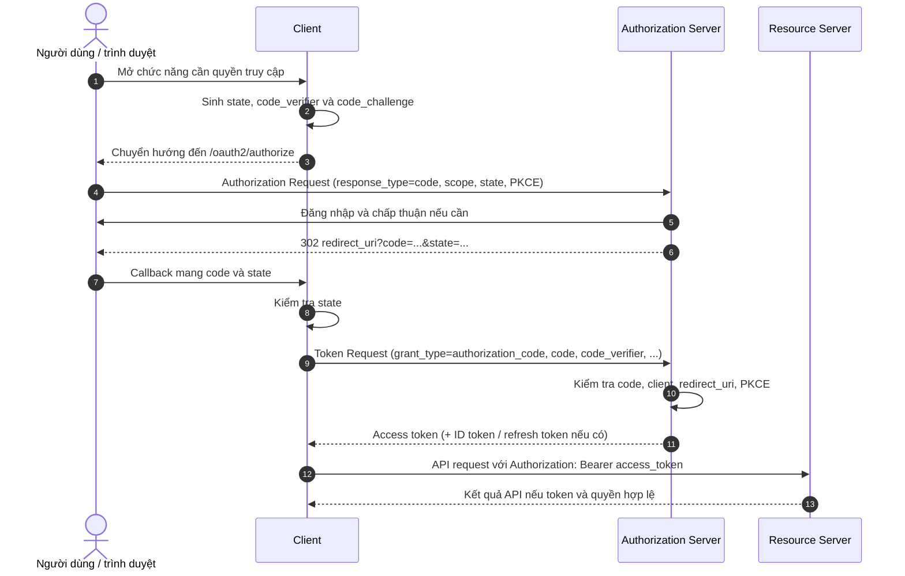

# Authorization Grant, Authorization Request và Token Request

## 1. Vì sao phải phân biệt ba khái niệm này?

Trong OAuth 2.0, một ứng dụng (client) cần quyền truy cập tài nguyên được bảo vệ, chẳng hạn API đơn hàng của người dùng. **Authorization Server** chịu trách nhiệm cấp quyền và phát hành token; **Resource Server** kiểm tra token khi nhận lời gọi API. Khi triển khai với **Spring Security** và **Spring Authorization Server** trong ứng dụng Spring Boot, cần phân biệt ba khái niệm sau:

| Khái niệm | Bản chất | Câu hỏi cần trả lời |
| --- | --- | --- |
| **Authorization Grant** (ủy quyền để nhận token) | Căn cứ hoặc cơ chế cho phép client xin access token; trên giao thức thường thể hiện qua một `grant_type` | *Client dựa vào loại quyền/cơ chế nào để lấy token?* |
| **Authorization Request** (yêu cầu ủy quyền) | Yêu cầu client đưa tới **authorization endpoint**, thường qua trình duyệt, để bắt đầu tương tác với người dùng | *Client muốn xin quyền gì, thay mặt ai, và trả kết quả về đâu?* |
| **Token Request** (yêu cầu token) | Yêu cầu client gửi tới **token endpoint** để đổi grant hoặc thông tin xác thực phù hợp lấy token | *Client trình gì để Authorization Server phát hành token?* |

Ba khái niệm liên quan nhưng **không đồng nghĩa**. Trong Authorization Code Flow, authorization request xin cấp một **authorization code**; sau đó token request sử dụng `grant_type=authorization_code` để đổi code lấy token. Tuy nhiên, **không phải mọi grant đều cần authorization request**: `client_credentials` và `refresh_token` thường chỉ cần token request.

### Các vai trò liên quan

- **Resource Owner**: chủ thể có quyền cho phép truy cập tài nguyên, thường là người dùng.
- **Client**: ứng dụng muốn truy cập tài nguyên; có thể là ứng dụng web phía server, SPA hoặc ứng dụng di động.
- **Authorization Server (AS)**: xác thực và/hoặc ghi nhận chấp thuận, kiểm tra client, phát hành authorization code và token.
- **Resource Server (RS)**: API tiếp nhận access token và quyết định cho phép truy cập tài nguyên.
- **User Agent**: trình duyệt hoặc thành phần tương tác đưa người dùng tới trang đăng nhập/chấp thuận của AS.

Trong OpenID Connect (OIDC), client còn được gọi là **Relying Party (RP)** và Authorization Server hỗ trợ OIDC đóng vai trò **OpenID Provider (OP)**. OIDC xây trên OAuth 2.0 để xác thực danh tính người dùng, nổi bật với **ID Token**.

## 2. Authorization Grant: quyền/cơ chế được dùng để nhận token

Theo mô hình OAuth 2.0, *authorization grant* biểu thị sự ủy quyền của Resource Owner (hoặc một căn cứ hợp lệ khác theo loại grant) để client nhận access token. Trong cấu hình và request thực tế, thuật ngữ **grant type** chỉ *loại* quy trình cấp token mà Authorization Server xử lý.

Để tránh nhầm lẫn, hãy tách ba thứ:

1. **Grant type**: nhãn xác định cách xin token, ví dụ `authorization_code`, `client_credentials`, `refresh_token`.
2. **Authorization code**: mã tạm thời, dùng một lần, được trả về sau authorization request thành công trong Authorization Code Flow; đây **không phải access token**.
3. **Access token**: thông tin cho phép client gọi Resource Server trong phạm vi quyền đã cấp; Resource Server dùng token để kiểm tra truy cập.

### Những grant type thường gặp

| Grant type / cơ chế | Có authorization request qua trình duyệt không? | Dữ liệu chính trong token request | Khi sử dụng |
| --- | --- | --- | --- |
| **Authorization Code** — `authorization_code` | Có, với `response_type=code` | `code`, `redirect_uri` (khi đã dùng ở bước authorize), `code_verifier` khi dùng PKCE; xác thực client theo kiểu đăng ký | Đăng nhập người dùng và cấp quyền cho ứng dụng web, SPA, mobile |
| **Client Credentials** — `client_credentials` | Không | `grant_type=client_credentials`, thông tin xác thực client và phạm vi được phép | Dịch vụ gọi dịch vụ, không đại diện một người dùng cụ thể |
| **Refresh Token** — `refresh_token` | Không cần bước authorize mới | `refresh_token`, thông tin xác thực client nếu thuộc loại confidential | Xin access token mới mà không cần người dùng đăng nhập lại |
| **Device Authorization** — `urn:ietf:params:oauth:grant-type:device_code` | Không dùng authorization request chuẩn của Authorization Code Flow; có quy trình người dùng xác minh riêng | `device_code` và các thông số dành cho device flow | TV, thiết bị hạn chế bàn phím/trình duyệt |

Các flow **Implicit** (`response_type=token`) và **Resource Owner Password Credentials** (`grant_type=password`) thuộc OAuth 2.0 đời đầu nhưng **không nên chọn cho hệ thống mới**, vì rủi ro bảo mật và không phù hợp thực hành hiện đại. Đừng tự suy ra rằng tất cả grant type đều được Spring Authorization Server cho phép: server phải hỗ trợ flow đó **và** từng `RegisteredClient` phải được đăng ký grant tương ứng.

> **Ghi nhớ:** `authorization_code` là giá trị của **grant_type** trong token request; `code` là giá trị của **response_type** trong authorization request. Hai giá trị xuất hiện ở hai bước khác nhau của cùng Authorization Code Flow.

## 3. Authorization Request: bắt đầu ủy quyền tại authorization endpoint

Với Authorization Code Flow, client khởi tạo yêu cầu bằng cách chuyển hướng **trình duyệt** đến authorization endpoint. Trong Spring Authorization Server, đường dẫn mặc định thường là `/oauth2/authorize` (có thể cấu hình khác).

Ví dụ minh họa, các chuỗi `STATE_SAMPLE` và `CHALLENGE_SAMPLE` đại diện cho giá trị ngẫu nhiên/PKCE thật do client tạo, **không dùng nguyên văn khi chạy**:

```http
GET /oauth2/authorize?response_type=code&client_id=orders-web&redirect_uri=https%3A%2F%2Fclient.example.com%2Fcallback&scope=openid%20profile%20orders.read&state=STATE_SAMPLE&code_challenge=CHALLENGE_SAMPLE&code_challenge_method=S256 HTTP/1.1
Host: auth.example.com
```

| Tham số | Vai trò | Lưu ý |
| --- | --- | --- |
| `response_type=code` | Yêu cầu AS trả về authorization code | Dành cho Authorization Code Flow; khác với `grant_type` |
| `client_id` | Xác định client đã đăng ký | Không phải bí mật |
| `redirect_uri` | Địa chỉ callback nhận kết quả | Phải khớp URI đã đăng ký theo quy tắc kiểm tra của AS; không chấp nhận redirect tùy ý |
| `scope` | Các phạm vi truy cập client đề nghị | AS có thể từ chối hoặc chỉ cấp tập con được phép; `openid` kích hoạt yêu cầu OIDC |
| `state` | Giá trị khó đoán, do client lưu và kiểm tra ở callback | Chống CSRF/nhầm lẫn giữa các phiên ủy quyền; cần ràng buộc với phiên khởi tạo |
| `code_challenge` | Giá trị thử thách được suy ra từ `code_verifier` | Dùng cho **PKCE**, giúp code bị đánh cắp không dễ đổi được thành token |
| `code_challenge_method=S256` | Phép biến đổi dùng SHA-256 | Nên dùng `S256` |

Trong yêu cầu OIDC, client có thể gửi thêm `nonce` để ràng buộc ID Token trả về với yêu cầu xác thực, cùng `prompt`, `max_age`, `login_hint` theo nhu cầu. **`nonce` và `state` xử lý các nguy cơ khác nhau**: state ràng buộc phản hồi authorization với phiên client; nonce giúp chống phát lại/nhầm lẫn ID Token. Với Authorization Code Flow, nonce không thay thế PKCE hoặc state.

### Authorization Server xử lý gì?

1. Nhận và kiểm tra `client_id`, `response_type`, `redirect_uri`, `scope`, PKCE và chính sách của client.
2. Nếu người dùng chưa xác thực, đưa họ tới quy trình đăng nhập **của Authorization Server**. Ứng dụng client không cần nhận mật khẩu người dùng.
3. Lấy chấp thuận của người dùng nếu flow và chính sách yêu cầu consent.
4. Nếu thành công, phát hành **authorization code** có thời hạn ngắn, dùng một lần và gắn với client, redirect URI cùng thông tin PKCE.
5. Trả kết quả về callback của client qua trình duyệt:

```http
HTTP/1.1 302 Found
Location: https://client.example.com/callback?code=CODE_SAMPLE&state=STATE_SAMPLE
```

Client phải xác minh `state` nhận về khớp giá trị đã lưu **trước khi xử lý code**. Nếu người dùng từ chối, callback hợp lệ có thể nhận `error=access_denied` thay cho `code`. Nếu `redirect_uri` không hợp lệ, AS **không được tùy tiện redirect tới URI đó** chỉ để báo lỗi.

## 4. Token Request: trao đổi grant tại token endpoint

Sau khi nhận code hợp lệ, client gọi **token endpoint** của Authorization Server, thường là `POST /oauth2/token` trong Spring Authorization Server. Đây là giao tiếp **back channel** qua HTTPS: request diễn ra giữa client và AS, không cần gửi token response qua URL callback.

Ví dụ client web phía server, đã đăng ký `client_secret_basic` (giá trị trong ví dụ chỉ là placeholder):

```http
POST /oauth2/token HTTP/1.1
Host: auth.example.com
Content-Type: application/x-www-form-urlencoded
Authorization: Basic <base64(client_id:client_secret)>

grant_type=authorization_code&code=CODE_SAMPLE&redirect_uri=https%3A%2F%2Fclient.example.com%2Fcallback&code_verifier=VERIFIER_SAMPLE
```

Các yêu cầu cần hiểu:

- **`grant_type=authorization_code`** cho token endpoint biết client đang đổi authorization code.
- **`code`** phải tồn tại, chưa hết hạn, chưa sử dụng và được phát hành cho đúng client.
- **`redirect_uri`** phải khớp URI dùng trong authorization request nếu URI đó đã được cung cấp.
- **`code_verifier`** phải tương ứng với `code_challenge` trong authorization request, khi PKCE được sử dụng.
- **Client authentication** phụ thuộc kiểu client đã đăng ký. Client confidential có thể dùng HTTP Basic với client secret, `private_key_jwt` hoặc phương thức được hỗ trợ; client public (SPA/mobile) không được coi là có thể giữ client secret an toàn, thường dùng `client_authentication_method=none`, gửi `client_id` theo yêu cầu và sử dụng PKCE.
- Body token request dùng **`application/x-www-form-urlencoded`**, không mặc định là JSON.

Nếu hợp lệ, một ví dụ response là:

```http
HTTP/1.1 200 OK
Content-Type: application/json
Cache-Control: no-store
Pragma: no-cache

{
  "access_token": "ACCESS_TOKEN_SAMPLE",
  "token_type": "Bearer",
  "expires_in": 300,
  "scope": "openid profile orders.read",
  "refresh_token": "REFRESH_TOKEN_SAMPLE",
  "id_token": "ID_TOKEN_SAMPLE"
}
```

Đây là **response minh họa**: không phải mọi client đều nhận refresh token; `id_token` chỉ xuất hiện khi yêu cầu OIDC hợp lệ và server phát hành ID Token. TTL, nội dung token và chính sách phát hành tùy cấu hình. Client sử dụng **access token** để gọi API; **ID Token** chứng minh kết quả xác thực cho client OIDC, không thay access token để gọi Resource Server.

### PKCE ràng buộc hai request như thế nào?

Trước khi chuyển hướng trình duyệt, client sinh `code_verifier` đủ ngẫu nhiên và giữ cục bộ. Với phương thức `S256`:

```text
code_challenge = BASE64URL_NO_PADDING(SHA256(ASCII(code_verifier)))
```

Authorization request chứa **`code_challenge`**. Token request sau đó gửi **`code_verifier`**; AS tự tính lại challenge để kiểm tra. Nhờ đó, chỉ nắm được code trên URL callback là **không đủ** để đổi thành token. PKCE đặc biệt quan trọng cho public client và cũng nên áp dụng cho confidential client. PKCE **không thay thế** việc xác thực confidential client.

## 5. Toàn bộ Authorization Code Flow với OAuth 2.0 / OIDC



Phân biệt hai kênh truyền:

| Kênh | Request | Điểm cần chú ý |
| --- | --- | --- |
| **Front channel** qua trình duyệt | Authorization Request và redirect chứa `code`, `state` | Trình duyệt nhìn thấy URL; không đưa `client_secret` hoặc access token vào URL |
| **Back channel** giữa client và AS | Token Request và token response | Bắt buộc HTTPS; bảo vệ secret, code verifier và token trong bộ nhớ/lưu trữ thích hợp |

**Ví dụ nghiệp vụ:** Một dashboard muốn xem danh sách đơn hàng của người dùng. Client yêu cầu `orders.read`. Người dùng đăng nhập tại Authorization Server và chấp thuận nếu cần. Client nhận code ở callback, đổi code lấy access token, sau đó gọi `GET /api/orders`. Resource Server kiểm tra access token và quyền `orders.read` trước khi trả dữ liệu. Nếu dashboard cần biết người dùng *là ai*, nó có thể dùng luồng OIDC (`scope=openid`) và kiểm tra ID Token theo quy tắc OIDC.

## 6. Khi không có Authorization Request

### Client Credentials: giao tiếp giữa dịch vụ

Một tác vụ nền cần truy cập API quản trị với danh tính **ứng dụng**, không phải danh tính người dùng:

```http
POST /oauth2/token HTTP/1.1
Host: auth.example.com
Content-Type: application/x-www-form-urlencoded
Authorization: Basic <base64(service-client:service-secret)>

grant_type=client_credentials&scope=reports.read
```

AS kiểm tra client và grant được phép rồi phát hành access token theo chính sách. **Không có** `response_type=code`, `state`, `redirect_uri`, trang đăng nhập hay consent của end user trong flow cơ bản này. Đừng suy từ token `client_credentials` rằng nó đại diện một người dùng đã đăng nhập.

### Refresh Token: xin access token mới

Khi được cấp refresh token và đã đăng ký grant `refresh_token`, client có thể gửi:

```http
POST /oauth2/token HTTP/1.1
Host: auth.example.com
Content-Type: application/x-www-form-urlencoded
Authorization: Basic <base64(client_id:client_secret)>

grant_type=refresh_token&refresh_token=REFRESH_TOKEN_SAMPLE
```

Token endpoint kiểm tra refresh token còn hợp lệ, ràng buộc với client, quyền và chính sách; có thể cấp refresh token mới (rotation) tùy cấu hình. Refresh token phải được bảo vệ chặt chẽ và **không nên đưa vào URL, log hoặc trình duyệt ở nơi có nguy cơ rò rỉ**. Không phải mọi flow/client đều được phát refresh token.

### Device Authorization: tương tác ủy quyền riêng

Thiết bị hạn chế nhập liệu thường xin `device_code` tại device authorization endpoint, hiển thị `verification_uri` cùng `user_code` để người dùng xác thực trên thiết bị khác, rồi thăm dò token endpoint bằng grant `urn:ietf:params:oauth:grant-type:device_code`. Đây là minh họa rằng **một grant không bắt buộc phải bắt đầu bằng GET `/oauth2/authorize`**.

## 7. Ánh xạ khái niệm vào Spring Authorization Server

Với Spring Boot, **Spring Authorization Server** cung cấp chức năng Authorization Server, trong khi module **Spring Security OAuth2 Client** phía ứng dụng khách thường tạo authorization request và thực hiện token exchange. **Spring Security Resource Server** xác minh access token cho API. Một hệ thống có thể đảm nhiệm nhiều vai trò, nhưng cần hiểu ranh giới trách nhiệm.

| Thành phần / cấu hình | Liên hệ với quy trình |
| --- | --- |
| `RegisteredClientRepository` / `RegisteredClient` | Định nghĩa client ID, phương thức xác thực, grant types, redirect URIs và scopes được phép |
| `ClientSettings.requireProofKey(true)` | Yêu cầu PKCE đối với client tương ứng |
| `ClientSettings.requireAuthorizationConsent(true)` | Yêu cầu ghi nhận chấp thuận khi phù hợp |
| Authorization endpoint `/oauth2/authorize` | Nhận authorization request và xử lý cấp code |
| Token endpoint `/oauth2/token` | Xử lý token request theo grant type |
| `OAuth2AuthorizationService` | Lưu thông tin ủy quyền, code/token và trạng thái liên quan |
| `OAuth2AuthorizationConsentService` | Lưu consent khi ứng dụng yêu cầu/chính sách cần |
| `OAuth2TokenGenerator` | Tạo token theo cấu hình và chính sách |
| OIDC configuration | Bật tính năng OIDC khi cần ID Token và các endpoint OpenID Connect |

Ví dụ **đăng ký client confidential** phục vụ Authorization Code + OIDC, chỉ tập trung vào phần gắn với bài học:

```java
import java.util.UUID;
import org.springframework.context.annotation.Bean;
import org.springframework.security.crypto.password.PasswordEncoder;
import org.springframework.security.oauth2.core.AuthorizationGrantType;
import org.springframework.security.oauth2.core.ClientAuthenticationMethod;
import org.springframework.security.oauth2.core.oidc.OidcScopes;
import org.springframework.security.oauth2.server.authorization.client.RegisteredClient;
import org.springframework.security.oauth2.server.authorization.client.RegisteredClientRepository;
import org.springframework.security.oauth2.server.authorization.client.InMemoryRegisteredClientRepository;
import org.springframework.security.oauth2.server.authorization.settings.ClientSettings;

@Bean
RegisteredClientRepository registeredClientRepository(PasswordEncoder encoder) {
    RegisteredClient client = RegisteredClient.withId(UUID.randomUUID().toString())
        .clientId("orders-web")
        .clientSecret(encoder.encode("dev-only-change-me"))
        .clientAuthenticationMethod(ClientAuthenticationMethod.CLIENT_SECRET_BASIC)
        .authorizationGrantType(AuthorizationGrantType.AUTHORIZATION_CODE)
        .authorizationGrantType(AuthorizationGrantType.REFRESH_TOKEN)
        .redirectUri("https://client.example.com/callback")
        .scope(OidcScopes.OPENID)
        .scope(OidcScopes.PROFILE)
        .scope("orders.read")
        .clientSettings(ClientSettings.builder()
            .requireProofKey(true)
            .requireAuthorizationConsent(true)
            .build())
        .build();

    return new InMemoryRegisteredClientRepository(client);
}
```

Đoạn trên chỉ minh họa **đăng ký client**; một Authorization Server chạy được còn cần security filter chains, đăng nhập người dùng, khóa ký/token generator, cấu hình issuer và các thành phần liên quan. Với OIDC, cần **bật OIDC trong cấu hình Authorization Server**; chỉ đăng ký scope `openid` chưa đủ. `InMemoryRegisteredClientRepository` và client secret viết trong ví dụ chỉ phù hợp demo: production cần lưu client bền vững và lấy bí mật từ secret manager/cấu hình an toàn.

Khi nhận:

- `GET /oauth2/authorize?...response_type=code...`: Authorization Server kiểm tra `RegisteredClient`, cho người dùng đăng nhập/consent và phát code.
- `POST /oauth2/token` với `grant_type=authorization_code`: server xác thực client theo `clientAuthenticationMethod` (nếu cần), kiểm tra code + PKCE, rồi cấp token.
- `POST /oauth2/token` với `grant_type=client_credentials`: nếu `orders-web` như trên **không đăng ký** `CLIENT_CREDENTIALS`, yêu cầu không được chấp nhận dù Authorization Server có thể hỗ trợ grant đó cho client khác.

Đường dẫn endpoint và metadata có thể thay đổi theo phiên bản/cấu hình. Khi tích hợp, nên dựa vào **issuer và discovery metadata** (chẳng hạn `/.well-known/openid-configuration` khi bật OIDC) để lấy endpoint thực tế, thay vì hard-code theo ví dụ.

## 8. Các ranh giới bảo mật quan trọng

| Rủi ro / sai lầm | Cách xử lý đúng |
| --- | --- |
| Bị ép callback sang trang ngoài để đánh cắp code | Đăng ký `redirect_uri` chính xác; AS xác minh chặt; không dùng redirect tùy ý |
| Kẻ tấn công cấy response của phiên ủy quyền khác | Sinh `state` khó đoán, gắn với phiên khởi tạo và kiểm tra tại callback |
| Code bị lộ từ browser history/log hoặc interception | Dùng Authorization Code + PKCE `S256`, code ngắn hạn, một lần và HTTPS |
| SPA/mobile chứa `client_secret` có thể bị trích xuất | Đăng ký public client thích hợp, dùng PKCE; không coi secret đóng gói trong app là bí mật |
| Dùng ID Token làm Bearer để gọi API | Resource Server phải kiểm tra **access token** đúng audience/quyền; ID Token dành cho client OIDC |
| Dùng scope yêu cầu như bằng chứng đã được cấp | Đọc scopes thực sự được grant và kiểm tra quyền ở Resource Server |
| Lộ token/secret qua log, URL, analytics hoặc storage | Che dữ liệu nhạy cảm; dùng HTTPS; hạn chế thời gian sống và nơi lưu token |
| Chỉ xác thực người dùng mà bỏ qua kiểm tra client | Xác thực/định danh client theo phương thức đăng ký; ràng buộc code và token với đúng client |

Đừng nhầm **authentication** với **authorization**: OIDC cung cấp thông tin xác thực danh tính qua ID Token; OAuth 2.0 cấp quyền truy cập qua access token và scope. **Đăng nhập thành công không có nghĩa được quyền truy cập mọi API.**

## 9. Lỗi thường gặp: đọc lỗi ở đúng endpoint

### Lỗi tại authorization endpoint

Authorization Server có thể chuyển hướng về callback **đã xác thực hợp lệ** cùng các tham số lỗi:

```http
HTTP/1.1 302 Found
Location: https://client.example.com/callback?error=access_denied&state=STATE_SAMPLE
```

Các lỗi có thể gặp: `access_denied` (người dùng từ chối), `invalid_scope`, `unauthorized_client`, `unsupported_response_type`, `invalid_request`. Nếu redirect URI chưa được xác minh hợp lệ, server cần báo lỗi theo cách an toàn, **không redirect tùy tiện tới URI không tin cậy**.

### Lỗi tại token endpoint

Một token request sai code hoặc sai PKCE thường nhận:

```http
HTTP/1.1 400 Bad Request
Content-Type: application/json

{
  "error": "invalid_grant"
}
```

| Mã lỗi | Nguyên nhân điển hình | Cách khoanh vùng |
| --- | --- | --- |
| `invalid_grant` | Code hết hạn, tái sử dụng, không thuộc client, sai redirect URI/PKCE; refresh token không hợp lệ | Đối chiếu code, client, redirect URI, verifier và thời điểm |
| `invalid_client` | Sai/lỗi phương thức xác thực client | Kiểm tra registration, secret/credential và phương thức gửi xác thực |
| `unauthorized_client` | Client chưa được phép dùng grant được yêu cầu | Kiểm tra `RegisteredClient.authorizationGrantTypes` |
| `unsupported_grant_type` | Server không hỗ trợ grant type đã gửi | Kiểm tra `grant_type` và cấu hình server |
| `invalid_request` | Thiếu/trùng/sai định dạng tham số bắt buộc | Kiểm tra HTTP method, content type và body form |
| `invalid_scope` | Scope yêu cầu không hợp lệ hoặc vượt phạm vi cho phép | So khớp scope đăng ký và chính sách cấp quyền |

**Không suy luận** mọi lỗi đều trả HTTP 400: ví dụ `invalid_client` có thể dùng HTTP 401 cùng `WWW-Authenticate`. Chỉ ghi vào log những dữ liệu cần chẩn đoán, **không log nguyên token, authorization code, code verifier hoặc client secret**.

## 10. Kiểm thử theo hành vi

Khi xây Authorization Server bằng Spring Security, nên kiểm tra tối thiểu các tình huống:

1. **Luồng thành công**: client hợp lệ xin `response_type=code` với PKCE, đăng nhập/consent khi cần, callback nhận code và đúng state; token endpoint trả access token; Resource Server chỉ cho truy cập API có scope phù hợp.
2. **State không khớp**: client từ chối callback, không dùng code nhận được.
3. **PKCE sai hoặc thiếu khi bắt buộc**: token request bị từ chối; không phát access token.
4. **Code đã dùng hoặc hết hạn**: token endpoint trả `invalid_grant`.
5. **Redirect URI không đúng đăng ký**: authorization request bị từ chối; không redirect tới URI lạ.
6. **Client/credential không hợp lệ**: token endpoint từ chối, không cấp token.
7. **Grant type hoặc scope chưa được đăng ký**: request bị từ chối theo quy tắc tương ứng.
8. **OIDC**: khi yêu cầu `openid`, xác minh ID Token đúng issuer, audience, chữ ký và thời hạn; nếu dùng `nonce`, kiểm tra nonce tương ứng.
9. **Token của client_credentials**: không bị diễn giải thành phiên người dùng; API có chính sách ủy quyền tương ứng.

### Tình huống tự kiểm tra kiến thức

**Tình huống A.** Authorization request gửi `response_type=code`, callback nhận `code=abc`, nhưng client gọi token endpoint với `grant_type=client_credentials&code=abc`. **Vì sao sai?** Vì `code` chỉ được đổi bằng `authorization_code` grant; `client_credentials` xác thực ứng dụng theo cơ chế riêng và không dùng authorization code.

**Tình huống B.** Một SPA đặt client secret trong JavaScript và bỏ PKCE vì đã có `state`. **Vì sao không an toàn?** Secret trong mã phân phối đến người dùng không giữ kín được; state chống nhầm lẫn/CSRF ở callback, không chứng minh người đổi code chính là bên đã khởi tạo yêu cầu. SPA cần mô hình public client và PKCE.

**Tình huống C.** Một service dùng `client_credentials` được cấp token với `reports.read`, sau đó yêu cầu endpoint trả thông tin hồ sơ của người dùng hiện hành. **Thiếu điều gì?** Grant này không đại diện người dùng; API phải có mô hình quyền dành riêng cho service hoặc một flow có ngữ cảnh người dùng được ủy quyền hợp lệ.

## 11. Bản đồ ghi nhớ

```text
OAuth 2.0 Authorization Code (+ OIDC nếu scope chứa openid)

  Authorization Request
  GET /oauth2/authorize?response_type=code&...&state=...&code_challenge=...
        |
        |  [trình duyệt, đăng nhập/consent nếu cần]
        v
  Authorization Response
  302 -> redirect_uri?code=...&state=...
        |
        |  [client kiểm tra state]
        v
  Token Request
  POST /oauth2/token
  grant_type=authorization_code&code=...&code_verifier=...
        |
        |  [server kiểm tra client, code, redirect_uri, PKCE]
        v
  Token Response
  access_token [+ refresh_token] [+ id_token nếu OIDC]
        |
        v
  Client -> Resource Server: Authorization: Bearer <access_token>
```

**Điểm cốt lõi:** Authorization Grant giải thích *cơ chế/căn cứ* nhận token; Authorization Request yêu cầu người dùng/AS ủy quyền trong các flow cần tương tác; Token Request thực sự trao đổi grant để lấy token. Nắm rõ ranh giới này giúp cấu hình `RegisteredClient`, endpoint, PKCE, OIDC và kiểm thử Spring Authorization Server một cách nhất quán.

## Tài liệu chuẩn để đối chiếu

- [RFC 6749 — The OAuth 2.0 Authorization Framework](https://www.rfc-editor.org/rfc/rfc6749) (authorization grant, authorization endpoint, token endpoint).
- [RFC 7636 — Proof Key for Code Exchange (PKCE)](https://www.rfc-editor.org/rfc/rfc7636).
- [RFC 8628 — OAuth 2.0 Device Authorization Grant](https://www.rfc-editor.org/rfc/rfc8628).
- [OpenID Connect Core 1.0](https://openid.net/specs/openid-connect-core-1_0.html) (authorization code flow, ID Token, nonce).
- [Spring Authorization Server Reference](https://docs.spring.io/spring-authorization-server/reference/) (endpoint và cấu hình theo phiên bản sử dụng).
