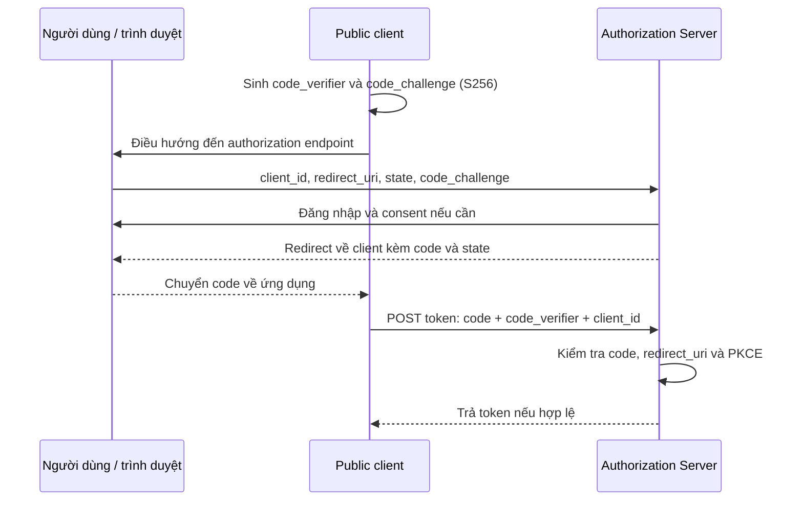
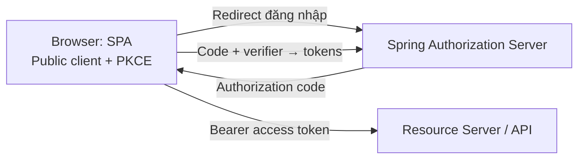
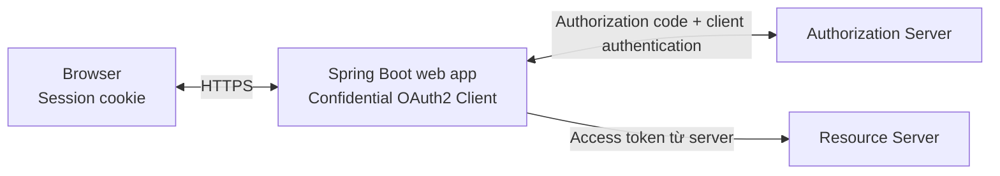
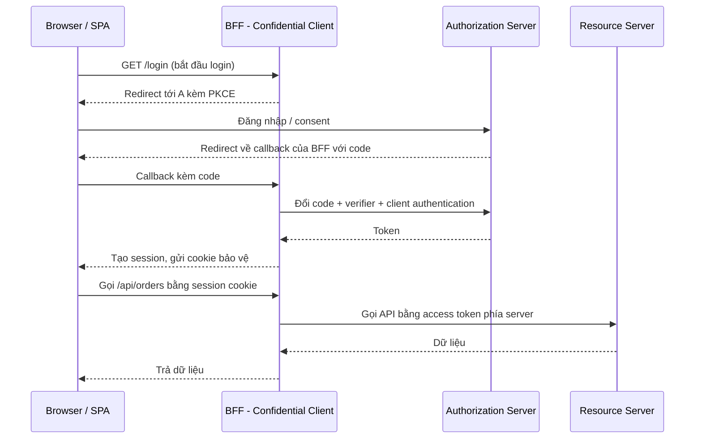

# Public Client, Confidential Client và mô hình triển khai ứng dụng

Trong OAuth 2.0 và OpenID Connect (OIDC), **client** là ứng dụng yêu cầu Authorization Server cấp quyền hoặc phát hành token để truy cập một tài nguyên được bảo vệ. Khi thiết kế **Spring Security OAuth2/OIDC Authorization Server** bằng **Spring Authorization Server** trong ứng dụng Spring Boot, một trong những quyết định đầu tiên là đăng ký ứng dụng dưới dạng **public client** hay **confidential client**. Quyết định này chi phối cách xác thực client tại Token Endpoint, luồng cấp quyền, PKCE, nơi lưu token, khả năng dùng refresh token và kiến trúc triển khai.

Điểm mấu chốt: **phân loại theo khả năng giữ bí mật thông tin xác thực của chính ứng dụng trong môi trường chạy thực tế**, không phân loại theo việc mã nguồn có công khai hay không, ứng dụng có màn hình đăng nhập hay không, hoặc số lượng người dùng.

## 1. Đặt client vào đúng mô hình OAuth 2.0/OIDC

Các vai trò cần tách bạch:

| Vai trò | Trách nhiệm | Ví dụ trong Spring |
| --- | --- | --- |
| **Resource Owner / End User** | Người dùng sở hữu dữ liệu và xác thực tại hệ thống danh tính. | Người đăng nhập qua trang login. |
| **Client** | Yêu cầu quyền, nhận và sử dụng token theo một grant được cho phép. | SPA React, mobile app, Spring Boot web app hoặc backend job. |
| **Authorization Server (AS)** | Xác thực người dùng (khi cần), xác thực client (khi áp dụng), xử lý consent, cấp authorization code/token và cung cấp OIDC endpoints. | Spring Authorization Server. |
| **Resource Server (RS)** | Nhận access token, xác thực và áp dụng quyền trước khi trả dữ liệu API. | Spring Security OAuth2 Resource Server. |

**Xác thực người dùng khác với xác thực client.** Người dùng nhập mật khẩu hoặc sử dụng passkey tại Authorization Server; client có thể đồng thời phải chứng minh danh tính của *ứng dụng* bằng secret, private key hoặc chứng thư. Public client vẫn đưa người dùng đi đăng nhập được, dù không thể giữ client secret an toàn.

Trong OIDC, scope `openid` biến yêu cầu thành xác thực danh tính theo OIDC và dẫn đến việc nhận **ID token** phù hợp với flow. ID token dành cho client để biết kết quả xác thực người dùng; **access token** dành cho API/resource server. Không lấy ID token làm bearer token gọi API.

## 2. Public client và confidential client khác nhau ở đâu?

Theo mô hình bảo mật OAuth 2.0:

- **Public client:** phần mềm không thể bảo mật thông tin xác thực của client trước người dùng thiết bị hoặc những người có thể kiểm tra môi trường chạy. Ví dụ: JavaScript chạy trong browser, ứng dụng mobile cài trên máy người dùng, desktop app được phân phối rộng rãi, CLI cài trên máy cá nhân.
- **Confidential client:** ứng dụng có môi trường thực thi do đơn vị vận hành kiểm soát và có khả năng lưu, bảo vệ, xoay vòng thông tin xác thực client. Ví dụ: Spring Boot backend, web app xử lý OAuth hoàn toàn trên server, BFF hoặc service nội bộ.

| Tiêu chí | Public client | Confidential client |
| --- | --- | --- |
| Khả năng bảo vệ secret dùng chung | Không đáng tin cậy | Có, nếu vận hành đúng |
| Cách đăng ký phổ biến | `ClientAuthenticationMethod.NONE` | `client_secret_basic`, `private_key_jwt`, mTLS… |
| Client ID | Được công khai; **không phải** mật khẩu | Cũng có thể công khai; không thay cho xác thực |
| Authorization Code | Kết hợp **PKCE bắt buộc** theo RFC 9700 | Nên kết hợp PKCE, ngay cả khi xác thực client bằng secret |
| Client Credentials grant | Không phù hợp / không được cấp theo quy tắc của grant | Phù hợp cho machine-to-machine |
| Nơi token thường xuất hiện | Trên thiết bị của người dùng nếu dùng mô hình direct | Trong backend/session storage do server kiểm soát |
| Ví dụ | SPA trực tiếp, native mobile, desktop | Web server, BFF, scheduled job, service |

Không thể làm một SPA trở thành confidential client bằng cách đặt `client_secret` trong tệp `.env` của frontend, biến môi trường lúc build, JavaScript bundle, mã native đã biên dịch hoặc local storage. Những giá trị ấy vẫn đến được thiết bị người dùng. Ngược lại, một trang giao diện dùng React vẫn có thể thuộc **mô hình confidential** nếu mọi tương tác OAuth do **backend/BFF** thực hiện và bí mật chỉ tồn tại trên server.

Phân loại theo **thành phần thực sự gọi Token Endpoint** và ranh giới tin cậy. Một sản phẩm có thể đăng ký nhiều `client_id`: SPA công khai, BFF bí mật và một batch job bí mật, mỗi thành phần có cấu hình, redirect URI, grant và scope riêng.

## 3. Public client: Authorization Code + PKCE

Public client không cung cấp một shared secret đủ tin cậy để Authorization Server xác thực như máy chủ. Với người dùng tương tác, lựa chọn chuẩn là **Authorization Code grant kết hợp Proof Key for Code Exchange (PKCE)**.

PKCE ràng buộc việc đổi authorization code với phiên khởi tạo yêu cầu:

1. Ứng dụng tạo `code_verifier` ngẫu nhiên, đủ entropy, chỉ giữ cho giao dịch đăng nhập hiện tại.
2. Ứng dụng tính `code_challenge = BASE64URL(SHA256(ASCII(code_verifier)))` và gửi `code_challenge_method=S256` ở Authorization Request.
3. Authorization Server xác thực người dùng, xử lý consent khi cần và redirect lại một `authorization_code` ngắn hạn.
4. Ứng dụng gọi Token Endpoint kèm `code`, `client_id`, `redirect_uri` và **`code_verifier`**; Authorization Server kiểm tra challenge đã lưu trước khi phát token.



Ví dụ luồng HTTP được giản lược (giá trị challenge/verifier chỉ mang tính minh họa):

```http
GET /oauth2/authorize?response_type=code
  &client_id=spa-app
  &redirect_uri=https%3A%2F%2Fspa.example.com%2Fcallback
  &scope=openid%20profile
  &state=<random-state>
  &code_challenge=<base64url-sha256-verifier>
  &code_challenge_method=S256
```

Sau redirect về `https://spa.example.com/callback?code=...&state=...`, client đối chiếu `state` với giao dịch đang chờ rồi gửi:

```http
POST /oauth2/token
Content-Type: application/x-www-form-urlencoded

grant_type=authorization_code&
client_id=spa-app&
code=<authorization-code>&
redirect_uri=https%3A%2F%2Fspa.example.com%2Fcallback&
code_verifier=<original-random-verifier>
```

**PKCE không phải cơ chế xác thực bí mật của public client.** PKCE bảo vệ authorization code khỏi bị bên khác đổi token nếu không có `code_verifier`, nhưng không cứu được tình huống JavaScript độc hại chạy trong chính origin đánh cắp access token hoặc thực hiện yêu cầu thay người dùng. Không lưu verifier dưới dạng hằng số, không dùng chung verifier giữa các lần đăng nhập và không cho phép bỏ qua PKCE khi một public client đã được đăng ký yêu cầu PKCE.

Các biện pháp bổ sung cần được thiết kế cùng nhau:

- Đăng ký và kiểm tra **redirect URI chính xác**, ưu tiên HTTPS; ngoại lệ loopback cho native app theo chuẩn áp dụng. Không dùng wildcard hoặc suy đoán redirect theo URL do người dùng gửi.
- Sinh và kiểm tra `state` theo từng giao dịch để liên kết phản hồi với yêu cầu khởi tạo; với OIDC, dùng và xác minh `nonce` khi luồng hoặc profile bảo mật yêu cầu. PKCE và các cơ chế này giải quyết những mối đe dọa liên quan nhưng không tự thay thế mọi kiểm tra.
- Dùng `S256`, tránh Implicit grant và Resource Owner Password Credentials grant trong thiết kế mới.
- Giới hạn scope, audience và thời hạn access token; không log token, code hoặc verifier. Với browser, áp dụng CSP, kiểm soát script bên thứ ba và phòng chống XSS.
- **Không đưa client secret vào ứng dụng public**, kể cả dưới dạng chuỗi đã mã hóa nhưng khóa giải mã cũng nằm trong ứng dụng.

**Lưu ý với Spring Authorization Server:** tài liệu hướng dẫn SPA/PKCE của Spring Authorization Server 1.5.x nêu rõ **không cấp refresh token cho public client** theo cách triển khai mặc định. Vì vậy, không được thiết kế trải nghiệm đăng nhập dài hạn cho SPA trực tiếp dựa trên giả định rằng thêm `refresh_token` vào grant list sẽ khiến server cấp refresh token. Cần kiểm tra phiên bản đang dùng và lựa chọn BFF, đăng nhập lại theo session của Authorization Server hoặc một chính sách mở rộng có đánh giá rủi ro. Đây là **đặc điểm triển khai của Spring Authorization Server**, không phải quy tắc chung cấm mọi OAuth authorization server cấp refresh token cho mọi public client.

## 4. Confidential client: xác thực chính ứng dụng

Confidential client có thể giữ credential trong vùng thực thi do backend quản lý. Tại Token Endpoint, server thường yêu cầu một phương thức **client authentication**:

| Phương thức | Cách hoạt động | Trường hợp sử dụng |
| --- | --- | --- |
| `client_secret_basic` | Gửi client ID/secret qua HTTP Basic trên kết nối TLS. | Tích hợp backend đơn giản, có kho secrets và chính sách rotation. |
| `client_secret_post` | Gửi secret trong form body của token request. | Chỉ khi cần tương thích; cần giảm nguy cơ secret lọt log. |
| `private_key_jwt` | Client ký JWT assertion bằng private key; server xác minh public key. | Liên kết đối tác và hệ thống nhiều service cần quản lý khóa. |
| mTLS | Dùng chứng thư client trong bắt tay TLS. | Hạ tầng quản lý PKI và yêu cầu xác thực mạnh. |

Secret và private key phải ở phía server: lấy qua secret manager hoặc cơ chế cấu hình bảo mật, không commit vào repository, không gửi về browser, hạn chế quyền truy cập, theo dõi việc sử dụng và có khả năng xoay vòng/thu hồi. **Có secret không có nghĩa client an toàn tuyệt đối**: một backend bị xâm nhập vẫn có thể làm lộ credential và token.

Confidential client có hai kiểu công việc phổ biến:

**Đăng nhập người dùng trên web server.** Browser redirect người dùng đến Authorization Server; backend nhận authorization code và đổi token qua back channel, dùng client authentication và **nên dùng PKCE**. Backend giữ token phía server, còn browser giữ cookie phiên được bảo vệ. Ví dụ: Spring Security `oauth2Login()` ở ứng dụng web.

**Machine-to-machine (M2M).** Worker hoặc service gọi `grant_type=client_credentials` và tự xác thực bằng secret/key/certificate để nhận access token cho chính ứng dụng. **Không có người dùng đăng nhập và không có ID token cho người dùng** trong flow này; quyền của token phụ thuộc scope/audience đã cấp cho client.

Đừng nhầm **client credentials** với mật khẩu tài khoản dịch vụ của người dùng. Trong mô hình hiện đại, service nên dùng phương thức xác thực client phù hợp và áp dụng quyền tối thiểu.

## 5. Mô hình triển khai ứng dụng và ranh giới giữ token

### 5.1. SPA trực tiếp tới Authorization Server và API



Ưu điểm: SPA triển khai tĩnh trên CDN và gọi API trực tiếp; ít thành phần backend trung gian. Đổi lại: browser phải quản lý vòng đời access token, chịu rủi ro XSS và có thể cần CORS trên các endpoint có truy cập từ browser. **CORS là chính sách trình duyệt, không phải xác thực client hoặc thay thế kiểm tra redirect URI.** Giới hạn origin cụ thể thay vì mở CORS tùy tiện. Với Spring Authorization Server, lưu ý hạn chế refresh token của public client đã nói ở trên.

### 5.2. Web application render trên server (confidential)



Backend đảm nhiệm OAuth, lưu token trong kho do server quản lý, browser chỉ nhận cookie phiên. Phù hợp với ứng dụng Spring MVC/Thymeleaf, server-rendered hoặc ứng dụng có backend riêng. Cần cấu hình cookie `HttpOnly`, `Secure`, `SameSite` phù hợp và chống CSRF cho các yêu cầu làm thay đổi trạng thái. Session và kho token phải được thiết kế cho triển khai nhiều instance nếu ứng dụng scale.

### 5.3. SPA + Backend for Frontend (BFF)

Ở mô hình BFF, giao diện vẫn là React/Vue/Angular nhưng **BFF mới là OAuth client**. BFF giữ secret, thực hiện Authorization Code + PKCE, lưu token phía server và gọi API thay trình duyệt:



BFF là lựa chọn tốt khi giao diện web cần phiên đăng nhập ổn định mà không muốn đặt OAuth token trong JavaScript. BFF không làm biến mất toàn bộ nguy cơ XSS: script độc hại vẫn có thể gửi request bằng session hiện hành. Vì vậy tiếp tục phải kiểm tra CSRF, xác thực origin, quyền truy cập, CSP và giới hạn API. Đặc biệt, cookie phiên browser **không phải** access token dùng trực tiếp với Resource Server.

### 5.4. Native mobile, desktop và CLI

Ứng dụng cài trên thiết bị người dùng thường là **public client** dù được viết bằng Swift, Kotlin, Java hoặc ngôn ngữ biên dịch:

- Sử dụng **system browser** cho đăng nhập; tránh thu thập mật khẩu ngay trong embedded WebView.
- Dùng Authorization Code + PKCE; xử lý callback bằng app/universal link đã xác minh hoặc loopback redirect khi phù hợp với nền tảng.
- Lưu token bằng cơ chế lưu trữ bảo vệ của hệ điều hành khi có thể, đồng thời hiểu rằng thiết bị có thể bị xâm nhập hoặc phân tích. Việc lưu an toàn cục bộ **không biến ứng dụng thành confidential client**.
- Không chia sẻ một client secret cố định bên trong tất cả bản cài đặt.

### 5.5. Service-to-service và hệ thống nhiều thành phần

Một scheduled job hoặc service Spring Boot chạy trên hạ tầng kiểm soát được có thể là confidential client dùng `client_credentials`; API đích đóng vai trò Resource Server và xác minh access token. Nếu có API Gateway, gateway có thể làm Resource Server, OAuth2 Client hoặc cả hai tùy luồng, nhưng từng API phía sau vẫn cần bảo vệ quyền phù hợp. Không giả định rằng vì token đã đi qua gateway nên mọi service nội bộ có thể bỏ kiểm tra.

## 6. Đăng ký hai loại client với Spring Authorization Server

Spring Authorization Server biểu diễn cấu hình của từng ứng dụng qua `RegisteredClient` và lưu qua `RegisteredClientRepository`. Ví dụ dưới đây chỉ tập trung vào **client registration**; nó giả định Authorization Server, issuer, OIDC và security filter chain đã được cấu hình riêng.

```java
import java.util.UUID;

import org.springframework.context.annotation.Bean;
import org.springframework.context.annotation.Configuration;
import org.springframework.security.crypto.factory.PasswordEncoderFactories;
import org.springframework.security.crypto.password.PasswordEncoder;
import org.springframework.security.oauth2.core.AuthorizationGrantType;
import org.springframework.security.oauth2.core.ClientAuthenticationMethod;
import org.springframework.security.oauth2.core.oidc.OidcScopes;
import org.springframework.security.oauth2.server.authorization.client.InMemoryRegisteredClientRepository;
import org.springframework.security.oauth2.server.authorization.client.RegisteredClient;
import org.springframework.security.oauth2.server.authorization.client.RegisteredClientRepository;
import org.springframework.security.oauth2.server.authorization.settings.ClientSettings;

@Configuration
class OAuthClientsConfig {

    @Bean
    RegisteredClientRepository registeredClientRepository() {
        // Ví dụ: secret từ runtime/secret manager, tuyệt đối không gửi cho SPA.
        String bffSecret = System.getenv("BFF_CLIENT_SECRET");
        if (bffSecret == null || bffSecret.isBlank()) {
            throw new IllegalStateException("Missing BFF_CLIENT_SECRET");
        }
        PasswordEncoder passwordEncoder =
                PasswordEncoderFactories.createDelegatingPasswordEncoder();

        RegisteredClient spa = RegisteredClient.withId(UUID.randomUUID().toString())
                .clientId("spa-app")
                .clientAuthenticationMethod(ClientAuthenticationMethod.NONE)
                .authorizationGrantType(AuthorizationGrantType.AUTHORIZATION_CODE)
                .redirectUri("https://spa.example.com/callback")
                .scope(OidcScopes.OPENID)
                .scope(OidcScopes.PROFILE)
                .clientSettings(ClientSettings.builder()
                        .requireProofKey(true)
                        .requireAuthorizationConsent(true)
                        .build())
                .build();

        RegisteredClient bff = RegisteredClient.withId(UUID.randomUUID().toString())
                .clientId("web-bff")
                .clientSecret(passwordEncoder.encode(bffSecret))
                .clientAuthenticationMethod(ClientAuthenticationMethod.CLIENT_SECRET_BASIC)
                .authorizationGrantType(AuthorizationGrantType.AUTHORIZATION_CODE)
                .authorizationGrantType(AuthorizationGrantType.REFRESH_TOKEN)
                .redirectUri("https://app.example.com/login/oauth2/code/web-bff")
                .scope(OidcScopes.OPENID)
                .scope(OidcScopes.PROFILE)
                .clientSettings(ClientSettings.builder()
                        .requireProofKey(true)
                        .build())
                .build();

        return new InMemoryRegisteredClientRepository(spa, bff);
    }
}
```

Các điểm cần hiểu trong cấu hình:

1. `spa-app` dùng `ClientAuthenticationMethod.NONE`, **không có** `clientSecret` và yêu cầu PKCE. Client vẫn phải dùng `client_id` để server tìm đúng registration; đây không phải bí mật.
2. `web-bff` dùng `CLIENT_SECRET_BASIC`. Secret lấy ở runtime, được băm khi lưu trong registration; giá trị plaintext chỉ thuộc backend được phép. `requireProofKey(true)` vẫn có ích với confidential client.
3. `REFRESH_TOKEN` chỉ được cấu hình cho BFF trong ví dụ. Điều này **không bảo đảm** mọi trường hợp sẽ được cấp refresh token: còn phụ thuộc grant, scope, chính sách và phiên bản server. Hướng dẫn SPA của Spring Authorization Server nêu hạn chế riêng cho public client.
4. `InMemoryRegisteredClientRepository` dùng cho minh họa và thử nghiệm. Production nên lưu đăng ký client bằng repository bền vững, quản lý vòng đời credential, cân nhắc `private_key_jwt`/mTLS và hỗ trợ phân quyền vận hành.
5. Các domain `example.com` chỉ là placeholder. Đăng ký redirect URI thực tế theo môi trường; issuer và giao thức bên ngoài cần dùng HTTPS, ngoại trừ trường hợp phát triển cục bộ được cho phép.

Đoạn code **đăng ký** client không tự tạo trang login, OIDC provider, API Resource Server hay session BFF. Để hệ thống hoạt động cần cấu hình các thành phần tương ứng và client OAuth2 ở phía ứng dụng tiêu thụ.

## 7. Cách chọn mô hình cho một yêu cầu thực tế

Giả sử xây một hệ thống quản lý đơn hàng với Spring Boot APIs:

| Yêu cầu | Kiến trúc phù hợp | Đăng ký ở Authorization Server | Lý do |
| --- | --- | --- | --- |
| React SPA host trên CDN, gọi API từ browser | SPA direct | Public + Authorization Code + PKCE | JavaScript không giữ được secret. |
| React SPA cần session an toàn và token ở server | SPA + BFF | BFF confidential + Authorization Code + PKCE | Token không phải đi qua JavaScript của browser. |
| Spring MVC app có session web | Server-side web | Confidential + Authorization Code + PKCE | Backend bảo vệ credential và token. |
| Ứng dụng iOS/Android cho khách hàng | Native | Public + Authorization Code + PKCE | Binary trên thiết bị có thể bị trích xuất. |
| Job đồng bộ đơn hàng chạy trong cluster | Backend job | Confidential + Client Credentials | Luồng không có end user, cấp quyền theo service. |

**Quy trình chọn:** Xác định nơi OAuth client thực thi và nơi giữ token; nếu client không thể bảo vệ credential, đăng ký public và bắt buộc PKCE cho Authorization Code. Nếu một backend thực sự sở hữu credential, đăng ký confidential, chọn phương thức client authentication và vẫn ưu tiên PKCE khi có authorization code. Tiếp đó định nghĩa grant, scopes, redirect URIs, audience, lưu token/session và các biện pháp phòng vệ theo từng luồng.

## 8. Những nhầm lẫn dễ dẫn đến lỗ hổng

| Nhầm lẫn | Cách hiểu và xử lý đúng |
| --- | --- |
| “Có `client_id` tức đã xác thực client.” | Client ID là mã định danh. Public client không có client authentication bằng shared secret. |
| “Giấu `client_secret` trong mã JS là an toàn.” | Người dùng có thể xem bundle/network/thiết bị. Không cấp shared secret cho public runtime. |
| “PKCE thay thế client secret ở mọi nơi.” | PKCE bảo vệ việc đổi **authorization code**; confidential client vẫn có client authentication nếu được yêu cầu. |
| “Chỉ public client mới cần PKCE.” | RFC 9700 **bắt buộc** PKCE với public client và **khuyến nghị** cho confidential client khi dùng Authorization Code. |
| “BFF cũng là SPA public client.” | Nếu BFF giữ credential và đổi code/token trên server thì **BFF** là confidential client; browser chỉ là giao diện. |
| “Bật CORS nghĩa là client đã đáng tin.” | CORS không chứng minh danh tính OAuth client, không kiểm soát quyền API và không thay thế PKCE. |
| “ID token chính là access token.” | ID token phục vụ xác thực danh tính tại client; API phải kiểm tra access token được cấp cho tài nguyên tương ứng. |
| “Client Credentials dùng để đăng nhập người dùng.” | Grant này phục vụ ứng dụng máy chủ, không đại diện cho phiên đăng nhập của một end user. |
| “Refresh token luôn có khi khai báo grant.” | Việc phát hành phụ thuộc server và chính sách; Spring Authorization Server mặc định không cấp refresh token cho public client theo hướng dẫn SPA. |

## 9. Kiểm tra cấu hình trước khi đưa vào vận hành

Trong môi trường thử nghiệm, nên kiểm tra cả đường đi hợp lệ và các trường hợp bị từ chối:

1. **Public client:** đăng nhập với authorization code + `S256` thành công; thiếu `code_challenge`, sai `code_verifier` hoặc cố dùng lại code phải bị từ chối theo quy tắc tương ứng. Không thử gửi một secret “ẩn trong SPA”.
2. **Redirect URI:** URI khác URI đã đăng ký, kể cả path, port hoặc scheme không hợp lệ, không được dùng để nhận authorization code.
3. **Confidential client:** xác thực đúng thì đổi code được; sai/thiếu credential bị từ chối; yêu cầu grant/scope chưa đăng ký không được chấp nhận.
4. **OIDC và API:** ứng dụng xác minh issuer, audience, thời hạn và các claim cần thiết của token theo vai trò; API từ chối token không dành cho API đó. Khi có `nonce`, client phải kiểm tra đúng giá trị gắn với phiên xác thực.
5. **Vận hành:** đảm bảo HTTPS, mã hóa khi lưu, secret không xuất hiện trong log, token/session được thu hồi hoặc hết hạn theo chính sách, cookie BFF có cờ thích hợp và các request thay đổi dữ liệu có CSRF protection.

## 10. Tài liệu tham khảo

- [RFC 6749 — The OAuth 2.0 Authorization Framework](https://www.rfc-editor.org/rfc/rfc6749): định nghĩa client types, roles và các authorization grants.
- [RFC 7636 — Proof Key for Code Exchange](https://www.rfc-editor.org/rfc/rfc7636): cách tạo verifier/challenge và kiểm tra PKCE.
- [RFC 8252 — OAuth 2.0 for Native Apps](https://www.rfc-editor.org/rfc/rfc8252): hướng dẫn ứng dụng native dùng external user agent và redirect.
- [RFC 9700 — Best Current Practice for OAuth 2.0 Security](https://www.rfc-editor.org/rfc/rfc9700): khuyến nghị bảo mật hiện hành, bao gồm PKCE cho public/confidential clients và client authentication.
- [OpenID Connect Core 1.0](https://openid.net/specs/openid-connect-core-1_0.html): phân biệt xác thực người dùng, ID token và các luồng OIDC.
- [Spring Authorization Server — Authenticate using a Single Page Application with PKCE](https://docs.spring.io/spring-authorization-server/reference/guides/how-to-pkce.html): ví dụ `none` + `requireProofKey(true)` và lưu ý refresh token của public client.

Khi xây dựng Authorization Server bằng Spring, hãy coi **public/confidential** là quyết định về **ranh giới tin cậy và vị trí chạy ứng dụng**. Mọi lựa chọn kế tiếp—client authentication, PKCE, grant, token storage, BFF, redirect, session và kiểm thử—phải nhất quán với ranh giới đó.
