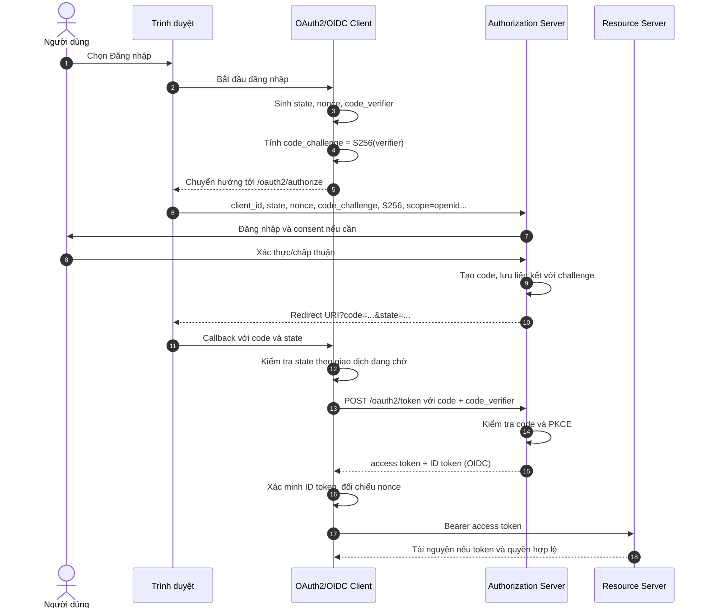

# State, Nonce và PKCE trong các luồng có trình duyệt

## 1. Bối cảnh: Vì sao luồng chuyển hướng cần ba cơ chế?

Trong **OAuth 2.0** và **OpenID Connect (OIDC)**, ứng dụng thường không tự thu thập mật khẩu. Thay vào đó, ứng dụng chuyển trình duyệt tới **Authorization Server** để người dùng xác thực và cấp quyền, sau đó trình duyệt được chuyển về địa chỉ callback của ứng dụng.

Trình duyệt là kênh **front-channel**: nó đi qua thiết bị người dùng, URL, lịch sử duyệt web, các trang trung gian và những tác nhân có thể điều hướng trình duyệt. Vì vậy, client không được mặc định rằng một phản hồi đến callback chắc chắn thuộc về yêu cầu đăng nhập do chính client vừa khởi tạo. Bên cạnh đó, authorization code xuất hiện qua bước chuyển hướng cần được ràng buộc với đúng client đã bắt đầu giao dịch.

Ba cơ chế thường xuất hiện cùng nhau:

- **`state`** ràng buộc **phản hồi chuyển hướng** với **yêu cầu ủy quyền ban đầu** của client. Đây là biện pháp quan trọng chống giả mạo yêu cầu đăng nhập/ủy quyền qua callback (CSRF) và nhầm lẫn giữa các giao dịch.
- **`nonce`** của **OIDC** ràng buộc **ID token** với **yêu cầu xác thực ban đầu**. Nó giúp phát hiện ID token bị phát lại hoặc được đưa vào sai ngữ cảnh xác thực.
- **PKCE** (*Proof Key for Code Exchange*) ràng buộc **authorization code** với **bên đã khởi tạo yêu cầu**, thông qua cặp `code_verifier` và `code_challenge`. Kẻ chỉ lấy được code sẽ không thể đổi code thành token khi thiếu verifier phù hợp.

Trong module **`SPRING_SECURITY_OAUTH2_OIDC_AUTHORIZATION_SERVER`**, cả ba khái niệm là nền tảng để **thiết kế, cấu hình, bảo mật, kiểm thử và vận hành** luồng ủy quyền bằng Spring Security và Spring Authorization Server trong ứng dụng Spring Boot. Điều quan trọng là xác định chính xác **bên nào tạo giá trị, bên nào kiểm tra và tấn công nào được giảm thiểu**.

### Mục tiêu học tập

Sau bài này, bạn cần:

1. Phân biệt `state`, `nonce`, `code_verifier` và `code_challenge` về chức năng, nơi lưu trữ và điểm kiểm tra.
2. Trình bày chính xác luồng Authorization Code + PKCE, có hoặc không có OIDC.
3. Xây dựng hoặc cấu hình các thành phần cần thiết ở **Spring Security OAuth2 Client** và **Spring Authorization Server**.
4. Kiểm thử được các phản hồi callback bị giả mạo, ID token sai nonce, authorization code bị đánh cắp và lỗi cấu hình PKCE.

## 2. Phân biệt nhanh State, Nonce và PKCE

| Cơ chế | Client gửi gì khi bắt đầu? | Ai kiểm tra và khi nào? | Bảo vệ trọng tâm |
| --- | --- | --- | --- |
| **OAuth 2.0 `state`** | Giá trị `state` ngẫu nhiên trong yêu cầu `/oauth2/authorize` | **Client** so sánh `state` phản hồi tại callback với giao dịch đang chờ | Chống callback/response injection, CSRF và nhầm giao dịch |
| **OIDC `nonce`** | Giá trị `nonce` ngẫu nhiên trong yêu cầu xác thực OIDC | **OIDC Client** so sánh claim `nonce` trong **ID token đã xác minh** với giá trị lưu từ yêu cầu | Phát hiện ID token bị phát lại hoặc gắn sai phiên xác thực |
| **PKCE** | `code_challenge` và `code_challenge_method=S256`; giữ kín `code_verifier` | **Authorization Server** so `code_verifier` khi đổi code ở `/oauth2/token` với challenge đã gắn vào code | Ngăn kẻ chỉ chiếm được authorization code đổi nó lấy token |

Đây là ba lớp ràng buộc khác nhau. **`state` không thay thế PKCE**; **`nonce` không phải cách xác minh authorization code**; **PKCE không chứng minh rằng ID token thuộc đúng yêu cầu đăng nhập của người dùng**.

Trong luồng OAuth 2.0 **không có OIDC**, có thể không có ID token và không dùng `nonce`. Trong OIDC, ứng dụng phải yêu cầu scope `openid` và thực hiện xác minh ID token theo đặc tả.

## 3. Luồng tổng thể Authorization Code + PKCE + OIDC

Giả sử ứng dụng quản lý đơn hàng ở `https://app.example.com` muốn đăng nhập người dùng bằng Authorization Server ở `https://auth.example.com`. API đơn hàng được bảo vệ ở `https://api.example.com`.



Trong sơ đồ, Authorization Server **phản hồi lại `state`** đã nhận và **gắn `code_challenge` với authorization code**. Khi phát hành ID token cho yêu cầu OIDC có nonce, máy chủ đưa nonce tương ứng vào claim của ID token. Phía client chịu trách nhiệm lưu các giá trị mong đợi theo từng giao dịch và đối chiếu đúng thời điểm.

Nếu kiểm tra `state` thất bại, client **phải dừng trước bước đổi code**. Nếu kiểm tra ID token/nonce thất bại, client **không được tạo phiên đăng nhập thành công** dù đã nhận phản hồi token qua kết nối HTTPS. Nếu PKCE không khớp, Authorization Server **không được cấp token cho code đó**.

## 4. State: Ràng buộc callback với đúng yêu cầu

### 4.1. State hoạt động ra sao?

Khi bắt đầu một lần đăng nhập, client tạo một giá trị khó đoán, ví dụ:

```text
state = "V4iLwQfX6q81bmRsY6xNw8fQoMjVz3c8"
```

Client lưu giá trị này cùng dữ liệu của **giao dịch đăng nhập đang chờ**. Yêu cầu chuyển hướng chứa `state`:

```http
GET /oauth2/authorize?response_type=code
    &client_id=orders-web
    &redirect_uri=https%3A%2F%2Fapp.example.com%2Flogin%2Foauth2%2Fcode%2Forders
    &scope=openid%20profile%20orders.read
    &state=V4iLwQfX6q81bmRsY6xNw8fQoMjVz3c8
    &code_challenge=EXAMPLE_CODE_CHALLENGE
    &code_challenge_method=S256
    &nonce=EXAMPLE_NONCE
Host: auth.example.com
```

Các dòng trên được ngắt để dễ đọc; khi gửi thực tế, các tham số thuộc **một URL đã mã hóa phù hợp**.

Sau khi xử lý, Authorization Server chuyển hướng:

```http
HTTP/1.1 302 Found
Location: https://app.example.com/login/oauth2/code/orders?code=AUTH_CODE&state=V4iLwQfX6q81bmRsY6xNw8fQoMjVz3c8
```

Client lấy `state` của callback, tra cứu giao dịch đang chờ và chỉ tiếp tục nếu giá trị khớp. Hãy xóa hoặc vô hiệu hóa giao dịch đã dùng, đặt thời hạn ngắn và xử lý độc lập các lần đăng nhập đồng thời (ví dụ nhiều tab).

### 4.2. Điều gì xảy ra nếu bỏ State?

Kẻ tấn công có thể khởi tạo một lượt cấp quyền bằng tài khoản của **chính kẻ tấn công**, sau đó tìm cách khiến trình duyệt nạn nhân truy cập callback mang code từ lượt đó. Nếu client không biết phản hồi nào thuộc giao dịch nào, nó có nguy cơ tạo phiên đăng nhập nạn nhân dưới tài khoản của kẻ tấn công (**login CSRF / authorization response injection**), dẫn tới dữ liệu nạn nhân nhập sau đó bị lưu vào tài khoản không mong muốn.

**State giúp phát hiện phản hồi không thuộc giao dịch đã khởi tạo**. Nó cần được liên kết thực sự với phiên trình duyệt/luồng đăng nhập, không chỉ xuất hiện trong URL cho đủ trường. Giá trị cố định như `state=123` hoặc một state chung cho mọi người dùng không có tác dụng bảo vệ đáng tin cậy.

### 4.3. Nguyên tắc tạo và lưu State

- Sinh bằng **bộ tạo số ngẫu nhiên an toàn về mật mã (CSPRNG)**, giá trị đủ entropy, mới cho mỗi yêu cầu; ví dụ 16–32 byte ngẫu nhiên rồi Base64URL.
- Lưu `state` hoặc thông tin ràng buộc tương đương trong **phiên/transaction của client**; giới hạn thời hạn và không cho sử dụng lại.
- Không để kẻ bên ngoài kiểm soát hay tự chọn giá trị `state` hợp lệ cho một giao dịch.
- Nếu cần nhớ đường dẫn định quay về sau đăng nhập, lưu phía server rồi liên kết qua state; nếu mã hóa dữ liệu vào state, phải bảo đảm **tính toàn vẹn**, giới hạn thời hạn và kiểm tra đích chuyển hướng để tránh **open redirect**.
- Không nhầm state với CSRF token dùng cho mọi biểu mẫu HTTP trong ứng dụng. Chúng có thể cùng giảm thiểu CSRF nhưng được gắn với những tương tác khác nhau.

**Lưu ý bảo mật:** PKCE được triển khai chặt chẽ cũng đóng góp vào phòng chống các dạng CSRF trong luồng code theo hướng dẫn OAuth hiện đại. Tuy vậy, việc giữ `state` để ràng buộc chính xác phiên, trạng thái giao dịch và callback vẫn là cách thực tế, dễ kiểm thử khi tích hợp Spring Security.

## 5. Nonce: Ràng buộc ID token với yêu cầu OIDC

### 5.1. Nonce khác State ở điểm nào?

Trong OIDC, `nonce` (number used once) là giá trị do **OIDC Client** tạo và gửi trong authentication request. Khi đưa ra ID token cho yêu cầu có nonce, **OpenID Provider** gắn giá trị đó vào claim `nonce`. Client kiểm tra claim **sau khi đã xác minh ID token**, cùng với chữ ký, issuer, audience, thời hạn và các điều kiện xác thực liên quan.

Ví dụ payload của **một ID token minh họa**:

```json
{
  "iss": "https://auth.example.com",
  "sub": "user-204",
  "aud": "orders-web",
  "iat": 1780000000,
  "exp": 1780000900,
  "nonce": "rM6t7FSgyYhqzDUGzbo7m5YZVvwUoZA0"
}
```

Đây chỉ là phần payload để học cách đọc claim; client không được tin một JSON tự giải mã nếu chưa **xác minh chữ ký và các điều kiện hợp lệ**. Các mốc thời gian chỉ để minh họa, không phải giá trị thực của một phiên đăng nhập.

Giả sử client đã lưu nonce mong đợi là `rM6t7FSgyYhqzDUGzbo7m5YZVvwUoZA0`. Nếu ID token nhận được chứa nonce khác, **client phải từ chối xác thực**. Một ID token hợp lệ về chữ ký nhưng từ giao dịch khác không được phép thay thế ID token của lượt đăng nhập hiện tại.

### 5.2. Nonce có bắt buộc không?

Theo OIDC Core:

- Với **Authorization Code Flow thuần**, tham số `nonce` là **tùy chọn theo đặc tả**, nhưng nên sử dụng khi phù hợp để bổ sung ràng buộc chống phát lại. Nếu đã gửi nonce, client **phải kiểm tra** giá trị nonce được trả về trong ID token.
- Với **Implicit Flow** và **Hybrid Flow** của OIDC, nonce **bắt buộc** theo các quy tắc tương ứng của đặc tả. Những luồng này có đặc điểm rủi ro front-channel khác và không phải lựa chọn ưu tiên để xây dựng ứng dụng mới.

Trong một ứng dụng Spring Boot sử dụng Authorization Code + OIDC, việc bật `openid` là điều kiện để nhận **ID token**; dùng PKCE không tự biến luồng OAuth thuần thành OIDC. Ngược lại, nonce không thay thế các kiểm tra **`iss`, `aud`, `exp`, chữ ký** và những kiểm tra khác do OIDC quy định.

### 5.3. Nonce không phải giải pháp nào?

Nonce **không** ngăn việc kẻ tấn công lấy authorization code và tự đổi token; đó là bài toán của PKCE. Nonce **không** có mục đích phân quyền gọi API; access token và chính sách của Resource Server xử lý việc đó. Nonce cũng không thay thế xác minh đúng **issuer** trong kiến trúc có nhiều Authorization Server/OpenID Provider.

## 6. PKCE: Authorization code chỉ được đổi bởi bên giữ Verifier

### 6.1. Lý do PKCE ra đời

Trong Authorization Code Flow, code đi qua trình duyệt và callback. Kẻ tấn công có thể tìm cách lấy code từ URL callback, ứng dụng mobile xử lý custom URI scheme không an toàn, extension độc hại, log hoặc lỗi chuyển hướng. Nếu chỉ cần code để đổi token, một client công khai không có client secret sẽ rất khó chống việc trao đổi code trái phép.

PKCE thêm một bí mật ngắn hạn **riêng cho từng giao dịch**:

1. Client sinh `code_verifier` từ nguồn ngẫu nhiên an toàn và **giữ lại**; không gửi verifier trong URL ủy quyền.
2. Client tính `code_challenge` từ verifier và gửi `code_challenge` với `code_challenge_method=S256` trong yêu cầu `/oauth2/authorize`.
3. Authorization Server liên kết challenge và phương pháp với authorization code tương ứng.
4. Khi client gửi code đến `/oauth2/token`, nó kèm `code_verifier` trên **kết nối trực tiếp được bảo vệ bằng TLS**.
5. Authorization Server tính lại challenge từ verifier và so sánh. Sai hoặc thiếu verifier → từ chối cấp token.

### 6.2. Cách tính `S256` chính xác

RFC 7636 định nghĩa:

```text
code_challenge = BASE64URL-ENCODE(
    SHA256(ASCII(code_verifier))
)
```

Trong đó **BASE64URL không có dấu đệm `=`**. `code_verifier` có độ dài **43–128 ký tự**, sử dụng tập ký tự unreserved được RFC 7636 cho phép (`A–Z`, `a–z`, `0–9`, `-`, `.`, `_`, `~`). Cách đơn giản là sinh **32 byte ngẫu nhiên** rồi mã hóa Base64URL không padding: kết quả dài **43 ký tự**.

Ví dụ chuẩn từ RFC 7636, Appendix B:

```text
code_verifier:
dBjftJeZ4CVP-mB92K27uhbUJU1p1r_wW1gFWFOEjXk

code_challenge (S256):
E9Melhoa2OwvFrEMTJguCHaoeK1t8URWbuGJSstw-cM
```

Không nhầm `code_challenge` với hash mật khẩu lưu trong database. Challenge là giá trị **công khai** gắn với **một lần đổi code**, còn verifier phải được bảo vệ cho đến khi giao dịch kết thúc. Không dùng cùng một verifier tĩnh cho toàn bộ người dùng hoặc mọi lần đăng nhập.

Phương thức `plain` cho phép challenge bằng chính verifier nhưng không đạt mục tiêu chống lộ verifier trên front-channel như `S256`; với ứng dụng mới, sử dụng **`S256`** và cấu hình máy chủ yêu cầu nó khi có thể.

### 6.3. Ví dụ đổi Code với Verifier

Sau khi client kiểm tra `state` ở callback:

```http
POST /oauth2/token HTTP/1.1
Host: auth.example.com
Content-Type: application/x-www-form-urlencoded

grant_type=authorization_code&
client_id=orders-web&
code=AUTH_CODE&
redirect_uri=https%3A%2F%2Fapp.example.com%2Flogin%2Foauth2%2Fcode%2Forders&
code_verifier=dBjftJeZ4CVP-mB92K27uhbUJU1p1r_wW1gFWFOEjXk
```

Đây là ví dụ **public client** sử dụng `client_id`, nên không có client secret. Với **confidential client**, token endpoint còn yêu cầu xác thực client theo phương thức đã đăng ký, ví dụ `client_secret_basic` hoặc cơ chế mạnh hơn. PKCE bổ sung lớp ràng buộc code và **không thay thế client authentication**.

Nếu một yêu cầu token đưa `code_verifier` sai hoặc đưa đúng verifier nhưng với code của một giao dịch khác, Authorization Server phải từ chối. Authorization code cũng cần **ngắn hạn, dùng một lần**, gắn với client và redirect URI phù hợp; không dựa vào PKCE để bỏ qua các điều kiện này.

### 6.4. Những gì PKCE không giải quyết

PKCE bảo vệ **bước đổi authorization code**, không phải toàn bộ vòng đời token. Nếu access token đã bị đánh cắp **sau khi phát hành**, PKCE không tự vô hiệu hóa token đó. PKCE cũng không chữa được XSS, client bị chiếm quyền, redirect URI sai, ID token giả mạo, cấu hình issuer/audience thiếu chặt chẽ hay việc lưu refresh token không an toàn.

## 7. Tạo các giá trị an toàn trong Java

Đây là ví dụ Java độc lập để hiểu các giá trị client cần tạo. Trong một ứng dụng thực tế dùng **Spring Security OAuth2 Client**, ưu tiên cơ chế tạo, lưu và xác minh do framework quản lý; chỉ tự viết khi có yêu cầu tích hợp đặc biệt và hiểu rõ vòng đời giao dịch.

```java
import java.nio.charset.StandardCharsets;
import java.security.MessageDigest;
import java.security.NoSuchAlgorithmException;
import java.security.SecureRandom;
import java.util.Base64;

public final class OAuthRequestValues {
    private static final SecureRandom RANDOM = new SecureRandom();
    private static final Base64.Encoder BASE64_URL =
            Base64.getUrlEncoder().withoutPadding();

    private OAuthRequestValues() {}

    // Mỗi giá trị được tạo MỚI cho mỗi lần bắt đầu authorization request.
    public static String randomValue(int bytes) {
        byte[] data = new byte[bytes];
        RANDOM.nextBytes(data);
        return BASE64_URL.encodeToString(data);
    }

    public static String pkceS256Challenge(String verifier) {
        try {
            byte[] digest = MessageDigest.getInstance("SHA-256")
                    .digest(verifier.getBytes(StandardCharsets.US_ASCII));
            return BASE64_URL.encodeToString(digest);
        } catch (NoSuchAlgorithmException ex) {
            throw new IllegalStateException("SHA-256 is unavailable", ex);
        }
    }

    public static void main(String[] args) {
        String state = randomValue(24);       // 192 bit ngẫu nhiên
        String nonce = randomValue(24);       // 192 bit ngẫu nhiên
        String codeVerifier = randomValue(32); // 43 ký tự Base64URL
        String codeChallenge = pkceS256Challenge(codeVerifier);

        // Lưu state/nonce/verifier theo cùng giao dịch đăng nhập đang chờ.
        // Đưa state, nonce, codeChallenge và method=S256 vào authorization request.
        // Chỉ gửi codeVerifier khi đổi authorization code tại token endpoint.
    }
}
```

Đoạn code trên minh họa cách sinh giá trị, **không tự triển khai giao dịch đăng nhập hoàn chỉnh**. Khi dùng thực tế, không log các giá trị, không nhúng verifier vào URL, và không giữ verifier trong một biến toàn cục dùng chung cho mọi phiên.

## 8. Đặt State, Nonce và PKCE đúng vị trí trong Spring Security

### 8.1. Phía Spring Security OAuth2 Client

Spring Security OAuth2 Client có các thành phần để tạo authorization request, lưu giao dịch đang chờ và xử lý callback:

- **`OAuth2AuthorizationRequestResolver`** tạo yêu cầu gửi đến Authorization Server, bao gồm các tham số giao thức và tùy chỉnh PKCE khi áp dụng.
- **`AuthorizationRequestRepository`** lưu thông tin của yêu cầu giữa lúc chuyển hướng và lúc callback quay về. Cách triển khai phổ biến là lưu theo HTTP session; khi xây client khác, phải bảo vệ vòng đời và tương quan giữa các giao dịch.
- **`OAuth2LoginAuthenticationFilter`** và các thành phần OIDC/OAuth2 login xử lý authorization response, đổi code và xác thực kết quả theo cấu hình.

Khi sử dụng `oauth2Login()`, hãy để Spring Security quản lý việc liên kết `state` với authorization request. Với đăng nhập OIDC, các thành phần OIDC của Spring Security xử lý nonce và xác minh ID token theo cơ chế được framework cung cấp. Tránh tự xây callback rồi chỉ kiểm tra xem query có `code` hay không.

Khả năng PKCE được Spring Security hỗ trợ qua `OAuth2AuthorizationRequestCustomizers.withPkce()`. Tùy phiên bản và loại client, PKCE có thể được thêm tự động cho public client; với client cần bật PKCE tường minh, có thể cấu hình resolver và gắn vào authorization endpoint:

```java
@Bean
OAuth2AuthorizationRequestResolver authorizationRequestResolver(
        ClientRegistrationRepository registrations) {

    DefaultOAuth2AuthorizationRequestResolver resolver =
            new DefaultOAuth2AuthorizationRequestResolver(
                    registrations, "/oauth2/authorization");

    resolver.setAuthorizationRequestCustomizer(
            OAuth2AuthorizationRequestCustomizers.withPkce());
    return resolver;
}

// Gắn resolver vào cấu hình security filter chain cho OAuth2 Login:
// http.oauth2Login(oauth2 -> oauth2
//     .authorizationEndpoint(endpoint -> endpoint
//         .authorizationRequestResolver(authorizationRequestResolver)));
```

Đây là ví dụ cấu hình **một thành phần**, chưa phải ứng dụng Spring Boot đầy đủ. Nếu dùng tham chiếu biến `authorizationRequestResolver` trong `SecurityFilterChain`, cần truyền đúng bean hoặc phương thức đã đăng ký. Một cấu hình production còn cần `ClientRegistration`, endpoint, cơ chế lưu phiên, TLS, security filter chain và xử lý lỗi phù hợp. Kiểm tra API cụ thể theo phiên bản Spring Security mà dự án đang dùng.

### 8.2. Phía Spring Authorization Server

Ở phía máy chủ, trọng tâm PKCE là **kiểm tra challenge/verifier theo authorization code và cấu hình client**. Một public client trong `RegisteredClientRepository` có thể được đăng ký như sau:

```java
RegisteredClient client = RegisteredClient.withId(UUID.randomUUID().toString())
        .clientId("orders-web")
        .clientAuthenticationMethod(ClientAuthenticationMethod.NONE)
        .authorizationGrantType(AuthorizationGrantType.AUTHORIZATION_CODE)
        .redirectUri("https://app.example.com/login/oauth2/code/orders")
        .scope(OidcScopes.OPENID)
        .scope("profile")
        .scope("orders.read")
        .clientSettings(ClientSettings.builder()
                .requireProofKey(true)
                .requireAuthorizationConsent(true)
                .build())
        .build();

// Lưu client bằng RegisteredClientRepository phù hợp.
```

`ClientSettings.requireProofKey(true)` yêu cầu PKCE cho client này khi thực hiện Authorization Code. Trên hệ thống thật còn phải đăng ký đúng grant type, phương thức xác thực, redirect URI và các scope mà nghiệp vụ cần. Nếu client là backend có khả năng giữ bí mật, hãy cấu hình phương thức xác thực client tương ứng; vẫn có thể yêu cầu PKCE cho backend để phòng vệ bổ sung.

Authorization Server chịu trách nhiệm kiểm tra PKCE và phát hành ID token phù hợp với yêu cầu OIDC. **Client**, không phải Authorization Server, phải đối chiếu `state` của callback với phiên của chính nó và đối chiếu claim `nonce` trong ID token đã xác minh với nonce mong đợi.

### 8.3. Dòng dữ liệu và nơi lưu

| Dữ liệu | Có xuất hiện qua trình duyệt? | Nơi cần giữ giữa các bước | Thời điểm xóa/kết thúc |
| --- | --- | --- | --- |
| `state` | Có: authorization request và callback | Transaction/session của client | Sau khi callback được đối chiếu, bị từ chối hoặc hết hạn |
| `nonce` | Có trong OIDC authentication request; xuất hiện trong ID token | Transaction/session của OIDC Client | Sau khi ID token được xác minh hoặc giao dịch kết thúc |
| `code_challenge` | Có: authorization request | Authorization Server liên kết với authorization code | Khi code đã được dùng hoặc hết hạn |
| `code_verifier` | **Không gửi qua authorization request/front-channel**; gửi trực tiếp tại token endpoint | Transaction/session của client với giới hạn truy cập | Khi code được đổi, giao dịch bị hủy hoặc hết hạn |
| Authorization code | Có: callback redirect | Authorization Server quản lý code; client dùng để đổi token | Khi dùng một lần thành công hoặc hết hạn |

Đối với backend/BFF, lưu dữ liệu giao dịch ở phía server gắn với session của trình duyệt thường dễ kiểm soát. Với SPA hoặc ứng dụng mobile, phải cân nhắc khả năng bị XSS, deep link/custom scheme và nguy cơ lộ verifier/token trong bộ nhớ hoặc lưu trữ; nên dùng hệ điều hành hoặc thư viện OAuth/OIDC đáng tin cậy và ưu tiên **system browser** cho đăng nhập trên thiết bị di động. Không đặt bí mật lâu dài trong ứng dụng phát hành cho người dùng.

## 9. Ma trận tấn công và lớp bảo vệ

| Tình huống | Cơ chế kiểm soát trực tiếp | Cần kết hợp thêm |
| --- | --- | --- |
| Callback chứa `code` của giao dịch không do trình duyệt này bắt đầu | `state` ràng buộc callback với transaction | Quản lý session, CSRF protection và issuer validation |
| Người khác lấy được authorization code từ URL nhưng không có verifier | PKCE `S256` | TLS, redirect URI chính xác, code ngắn hạn và dùng một lần |
| ID token hợp lệ nhưng được phát hành cho lần đăng nhập khác | OIDC `nonce` (khi dùng) | Kiểm tra chữ ký, `iss`, `aud`, thời hạn và các claim OIDC |
| Kẻ tấn công sửa `code_challenge` và cố đổi code | Ràng buộc PKCE; token endpoint kiểm tra verifier | Đảm bảo request và redirect không bị thao túng; bảo vệ transaction phía client |
| Một client nhầm phản hồi từ hai Authorization Server | **Issuer identification/validation**; không chỉ `state` | Metadata đúng issuer, response `iss` khi hỗ trợ, callback phân biệt theo nhà cung cấp |
| Access token bị lấy cắp sau khi phát hành | **Không cơ chế nào trong ba cơ chế đủ** | TLS, bảo vệ lưu token, thời hạn phù hợp, thu hồi/rotation, sender-constrained token nếu cần |
| XSS đọc được verifier trong một SPA | PKCE **không chống XSS trên chính client** | CSP, chống XSS, kiến trúc BFF khi phù hợp, giảm phơi bày token |

Chú ý: **mix-up attack** xảy ra khi client dùng nhiều Authorization Server và xử lý sai danh tính máy chủ phát hành phản hồi. `state` đơn thuần không phải biện pháp đầy đủ; cần ràng buộc giao dịch với **issuer dự kiến** và xác thực issuer khi xử lý response/token.

## 10. Kiểm thử tích hợp: Bên nào phải từ chối?

Thực hiện kiểm thử với môi trường Spring Boot đã cấu hình client, Authorization Server và OIDC (nếu dùng nonce). Nên phân biệt rõ **kiểm thử client** và **kiểm thử token endpoint của Authorization Server**:

| Kiểm thử | Nơi cần xác minh | Kết quả mong đợi |
| --- | --- | --- |
| Bắt đầu hai lượt đăng nhập đồng thời ở hai tab | OAuth2 Client | Mỗi giao dịch giữ state/verifier/nonce riêng; không bị ghi đè lẫn nhau |
| Callback không có state hoặc state không đúng | OAuth2 Client | Từ chối callback; không đổi code hoặc tạo phiên đăng nhập |
| Callback có state hết hạn/đã sử dụng | OAuth2 Client | Từ chối sử dụng lại giao dịch |
| Token endpoint nhận code với verifier sai | Authorization Server | Trả lỗi giao thức thích hợp, không cấp token |
| Đổi lại authorization code đã dùng | Authorization Server | Từ chối mã đã sử dụng |
| Client đăng ký yêu cầu PKCE nhưng request thiếu challenge hoặc dùng method không được chấp nhận | Authorization Server | Từ chối yêu cầu theo chính sách PKCE |
| ID token có nonce khác nonce đã gửi | OIDC Client | Không chấp nhận xác thực, dù chữ ký ID token hợp lệ |
| ID token có issuer/audience sai hoặc hết hạn | OIDC Client | Từ chối ID token bất kể nonce khớp |
| Redirect URI không khớp URI đã đăng ký | Authorization Server | Từ chối yêu cầu ủy quyền/đổi code liên quan |
| Resource Server nhận access token thiếu scope | Resource Server | Từ chối truy cập API theo chính sách; độc lập với state/nonce/PKCE |

Để kiểm thử **PKCE**, có thể chạy một lượt cấp quyền hợp lệ rồi cố ý sửa `code_verifier` trong yêu cầu đổi code. Trong một lượt khác, kiểm tra rằng code chỉ được sử dụng một lần. Để kiểm thử **state**, phải mô phỏng callback phía client hoặc chèn phản hồi không có transaction hợp lệ; sửa state ở token endpoint không có ý nghĩa vì token endpoint thường không nhận state.

Để kiểm thử **nonce**, tạo hoặc giả lập ID token **có chữ ký hợp lệ trong môi trường test** nhưng claim nonce không khớp. Việc chỉ thay chuỗi trong JWT thật sẽ phá chữ ký trước khi logic kiểm tra nonce được chạy, khiến ca thử không đo đúng lớp bảo vệ mong muốn.

Các log ở cả client và Authorization Server nên ghi **mã tương quan, loại lỗi và thời gian** đủ để điều tra, nhưng **không ghi nguyên `code_verifier`, authorization code, access token, refresh token hoặc client secret**. Thử nghiệm lỗi cần dùng dữ liệu kiểm thử để tránh vô tình phơi lộ thông tin người dùng.

## 11. Ví dụ phân tích hai lỗi phổ biến

**Lỗi A — Có PKCE nhưng bỏ đối chiếu State.** Một client tự viết tiếp nhận callback có code, lấy verifier từ một biến dùng chung và lập tức gọi token endpoint. Cách triển khai này vừa làm mất khả năng đối chiếu giao dịch, vừa có nguy cơ lấy nhầm verifier của tab khác. Cần lưu state và verifier **cùng một authorization request**, tìm đúng transaction theo state và chỉ đổi code nếu callback hợp lệ.

**Lỗi B — ID token có chữ ký hợp lệ nhưng nonce không khớp.** Client đã gửi `nonce=A`, nhưng ID token phản hồi chứa `nonce=B`. Một số triển khai thủ công chỉ xác minh chữ ký/JWK và thời hạn nên có thể bỏ sót mối ràng buộc với lần đăng nhập. Khi client đã gửi nonce trong OIDC request, nó cần kiểm tra claim `nonce` và **từ chối** nếu không trùng với giá trị mong đợi.

## 12. Tổng kết

Hãy nhớ ba câu hỏi để xác định lớp bảo vệ:

1. **Callback này có thuộc đúng yêu cầu tôi đã khởi tạo không?** → Xác minh **`state`** tại **OAuth2 Client**.
2. **ID token này có thuộc đúng yêu cầu OIDC tôi đã khởi tạo không?** → Xác minh **`nonce`** trong ID token tại **OIDC Client**.
3. **Bên đang đổi authorization code có giữ bí mật đã dùng khi tạo challenge không?** → **Authorization Server** xác minh **PKCE** tại token endpoint.

Với hệ thống Spring Boot, dùng **Spring Security OAuth2 Client** để quản lý giao dịch đăng nhập, **Spring Authorization Server** để áp dụng chính sách PKCE và phát hành token, và **Spring Security Resource Server** để kiểm tra access token cùng quyền truy cập API. Thiết lập HTTPS, redirect URI chính xác, issuer/audience validation, quy tắc cấp quyền và quản lý session/token an toàn vẫn là phần bắt buộc của thiết kế tổng thể.

### Tài liệu tham khảo

- [RFC 6749 — The OAuth 2.0 Authorization Framework](https://www.rfc-editor.org/rfc/rfc6749)
- [RFC 7636 — Proof Key for Code Exchange (PKCE)](https://www.rfc-editor.org/rfc/rfc7636)
- [RFC 9700 — Best Current Practice for OAuth 2.0 Security](https://www.rfc-editor.org/rfc/rfc9700)
- [OpenID Connect Core 1.0 — Authentication](https://openid.net/specs/openid-connect-core-1_0.html)
- [RFC 9207 — OAuth 2.0 Authorization Server Issuer Identification](https://www.rfc-editor.org/rfc/rfc9207)
- [Spring Security — OAuth 2.0 Client](https://docs.spring.io/spring-security/reference/servlet/oauth2/client/index.html)
- [Spring Authorization Server — Reference](https://docs.spring.io/spring-authorization-server/reference/)
