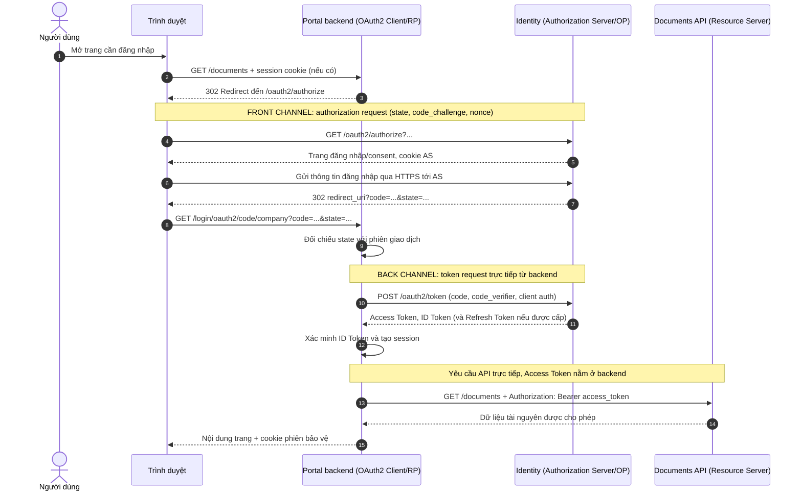

# Front Channel, Back Channel và điểm truyền dữ liệu nhạy cảm

Trong OAuth 2.0 và OpenID Connect (OIDC), **Front Channel** và **Back Channel** mô tả **đường đi của thông điệp giao thức** giữa ứng dụng, trình duyệt, Authorization Server và các thành phần liên quan. Phân biệt hai kênh là nền tảng để quyết định dữ liệu nào có thể xuất hiện trong URL chuyển hướng, dữ liệu nào cần gửi bằng yêu cầu trực tiếp, cách bảo vệ token và nơi đặt các kiểm tra an ninh.

Khi thiết kế **Spring Security OAuth2/OIDC Authorization Server** bằng Spring Boot và Spring Authorization Server, hiểu sai ranh giới hai kênh có thể dẫn tới rò rỉ access token, client secret, authorization code, thông tin đăng nhập hoặc dữ liệu cá nhân qua lịch sử trình duyệt, log, URL tham chiếu và mã JavaScript. Bài học thuộc chương **Giao thức và thuật ngữ** này tập trung vào kiến trúc, các điểm truyền dữ liệu nhạy cảm, cấu hình Spring liên quan và cách kiểm thử.

## 1. Định nghĩa chính xác hai kênh

### 1.1. Front Channel: đường đi qua User Agent

**Front Channel** là việc truyền thông điệp thông qua **User Agent**, phổ biến nhất là trình duyệt của người dùng, bằng điều hướng, redirect hoặc biểu mẫu HTML. Trong một luồng đăng nhập điển hình:

1. OAuth2 Client đưa trình duyệt đến **authorization endpoint** của Authorization Server (AS).
2. Trình duyệt tương tác với trang đăng nhập/đồng ý do AS cung cấp.
3. AS chuyển trình duyệt về **redirect URI** của client với kết quả ủy quyền.

Điểm nhận diện Front Channel là **trình duyệt nằm trên đường đi của thông điệp**. Vì vậy URL, query string, fragment, biểu mẫu và tài nguyên web có thể chịu tác động của lịch sử trình duyệt, phần mềm mở rộng, script, trang trung gian, nhật ký HTTP và cấu hình điều hướng.

**Front Channel không có nghĩa là HTTP không mã hóa.** Front Channel vẫn phải dùng HTTPS trong môi trường thực tế. HTTPS bảo vệ dữ liệu trên đường truyền nhưng không tự ngăn URL xuất hiện trong lịch sử trình duyệt, log của chính các điểm cuối hoặc script chạy trong một origin bị xâm phạm.

### 1.2. Back Channel: trao đổi trực tiếp giữa các thành phần giao thức

**Back Channel** là trao đổi không dựa vào redirect của trình duyệt để chuyển thông điệp giữa các bên; điển hình là yêu cầu HTTP trực tiếp từ backend của OAuth2 Client đến AS hoặc từ Client đến Resource Server (RS):

- Client gọi **token endpoint** để đổi authorization code lấy token.
- Resource Server gọi **introspection endpoint** để xác minh opaque access token.
- Ứng dụng lấy metadata/JWKS hoặc gọi **UserInfo endpoint** theo cơ chế thích hợp.
- OpenID Provider (OP) gửi thông báo **Back-Channel Logout** trực tiếp đến Relying Party khi cả hai hỗ trợ cơ chế đó.

**Back Channel cũng phải được bảo vệ bằng TLS, xác thực bên gửi khi giao thức yêu cầu, kiểm soát đầu ra và log.** Việc một yêu cầu không đi qua URL redirect không bảo đảm token hoặc secret không thể bị lộ tại backend, reverse proxy, bộ thu thập log hay hệ thống quan sát.

### 1.3. Ngoại lệ cần nhớ: Back Channel không luôn là server-to-server

Với **confidential web client** sử dụng backend, token request thường đi từ backend đến AS nên mã truy cập và token có thể được giữ phía máy chủ. Nhưng với **SPA/public client**, chính JavaScript trong trình duyệt có thể gửi yêu cầu trực tiếp tới token endpoint bằng Authorization Code + PKCE. Đó là **trao đổi trực tiếp với token endpoint**, thường được phân loại vào nhánh back-channel của giao thức, song **dữ liệu trả về vẫn hiện diện trong môi trường trình duyệt**.

Do đó cần phân biệt hai câu hỏi:

| Câu hỏi | Ý nghĩa |
|---|---|
| **Thông điệp đi qua redirect/User Agent hay yêu cầu trực tiếp?** | Phân biệt **Front Channel / Back Channel** trong luồng giao thức. |
| **Ai có quyền nhìn thấy hoặc lưu dữ liệu ở nơi xử lý?** | Xác định **ranh giới tin cậy**: backend, trình duyệt, JavaScript, proxy, log, thiết bị người dùng. |

Tên gọi **Back Channel không phải là một thuộc tính bảo mật tự động**. Khi threat model, luôn xác định cả hai khía cạnh.

## 2. Sơ đồ Authorization Code + PKCE với OIDC

Giả sử hệ thống có cổng web `https://portal.example.com`, Authorization Server kiêm OpenID Provider `https://identity.example.com` và API `https://api.example.com`. Trong ví dụ này, `portal` là **confidential client/BFF** giữ token ở backend; trình duyệt chỉ giữ cookie phiên phù hợp.



Sơ đồ này cố ý tách **đường đi của authorization code qua trình duyệt** khỏi **đường đi của token sau khi đổi code**. Authorization Code flow không đặt access token vào URL chuyển hướng trong mô hình backend được minh họa. Lưu ý: **thông tin đăng nhập của người dùng vẫn được nhập trên trình duyệt** và gửi đến trang đăng nhập AS qua HTTPS; không có quy tắc chung rằng mọi dữ liệu nhạy cảm đều phải nằm ngoài Front Channel.

### 2.1. Chú giải theo từng chặng

| Chặng | Hình thức truyền | Dữ liệu trọng tâm | Thành phần cần bảo vệ |
|---|---|---|---|
| Client → AS authorization request | **Front Channel**, trình duyệt điều hướng | `client_id`, `redirect_uri`, `response_type=code`, `scope`, `state`, `code_challenge`, `nonce` nếu có | URL, tham số cá nhân, liên kết phiên giao dịch |
| Trình duyệt ↔ AS login/consent | **Front Channel**, form/cookie | Mật khẩu, yếu tố xác thực, session cookie AS, lựa chọn đồng ý | Trang đăng nhập, HTTPS, cookie, CSRF, chống phishing |
| AS → Client redirect | **Front Channel**, thông qua trình duyệt | `code`, `state` hoặc `error` | Authorization code, trạng thái phiên và URL callback |
| Client backend → AS token endpoint | **Back Channel**, HTTP trực tiếp | `code`, `code_verifier`, xác thực client, sau đó token | TLS, client authentication, secret, log, phản hồi token |
| Client → API | HTTP trực tiếp giữa backend và RS | `Authorization: Bearer <access_token>` | Access token, audience, scope, đường truyền và log |
| API → AS introspection nếu dùng opaque token | **Back Channel**, HTTP trực tiếp | Access token, thông tin xác thực để introspect, phản hồi trạng thái | TLS, quyền truy cập introspection, log |

Không phải bước nào trong bảng cũng xảy ra với mọi grant. Ví dụ `client_credentials` không cần authorization redirect, trang đăng nhập hay authorization code.

## 3. Điểm nào truyền dữ liệu nhạy cảm?

Một lỗi phổ biến là phân loại dữ liệu theo "kênh" rồi kết luận rằng dữ liệu ở Front Channel đều không nhạy cảm. Thực tế, phải phân loại theo **giá trị, vòng đời, chủ thể dự kiến được nhận và khả năng bị lạm dụng**.

| Dữ liệu | Nơi thường xuất hiện | Độ nhạy cảm và mối nguy | Quy tắc bảo vệ chính |
|---|---|---|---|
| `client_id` | Authorization URL; token request | Thông tin định danh client, **không phải bí mật** | Có thể công khai; không thay thế xác thực client |
| `redirect_uri`, `scope`, `response_type` | Authorization URL | Thường không phải secret; có thể tiết lộ dịch vụ/chức năng người dùng yêu cầu | Chỉ chấp nhận redirect URI đã đăng ký; hạn chế dữ liệu riêng tư trong URL |
| `state` | Authorization URL và callback | Giá trị đối chiếu giao dịch; bị đánh cắp/lộ có thể hỗ trợ tấn công khi kết hợp lỗ hổng khác | Sinh khó đoán, liên kết với phiên và kiểm tra khi callback; không nhúng dữ liệu riêng tư |
| `nonce` OIDC | Authorization request; ràng buộc với ID Token | Giá trị bảo vệ phiên xác thực; thường xuất hiện ở Front Channel, không phải client secret | Sinh khó đoán, lưu đối chiếu và kiểm tra claim `nonce` khi áp dụng |
| PKCE `code_challenge` | Authorization URL | Cam kết dẫn xuất từ `code_verifier`, được thiết kế để gửi qua Front Channel | Dùng `S256`; không gửi nhầm `code_verifier` ở đây |
| PKCE `code_verifier` | Client → token endpoint | Giá trị nhạy cảm vì dùng để đổi code tương ứng | Lưu gắn với giao dịch; truyền qua token request, tránh URL/log |
| Authorization `code` | Query của redirect URI trong flow thông thường | **Nhạy cảm, ngắn hạn, dùng một lần**, có thể bị chặn trong URL hoặc log | Thời hạn ngắn, dùng một lần, ràng buộc client/redirect URI/PKCE; không log |
| Access Token | Token response; lời gọi API | **Bearer credential**: ai giữ token phù hợp có thể có quyền gọi API | Không đưa vào URL; TLS, audience/scope, lưu trữ phù hợp, che log |
| Refresh Token | Token response; refresh request | Có thể đổi lấy access token mới; thường có vòng đời dài hơn | Giữ ở nơi an toàn; rotation/revocation và chính sách cấp phát phù hợp |
| ID Token | OIDC token response | Chứa thông tin xác thực và có thể có claim cá nhân; dành cho RP | Kiểm tra chữ ký, issuer, audience, thời hạn, nonce khi có; không dùng thay access token |
| Client secret/private key | Token endpoint, cơ chế xác thực client | Bí mật dài hạn hoặc khóa ký | Chỉ ở môi trường có thể giữ bí mật; secret manager; không đưa vào SPA/URL/repo |
| Mật khẩu, OTP, mã khôi phục | Biểu mẫu xác thực tại AS | Thông tin xác thực người dùng rất nhạy cảm | Chỉ gửi đến AS hợp lệ qua HTTPS; không truyền cho OAuth2 Client bên thứ ba |
| Cookie phiên AS hoặc Client | Header `Cookie` qua trình duyệt | Có thể trao quyền truy cập phiên, dễ bị đánh cắp qua XSS/CSRF/lỗi cookie | `Secure`, `HttpOnly`, `SameSite` phù hợp, session fixation và CSRF protection |
| Claim như `login_hint`, `id_token_hint`, email, `claims` | Có thể nằm trong authorization request | Có thể chứa PII hoặc token dù đi cùng các tham số công khai | Không cho dữ liệu nhạy cảm không cần thiết vào URL; cân nhắc PAR và giảm tối đa claim |

**Tính bí mật của PKCE:** `code_challenge` được phép lộ vì một phía không thể dễ dàng tính ngược `code_verifier` đủ entropy từ giá trị băm S256. Ngược lại, gửi `code_verifier` qua query authorization request sẽ phá hỏng mục đích ràng buộc authorization code với client khởi tạo giao dịch.

### 3.1. Ví dụ request Front Channel

```http
GET /oauth2/authorize?response_type=code&client_id=portal-web&redirect_uri=https%3A%2F%2Fportal.example.com%2Flogin%2Foauth2%2Fcode%2Fcompany&scope=openid%20profile%20documents.read&state=STATE_RANDOM&code_challenge=PKCE_CHALLENGE&code_challenge_method=S256&nonce=NONCE_RANDOM HTTP/1.1
Host: identity.example.com
```

Ở đây `client_id`, `state`, `code_challenge`, `nonce` là dữ liệu được đặt trong authorization request theo đúng vai trò của chúng. **Không đặt `client_secret`, `code_verifier`, access token hoặc refresh token vào URL này.** Các giá trị viết hoa là placeholder, không phải dữ liệu có thể dùng trong môi trường thực.

Sau xác thực và consent, AS chuyển hướng trình duyệt về client:

```http
HTTP/1.1 302 Found
Location: https://portal.example.com/login/oauth2/code/company?code=AUTH_CODE&state=STATE_RANDOM
Cache-Control: no-store
```

Authorization code đi qua Front Channel nên vẫn là một **điểm cần phòng vệ**, mặc dù chưa phải access token. Client phải kiểm tra `state` trước khi dùng code; AS phải kiểm tra code còn hiệu lực, chưa sử dụng, khớp client/redirect URI và `code_verifier` khi đổi code.

### 3.2. Ví dụ request Back Channel

```http
POST /oauth2/token HTTP/1.1
Host: identity.example.com
Content-Type: application/x-www-form-urlencoded
Authorization: Basic <REDACTED_CLIENT_AUTH>

grant_type=authorization_code&code=AUTH_CODE&redirect_uri=https%3A%2F%2Fportal.example.com%2Flogin%2Foauth2%2Fcode%2Fcompany&code_verifier=ORIGINAL_HIGH_ENTROPY_VERIFIER
```

```json
{
  "access_token": "REDACTED_ACCESS_TOKEN",
  "token_type": "Bearer",
  "expires_in": 300,
  "id_token": "REDACTED_ID_TOKEN"
}
```

Đây là ví dụ cho **confidential OIDC client** với cơ chế client authentication ở token endpoint; tập trường trong phản hồi thay đổi theo grant, scope và chính sách AS. `refresh_token` chỉ xuất hiện nếu AS cấp. Không có giá trị nào trong ví dụ là token/credential thật.

Client secret không tự an toàn chỉ vì nằm trong HTTP header `Authorization`: reverse proxy, APM, tracing hoặc logging filter vẫn có thể ghi nhầm header hay request body. Chặn việc ghi dữ liệu bí mật phải áp dụng xuyên suốt toàn bộ tuyến xử lý.

## 4. Những bề mặt làm rò rỉ dữ liệu

### 4.1. URL, query string và fragment

URL Front Channel có thể đi vào:

- **Lịch sử trình duyệt**, bookmark, thanh địa chỉ, chức năng đồng bộ trình duyệt, ảnh chụp màn hình và extension.
- **Access log** của web server, reverse proxy, gateway, WAF, CDN và công cụ phân tích nếu các thành phần này ghi nguyên request target.
- **`Referer` header** khi trang tải tài nguyên khác hoặc điều hướng; phạm vi dữ liệu được gửi phụ thuộc trình duyệt, chính sách `Referrer-Policy`, nguồn/đích và kiểu điều hướng.
- **Analytics/tracking script**, error reporting và mã JavaScript khác chạy trên trang callback.
- **Open redirect** hoặc trang callback trả nội dung/tải script bên thứ ba trước khi xử lý, loại bỏ dữ liệu một lần khỏi URL.

Trong một số flow cũ, token/ID Token có thể được trả về bằng **URL fragment** (phần sau `#`). Fragment thường **không** được gửi trong HTTP request đến web server, nhưng vẫn có thể được JavaScript của trang hoặc môi trường trình duyệt đọc. Vì vậy **fragment không phải két an toàn cho bearer token**. Tránh dùng Implicit flow cho thiết kế mới; ưu tiên Authorization Code + PKCE với xử lý token thích hợp.

`response_mode=form_post` của OIDC có thể trả tham số qua biểu mẫu POST do trình duyệt tự gửi. Cách này làm giảm một số phơi lộ trên URL nhưng **vẫn là Front Channel**, và các tham số vẫn qua trình duyệt/POST body; nó không thay thế `state`, PKCE, kiểm tra token hoặc bảo vệ CSRF/cookie. Cần kiểm tra cơ chế hỗ trợ và chính sách `SameSite` phù hợp khi dùng callback POST xuyên site.

### 4.2. Body và header trong Back Channel

Đổi từ query string sang POST body chỉ làm thay đổi nơi xuất hiện dữ liệu; không làm dữ liệu tự biến mất khỏi:

- HTTP request/response logging hoặc debug logging của framework.
- Trace/span và collector có thu thập header, form field, response body.
- Proxy/gateway kết thúc TLS rồi chuyển tiếp nội bộ.
- Application exception, lỗi validation hoặc log khi retry chứa nguyên thông điệp.
- Heap dump, crash report, file tạm và storage không được bảo vệ.

Với bearer access token, **không ghi `Authorization` header**. Với refresh token, secret và `code_verifier`, cũng phải loại bỏ/che nội dung khi log request body. Với ID Token, tránh ghi claim định danh không cần thiết vì ngoài giá trị bảo mật còn có thể là dữ liệu cá nhân.

### 4.3. Browser state, cookie và JavaScript

Trong **BFF/confidential web client**, backend có thể giữ token server-side và gửi cho trình duyệt **session cookie** riêng. Kiến trúc này giảm phạm vi token xuất hiện trong JavaScript, nhưng cookie phiên vẫn nhạy cảm:

- Đặt `Secure` để trình duyệt chỉ gửi cookie qua HTTPS; dùng `HttpOnly` khi JavaScript không cần đọc cookie.
- Thiết lập `SameSite` theo luồng redirect thực tế; bảo vệ **CSRF** cho các thao tác thay đổi trạng thái.
- Không đưa token hoặc client secret vào HTML, template, source map, client bundle, `localStorage` hoặc URL để tiện debug.
- Giảm rủi ro XSS bằng mã hóa output, kiểm soát script/CSP, kiểm tra dependency và hạn chế third-party script.
- Đổi session ID tại các thời điểm đăng nhập thích hợp; giới hạn thời gian phiên và xử lý logout.

Với SPA, token có thể hiện diện trong runtime của browser khi JavaScript tự thực hiện token request. Không có client secret nào lưu trong SPA là bí mật thật. Authorization Code + PKCE giảm nguy cơ chiếm đoạt code trên đường redirect nhưng **không giải quyết hoàn toàn XSS hoặc token bị đọc trong trình duyệt**.

### 4.4. HTTPS bảo vệ điều gì và còn thiếu gì?

HTTPS bảo vệ tính bí mật và toàn vẹn dữ liệu **trên kết nối được TLS bảo vệ** và giúp xác thực điểm cuối theo chứng chỉ. Nó không kiểm soát được hành vi của ứng dụng khi đã nhận dữ liệu. Vì vậy cần kết hợp:

1. HTTPS end-to-end phù hợp kiến trúc; tránh redirect hạ cấp và cấu hình sai khi kết thúc TLS ở proxy.
2. Giới hạn dữ liệu trong redirect URL; không cho credential/token dài hạn vào query.
3. Xác thực/ủy quyền ở đúng endpoint, kiểm tra issuer và audience của token khi cần.
4. Mã hóa và quyền truy cập dữ liệu lưu trữ, quản lý secret tập trung, redaction log.
5. Bảo vệ trình duyệt bằng cookie và cơ chế chống XSS/CSRF, chính sách chuyển hướng hợp lệ.

## 5. So sánh các luồng OAuth2/OIDC theo kênh dữ liệu

| Luồng/kiến trúc | Front Channel | Back Channel/trao đổi trực tiếp | Dữ liệu cần lưu ý |
|---|---|---|---|
| **Authorization Code + PKCE, web backend** | Authorization request; AS login/consent; redirect về client với code | Backend đổi code lấy token; gọi API | `code`, `state`, `nonce` ở browser; `code_verifier`, secret, token ở backend |
| **Authorization Code + PKCE, SPA/public client** | Authorization request/redirect với code | JS trực tiếp gửi token request tới AS qua mạng | Access token có thể nằm trong browser runtime; không có client secret an toàn |
| **Client Credentials** | Không cần bước điều hướng/đăng nhập người dùng | Client xác thực với token endpoint, lấy token và gọi API | Client secret/private key, access token; không có ID Token đăng nhập người dùng |
| **OIDC Implicit/Hybrid (lịch sử/tùy trường hợp)** | Có thể trả ID Token và/hoặc access token qua trình duyệt | Một số biến thể hybrid còn đổi code tại token endpoint | Token có thể lộ qua browser; không lựa chọn mặc định cho hệ thống mới |
| **Token introspection** | Không yêu cầu redirect trình duyệt | Resource Server gọi AS trực tiếp | Token cần kiểm tra, introspection credentials, metadata trả về |
| **OIDC UserInfo** | Thường không cần redirect trình duyệt cho request UserInfo | Client gọi OP với access token phù hợp | Access token và thông tin cá nhân từ UserInfo |

**Không đánh đồng "access token là JWT" với "token đi qua Front Channel".** Loại token, định dạng JWT/opaque và kênh truyền là các quyết định khác nhau. Cả JWT lẫn opaque token đều có thể bị lộ nếu bị ghi log hoặc đưa vào URL.

### 5.1. Front-Channel Logout và Back-Channel Logout của OIDC

OIDC còn dùng hai thuật ngữ này cho **cơ chế thông báo đăng xuất**, khác với mô tả chung về đường đi của token:

- **Front-Channel Logout:** OP phối hợp đăng xuất thông qua trình duyệt, có thể dùng việc tải trang/iframe theo cơ chế được hỗ trợ. Phụ thuộc trạng thái trình duyệt, cookie và hạn chế third-party content.
- **Back-Channel Logout:** OP gửi **Logout Token** bằng yêu cầu trực tiếp tới endpoint do RP đăng ký; RP xác minh token và hủy phiên phù hợp mà không cần browser thực hiện điều hướng thông báo logout.

Hai cơ chế là các đặc tả/khả năng **tùy chọn**, phải được OP và RP thực sự hỗ trợ/cấu hình. **Logout Token không phải access token để gọi API và cũng không phải ID Token đăng nhập thông thường.** Nếu kiến trúc cần đồng bộ đăng xuất nhiều ứng dụng, phải kiểm thử riêng từng cơ chế và tình huống trình duyệt đóng hoặc bị chặn nội dung bên thứ ba.

## 6. Trách nhiệm bảo mật tại từng thành phần

| Thành phần | Front Channel cần kiểm tra | Back Channel cần kiểm tra |
|---|---|---|
| **Authorization Server / OpenID Provider** | `client_id`, `redirect_uri`, grant/scope, consent, trang login, phiên, chống giả mạo yêu cầu, dữ liệu response | Xác thực confidential client, code một lần và thời hạn, đối chiếu PKCE, chính sách token, TLS, bảo vệ secret/JWK, log redaction |
| **OAuth2 Client / OIDC Relying Party** | Sinh và kiểm tra `state`, lưu giao dịch đúng phiên, bảo vệ callback, tránh lộ code trong trang/log | Gửi `code_verifier`, giữ client secret/token đúng nơi, kiểm tra ID Token, gọi API đúng audience/quyền |
| **Resource Server** | Thường không tham gia authorization redirect; bảo vệ endpoint API nếu có cookie/web UI riêng | Chấp nhận access token đúng issuer/audience/thời hạn/quyền; không chấp nhận ID Token thay access token |
| **Browser / User Agent** | Chỉ nhập credential vào đúng origin của AS, xử lý redirect/cookie/session | Với SPA, JS có thể trực tiếp nhận token nên browser vẫn là vùng dữ liệu nhạy cảm |

**Authorization Server không thể tự khắc phục mọi lỗi của Client.** AS kiểm soát phát hành token và xác minh redirect URI, nhưng Client vẫn phải quản lý state, phiên giao dịch, callback và token storage đúng cách. Resource Server cũng phải tự thực thi kiểm tra access token và quyền của API.

## 7. Áp dụng trong Spring Security và Spring Authorization Server

### 7.1. Nhận diện endpoint nào thường thuộc kênh nào

Với đường dẫn mặc định phổ biến của Spring Authorization Server, có thể bắt đầu phân loại như sau:

| Endpoint | Cách dùng thông thường | Điểm bảo mật |
|---|---|---|
| `/oauth2/authorize` | **Front Channel**: trình duyệt tới AS | Redirect URI, `state`, PKCE challenge, scope, authorization code response |
| `/login`, các trang xác thực/consent | **Front Channel**: người dùng tương tác với AS | Cookie phiên, mật khẩu/MFA, CSRF, chống phishing, tránh open redirect |
| `/oauth2/token` | **Trao đổi trực tiếp/Back Channel**: client gọi AS | Client authentication khi cần, code verifier, token response, redaction |
| `/oauth2/introspect` | **Back Channel**: RS hoặc client được phép gọi AS | Xác thực bên introspect, token được kiểm tra, dữ liệu phản hồi |
| `/oauth2/revoke` | **Yêu cầu trực tiếp** từ client đến AS | Client authentication khi áp dụng, token được thu hồi, redaction |
| `/oauth2/jwks` | Yêu cầu trực tiếp để lấy public keys; có thể truy cập công khai | Chỉ công bố **public key** và metadata cần thiết; bảo vệ private key |
| `/.well-known/openid-configuration` | Discovery metadata, có thể lấy qua trình duyệt hoặc backend | Đúng issuer và URL endpoint; metadata công khai không chứa secret |
| `/userinfo` (nếu OIDC được bật/hỗ trợ) | Client gọi trực tiếp OP với access token thích hợp | Bảo vệ claim cá nhân, audience/scope/token và log |

Đây là **mẫu giao thức thường gặp**, không phải quy tắc rằng mỗi endpoint chỉ nhận request từ một loại máy. Các route có thể thay đổi theo `AuthorizationServerSettings`, phiên bản Spring Authorization Server và cấu hình OIDC. Một endpoint công khai như JWKS vẫn cần HTTPS và vận hành khóa ký đúng cách, dù public key bản thân không phải secret.

### 7.2. Bắt buộc PKCE cho client dùng Authorization Code

Trong Spring Authorization Server, có thể khai báo yêu cầu PKCE trong metadata client:

```java
RegisteredClient portal = RegisteredClient.withId(UUID.randomUUID().toString())
    .clientId("portal-web")
    .clientSecret(passwordEncoder.encode(clientSecretFromSecretStore))
    .clientAuthenticationMethod(ClientAuthenticationMethod.CLIENT_SECRET_BASIC)
    .authorizationGrantType(AuthorizationGrantType.AUTHORIZATION_CODE)
    .redirectUri("https://portal.example.com/login/oauth2/code/company")
    .scope(OidcScopes.OPENID)
    .scope("documents.read")
    .clientSettings(ClientSettings.builder()
        .requireProofKey(true)
        .requireAuthorizationConsent(true)
        .build())
    .build();
```

Đoạn mã minh họa phần **đăng ký client** (các import/bean và repository lưu client chưa được trình bày). `clientSecretFromSecretStore` là biến minh họa secret được nạp an toàn ở backend, không phải chuỗi bí mật hardcode. Cần lưu `RegisteredClient` vào `RegisteredClientRepository`, cấu hình AS/OP, khóa ký và cơ chế đăng nhập người dùng theo hệ thống thực.

`requireProofKey(true)` yêu cầu client sử dụng PKCE khi thực hiện Authorization Code flow. Nó **không thay cho** việc kiểm tra `state` ở Client, xác thực confidential client ở token endpoint hoặc xác minh `redirect_uri`. Với SPA/public client, đăng ký phương thức xác thực `none` và không cấp client secret giả; PKCE vẫn cần thiết.

### 7.3. OAuth2 Client trên Spring Boot

Ứng dụng portal ở backend có thể dùng cấu hình mẫu:

```yaml
spring:
  security:
    oauth2:
      client:
        registration:
          company:
            provider: company-identity
            client-id: portal-web
            client-secret: ${PORTAL_OAUTH2_CLIENT_SECRET}
            authorization-grant-type: authorization_code
            redirect-uri: "{baseUrl}/login/oauth2/code/{registrationId}"
            scope: openid, profile, documents.read
        provider:
          company-identity:
            issuer-uri: https://identity.example.com
```

```java
@Bean
SecurityFilterChain portalSecurity(HttpSecurity http) throws Exception {
    http.authorizeHttpRequests(auth -> auth
            .requestMatchers("/", "/public/**").permitAll()
            .anyRequest().authenticated())
        .oauth2Login(Customizer.withDefaults())
        .oauth2Client(Customizer.withDefaults());

    return http.build();
}
```

Khi sử dụng `oauth2Login()`, Spring Security cung cấp phần xử lý redirect/callback và liên kết authorization request với phiên theo cơ chế mặc định. Cần kiểm tra cấu hình **PKCE thực tế của phiên bản Spring Security và loại client đang dùng**, sự tương thích với chính sách `requireProofKey` của AS, các đường dẫn reverse proxy và `redirect-uri`. Việc bật `oauth2Login()` **không chứng minh tự động** rằng hệ thống đã bảo vệ mọi đường truyền, lưu token an toàn hoặc kiểm tra đúng audience ở Resource Server.

Với mô hình portal backend, nên giữ access/refresh token trong storage được kiểm soát ở máy chủ khi khả thi. Trình duyệt chỉ nhận cookie phiên; khi portal gọi API, backend gắn access token vào request trực tiếp. Token dành cho API phải đúng audience, quyền hạn và thời hạn.

### 7.4. Phiên đăng nhập, SameSite và CSRF

Cấu hình cookie phiên phía Spring Boot cho mô hình backend có thể bắt đầu từ:

```yaml
server:
  servlet:
    session:
      cookie:
        secure: true
        http-only: true
        same-site: lax
```

`SameSite=Lax` thường tương thích với callback OAuth2 bằng điều hướng GET cấp cao từ AS về client. Nếu dùng `response_mode=form_post` hoặc các tình huống cross-site POST/iframe, **cookie policy phải được đánh giá lại** vì `Lax` có thể ngăn gửi cookie trong những request đó. Không tự tắt CSRF chỉ để làm callback hoạt động; hãy kiểm tra cơ chế lưu/correlate authorization request, điểm nhận callback và yêu cầu phiên thực tế.

Trong triển khai sau proxy, cần bảo đảm ứng dụng nhận đúng **external scheme/host** để sinh redirect URI HTTPS đã đăng ký. Chỉ tin các forwarded header do proxy đáng tin cậy thiết lập. Sai lệch scheme/host có thể gây lỗi redirect URI hoặc tạo lỗ hổng chuyển hướng.

### 7.5. Giảm dữ liệu trong authorization URL

Nếu authorization request chứa thông tin cá nhân hoặc nhiều tham số nhạy cảm, hãy đánh giá **Pushed Authorization Requests (PAR, RFC 9126)** khi AS/client và phiên bản triển khai hỗ trợ. Client gửi chi tiết authorization request **trực tiếp** tới PAR endpoint trước, nhận `request_uri` rồi mới điều hướng browser qua Front Channel với tham chiếu này. PAR giúp giảm lượng dữ liệu chi tiết xuất hiện trong URL trình duyệt nhưng **không xóa mọi rủi ro Front Channel**, không thay thế PKCE/state và vẫn phải bảo vệ `request_uri` khỏi lạm dụng theo cơ chế của AS.

Có thể xem xét signed authorization request (JAR) và cơ chế phản hồi nâng cao khi cần threat model cao hơn, nhưng phải dựa trên **hỗ trợ thực tế của cả client và AS**. Không giả định một tính năng đã sẵn có chỉ vì nó tồn tại trong đặc tả OAuth/OIDC.

## 8. Kịch bản tấn công và cách phòng tránh

| Kịch bản | Điểm yếu bị khai thác | Biện pháp chính |
|---|---|---|
| Truy cập URL callback chứa `code` từ log | Authorization code đi qua Front Channel | Không log query nhạy cảm; code ngắn hạn/một lần; PKCE; xử lý callback nhanh và chuyển sang URL sạch |
| Kẻ tấn công thay response callback của người dùng | Client không ràng buộc phiên với authorization request | Sinh/kiểm tra `state` gắn phiên, xác minh đúng AS/issuer khi tích hợp nhiều AS, kiểm soát redirect URI |
| Đổi authorization code bị đánh cắp | AS không kiểm tra PKCE hoặc code binding | `S256` PKCE, chỉ dùng code một lần, kiểm tra client và redirect URI theo luồng |
| Token bị gửi qua query string | Browser history, referer, proxy log lưu credential | Chỉ đưa token vào vị trí hợp lệ như header Bearer của API, không truyền token qua URL |
| Script bên thứ ba đọc token trong SPA | XSS, script bị xâm phạm hoặc môi trường browser không an toàn | Giảm script; CSP và vệ sinh XSS; ưu tiên BFF khi phù hợp; không nhúng client secret |
| Lộ refresh token hoặc client secret qua tracing | Collector/proxy ghi header/body | Redaction trước khi xuất log/trace, giới hạn quyền xem, retention phù hợp, secret rotation |
| Client chấp nhận ID Token dành cho ứng dụng khác | Thiếu xác minh `aud`, `iss`, chữ ký, thời hạn | Validate ID Token theo OIDC; đối chiếu nonce khi có; không dùng ID Token làm access token |
| API chấp nhận access token dành cho API khác | Thiếu audience validation ở Resource Server | Xác minh issuer, chữ ký hoặc introspection, audience, thời gian và quyền theo API |
| Redirect URI trỏ sang trang khác | Đăng ký redirect lỏng lẻo/open redirect | Khớp redirect URI theo quy tắc chặt chẽ; bỏ open redirect; hạn chế URI nhận phản hồi |
| Logout chỉ làm mất cookie local | Không có cơ chế kết thúc/synchronize phiên/token phù hợp | Thiết kế logout ở client/OP, revocation và Front-/Back-Channel Logout nếu cần và được hỗ trợ |

### 8.1. Đừng nhầm vai trò của `state`, `nonce`, PKCE và client authentication

| Biện pháp | Bảo vệ chính | Không thay thế được |
|---|---|---|
| `state` | Liên kết authorization response với giao dịch của client; hỗ trợ chống CSRF/login CSRF | PKCE, token validation, bảo vệ XSS |
| OIDC `nonce` | Ràng buộc ID Token với yêu cầu xác thực để giảm replay/substitution khi áp dụng | `state`, PKCE, kiểm tra chữ ký/audience |
| PKCE (`S256`) | Gắn authorization code với client tạo `code_verifier`, giảm nguy cơ bị đổi code trái phép | Session correlation, bảo vệ access token sau khi cấp |
| Client authentication | Xác minh danh tính confidential client khi gọi endpoint yêu cầu | Xác thực người dùng cuối, PKCE, quyền API |
| `redirect_uri` validation | Hạn chế nơi AS gửi kết quả authorization | Đối chiếu `state`, kiểm tra token và cookie/CSRF |
| TLS | Bảo vệ kết nối đang truyền | An toàn log, browser runtime, secret storage hoặc logic ứng dụng |

Với client hỗ trợ đăng nhập qua **nhiều Authorization Server**, cần kiểm tra cơ chế ràng buộc **issuer/AS** trong phản hồi nhằm chống nhầm lẫn nơi phát hành (authorization server mix-up). Không kết luận chỉ một `state` là đủ cho mọi trường hợp đa AS; có thể cần áp dụng cơ chế issuer identification phù hợp như RFC 9207 và kiểm tra theo cấu hình client.

## 9. Kiểm thử Front Channel và Back Channel

Các phép thử sau giúp tách kiểm tra giao thức khỏi kiểm tra tính bí mật của dữ liệu. Thực hiện trên môi trường thử nghiệm với **token giả hoặc tài khoản thử**, bảo đảm log không vô tình lưu credential thật.

| Kiểm thử | Thực hiện | Kết quả mong đợi |
|---|---|---|
| Authorization URL sạch | Quan sát redirect đến `/oauth2/authorize` | Có `state`, `code_challenge_method=S256`, `code_challenge`; không có `client_secret`, `code_verifier` hoặc token |
| Authorization callback | Hoàn tất đăng nhập với code flow | Browser chỉ nhận `code`/`state` hoặc thông điệp lỗi phù hợp; không có access/refresh token trong URL |
| State binding | Thay `state` hoặc dùng callback của phiên khác | Client từ chối giao dịch, không tạo phiên đăng nhập từ callback sai |
| PKCE | Thử đổi code với `code_verifier` sai/thiếu | Token endpoint từ chối khi PKCE bắt buộc; code hợp lệ chỉ dùng một lần |
| Redirect URI | Thay URI khác với URI đã đăng ký | AS từ chối hoặc xử lý lỗi an toàn, không redirect code đến URI không hợp lệ |
| Client authentication | Gọi token endpoint với thông tin confidential client sai | Không phát hành token |
| Log redaction | Bật log/tracing mức thử nghiệm, gửi token giả | Không xuất hiện nguyên client secret, `Authorization`, code verifier, access/refresh token, cookie |
| Browser history / Referer | Theo dõi callback và tải tài nguyên bên thứ ba trong trang | Callback được xử lý sớm, hạn chế query nhạy cảm; policy phù hợp, không chuyển dữ liệu riêng tư qua Referer |
| Cookie và phiên | Kiểm tra `Set-Cookie`, HTTPS, callback, CSRF | Cookie có thuộc tính thích hợp và luồng đăng nhập hoạt động an toàn |
| API validation | Gọi API bằng access token sai `aud`/scope, ID Token, token hết hạn | RS từ chối theo chính sách; không dùng ID Token như access token |
| SPA/public client (nếu hỗ trợ) | Kiểm tra token request ở Network/DevTools | Không có client secret cài trong bundle; đã dùng PKCE và CORS/chính sách token phù hợp |
| Logout (nếu hỗ trợ) | Thử Front-/Back-Channel Logout và browser đóng/chặn cookie | Phiên được xử lý nhất quán theo cơ chế triển khai, logout token được xác minh |

Một phép thử thủ công có giá trị là mở **Network** trong Developer Tools và đánh dấu ba điểm: request `/oauth2/authorize`, callback mang `code`, và request `/oauth2/token`. Với **backend web client**, trình duyệt thường chỉ thấy hai điểm đầu; request đổi code nằm ở network/backend logs đã che dữ liệu. Với **SPA**, request token có thể thấy trong DevTools. Quan sát này giúp xác nhận **kiến trúc thực** thay vì chỉ suy từ tên endpoint.

### 9.1. Phản hồi lỗi cũng có thể làm lộ dữ liệu

Khi token exchange hoặc callback thất bại, ứng dụng không nên đổ nguyên authorization request, HTTP headers hoặc token response vào HTML lỗi. Trang lỗi cũng cần tránh gắn nguyên query nhạy cảm vào analytics/event tracking. Nhật ký vận hành nên dùng **mã tương quan giao dịch không mang credential** và thông tin lỗi đã loại dữ liệu bí mật. Cân nhắc `Cache-Control: no-store` cho phản hồi chứa dữ liệu nhạy cảm và cấu hình `Referrer-Policy` phù hợp với trang callback/login.

## 10. Checklist thiết kế trước khi triển khai

Trước khi viết code hoặc duyệt cấu hình Authorization Server và OAuth2 Client, tự trả lời:

1. **Bước nào đi qua trình duyệt?** Liệt kê URL authorization, login, consent, callback và logout; xác định query/form/cookie được gửi ở từng bước.
2. **Bước nào là yêu cầu trực tiếp?** Liệt kê token, introspection, UserInfo, JWKS, API, back-channel logout và ai gọi endpoint thực sự.
3. **Token đi đến đâu?** Access token dành cho API nào, ID Token dành cho RP nào, refresh token lưu ở đâu, client secret thuộc trust boundary nào?
4. **Có dữ liệu cá nhân/credential trong URL không?** Loại bỏ dữ liệu không cần thiết, tránh `login_hint` nhạy cảm hay token trong query; xem xét PAR khi phù hợp.
5. **Có đủ liên kết giao dịch không?** Kiểm tra `state`, OIDC `nonce` khi áp dụng, PKCE, issuer, redirect URI, client authentication và yêu cầu kiểm tra token.
6. **Hệ thống log và proxy có nhìn thấy gì?** Xác nhận chính sách redaction cho header, query, body, cookies, response và tracing.
7. **Kiến trúc browser/backend là gì?** BFF/confidential client hay SPA/public client; công bố ranh giới dữ liệu thật thay vì suy từ tên Front/Back Channel.
8. **Đã kiểm thử tình huống thất bại chưa?** Bao gồm code bị dùng lại, PKCE sai, callback khác phiên, wrong audience, token hết hạn, logout và lỗi proxy/cookie.

## 11. Tổng kết

- **Front Channel** là đường đi thông qua User Agent, thường mang authorization request, giao diện đăng nhập, consent, authorization response và đôi khi thông báo logout.
- **Back Channel** là trao đổi trực tiếp, thường gồm token request, introspection, gọi API và back-channel logout; nó không tự đảm bảo dữ liệu bí mật, đặc biệt với SPA.
- **Authorization code, `state`, PKCE challenge và OIDC nonce** có thể xuất hiện trong Front Channel theo đúng thiết kế, nhưng phải được sinh, ràng buộc và kiểm tra đúng cách.
- **Access token, refresh token, client secret và `code_verifier`** cần được truyền/lưu theo ranh giới tin cậy tương ứng và tuyệt đối tránh phơi lộ trong redirect URL hoặc log.
- Trong Spring Security và Spring Authorization Server, cần kết hợp **PKCE, `state`, client authentication, validation token, bảo vệ session/cookie, TLS và log redaction** thay vì dựa vào một biện pháp đơn lẻ.

Nắm rõ ranh giới này giúp thiết kế, cấu hình, bảo mật, kiểm thử và vận hành Authorization Server/OIDC Provider trên Spring Boot an toàn hơn, đồng thời xác định đúng trách nhiệm của OAuth2 Client và Resource Server.

## 12. Tài liệu chuẩn để tra cứu thêm

- [RFC 6749 — The OAuth 2.0 Authorization Framework](https://www.rfc-editor.org/rfc/rfc6749): vai trò và các endpoint của OAuth 2.0.
- [RFC 7636 — Proof Key for Code Exchange (PKCE)](https://www.rfc-editor.org/rfc/rfc7636): liên kết authorization code với `code_verifier`.
- [RFC 9700 — Best Current Practice for OAuth 2.0 Security](https://www.rfc-editor.org/rfc/rfc9700): các khuyến nghị bảo mật OAuth 2.0 hiện đại.
- [RFC 9126 — OAuth 2.0 Pushed Authorization Requests](https://www.rfc-editor.org/rfc/rfc9126): giảm dữ liệu truyền qua authorization URL.
- [RFC 9207 — OAuth 2.0 Authorization Server Issuer Identification](https://www.rfc-editor.org/rfc/rfc9207): hỗ trợ liên kết response với đúng AS.
- [OpenID Connect Core 1.0](https://openid.net/specs/openid-connect-core-1_0.html): ID Token, `nonce`, OIDC flows và cơ chế xác thực.
- [OpenID Connect Front-Channel Logout 1.0](https://openid.net/specs/openid-connect-frontchannel-1_0.html) và [OpenID Connect Back-Channel Logout 1.0](https://openid.net/specs/openid-connect-backchannel-1_0.html): thông báo đăng xuất qua hai kênh.
