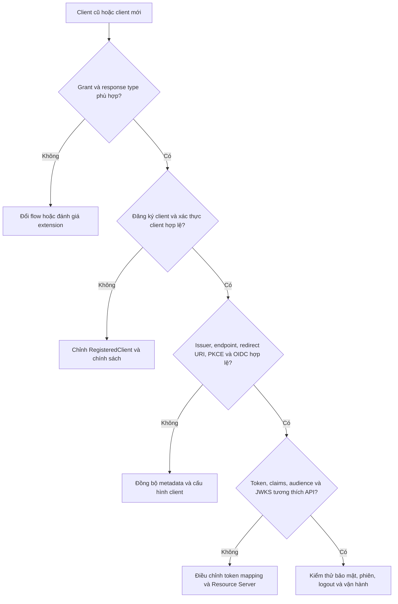

# Các luồng cũ, tính năng không hỗ trợ và ranh giới tương thích giao thức

## 1. Vì sao cần xác định ranh giới tương thích?

Trong một hệ thống dùng **Spring Security** và **Spring Authorization Server (SAS)**, câu hỏi “có hỗ trợ OAuth 2.0/OpenID Connect không?” chưa đủ để quyết định tích hợp. Một hệ thống đang vận hành có thể dùng OAuth 2.0 với **Implicit Grant**, **Resource Owner Password Credentials (ROPC)**, endpoint đăng nhập tự tạo, định dạng token riêng hoặc yêu cầu mở rộng của một nhà cung cấp danh tính. SAS cung cấp hạ tầng Authorization Server theo những chuẩn và tính năng được triển khai trong phiên bản đang dùng; nó không mặc nhiên nhận được mọi yêu cầu từng được một “OAuth server” khác chấp nhận.

Bài học thuộc chương **Giao thức và thuật ngữ** này giúp người học nhận diện các luồng cũ, xác định đâu là khả năng mặc định của SAS, đâu là tính năng cần cấu hình/mở rộng, và đâu là **hợp đồng tích hợp** phải thống nhất giữa client, Authorization Server và Resource Server. Đây là phần nền tảng trước khi thiết kế, cấu hình, bảo mật, kiểm thử và vận hành OAuth 2.0/OIDC Authorization Server trong Spring Boot.

Ba nguyên tắc cần giữ xuyên suốt:

1. **Được định nghĩa trong một RFC không đồng nghĩa SAS hỗ trợ sẵn**. Cần kiểm tra phiên bản và cấu hình được triển khai.
2. **Một grant type được chấp nhận không đồng nghĩa mọi client được phép dùng grant đó**. `RegisteredClient`, cơ chế xác thực client và chính sách an ninh tiếp tục giới hạn phạm vi.
3. **Cấp token thành công không đồng nghĩa tích hợp đã an toàn hoặc tương thích**. Issuer, token format, audience, scopes, claims, JWKS, hành vi logout và kiểm tra quyền ở API cũng phải phù hợp.

## 2. Thuật ngữ: flow, grant type, client authentication, protocol extension

| Thuật ngữ | Ý nghĩa | Ví dụ |
| --- | --- | --- |
| **Authorization flow** | Trình tự tương tác giữa trình duyệt/người dùng, client và Authorization Server | Chuyển hướng người dùng đến `/oauth2/authorize`, nhận code, đổi token |
| **Authorization grant** | Cách client trình bày căn cứ để yêu cầu cấp token tại token endpoint | `authorization_code`, `client_credentials`, `refresh_token` |
| **Client authentication method** | Cách **client** chứng minh danh tính tại endpoint cần xác thực client; khác với đăng nhập **người dùng** | `client_secret_basic`, `private_key_jwt`, `none` |
| **Response type** | Loại kết quả client yêu cầu từ authorization endpoint | `code` trong Authorization Code; `token` trong Implicit |
| **OIDC** | Lớp xác thực danh tính xây trên OAuth 2.0, bổ sung các khái niệm như ID token, `openid` scope và UserInfo | Client xác minh danh tính người dùng qua ID token |
| **Protocol extension** | Phần mở rộng chuẩn hoặc tự định nghĩa trên cơ chế nền | Device Authorization, Token Exchange, PAR, custom grant |
| **Interoperability** | Khả năng nhiều triển khai tuân theo cùng một hợp đồng giao thức và hoạt động cùng nhau | Client khám phá issuer, lấy JWKS, đổi code, kiểm tra token |

Đặc biệt, `grant_type=password` không phải “phương thức xác thực client bằng mật khẩu”. Nó là một **authorization grant** từng cho phép client gửi username/password của người dùng đến token endpoint. Ngược lại, `client_secret_basic` xác thực **ứng dụng khách**, không phải end user.

## 3. Các luồng cũ cần nhận diện và hướng thay thế

### 3.1. Implicit Grant: `response_type=token`

Trong Implicit Flow, authorization endpoint trả access token trực tiếp qua chuyển hướng của trình duyệt, thường ở URL fragment:

```http
GET /oauth2/authorize?response_type=token
    &client_id=legacy-spa
    &redirect_uri=https%3A%2F%2Fspa.example.com%2Fcallback
    &scope=orders.read
    &state=opaque-random-value
```

Mẫu cũ này không có bước đổi authorization code lấy token bằng PKCE. Token có nguy cơ bị lộ cho môi trường trình duyệt, script hoặc cơ chế xử lý chuyển hướng, đồng thời hạn chế các biện pháp bảo vệ token tại token endpoint. Vì những rủi ro đó, hướng dẫn bảo mật OAuth 2.0 hiện đại **không khuyến nghị Implicit Grant**. Không nên thiết kế SAS mới dựa vào `response_type=token`; triển khai SAS thông thường tập trung vào Authorization Code Flow.

**Thay thế:** Authorization Code **kết hợp PKCE** cho SPA/mobile. Nếu kiến trúc cho phép, mô hình Backend for Frontend (BFF) có thể giữ token ở backend và dùng cookie phiên an toàn để giảm việc token xuất hiện trong JavaScript.

### 3.2. Resource Owner Password Credentials: `grant_type=password`

ROPC cho phép client tự nhận username/password của người dùng rồi gửi đến token endpoint:

```http
POST /oauth2/token
Content-Type: application/x-www-form-urlencoded

grant_type=password&username=alice&password=example-password
  &client_id=legacy-app
```

Ví dụ trên chỉ để **nhận diện và kiểm thử loại bỏ luồng cũ**, không phải mã cần triển khai. Grant này gắn việc xác thực người dùng trực tiếp với client, khiến client tiếp xúc với mật khẩu; khó tích hợp MFA, WebAuthn, đăng nhập liên kết hoặc chính sách xác thực theo ngữ cảnh. OAuth 2.0 Security Best Current Practice yêu cầu không dùng ROPC. **Spring Authorization Server không cung cấp Password Grant như một grant mặc định**.

**Thay thế:** Ứng dụng có người dùng chuyển sang Authorization Code + PKCE với trang đăng nhập do Authorization Server/Identity Provider kiểm soát. Đối với giao tiếp **không có người dùng**, cân nhắc Client Credentials với danh tính riêng của dịch vụ. Không lấy Client Credentials làm cách giả mạo một người dùng để vượt qua yêu cầu phân quyền.

### 3.3. OIDC Implicit/Hybrid và các cách truyền token cũ

Một số hệ thống OIDC cũ dùng các `response_type` như `id_token`, `id_token token` hoặc `code id_token` để trả token từ authorization endpoint. Một client OIDC hiện đại nên ưu tiên **Authorization Code Flow**, nhận ID token từ token endpoint khi yêu cầu OIDC hợp lệ. Không suy rằng SAS chấp nhận mọi `response_type` của OIDC Core chỉ vì đã bật `oidc()`.

Hãy kiểm tra `response_type`, `response_mode`, PKCE, `nonce`, claims, thuật toán ký và logout của client hiện hữu. Các thay đổi này phải được kiểm thử end-to-end, nhất là với thư viện OIDC của bên thứ ba.

### 3.4. Direct login endpoint, grant tùy biến và “password grant tự chế”

Một API cũ kiểu `POST /login` trả thẳng JWT sau khi nhận username/password có thể là **API đăng nhập riêng**, hoàn toàn không phải giao thức OAuth 2.0 tương thích. Không nên chỉ đổi tên đường dẫn thành `/oauth2/token` và gọi nó là Authorization Server. Tương tự, việc có điểm mở rộng cho custom grant không có nghĩa một grant tự nhận mật khẩu người dùng trở nên an toàn.

Nếu thật sự cần extension grant, phải có lý do nghiệp vụ, đặc tả input/output và mô hình đe dọa rõ ràng; triển khai validator, provider, authorization/token persistence, lỗi chuẩn, cấu hình client và kiểm thử bảo mật. Những mở rộng này vẫn phải tôn trọng các ràng buộc của endpoint và quyền của client.

### 3.5. Không nhầm “cũ” với “không còn dùng được”

**Authorization Code**, **Client Credentials** và **Refresh Token** vẫn có vai trò chính đáng khi được dùng đúng đối tượng, chính sách và phiên bản. Đặc biệt, `refresh_token` là cơ chế xin token mới, không phải một phương thức đăng nhập tương tác; server phải quyết định client nào được phép nhận/làm mới token và cách quản lý refresh token.

## 4. Ma trận khả năng: hỗ trợ, cần bật, cần mở rộng, nằm ngoài phạm vi

Bảng sau mô tả **ranh giới khái niệm**. Chi tiết endpoint, tùy chọn và tính năng mở rộng phải được xác minh bằng tài liệu của **phiên bản SAS/Spring Security thực tế** trước khi cam kết tương thích.

| Khả năng | Phân loại | Cách hiểu đúng |
| --- | --- | --- |
| OAuth 2.0 Authorization Code | Khả năng cốt lõi | Cần `RegisteredClient`, login, redirect URI và chính sách PKCE |
| PKCE | Có cơ chế hỗ trợ | Phải cấu hình/yêu cầu đúng loại client; nên dùng `S256` |
| OAuth 2.0 Client Credentials | Khả năng cốt lõi | Dành cho client/service, không có ngữ cảnh đăng nhập end user |
| Refresh Token | Khả năng giao thức | Không phải client nào cũng mặc nhiên được cấp; phụ thuộc grant, client và chính sách |
| Token Revocation / Introspection | Có endpoint chuẩn | Kiểm tra phương thức xác thực client, trạng thái token và cách Resource Server sử dụng |
| Authorization Server Metadata / JWK Set | Có cơ chế công bố | Cần cấu hình issuer, khóa ký và URL chính xác với môi trường triển khai |
| OIDC ID Token, UserInfo, Discovery | Khả năng tùy chọn | Chỉ xuất hiện đầy đủ khi bật/cấu hình OIDC và cung cấp principal/claims phù hợp |
| OIDC Logout | Tùy cấu hình và phiên bản | Không tự đồng bộ mọi session trên tất cả client |
| OIDC Dynamic Client Registration | Tùy phiên bản/cấu hình, không nên mặc định mở công khai | Phải có quy trình xác thực, phê duyệt và quản lý client |
| Device Authorization, Token Exchange, PAR và các extension khác | Phụ thuộc khả năng của phiên bản đang dùng | Xác nhận endpoint, grant type, chính sách và rủi ro trước khi thiết kế |
| Implicit Grant (`response_type=token`) | Luồng cũ, không phải mục tiêu triển khai SAS mặc định | Chuyển client sang Authorization Code + PKCE |
| Resource Owner Password Credentials (`grant_type=password`) | Không có grant mặc định trong SAS | Không tái tạo luồng cũ để nhận mật khẩu của người dùng |
| OIDC Implicit/Hybrid `response_type` | Không được tự suy diễn từ việc bật OIDC | Kiểm tra response type được hỗ trợ, ưu tiên Code Flow |
| Proprietary grants/token formats | Cần mở rộng hoặc chuyển đổi | Không có tương thích tự động với quy ước của vendor |
| OAuth 1.0a, SAML 2.0, CAS, WS-Federation | Giao thức khác phạm vi OAuth 2.0 AS | Cần gateway, broker hoặc thành phần chuyên trách tương ứng |
| User registration, MFA, password reset, account recovery | Nghiệp vụ danh tính, không do SAS tự cung cấp | Tự xây dựng hoặc tích hợp dịch vụ danh tính |
| Role/tenant/resource ownership tại API | Trách nhiệm Resource Server | Token hợp lệ vẫn có thể bị từ chối truy cập nghiệp vụ |

**Cách đọc ma trận:** “có cơ chế hỗ trợ” chỉ khẳng định tồn tại một điểm tích hợp hoặc thành phần giao thức. Nó không cam kết hệ thống đã sẵn sàng production, đã bật endpoint, hay đã hỗ trợ một hồ sơ tương thích cụ thể của nhà cung cấp.

## 5. Tương thích giao thức gồm những lớp nào?



### 5.1. Khả năng tại endpoint

Các tên thường gặp trong một cấu hình SAS là `/oauth2/authorize`, `/oauth2/token`, `/oauth2/revoke`, `/oauth2/introspect`, endpoint JWK Set, OIDC UserInfo và logout. Đường dẫn có thể thay đổi bởi `AuthorizationServerSettings`, và một endpoint tùy chọn có thể chưa được bật. Client không nên hard-code địa chỉ của một nhà cung cấp cũ mà chưa đối chiếu metadata hiện hành.

### 5.2. Khả năng tại từng client

`RegisteredClient` mô tả danh tính client, `clientAuthenticationMethods`, `authorizationGrantTypes`, redirect URI, scopes, `ClientSettings` và `TokenSettings`. Có endpoint hỗ trợ `client_credentials` không đồng nghĩa public SPA có quyền dùng grant đó. Một confidential client có thể phải chứng minh danh tính bằng secret hoặc chữ ký JWT, trong khi public client phải dựa vào PKCE và các biện pháp bảo vệ phù hợp, chứ không cất `client_secret` trong JavaScript/mobile binary.

Một lỗi tích hợp phổ biến là đánh đồng **authorization grant** với **client authentication**. Ví dụ, `authorization_code` đi kèm `client_secret_basic` ở confidential web app; cũng có thể đi kèm `none` và PKCE ở public client. Hai yếu tố này được cấu hình độc lập.

### 5.3. Khả năng phát hành và kiểm tra token

Resource Server cần biết token dùng để làm gì, ai phát hành (`iss`), dành cho ai (`aud`), còn hạn không (`exp`), và client/người dùng có quyền gì (`scope` cùng chính sách nghiệp vụ). Không thể giả định API vốn chấp nhận JWT của vendor cũ sẽ tự chấp nhận JWT do SAS phát hành.

- **JWT self-contained:** API xác minh chữ ký và các claim cần thiết qua khóa công khai từ JWKS. Cần quy hoạch `kid`, rotation, thuật toán và các claim bắt buộc.
- **Opaque/reference token:** API thường cần introspection hoặc thành phần truy xuất trạng thái để xác định token còn hiệu lực và được cấp quyền gì.
- **ID token:** Dùng để OIDC client xác minh kết quả xác thực danh tính. Không dùng ID token thay access token khi gọi Resource Server.
- **Custom claim:** Cần thống nhất kiểu dữ liệu, độ ổn định, nguồn phát hành và quyền riêng tư. Không thể coi claim có tên `roles` hay `tenant_id` là chuẩn bắt buộc của OAuth 2.0.

Ví dụ, `scope=orders.read` chỉ cho biết phạm vi API client được phép gọi; API vẫn phải kiểm tra một người dùng có sở hữu đơn hàng số 123 hay không. Thay đổi cấu trúc scope, claim hoặc audience là thay đổi **hợp đồng với Resource Server**, cho dù token endpoint vẫn trả HTTP 200.

### 5.4. Khả năng khám phá và OIDC

Một OIDC client thông thường đọc **Provider Configuration** để biết issuer, authorization endpoint, token endpoint, `jwks_uri`, các thuật toán và khả năng được công bố. OAuth 2.0 cũng có chuẩn Authorization Server Metadata. Sự hiện diện của một endpoint discovery không chứng minh toàn bộ danh sách thuật toán, response type hoặc extension đều được hỗ trợ.

Cần lưu ý URL **issuer** phải nhất quán giữa cấu hình SAS, `iss` trong token, discovery document và phía client/API. Sau reverse proxy, nếu issuer công bố sai host hoặc scheme, client có thể từ chối token dù chữ ký hợp lệ. Đây là lỗi cấu hình triển khai, không phải lỗi grant.

### 5.5. Khả năng phiên, consent và logout

Authorization Server có thể xác thực người dùng bằng session trình duyệt; client có thể có session riêng; API có thể chỉ kiểm tra token. Vì thế `/connect/logout` (khi được hỗ trợ/bật) không mặc nhiên kết thúc mọi phiên của client, vô hiệu hóa mọi JWT đã cấp hoặc thu hồi toàn bộ refresh token.

Quy định rõ trách nhiệm cho front-channel/back-channel logout nếu dự án cần, nơi giữ session, hành vi sau đăng xuất và yêu cầu thu hồi token. Với JWT, revocation không nhất thiết có hiệu lực ngay tại API chỉ kiểm tra chữ ký và thời hạn; cần chính sách phù hợp cho token TTL, kiểm tra trạng thái hoặc phương án khác.

### 5.6. Profile bổ sung và extension bảo mật

Những yêu cầu như DPoP, mTLS-bound token, JWT Authorization Request, Pushed Authorization Requests, token exchange, logout profile chuyên biệt, FAPI hoặc chính sách của một hệ sinh thái tài chính là **các khả năng cần đối chiếu riêng**. Tên chuẩn xuất hiện trong tài liệu OAuth 2.0 không đồng nghĩa phiên bản SAS đang chạy đã hỗ trợ, đã cấu hình hoặc đạt chứng nhận tương thích profile đó.

Khi triển khai extension, hãy đối chiếu: endpoint và phương thức HTTP, tham số bắt buộc, cách xác thực client, thuật toán, lưu trữ trạng thái, mã lỗi, metadata công bố, cách chống replay và bộ kiểm thử liên thông.

## 6. Ví dụ: chuyển SPA dùng Implicit sang Authorization Code + PKCE

Giả sử phiên bản cũ của SPA đang yêu cầu `response_type=token` và API chấp nhận JWT có claim `permissions` do hệ thống cũ tự phát. Mục tiêu là chuyển sang SAS mà vẫn truy cập được `orders-api`.

### 6.1. Đăng ký client theo luồng mới

Ví dụ Java dưới đây minh họa **quyết định cấu hình**. Cú pháp cần đối chiếu với API của phiên bản Spring Authorization Server thực tế; import/bean repository, các kho lưu authorization/consent, khóa ký và cơ chế đăng nhập được lược bỏ.

```java
RegisteredClient spa = RegisteredClient.withId(UUID.randomUUID().toString())
        .clientId("orders-spa")
        .clientAuthenticationMethod(ClientAuthenticationMethod.NONE)
        .authorizationGrantType(AuthorizationGrantType.AUTHORIZATION_CODE)
        .redirectUri("https://orders.example.com/callback")
        .scope(OidcScopes.OPENID)
        .scope("orders.read")
        .clientSettings(ClientSettings.builder()
                .requireProofKey(true)
                .requireAuthorizationConsent(true)
                .build())
        .tokenSettings(TokenSettings.builder()
                .accessTokenTimeToLive(Duration.ofMinutes(10))
                .build())
        .build();
```

Đăng ký này **không khai báo** `implicit` hay `password`. `ClientAuthenticationMethod.NONE` phù hợp với public client, còn `requireProofKey(true)` yêu cầu PKCE. Redirect URI công khai cần HTTPS và phải được đăng ký đúng. Nguồn đăng ký bền vững và quy trình phê duyệt client là việc phải hoàn thiện khi triển khai thật.

### 6.2. Yêu cầu ủy quyền từ trình duyệt

Client sinh `code_verifier` đủ entropy; tính `code_challenge = BASE64URL(SHA256(ASCII(code_verifier)))` không kèm padding; sinh `state` ngẫu nhiên và `nonce` khi ứng dụng OIDC cần ràng buộc phản hồi đăng nhập. Yêu cầu minh họa:

```http
GET /oauth2/authorize?response_type=code
    &client_id=orders-spa
    &redirect_uri=https%3A%2F%2Forders.example.com%2Fcallback
    &scope=openid%20orders.read
    &state=RANDOM_STATE
    &code_challenge=BASE64URL_SHA256_OF_VERIFIER
    &code_challenge_method=S256
    &nonce=RANDOM_NONCE
```

Các chuỗi `RANDOM_*` và `BASE64URL_*` là **placeholder mô tả**, không phải giá trị hợp lệ để chạy nguyên văn. Client phải xác minh `state` khi nhận redirect; với OIDC phải kiểm tra ID token, `nonce` (khi sử dụng) và các claim theo yêu cầu của client.

### 6.3. Đổi code tại token endpoint

```http
POST /oauth2/token
Content-Type: application/x-www-form-urlencoded

grant_type=authorization_code
&client_id=orders-spa
&code=AUTHORIZATION_CODE
&redirect_uri=https%3A%2F%2Forders.example.com%2Fcallback
&code_verifier=ORIGINAL_RANDOM_VERIFIER
```

SAS kiểm tra code, client, redirect URI và PKCE trước khi cấp token. Code chỉ nên được sử dụng một lần và có thời hạn ngắn. Một request thiếu hoặc sai `code_verifier` phải bị từ chối khi client yêu cầu PKCE. Nếu là OIDC login hợp lệ, token response có thể có ID token; access token mới là token gửi tới `orders-api`.

### 6.4. Kiểm tra tương thích API

Việc đổi flow mới giải quyết **cách nhận token**. Nhóm API còn phải cấu hình kiểm tra issuer, chữ ký, audience, scope, cách map claim và quyền trên đối tượng đơn hàng. Nếu API cũ phụ thuộc vào claim `permissions`, cần thiết kế ánh xạ theo hợp đồng rõ ràng, kiểm tra độ lớn và tính riêng tư của token, hoặc thay đổi API dùng authorization service. Không tự sao chép mọi claim cũ sang token mới mà chưa đánh giá nguồn gốc và quyền đọc.

## 7. Di trú các hệ thống cũ: quyết định theo nhu cầu

| Trạng thái cũ / nhu cầu thật | Hướng xử lý khuyến nghị | Điều cần kiểm thử |
| --- | --- | --- |
| SPA nhận access token từ URL fragment | Authorization Code + PKCE, cân nhắc BFF | Chống CSRF bằng `state`, xử lý callback, lưu trữ token an toàn |
| Mobile app tự gửi username/password đến token endpoint | Browser-based login hoặc system browser + Authorization Code + PKCE | Redirect URI theo nền tảng, xử lý app switch, xác minh PKCE |
| Hệ thống server-to-server dùng mật khẩu của một người dùng kỹ thuật | Client Credentials với danh tính dịch vụ | Scope tối thiểu, secret/khóa xoay vòng, không gán sai danh tính người dùng |
| Ứng dụng không có trình duyệt/khó nhập liệu | Cân nhắc Device Authorization nếu phiên bản hỗ trợ và cấu hình đầy đủ | Thời hạn mã, polling, xác minh UI và chống phishing |
| Client cũ dùng custom grant của vendor | Đánh giá thay bằng grant tiêu chuẩn; nếu không, đặc tả extension an toàn | Bản đồ lỗi, client authentication, token semantics, chống replay |
| API cũ tự phát JWT | Chuyển API thành Resource Server xác thực token do AS phát hành | `iss`, `aud`, JWKS, `exp`, `scope`, quyền dữ liệu |
| Legacy SAML application | Dùng identity broker/federation gateway thích hợp | Chuyển đổi thuộc tính, session, logout, ký/xác minh assertion |
| Yêu cầu đổi token của dịch vụ A để gọi B | Đánh giá Token Exchange theo phiên bản và chính sách | Đối tượng nhận token, delegation, actor/subject, chống leo thang quyền |

Mọi lộ trình chuyển đổi cần xác định **nguồn tài khoản**, **tập client đang tồn tại**, **tài nguyên API**, **thời gian sống token**, **cơ chế logout** và **cửa sổ duy trì tương thích**. Một giai đoạn chạy song song có thể cần thiết, nhưng phải kiểm soát rõ issuer nào được API tin cậy và thời điểm cắt bỏ cấu hình cũ; không chấp nhận token từ mọi issuer để “tránh lỗi tích hợp”.

## 8. Những lỗi giao thức thường gặp khi tích hợp

OAuth 2.0 dùng các mã lỗi theo ngữ cảnh endpoint. Không đồng nhất mọi lỗi với HTTP 401; ví dụ lỗi từ authorization endpoint có thể đi qua redirect, còn token endpoint trả JSON và trạng thái HTTP thích hợp. Kết quả cụ thể phụ thuộc validation và phiên bản.

| Tình huống | Lỗi thường cần điều tra | Hướng chẩn đoán |
| --- | --- | --- |
| Client gửi `response_type=token` | `unsupported_response_type` hoặc từ chối authorization request | Kiểm tra response type; chuyển client sang `code` |
| Client gửi `grant_type=password` | `unsupported_grant_type` hoặc `unauthorized_client` theo xử lý | Kiểm tra grant được AS triển khai và được client đăng ký |
| Client dùng grant có hỗ trợ nhưng không được phép | `unauthorized_client` | Kiểm tra `RegisteredClient.authorizationGrantTypes` |
| Client xác thực bằng secret sai | `invalid_client` | Kiểm tra client authentication method, thời hạn và lưu secret |
| Authorization code sai, hết hạn, tái sử dụng hoặc PKCE không hợp lệ | Thường `invalid_grant` | Đối chiếu code, `code_verifier`, redirect URI và trạng thái |
| Thiếu tham số bắt buộc hoặc giá trị sai | `invalid_request` hay lỗi chuyên biệt | Kiểm tra request form encoding, state, PKCE, URI |
| Scope yêu cầu không hợp lệ | `invalid_scope` | Đối chiếu scope đăng ký, mapping và chính sách consent |
| API từ chối token dù token endpoint trả thành công | Thường 401/403 ở Resource Server | Kiểm tra `iss`, chữ ký, `aud`, thời gian, scope và quyền nghiệp vụ |
| OIDC discovery thất bại | Lỗi cấu hình client/issuer/endpoint, không nhất thiết là OAuth grant error | Kiểm tra URL public, TLS, proxy và metadata |

**Thực hành chẩn đoán:** ghi nhận correlation ID, tên client, endpoint, mã lỗi và phiên bản triển khai; tránh ghi log access token, refresh token, authorization code, client secret và thông tin đăng nhập. Lỗi `invalid_client` không nên tiết lộ chi tiết giúp kẻ tấn công phân biệt client ID có tồn tại hay không.

## 9. Checklist kiểm thử tương thích và bảo mật

### 9.1. Contract tests giữa client và Authorization Server

- **Metadata:** discovery công bố issuer, authorization/token endpoint và `jwks_uri` đúng domain/protocol; không lệch do reverse proxy.
- **Flow:** Authorization Code + PKCE `S256` hoạt động; client gửi Implicit hoặc ROPC được từ chối theo chính sách; code dùng lại hoặc quá hạn bị từ chối.
- **Client:** grant, client authentication method và scope nằm trong giới hạn `RegisteredClient`; public client không cần và không giữ client secret.
- **Redirect:** URI đăng ký khớp chính xác theo yêu cầu bảo mật; URI lạ không nhận code/token; state và nonce được kiểm tra tại client.
- **OIDC:** nếu bật, kiểm tra ID token, UserInfo, claims, `sub`, `aud`, `iss`, `exp`, thuật toán ký và các tính năng logout được sử dụng.
- **Refresh và revocation:** verify chính sách cấp, rotation/reuse theo cấu hình và tác động thực tế sau revoke.

### 9.2. Contract tests giữa Authorization Server và Resource Server

- JWT bị sửa chữ ký, hết hạn, sai issuer hoặc sai audience phải bị từ chối.
- Access token có scope phù hợp nhưng **không có quyền trên tài nguyên cụ thể** vẫn phải bị từ chối.
- Nếu API dùng opaque token, cần kiểm thử introspection thành công/thất bại và lỗi kết nối đến Authorization Server.
- Xoay khóa không làm gián đoạn việc xác minh token còn hợp lệ trong giai đoạn chuyển đổi được thiết kế.
- Không có khả năng dùng ID token thay access token hoặc token của API A tại API B khi audience không phù hợp.

### 9.3. Kiểm thử vận hành và chuyển đổi

- Thử restart và chạy nhiều instance để phát hiện dữ liệu client, authorization, consent, session hoặc khóa ký chỉ lưu trong bộ nhớ.
- Thử tình huống issuer/URL đổi khi chuyển môi trường, chứng chỉ TLS sắp hết hạn và endpoint discovery bị cache.
- Kiểm thử logout từ nhiều client/thiết bị, thu hồi token và xử lý session theo hợp đồng đã cam kết.
- Đo khả năng giám sát `invalid_grant`, `invalid_client`, tỷ lệ lỗi login, tốc độ cấp token và hành vi đáng ngờ mà không lộ credential.
- Xác nhận thư viện client và Resource Server của các bên dùng đúng những thuật toán, grant và profile đã thống nhất.

## 10. Bài tập phân tích tình huống

Một nhóm di trú hệ thống gồm: (1) SPA dùng `response_type=token`; (2) mobile app dùng `grant_type=password`; (3) dịch vụ báo cáo dùng `client_credentials`; (4) API chỉ chấp nhận JWT có issuer của hệ thống cũ; (5) một client OIDC cần lấy email ở UserInfo.

Hãy thiết kế lộ trình theo thứ tự:

1. Phân loại flow nào cần thay, flow nào có thể giữ, thành phần nào thuộc SAS và thành phần nào thuộc ứng dụng đăng nhập.
2. Đề xuất loại `RegisteredClient`, phương thức xác thực client, PKCE, redirect URI và scopes cho mỗi client.
3. Chỉ ra contract cần thay đổi ở Resource Server: issuer, audience, JWKS, scopes, claims và quyền nghiệp vụ.
4. Đặt tối thiểu một ca kiểm thử âm cho từng client, ví dụ `grant_type=password` bị từ chối, code có PKCE sai không đổi được token, JWT của issuer không được tin cậy bị API từ chối.
5. Mô tả cách xác thực email của người dùng từ nguồn dữ liệu tin cậy rồi ánh xạ claims phục vụ OIDC UserInfo; phân biệt `email` và `email_verified`.

**Gợi ý đáp án:** SPA và mobile chuyển sang Authorization Code + PKCE; dịch vụ báo cáo có thể tiếp tục Client Credentials với quyền tối thiểu; API chuyển sang kiểm chứng issuer/JWKS/audience của AS mới theo kế hoạch di trú; UserInfo chỉ công bố claim đã có nguồn dữ liệu và chính sách cho phép. Không dùng Client Credentials để mạo nhận danh tính người dùng của mobile.

## 11. Tài liệu chuẩn nên đối chiếu khi triển khai

| Chuẩn / tài liệu | Nội dung cần tra cứu |
| --- | --- |
| RFC 6749 — The OAuth 2.0 Authorization Framework | Grant types, authorization/token endpoints, định dạng lỗi cơ bản |
| RFC 7636 — Proof Key for Code Exchange | `code_verifier`, `code_challenge`, `S256` |
| RFC 9700 — Best Current Practice for OAuth 2.0 Security | Khuyến nghị an ninh hiện đại, tránh Implicit và ROPC |
| RFC 8252 — OAuth 2.0 for Native Apps | Tích hợp ứng dụng native với trình duyệt ngoài và redirect |
| RFC 8414 — OAuth 2.0 Authorization Server Metadata | Discovery/metadata cho OAuth Authorization Server |
| RFC 7009, RFC 7662 | Token revocation và token introspection |
| RFC 8628, RFC 8693 | Device Authorization Grant và Token Exchange |
| OpenID Connect Core, Discovery, RP-Initiated Logout | ID token, UserInfo, OIDC discovery và logout liên quan |
| Spring Authorization Server Reference (đúng phiên bản) | Các endpoint, grant, extension và thiết lập thực sự có sẵn |
| Spring Security Reference (đúng phiên bản) | Cách client `oauth2Login()` và Resource Server sử dụng/cấu hình giao thức |

Các tài liệu tiêu chuẩn mô tả hành vi giao thức; tài liệu Spring mô tả phần framework đã triển khai. Khi có khác biệt, cần xác định **mức hỗ trợ của phiên bản**, mức tuân thủ mà hệ thống đòi hỏi và kế hoạch bổ sung trước khi nhận cam kết tương thích.

## 12. Ghi nhớ

**Spring Authorization Server là nền tảng để xây Authorization Server OAuth 2.0/OIDC, không phải lớp tương thích tự động cho mọi flow cũ hay mọi nhà cung cấp danh tính.** Implicit và ROPC là các dấu hiệu phải đánh giá lại kiến trúc; một số extension phải đối chiếu phiên bản và cấu hình; định dạng token, issuer, claims và chính sách tại API vẫn là hợp đồng riêng cần kiểm thử. Khi thiết kế Spring Boot Authorization Server, hãy chọn flow theo loại client, kiểm soát quyền phát hành token, sau đó chứng minh tương thích bằng metadata, contract tests và các trường hợp từ chối an toàn.
