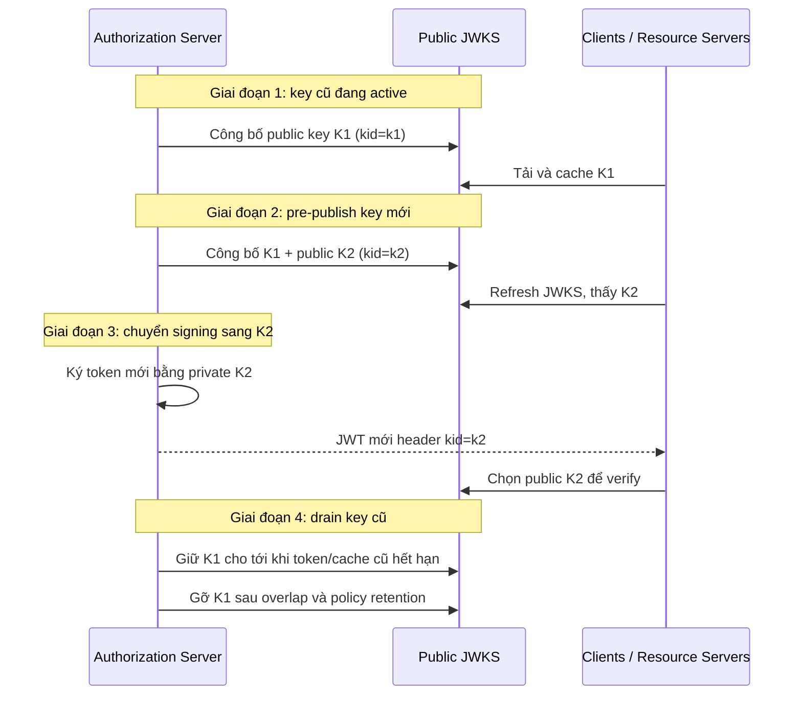

# Lựa chọn RSA, EC và thuật toán ký tương thích với client

## 1. Bài toán: ký token thế nào để mọi bên xác minh được?

Một Spring Authorization Server phát hành JWT access token và OpenID Connect (OIDC) ID Token cho nhiều loại client. Một client cũ chỉ hỗ trợ RSA với `RS256`; một ứng dụng mobile mới hỗ trợ Elliptic Curve (EC) với `ES256`; một API gateway lại có allowlist thuật toán riêng. Nếu Authorization Server đổi thuật toán ký mà không kiểm tra khả năng tương thích, client có thể không xác minh được token, hoặc tệ hơn, vô tình chấp nhận một thuật toán yếu/không mong muốn.

Vì vậy, chọn khóa ký không chỉ là chọn một thư viện tạo key pair. Cần phối hợp:

- **Loại khóa/JWK:** RSA hay EC, kích thước khóa hoặc đường cong (curve), public/private parameters.
- **Thuật toán chữ ký JWS:** `RS256`, `PS256`, `ES256`...; thuật toán phải tương thích với loại khóa và policy.
- **Metadata và key discovery:** `kid`, `use`, `key_ops`, JWKS endpoint và cơ chế client tải khóa công khai.
- **Khả năng của client/resource server:** thư viện JOSE, runtime, crypto provider, FIPS/HSM và allowlist thuật toán.
- **Vòng đời khóa:** lưu trữ private key, rotation, thời gian overlap, cache JWKS và xử lý token cũ.

Bài thuộc chương **JWK và quản lý khóa** của module `SPRING_SECURITY_OAUTH2_OIDC_AUTHORIZATION_SERVER`. Mục tiêu tổng thể của module là **học cách thiết kế, cấu hình, bảo mật, kiểm thử và vận hành OAuth 2.0/OpenID Connect Authorization Server bằng Spring Security và Spring Authorization Server trong ứng dụng Spring Boot**.

### Sau bài này, bạn có thể

1. Phân biệt JWK RSA và EC, public key và private key, JWK và JWK Set.
2. Chọn `RS256`, `PS256`, `ES256` hoặc thuật toán phù hợp dựa trên client compatibility và security policy.
3. Kiểm tra mối quan hệ giữa `kty`, `crv`, `alg`, `use`, `key_ops` và `kid`.
4. Cấu hình `JWKSource<SecurityContext>`, `JwtDecoder` và `TokenSettings` trong Spring Authorization Server.
5. Phân biệt thuật toán ký ID Token với thuật toán ký JWT access token.
6. Lập kế hoạch rotation có overlap, cache refresh và xác minh chữ ký cho client/resource server.

> **Phạm vi phiên bản:** Ví dụ Java sử dụng API phổ biến của Spring Authorization Server 1.x và Spring Security 6.x. Kiểm tra đúng dependency, Nimbus JOSE/JWT và crypto provider trong dự án trước khi áp dụng. Ghi chú bổ sung của bài được giao để trống; không có ràng buộc riêng.

## 2. Phân biệt JWK, JWK Set và JWS

| Thuật ngữ | Ý nghĩa | Ví dụ |
| --- | --- | --- |
| **Key pair** | Một cặp private key và public key có quan hệ mật mã | RSA private/public hoặc EC private/public |
| **JWK** | JSON Web Key: biểu diễn một khóa theo JOSE | Một RSA key có `kty`, `n`, `e`, `kid` |
| **JWK Set (JWKS)** | Tập hợp một hoặc nhiều JWK trong trường `keys` | `{"keys":[...]}` |
| **JWS** | JSON Web Signature: cấu trúc dữ liệu có chữ ký | JWT ký bằng `RS256` |
| **JWT** | JSON Web Token: định dạng claims; thường được bảo vệ bằng JWS | Access token JWT hoặc OIDC ID Token |
| **`kid`** | Key ID: gợi ý chọn khóa trong JWK Set | `rsa-2026-01` |
| **`alg`** | Thuật toán ký/xác minh JWS | `RS256`, `ES256` |

**JWK là biểu diễn khóa, không phải thuật toán ký.** Một JWK có thể chứa thông tin khóa RSA hoặc EC; header JWS của token chỉ rõ thuật toán ký. Server và client cần kiểm tra chúng tương thích với nhau.

### 2.1. JWS có cấu trúc nào?

Một compact JWS JWT thường có ba phần Base64URL:

```text
BASE64URL(protected-header).
BASE64URL(payload).
BASE64URL(signature)
```

Ví dụ protected header:

```json
{
  "alg": "RS256",
  "kid": "rsa-signing-2026-01",
  "typ": "JWT"
}
```

- `alg` cho biết thuật toán chữ ký được sử dụng.
- `kid` giúp client tìm public key phù hợp trong JWKS.
- `typ` có thể mô tả loại JWT; nó không thay thế việc kiểm tra issuer, audience, token type và claims.

Header và payload chỉ được Base64URL encode, **không được mã hóa**. Bất kỳ ai có token đều có thể đọc claims; chữ ký giúp phát hiện dữ liệu bị sửa đổi và xác minh bên ký sở hữu private key tương ứng.

## 3. RSA và EC khác nhau thế nào?

### 3.1. RSA

RSA là hệ mật mã khóa công khai lâu đời, có độ tương thích rộng trong TLS, JOSE libraries, API gateways và các nền tảng doanh nghiệp. JWK RSA public key thường có:

| JWK member | Ý nghĩa |
| --- | --- |
| `kty` | `RSA` |
| `n` | Modulus, mã hóa Base64URLUInt |
| `e` | Public exponent, mã hóa Base64URLUInt |
| `kid` | Định danh khóa |
| `use` | Thường `sig` khi dùng ký |
| `alg` | Có thể chỉ rõ thuật toán JWS được dùng, ví dụ `RS256` |

Private JWK có thể chứa thêm `d`, `p`, `q`, `dp`, `dq` và `qi`. **Không bao giờ công bố các private parameters này trong JWKS public**.

Ưu điểm:

- Tương thích rất rộng với client, gateway và hệ thống cũ.
- RSA public key có thể dùng để xác minh chữ ký mà không cần chia sẻ private key.
- Dễ tích hợp với HSM/KMS và quy trình quản trị khóa của nhiều tổ chức.

Đổi lại, RSA key và chữ ký thường lớn hơn EC ở mức bảo mật tương đương, và thao tác ký có thể tốn tài nguyên hơn.

### 3.2. Elliptic Curve (EC)

EC sử dụng toán học đường cong elliptic để tạo chữ ký với kích thước khóa và chữ ký nhỏ hơn RSA ở mức bảo mật tương đương. JWK EC public key thường có:

| JWK member | Ý nghĩa |
| --- | --- |
| `kty` | `EC` |
| `crv` | Tên curve, ví dụ `P-256` |
| `x` | Tọa độ x của public point |
| `y` | Tọa độ y của public point |
| `kid` | Định danh khóa |
| `use` | Thường `sig` |
| `alg` | Ví dụ `ES256` nếu key được giới hạn cho thuật toán đó |

Private EC JWK có thêm `d`. Không đưa `d` vào public JWKS.

Ưu điểm:

- Khóa và chữ ký compact hơn RSA tương ứng.
- Phù hợp hệ thống cần giảm kích thước token/JWKS và hỗ trợ JOSE EC tốt.
- `ES256` dựa trên P-256 thường được hỗ trợ rộng trong các thư viện hiện đại.

Điểm cần đánh giá là client cũ, HSM, provider và môi trường compliance có thể hỗ trợ EC khác nhau. Không phải mọi runtime đều hỗ trợ mọi curve/algorithm giống nhau.

### 3.3. So sánh thực tế

| Tiêu chí | RSA | EC |
| --- | --- | --- |
| JWK `kty` | `RSA` | `EC` |
| Thành phần public key | `n`, `e` | `crv`, `x`, `y` |
| Thuật toán JWS điển hình | `RS256`, `PS256` | `ES256`, `ES384`, `ES512` |
| Kích thước public key/JWS | Thường lớn hơn | Thường nhỏ hơn |
| Tương thích hệ thống cũ | Rất rộng | Phụ thuộc thư viện/runtime |
| Đánh giá crypto provider | RSA signing và PSS support | Curve, ECDSA support, signature encoding |
| Tình huống chọn | Tích hợp nhiều client cũ/enterprise | Client hiện đại, cần token nhỏ và hỗ trợ EC đồng nhất |

Không có quy tắc “EC luôn an toàn hơn RSA” hay “RSA luôn tốt hơn EC”. Chọn theo **mức bảo mật yêu cầu, client compatibility, chuẩn tổ chức và khả năng vận hành**.

## 4. Các thuật toán JWS phổ biến

Tên thuật toán JWS biểu thị **hàm băm + cơ chế ký**, không phải tên của loại token.

| JWS `alg` | Loại khóa | Cơ chế | Hash/curve |
| --- | --- | --- | --- |
| `RS256` | RSA | RSASSA-PKCS1-v1_5 | SHA-256 |
| `RS384` | RSA | RSASSA-PKCS1-v1_5 | SHA-384 |
| `RS512` | RSA | RSASSA-PKCS1-v1_5 | SHA-512 |
| `PS256` | RSA | RSASSA-PSS | SHA-256 |
| `PS384` | RSA | RSASSA-PSS | SHA-384 |
| `PS512` | RSA | RSASSA-PSS | SHA-512 |
| `ES256` | EC | ECDSA | P-256 + SHA-256 |
| `ES384` | EC | ECDSA | P-384 + SHA-384 |
| `ES512` | EC | ECDSA | P-521 + SHA-512 |

**Điểm dễ nhầm:** `ES512` dùng curve **P-521**, không phải curve có tên P-512. Số trong tên thuật toán chỉ hàm băm tương ứng.

### 4.1. RS256 và PS256

- `RS256` sử dụng RSA với PKCS#1 v1.5 signature padding và SHA-256. Đây là lựa chọn có tính tương thích rộng.
- `PS256` sử dụng RSA-PSS và SHA-256. PSS là cơ chế padding xác suất được thiết kế cho chữ ký RSA hiện đại; cần xác minh thư viện, HSM và client có hỗ trợ.

Không thể đổi header `alg` từ `RS256` sang `PS256` mà giữ nguyên signature bytes. Hai thuật toán có cách tạo/xác minh chữ ký khác nhau.

**Tương thích API Spring:** JWA định nghĩa `PS256`, nhưng không được giả định enum `org.springframework.security.oauth2.jose.jws.SignatureAlgorithm` của mọi phiên bản Spring đều cung cấp mọi thuật toán JWA. Đặc biệt, trước khi dùng `PS256` cho ID Token qua `TokenSettings.idTokenSignatureAlgorithm(...)`, hãy kiểm tra enum/API của dependency thực tế và khả năng của Nimbus/provider/HSM. Nếu API không biểu diễn thuật toán cần dùng, phải thiết kế extension có kiểm thử hoặc chọn thuật toán được toàn bộ stack hỗ trợ; không truyền chuỗi tùy ý vào builder rồi cho rằng server đã ký bằng PSS.

### 4.2. ES256, ES384 và ES512

ECDSA tạo chữ ký theo curve:

- `ES256` → `P-256` + SHA-256.
- `ES384` → `P-384` + SHA-384.
- `ES512` → `P-521` + SHA-512.

JWS mã hóa ECDSA signature dưới dạng hai số nguyên cố định độ dài `R || S` (được Base64URL encode), trong khi một số thư viện crypto cấp thấp dùng ASN.1 DER. Thư viện JOSE phải chuyển đổi đúng định dạng. Đây là lý do không nên tự ký ECDSA JWT bằng cách ghép chuỗi chữ ký từ API crypto tùy ý.

### 4.3. HMAC và thuật toán không phù hợp

`HS256`/`HS384`/`HS512` là thuật toán chữ ký đối xứng: bên ký và bên xác minh cùng giữ secret. Nếu public JWKS được công bố cho mọi client, **không đưa HMAC secret vào đó**. Bên xác minh không được nhận secret dùng để ký.

Với Authorization Server phát JWT cho nhiều Resource Server/client độc lập, chữ ký bất đối xứng RSA/EC thường phù hợp hơn vì chỉ Authorization Server giữ private key, còn bên xác minh chỉ nhận public key.

Không chấp nhận `none` cho access token/ID Token cần chữ ký. Không cho phép client tự chọn thuật toán yếu qua header hoặc fallback khi thuật toán mong đợi không được hỗ trợ.

## 5. Chọn thuật toán theo khả năng tương thích client

### 5.1. Xác định tập client và thư viện xác minh

Trước khi chọn key, lập danh sách:

| Thành phần | Cần xác minh |
| --- | --- |
| OIDC Web Client | `id_token_signed_response_alg` được hỗ trợ, thư viện OIDC/JWT, key discovery |
| SPA/mobile | JOSE implementation, runtime/browser support, khả năng tải JWKS và refresh cache |
| Resource Server Spring | Nimbus decoder, issuer/JWKS configuration, accepted algorithms |
| API Gateway | Allowlist `alg`, JWKS refresh, hỗ trợ RSA/EC/PSS |
| Hệ thống đối tác | Thuật toán và key format được hợp đồng tích hợp chấp nhận |
| HSM/KMS | Thuật toán/curve/key size, signing API và throughput |
| Compliance/security baseline | Thuật toán được phê duyệt, thời hạn key, quy trình rotation |

Đừng chọn `ES512` chỉ vì tên có vẻ mạnh hơn `RS256`. Một thuật toán chỉ an toàn khi các bên triển khai đúng và policy xác minh thực sự yêu cầu nó.

### 5.2. Ma trận quyết định gợi ý

| Bối cảnh | Lựa chọn ban đầu có thể xem xét | Điều kiện |
| --- | --- | --- |
| Nhiều client cũ, gateway chỉ hỗ trợ RSA | `RS256` | RSA key tối thiểu 2048 bit; client pin/allowlist RS256 |
| Tổ chức yêu cầu RSA-PSS | `PS256` | HSM/provider và toàn bộ client hỗ trợ PSS |
| Client hiện đại, JOSE EC hỗ trợ tốt | `ES256` | Public key P-256 và ECDSA JWS support |
| Policy cần curve P-384 | `ES384` | Tất cả client/resource server hỗ trợ |
| Hệ thống có profile P-521 | `ES512` | Xác nhận thư viện, HSM và hiệu năng P-521 |
| Client có khả năng hỗ trợ không đồng nhất | Chọn tập alg giao nhau, thường RS256 hoặc ES256 tùy môi trường | Test thật trên tất cả consumer trước rollout |

Đây là gợi ý kỹ thuật, không thay thế security baseline của tổ chức hoặc yêu cầu pháp lý. Nếu một client không hỗ trợ thuật toán đã chọn, hãy nâng cấp client hoặc thiết kế migration; không hạ toàn hệ thống xuống thuật toán yếu mà không đánh giá.

### 5.3. Một issuer có thể công bố nhiều loại key không?

Có. JWK Set có thể chứa nhiều public key, ví dụ RSA key cũ và EC key mới trong giai đoạn migration. Nhưng **công bố nhiều key không đồng nghĩa server tự động phát token bằng thuật toán phù hợp với từng client**. Cần xác định:

- Token type nào được ký bằng key nào.
- Client nào được phép nhận alg nào.
- `kid` nào sẽ xuất hiện trong JWT header.
- Decoder/resource server có allowlist và chọn đúng key hay không.
- Khi rotate, key cũ được giữ tới khi token cũ hết hiệu lực và cache đã cập nhật.

Nếu một client OIDC đăng ký thuật toán ID Token riêng, cấu hình per-client cần nhất quán với key source và generator. Đừng chỉ thêm EC key vào JWKS rồi cho rằng client cũ RS256 sẽ tự hiểu ES256.

## 6. JWK fields và nguyên tắc công bố public key

### 6.1. RSA JWK public

Ví dụ minh họa:

```json
{
  "kty": "RSA",
  "kid": "rsa-signing-2026-01",
  "use": "sig",
  "alg": "RS256",
  "n": "BASE64URL_RSA_MODULUS",
  "e": "AQAB"
}
```

### 6.2. EC JWK public

Ví dụ minh họa:

```json
{
  "kty": "EC",
  "kid": "ec-signing-2026-01",
  "use": "sig",
  "alg": "ES256",
  "crv": "P-256",
  "x": "BASE64URL_PUBLIC_X",
  "y": "BASE64URL_PUBLIC_Y"
}
```

Các chuỗi `n`, `x`, `y` là placeholder để minh họa schema, không phải khóa hợp lệ.

### 6.3. Ý nghĩa use, key_ops, alg và kid

| Member | Ý nghĩa | Thực hành |
| --- | --- | --- |
| `kty` | Loại key: `RSA`, `EC`... | Phải khớp thuật toán |
| `kid` | Key ID | Duy nhất trong phạm vi JWKS; không tái dùng cho key material khác |
| `use` | Mục đích: `sig` hoặc `enc` | Signing key nên có use phù hợp |
| `key_ops` | Thao tác được phép: `sign`, `verify`... | Public key chỉ cần `verify`; private key không công bố |
| `alg` | Thuật toán dự kiến | Nếu có, phải khớp alg được phép sử dụng |
| `crv` | Curve của EC | Ví dụ `P-256` |
| `n`, `e` | Thành phần public RSA | Không chứa private exponent |
| `x`, `y` | Tọa độ public EC | Không chứa private scalar `d` |

Theo JOSE/JWK, một số member là tùy chọn trong một số bối cảnh; không cần tự thêm mọi trường vào mỗi key. Tuy nhiên, nếu đã giới hạn `alg` hoặc `use`, các giá trị đó phải nhất quán với mục đích sử dụng. Không công bố private parameters như `d`, `p`, `q`, `dp`, `dq` hoặc `qi`.

### 6.4. JWK Set public

Một JWKS công khai có cấu trúc:

```json
{
  "keys": [
    {
      "kty": "RSA",
      "kid": "rsa-signing-2026-01",
      "use": "sig",
      "alg": "RS256",
      "n": "BASE64URL_RSA_MODULUS",
      "e": "AQAB"
    },
    {
      "kty": "EC",
      "kid": "ec-signing-2026-01",
      "use": "sig",
      "alg": "ES256",
      "crv": "P-256",
      "x": "BASE64URL_PUBLIC_X",
      "y": "BASE64URL_PUBLIC_Y"
    }
  ]
}
```

JWKS chỉ công bố **public key**. Việc public key được công khai không làm token kém an toàn: chữ ký chỉ tạo được bằng private key tương ứng. Ngược lại, nếu private material xuất hiện ở endpoint JWKS, cần xem đó là sự cố lộ khóa nghiêm trọng và thực hiện incident response/rotation.

## 7. Chọn RSA key size và EC curve

### 7.1. RSA

Trong hệ thống hiện đại, **RSA 2048 bit** thường được xem là mức tối thiểu thực tế phổ biến cho chữ ký; có thể chọn **3072 bit** nếu security baseline yêu cầu thời gian bảo vệ dài hơn và throughput/latency cho phép. Không chọn RSA 1024 bit cho signing key mới.

Kích thước lớn hơn tăng chi phí ký/xác minh và kích thước public key/JWT. Việc chọn 2048 hay 3072 cần dựa vào thời hạn sử dụng, policy và năng lực HSM/KMS.

### 7.2. EC

| Curve | Thuật toán JWS thường tương ứng | Ghi chú |
| --- | --- | --- |
| `P-256` | `ES256` | Phổ biến, cân bằng giữa hiệu năng và khả năng tương thích |
| `P-384` | `ES384` | Curve lớn hơn, cần kiểm tra client/provider |
| `P-521` | `ES512` | Ít phổ biến hơn, kiểm tra kỹ HSM/JOSE library |

Không trộn `P-256` với `ES384` hoặc `P-384` với `ES256`. Curve, hash và tên thuật toán phải khớp theo JWA.

### 7.3. EdDSA có phải lựa chọn thay thế?

`EdDSA`/Ed25519 là lựa chọn chữ ký hiện đại trong JOSE, nhưng mức hỗ trợ phụ thuộc phiên bản Nimbus, JCA provider, Spring Security, HSM/KMS và client. Bài này tập trung RSA/EC theo đề mục; **không mặc định EdDSA được hỗ trợ ở mọi phiên bản**. Chỉ chọn sau khi xác minh đầy đủ interoperability và policy.

## 8. Cấu hình JWKSource trong Spring Authorization Server

Spring Authorization Server sử dụng **`JWKSource<SecurityContext>`** để cung cấp khóa cho việc ký JWT và công bố JWK Set khi endpoint/metadata được cấu hình phù hợp. Private key phải nằm trong vùng tin cậy của Authorization Server; client/resource server chỉ cần public key.

### 8.1. Ví dụ RSA key cho môi trường học tập

```java
@Bean
JWKSource<SecurityContext> jwkSource() throws JOSEException {
    RSAKey rsaKey = new RSAKeyGenerator(2048)
            .keyID("rsa-signing-demo-2026")
            .generate();

    JWKSet jwkSet = new JWKSet(rsaKey);

    return (jwkSelector, securityContext) ->
            jwkSelector.select(jwkSet);
}
```

`RSAKeyGenerator` tạo cặp key và object `rsaKey` chứa private key trong memory của process. Đoạn code **chỉ dành cho demo/test**: mỗi lần khởi động tạo key mới, khiến JWT cũ không còn xác minh được nếu key trước đó biến mất. Production phải nạp key bền vững từ KMS/HSM/secret store hoặc keystore được bảo vệ.

### 8.2. Ví dụ EC P-256

```java
@Bean
JWKSource<SecurityContext> ecJwkSource() throws JOSEException {
    ECKey ecKey = new ECKeyGenerator(Curve.P_256)
            .keyID("ec-signing-demo-2026")
            .generate();

    JWKSet jwkSet = new JWKSet(ecKey);
    return (jwkSelector, securityContext) ->
            jwkSelector.select(jwkSet);
}
```

Đây cũng là ví dụ tạo key mới trong memory. Không khai báo đồng thời hai bean `JWKSource<SecurityContext>` như hai cấu hình production nếu không có chủ đích chọn/compose key source. Trong một server cần nhiều key, thường trả về **một JWKSource** có thể chọn nhiều JWK theo selector, policy và `kid`.

### 8.3. Public JWKS và JwtDecoder

Với Spring Authorization Server, một `JWKSource` phù hợp cho phép server cung cấp public JWK Set qua JWK Set endpoint đã cấu hình. Để hỗ trợ các chức năng OIDC như UserInfo/introspection theo cấu hình, có thể cần `JwtDecoder`:

```java
@Bean
JwtDecoder jwtDecoder(JWKSource<SecurityContext> jwkSource) {
    return OAuth2AuthorizationServerConfiguration.jwtDecoder(jwkSource);
}
```

Đây là cấu hình phổ biến trong mẫu Authorization Server 1.x. Endpoint JWKS và discovery phải công bố **public issuer URL** nhất quán. Không dùng endpoint nội bộ hoặc URL do header Host chưa tin cậy tạo ra.

### 8.4. Không để public endpoint trả private JWK

Khi tạo JWK Set để publish, cần loại bỏ private parameters:

```java
JWKSet publicJwkSet = new JWKSet(rsaKey.toPublicJWK());
```

Đây là minh họa cách lấy public projection cho một RSA key. Nếu JWKSource cần ký token, nó phải có private key trong vùng bảo mật server; **đừng thay source dùng để ký bằng public-only JWKSet** nếu encoder cần thao tác ký.

## 9. Phân biệt thuật toán ký ID Token và Access Token

Một Authorization Server có thể phát hành cả JWT access token và OIDC ID Token, nhưng **hai loại token có mục đích và cấu hình khác nhau**.

| Đặc tính | JWT Access Token | OIDC ID Token |
| --- | --- | --- |
| Bên nhận chính | Resource Server/API | OIDC Client |
| Mục đích | Cấp quyền truy cập resource | Chứng minh kết quả xác thực End-User |
| Kiểm tra chính | Issuer, signature, audience, expiry, scope/claims | Issuer, signature, audience, expiry, nonce khi áp dụng và OIDC claims |
| Thuật toán ký | Do JwtEncoder/JwtGenerator và signing-key selection quyết định | Có thể cấu hình theo client qua token settings/OIDC policy |
| Không được dùng thay | ID Token không thay access token gọi API | Access token không thay ID Token để xác minh login |

### 9.1. Cấu hình ID Token algorithm theo RegisteredClient

Trong Spring Authorization Server 1.x, `TokenSettings` có cấu hình thuật toán ký ID Token. Ví dụ:

```java
TokenSettings tokenSettings = TokenSettings.builder()
        .idTokenSignatureAlgorithm(SignatureAlgorithm.RS256)
        .build();

RegisteredClient client = RegisteredClient.withId(
                UUID.randomUUID().toString())
        .clientId("orders-oidc")
        .clientSecret(encodedClientSecret)
        .clientAuthenticationMethod(
                ClientAuthenticationMethod.CLIENT_SECRET_BASIC)
        .authorizationGrantType(AuthorizationGrantType.AUTHORIZATION_CODE)
        .redirectUri("https://orders.example.com/login/oauth2/code/orders-oidc")
        .scope(OidcScopes.OPENID)
        .tokenSettings(tokenSettings)
        .build();
```

`SignatureAlgorithm.RS256` là kiểu enum của Spring Security JOSE. Client registration, key source và OIDC client phải cùng hỗ trợ thuật toán này. Nếu chọn `ES256`, phải có EC P-256 signing key và client verifier hỗ trợ ECDSA JWS.

**`idTokenSignatureAlgorithm` chỉ cấu hình chữ ký ID Token**, không tự đổi thuật toán của JWT access token. Thuật toán access token JWT phụ thuộc `JwtEncoder`/`JwtGenerator`, JWS header và JWK selection/customization. Đừng thay một thiết lập rồi giả định cả hai token đổi alg giống nhau.

### 9.2. Client đăng ký thuật toán nào?

Trong OIDC Dynamic Client Registration, `id_token_signed_response_alg` biểu diễn thuật toán chữ ký ID Token mà client yêu cầu. Nếu không khai báo, OIDC Core quy định mặc định `RS256` trong trường hợp tương ứng. Với client đăng ký thủ công trong Spring Authorization Server, hãy ánh xạ yêu cầu tương đương vào cấu hình `TokenSettings`/policy của server.

Nếu client chỉ hỗ trợ `RS256`, server không nên bất ngờ phát ID Token bằng `ES256`. Nếu client yêu cầu thuật toán server không hỗ trợ, cần từ chối registration/request theo policy hoặc chọn cấu hình tương thích đã được thỏa thuận; **không âm thầm hạ cấp sang alg yếu**.

## 10. Key selection: kid và alg phải khớp

Khi ký JWT, header thường có `alg` và `kid`. JWK Set chứa nhiều key thì selector cần tìm key phù hợp:

1. `kid` trỏ tới key đang được dùng để ký.
2. `kty` phù hợp với `alg` (RSA với RS/PS, EC với ES).
3. `crv` phù hợp với ES algorithm.
4. `use`/`key_ops` cho phép mục đích ký hoặc xác minh tương ứng.
5. `alg` trong JWK (nếu có) không mâu thuẫn với JWS header.
6. Key chưa bị loại khỏi policy và đang trong thời hạn sử dụng.

**Không chọn key chỉ vì nó là phần tử đầu tiên trong JWKS.** Khi nhiều key cùng loại, phải có quy tắc chọn rõ ràng; nếu selector không tìm được key phù hợp, signing nên thất bại an toàn thay vì đổi sang thuật toán khác không được yêu cầu.

### 10.1. kid không phải bí mật

`kid` chỉ là định danh công khai. Nó không cần che giấu, nhưng cần **ổn định trong suốt vòng đời key** và không tái dùng cho key material mới. Dùng UUID hoặc key version có thể giúp quản trị; không đưa private key/secret vào kid.

### 10.2. Tránh algorithm confusion

Client/resource server phải:

- Allowlist thuật toán được chấp nhận, ví dụ chỉ `RS256` hoặc `RS256` và `ES256` theo policy.
- Kiểm tra `alg` trong protected header đúng với allowlist; không tin thuật toán do token tự khai.
- Chọn key tương thích `kid`/`kty`/`crv`; không dùng RSA public key như HMAC secret.
- Từ chối `alg=none` và mọi fallback/downgrade không được cho phép.
- Kiểm tra chữ ký trước khi tin claims; sau đó vẫn xác minh `iss`, `aud`, `exp` và claims theo token type.

Không dùng cùng một validator/allowlist cho mọi JWT mà không xét mục đích token. ID Token và access token có audience/claims khác nhau.

## 11. Cấu hình Resource Server xác minh thuật toán

Spring Security Resource Server dùng `JwtDecoder` để xác minh JWT. Có thể cấu hình issuer và thuật toán mong đợi, ví dụ RSA:

```java
@Bean
JwtDecoder jwtDecoder() {
    NimbusJwtDecoder decoder = NimbusJwtDecoder
            .withIssuerLocation("https://auth.example.com")
            .jwsAlgorithm(SignatureAlgorithm.RS256)
            .build();

    decoder.setJwtValidator(
            JwtValidators.createDefaultWithIssuer("https://auth.example.com"));
    return decoder;
}
```

Đoạn ví dụ cho thấy ý tưởng **pin thuật toán và issuer**. API builder cụ thể có thể khác theo phiên bản Spring Security; khi cấu hình nhiều thuật toán, phải thêm rõ từng thuật toán được cho phép thay vì chấp nhận bất kỳ `alg` nào.

Nếu resource server xác minh EC `ES256`, decoder phải có cấu hình phù hợp và public JWKS chứa EC key tương ứng. **Không đổi signing alg ở Authorization Server trước khi toàn bộ Resource Server/consumer được triển khai khả năng xác minh**.

### 11.1. Xác minh audience

Issuer hợp lệ và chữ ký đúng vẫn chưa đủ. API `orders-api` cần kiểm tra token dành cho `orders-api`, không chỉ token bất kỳ do cùng issuer ký. Cấu hình audience validator theo yêu cầu ứng dụng:

```java
OAuth2TokenValidator<Jwt> audienceValidator = jwt -> {
    if (jwt.getAudience().contains("orders-api")) {
        return OAuth2TokenValidatorResult.success();
    }
    return OAuth2TokenValidatorResult.failure(
            new OAuth2Error("invalid_token", "Invalid audience", null));
};
```

Đây là validator minh họa; phải kết hợp với issuer/timestamp/default validators, không thay chúng bằng audience check đơn lẻ.

## 12. Key rotation: thay khóa mà không làm hỏng token đang lưu hành

Rotation không phải “tạo key mới rồi xóa key cũ ngay”. Client có thể đang cache JWKS, còn token ký bằng key cũ vẫn chưa hết hạn.



### 12.1. Quy trình rotation khuyến nghị

1. **Sinh key mới** trong KMS/HSM/keystore được bảo vệ, cấp `kid` mới.
2. **Pre-publish public key** mới trong JWKS nhưng chưa dùng để ký token.
3. Chờ đủ thời gian cho client/resource server refresh JWKS theo cache policy.
4. Chuyển signing sang private key mới; JWT mới mang `kid` mới.
5. Giữ public key cũ để xác minh token đã phát hành bằng key cũ.
6. Chỉ gỡ public key cũ sau khi token cũ hết hạn, cache overlap đã qua và các consumer đã xác minh được key mới.
7. Theo dõi lỗi signature/JWKS refresh; có kế hoạch rollback an toàn.

Thời gian overlap phụ thuộc **max access/ID token lifetime**, cache-control/JWKS cache của consumer, clock skew, thời gian phát hành và yêu cầu vận hành. Không có một con số cố định phù hợp mọi hệ thống.

### 12.2. Rotation định kỳ và rotation khẩn cấp

**Định kỳ:** có thể overlap lâu hơn, rollout theo lịch, thông báo cho client và theo dõi consumer.

**Khẩn cấp khi private key bị lộ:** cần ưu tiên ngừng ký bằng key compromised, thu hồi/loại bỏ key theo incident plan và cân nhắc vô hiệu token cũ. Việc giữ public key bị xâm phạm trong JWKS giúp xác minh token cũ nhưng cũng có thể tiếp tục cho phép token giả được ký bằng private key đã lộ. Quyết định cần cân bằng khả năng xác minh token hợp lệ cũ với nguy cơ attacker tiếp tục ký giả; có thể cần revoke/shorten token validity, blocklist hoặc introspection tùy kiến trúc.

### 12.3. JWKS cache và unknown kid

Khi client nhận JWT với `kid` chưa có trong cache, nó có thể refresh JWKS theo chính sách. Cần tránh:

- Tải JWKS lại liên tục theo mỗi request token giả có kid ngẫu nhiên (DoS).
- Cache JWKS vô thời hạn khiến key rotation không có tác dụng.
- Chỉ lưu một key trong cache khi server công bố nhiều key hợp lệ.
- Dùng key fallback không kiểm tra `kid`/`alg`.

Thiết lập cache TTL và refresh-on-unknown-kid có giới hạn/backoff. Khi JWKS endpoint tạm lỗi, xác định rõ có dùng cache hợp lệ hay fail closed theo security policy.

## 13. Lưu trữ private key: JWKSource không phải kho khóa

Ví dụ `RSAKeyGenerator`/`ECKeyGenerator` trong ứng dụng tạo key mỗi lần process khởi động chỉ phù hợp local demo. Production cần:

- **KMS/HSM:** private key không xuất khỏi vùng bảo mật; signing được thực hiện qua API/provider tương ứng.
- **Keystore được mã hóa:** quyền filesystem tối thiểu, secret unlock lấy từ secret manager, backup/restore và audit.
- **Secret manager:** quản lý version, rotation, quyền đọc và quy trình phát hành.
- **Multi-instance:** mọi node ký/xác minh theo key set/active key nhất quán; không mỗi node tự tạo một key ngẫu nhiên riêng.

JWKSource là **abstraction để chọn/cung cấp JWK cho encoder/endpoint**. Nó có thể được xây trên file, database, KMS/HSM hoặc một kho khóa tùy chỉnh. Đừng coi việc trả một JWK từ bean là đã giải quyết backup, rotation, access control và audit.

### 13.1. Phân tách quyền ký và quyền xác minh

Authorization Server cần quyền dùng private key để ký. Resource Server/client chỉ cần public key. Không sao chép keystore chứa private key tới mọi API chỉ để xác minh JWT; public JWKS là đủ cho chữ ký bất đối xứng.

### 13.2. Backup và phục hồi

Key signing không có backup/restore có thể làm server mất khả năng ký hoặc xác minh token sau sự cố. Kế hoạch backup phải mã hóa, kiểm soát người truy cập, kiểm tra restore định kỳ và không lưu bản private key trong source control/container image.

## 14. Chọn thuật toán riêng cho từng token type

Một Authorization Server có thể có nhiều token:

| Token | Mục đích | Gợi ý kiểm soát |
| --- | --- | --- |
| JWT access token | Resource Server xác minh | Alg allowlist ở Resource Server, issuer/audience/claims |
| OIDC ID Token | OIDC Client xác minh | Thuật toán theo client registration/policy; kiểm tra OIDC claims |
| Client assertion JWT | Authorization Server xác minh client | Khóa/alg của client; audience/expiry/replay |
| Request Object JWT (JAR) | Authorization Server xác minh authorization request | Chính sách JAR riêng, không dùng nhầm signing key/alg của ID Token |

Không giả định mọi JWT trong hệ thống dùng chung một signing algorithm/key. Client assertion có thể được ký bằng private key **của client**; ID/access token được ký bằng private key **của Authorization Server**.

### 14.1. Access token signing algorithm

Với JWT access token, Spring Authorization Server dùng `JwtGenerator` và `JwtEncoder`. Việc lựa chọn JWS header/key phải nhất quán với `JWKSource` và thuật toán mà Resource Server chấp nhận. Nếu tùy chỉnh `OAuth2TokenCustomizer<JwtEncodingContext>`, chỉ thay đổi header/claims trong phạm vi đã kiểm tra và không cho client gửi `alg` tùy ý để điều khiển signing.

### 14.2. ID Token signing algorithm

Với OIDC, `TokenSettings.idTokenSignatureAlgorithm(...)` có thể chỉ định thuật toán ký ID Token theo cấu hình client trong Spring Authorization Server 1.x. Đây là nơi cần đối chiếu với khả năng của OIDC Client. Nếu client yêu cầu `ES256`, cần EC P-256 key và verifier tương thích; nếu client chỉ hỗ trợ `RS256`, dùng cấu hình RSA đã thỏa thuận.

Nếu thuật toán không hỗ trợ hoặc key source không có key phù hợp, phát hành token phải **thất bại an toàn**. Không tạo một ID Token unsigned để “tương thích”.

## 15. JWK thumbprint, x5c và chứng chỉ

### 15.1. JWK thumbprint

**JWK Thumbprint** (RFC 7638) là dấu vân tay tính từ các member công khai cần thiết của JWK theo thứ tự/canonicalization quy định. Nó giúp định danh key material ổn định hơn một nhãn tự đặt. Tuy nhiên:

- Thumbprint không phải private key.
- `kid` không bắt buộc phải là thumbprint, nhưng có thể được thiết kế dựa trên nó.
- Khi key material đổi, thumbprint đổi; đừng tái dùng ID theo cách gây nhầm lẫn.

### 15.2. x5c và x5t

JWK có thể chứa `x5c` (certificate chain) và `x5t`/`x5t#S256` (certificate thumbprint) trong một số profile. Chúng bổ sung thông tin chứng chỉ, **không thay thế kiểm tra JWK, signature, issuer, audience hoặc trust chain**.

Không tin certificate chỉ vì nó nằm trong JWT/JWKS. Khi dùng PKI, phải xác minh chuỗi chứng chỉ, mục đích, thời hạn và trust anchor theo policy.

## 16. Ma trận kiểm thử thuật toán và khả năng tương thích

| Ca thử | Khóa/token | Kết quả mong đợi |
| --- | --- | --- |
| RSA RS256 | RSA key, header `alg=RS256`, đúng `kid` | Client cho phép RS256 xác minh thành công |
| RSA PS256 | RSA key, PSS signature | Chỉ consumer hỗ trợ/allowlist PS256 chấp nhận |
| EC ES256 | EC P-256, header ES256 | JOSE verifier xác minh đúng JWS raw R||S |
| EC ES384 | EC P-384, header ES384 | Client/provider hỗ trợ curve và hash tương ứng |
| EC ES512 | EC P-521, header ES512 | Không nhầm P-521 với P-512 |
| Alg/key mismatch | EC key nhưng header RS256 | Từ chối, không thử fallback |
| Kid không tồn tại | JWT header có kid lạ | Refresh JWKS có giới hạn, sau đó từ chối |
| Key bị thu hồi khỏi JWKS | Token ký bởi key đã gỡ | Consumer xử lý theo overlap/revocation policy |
| Private field bị lộ | JWKS có `d` hoặc RSA private params | Security test phát hiện và chặn publish |
| Alg none | JWT unsigned | Từ chối |
| HMAC confusion | HS256 với public RSA key | Từ chối |
| Issuer sai | Chữ ký đúng nhưng `iss` khác | Từ chối |
| Audience sai | Token đúng chữ ký nhưng sai API | Từ chối |
| Expired token | `exp` đã qua | Từ chối theo clock skew policy |
| Wrong token type | ID Token dùng gọi API hoặc ngược lại | Từ chối theo token contract |
| Rotation pre-publish | JWKS có K1 + K2, server vẫn ký K1 | Consumer tải được K2 trước khi cutover |
| Rotation cutover | Server ký K2, JWKS còn K1 + K2 | Consumer xác minh token mới và token cũ |
| Rotation retirement | Gỡ K1 sau overlap | Token K2 tiếp tục hợp lệ; token K1 hết thời hạn theo policy |
| Multi-node key consistency | Token ký node A, xác minh node B | Cùng JWKS/issuer/key state, verify thành công |
| KMS unavailable | Signing service không hoạt động | Fail closed, không phát token unsigned |
| Client chỉ hỗ trợ RS256 | Server cấu hình ID Token ES256 | Registration/policy ngăn incompatibility hoặc client được nâng cấp |
| Nâng cấp JOSE/provider | Chạy test trên dependency mới | Không thay đổi alg/curve/encoding âm thầm |

### 16.1. Kiểm tra header và JWKS

Với mỗi token mẫu, test cần xác minh:

1. Header `alg` nằm trong allowlist đã thống nhất.
2. Header `kid` tồn tại trong JWKS public.
3. Key có đúng `kty`/`crv`/`use`/`key_ops` và tương thích alg.
4. Chữ ký xác minh được bằng public key.
5. Claims `iss`, `aud`, `exp` và token-specific claims hợp lệ.

Không chỉ giải mã payload để kết luận token hợp lệ. JWT giả có thể chứa claims trông rất thuyết phục nhưng chữ ký sai.

### 16.2. Test rotation không dùng sleep dài

Nên dùng clock/test fixture có thể điều khiển, mock JWKS cache hoặc consumer integration test. Kiểm tra rõ ba thời điểm **pre-publish**, **signing cutover**, **retirement**; test cả cache cũ và consumer mới khởi động lần đầu.

## 17. Chẩn đoán lỗi thường gặp

| Triệu chứng | Nguyên nhân có thể | Hướng xử lý |
| --- | --- | --- |
| Client báo unsupported algorithm | Client không hỗ trợ alg server phát | Đối chiếu allowlist/metadata/TokenSettings, nâng cấp hoặc chọn alg giao nhau |
| `kid` không tìm thấy | JWKS cache cũ, key chưa publish hoặc kid sai | Kiểm tra discovery/JWKS, cache refresh và key rotation |
| RSA verify fail | Sai key, modulus, signature hoặc alg mismatch | So khớp `kid`, `kty`, `alg`, issuer |
| EC verify fail | Sai curve hoặc ECDSA DER/raw signature encoding | Dùng JOSE library đúng chuẩn, xác minh P-256/P-384/P-521 |
| Token cũ fail sau restart | App sinh key mới mỗi lần khởi động | Nạp key bền vững; giữ public key cũ trong JWKS |
| Token mới fail ngay sau rotation | Consumer chưa refresh JWKS | Pre-publish key mới và điều chỉnh overlap/cache |
| Token cũ fail khi key còn hạn | Đã gỡ public key quá sớm | Giữ old key đến hết token lifetime + cache overlap |
| ID Token alg không đúng yêu cầu client | `TokenSettings`/client policy sai hoặc default không được ghi rõ | Kiểm tra `idTokenSignatureAlgorithm` và registration |
| Access Token alg đổi ngoài dự kiến | JwtEncoder/JwtGenerator/key selector/customizer | Kiểm tra JWS header và key selection |
| KMS/HSM signing lỗi | Permission, key version, provider hoặc quota | Kiểm tra audit/health, fail closed, rollback theo kế hoạch |
| Public JWKS có private params | Dùng JWK object chứa private key khi serialize | Publish `toPublicJWK()`/public projection, điều tra incident |
| Một node xác minh được, node khác không | JWKS/key set/issuer không nhất quán | Đồng bộ key version và metadata giữa node |

## 18. Tình huống tổng hợp: migration từ RS256 sang ES256

Một tổ chức đang ký tất cả JWT bằng RSA `RS256`. Họ muốn chuyển sang EC `ES256` để giảm kích thước token, nhưng một số API gateway cũ chưa hỗ trợ ECDSA.

**Bước 1 — Inventory:** liệt kê tất cả OIDC clients, Resource Servers, gateway, mobile versions, thư viện JWT và HSM/KMS. Ghi thuật toán đang allowlist.

**Bước 2 — Compatibility test:** tạo EC P-256 key trong staging, publish public JWK với `kid` mới. Kiểm tra từng consumer có refresh JWKS và verify `ES256` được không.

**Bước 3 — Pre-publish:** JWKS trả cả public K1 (RSA) và K2 (EC). Chưa đổi signing algorithm mặc định. Theo dõi cache refresh và lỗi unknown kid.

**Bước 4 — Chuyển từng nhóm:** chỉ đổi token/client policy cho nhóm đã hỗ trợ ES256. Giữ RSA cho consumer chưa sẵn sàng nếu kiến trúc cho phép phân tách an toàn; không phát token với alg mà consumer không thể verify.

**Bước 5 — Drain:** khi không còn token hợp lệ được ký bằng K1 và cache overlap kết thúc, mới gỡ public RSA key. Private K1 được archive/retire theo key-management policy.

**Bước 6 — Hoàn tất:** cập nhật baseline, test suite và tài liệu client contract; theo dõi signature failures, JWKS fetch errors và token issuance metrics.

Nếu không thể chọn alg riêng cho từng nhóm client một cách rõ ràng, hãy nâng cấp các consumer trước và thực hiện cutover có kế hoạch. **Không dùng cùng một `kid` cho RSA và EC key khác nhau**, và không xóa key cũ ngay khi phát token ES256 đầu tiên.

## 19. Checklist trước production

- [ ] Đã xác định đầy đủ client, Resource Server, gateway, runtime và HSM/KMS cần verify.
- [ ] Đã chọn RSA/EC, key size/curve và JWS alg theo security baseline + giao của khả năng client.
- [ ] RSA không dưới 2048 bit cho signing key mới; EC curve và alg khớp P-256/ES256, P-384/ES384 hoặc P-521/ES512.
- [ ] JWK public có đúng `kty`/`kid`/`use`/`key_ops`/`alg`; không có private parameters.
- [ ] Client/resource server pin/allowlist alg và xác minh chữ ký; từ chối `none`/algorithm confusion.
- [ ] ID Token algorithm được cấu hình phù hợp từng OIDC client; không nhầm với access token signing algorithm.
- [ ] Private key được lưu trong KMS/HSM/keystore/secret store, không sinh lại ngẫu nhiên khi restart production.
- [ ] JWKS/discovery công bố issuer và public key nhất quán, qua HTTPS.
- [ ] Rotation có pre-publish, overlap, cutover, drain và quy trình khẩn cấp khi key compromise.
- [ ] JWKS cache có TTL/refresh-on-unknown-kid hợp lý, chống request spam.
- [ ] Multi-instance dùng key set và issuer nhất quán; backup/restore đã được kiểm tra.
- [ ] Integration test bao gồm alg/key mismatch, kid, issuer, audience, expiry và token type.
- [ ] Có metrics/audit nhưng không log private key, secret hoặc token raw.

## 20. Tổng kết

Chọn thuật toán ký phù hợp là bài toán **tương thích đầu-cuối và quản lý vòng đời khóa**, không chỉ là một lựa chọn enum:

1. **RSA** có độ tương thích rộng; `RS256` là lựa chọn phổ biến, `PS256` phù hợp khi toàn bộ hệ thống hỗ trợ RSA-PSS.
2. **EC** giúp key/signature compact; `ES256` dùng P-256, `ES384` dùng P-384 và `ES512` dùng P-521. Kiểm tra JOSE library/provider/HSM của tất cả consumer.
3. **JWK/JWKS** công bố public key với `kid` ổn định; tuyệt đối không lộ private parameters. Client chọn key theo `kid` và xác minh alg trong allowlist.
4. **ID Token và access token** có mục đích khác nhau; cấu hình ID Token signing algorithm không tự đổi access token algorithm.
5. **Rotation** phải có pre-publish, overlap, cutover và retirement. Key cũ cần được giữ đủ lâu để xác minh token còn hiệu lực, trừ khi incident buộc thu hồi khẩn cấp.

Trong Spring Authorization Server, `JWKSource`, `JwtEncoder`/`JwtGenerator` và `TokenSettings` là những điểm cấu hình quan trọng. Khi thay RSA bằng EC hoặc đổi JWS alg, hãy chứng minh **mọi client/resource server cần thiết đều xác minh được token** trước khi chuyển signing key ở production.

### Tài liệu tham khảo

- [RFC 7517 — JSON Web Key (JWK)](https://www.rfc-editor.org/rfc/rfc7517)
- [RFC 7518 — JSON Web Algorithms (JWA)](https://www.rfc-editor.org/rfc/rfc7518)
- [RFC 7515 — JSON Web Signature (JWS)](https://www.rfc-editor.org/rfc/rfc7515)
- [RFC 7519 — JSON Web Token (JWT)](https://www.rfc-editor.org/rfc/rfc7519)
- [RFC 7638 — JSON Web Key (JWK) Thumbprint](https://www.rfc-editor.org/rfc/rfc7638)
- [RFC 8725 — JSON Web Token Best Current Practices](https://www.rfc-editor.org/rfc/rfc8725)
- [OpenID Connect Core 1.0 — ID Token](https://openid.net/specs/openid-connect-core-1_0.html)
- [Spring Authorization Server — Core Model Components](https://docs.spring.io/spring-authorization-server/reference/core-model-components.html)
- [Spring Authorization Server — Configuration Model](https://docs.spring.io/spring-authorization-server/reference/configuration-model.html)
- [Spring Security — OAuth2 Resource Server JWT](https://docs.spring.io/spring-security/reference/servlet/oauth2/resource-server/jwt.html)
- [Nimbus JOSE + JWT — Documentation](https://connect2id.com/products/nimbus-jose-jwt)
