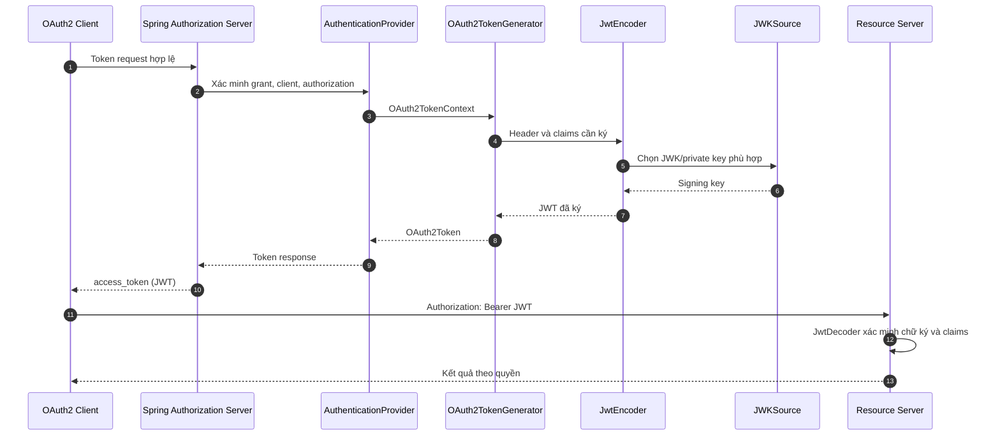
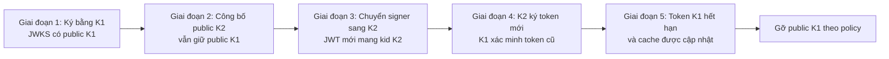

# JwtEncoder và tích hợp bộ tạo JWT

Trong Spring Boot sử dụng **Spring Authorization Server**, việc phát hành JWT gồm nhiều trách nhiệm liên kết với nhau: chọn khóa ký, tạo claims từ ngữ cảnh OAuth2/OIDC, ký token, công bố public key để Resource Server xác minh và duy trì khả năng xác minh trong suốt quá trình luân chuyển khóa.

Spring Security cung cấp abstraction **`JwtEncoder`** để mã hóa và ký JWT. Implementation thường dùng với Nimbus JOSE + JWT là **`NimbusJwtEncoder`**, nhận một **`JWKSource<SecurityContext>`** làm nguồn khóa. Spring Authorization Server kết nối encoder với **`JwtGenerator`** và **`OAuth2TokenGenerator`** để phát access token dạng JWT và OIDC ID token trong các grant tương ứng.

Bài thuộc chương **JWK và quản lý khóa** của mô-đun **SPRING_SECURITY_OAUTH2_OIDC_AUTHORIZATION_SERVER**. Mô-đun hướng dẫn thiết kế, cấu hình, bảo mật, kiểm thử và vận hành OAuth 2.0/OpenID Connect Authorization Server bằng Spring Security và Spring Authorization Server trong ứng dụng Spring Boot. Trọng tâm bài này là **vai trò của JwtEncoder và cách tích hợp nó với bộ tạo token của Authorization Server**.

> **Phân biệt cốt lõi:** `JwtEncoder` ký JWT từ header và claims đã được chuẩn bị. `JwtGenerator` tạo JWT phù hợp với `OAuth2TokenContext`. `DelegatingOAuth2TokenGenerator` điều phối nhiều generator để xử lý JWT, access token opaque và refresh token. `JWKSource` cung cấp khóa phù hợp cho thao tác ký.

**Phạm vi API:** Các ví dụ sử dụng API phổ biến của Spring Security 6.x và Spring Authorization Server 1.5.x. Khi dự án dùng Spring Security 7.x, cần đối chiếu lại package, cách cấu hình và dependency thực tế. Mã sinh khóa RSA ngẫu nhiên chỉ dành cho học tập/test; production cần kho khóa bền vững hoặc KMS/HSM được quản trị.

## 1. JWT được tạo ở đâu trong Authorization Server?

Khi client hoàn tất một grant hợp lệ, Authorization Server tạo token response. Với access token dạng self-contained, token có thể là JWT được ký bằng private key của Authorization Server. Resource Server dùng public key tương ứng để xác minh chữ ký mà không cần gọi lại Token Endpoint cho mỗi request.



Luồng thực tế còn có bước xác thực client, kiểm tra authorization, consent, scope, lưu token và có thể phát refresh token/ID token. Sơ đồ tập trung vào đường tạo JWT.

### 1.1. Vai trò từng thành phần

| Thành phần | Trách nhiệm | Không chịu trách nhiệm |
|---|---|---|
| `JWK` / `JWKSet` | Biểu diễn khóa theo JSON Web Key, có metadata như `kid`, `use`, `alg` | Không tự phát token |
| `JWKSource<SecurityContext>` | Cung cấp JWK phù hợp tiêu chí lựa chọn | Không tự quyết định quyền OAuth |
| `JwtEncoder` | Mã hóa/ký JWT từ header và claims | Không tự xác thực client hoặc consent |
| `NimbusJwtEncoder` | Implementation `JwtEncoder` dựa trên Nimbus JOSE + JWT | Không thay thế token grant provider |
| `JwtGenerator` | Sinh JWT dựa trên `OAuth2TokenContext`, gồm access token JWT hoặc OIDC ID token | Không lưu private key thay cho JWKSource |
| `OAuth2AccessTokenGenerator` | Sinh access token opaque/reference | Không tạo JWT |
| `OAuth2RefreshTokenGenerator` | Sinh refresh token | Không tạo access token JWT |
| `DelegatingOAuth2TokenGenerator` | Kết hợp các generator và chọn generator phù hợp token type | Không thay thế logic grant |
| `JwtDecoder` | Xác minh/giải mã JWT ở Resource Server hoặc thành phần cần xác minh | Không ký token |

### 1.2. Encoder không phải generator

`JwtEncoder` nhận `JwtEncoderParameters` gồm JWS header và claims set, rồi trả về `Jwt` đã được mã hóa/ký. Nó không tự biết phải tạo access token cho grant nào, subject nào, scope nào, TTL nào hoặc request đã được phép hay chưa.

`JwtGenerator` nhận `OAuth2TokenContext`, từ đó biết token type, client, principal, authorization grant, scopes và token settings. Nó tạo claims phù hợp rồi gọi encoder. Vì vậy, trong Spring Authorization Server, **không nên tự gọi JwtEncoder từ controller để thay thế luồng phát token chuẩn**.

## 2. JWK, JWKSet và JWKSource

### 2.1. JWK mô tả khóa theo định dạng chuẩn

**JSON Web Key (JWK)** là cấu trúc JSON biểu diễn khóa mật mã. Với RSA signing key, một số thuộc tính quan trọng:

| Thuộc tính | Ý nghĩa |
|---|---|
| `kty` | Loại khóa, ví dụ `RSA` |
| `kid` | Key ID, xác định khóa trong tập khóa |
| `use` | Mục đích khóa, thường `sig` cho ký/xác minh |
| `alg` | Thuật toán dự kiến, ví dụ `RS256` |
| `n`, `e` | Thành phần public của RSA key |
| `d` và thành phần CRT | Thành phần private; phải được bảo vệ, không công bố |

`JWKSet` chứa một hoặc nhiều JWK. Khi công bố JWKS cho Resource Server, Authorization Server chỉ được tiết lộ **thành phần public** của khóa bất đối xứng. Private key không được đưa ra endpoint công khai, log, browser hoặc client.

### 2.2. JWKSource là nguồn để encoder chọn khóa

`JWKSource<SecurityContext>` là abstraction của Nimbus JOSE + JWT để chọn JWK dựa trên `JWKSelector` và `SecurityContext`. `NimbusJwtEncoder` dùng nguồn này để tìm signing key tương thích với JWS header của JWT.

```text
JwtGenerator
    |
    | OAuth2TokenContext -> claims/header
    v
JwtEncoder
    |
    | JWKSelector (alg, kid, use, key type...)
    v
JWKSource
    |
    +--> active private signing key
    +--> public keys used for verification/JWKS
```

Trong cấu hình đơn giản, `JWKSource` có thể dùng `ImmutableJWKSet`. Trong production, nguồn này nên đọc từ kho khóa được bảo vệ hoặc tích hợp KMS/HSM. Không đặt private key trực tiếp trong mã nguồn hay repository Git.

### 2.3. Key ID và JWT header kid

Một JWT được ký bằng một khóa cụ thể. JWS header thường có `alg` và `kid`:

```json
{
  "alg": "RS256",
  "kid": "as-signing-2026-01",
  "typ": "JWT"
}
```

Resource Server dùng `kid` để chọn public key tương ứng trong JWKS. Khi có nhiều khóa, `kid` giúp rollover rõ ràng. Không tái sử dụng một `kid` cho hai khóa khác nhau; nếu public key thay đổi nhưng `kid` giữ nguyên, cache Resource Server có thể chọn nhầm khóa.

## 3. Tạo JWKSource RSA cho môi trường học tập

### 3.1. Sinh cặp khóa RSA

Ví dụ tạo khóa RSA 2048 bit trong bộ nhớ:

```java
import java.security.KeyPair;
import java.security.KeyPairGenerator;
import java.security.interfaces.RSAPrivateKey;
import java.security.interfaces.RSAPublicKey;
import java.util.UUID;

import com.nimbusds.jose.JWSAlgorithm;
import com.nimbusds.jose.jwk.JWKSet;
import com.nimbusds.jose.jwk.KeyUse;
import com.nimbusds.jose.jwk.RSAKey;
import com.nimbusds.jose.jwk.source.ImmutableJWKSet;
import com.nimbusds.jose.jwk.source.JWKSource;
import com.nimbusds.jose.proc.SecurityContext;

import org.springframework.context.annotation.Bean;
import org.springframework.context.annotation.Configuration;

@Configuration(proxyBeanMethods = false)
public class SigningKeyConfiguration {

    @Bean
    JWKSource<SecurityContext> jwkSource() throws Exception {
        KeyPairGenerator generator = KeyPairGenerator.getInstance("RSA");
        generator.initialize(2048);

        KeyPair pair = generator.generateKeyPair();
        RSAPublicKey publicKey = (RSAPublicKey) pair.getPublic();
        RSAPrivateKey privateKey = (RSAPrivateKey) pair.getPrivate();

        RSAKey signingKey = new RSAKey.Builder(publicKey)
                .privateKey(privateKey)
                .keyID("as-signing-" + UUID.randomUUID())
                .keyUse(KeyUse.SIGNATURE)
                .algorithm(JWSAlgorithm.RS256)
                .build();

        JWKSet jwkSet = new JWKSet(signingKey);
        return new ImmutableJWKSet<>(jwkSet);
    }
}
```

Đoạn mã tạo một khóa mới mỗi lần khởi động. Nó phù hợp **local development hoặc test**, giúp minh họa cách nối `RSAKey` vào `JWKSource`. Khi restart, khóa và `kid` thay đổi; JWT cũ có thể không còn xác minh được nếu Resource Server không có public key cũ.

**Không dùng sinh khóa ngẫu nhiên mỗi lần khởi động làm cấu hình production.** Production phải nạp khóa đã được quản lý, có backup/rotation, quyền truy cập hạn chế và cơ chế khôi phục. Nếu dùng KMS/HSM, private key có thể không export được; cần integration tương thích với signer/encoder được chọn.

### 3.2. JWKSet nhiều khóa

Trong thời gian rollover, JWKSet có thể chứa:

- Khóa hiện hành có public và private component để ký;
- Các khóa cũ chỉ có public component để xác minh token đã phát trước đó.

Ví dụ cấu trúc public JWKS:

```json
{
  "keys": [
    {
      "kty": "RSA",
      "kid": "as-signing-2026-02",
      "use": "sig",
      "alg": "RS256",
      "n": "PUBLIC_MODULUS_NEW",
      "e": "AQAB"
    },
    {
      "kty": "RSA",
      "kid": "as-signing-2026-01",
      "use": "sig",
      "alg": "RS256",
      "n": "PUBLIC_MODULUS_OLD",
      "e": "AQAB"
    }
  ]
}
```

JSON trên chỉ minh họa **public JWKS**. Không đưa trường private như `d`, `p`, `q` hoặc private CRT parameters vào JWKS công khai. Khi ký, encoder phải chọn đúng **một** private key active; khóa cũ chỉ cần public key cho giai đoạn xác minh token cũ.

### 3.3. Lưu khóa bền vững

| Nơi lưu | Đặc điểm | Lưu ý |
|---|---|---|
| PKCS#12/JKS | Lưu private key được bảo vệ trong keystore | Quản lý password, file permission, backup và rotation |
| Secret manager/Vault | Tách bí mật khỏi artifact ứng dụng | Quản lý quyền đọc, audit và version |
| KMS/HSM | Private key có thể không rời thiết bị bảo mật | Cần signer/encoder tương thích và kiểm thử thuật toán |
| Cloud key management | Tích hợp IAM, audit và rotation | Không để workload có quyền ký rộng hơn cần thiết |

Không lưu private key dạng plain text trong YAML, Docker image, biến môi trường không được bảo vệ hoặc source control. Secret manager cũng không tự bảo đảm an toàn nếu mọi service đều có quyền ký bằng cùng một key.

## 4. Tích hợp NimbusJwtEncoder với JWKSource

### 4.1. Khai báo JwtEncoder bean

Sau khi có `JWKSource`, tạo `NimbusJwtEncoder`:

```java
import com.nimbusds.jose.proc.SecurityContext;
import com.nimbusds.jose.jwk.source.JWKSource;

import org.springframework.context.annotation.Bean;
import org.springframework.context.annotation.Configuration;
import org.springframework.security.oauth2.jwt.JwtEncoder;
import org.springframework.security.oauth2.jwt.NimbusJwtEncoder;

@Configuration(proxyBeanMethods = false)
public class JwtEncoderConfiguration {

    @Bean
    JwtEncoder jwtEncoder(JWKSource<SecurityContext> jwkSource) {
        return new NimbusJwtEncoder(jwkSource);
    }
}
```

`NimbusJwtEncoder` là implementation của `JwtEncoder` sử dụng Nimbus JOSE + JWT. Nó nhận `JWKSource` để chọn khóa phù hợp với JWS header. Với RSA key ở ví dụ trước, thuật toán được khai báo `RS256`.

Không nhầm `JwtEncoder` với `JwtDecoder`. Encoder dùng private signing key để ký; decoder dùng public key để xác minh. Có encoder không tự bảo đảm endpoint JWKS được công bố, và có JWKS không tự cấu hình mọi Resource Server tin issuer.

### 4.2. Encoder cần chọn được đúng một khóa ký

Khi có nhiều JWK cùng thỏa selector, encoder cần chiến lược chọn khóa xác định. Cấu hình thực tế nên bảo đảm:

- Khóa ký có private component và `use=sig`;
- `alg` tương thích thuật toán JWS mà token generator yêu cầu;
- `kid` ổn định và duy nhất cho từng phiên bản khóa;
- Chỉ một private signing key active được chọn cho cùng một tiêu chí;
- Public key cũ vẫn được giữ để xác minh token cũ trong thời gian cần thiết.

Nếu `NimbusJwtEncoder` không tìm thấy khóa phù hợp hoặc có nhiều khóa mơ hồ, thao tác encode có thể thất bại bằng `JwtEncodingException`. Không khắc phục bằng cách trả về một khóa bất kỳ mà không xét `alg`/`kid`.

### 4.3. JwtDecoder phục vụ xác minh

Trong Authorization Server, có thể khai báo decoder từ cùng `JWKSource`:

```java
import com.nimbusds.jose.proc.SecurityContext;
import com.nimbusds.jose.jwk.source.JWKSource;

import org.springframework.context.annotation.Bean;
import org.springframework.security.oauth2.jwt.JwtDecoder;
import org.springframework.security.oauth2.server.authorization.config.annotation.web.configuration.OAuth2AuthorizationServerConfiguration;

@Bean
JwtDecoder jwtDecoder(JWKSource<SecurityContext> jwkSource) {
    return OAuth2AuthorizationServerConfiguration.jwtDecoder(jwkSource);
}
```

Decoder thường cần cho những tính năng như OIDC UserInfo hoặc thành phần ứng dụng cần xác minh JWT. Resource Server độc lập có thể dùng issuer metadata hoặc JWKS URI công khai để cấu hình decoder riêng.

**Đừng dùng decoder để xác minh token bằng private key hoặc bỏ kiểm tra claims.** Chữ ký hợp lệ chỉ chứng minh token được ký bởi khóa tin cậy; vẫn cần kiểm tra issuer, audience, expiry, token type và quyền API.

## 5. JwtEncoder tích hợp vào bộ tạo token mặc định

### 5.1. OAuth2TokenGenerator là abstraction trung tâm

Spring Authorization Server sử dụng `OAuth2TokenGenerator` để tạo các loại token dựa trên `OAuth2TokenContext`:

| Generator | Loại token |
|---|---|
| `JwtGenerator` | JWT access token dạng self-contained và OIDC ID token |
| `OAuth2AccessTokenGenerator` | Access token opaque/reference |
| `OAuth2RefreshTokenGenerator` | Refresh token |
| `DelegatingOAuth2TokenGenerator` | Kết hợp các generator trên |

`JwtGenerator` cần `JwtEncoder`. Khi nhận context, nó xem token type và token settings, tạo header/claims phù hợp rồi gọi encoder. Nếu token type không được hỗ trợ, generator trả `null` để `DelegatingOAuth2TokenGenerator` thử generator tiếp theo.

### 5.2. Cấu hình mặc định khi có JwtEncoder hoặc JWKSource bean

Theo cơ chế mặc định của Spring Authorization Server:

- `OAuth2TokenGenerator` có thể được cấu hình tường minh hoặc để framework tạo mặc định.
- Generator mặc định là `DelegatingOAuth2TokenGenerator` gồm `OAuth2AccessTokenGenerator` và `OAuth2RefreshTokenGenerator`.
- Khi đăng ký `JwtEncoder` bean hoặc `JWKSource<SecurityContext>` bean, `JwtGenerator` được bổ sung vào bộ generator mặc định.
- Với `TokenSettings.getAccessTokenFormat()` là `SELF_CONTAINED` (mặc định), access token được tạo dưới dạng JWT.
- Với `OAuth2TokenFormat.REFERENCE`, access token được tạo dưới dạng opaque/reference.

Do đó, **chỉ cần cấu hình JWKSource phù hợp cũng có thể đủ để framework tạo JWT theo mặc định**. Nếu muốn tùy chỉnh cách kết hợp generator hoặc gắn customizer thủ công, cần cấu hình rõ ràng và kiểm thử lại mọi grant.

### 5.3. TokenSettings chọn định dạng access token

Ví dụ cấu hình một client nhận JWT access token:

```java
RegisteredClient apiClient = RegisteredClient
        .withId("orders-client-registration")
        .clientId("orders-client")
        .clientAuthenticationMethod(
                ClientAuthenticationMethod.CLIENT_SECRET_BASIC)
        .authorizationGrantType(AuthorizationGrantType.CLIENT_CREDENTIALS)
        .scope("orders.read")
        .tokenSettings(TokenSettings.builder()
                .accessTokenFormat(OAuth2TokenFormat.SELF_CONTAINED)
                .accessTokenTimeToLive(Duration.ofMinutes(5))
                .build())
        .build();
```

`SELF_CONTAINED` là JWT có claims tự chứa; Resource Server có thể xác minh chữ ký bằng public key. Nếu cấu hình `REFERENCE`, access token opaque không được ký như JWT; Resource Server thường cần introspection hoặc cơ chế tra cứu trạng thái tin cậy.

Không nhầm định dạng access token với refresh token. `JwtGenerator` không có nghĩa mọi token trong token response đều là JWT; refresh token vẫn được sinh bởi generator riêng theo policy.

## 6. Tạo OAuth2TokenGenerator tường minh

### 6.1. Khi nào cần tự khai báo generator?

Có thể giữ generator mặc định nếu chỉ cần JWT chuẩn và JWKSource hoạt động. Nên khai báo `OAuth2TokenGenerator` riêng khi:

- Muốn kiểm soát chính xác loại generator;
- Cần gắn `OAuth2TokenCustomizer` trực tiếp vào `JwtGenerator`;
- Có custom token format hoặc quy tắc generation riêng;
- Muốn wiring tường minh để review và kiểm thử.

Cấu hình thông dụng:

```java
import org.springframework.context.annotation.Bean;
import org.springframework.context.annotation.Configuration;
import org.springframework.security.oauth2.jwt.JwtEncoder;
import org.springframework.security.oauth2.server.authorization.token.DelegatingOAuth2TokenGenerator;
import org.springframework.security.oauth2.server.authorization.token.JwtGenerator;
import org.springframework.security.oauth2.server.authorization.token.OAuth2AccessTokenGenerator;
import org.springframework.security.oauth2.server.authorization.token.OAuth2RefreshTokenGenerator;
import org.springframework.security.oauth2.server.authorization.token.OAuth2TokenGenerator;

@Configuration(proxyBeanMethods = false)
public class TokenGeneratorConfiguration {

    @Bean
    OAuth2TokenGenerator<?> tokenGenerator(JwtEncoder jwtEncoder) {
        JwtGenerator jwtGenerator = new JwtGenerator(jwtEncoder);
        OAuth2AccessTokenGenerator accessTokenGenerator =
                new OAuth2AccessTokenGenerator();
        OAuth2RefreshTokenGenerator refreshTokenGenerator =
                new OAuth2RefreshTokenGenerator();

        return new DelegatingOAuth2TokenGenerator(
                jwtGenerator,
                accessTokenGenerator,
                refreshTokenGenerator);
    }
}
```

`DelegatingOAuth2TokenGenerator` thử các generator theo thứ tự; generator phù hợp với `OAuth2TokenContext.getTokenType()` sẽ tạo token. Ví dụ giữ cả JWT và opaque access token generator để các client có `TokenSettings` khác nhau vẫn có thể dùng định dạng tương ứng.

### 6.2. Gắn generator vào OAuth2AuthorizationServerConfigurer

Có thể truyền generator vào configurer của Authorization Server:

```java
@Bean
@Order(1)
SecurityFilterChain authorizationServerSecurityFilterChain(
        HttpSecurity http,
        OAuth2TokenGenerator<?> tokenGenerator) throws Exception {

    OAuth2AuthorizationServerConfigurer authorizationServer =
            OAuth2AuthorizationServerConfigurer.authorizationServer();

    http
        .securityMatcher(authorizationServer.getEndpointsMatcher())
        .with(authorizationServer, server -> server
            .tokenGenerator(tokenGenerator))
        .authorizeHttpRequests(authorize -> authorize
            .anyRequest().authenticated());

    return http.build();
}
```

Đây là đoạn minh họa protocol chain; ứng dụng còn cần client repository, authorization service, user authentication, issuer, JWK source và login chain phù hợp. `OAuth2AuthorizationServerConfigurer` cũng cho phép phối hợp các cài đặt endpoint khác.

**Không cấu hình hai bộ token generator độc lập rồi không biết provider đang dùng bộ nào.** Nếu vừa khai báo generator bean vừa gọi configurer setter, hãy truyền đúng bean duy nhất đã được kiểm thử. Nếu để framework tạo generator mặc định, không cần thay thế nó chỉ để “có JWT”.

### 6.3. Không bỏ quên refresh token generator

Một lỗi khi tự tạo generator là chỉ trả về `new JwtGenerator(jwtEncoder)`. Khi đó những grant cần refresh token có thể không còn generator phù hợp để phát refresh token. Nếu ứng dụng dùng `refresh_token` grant, giữ `OAuth2RefreshTokenGenerator` trong `DelegatingOAuth2TokenGenerator` và test refresh flow.

Tương tự, nếu một số client dùng opaque access token, cần giữ `OAuth2AccessTokenGenerator`. Không giả định `JwtGenerator` có thể thay thế mọi generator.

## 7. Tùy chỉnh JWT bằng OAuth2TokenCustomizer

### 7.1. JwtEncodingContext cung cấp ngữ cảnh phát token

`OAuth2TokenCustomizer<JwtEncodingContext>` cho phép bổ sung hoặc điều chỉnh JWS header và JWT claims trước khi ký. `JwtEncodingContext` chứa ngữ cảnh như:

- `RegisteredClient` đang yêu cầu token;
- `Principal` đã được xác thực;
- `AuthorizationGrantType`;
- `OAuth2TokenType`;
- Các scope được cấp;
- Authorization hiện tại và metadata liên quan.

Ví dụ thêm `tenant_id` vào access token khi principal là một kiểu ứng dụng có thông tin tenant:

```java
public interface TenantAwarePrincipal {
    String getTenantId();
}

@Bean
OAuth2TokenCustomizer<JwtEncodingContext> jwtCustomizer() {
    return context -> {
        if (!OAuth2TokenType.ACCESS_TOKEN.equals(context.getTokenType())) {
            return;
        }

        Object principal = context.getPrincipal().getPrincipal();
        if (principal instanceof TenantAwarePrincipal tenantPrincipal) {
            context.getClaims().claim(
                    "tenant_id", tenantPrincipal.getTenantId());
        }
    };
}
```

Đây là ví dụ cho ứng dụng có principal tùy chỉnh. Nếu principal không triển khai `TenantAwarePrincipal`, claim không được thêm. Trong production, tenant phải đến từ **ngữ cảnh đã xác minh**; không lấy `tenant_id` từ query parameter hoặc header do client tự gửi mà không xác minh.

### 7.2. Phân biệt access token và ID token

`JwtGenerator` cũng có thể tạo OIDC ID token. Một customizer áp dụng cho cả hai nên phân nhánh theo `tokenType`:

```java
@Bean
OAuth2TokenCustomizer<JwtEncodingContext> jwtCustomizer() {
    return context -> {
        String tokenType = context.getTokenType().getValue();

        if (OAuth2TokenType.ACCESS_TOKEN.getValue().equals(tokenType)) {
            // Claims dành cho Resource Server/API.
            context.getClaims().claim("token_use", "access");
        } else if (OidcParameterNames.ID_TOKEN.equals(tokenType)) {
            // Chỉ thêm claims thực sự dành cho OIDC client.
            // Không đưa toàn bộ quyền API vào ID token.
        }
    };
}
```

Access token dành cho Resource Server; ID token dành cho OIDC client xác minh sự kiện đăng nhập và claims identity. Không dùng ID token làm Bearer token gọi API, và không đưa scope/permission nội bộ không cần thiết vào ID token.

### 7.3. Claims tiêu chuẩn và claims ứng dụng

| Claim | Nguồn/ý nghĩa | Lưu ý |
|---|---|---|
| `iss` | Issuer Authorization Server | Phải nhất quán với metadata và Resource Server |
| `sub` | Subject của token | Không tự ghi đè bằng client ID |
| `aud` | Bên nhận token | Phải phản ánh Resource Server đích |
| `iat` / `exp` | Thời điểm phát và hết hạn | Phù hợp TokenSettings và policy |
| `jti` | Định danh token | Có thể hỗ trợ audit/revocation theo thiết kế |
| `scope` | Scope được cấp | Không tăng quyền từ request chưa xác minh |
| `tenant_id` | Claim ứng dụng ví dụ | Chỉ lấy từ identity/authorization context tin cậy |
| `roles` | Role/authority nếu policy cần | Không copy toàn bộ role một cách máy móc |

Không thay thế claims do framework tạo nếu không có lý do rõ ràng. Ví dụ tự ghi đè `iss`, `sub` hoặc `exp` có thể làm token sai semantics của issuer hoặc vượt thời hạn token settings. Claims bổ sung phải tối thiểu, ổn định và có tài liệu cho Resource Server.

### 7.4. Customizer phải có điều kiện rõ

Không viết customizer kiểu “nếu có token thì thêm tất cả authorities vào claim roles”. Điều đó có thể làm lộ thông tin nội bộ, tăng quyền ngoài ý muốn hoặc tạo token khác nhau không có hợp đồng. Nên kiểm tra grant, client ID, token type, scopes được cấp và ngữ cảnh principal trước khi thêm claim.

Ví dụ chỉ thêm claim cho một client cụ thể:

```java
@Bean
OAuth2TokenCustomizer<JwtEncodingContext> ordersTokenCustomizer() {
    return context -> {
        if (!OAuth2TokenType.ACCESS_TOKEN.equals(context.getTokenType())) {
            return;
        }

        if (!"orders-client".equals(
                context.getRegisteredClient().getClientId())) {
            return;
        }

        if (context.getAuthorizedScopes().contains("orders.read")) {
            context.getClaims().claim("api_domain", "orders");
        }
    };
}
```

Claim `api_domain` chỉ là metadata minh họa, không thay thế `aud` hoặc `scope`. Orders API vẫn phải xác minh audience và quyền trên tài nguyên.

## 8. Khi dùng custom token generator, phải wire customizer tường minh

Nếu để framework tạo generator mặc định, bean `OAuth2TokenCustomizer<JwtEncodingContext>` có thể được tự động gắn với `JwtGenerator` phù hợp. Nhưng khi **tự tạo `JwtGenerator`**, cần gọi `setJwtCustomizer`:

```java
@Bean
OAuth2TokenGenerator<?> tokenGenerator(
        JwtEncoder jwtEncoder,
        OAuth2TokenCustomizer<JwtEncodingContext> jwtCustomizer) {

    JwtGenerator jwtGenerator = new JwtGenerator(jwtEncoder);
    jwtGenerator.setJwtCustomizer(jwtCustomizer);

    OAuth2AccessTokenGenerator accessTokenGenerator =
            new OAuth2AccessTokenGenerator();
    OAuth2RefreshTokenGenerator refreshTokenGenerator =
            new OAuth2RefreshTokenGenerator();

    return new DelegatingOAuth2TokenGenerator(
            jwtGenerator,
            accessTokenGenerator,
            refreshTokenGenerator);
}
```

Nếu customizer không được gắn, ứng dụng có thể phát JWT mà thiếu claim ứng dụng mong đợi dù bean customizer đã tồn tại. Đây là lỗi wiring thường xuất hiện khi thay generator mặc định.

### 8.1. Opaque token có customizer khác

`OAuth2TokenCustomizer<JwtEncodingContext>` chỉ áp dụng cho JWT. Nếu client dùng `OAuth2TokenFormat.REFERENCE`, access token được tạo bởi `OAuth2AccessTokenGenerator` và có thể dùng `OAuth2TokenCustomizer<OAuth2TokenClaimsContext>`:

```java
@Bean
OAuth2TokenCustomizer<OAuth2TokenClaimsContext> opaqueAccessTokenCustomizer() {
    return context -> {
        if (OAuth2TokenType.ACCESS_TOKEN.equals(context.getTokenType())) {
            context.getClaims().claim("token_use", "opaque_access");
        }
    };
}
```

Khi tự tạo `OAuth2AccessTokenGenerator`, cần gọi `setAccessTokenCustomizer(opaqueAccessTokenCustomizer)`. Nếu token generator do framework tạo mặc định, bean customizer loại `OAuth2TokenClaimsContext` có thể được wiring tự động theo cấu hình hỗ trợ.

Không dùng `JwtEncodingContext` để cố chỉnh một opaque token; nó không đi qua `JwtGenerator`.

### 8.2. Không khai báo nhiều customizer cùng loại rồi giả định chúng tự ghép

Nếu có nhiều bean `OAuth2TokenCustomizer<JwtEncodingContext>`, không nên dựa vào giả định framework tự thực thi tất cả theo thứ tự mong muốn. Tùy cách cấu hình và generator, cần một customizer tổng hợp hoặc cơ chế compose có chủ đích. Khi có nhiều policy (tenant, audience, client-specific claim), gom logic vào component rõ ràng và test điều kiện ghi claim.

## 9. JwtEncoder ở mức thấp: tự tạo một JWT trong test

Trong ứng dụng Authorization Server, nên để `JwtGenerator` tạo token từ `OAuth2TokenContext`. Tuy nhiên, hiểu API encoder trực tiếp hữu ích khi viết unit test hoặc công cụ kiểm thử độc lập:

```java
import java.time.Instant;
import java.util.List;

import org.springframework.security.oauth2.jose.jws.SignatureAlgorithm;
import org.springframework.security.oauth2.jwt.JwsHeader;
import org.springframework.security.oauth2.jwt.Jwt;
import org.springframework.security.oauth2.jwt.JwtClaimsSet;
import org.springframework.security.oauth2.jwt.JwtEncoder;
import org.springframework.security.oauth2.jwt.JwtEncoderParameters;

Instant now = Instant.now();

JwtClaimsSet claims = JwtClaimsSet.builder()
        .issuer("https://login.example.com")
        .subject("user-123")
        .audience(List.of("orders-api"))
        .issuedAt(now)
        .expiresAt(now.plusSeconds(300))
        .claim("scope", "orders.read")
        .build();

JwsHeader header = JwsHeader.with(SignatureAlgorithm.RS256)
        .keyId("as-signing-2026-01")
        .build();

Jwt jwt = jwtEncoder.encode(
        JwtEncoderParameters.from(header, claims));

String compactToken = jwt.getTokenValue();
```

Đoạn mã tạo một JWT ký bằng `JwtEncoder`. Trong production, **không tự xây token response trong controller** bằng đoạn mã này, vì bạn sẽ phải tự bảo đảm authorization grant, client authentication, token persistence, metadata, revocation và response semantics. Để phát OAuth token đúng luồng, sử dụng `OAuth2TokenGenerator` đã tích hợp với Authorization Server.

### 9.1. Encoder không thay thế authorization

Nếu caller tự đặt `sub=user-123`, `aud=orders-api` và `scope=orders.read` trong `JwtClaimsSet`, việc ký thành công **không chứng minh caller có quyền cấp các claims đó**. Encoder chỉ thực hiện thao tác mật mã với dữ liệu được đưa vào. Quyết định authorization phải diễn ra trước ở grant provider và policy của hệ thống.

## 10. JWKS Endpoint và Resource Server xác minh JWT

### 10.1. Công bố public keys

Khi có `JWKSource<SecurityContext>` trong cấu hình Authorization Server, Spring Authorization Server có thể cung cấp **JWK Set Endpoint**, thường là `/oauth2/jwks`. Endpoint trả public JWK để Resource Server lấy khóa xác minh JWT.

Ví dụ cấu trúc public JWKS:

```json
{
  "keys": [
    {
      "kty": "RSA",
      "kid": "as-signing-2026-01",
      "use": "sig",
      "alg": "RS256",
      "n": "PUBLIC_MODULUS",
      "e": "AQAB"
    }
  ]
}
```

Đây là dữ liệu public minh họa. Không được xuất private key parameters như `d`, `p`, `q` hoặc private CRT values. Kiểm tra response thực tế của `/oauth2/jwks` để chắc chắn endpoint chỉ công bố khóa công khai.

### 10.2. Resource Server cấu hình issuer/JWKS

Resource Server có thể cấu hình bằng issuer URI:

```yaml
spring:
  security:
    oauth2:
      resourceserver:
        jwt:
          issuer-uri: https://login.example.com
```

Spring Security dùng metadata của issuer để tìm JWKS URI và cấu hình xác minh JWT theo discovery. Một phương án khác là cấu hình `jwk-set-uri` tường minh, nhưng vẫn cần xác minh issuer phù hợp.

### 10.3. Chữ ký đúng vẫn phải kiểm tra audience

Một JWT có chữ ký hợp lệ của Authorization Server **không có nghĩa mọi API đều được nhận**. Orders API cần xác minh token được phát cho đúng audience:

```java
@Bean
JwtDecoder ordersJwtDecoder() {
    String issuer = "https://login.example.com";
    String jwksUri = "https://login.example.com/oauth2/jwks";

    NimbusJwtDecoder decoder =
            NimbusJwtDecoder.withJwkSetUri(jwksUri).build();

    OAuth2TokenValidator<Jwt> issuerValidator =
            JwtValidators.createDefaultWithIssuer(issuer);

    OAuth2TokenValidator<Jwt> audienceValidator = jwt ->
            jwt.getAudience().contains("orders-api")
                ? OAuth2TokenValidatorResult.success()
                : OAuth2TokenValidatorResult.failure(
                    new OAuth2Error(
                        "invalid_token",
                        "Token không dành cho Orders API",
                        null));

    decoder.setJwtValidator(new DelegatingOAuth2TokenValidator<>(
            issuerValidator, audienceValidator));

    return decoder;
}
```

Resource Server còn cần kiểm tra scope/authority, ví dụ `SCOPE_orders.read`, và quyền trên từng đơn hàng/tenant. Chữ ký chỉ xác minh tính toàn vẹn và nguồn ký; nó không tự thực hiện business authorization.

## 11. Thuật toán ký và lựa chọn khóa

### 11.1. RS256 trong ví dụ

`RS256` là RSASSA-PKCS1-v1_5 sử dụng SHA-256. Đây là lựa chọn tương thích rộng trong hệ sinh thái OAuth/OIDC. Có thể dùng thuật toán bất đối xứng khác như ECDSA hoặc RSA-PSS nếu issuer, encoder, JWKS consumer và Resource Server hỗ trợ theo policy.

Không chấp nhận thuật toán `none` cho access token ký. Không để verifier chấp nhận một thuật toán chỉ dựa trên header do token tự khai báo; thuật toán được phép phải bị giới hạn bởi cấu hình và trust policy.

### 11.2. Không dùng cùng một khóa cho mọi mục đích tùy tiện

Nếu cùng một JWK được sử dụng cho nhiều giao thức, cần xác định rõ key use, algorithm, issuer và audience. Tránh dùng một khóa HMAC bí mật chung cho nhiều client/resource server vì bất kỳ bên giữ secret để xác minh cũng có thể có khả năng ký token. Với JWT access token công bố qua JWKS, mô hình bất đối xứng thường giúp tách quyền ký và xác minh.

### 11.3. Kích thước khóa và thuật toán theo policy

RSA 2048 bit trong ví dụ là mức phổ biến cho mục đích minh họa. Tổ chức có thể yêu cầu RSA 3072 bit hoặc thuật toán khác theo tiêu chuẩn mật mã nội bộ. Cần xem xét hiệu năng, khả năng tương thích client/resource server, HSM/KMS và vòng đời khóa trước khi thay thuật toán.

Không tự đổi từ RS256 sang ES256/PS256 chỉ bằng cách sửa chuỗi `alg` trong JWK; key type, encoder, selector, JWT decoder và các client phụ thuộc đều phải hỗ trợ.

## 12. Rotation và vòng đời signing key

### 12.1. Mục tiêu của rotation

Signing key cần được luân chuyển định kỳ và khi nghi ngờ bị lộ. Khi đổi khóa, Authorization Server bắt đầu ký JWT mới bằng key ID mới; Resource Server cần public key mới để xác minh. Token cũ đã phát vẫn còn hiệu lực đến khi hết hạn hoặc bị thu hồi theo cơ chế riêng, nên public key cũ cần được giữ đủ lâu.



Quy trình rollover có thể cần pre-publish public key mới trước khi bắt đầu ký bằng nó, để Resource Server kịp cập nhật cache JWKS. Không gỡ public key cũ ngay khi chuyển signer nếu token cũ còn hiệu lực.

### 12.2. Khoảng giữ public key cũ

Thời gian giữ public key cũ phải xét:

- TTL tối đa của access token được ký bằng khóa cũ;
- Clock skew cho phép ở Resource Server;
- Cache TTL của JWKS và tần suất refresh khóa;
- Độ trễ triển khai/đồng bộ Resource Server;
- Quy trình rollback và xử lý token cũ.

Một quy tắc vận hành thường dùng là giữ public key cũ ít nhất **đến sau thời điểm token cuối cùng ký bằng khóa đó hết hạn**, cộng biên an toàn cho clock skew và cache. Con số cụ thể phải dựa trên cấu hình thực tế.

### 12.3. kid duy nhất và signer active

Khi có nhiều JWK:

- Private signing key active phải được lựa chọn xác định;
- Public key cũ vẫn có mặt trong JWKS;
- `kid` phải duy nhất và không đổi trong suốt vòng đời một khóa;
- Header JWT phải nhận diện đúng key ID;
- Resource Server phải refresh JWKS khi gặp `kid` mới theo cơ chế an toàn.

Không để encoder chọn ngẫu nhiên một trong nhiều private key cùng thỏa selector. Nếu có nhiều khóa cùng `alg`, phải cấu hình nguồn/selector rõ để không tạo JWT với `kid` ngoài dự kiến.

### 12.4. Key compromise cần quy trình khẩn cấp

Nếu private key bị lộ, chỉ xoay khóa định kỳ là chưa đủ. Cần:

1. Ngừng ký bằng key bị xâm phạm và chuyển sang khóa mới;
2. Xác định phạm vi JWT có thể đã bị giả mạo;
3. Cập nhật JWKS và cơ chế cache/invalidation;
4. Đánh giá thu hồi authorization/token và TTL;
5. Thông báo Resource Server cập nhật trust state;
6. Điều tra audit, giới hạn quyền signer và khắc phục nguyên nhân;
7. Chỉ gỡ public key cũ sau khi đánh giá rủi ro và tác động.

JWT tự chứa không có cơ chế thu hồi tức thời mặc định chỉ vì khóa đã được xoay. Nếu Resource Server cache public key cũ và vẫn tin nó, JWT giả được ký bằng private key bị lộ có thể tiếp tục được xác minh cho đến khi trust/key state được cập nhật.

## 13. Kiểm thử JwtEncoder và token generator

### 13.1. Kiểm thử JWKSource và encoder

| Test case | Điều kiện | Kỳ vọng |
|---|---|---|
| JWKSource có signing key | RSA private/public key hợp lệ, use=sig, alg phù hợp | Encoder chọn được khóa |
| Thiếu private key | Chỉ có public JWK cho thao tác ký | Không tạo JWT |
| Sai thuật toán | Header RS256 nhưng source không có key tương thích | Encode thất bại |
| Không có key phù hợp | JWKSource trả danh sách rỗng | JwtEncodingException hoặc lỗi tương ứng |
| Nhiều key mơ hồ | Nhiều private key cùng selector | Cấu hình chọn khóa rõ; không chọn ngẫu nhiên |
| kid | JWK có key ID | JWT header xác định đúng key |
| Chữ ký hợp lệ | Decode bằng public key tương ứng | Verify thành công |
| Token bị sửa | Thay payload/signature | Decoder từ chối |
| Public JWKS | Gọi `/oauth2/jwks` | Chỉ có public key material |
| Private key leakage | Kiểm tra response/log/artifact | Không xuất private parameters |

### 13.2. Kiểm thử generator theo loại token

| Token type/client setting | Generator mong đợi | Điều cần kiểm tra |
|---|---|---|
| Access token `SELF_CONTAINED` | `JwtGenerator` | Kết quả là JWT có chữ ký |
| Access token `REFERENCE` | `OAuth2AccessTokenGenerator` | Opaque token, không giả định JWT |
| OIDC ID token | `JwtGenerator` | Chỉ xuất hiện khi OIDC flow và điều kiện phù hợp |
| Refresh token | `OAuth2RefreshTokenGenerator` | Không bị customizer JWT làm thay đổi |
| Custom JWT claims | `JwtGenerator` + JWT customizer | Claim chỉ thêm cho token type/client phù hợp |
| Custom opaque claims | `OAuth2AccessTokenGenerator` + claims customizer | Claim được lưu/introspect đúng |
| Generator tường minh | `DelegatingOAuth2TokenGenerator` | Không mất opaque/refresh generator |

### 13.3. Unit test xác minh JWT bằng public key

Ví dụ test khái niệm sau khi có `JwtEncoder` và `JwtDecoder` đã cấu hình:

```java
@Test
void jwtCanBeEncodedAndVerified() {
    JwtClaimsSet claims = JwtClaimsSet.builder()
            .issuer("https://login.example.com")
            .subject("user-123")
            .audience(List.of("orders-api"))
            .issuedAt(Instant.now())
            .expiresAt(Instant.now().plusSeconds(120))
            .claim("scope", "orders.read")
            .build();

    JwsHeader header = JwsHeader.with(SignatureAlgorithm.RS256).build();

    Jwt encoded = jwtEncoder.encode(
            JwtEncoderParameters.from(header, claims));

    Jwt decoded = jwtDecoder.decode(encoded.getTokenValue());

    assertThat(decoded.getSubject()).isEqualTo("user-123");
    assertThat(decoded.getAudience()).contains("orders-api");
    assertThat(decoded.getClaimAsString("scope")).isEqualTo("orders.read");
}
```

Test fixture cần có JWKSource và decoder cùng trust key. Nếu kiểm thử TTL, dùng Clock/fixture phù hợp và không dựa vào sleep. Một test encode/decode thành công chưa chứng minh Authorization Endpoint, grant provider, token persistence hoặc Resource Server audience policy đã đúng.

### 13.4. Integration test qua Token Endpoint

Một integration test quan trọng cần:

1. Đăng ký `RegisteredClient` với `SELF_CONTAINED` access token.
2. Gọi một grant được phép, ví dụ Client Credentials hoặc Authorization Code.
3. Nhận token response và xác minh access token là JWT.
4. Đọc `kid`, lấy public JWK tương ứng từ JWKS và xác minh chữ ký.
5. Kiểm tra `iss`, `aud`, `exp`, `scope` và custom claims.
6. Đổi client sang `REFERENCE` trong test riêng, xác minh token opaque và customizer loại khác.
7. Chạy refresh grant nếu ứng dụng sử dụng để bảo đảm refresh token generator vẫn hoạt động.
8. Thực hiện key rollover test với token cũ và mới.

Đừng chỉ test trực tiếp `JwtEncoder` rồi kết luận bộ token generator đã tích hợp đúng. Cần có ít nhất một test **đi qua grant provider và Token Endpoint**.

## 14. Lỗi thường gặp và cách chẩn đoán

| Triệu chứng | Nguyên nhân khả dĩ | Cách xử lý |
|---|---|---|
| Không có access token JWT dù có JWKSource | Client đang dùng `REFERENCE` hoặc generator không được wire | Kiểm tra `TokenSettings.accessTokenFormat` và token generator |
| `JwtEncodingException` không tìm thấy key | JWKSource không trả key có private component/alg phù hợp | Kiểm tra `kty`, `use`, `alg`, private key |
| Có nhiều key phù hợp | Selector không xác định được duy nhất signing key | Giới hạn selector, `kid` và active signer |
| JWT thiếu custom claim | Customizer không được gắn vào generator tự tạo | Gọi `JwtGenerator.setJwtCustomizer` hoặc dùng auto wiring đúng |
| Custom claim xuất hiện trong ID token không mong muốn | Customizer không phân nhánh token type | Kiểm tra `OAuth2TokenType` và OIDC token type |
| Refresh token không còn được phát | Delegating generator bỏ `OAuth2RefreshTokenGenerator` | Khôi phục generator và test refresh grant |
| Opaque token không có claim | Chỉ cấu hình JwtEncodingContext customizer | Dùng `OAuth2TokenClaimsContext` cho opaque |
| JWKS endpoint 404 | JWKSource chưa có hoặc protocol chain/endpoint settings sai | Kiểm tra JWKSource bean và `/oauth2/jwks` |
| Resource Server không xác minh được token | JWKS URI/issuer sai, cache cũ, kid không có | Kiểm tra discovery, JWKS, `kid` và thời gian |
| JWT signature invalid sau restart | Khóa được sinh ngẫu nhiên lại mỗi lần khởi động | Nạp khóa bền vững, giữ public key cũ |
| JWT ký bằng kid lạ | Nhiều signer active hoặc JWK selection không rõ | Quản lý active key và selector |
| Token bị từ chối dù chữ ký đúng | Sai issuer, audience, expiry hoặc scope | Kiểm tra validators và API policy |
| Customizer ghi đè exp | Token vượt TTL cấu hình | Không ghi đè claim tiêu chuẩn tùy tiện |
| Nhiều node phát JWT không nhất quán | JWKSource khác nhau hoặc key rollout lệch | Đồng bộ key registry, active key và JWKS |
| Lộ private key | JWKS/log/config/artifact chứa private parameters | Thu hồi key, rotate khẩn cấp, kiểm tra quyền truy cập |

## 15. Vận hành production và checklist bảo mật

### 15.1. Checklist triển khai

1. **Nguồn khóa:** JWKSource dùng key store bền vững hoặc KMS/HSM; không sinh khóa mới mỗi lần restart production.
2. **Quyền truy cập:** Chỉ thành phần phát token có quyền ký; Resource Server chỉ cần public key.
3. **Thuật toán:** Giới hạn JWS algorithms theo policy; không chấp nhận `none` hoặc thuật toán ngoài allowlist.
4. **Key ID:** Mỗi phiên bản khóa có `kid` duy nhất; JWT header và JWKS đồng bộ.
5. **Token generator:** Giữ đủ `JwtGenerator`, `OAuth2AccessTokenGenerator` và `OAuth2RefreshTokenGenerator` theo định dạng client.
6. **Customizer:** Phân nhánh theo grant/token type/client; chỉ thêm claims tối thiểu từ ngữ cảnh tin cậy.
7. **Claims:** Kiểm tra `iss`, `sub`, `aud`, `iat`, `exp` và scope; không ghi đè claims tiêu chuẩn thiếu chủ đích.
8. **Resource Server:** Xác minh chữ ký, issuer, audience, thời hạn, scope và quyền nghiệp vụ.
9. **JWKS:** Chỉ công bố public material; giữ public key cũ đủ lâu sau rollover.
10. **Rotation:** Pre-publish key mới, chuyển signer có kiểm soát, theo dõi cache và có kế hoạch rollback.
11. **Incident response:** Có quy trình xử lý private key compromise và đánh giá token đã phát.
12. **Quan sát:** Theo dõi lỗi ký/decoder, kid lạ, token bị từ chối và sai lệch key giữa các node; không log token/private key.

### 15.2. Những dữ liệu không được log

Không log:

- Private key, JWK private parameters, keystore password hoặc KMS credentials;
- Access token, refresh token, ID token đầy đủ;
- Authorization code, client secret hoặc client assertion;
- Toàn bộ claims có thông tin cá nhân nhạy cảm nếu không có nhu cầu được phê duyệt.

Có thể log `kid`, client ID đã xác minh, token type, grant type, correlation ID và mã lỗi. Nếu cần truy vết token, dùng định danh/hash an toàn theo policy thay vì lưu nguyên bearer credential.

### 15.3. Tình huống key compromise

Khi nghi ngờ private signing key bị lộ, phải đánh giá đây là sự cố trust của toàn bộ token do khóa đó ký. Chỉ thay `JwtEncoder` bean hoặc tạo key mới không đủ nếu Resource Server vẫn chấp nhận public key cũ. Cần phối hợp issuer, JWKS cache, Resource Server, token TTL/revocation, audit và quy trình thu hồi.

## 16. Bài tập thực hành

**Đề bài:** Xây Authorization Server cho Orders API, phát JWT access token có `aud=orders-api` và scope `orders.read`. Dùng RSA signing key với `kid` ổn định, công bố public JWKS và thêm claim `tenant_id` từ principal đã xác thực.

**Yêu cầu thực hiện:**

1. Tạo `JWKSource<SecurityContext>` từ RSA key cho môi trường local/test.
2. Tạo `NimbusJwtEncoder` từ JWKSource.
3. Tạo `JwtGenerator` và tích hợp qua `DelegatingOAuth2TokenGenerator`, giữ opaque và refresh generator nếu hệ thống cần.
4. Cấu hình `OAuth2AuthorizationServerConfigurer.tokenGenerator(...)` khi dùng generator tường minh.
5. Đăng ký client có `TokenSettings.accessTokenFormat(SELF_CONTAINED)`.
6. Viết `OAuth2TokenCustomizer<JwtEncodingContext>` chỉ thêm `tenant_id` khi principal thực sự có thông tin tenant.
7. Xác minh JWT header có `kid`, chữ ký hợp lệ và claims đúng.
8. Gọi `/oauth2/jwks` để xác nhận chỉ có public key material.
9. Cấu hình Resource Server kiểm tra issuer, audience `orders-api` và scope.
10. Thực hiện test rollover: phát token bằng K1, công bố K2, chuyển signer sang K2, xác minh token cũ và mới rồi mới gỡ public K1 sau thời gian an toàn.

**Tiêu chí nghiệm thu:** Token chỉ được phát qua grant hợp lệ; encoder chọn đúng private key; JWT có `kid` và claims theo policy; Resource Server xác minh đúng public key/issuer/audience/scope; opaque/refresh flows không bị hỏng; private key không xuất hiện trong JWKS/log/source control.

## 17. Câu hỏi tự đánh giá

1. `JwtEncoder` khác `JwtGenerator` ở trách nhiệm nào?
2. Vì sao `NimbusJwtEncoder` cần `JWKSource<SecurityContext>`?
3. `JWK`, `JWKSet` và `JWKSource` có vai trò khác nhau ra sao?
4. `kid` giúp Resource Server chọn khóa nào và điều gì xảy ra khi tái sử dụng kid?
5. Khi `TokenSettings.accessTokenFormat` là `SELF_CONTAINED` và `REFERENCE`, generator nào được dùng?
6. Vì sao `DelegatingOAuth2TokenGenerator` cần giữ cả access token generator và refresh token generator?
7. Khi nào Spring Authorization Server tự tạo JwtGenerator từ JwtEncoder/JWKSource bean?
8. Khi tự tạo `JwtGenerator`, vì sao phải gắn `OAuth2TokenCustomizer<JwtEncodingContext>`?
9. Vì sao customizer phải phân biệt access token và ID token?
10. Tại sao customizer không nên copy tất cả role/claim từ principal?
11. Vì sao encoder ký thành công không chứng minh claims được ủy quyền đúng?
12. Resource Server cần kiểm tra gì ngoài chữ ký JWT?
13. Tại sao public JWKS chỉ được chứa public key material?
14. Khi rotation, vì sao phải giữ public key cũ sau khi chuyển signer?
15. Nếu sinh khóa ngẫu nhiên mỗi lần restart, token đang còn hạn có thể gặp vấn đề gì?
16. Khi private key bị compromise, vì sao chỉ thay key mới chưa đủ để vô hiệu token giả/cũ?
17. Khi nào nên dùng custom JwtEncoder/KMS signer thay vì NimbusJwtEncoder mặc định?
18. Làm thế nào để kiểm thử encoder, generator, token endpoint và Resource Server trong cùng một luồng?

## 18. Tài liệu tham khảo chính thức

- [Spring Authorization Server — Core Model / Components](https://docs.spring.io/spring-authorization-server/reference/core-model-components.html): `OAuth2TokenGenerator`, `JwtGenerator`, `OAuth2TokenCustomizer`, `DelegatingOAuth2TokenGenerator` và cách wiring generator.
- [Spring Authorization Server — Configuration Model](https://docs.spring.io/spring-authorization-server/reference/configuration-model.html): cấu hình protocol endpoints, JWK Set Endpoint và các thành phần Authorization Server.
- [Spring Authorization Server — API JwtGenerator](https://docs.spring.io/spring-authorization-server/reference/api/java/org/springframework/security/oauth2/server/authorization/token/JwtGenerator.html): constructor nhận `JwtEncoder`, `generate` và `setJwtCustomizer`.
- [Spring Security — NimbusJwtEncoder API](https://docs.spring.io/spring-security/reference/api/java/org/springframework/security/oauth2/jwt/NimbusJwtEncoder.html): implementation JwtEncoder sử dụng JWKSource.
- [Spring Security — OAuth2 Resource Server JWT](https://docs.spring.io/spring-security/reference/servlet/oauth2/resource-server/jwt.html): cấu hình decoder, issuer và xác minh JWT.
- [RFC 7517 — JSON Web Key (JWK)](https://www.rfc-editor.org/rfc/rfc7517): cấu trúc JWK/JWK Set và các thuộc tính khóa.
- [RFC 7515 — JSON Web Signature (JWS)](https://www.rfc-editor.org/rfc/rfc7515): header, thuật toán và compact serialization của JWT ký.
- [RFC 7519 — JSON Web Token (JWT)](https://www.rfc-editor.org/rfc/rfc7519): claims và cấu trúc JWT.
- [RFC 9068 — JWT Profile for OAuth 2.0 Access Tokens](https://www.rfc-editor.org/rfc/rfc9068): profile JWT access token, issuer, audience và các yêu cầu xác minh.

**Ghi nhớ:** `NimbusJwtEncoder` ký JWT bằng JWK phù hợp; `JwtGenerator` chuyển `OAuth2TokenContext` thành JWT; `DelegatingOAuth2TokenGenerator` phối hợp JWT, opaque access token và refresh token theo token type/format. Để tích hợp an toàn, hãy quản lý JWK bền vững, lựa chọn `kid`/thuật toán xác định, chỉ thêm claims từ ngữ cảnh đã xác minh, công bố public JWKS và kiểm tra issuer/audience/scope ở Resource Server. Khi xoay khóa, giữ public key cũ đủ lâu để xác minh token còn hạn và có quy trình khẩn cấp khi private key bị xâm phạm.
