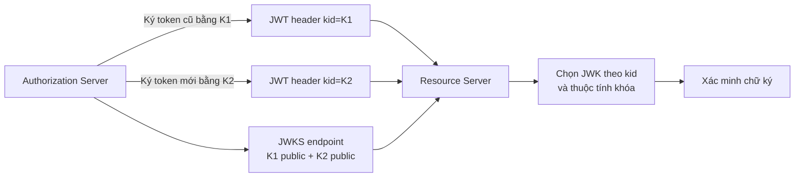
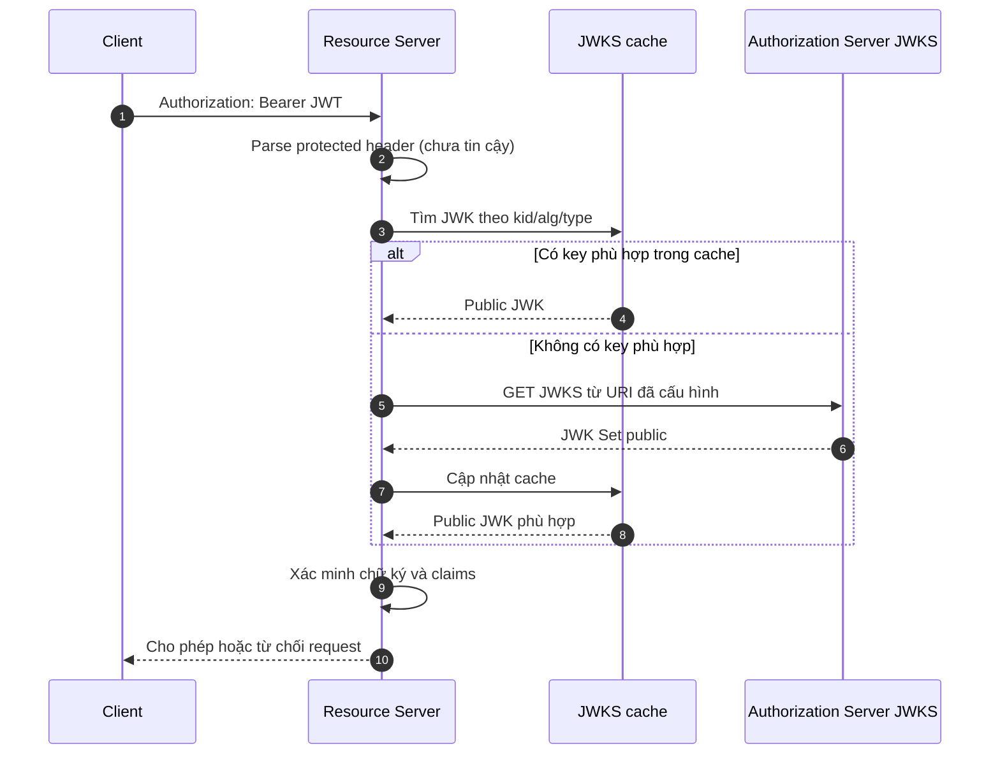
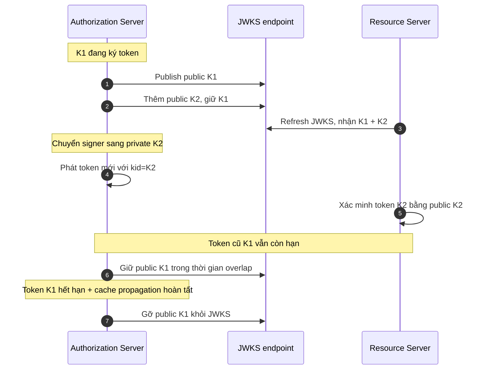

# kid và quá trình Resource Server lựa chọn khóa xác minh

Trong OAuth 2.0/OpenID Connect, Authorization Server thường ký JWT access token bằng **khóa riêng** và công bố khóa công khai tương ứng qua **JSON Web Key Set (JWKS)**. Resource Server nhận JWT từ client, cần xác định đúng khóa công khai để kiểm tra chữ ký trước khi tin các claims bên trong token.

Trường **`kid` (Key ID)** trong protected header của JWT giúp Resource Server nhận biết khóa nào trong JWK Set có khả năng đã được dùng để ký token. Nó đặc biệt quan trọng khi Authorization Server có nhiều khóa cùng tồn tại trong giai đoạn xoay vòng khóa. Tuy nhiên, `kid` chỉ là **gợi ý chọn khóa**, không phải bằng chứng mật mã, không phải bí mật và cũng không thay thế việc xác minh chữ ký.

Bài học thuộc chương **JWK và quản lý khóa** của module **SPRING_SECURITY_OAUTH2_OIDC_AUTHORIZATION_SERVER**, với mục tiêu học cách thiết kế, cấu hình, bảo mật, kiểm thử và vận hành OAuth 2.0/OpenID Connect Authorization Server bằng Spring Security và Spring Authorization Server trong Spring Boot.

Sau bài học, bạn có thể:

- Giải thích quan hệ giữa JWT header `kid`, JWK, JWKS endpoint và khóa ký của Authorization Server.
- Mô tả các bước Resource Server chọn JWK phù hợp và xác minh chữ ký JWT.
- Phân biệt `kid` với `alg`, `kty`, `use` và `key_ops`.
- Cấu hình Spring Authorization Server công bố public JWK và ký JWT bằng khóa riêng tương ứng.
- Cấu hình Spring Resource Server lấy JWKS theo issuer hoặc URI được cấu hình, đồng thời kiểm tra issuer, audience và thuật toán.
- Thiết kế key rotation có thời gian chồng lấp để token cũ vẫn xác minh được trong khi token mới dùng khóa mới.
- Kiểm thử unknown kid, key cache, chữ ký sai, thuật toán không được phép và các tình huống khẩn cấp khi khóa bị lộ.

## 1. Vì sao Resource Server cần kid?

Giả sử Authorization Server ký access token cho `orders-api` bằng RSA. Khi chỉ có một khóa, Resource Server có thể xác minh mọi token bằng public key duy nhất. Nhưng hệ thống production cần xoay khóa định kỳ, thay khóa khi nghi ngờ bị lộ, hoặc hỗ trợ nhiều khóa trong giai đoạn triển khai song song.

Trong thời gian chuyển đổi, JWKS có thể chứa đồng thời public key cũ và mới:



Nếu không có định danh khóa, Resource Server có thể phải thử nhiều khóa phù hợp cho đến khi tìm được khóa xác minh chữ ký. Khi có nhiều khóa, điều này gây tốn chi phí, làm lựa chọn khó dự đoán và tăng nguy cơ cấu hình sai. `kid` cho phép thư viện JOSE/JWT lọc tập khóa ứng viên trước khi xác minh.

**Ví dụ:** token cũ được ký bởi private key K1 có header `kid` là `as-signing-2026-01`. Token mới được ký bằng K2 có `kid` là `as-signing-2026-07`. JWKS công bố cả public key K1 và K2 trong thời gian chuyển tiếp. Resource Server dùng `kid` trong JWT header để tìm đúng public JWK, sau đó vẫn phải xác minh chữ ký.

## 2. JWK, JWKS và kid

### 2.1. JWK — JSON Web Key

**JWK** là một JSON object mô tả một khóa mật mã. Với RSA public key, các trường thường gặp:

| Trường | Ý nghĩa |
| --- | --- |
| `kty` | Key type, ví dụ `RSA` hoặc `EC`. |
| `kid` | Key ID, định danh khóa để đối chiếu với JWT header. |
| `use` | Mục đích sử dụng, ví dụ `sig` cho ký/xác minh hoặc `enc` cho mã hóa. |
| `key_ops` | Các thao tác được phép, ví dụ `verify` hoặc `sign`. |
| `alg` | Thuật toán JOSE dự kiến dùng với khóa, ví dụ `RS256`. |
| `n`, `e` | Thành phần modulus và public exponent của RSA public key. |
| `crv`, `x`, `y` | Đường cong và tọa độ public key đối với EC. |

Một public RSA JWK minh họa:

```json
{
  "kty": "RSA",
  "use": "sig",
  "key_ops": ["verify"],
  "kid": "as-signing-2026-01",
  "alg": "RS256",
  "n": "<BASE64URL_RSA_MODULUS>",
  "e": "AQAB"
}
```

Các giá trị `n` và `e` là placeholder. JWK public **không chứa private exponent `d`** hay các thành phần private RSA khác. Không công bố JWK có private material tại endpoint JWKS công khai.

### 2.2. JWKS — JSON Web Key Set

**JWKS** là một JSON object chứa mảng `keys`, mỗi phần tử là một JWK:

```json
{
  "keys": [
    {
      "kty": "RSA",
      "use": "sig",
      "key_ops": ["verify"],
      "kid": "as-signing-2026-01",
      "alg": "RS256",
      "n": "<PUBLIC_MODULUS_K1>",
      "e": "AQAB"
    },
    {
      "kty": "RSA",
      "use": "sig",
      "key_ops": ["verify"],
      "kid": "as-signing-2026-07",
      "alg": "RS256",
      "n": "<PUBLIC_MODULUS_K2>",
      "e": "AQAB"
    }
  ]
}
```

JWKS endpoint thường được công bố trong Authorization Server metadata qua trường `jwks_uri`. Với cấu hình Spring Authorization Server thông dụng, endpoint JWK Set mặc định thường là `/oauth2/jwks`, trừ khi ứng dụng thay đổi `AuthorizationServerSettings`.

Resource Server cần lấy JWKS từ **issuer metadata đáng tin** hoặc một URI được cấu hình rõ. Không lấy URI JWKS từ một header JWT không đáng tin rồi tải khóa theo URL đó.

### 2.3. kid trong JWT protected header

Một JWT JWS có header dạng:

```json
{
  "alg": "RS256",
  "kid": "as-signing-2026-01",
  "typ": "JWT"
}
```

- `alg` cho biết thuật toán chữ ký mà token khai báo.
- `kid` gợi ý khóa tương ứng trong JWK Set.
- `typ` có thể biểu thị loại token nếu ứng dụng đặt giá trị đó.

Header là dữ liệu được đọc trước khi chữ ký được xác minh. Vì vậy, **không tin `alg` hay `kid` chỉ vì chúng xuất hiện trong JWT**. Resource Server dùng chúng để chọn ứng viên trong tập khóa và thuật toán đã được cấu hình tin cậy; sau đó phải xác minh chữ ký.

`kid` không phải secret. Không đưa password, private key, thông tin người dùng hoặc dữ liệu nội bộ nhạy cảm vào giá trị này.

## 3. Resource Server chọn khóa xác minh như thế nào?

Quy trình khái niệm khi Resource Server nhận JWT:

1. Đọc cấu hình trust: issuer nào được chấp nhận và JWKS lấy từ đâu.
2. Parse protected header để lấy `alg` và `kid`. Ở thời điểm này, header và payload **chưa được xác minh**.
3. Lấy JWK Set từ nguồn đã cấu hình hoặc cache JWKS hiện có.
4. Lọc các JWK ứng viên dựa trên các thuộc tính phù hợp: `kid`, `kty`, `use`, `key_ops` và `alg`.
5. Dùng public key phù hợp để xác minh chữ ký JWS.
6. Sau khi chữ ký hợp lệ, kiểm tra claims như `iss`, `exp`, `nbf`, `aud` và policy ứng dụng.
7. Chỉ sau các bước trên, Resource Server mới tạo authentication principal và đánh giá scope/authority.



Sơ đồ mô tả hành vi điển hình của thư viện hỗ trợ remote JWK Set. Cách cache, thời điểm tải lại JWKS và số lần retry khi gặp `kid` chưa biết phụ thuộc implementation/version. **Không tự giả định mọi Resource Server lập tức tải JWKS mới cho từng token có kid lạ.**

### 3.1. kid là một điều kiện lọc, không phải phép xác minh

Ví dụ token header khai:

```json
{
  "alg": "RS256",
  "kid": "as-signing-2026-01"
}
```

Resource Server tìm public JWK có `kid` tương ứng và các thuộc tính khóa phù hợp. Nếu tìm thấy, nó vẫn phải xác minh chữ ký. Attacker có thể tự tạo JWT với `kid` đúng tên của khóa thật, nhưng không có private key tương ứng thì không thể tạo chữ ký hợp lệ nếu thuật toán và khóa được dùng đúng.

- **kid khớp + chữ ký sai** → token không hợp lệ.
- **kid không tồn tại trong JWKS đáng tin** → không có khóa ứng viên; token bị từ chối.
- **kid khớp nhưng alg/kty/use/key_ops không phù hợp** → khóa không phải ứng viên hợp lệ.
- **kid khớp và chữ ký hợp lệ nhưng iss/aud/exp sai** → token vẫn bị từ chối ở bước claims validation.

### 3.2. Các thuộc tính JWK cùng tham gia lựa chọn

| Thuộc tính | Cách ảnh hưởng đến việc chọn khóa |
| --- | --- |
| `kid` | Nhận diện khóa được JWT chỉ định; hữu ích khi có nhiều khóa. |
| `alg` | Thuật toán token khai báo phải nằm trong danh sách thuật toán Resource Server cho phép và tương thích với JWK. |
| `kty` | Key type phải phù hợp thuật toán, ví dụ RSA với RS256 hoặc EC với ES256. |
| `use` | Nếu có, khóa dùng cho chữ ký phải phù hợp `sig`. |
| `key_ops` | Nếu có, thao tác cần thiết là `verify`; public key không nên được dùng để ký. |
| `crv` | Với EC, đường cong phải phù hợp thuật toán và chính sách. |

Không phải mọi JWK đều bắt buộc chứa tất cả trường tùy chọn. Tuy nhiên, cấu hình phát hành và xác minh nên **nhất quán, không mơ hồ**. Với hệ thống có nhiều khóa ký đồng thời, nên cấp `kid` riêng, ổn định cho mỗi khóa.

### 3.3. JWT không có kid thì sao?

`kid` là tham số header tùy chọn trong JWS/JWK. Nếu không có `kid`, thư viện có thể thử chọn khóa dựa trên các thuộc tính còn lại. Trường hợp chỉ có một khóa phù hợp có thể hoạt động, nhưng khi JWKS chứa nhiều khóa cùng loại/thuật toán, lựa chọn có thể mơ hồ hoặc thất bại.

**Khuyến nghị:** luôn gắn `kid` vào JWT được ký trong hệ thống có xoay vòng khóa hoặc nhiều khóa cùng tồn tại. Không tự viết fallback kiểu “thử mọi khóa bất kể thuật toán và issuer cho đến khi chữ ký nào đúng”.

## 4. Những điều kid không làm

| Hiểu nhầm | Thực tế |
| --- | --- |
| `kid` chứng minh token do AS phát hành. | Không. Chữ ký hợp lệ bằng public key đáng tin mới chứng minh tính toàn vẹn và nguồn ký theo trust configuration. |
| `kid` là secret. | Không. Nó xuất hiện trong JWT header và JWKS công khai. |
| `kid` xác định user hoặc client. | Không. Subject và client được thể hiện bằng claims/ngữ cảnh khác, sau khi xác minh. |
| `kid` thay thế `iss`. | Không. Issuer vẫn phải được xác minh độc lập. |
| `kid` thay thế `aud`. | Không. Token phải dành cho đúng Resource Server. |
| Có thể tải URL trong header để tìm key. | Không mặc định tin `jku`/`x5u` do token cung cấp; dùng JWKS URI đã cấu hình/metadata tin cậy. |
| Chỉ cần kid khớp là token hợp lệ. | Không. Chữ ký và toàn bộ validation vẫn phải thành công. |
| Xóa key khỏi JWKS sẽ lập tức vô hiệu mọi token cũ. | Không chắc. Resource Server có thể đang cache key; JWT đã phát hành còn hiệu lực theo validation/cache policy cho đến khi bị từ chối. |

`kid` cũng không phải cơ chế thu hồi token. Xóa public key khỏi JWKS là thao tác ảnh hưởng tới khả năng xác minh mọi token ký bằng key đó, nhưng tác động thực tế phụ thuộc cache, độ trễ phân phối và các nguồn khóa khác.

## 5. Cấu hình JWK và JWKS trong Spring Authorization Server

Spring Authorization Server dùng `JWKSource<SecurityContext>` để cung cấp khóa cho token generator và JWK Set endpoint. Với JWT access token, `JwtGenerator`/`JwtEncoder` dùng private key để ký; endpoint JWKS công bố public key tương ứng cho Resource Server.

Ví dụ sau giả định ứng dụng đã có `KeyPair signingKeyPair` được nạp an toàn từ keystore, HSM hoặc KMS. Không sinh một cặp khóa tạm thời mới mỗi lần ứng dụng khởi động trong production.

### 5.1. Tạo JWK từ key pair đã quản lý

```java
package com.example.authserver.config;

import java.security.KeyPair;
import java.security.interfaces.RSAPrivateKey;
import java.security.interfaces.RSAPublicKey;

import com.nimbusds.jose.JWSAlgorithm;
import com.nimbusds.jose.jwk.JWKSet;
import com.nimbusds.jose.jwk.KeyUse;
import com.nimbusds.jose.jwk.RSAKey;
import com.nimbusds.jose.jwk.source.ImmutableJWKSet;
import com.nimbusds.jose.jwk.source.JWKSource;
import com.nimbusds.jose.proc.SecurityContext;

import org.springframework.context.annotation.Bean;
import org.springframework.context.annotation.Configuration;

@Configuration(proxyBeanMethods = false)
public class SigningJwkConfig {

    @Bean
    JWKSource<SecurityContext> jwkSource(KeyPair signingKeyPair) {
        RSAKey signingJwk = new RSAKey.Builder(
                (RSAPublicKey) signingKeyPair.getPublic())
            .privateKey((RSAPrivateKey) signingKeyPair.getPrivate())
            .keyUse(KeyUse.SIGNATURE)
            .algorithm(JWSAlgorithm.RS256)
            .keyID("as-signing-2026-01")
            .build();

        return new ImmutableJWKSet<>(new JWKSet(signingJwk));
    }
}
```

Đây là ví dụ với RSA và RS256. `signingKeyPair` là dependency do ứng dụng quản lý; bài này không tạo hay lưu private key trong source. Trong production:

- Private key phải được bảo vệ bằng KMS/HSM hoặc keystore có kiểm soát quyền truy cập.
- Public key có thể được công bố qua JWKS; private parameters không được xuất hiện trong response.
- `kid` phải ổn định trong suốt vòng đời của key và duy nhất trong tập khóa mà Resource Server cần phân biệt.
- Khi thay key, tạo `kid` mới; không tái sử dụng `kid` cũ cho một cặp khóa khác.
- Các instance Authorization Server cần dùng đúng tập signing keys và trạng thái rotation đồng bộ.

### 5.2. Công bố JWKS endpoint

Trong Spring Authorization Server, JWK Set endpoint mặc định thường là `/oauth2/jwks`. Nếu cần cấu hình rõ endpoint:

```java
@Bean
AuthorizationServerSettings authorizationServerSettings() {
    return AuthorizationServerSettings.builder()
        .issuer("https://login.example.com")
        .jwkSetEndpoint("/oauth2/jwks")
        .build();
}
```

Đây là ví dụ endpoint settings; ứng dụng cần giữ một bean `AuthorizationServerSettings` nhất quán với issuer thực tế. Khi gọi JWKS endpoint, response chỉ được phép chứa **public JWK material**. Hãy kiểm tra response JSON thực tế và bảo đảm không có private RSA fields như `d`, `p`, `q`, `dp`, `dq`, `qi` hoặc private EC parameter.

Nếu ứng dụng dùng nhiều loại khóa (ký JWT, mã hóa JWE, ký dữ liệu khác), không đưa tất cả vào một tập khóa mà không có policy rõ. Dùng `use`, `key_ops`, `alg` và key type phù hợp; tách key set/endpoint khi ranh giới tin cậy yêu cầu.

### 5.3. JWT header có kid được tạo ra thế nào?

Khi token generator chọn một signing JWK có `keyID`, JOSE encoder có thể đưa `kid` đó vào protected header của JWT. Resource Server sau này dùng header để lọc khóa xác minh từ JWKS.

Không nên tự gắn một chuỗi `kid` tùy ý vào header mà không bảo đảm private key được chọn thực sự là key tương ứng. Nếu header nói K2 nhưng chữ ký tạo bởi K1, Resource Server sẽ chọn public key K2 và xác minh thất bại.

## 6. Cấu hình Spring Resource Server lấy JWKS

Resource Server phải biết **issuer đáng tin** và nguồn JWK Set. Có hai cách phổ biến.

### 6.1. Dùng issuer-uri và discovery

Cấu hình:

```yaml
spring:
  security:
    oauth2:
      resourceserver:
        jwt:
          issuer-uri: https://login.example.com
```

Spring Security có thể khám phá Authorization Server metadata, lấy `jwks_uri` và cấu hình decoder để xác minh JWT. Cách này gắn trust với issuer và metadata của nó; cần đảm bảo discovery endpoint, TLS và metadata thực sự thuộc issuer mong đợi.

### 6.2. Cấu hình jwk-set-uri tường minh

Nếu muốn cấu hình trực tiếp JWKS endpoint:

```yaml
spring:
  security:
    oauth2:
      resourceserver:
        jwt:
          issuer-uri: https://login.example.com
          jwk-set-uri: https://login.example.com/oauth2/jwks
```

Kết hợp cả hai có thể giữ issuer validation trong khi tránh phụ thuộc discovery ở thời điểm khởi động, tùy cách cấu hình Spring Security. Đừng bỏ kiểm tra issuer chỉ vì đã biết JWK Set URI.

### 6.3. Giới hạn thuật toán chữ ký

Resource Server nên cho phép rõ thuật toán ký phù hợp với key set và policy. Ví dụ khi dùng Nimbus decoder, có thể cấu hình thuật toán JWS được chấp nhận bằng API của phiên bản Spring Security đang dùng:

```java
NimbusJwtDecoder decoder = NimbusJwtDecoder
    .withJwkSetUri("https://login.example.com/oauth2/jwks")
    .jwsAlgorithm(SignatureAlgorithm.RS256)
    .build();
```

Đây là ví dụ giới hạn RS256; import và API builder cần khớp version. Không chấp nhận thuật toán chỉ vì JWT header khai báo nó. Không cho phép `none`, không trộn tùy tiện HMAC và RSA/ECDSA, và không để một public key bị diễn giải sai vai trò.

### 6.4. Xác minh audience ngoài issuer

Issuer validation xác nhận token đến từ Authorization Server mong đợi. Resource Server còn cần kiểm tra `aud` chứa chính API của nó. Ví dụ validator:

```java
OAuth2TokenValidator<Jwt> audienceValidator = jwt -> {
    if (jwt.getAudience().contains("orders-api")) {
        return OAuth2TokenValidatorResult.success();
    }

    OAuth2Error error = new OAuth2Error(
        "invalid_token",
        "Required audience is missing",
        null
    );
    return OAuth2TokenValidatorResult.failure(error);
};
```

Kết hợp validator audience với validator mặc định kiểm tra issuer/thời hạn bằng `DelegatingOAuth2TokenValidator` theo API Spring Security tương ứng. Đừng thay thế toàn bộ default validator chỉ để thêm audience nếu việc đó vô tình bỏ kiểm tra `iss`, `exp` hoặc `nbf`.

`kid` giúp chọn khóa; **audience validator** mới xác nhận token dành cho API nào. Hai bước có mục tiêu khác nhau.

## 7. Quá trình lựa chọn khóa khi có nhiều JWK

Giả sử JWKS có ba khóa:

| kid | kty | use | alg | Trạng thái |
| --- | --- | --- | --- | --- |
| `as-rsa-2025-01` | RSA | sig | RS256 | Khóa cũ, vẫn giữ public để xác minh token chưa hết hạn. |
| `as-rsa-2026-01` | RSA | sig | RS256 | Khóa hiện hành để ký token mới. |
| `as-ec-2026-01` | EC | sig | ES256 | Khóa ký cho một nhóm token/issuer policy khác nếu được cấu hình. |

JWT header:

```json
{
  "alg": "RS256",
  "kid": "as-rsa-2026-01",
  "typ": "JWT"
}
```

Resource Server tìm JWK phù hợp với `kid` và thuật toán/key type được cho phép. Khóa EC không phải ứng viên phù hợp cho RS256; khóa RSA cũ có `kid` khác cũng không phải lựa chọn tương ứng khi header yêu cầu K2.

### 7.1. kid phải duy nhất và không tái sử dụng

Khi K1 bị loại bỏ và K2 trở thành khóa mới, đừng gán lại tên `as-rsa-2025-01` cho K3. Một Resource Server có cache cũ có thể vẫn ánh xạ `kid` đó tới public key K1; một server khác đã tải JWKS mới lại ánh xạ cùng `kid` tới K3. Kết quả có thể là lỗi xác minh không nhất quán hoặc tạo điều kiện cho cấu hình nguy hiểm.

**Quy tắc vận hành:** mỗi cặp khóa ký có một `kid` ổn định, không trùng với khóa khác trong tập khóa và không tái sử dụng cho material mới.

### 7.2. Unknown kid

Nếu JWT khai `kid` mà Resource Server không tìm thấy JWK phù hợp:

- Decoder có thể yêu cầu remote JWK source làm mới cache theo hành vi thư viện.
- Nếu sau khi cập nhật vẫn không có khóa phù hợp, token phải bị từ chối.
- Không fallback sang một khóa tùy ý chỉ vì cùng `kty`.
- Không tải khóa từ URL do JWT header cung cấp trừ khi có một thiết kế trust đặc biệt, được pin và kiểm soát độc lập.

Unknown `kid` có thể xuất hiện trong rollout hợp lệ khi Resource Server chưa tải JWKS mới, nhưng cũng có thể là token giả. Hãy giám sát số lần xảy ra, độ trễ cập nhật JWKS và nguồn request; **không fail open** khi không tìm được khóa.

### 7.3. JWT không có kid hoặc có kid trùng

Với JWT không có `kid`, thư viện có thể tìm khóa dựa trên các tiêu chí khác. Nếu có nhiều ứng viên, xác minh có thể thất bại hoặc cần thử nhiều khóa. Đây là lý do nên gắn `kid` trong môi trường rotation.

JWKS có nhiều key cùng `kid` là cấu hình mơ hồ. Hãy loại bỏ trùng lặp và kiểm tra key set trước khi publish. Đừng dựa vào thứ tự mảng `keys` để xác định khóa.

## 8. Key rotation: giữ khóa cũ đủ lâu để xác minh token cũ

Một quy trình rotation an toàn thường có **giai đoạn overlap** giữa public key cũ và mới. Resource Server có thể cache JWKS, vì vậy cần công bố public key mới trước khi bắt đầu ký token bằng private key mới.



Các bước khuyến nghị:

1. **Chuẩn bị K2:** tạo private/public key mới trong KMS/HSM hoặc hệ thống quản lý khóa.
2. **Công bố public K2:** thêm JWK K2 với `kid` mới vào JWKS, vẫn giữ public K1.
3. **Đợi phân phối:** cho Resource Server có cơ hội tải JWKS mới; theo dõi cache/metadata và xác minh endpoint đã trả K2.
4. **Chuyển ký:** Authorization Server bắt đầu phát token bằng private K2 và đặt `kid=K2`.
5. **Giữ K1 public:** tiếp tục công bố K1 cho đến khi mọi JWT được ký bằng K1 đã hết hạn, cộng clock skew và khoảng thời gian propagation/cache cần thiết.
6. **Gỡ K1 public:** chỉ khi không còn token hợp lệ cần xác minh bằng K1 và policy cho phép.
7. **Lưu/retire private K1:** khóa riêng cũ không còn được dùng ký; xử lý lưu trữ/tiêu hủy theo chính sách quản trị khóa.

### 8.1. Tính thời gian overlap

Một quy tắc lập kế hoạch bảo thủ:

```text
overlap >= maximum lifetime of tokens signed by K1
           + accepted clock skew
           + JWKS cache / propagation margin
```

Ví dụ, nếu access token có TTL tối đa 15 phút, clock skew cho phép 1 phút và cần 5 phút để đảm bảo cache/replica cập nhật, khoảng overlap tối thiểu theo giả định đó là 21 phút. Hệ thống thực tế có thể cần lâu hơn do Resource Server không hoạt động liên tục hoặc cache/proxy có TTL lớn.

Không chỉ nhìn `exp` của token mới. Phải tính token cũ **cuối cùng** được ký bởi K1 ở thời điểm nào, mọi loại JWT còn dùng K1, và cách các Resource Server làm mới JWKS.

### 8.2. Đừng gỡ private và public key cùng lúc

Sau khi AS dừng ký bằng K1, private K1 có thể được rút khỏi signer hoạt động và bảo quản/tiêu hủy theo quy định. Nhưng public K1 vẫn cần nằm trong JWKS để Resource Server xác minh token K1 chưa hết hạn.

Private key và public key có vòng đời vận hành khác nhau:

- Private key: chỉ AS/KMS/HSM có quyền ký được truy cập; dừng dùng khi rotation hoàn tất.
- Public key: được chia sẻ cho verifier; giữ cho đến khi không còn token cần xác minh bằng key đó.

### 8.3. JWKS cache ảnh hưởng đến rotation

Resource Server thường cache JWK Set để không gọi AS ở mọi request. Vì vậy:

- Public K2 phải được công bố đủ sớm để các verifier tải được.
- Cache có thể giữ JWKS cũ cho đến TTL hoặc đến khi thư viện phát hiện unknown `kid`.
- Cache quá lâu làm rollout chậm; cache quá ngắn làm tăng tải JWKS và phụ thuộc AS.
- CDN/reverse proxy có thể cache JWKS riêng; cần tính cả lớp này.
- Nếu AS publish JWKS mới nhưng một số replica trả dữ liệu cũ, kết quả xác minh có thể không nhất quán.

Cấu hình cache phải dựa trên SLA và behavior thư viện đang dùng. Không giả định thay JWKS endpoint nghĩa là mọi Resource Server đã nhận key mới ngay lập tức.

## 9. Xử lý khẩn cấp khi private key bị lộ

Nếu private signing key K1 có dấu hiệu bị xâm phạm, đây không còn là rotation định kỳ. Attacker có thể dùng private key để ký JWT giả với `kid` của K1. Việc header có `kid` đúng không làm token đó đáng tin.

Quy trình ứng phó cần phối hợp:

1. **Dừng ký bằng K1 ngay:** loại K1 khỏi signing key selector hoặc vô hiệu hóa key trong KMS/HSM.
2. **Tạo key mới K2:** sinh key trong môi trường tin cậy, cấp `kid` mới, công bố public key.
3. **Gỡ K1 khỏi JWKS:** sau khi đánh giá tác động, ưu tiên ngăn verifier tải public key đã bị compromise. Việc này có thể làm các JWT hợp lệ cũ ký bằng K1 không xác minh được; trong sự cố compromise, đó có thể là hành động cần thiết.
4. **Làm mới cache:** yêu cầu Resource Server/edge cache xóa JWK cũ theo cơ chế được triển khai; không chờ TTL tự hết nếu rủi ro cao.
5. **Xem xét token và phiên liên quan:** revoke authorization/session phù hợp, yêu cầu xác thực lại hoặc phát token mới.
6. **Điều tra:** tìm thời gian key có thể bị lộ, token giả, issuer/audience/subject bất thường và các hệ thống đã truy cập private key.
7. **Khôi phục trust:** xác minh key mới, issuer metadata, JWKS và tất cả Resource Server trước khi khôi phục lưu lượng.

**Xóa K1 khỏi JWKS không bảo đảm mọi verifier dừng tin K1 tức thì** nếu họ đang cache public key hoặc có nguồn key khác. Cần có cơ chế cache invalidation và kế hoạch xử lý token đã phát hành. Không giữ K1 public chỉ vì muốn mọi JWT cũ tiếp tục chạy nếu chính key đó đã bị compromise.

## 10. Các lỗi thường gặp khi Resource Server lựa chọn khóa

### 10.1. Unknown kid sau khi rotation

Nguyên nhân có thể là AS ký bằng K2 trước khi publish K2, JWKS cache cũ, proxy trả cache stale, hoặc token đến nhầm issuer/environment. Kiểm tra JWT header, issuer, JWKS endpoint thực tế và thời điểm key được publish. Sửa thứ tự rotation và cache propagation.

### 10.2. kid khớp nhưng chữ ký sai

Có thể private key dùng ký không phải cặp với public JWK được công bố, `kid` bị tái sử dụng, key pair nạp nhầm môi trường hoặc token bị sửa. Kiểm tra fingerprint/key ID nội bộ và signer configuration; không tắt signature validation.

### 10.3. JWKS endpoint trả cả private key

Đây là sự cố nghiêm trọng. Kiểm tra JWK Set response và bảo đảm public projection loại bỏ private parameters. Dừng endpoint bị lỗi, xoay/thu hồi private key đã lộ, cập nhật cache và điều tra truy cập. Không cho rằng HTTPS làm private key an toàn khi đã được trả trong response.

### 10.4. Token K1 bị từ chối ngay sau khi chuyển sang K2

Có thể AS đã gỡ K1 public quá sớm, hoặc một instance Resource Server tải JWKS mới không còn K1 trong khi token cũ vẫn còn hạn. Giữ overlap theo TTL + skew + cache margin hoặc chủ động chấm dứt token cũ theo một chính sách rõ.

### 10.5. Một số instance xác minh được, instance khác trả 401

Kiểm tra JWKS cache, DNS/load balancer, proxy cache, đồng hồ, issuer và phiên bản cấu hình. Đảm bảo mọi instance cùng dùng issuer/JWKS trust và thuật toán. Không sửa bằng cách chấp nhận mọi key từ mọi issuer.

### 10.6. Token có kid lạ làm tăng tải JWKS

Attacker có thể gửi nhiều JWT giả với `kid` ngẫu nhiên để kích hoạt refresh JWKS hoặc cache miss. Cần rate limit, cache behavior phù hợp, giới hạn tải JWKS và quan sát unknown-kid metrics. Không để mỗi request kid lạ gây một lần tải mạng không giới hạn.

### 10.7. JWK đúng nhưng API vẫn trả 401/403

Sau khi chọn đúng key, Resource Server vẫn kiểm tra issuer, audience, thời hạn, not-before, scope và policy ứng dụng. `kid` đúng chỉ giúp chọn key, không chứng minh token dành cho API hoặc user có quyền đọc tài nguyên.

## 11. Kiểm thử kid và key selection

Kiểm thử nên dùng key pair test được quản lý trong fixture, không dùng private key production.

| Kịch bản | Kết quả mong đợi |
| --- | --- |
| JWT ký bằng K1, `kid=K1` và JWKS có public K1 | Chữ ký được xác minh nếu claims/policy hợp lệ. |
| JWT ký bằng K2, `kid=K2` và JWKS có public K2 | Chữ ký được xác minh. |
| JWT K1 trong giai đoạn JWKS chứa cả K1/K2 | K1 vẫn được chọn và token cũ hợp lệ có thể xác minh. |
| JWT khai `kid` không tồn tại | Không tìm thấy key; token bị từ chối sau hành vi refresh/cache được hỗ trợ. |
| JWT khai `kid=K2` nhưng ký bằng private K1 | Chữ ký thất bại. |
| JWT có `kid` đúng nhưng `alg` không được allowlist | Bị từ chối. |
| JWK có `kty` không phù hợp với thuật toán | Không được chọn làm key hợp lệ. |
| JWK có `use` không phải sig hoặc `key_ops` không cho verify | Không dùng để xác minh chữ ký. |
| JWT không có `kid` và JWKS chỉ có một key phù hợp | Kiểm tra behavior thư viện; không dựa vào đây cho rotation đa khóa. |
| JWKS có kid trùng | Cấu hình bị phát hiện và không publish; không phụ thuộc thứ tự keys. |
| JWT chữ ký sai nhưng kid tồn tại | Bị từ chối; không tin claims payload. |
| JWT ký hợp lệ nhưng `iss` sai | Bị từ chối. |
| JWT ký hợp lệ nhưng thiếu `aud` của API | Bị từ chối. |
| JWT ký hợp lệ nhưng hết `exp` | Bị từ chối. |
| JWKS cache còn K1, AS chuyển ký K2 | K2 được xử lý theo cơ chế refresh/cache; K1 vẫn xác minh trong overlap. |
| K1 bị gỡ sau khi token K1 hết hạn | Token K1 không còn được chấp nhận. |
| K1 bị compromise và gỡ khẩn cấp | Cache/replica được làm mới theo incident plan; token giả ký bằng K1 bị từ chối. |
| JWKS endpoint tạm thời không khả dụng | Resource Server xử lý theo cache/fail-closed policy, không chấp nhận chữ ký không xác minh. |
| JWT header chứa `jku` trỏ tới host attacker | Resource Server không tự tải key từ URL không được tin. |

### 11.1. Test integration cho rotation

Một test integration có thể mô phỏng vòng đời:

1. Tạo RSA key pair K1 và K2 dành riêng cho test.
2. Publish JWKS chứa public K1.
3. Phát JWT ký K1, header `kid=K1`; Resource Server xác minh thành công.
4. Cập nhật JWKS chứa public K1 và K2.
5. Chuyển signer sang K2; phát JWT `kid=K2`.
6. Xác minh cả JWT K1 cũ và JWT K2 mới đều thành công trong giai đoạn overlap.
7. Chờ/điều khiển clock cho JWT K1 hết hạn, sau đó gỡ K1 khỏi JWKS.
8. Xác nhận token K2 vẫn hợp lệ, token K1 không còn được chấp nhận.
9. Thử token có kid lạ và token ký sai để xác nhận fail closed.

Dùng clock giả hoặc thời hạn ngắn trong test thay vì chờ nhiều phút. Nếu decoder cache JWKS, test cần kiểm soát cache hoặc tạo instance mới để kiểm tra đúng behavior cập nhật khóa.

### 11.2. Kiểm tra JWKS endpoint không lộ private material

Test endpoint `/oauth2/jwks` và assert:

- Response có trường `keys` là mảng JWK.
- Mỗi key có `kid` ổn định, `kty` và metadata sử dụng phù hợp.
- RSA public key có `n` và `e`; EC public key có `crv`, `x` và `y`.
- Không có private parameters như `d`, `p`, `q`, `dp`, `dq`, `qi`, `oth`.
- Không trả private key trong log, metrics hoặc error body.

## 12. Vận hành JWKS và quan sát key selection

### 12.1. Metric và audit hữu ích

| Sự kiện/metric | Mục đích |
| --- | --- |
| `jwt_signature_validation_failure_total` | Theo dõi token có chữ ký không hợp lệ. |
| `jwks_refresh_total` | Quan sát tần suất Resource Server tải JWKS mới. |
| `jwks_refresh_failure_total` | Phát hiện endpoint/đường truyền JWKS lỗi. |
| `jwt_unknown_kid_total` | Nhận diện token kid lạ, rollout sai hoặc tấn công. |
| `jwt_issuer_validation_failure_total` | Phát hiện token sai issuer/environment. |
| `jwt_audience_validation_failure_total` | Phát hiện token gửi nhầm API. |
| `active_signing_kid` | Biết key nào đang được AS dùng để ký. |
| `jwks_published_kids` | Theo dõi danh sách key ID công bố. |

Không log toàn bộ JWT hoặc private key để điều tra. Log có thể ghi `kid`, issuer, request ID và kết quả validation ở mức phù hợp. `kid` thường không phải bí mật, nhưng vẫn cần kiểm soát cardinality nếu attacker có thể gửi giá trị tùy ý.

### 12.2. JWKS endpoint phải sẵn sàng và nhất quán

Resource Server có thể cần tải JWKS lúc khởi động hoặc khi cache cần refresh. Vì vậy:

- Endpoint phải truy cập qua HTTPS và hostname/issuer canonical.
- Mọi replica Authorization Server phải công bố cùng tập public keys theo cùng giai đoạn rotation.
- Reverse proxy/CDN phải có cache TTL hợp lý và không phục vụ key set stale quá thời gian cho phép.
- Nếu dùng nhiều issuer, mỗi issuer phải có trust/JWKS configuration riêng; không trộn key set của staging và production.
- Theo dõi thời điểm publish key mới và thời điểm chuyển signer; cảnh báo nếu signer dùng kid chưa có trong JWKS.

### 12.3. Quản trị private key

Private signing key cần:

- Lưu trong KMS/HSM hoặc keystore bảo vệ, phân quyền tối thiểu.
- Chỉ cấp quyền ký cho thành phần cần thiết; Resource Server chỉ nhận public key.
- Có backup/escrow theo chính sách, rotation và incident response.
- Có audit ai/ứng dụng nào dùng key và khi nào.
- Không đặt trong source control, image container, log hoặc JWKS public.
- Có quy trình xoay key định kỳ và khẩn cấp, bao gồm cập nhật cache ở verifier.

## 13. Bài tập thiết kế key rotation

Authorization Server hiện ký JWT bằng RSA key K1, `kid=as-rsa-01`. Access token có TTL tối đa 10 phút. Resource Server cache JWKS tối đa 15 phút và chấp nhận clock skew 1 phút. Đội vận hành muốn chuyển sang K2.

Hãy thiết kế và trả lời:

1. Vì sao phải publish public K2 trước khi AS ký token bằng K2?
2. Trong thời gian overlap, JWKS nên chứa K1, K2 hay chỉ K2?
3. Với TTL 10 phút, cache 15 phút và clock skew 1 phút, khoảng overlap dự kiến tối thiểu là bao nhiêu theo giả định đơn giản? Cần bổ sung yếu tố nào trong môi trường thật?
4. Nếu AS phát JWT có `kid=as-rsa-02` nhưng JWKS chưa có K2, Resource Server có thể phản ứng thế nào?
5. Nếu token header khai `kid` đúng nhưng chữ ký được tạo bằng K1 khác, token có hợp lệ không?
6. Tại sao không tái sử dụng `kid=as-rsa-01` cho một key pair mới?
7. Khi K1 bị lộ, vì sao cần xử lý JWKS cache và token đã phát hành cùng lúc?
8. `kid` có thay thế issuer/audience validation không?
9. Nếu JWKS có public K1 và K2, Resource Server có thể xác minh JWT K1 cũ bằng cách nào?
10. Làm sao test để chứng minh endpoint JWKS không công bố private parameters?

**Gợi ý:** publish K2 trước, chờ verifier cập nhật, rồi mới chuyển signer. Giữ K1 public ít nhất tới khi token K1 cuối cùng hết hạn cộng clock skew và cache/propagation margin. Khi key compromise, ưu tiên dừng tin key bị lộ, chấp nhận tác động tới token cũ và làm mới cache có kiểm soát.

## 14. Checklist triển khai kid và lựa chọn khóa

- [ ] Mỗi signing key có `kid` ổn định, không trùng và không tái sử dụng cho key material mới.
- [ ] JWT protected header có `kid` tương ứng với private key thực sự dùng để ký.
- [ ] `alg` được giới hạn theo policy server-side; không tin thuật toán do JWT tự khai.
- [ ] JWKS chỉ công bố public JWK; không lộ private RSA/EC parameters.
- [ ] JWK có `kty`, `use`, `key_ops` và `alg` nhất quán với mục đích ký/xác minh.
- [ ] Resource Server lấy JWKS từ issuer metadata đáng tin hoặc URI cấu hình tường minh.
- [ ] Không tải khóa theo `jku`/`x5u` tùy ý trong JWT header.
- [ ] Resource Server xác minh chữ ký trước khi tin claims, rồi kiểm tra `iss`, `exp`, `nbf`, `aud` và scope.
- [ ] JWT không có kid hoặc unknown kid được xử lý fail closed theo behavior decoder đã kiểm thử.
- [ ] Key rotation publish key mới trước khi ký, giữ public key cũ trong overlap và gỡ đúng thời điểm.
- [ ] Overlap tính cả token TTL tối đa, clock skew, JWKS cache, CDN/proxy và thời gian verifier offline.
- [ ] Private key được quản lý bằng KMS/HSM/keystore, không sinh tạm thời mỗi lần restart production.
- [ ] Các AS replicas dùng cùng signer state và JWKS publication.
- [ ] Có kế hoạch emergency rotation, cache invalidation, revoke/reauth và điều tra key compromise.
- [ ] Có integration test K1/K2, unknown kid, invalid signature, wrong issuer/audience và JWKS private-material exposure.
- [ ] Metrics theo dõi active kid, published kid, JWKS refresh, unknown kid và signature failures.

**Ghi nhớ:** `kid` giúp Resource Server **chọn khóa công khai ứng viên** trong JWKS để xác minh chữ ký JWT. Nó không chứng minh token hợp lệ, không thay thế thuật toán allowlist, issuer, audience, expiration hay authorization. Khi xoay khóa, hãy công bố public key mới trước khi ký bằng private key mới và giữ public key cũ đủ lâu cho các token cũ cùng cache JWKS; với key compromise, phải dừng tin key bị lộ và xử lý cache/token theo incident plan.

**Tài liệu tham khảo:**

- [RFC 7515 — JSON Web Signature (JWS)](https://www.rfc-editor.org/rfc/rfc7515.html): protected header, `kid` và xác minh chữ ký.
- [RFC 7517 — JSON Web Key (JWK)](https://www.rfc-editor.org/rfc/rfc7517.html): JWK, JWKS, `kid`, `use` và `key_ops`.
- [RFC 7519 — JSON Web Token (JWT)](https://www.rfc-editor.org/rfc/rfc7519.html): JWT claims và token structure.
- [RFC 7638 — JSON Web Key (JWK) Thumbprint](https://www.rfc-editor.org/rfc/rfc7638.html): tạo thumbprint ổn định từ public JWK khi cần định danh.
- [Spring Authorization Server — Core Model and Components](https://docs.spring.io/spring-authorization-server/reference/core-model-components.html): `JWKSource`, token generator và authorization server components.
- [Spring Authorization Server — Configuration Model](https://docs.spring.io/spring-authorization-server/reference/configuration-model.html): `AuthorizationServerSettings` và endpoint configuration.
- [Spring Security — OAuth2 Resource Server JWT](https://docs.spring.io/spring-security/reference/servlet/oauth2/resource-server/jwt.html): issuer discovery, JWK Set URI, JWT decoder và validation.


