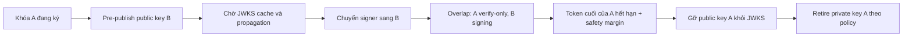

# Xoay khóa với giai đoạn chồng lấp cho token chưa hết hạn

## 1. Vì sao cần giai đoạn chồng lấp?

Trong chương **JWK và quản lý khóa** của module **SPRING_SECURITY_OAUTH2_OIDC_AUTHORIZATION_SERVER**, chúng ta học cách thiết kế, cấu hình, bảo mật, kiểm thử và vận hành OAuth 2.0/OpenID Connect Authorization Server bằng Spring Security và Spring Authorization Server trong ứng dụng Spring Boot.

Authorization Server dùng private key để ký JWT Access Token. Resource Server nhận token, tìm public key tương ứng trong **JSON Web Key Set (JWKS)** rồi xác minh chữ ký. Một JWT đã phát hành có thể tiếp tục được sử dụng cho đến khi hết hạn. Vì vậy, khi thay khóa ký, hệ thống phải phối hợp thời điểm bắt đầu ký bằng khóa mới với thời điểm ngừng công bố public key cũ.

Nếu chuyển signer sang khóa mới rồi xóa public key cũ ngay, những token cũ còn hạn có thể bị Resource Server từ chối. Nếu giữ khóa cũ trong JWKS vô thời hạn, hệ thống duy trì một khóa không còn cần thiết trong tập tin cậy.

Quy trình xoay khóa định kỳ có bốn giai đoạn:

1. **Tạo và công bố trước public key mới** để Resource Server cập nhật JWKS cache.
2. **Chuyển signer sang private key mới** và bắt đầu phát JWT với key ID mới.
3. **Giữ public key cũ trong JWKS** để xác minh token cũ chưa hết hạn.
4. **Gỡ public key cũ** sau khi token cuối cùng ký bằng khóa cũ hết hạn, cộng clock skew và biên an toàn phân phối/cache.

Khoảng thời gian cả public key mới và cũ cùng được công bố để xác minh được gọi là **overlap window**. Trong khoảng này, signer chỉ dùng khóa mới; khóa cũ chỉ còn vai trò xác minh.

Sau bài này, bạn có thể giải thích JWK/JWKS/key ID, thiết kế trình tự pre-publish → activate → overlap → retire, tính thời điểm gỡ khóa cũ, cấu hình JWK Source trong Spring Authorization Server, kiểm thử token cũ/mới và phân biệt rotation định kỳ với ứng phó khi private key bị lộ.

## 2. JWK, JWKS và key ID

### 2.1. Private key ký, public key xác minh

Với chữ ký bất đối xứng như RS256 hoặc ES256:

- Authorization Server giữ **private key** trong môi trường được bảo vệ và dùng nó để ký JWT.
- Resource Server lấy **public key** từ JWKS để xác minh chữ ký.
- Public key có thể được công bố; private key tuyệt đối không được công bố.

Một RSA JWK công khai thường có các trường:

| Trường | Ý nghĩa |
| --- | --- |
| kty | Loại khóa, ví dụ RSA. |
| kid | Key ID, định danh khóa trong JWK Set. |
| use | Mục đích, ví dụ sig cho chữ ký. |
| alg | Thuật toán dự kiến, ví dụ RS256. |
| n, e | Thành phần public key của RSA. |

RSA private JWK còn có thể chứa d, p, q, dp, dq, qi và các trường private khác. Những trường này **không được xuất hiện trong public JWKS**.

### 2.2. Key ID liên kết token với khóa

JWT được ký thường có protected header:

```json
{
  "alg": "RS256",
  "kid": "rsa-signing-2026-11-b",
  "typ": "JWT"
}
```

Resource Server đọc kid để tìm JWK phù hợp trong JWKS rồi xác minh chữ ký theo thuật toán được cấu hình cho phép. Key ID là **định danh công khai**, không phải secret và không phải bằng chứng token hợp lệ.

Quy tắc quản lý key ID:

- Mỗi khóa có một ID duy nhất trong tập khóa đang công bố.
- Không tái sử dụng ID cho khóa khác khi token cũ mang ID đó vẫn có thể được trình bày.
- Dùng ID có phiên bản hoặc giá trị ngẫu nhiên đủ phân biệt; lưu mapping ID với bản ghi khóa.
- Không tin thuật toán hoặc key ID trong token một cách độc lập; verifier phải áp dụng allowlist thuật toán và chỉ tìm key từ issuer/JWKS đã tin cậy.

### 2.3. JWKS là tập public keys được công bố

Ví dụ JWKS có hai khóa:

```json
{
  "keys": [
    {
      "kty": "RSA",
      "kid": "rsa-signing-2026-11-a",
      "use": "sig",
      "alg": "RS256",
      "n": "<base64url-modulus-a>",
      "e": "AQAB"
    },
    {
      "kty": "RSA",
      "kid": "rsa-signing-2026-11-b",
      "use": "sig",
      "alg": "RS256",
      "n": "<base64url-modulus-b>",
      "e": "AQAB"
    }
  ]
}
```

Hai public keys cùng tồn tại để xác minh token được ký ở hai thời điểm khác nhau. JWKS endpoint đúng chỉ trả public representation, không trả private key material.

Trong Spring Authorization Server, JWK Set Endpoint mặc định thường là /oauth2/jwks khi có bean JWKSource và endpoint được bật. Consumer nên lấy endpoint từ metadata/issuer configuration thay vì hardcode nếu kiến trúc hỗ trợ discovery.

## 3. Bốn giai đoạn của một lần xoay khóa

### 3.1. Trạng thái key ring

| Trạng thái | Private key | Public key trong JWKS | Vai trò |
| --- | --- | --- | --- |
| CANDIDATE | Đã tạo/lưu trong KMS hoặc HSM | Chưa công bố hoặc sắp pre-publish | Chuẩn bị cho lần xoay tiếp theo. |
| ACTIVE_SIGNING | Được signer sử dụng | Có công bố | Ký JWT mới. |
| VERIFY_ONLY | Không còn trong signing pool | Vẫn công bố | Xác minh token cũ còn hạn. |
| RETIRED | Đã vô hiệu hóa/xóa theo retention policy | Đã gỡ khỏi JWKS | Không còn dùng ký hoặc xác minh thông thường. |
| REVOKED/COMPROMISED | Bị khóa hoặc thu hồi khẩn cấp | Bị gỡ/đánh dấu không tin cậy theo incident plan | Ứng phó sự cố. |

VERIFY_ONLY là trạng thái cốt lõi của overlap window: private key cũ không còn được dùng ký, nhưng public key cũ vẫn phải được Resource Server tìm thấy.

### 3.2. Timeline



Trình tự này áp dụng cho **xoay khóa định kỳ khi khóa cũ vẫn an toàn**. Nếu private key bị xâm phạm, không giữ nó trong overlap như một khóa đáng tin; xem phần ứng phó sự cố.

### 3.3. Giai đoạn 1 — Tạo khóa mới và pre-publish public key

1. Tạo cặp khóa mới trong KMS/HSM hoặc key management system được phê duyệt.
2. Gán key ID mới, thuật toán, key type và mục đích ký rõ ràng.
3. Kiểm tra public key mới tương thích với các Resource Server.
4. Đưa **public JWK mới** vào JWKS trong khi signer vẫn dùng private key cũ.
5. Chờ các JWKS consumer cập nhật cache và xác minh key mới đã được phân phối.

Pre-publish tránh tình huống server bắt đầu ký JWT bằng key ID mới trong khi Resource Server vẫn dùng JWKS cache chưa chứa key đó.

### 3.4. Giai đoạn 2 — Chuyển signer sang khóa mới

Khi public key mới đã được phân phối đủ rộng:

- Cập nhật key ring để private key mới là ACTIVE_SIGNING.
- Các node Authorization Server phải chuyển sang cùng key ID mới theo kế hoạch.
- Dừng dùng private key cũ để ký token mới.
- Phát token thử nghiệm và kiểm tra JWT header có key ID mới.
- Kiểm tra JWKS vẫn chứa cả key mới lẫn key cũ.

Không xóa public key cũ ở bước này. Token đã phát hành bằng key cũ vẫn cần được xác minh đến hết hạn.

### 3.5. Giai đoạn 3 — Overlap để xác minh token chưa hết hạn

```text
JWT ký trước thời điểm switch:
    header.kid = key-A
    verifier tìm public key-A trong JWKS

JWT ký sau thời điểm switch:
    header.kid = key-B
    verifier tìm public key-B trong JWKS

JWKS:
    public key-A (VERIFY_ONLY)
    public key-B (ACTIVE_SIGNING)
```

Authorization Server chỉ ký bằng B. Resource Server vẫn có thể xác minh token A **nếu token chưa hết hạn và thỏa các validation khác**.

### 3.6. Giai đoạn 4 — Gỡ public key cũ và retire

Sau khi mọi JWT có thể được ký bằng A đã hết hạn, cộng clock skew và biên an toàn:

1. Gỡ public key A khỏi JWKS.
2. Xác minh mọi node Authorization Server công bố cùng tập JWKS mới.
3. Kiểm tra Resource Server đã refresh cache và không còn phụ thuộc A.
4. Vô hiệu hóa/xóa private key A khỏi hệ thống ký theo retention policy và yêu cầu audit.
5. Lưu metadata/audit về key ID, thời điểm switch và retire; không lưu private key trong log.

## 4. Tính overlap window

### 4.1. Công thức thời điểm gỡ public key cũ

Gọi:

- lastOldSigningTime: thời điểm **node cuối cùng** ngừng ký bằng khóa cũ.
- maxOldTokenLifetime: TTL lớn nhất của mọi JWT có thể được ký bằng khóa cũ (Access Token, ID Token và token khác nếu dùng chung key).
- maxClockSkew: dung sai thời gian tối đa Resource Server chấp nhận.
- distributionMargin: biên an toàn cho rollout, cache, mạng và vận hành.

Thời điểm sớm nhất có thể cân nhắc gỡ public key cũ:

```text
removeOldPublicKeyAt >=
    lastOldSigningTime
    + maxOldTokenLifetime
    + maxClockSkew
    + distributionMargin
```

Đây là **công thức lập kế hoạch**, không thay thế việc quan sát token thực tế. Nếu có token được cấp với TTL tùy chỉnh, dùng exp lớn nhất thực tế hoặc giới hạn TTL lớn nhất có thể phát hành, không chỉ lấy giá trị mặc định trong một bean.

### 4.2. Ví dụ

| Thông số | Giá trị |
| --- | --- |
| Node cuối cùng ngừng ký bằng A | 2026-11-16 10:00:00 UTC |
| TTL JWT lớn nhất được cho phép | 30 phút |
| Clock skew tối đa | 2 phút |
| Biên phân phối/vận hành | 5 phút |

Tính:

```text
10:00 + 30 phút + 2 phút + 5 phút = 10:37 UTC
```

Không gỡ public key A trước **10:37 UTC** trong ví dụ này. Nếu hệ thống có token TTL 60 phút, phải tính lại ít nhất theo 60 phút.

### 4.3. Dùng exp thực tế khi có telemetry

Nếu có inventory token theo key ID và thời hạn:

```text
latestOldTokenExpiry =
    max(exp của mọi JWT còn có thể được trình bày, ký bởi key-A)

removeOldPublicKeyAt >=
    latestOldTokenExpiry + maxClockSkew + distributionMargin
```

Hệ thống cần theo dõi key ID và exp mà không ghi raw token. Nếu không biết chính xác token nào còn tồn tại, dùng TTL lớn nhất được cấu hình và bảo đảm không có đường cấp token vượt giới hạn đó.

### 4.4. Token không có exp hoặc TTL không bị giới hạn

Nếu hệ thống chấp nhận JWT không có exp, hoặc có token được ký bằng A với thời hạn không giới hạn, **không thể tính một overlap hữu hạn an toàn** chỉ từ TTL mặc định.

Trước khi xoay khóa định kỳ:

- Ngừng phát hành loại token thiếu expiry.
- Xác định chính sách xử lý token cũ không có expiry (revoke/denylist hoặc kế hoạch riêng).
- Bảo đảm mọi đường phát hành JWT có exp và TTL cap.
- Kiểm tra cả ID Token và JWT nội bộ nếu chúng dùng chung signing key.

## 5. JWKS cache và phân phối public key

### 5.1. Vì sao phải pre-publish?

Resource Server thường cache JWKS để tránh gọi Authorization Server ở mỗi request. Nếu cache vẫn chứa JWKS cũ mà Authorization Server đã bắt đầu ký bằng B, Resource Server có thể không tìm thấy key ID B.

Một số thư viện tự refresh JWKS khi gặp key ID chưa biết; một số giới hạn tần suất refresh, cache lỗi hoặc xử lý khác. **Không dựa hoàn toàn vào refresh khi unknown key ID** nếu có thể pre-publish key trước.

### 5.2. Tính khoảng pre-publish

Gọi:

- maxJwksCacheAge: thời gian cache JWKS lớn nhất consumer được phép giữ.
- propagationDelay: thời gian rollout qua CDN, proxy, vùng mạng và node.
- safetyMargin: biên an toàn vận hành.

```text
prePublishDuration >=
    maxJwksCacheAge + propagationDelay + safetyMargin
```

Đây là ngưỡng lập kế hoạch. Thực tế phải kiểm tra Cache-Control, cấu hình cache của từng Resource Server, proxy/CDN và khả năng refresh khi gặp key ID chưa biết.

### 5.3. Cache cũ có thể tồn tại sau khi gỡ key

Gỡ A khỏi JWKS endpoint không có nghĩa mọi Resource Server lập tức quên A. Cache có thể còn giữ public key A đến khi hết TTL hoặc được purge. Vì vậy:

- Lập kế hoạch cache và thời điểm retire từ trước.
- Có cơ chế refresh/purge cache được quản lý khi cần.
- Giám sát lỗi unknown key ID, signature validation và độ trễ cập nhật JWKS.
- Với yêu cầu thu hồi khẩn cấp, dùng cơ chế chặn token/key ID ở Resource Server hoặc trạng thái trực tuyến; chỉ xóa JWKS không bảo đảm vô hiệu hóa tức thì.

### 5.4. JWKS chỉ chứa public key

Kiểm tra response:

- RSA public JWK có n, e, kid, kty và metadata ký thích hợp.
- EC public JWK có crv, x, y, kid, kty.
- Không có d, p, q, dp, dq, qi, private octet key hoặc secret.
- Key ID không trùng giữa các khóa khác nhau.
- Thuật toán và mục đích sử dụng phù hợp với cấu hình verifier.

Không cần bảo vệ public JWKS bằng client secret; việc công bố public key là một phần của giao thức. **Bảo vệ private key**, không che giấu public key.

## 6. Hình dạng JWKS trước, trong và sau overlap

### 6.1. Trước khi chuyển khóa

JWKS chỉ có A:

```json
{
  "keys": [
    { "kid": "key-A", "kty": "RSA", "use": "sig", "alg": "RS256", "n": "...", "e": "AQAB" }
  ]
}
```

JWT mới có header key ID A.

### 6.2. Pre-publish: A vẫn ký, B chỉ xác minh

JWKS có cả A và B:

```json
{
  "keys": [
    { "kid": "key-A", "kty": "RSA", "use": "sig", "alg": "RS256", "n": "...", "e": "AQAB" },
    { "kid": "key-B", "kty": "RSA", "use": "sig", "alg": "RS256", "n": "...", "e": "AQAB" }
  ]
}
```

Trong giai đoạn này, JWT mới vẫn có key ID A. Việc B xuất hiện trong JWKS **không có nghĩa** server đã bắt đầu ký bằng B.

### 6.3. Sau switch: B ký, A verify-only

JWKS vẫn chứa cả hai public keys, nhưng token mới có header:

```json
{
  "alg": "RS256",
  "kid": "key-B",
  "typ": "JWT"
}
```

Resource Server xác minh token cũ bằng A và token mới bằng B. Private key A đã rời signer pool; chỉ public key A còn được công bố.

### 6.4. Sau khi retire A

JWKS chỉ còn B (và các key khác còn hoạt động):

```json
{
  "keys": [
    { "kid": "key-B", "kty": "RSA", "use": "sig", "alg": "RS256", "n": "...", "e": "AQAB" }
  ]
}
```

Token A xuất hiện sau khi A đã retire sẽ không còn xác minh được ở consumer đã cập nhật JWKS. Đây là hành vi dự kiến **chỉ khi token A đã hết hạn hoặc được xử lý theo kế hoạch thu hồi**.

## 7. Spring Authorization Server: JWKSource và khóa đang active

### 7.1. Vai trò của JWKSource

Trong Spring Authorization Server, bean JWKSource cung cấp khóa cho quá trình ký JWT và JWK Set Endpoint. NimbusJwtEncoder dùng JWK Source để chọn khóa phù hợp với thuật toán ký; endpoint JWKS công bố public representation của các khóa có sẵn.

Khi có nhiều khóa cùng loại và thuật toán, ứng dụng phải bảo đảm **khóa active được chọn để ký**, trong khi khóa cũ/candidate chỉ được công bố để xác minh. Không chỉ thêm mọi JWK vào danh sách rồi giả định signer tự biết khóa nào đang active.

### 7.2. Mô hình SigningKeyProvider

Một abstraction phía ứng dụng có thể cung cấp:

```java
import java.util.List;
import com.nimbusds.jose.jwk.JWK;
import com.nimbusds.jose.jwk.RSAKey;

public interface SigningKeyProvider {
    RSAKey activeSigningKey();
    List<JWK> additionalPublishedPublicKeys();
}
```

Trong giai đoạn pre-publish, activeSigningKey trả private/public key A và danh sách public keys bổ sung chứa public-only key B. Sau khi switch, activeSigningKey trả private/public key B và danh sách bổ sung chứa public-only key A. Như vậy JWKS luôn có cả A và B trong overlap, còn signer chỉ có một active private key.

### 7.3. Cấu hình JWKSource minh họa

```java
import java.util.ArrayList;
import java.util.List;

import com.nimbusds.jose.jwk.JWK;
import com.nimbusds.jose.jwk.JWKSet;
import com.nimbusds.jose.jwk.source.ImmutableJWKSet;
import com.nimbusds.jose.jwk.source.JWKSource;
import com.nimbusds.jose.proc.SecurityContext;

import org.springframework.context.annotation.Bean;
import org.springframework.context.annotation.Configuration;

@Configuration(proxyBeanMethods = false)
public class SigningKeysConfiguration {

    @Bean
    JWKSource<SecurityContext> jwkSource(SigningKeyProvider keyProvider) {
        List<JWK> publishedKeys = new ArrayList<>();
        publishedKeys.add(keyProvider.activeSigningKey());
        publishedKeys.addAll(keyProvider.additionalPublishedPublicKeys());
        return new ImmutableJWKSet<>(new JWKSet(publishedKeys));
    }
}
```

**Đây là ví dụ wiring cho key ring đã được nạp**, không phải implementation KMS/HSM hoặc reload production hoàn chỉnh. Với NimbusJwtEncoder mặc định và ImmutableJWKSet, khi có nhiều JWK phù hợp, ứng dụng phải bảo đảm encoder chọn đúng khóa. Một cách là đặt key ID đang active vào JWS header bằng OAuth2TokenCustomizer<JwtEncodingContext>; sau đó kiểm tra JWT thực tế có đúng key ID. Nếu dùng custom encoder, KMS signer hoặc JWKSource khác, triển khai lựa chọn active key tường minh thay vì phụ thuộc thứ tự danh sách.

JWK Set Endpoint của Spring Authorization Server cần chỉ công bố public representation. Hãy kiểm tra HTTP response thực tế để chắc chắn **không có private parameters**. Không trả trực tiếp object key ring nội bộ qua một controller tự viết.

### 7.4. Đặt key ID đang active trên JWT

Ví dụ customizer dùng cùng nguồn cấu hình active key:

```java
import org.springframework.context.annotation.Bean;
import org.springframework.security.oauth2.server.authorization.token.JwtEncodingContext;
import org.springframework.security.oauth2.server.authorization.token.OAuth2TokenCustomizer;

@Bean
OAuth2TokenCustomizer<JwtEncodingContext> activeKeyIdCustomizer(
        SigningKeyProvider keyProvider) {
    return context -> context.getJwsHeader()
            .keyId(keyProvider.activeSigningKey().getKeyID());
}
```

Đoạn này minh họa việc đặt key ID; nó phải được triển khai cùng một key snapshot nhất quán với JWKSource. Nếu key ring thay đổi đồng thời giữa lúc customizer đọc ID và encoder chọn key, có thể xảy ra mismatch. Cách đơn giản là cập nhật key ring theo rolling deployment có kiểm soát, không hot-swap hai bean độc lập giữa một lần phát token. Khi cần reload động, dùng một snapshot/version bất biến và cơ chế đồng bộ để header và signer cùng đọc một phiên bản.

### 7.5. Biểu diễn RSA JWK và KMS/HSM

Ví dụ biểu diễn một RSA key đã được nạp từ secure key store:

```java
import com.nimbusds.jose.JWSAlgorithm;
import com.nimbusds.jose.jwk.KeyUse;
import com.nimbusds.jose.jwk.RSAKey;
import java.security.interfaces.RSAPrivateKey;
import java.security.interfaces.RSAPublicKey;

RSAKey active = new RSAKey.Builder((RSAPublicKey) publicKeyFromKeyStore)
        .privateKey((RSAPrivateKey) privateKeyFromKeyStore)
        .keyID("rsa-signing-2026-11-b")
        .algorithm(JWSAlgorithm.RS256)
        .keyUse(KeyUse.SIGNATURE)
        .build();

RSAKey oldPublicOnly = oldPrivateJwk.toPublicJWK();
```

Đây là cách biểu diễn JWK khi private key có thể được cung cấp dưới dạng key object. Với KMS/HSM non-exportable, private key có thể chỉ là handle/signer abstraction; cần integration hỗ trợ ký bên trong KMS/HSM thay vì xuất private bytes ra ứng dụng.

### 7.6. ImmutableJWKSet và reload

ImmutableJWKSet phù hợp cho cấu hình tĩnh hoặc ví dụ khởi động. Nó không tự đọc lại key ring khi file/database/KMS thay đổi. Production cần phân phối key ring động có kiểm soát, ví dụ rolling deployment hoặc JWKSource tùy biến đọc một snapshot mới.

Có thể dùng AtomicReference<JWKSet> để thay toàn bộ snapshot nguyên tử sau khi kiểm tra. Không sửa danh sách JWK đang được nhiều request đọc theo cách nửa cũ nửa mới.

```java
import java.util.List;
import java.util.concurrent.atomic.AtomicReference;

import com.nimbusds.jose.jwk.JWK;
import com.nimbusds.jose.jwk.JWKSelector;
import com.nimbusds.jose.jwk.JWKSet;
import com.nimbusds.jose.jwk.source.JWKSource;
import com.nimbusds.jose.jwk.source.KeySourceException;
import com.nimbusds.jose.proc.SecurityContext;

public final class RotatingJwkSource implements JWKSource<SecurityContext> {

    private final AtomicReference<JWKSet> current;

    public RotatingJwkSource(JWKSet initial) {
        this.current = new AtomicReference<>(initial);
    }

    @Override
    public List<JWK> get(
            JWKSelector selector,
            SecurityContext context) throws KeySourceException {
        return selector.select(current.get());
    }

    public void replaceSnapshot(JWKSet validatedNextSnapshot) {
        current.set(validatedNextSnapshot);
    }
}
```

Trước khi gọi replaceSnapshot, key manager phải kiểm tra đúng một active signing key, active key có private signing material, verify-only keys chỉ có public material, key ID duy nhất và danh sách khóa phù hợp giai đoạn pre-publish/overlap/retire.

AtomicReference chỉ bảo đảm atomic trong **một process**, không đồng bộ các node khác. Khi thay đồng thời JWKSource và active key ID, cần version/snapshot nhất quán hoặc rolling deployment có kiểm soát để không có request chọn ID từ snapshot mới nhưng signer lại đọc snapshot cũ.

## 8. Triển khai xoay khóa trong môi trường nhiều node

### 8.1. Chuẩn bị

Trước ngày xoay:

1. Kiểm kê mọi loại JWT đang ký bằng A: Access Token, ID Token và token nội bộ nếu dùng chung key.
2. Xác định TTL lớn nhất, clock skew tối đa, JWKS cache max-age và thời gian rollout.
3. Liệt kê Resource Server, API gateway, service mesh, batch consumer và ứng dụng có cache JWKS.
4. Sinh key B trong KMS/HSM, cấp key ID mới và kiểm tra khả năng ký.
5. Chuẩn bị rollback plan, metric theo key ID và người chịu trách nhiệm kích hoạt.

### 8.2. Pre-publish đồng nhất

- Công bố public key B trên JWKS của tất cả Authorization Server nodes.
- Giữ A là active signer.
- Kiểm tra mọi node trả cùng tập key ID và public key thumbprint.
- Chờ cache/propagation đủ lâu.
- Xác minh consumer có thể lấy public key B trước khi token B được phát hành.

Không để một node công bố B còn node khác chưa có B nếu load balancer có thể trả JWKS từ bất kỳ node nào.

### 8.3. Switch signer

Thực hiện thay đổi active key đồng bộ hoặc rolling theo cách bảo đảm:

- Mọi node có public A và B trong JWKS.
- Mỗi node chỉ ký bằng B sau khi đã nạp private key B.
- Node còn ký bằng A được xác định và dừng/drain trước khi tính thời điểm ký A cuối cùng.
- Token mới phát ra từ mọi node đều mang key ID B.

Trong rollout nhiều node, có thể tạm thời tồn tại node A ký và node B ký; điều này chỉ chấp nhận được **khi public keys A và B đã được công bố rộng rãi**. Overlap được tính từ thời điểm node cuối cùng ngừng ký A.

### 8.4. Theo dõi overlap

Quan sát:

- Tỉ lệ token mới theo key ID (không ghi raw token).
- Lỗi unknown key ID, signature validation và issuer mismatch.
- Tình trạng fetch/refresh JWKS của Resource Server.
- Các node Authorization Server có cùng active key không.
- Consumer nào còn giữ JWKS cache quá thời hạn dự kiến.

Không gỡ A chỉ vì đã deploy xong. Chỉ retire sau khi đạt mốc expiry an toàn và kiểm tra thực tế.

### 8.5. Gỡ key cũ

1. Cập nhật key ring bỏ public key A.
2. Đồng bộ JWKS snapshot mới tới tất cả node.
3. Xác minh JWKS chỉ còn các key còn hoạt động/cần xác minh.
4. Theo dõi lỗi xác minh token A ngoài dự kiến; điều tra consumer có token TTL vượt policy hoặc cache chưa cập nhật.
5. Vô hiệu hóa private key A trong KMS/HSM và xử lý retention theo quy định.

## 9. Kiểm tra JWKS và token trong Spring Authorization Server

### 9.1. Kiểm tra JWKS endpoint

Trong môi trường phát triển:

```powershell
curl.exe -i 'https://auth.example.com/oauth2/jwks'
```

Địa chỉ thực tế nên lấy từ metadata/issuer configuration. Kiểm tra response:

- keys chứa key ID đang active và các key ID cũ trong overlap.
- Mỗi key ID chỉ đại diện một public key.
- Không có trường private key.
- Cache-Control phù hợp với chiến lược pre-publish và retire.

### 9.2. Kiểm tra key ID của token mới

Sau khi signer switch sang B, lấy token test từ flow thực tế và đọc header:

```json
{
  "alg": "RS256",
  "kid": "rsa-signing-2026-11-b",
  "typ": "JWT"
}
```

Không chỉ kiểm tra cấu hình bean. Hãy xác minh JWT thực mang key ID mong muốn, rồi xác minh chữ ký bằng public key B từ JWKS. Token cũ mang key ID A phải vẫn xác minh được trong overlap.

### 9.3. Resource Server không nên pin cứng một key ID

Resource Server thường cấu hình issuer hoặc JWKS URI đáng tin cậy và dùng decoder chọn public key theo key ID. Nếu ứng dụng pin một public key cố định trong code, rotation sẽ cần triển khai cập nhật mọi consumer; đó là ràng buộc vận hành khác với JWKS discovery.

Ví dụ cấu hình theo issuer:

```yaml
spring:
  security:
    oauth2:
      resourceserver:
        jwt:
          issuer-uri: https://auth.example.com
```

Issuer validation, audience validation, thuật toán cho phép và các claim validation vẫn phải được cấu hình đúng. JWKS rotation chỉ giải quyết việc tìm public key; nó không thay thế xác minh issuer, audience, expiry, not-before, scope hoặc policy nghiệp vụ.

### 9.4. Unknown key ID và refresh

Khi decoder gặp token có key ID chưa có trong cache, thư viện có thể refresh JWKS theo cơ chế riêng. Cần test:

- JWKS mới đã có B trước khi token B được phát.
- Consumer có thể refresh khi gặp B.
- Cache không bị refresh storm nếu attacker gửi nhiều key ID giả.
- JWKS endpoint lỗi tạm thời thì consumer không bỏ qua signature validation.

Không cấu hình verifier chấp nhận token chỉ vì không lấy được JWKS. Nếu không thể xác minh chữ ký, request phải thất bại an toàn.

## 10. Rollback trong lần xoay khóa định kỳ

### 10.1. Trước khi switch

Nếu pre-publish B gây vấn đề, có thể gỡ public B trong khi A vẫn ký. Kiểm tra không có token B được phát hành ngoài môi trường test.

### 10.2. Sau khi switch

Nếu B gặp lỗi ký hoặc consumer không tương thích sau khi đã phát token:

- Có thể chuyển signer về A **chỉ khi private key A vẫn an toàn và được phép sử dụng**.
- Giữ public key B trong JWKS cho các token B đã phát hành còn hạn.
- Giữ public key A để xác minh token A.
- Xác định thời điểm cuối cùng node ký B trước khi retire B.
- Sau khi khắc phục, thực hiện lần switch mới với pre-publish/overlap rõ ràng.

Rollback không có nghĩa xóa public key của khóa vừa thử. Token đã ký bằng B vẫn có thể đang được consumer sử dụng.

### 10.3. Khi không được rollback

Nếu A bị lộ private key hoặc có dấu hiệu bị xâm nhập, không quay lại dùng A để ký. Đây là sự cố compromise, không còn là rollback thông thường. Phải thực hiện incident response và quyết định chặn token A theo mức rủi ro.

## 11. Xoay khóa khẩn cấp khi private key bị lộ

### 11.1. Routine overlap không phù hợp với khóa bị compromise

Trong rotation định kỳ, A vẫn đáng tin nên public key A được giữ để xác minh token chưa hết hạn. Khi private key A bị lộ, attacker có thể ký JWT mới với key ID A; giữ public key A trong JWKS tiếp tục khiến verifier tin các chữ ký do attacker tạo ra.

Vì vậy không áp dụng overlap thông thường một cách máy móc:

1. Dừng ký bằng A và cô lập/vô hiệu hóa private key A trong KMS/HSM.
2. Kích hoạt key B an toàn và công bố public key B.
3. Đánh giá việc **loại bỏ A khỏi trust** ngay lập tức, kể cả khi một số token A hợp lệ trước sự cố còn hạn.
4. Phối hợp Resource Server purge cache/chặn key ID A hoặc kiểm tra trạng thái trực tuyến.
5. Xem xét revoke/denylist token, giảm TTL, rotate credential liên quan và điều tra phạm vi ảnh hưởng.

### 11.2. Xóa JWKS không đồng nghĩa thu hồi tức thì

Resource Server đang cache public key A có thể tiếp tục xác minh JWT ký bằng A đến khi cache hết hạn hoặc được purge. Nếu cần chặn ngay, có thể phải:

- Phát sự kiện khẩn cấp để Resource Server từ chối key ID A.
- Purge JWKS cache hoặc refresh verifier theo quy trình.
- Dùng introspection/denylist hoặc trạng thái token trực tuyến nếu kiến trúc hỗ trợ.
- Vô hiệu hóa các token/phiên liên quan và điều tra token do attacker ký.

Không có thao tác xóa key khỏi endpoint nào bảo đảm mọi consumer offline ngừng tin key ngay lập tức nếu chúng vẫn giữ public key trong bộ nhớ.

### 11.3. Đánh đổi khi chặn token cũ

Khi loại bỏ A khẩn cấp, token hợp lệ được ký trước sự cố cũng có thể bị từ chối. Điều này gây gián đoạn dịch vụ hoặc buộc user/client lấy token mới. Đó là đánh đổi bảo mật cần quyết định theo phạm vi compromise; không tiếp tục tin một private key đã lộ chỉ để giữ tương thích.

## 12. Kiểm thử rotation và overlap

| Giai đoạn | Test | Kỳ vọng |
| --- | --- | --- |
| Baseline | Phát token bằng A, xác minh bằng JWKS hiện tại. | Thành công, key ID A. |
| Pre-publish | Công bố B nhưng chưa switch signer. | JWKS có A và B; token mới vẫn key ID A. |
| Pre-publish | Resource Server refresh JWKS. | Có public B trước khi token B được phát. |
| Switch | Phát token sau activation. | JWT mới có key ID B. |
| Overlap | Xác minh token A chưa hết hạn. | Thành công bằng public A. |
| Overlap | Xác minh token B mới. | Thành công bằng public B. |
| Private-key exposure | Tải JWKS endpoint. | Không có private RSA/EC/octet parameters. |
| Retire | Gỡ A sau expiry + skew + margin. | Token B vẫn hợp lệ; token A không còn verify ở consumer đã refresh. |
| Unknown key ID | Gửi token có ID không tồn tại. | Từ chối; không bỏ qua signature. |
| Cache | Consumer còn JWKS cũ trong pre-publish. | Không switch trước khi cache/distribution window đạt yêu cầu. |
| Multi-node | Phát token qua từng node sau switch. | Tất cả token mới dùng key ID B. |
| Rolling deploy | Node cuối cùng còn ký A được drain. | Thời điểm ký A cuối cùng chỉ ghi sau thời điểm này. |
| Rollback | Switch về A sau khi B đã phát token. | JWKS giữ cả A và B; cả hai loại token được xác minh. |
| Emergency | Key A compromise, consumer được lệnh deny key ID A. | Token A bị chặn theo incident policy dù chưa hết hạn. |
| TTL boundary | Token A có TTL lớn nhất được phép. | A không bị retire trước exp + skew + margin. |
| Clock skew | Resource Server chấp nhận skew tối đa. | Retire deadline tính đủ skew. |

### 12.1. Kiểm tra header và chữ ký

Integration test nên kiểm tra:

1. Header JWT mới có key ID đúng.
2. JWT signature verify được bằng public JWK có cùng key ID.
3. Token cũ vẫn verify được trong overlap.
4. Token hết hạn vẫn bị từ chối dù public key cũ còn trong JWKS.
5. Token có issuer/audience/scope sai vẫn bị từ chối dù chữ ký hợp lệ.

Đừng chỉ decode header rồi kết luận rotation thành công; phải thực hiện signature verification.

### 12.2. Test thời gian với Clock

```text
lastOldSigningTime = 10:00
maxOldTokenLifetime = 30m
maxClockSkew = 2m
distributionMargin = 5m

10:36 -> chưa được retire
10:37 -> đạt ngưỡng kế hoạch, vẫn cần xác nhận rollout/cache
```

Test thêm trường hợp token cuối cùng được ký ở node chưa được phát hiện; deadline phải dịch theo **lần ký A muộn nhất**, không theo thời điểm node đầu tiên switch.

## 13. Những lỗi vận hành thường gặp

| Triệu chứng | Nguyên nhân có thể | Hướng xử lý |
| --- | --- | --- |
| Token mới bị unknown key ID | Bắt đầu ký B trước khi public B được phân phối/cache. | Pre-publish, chờ cache/propagation, kiểm tra JWKS từ consumer. |
| Token cũ lỗi signature ngay sau deploy | Gỡ A quá sớm hoặc một node không công bố A. | Khôi phục public A nếu không compromise; tính lại overlap. |
| Một số node ký A, node khác ký B lâu hơn dự kiến | Key ring/rollout không đồng bộ. | Kiểm kê từng node, drain node cũ, cập nhật thời điểm ký A cuối cùng. |
| JWKS endpoint có private fields | Đưa JWK private ra endpoint tùy biến hoặc không dùng public projection. | Dừng endpoint lỗi, đánh giá lộ key và chỉ công bố public JWK. |
| Key ID trùng nhưng public key khác | Tái sử dụng ID hoặc key inventory sai. | Dùng ID mới, làm rõ cache và trust. |
| Token mới vẫn ký bằng A | Signer chọn sai key do thứ tự/selector/config. | Kiểm tra key selection, active key và header token thực. |
| Resource Server không refresh JWKS | Cache policy hoặc thư viện refresh khác kỳ vọng. | Kiểm tra cache headers, decoder và chiến lược refresh. |
| Token A còn hạn sau retire | TTL thực tế dài hơn dự tính hoặc token khác cũng dùng A. | Xác định loại token, expiry và key ID; không bỏ qua validation. |
| Sau restart token mới không verify | Demo sinh cặp key ngẫu nhiên mỗi lần khởi động. | Dùng key store bền vững/KMS/HSM và JWKS nhất quán. |
| API vẫn nhận token bị compromise | Consumer giữ cache A hoặc chưa có denylist/key ID block. | Incident response, purge cache và chặn key ID A. |

## 14. Bảo vệ private key và quản trị vòng đời

### 14.1. KMS/HSM và quyền truy cập

Trong production:

- Ưu tiên private key không exportable trong HSM/KMS nếu kiến trúc cho phép.
- Chỉ service identity của Authorization Server có quyền ký bằng active key.
- Tách quyền tạo key, phê duyệt activation, sử dụng để ký và retire.
- Ghi audit ai tạo, kích hoạt, chuyển trạng thái và vô hiệu hóa key.
- Mã hóa backup và giới hạn người có thể phục hồi private key.
- Kiểm tra backup/DR không khiến key cũ bất ngờ trở lại signer pool.

### 14.2. Thuật toán và key strength

Chọn thuật toán được hệ sinh thái consumer hỗ trợ và policy tổ chức cho phép. RS256 dùng RSA; ES256 dùng elliptic curve P-256. Thay đổi thuật toán (ví dụ RS256 sang ES256) là **algorithm migration** ngoài việc thay key cùng thuật toán; cần kiểm thử tương thích decoder, KMS và thư viện client riêng.

Verifier cần allowlist thuật toán. Không lấy thuật toán từ JWT header làm chỉ thị tự do để thử mọi thuật toán hoặc chuyển giữa HMAC và RSA. Không chấp nhận none cho Access Token ký số.

### 14.3. Lập lịch rotation

Chu kỳ rotation phụ thuộc yêu cầu chính sách, thời hạn token, khả năng pre-publish/refresh của Resource Server, mức bảo vệ KMS/HSM, quy trình phê duyệt và yêu cầu audit. Không có một chu kỳ số ngày áp dụng cho mọi hệ thống. Điều quan trọng là rotation có thể diễn tập, đo lường và rollback an toàn.

### 14.4. Audit record tối thiểu

| Trường audit | Ví dụ |
| --- | --- |
| Key ID cũ/mới | key-A → key-B |
| Key fingerprint/thumbprint | Định danh public key đã kiểm tra |
| Thời điểm tạo/pre-publish | UTC timestamp |
| Thời điểm activate | UTC timestamp |
| Node cuối cùng ngừng ký key cũ | UTC timestamp |
| TTL lớn nhất dùng để tính overlap | Duration |
| Clock skew và cache margin | Duration/config version |
| Thời điểm gỡ public key cũ | UTC timestamp |
| Người/hệ thống phê duyệt | Identity/audit reference |
| Kết quả kiểm thử | Test run/reference |

Không ghi private key, secret hoặc token vào audit record.

## 15. Bài tập thực hành và checklist

### Bài tập 1 — Tính overlap

Khóa A được dùng ký đến 14:00 UTC. Access Token tối đa 20 phút, ID Token tối đa 15 phút, clock skew 90 giây và distribution margin 4 phút. Tính thời điểm sớm nhất có thể cân nhắc gỡ public key A. Giải thích vì sao phải dùng TTL lớn nhất của mọi JWT ký bằng A.

### Bài tập 2 — Pre-publish trước switch

Mô phỏng JWKS có A active. Thêm public B nhưng chưa chuyển signer. Phát token mới và kiểm tra key ID vẫn là A. Sau đó chuyển signer sang B, phát token mới và kiểm tra key ID B, trong khi token A cũ vẫn xác minh được.

### Bài tập 3 — Cache JWKS

Giả lập Resource Server cache JWKS cũ. Thử ký bằng B trước khi pre-publish và quan sát lỗi. Sau đó pre-publish B, chờ cache refresh, switch signer và so sánh kết quả.

### Bài tập 4 — Nhiều node

Triển khai hai Authorization Server nodes. Cho một node chuyển signer trước node còn lại; xác minh JWKS cả hai đã có A/B và xác định thời điểm node cuối cùng ngừng ký A. Thiết kế cách đồng bộ snapshot để không node nào ký bằng key chưa công bố.

### Bài tập 5 — Compromised key

Giả định private key A bị lộ trong lúc overlap. Lập kế hoạch dừng ký, rotate sang B, gỡ A, purge cache hoặc deny key ID A, xử lý token còn hạn và thông báo tác động tới consumer. Phân biệt với routine rotation.

### Bài tập 6 — Key selection trong Spring

Dùng JWKSource với active private key và public-only verification keys. Viết integration test chứng minh NimbusJwtEncoder chọn đúng active key ID, JWK Set Endpoint chỉ trả public key và token ký bằng key cũ vẫn verify trong overlap.

### Checklist hoàn thành

- [ ] Phân biệt private signing key, public verification key, JWK, JWKS và key ID.
- [ ] Hiểu JWT cũ vẫn cần public key cũ đến khi hết hạn.
- [ ] Pre-publish public key mới trước khi bắt đầu ký bằng nó.
- [ ] Sau switch, chỉ private key mới được dùng ký; private key cũ rời signer pool.
- [ ] Giữ public key cũ trong overlap window.
- [ ] Tính deadline retire từ lần ký cũ cuối cùng, TTL lớn nhất, clock skew và distribution margin.
- [ ] Kiểm tra JWKS cache/refresh ở tất cả Resource Server.
- [ ] Cấu hình Spring Authorization Server để key active được chọn đúng và JWKS chỉ công bố public keys.
- [ ] Đồng bộ key ring, issuer và JWKS qua mọi node.
- [ ] Phân biệt rollback định kỳ với incident khi private key bị compromise.
- [ ] Kiểm thử key ID, signature, expiry, unknown key, cache, overlap và retire.
- [ ] Bảo vệ private key bằng KMS/HSM, audit và quy trình retire.

## 16. Tài liệu tham khảo

- [RFC 7517 — JSON Web Key (JWK)](https://www.rfc-editor.org/rfc/rfc7517) — định dạng JWK/JWKS và tham số public/private key.
- [RFC 7515 — JSON Web Signature (JWS)](https://www.rfc-editor.org/rfc/rfc7515) — chữ ký JWT/JWS và protected header.
- [RFC 7519 — JSON Web Token (JWT)](https://www.rfc-editor.org/rfc/rfc7519) — claims và thời hạn token.
- [RFC 7518 — JSON Web Algorithms (JWA)](https://www.rfc-editor.org/rfc/rfc7518) — thuật toán chữ ký và key types.
- [RFC 8725 — JSON Web Token Best Current Practices](https://www.rfc-editor.org/rfc/rfc8725) — algorithm verification, key use và thực hành JWT an toàn.
- [RFC 9068 — JWT Profile for OAuth 2.0 Access Tokens](https://www.rfc-editor.org/rfc/rfc9068) — profile JWT Access Token.
- [Spring Authorization Server Reference](https://docs.spring.io/spring-authorization-server/reference/) — token generation, JWK Source và protocol endpoints.
- [Spring Authorization Server — Core Model Components](https://docs.spring.io/spring-authorization-server/reference/core-model-components.html) — thành phần phát hành token và cấu hình.
- [Spring Security — OAuth2 Resource Server JWT](https://docs.spring.io/spring-security/reference/servlet/oauth2/resource-server/jwt.html) — JWT decoder, JWKS và xác minh token.
- [Nimbus JOSE + JWT](https://connect2id.com/products/nimbus-jose-jwt) — JWK, JWKSet, JWKSource và JWT signing/verification.

**Kết quả cốt lõi:** Xoay khóa an toàn cần **công bố public key mới trước khi dùng**, chuyển signer sang private key mới, giữ public key cũ để xác minh token chưa hết hạn, rồi chỉ retire key cũ sau thời điểm ký cũ cuối cùng cộng TTL lớn nhất, clock skew và biên phân phối/cache. Spring Authorization Server cung cấp cơ chế JWK Source và token generation; ứng dụng phải quản lý key ring, JWKS cache, đồng bộ nhiều node và quy trình khẩn cấp khi private key bị lộ.
