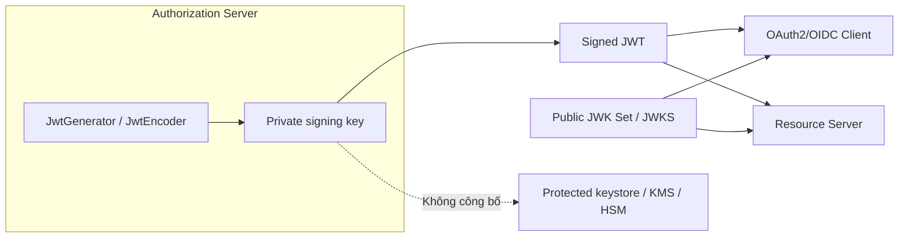
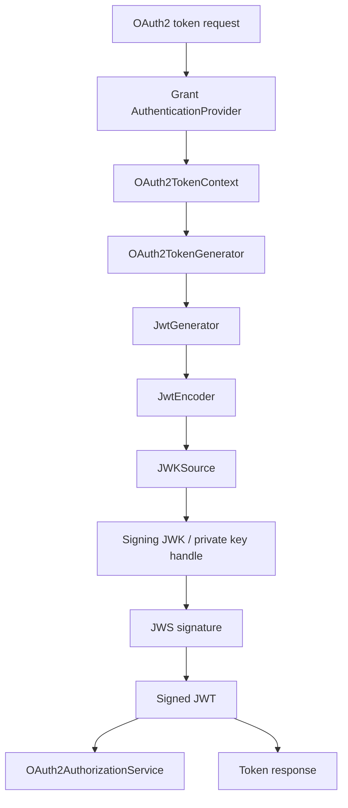
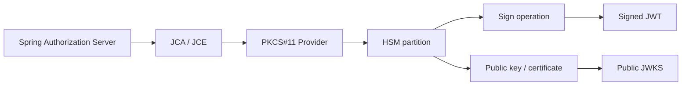
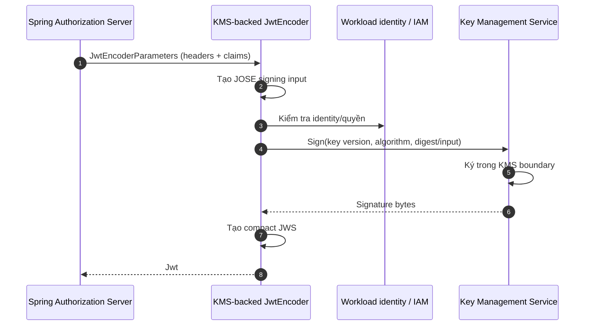
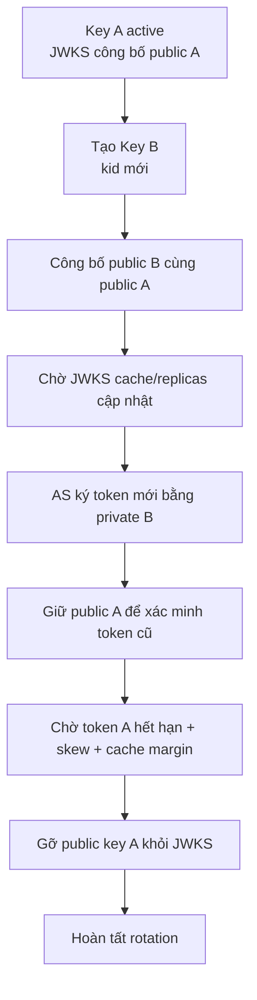
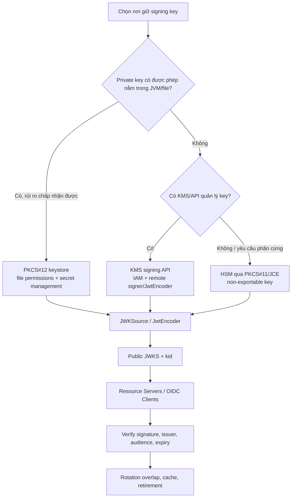

# Tích hợp keystore, KMS hoặc HSM theo yêu cầu triển khai

## 1. Mục tiêu và bối cảnh

Trong chương **JWK và quản lý khóa** của module **SPRING_SECURITY_OAUTH2_OIDC_AUTHORIZATION_SERVER**, khóa ký là thành phần bảo mật cốt lõi của Authorization Server. Với **Spring Security**, **Spring Authorization Server (SAS)** và **Spring Boot**, ứng dụng cần chọn cách giữ và sử dụng private key phù hợp với môi trường triển khai: Java keystore, dịch vụ quản lý khóa tập trung (KMS) hoặc thiết bị bảo mật phần cứng (HSM).

Khóa ký có vòng đời gồm tạo, lưu trữ, phân quyền sử dụng, công bố public key, xoay vòng, thu hồi, sao lưu/khôi phục và xử lý sự cố. Nếu private key bị lộ, kẻ tấn công có thể tự tạo JWT mang issuer, subject, audience và scope giả mạo. Nếu rotation sai, Resource Server có thể từ chối token hợp lệ hoặc tiếp tục tin key đã bị thu hồi.

Sau bài học, bạn có thể:

- Phân biệt Java KeyStore, KMS và HSM, chọn giải pháp theo threat model và yêu cầu vận hành.
- Hiểu cách SAS dùng `JWKSource<SecurityContext>`, `NimbusJwtEncoder` và JWK Set Endpoint.
- Nạp khóa RSA từ PKCS#12, kiểm tra certificate/key pair và tạo JWK phù hợp.
- Tích hợp HSM qua PKCS#11 hoặc KMS qua adapter ký từ xa mà không export private key.
- Quản lý `kid`, `alg`, `use`, `key_ops`, JWKS cache và giai đoạn overlap khi rotation.
- Kiểm thử chữ ký, JWKS, key mismatch, key outage và quyền truy cập khóa.
- Thiết kế phân quyền, audit, backup, disaster recovery và quy trình ứng phó khi key compromise.

**Phạm vi phiên bản:** Ví dụ hướng tới **Spring Authorization Server 1.x / Spring Security 6.x / Spring Boot 3.x**, Nimbus JOSE JWT và Java hiện đại. API cụ thể phụ thuộc phiên bản dependency, Java provider và nhà cung cấp KMS/HSM. Ví dụ PKCS#12 dùng RSA/RS256; production phải chọn thuật toán theo chuẩn nội bộ và khả năng của mọi Resource Server/client.

## 2. Vì sao Authorization Server cần quản lý khóa chuyên biệt?

Khi SAS phát hành JWT access token hoặc OIDC ID Token, nó ký JWT bằng **private signing key**. Resource Server và OIDC client lấy **public key** từ JWKS để xác minh chữ ký. Public key có thể công bố; private key chỉ được dùng bởi thành phần ký có thẩm quyền.



Nếu attacker lấy private signing key, họ có thể tạo token với claims tùy ý rồi ký như AS thật. Resource Server chỉ kiểm tra chữ ký sẽ tin token giả nếu vẫn tin public key tương ứng.

Cần bảo vệ năm thuộc tính:

- **Confidentiality:** private key không bị đọc/export bởi người hoặc process không được phép.
- **Integrity:** không thể thay key, certificate hoặc cấu hình `kid` trái phép.
- **Availability:** AS vẫn ký được token trong điều kiện lỗi đã dự kiến và có kế hoạch phục hồi.
- **Authenticity:** Resource Server lấy public key từ đúng issuer/JWKS được tin cậy.
- **Lifecycle:** rotation không làm token còn hạn bị từ chối bất ngờ và không để key cũ tiếp tục ký vô thời hạn.

## 3. Chọn keystore, KMS hay HSM?

Ba khái niệm có liên quan nhưng không đồng nghĩa:

- **Keystore** là giao diện/container lưu trữ key và certificate. PKCS#12 là định dạng phổ biến; JKS là định dạng Java cũ hơn. File thường được mã hóa bằng password, nhưng khi ứng dụng nạp private key, key có thể hiện diện trong memory của JVM.
- **KMS (Key Management Service)** quản lý key tập trung qua API, policy và audit. Tùy dịch vụ, private key có thể không export được; ứng dụng gọi API để ký hoặc dùng integration/JCA provider.
- **HSM (Hardware Security Module)** thực hiện thao tác mật mã trong thiết bị bảo mật chuyên dụng. Private key có thể được tạo và giữ trong phần cứng, không xuất khỏi boundary HSM. Ứng dụng thường truy cập qua PKCS#11, JCE provider hoặc vendor SDK.

| Tiêu chí | PKCS#12/JKS keystore | KMS | HSM |
| --- | --- | --- | --- |
| Lưu trữ | File hoặc volume được bảo vệ | Dịch vụ quản lý tập trung | Phần cứng chuyên dụng hoặc cluster |
| Private key | Thường có thể export khi có quyền/password | Có thể non-exportable tùy loại key | Thường non-exportable theo policy |
| Ký token | JCA key object trong JVM | API ký từ xa hoặc JCA integration | PKCS#11/JCE hoặc vendor integration |
| Kiểm soát truy cập | File permission, OS identity, password | IAM/workload identity và key policy | HSM role, partition, PIN, client identity |
| Audit | OS/app log, thường hạn chế hơn | Thường có audit API operation | Theo khả năng thiết bị/cluster |
| Độ phức tạp | Thấp đến trung bình | Trung bình, tùy provider | Cao hơn; cần HA, backup/restore và quản trị thiết bị |
| Độ trễ ký | Thường thấp | Có network latency | Tùy thiết bị/provider/kết nối |
| Phù hợp | Lab, hệ thống nhỏ, môi trường kiểm soát file tốt | Cloud/microservices cần central policy | Yêu cầu key custody/phần cứng hoặc tuân thủ cao |

**Cách lựa chọn:**

- Dùng **PKCS#12** cho local/dev hoặc hệ thống có quy trình bảo vệ file, phân quyền và rotation rõ ràng.
- Dùng **KMS** khi cần quản trị tập trung, audit, phân quyền theo workload và ký từ xa.
- Dùng **HSM** khi yêu cầu key custody, non-exportability, phần cứng chuyên dụng hoặc tiêu chuẩn tuân thủ đòi hỏi.
- Có thể kết hợp KMS với HSM làm backend bảo vệ key.

Không chọn HSM chỉ vì “an toàn hơn” mà chưa chuẩn bị HA, backup/restore, giám sát và xử lý sự cố. HSM cấu hình sai hoặc không được vận hành tốt vẫn có thể gây outage hoặc bị lạm dụng qua credential ứng dụng.

## 4. Luồng ký JWT trong Spring Authorization Server

SAS dùng abstraction để tách quá trình cấp token khỏi nơi giữ private key:



| Thành phần | Vai trò |
| --- | --- |
| `OAuth2TokenGenerator<?>` | Sinh access token, refresh token hoặc token liên quan theo grant và token context. |
| `JwtGenerator` | Sinh JWT khi token format và token type yêu cầu JWT. |
| `JwtEncoder` | Mã hóa claims và ký JWT. |
| `NimbusJwtEncoder` | Implementation phổ biến của `JwtEncoder` dựa trên Nimbus JOSE và JWK source. |
| `JWKSource<SecurityContext>` | Cung cấp JWK phù hợp cho thao tác ký hoặc truy xuất JWK Set. |
| `JWKSetEndpointFilter` | Phục vụ public JWK Set tại JWKS endpoint do AS cấu hình. |
| `AuthorizationServerSettings` | Cấu hình issuer và endpoint paths, bao gồm JWK Set endpoint. |

SAS không cần biết private key nằm trong file, HSM hay KMS API nếu lớp `JwtEncoder`/JWK integration thực hiện đúng hợp đồng. Đây là ranh giới giúp thay backend key mà không viết lại grant providers.

### 4.1. JWK là biểu diễn khóa

Một RSA JWK có thể chứa:

| Field | Ý nghĩa | Công bố trong public JWKS? |
| --- | --- | --- |
| `kty` | Key type, ví dụ `RSA` | Có |
| `kid` | Key identifier | Có |
| `use` | Mục đích, ví dụ `sig` | Có |
| `alg` | Thuật toán dự kiến, ví dụ `RS256` | Có |
| `n`, `e` | RSA modulus và public exponent | Có |
| `d` | Private exponent | **Không** |
| `p`, `q`, `dp`, `dq`, `qi` | RSA private parameters | **Không** |
| `key_ops` | Các thao tác được phép | Có thể công bố theo policy |

Public JWK Set chỉ chứa public key material. Không trả `d`, `p`, `q` hoặc private parameters qua JWKS endpoint. Với EC JWK, không công bố private scalar `d`; với symmetric JWK, không công bố secret `k`.

### 4.2. `kid`, `alg`, `use` và `key_ops`

- `kid` xác định key cụ thể để Resource Server chọn public key. Nó nên duy nhất trong JWKS và ổn định trong vòng đời của key.
- `alg` biểu thị thuật toán ký, ví dụ `RS256` hoặc `ES256`.
- `use=sig` biểu thị key dùng cho chữ ký.
- `key_ops` có thể giới hạn thao tác như `sign` hoặc `verify`.

Không tái sử dụng cùng `kid` cho một key khác. Nếu public key thay đổi mà `kid` giữ nguyên, cache JWKS có thể tiếp tục dùng key cũ. Không để client quyết định `alg` tùy ý; AS và Resource Server phải có allowlist thuật toán.

## 5. Dùng PKCS#12 keystore trong môi trường đơn giản

PKCS#12 phù hợp cho lab hoặc triển khai nhỏ khi tổ chức có thể bảo vệ file, password và quyền truy cập. File có thể chứa private key cùng certificate tương ứng.

### 5.1. Tạo keystore cho môi trường thử nghiệm

Có thể tạo key pair RSA và certificate tự ký bằng `keytool` trong local:

```bash
keytool -genkeypair \
  -alias as-signing-2026 \
  -keyalg RSA \
  -keysize 3072 \
  -sigalg SHA256withRSA \
  -validity 365 \
  -storetype PKCS12 \
  -keystore as-signing-dev.p12 \
  -dname "CN=Local Authorization Server Signing Key"
```

Lệnh này chỉ dùng tạo fixture/dev key. Certificate tự ký chứa public key nhưng **không tự chứng minh** Resource Server tin issuer. Resource Server vẫn phải lấy JWKS từ issuer HTTPS đã cấu hình và kiểm tra token theo trust model.

Không đưa file keystore hoặc password vào Git. Production nên tạo key bằng quy trình quản lý khóa phù hợp và lưu ở volume/secret store có quyền tối thiểu.

### 5.2. Cấu hình bên ngoài ứng dụng

Ví dụ application properties:

```yaml
security:
  signing:
    keystore:
      location: file:/run/secrets/as-signing.p12
      type: PKCS12
      alias: as-signing-2026
      store-password: ${AS_KEYSTORE_PASSWORD}
      key-password: ${AS_SIGNING_KEY_PASSWORD}
      kid: as-rsa-2026-01
      algorithm: RS256
```

Đây là cấu hình minh họa cho ứng dụng tự bind properties; issuer và endpoint settings được cấu hình riêng theo phiên bản/cách dựng AS. Không đặt password plaintext trong file được commit. Secret nên đến từ secret manager, mounted secret hoặc biến môi trường được quản trị.

### 5.3. Nạp private key và certificate

Ví dụ minh họa RSA private key trong PKCS#12. Các import được lược bỏ để tập trung vào xử lý khóa:

```java
@Configuration(proxyBeanMethods = false)
public class Pkcs12JwkConfiguration {

    @Bean
    JWKSource<SecurityContext> jwkSource(
            @Value("${security.signing.keystore.location}")
            Resource keyStoreResource,
            @Value("${security.signing.keystore.store-password}")
            String storePassword,
            @Value("${security.signing.keystore.key-password}")
            String keyPassword,
            @Value("${security.signing.keystore.alias}")
            String alias,
            @Value("${security.signing.keystore.kid}")
            String kid) throws Exception {

        KeyStore keyStore = KeyStore.getInstance("PKCS12");

        try (InputStream input = keyStoreResource.getInputStream()) {
            keyStore.load(input, storePassword.toCharArray());
        }

        Key key = keyStore.getKey(alias, keyPassword.toCharArray());
        Certificate certificate = keyStore.getCertificate(alias);

        if (!(key instanceof RSAPrivateKey privateKey)) {
            throw new IllegalStateException(
                    "Configured alias does not contain an RSA private key");
        }

        if (!(certificate instanceof X509Certificate x509)) {
            throw new IllegalStateException(
                    "Configured alias does not contain an X.509 certificate");
        }

        x509.checkValidity();

        if (!(x509.getPublicKey() instanceof RSAPublicKey publicKey)) {
            throw new IllegalStateException(
                    "Certificate does not contain an RSA public key");
        }

        if (!privateKey.getModulus().equals(publicKey.getModulus())) {
            throw new IllegalStateException(
                    "Private key does not match certificate public key");
        }

        if (publicKey.getModulus().bitLength() < 2048) {
            throw new IllegalStateException(
                    "RSA signing key is below the configured minimum size");
        }

        boolean[] keyUsage = x509.getKeyUsage();
        if (keyUsage != null && keyUsage.length > 0
                && !keyUsage[0]) {
            throw new IllegalStateException(
                    "Certificate does not permit digital signatures");
        }

        RSAKey signingJwk = new RSAKey.Builder(publicKey)
                .privateKey(privateKey)
                .keyID(kid)
                .algorithm(JWSAlgorithm.RS256)
                .keyUse(KeyUse.SIGNATURE)
                .build();

        JWKSet jwkSet = new JWKSet(signingJwk);
        return (selector, context) -> selector.select(jwkSet);
    }

    @Bean
    JwtEncoder jwtEncoder(JWKSource<SecurityContext> jwkSource) {
        return new NimbusJwtEncoder(jwkSource);
    }
}
```

**Đoạn code xác minh:**

- Alias có RSA private key và certificate X.509.
- Certificate còn trong thời hạn.
- Public key trong certificate khớp modulus của private key.
- RSA key đạt kích thước tối thiểu được cấu hình.
- Nếu certificate có extension Key Usage, bit `digitalSignature` phải cho phép ký.
- JWK có `kid` ổn định, `alg=RS256` và `use=sig`.

Ví dụ dùng RSA để kiểm tra cặp key. Với EC hoặc thuật toán khác, cần kiểm tra key pair theo thuật toán tương ứng và chọn JWK builder/JOSE algorithm phù hợp.

### 5.4. Giới hạn bảo mật của keystore

Sau khi gọi `keyStore.getKey(...)`, private key có thể được nạp vào memory JVM dưới dạng JCA key object. Mã hóa file keystore **không** có nghĩa private key luôn nằm ngoài process.

- Hạn chế OS identity có quyền đọc file.
- Dùng file permission tối thiểu, filesystem encryption và secret delivery an toàn.
- Không đặt password trong command line, log, source hoặc exception message.
- Không mount keystore vào container không cần ký token.
- Hạn chế heap dump và debug logging nhạy cảm trong production.
- Xây dựng rotation thay vì ghi đè file tại chỗ mà không đổi `kid`.
- Dùng KMS/HSM nếu yêu cầu private key không được export khỏi process/hardware boundary.

**Không tái sử dụng TLS server private key làm JWT signing key theo quán tính.** TLS key và JWT signing key có mục đích, chu kỳ rotation, phạm vi truy cập và hậu quả compromise khác nhau; nên tách biệt.

## 6. Kết nối JWKSource với Spring Authorization Server

`JWKSource<SecurityContext>` là abstraction SAS/Nimbus sử dụng để tìm JWK phù hợp cho thao tác ký và phục vụ public key set. Trong ví dụ keystore, bean `jwkSource` trả JWK đã được nạp.

```java
@Bean
JwtEncoder jwtEncoder(
        JWKSource<SecurityContext> jwkSource) {
    return new NimbusJwtEncoder(jwkSource);
}
```

Nếu ứng dụng tự cấu hình `OAuth2TokenGenerator<?>`, `JwtGenerator` sẽ sử dụng `JwtEncoder` này để ký JWT. Trong nhiều cấu hình SAS, token generator có thể được framework tạo hoặc ứng dụng đăng ký theo nhu cầu; **không tạo thêm generator bean chỉ vì đã thay keystore** nếu generator mặc định đang hoạt động.

### 6.1. Cấu hình JWK Set Endpoint

Trong `AuthorizationServerSettings`, endpoint JWKS thường được cấu hình tại `/oauth2/jwks`:

```java
@Bean
AuthorizationServerSettings authorizationServerSettings() {
    return AuthorizationServerSettings.builder()
            .issuer("https://auth.example.com")
            .jwkSetEndpoint("/oauth2/jwks")
            .build();
}
```

SAS công bố public part của JWK thông qua JWK Set Endpoint. Hãy kiểm thử response thực tế và bảo đảm không có private parameters. Không tự tạo controller serialize toàn bộ `JWKSet` có chứa private key.

Ví dụ public JWKS response:

```json
{
  "keys": [
    {
      "kty": "RSA",
      "kid": "as-rsa-2026-01",
      "use": "sig",
      "alg": "RS256",
      "n": "<BASE64URL_MODULUS>",
      "e": "AQAB"
    }
  ]
}
```

Không xuất hiện `d`, `p`, `q`, `dp`, `dq` hoặc `qi`. Client chỉ cần public key để xác minh.

### 6.2. Tách nguồn ký và nguồn public khi cần

Một thiết kế nâng cao có thể tách:

- **Signing key source:** chỉ trả đúng key active có private signing capability.
- **Verification/public key source:** chứa public keys đang và vừa hết thời gian ký để Resource Server xác minh token còn hạn.

Nếu dùng chung một `JWKSource`, cần bảo đảm selector khi ký chọn **duy nhất đúng private key** theo `kid`/`alg`; JWK Set Endpoint chỉ công bố public components. Đừng để nhiều private signing keys cùng match selector không có `kid` rõ ràng, vì Nimbus encoder có thể không chọn được một key duy nhất.

## 7. Tích hợp HSM qua PKCS#11

### 7.1. Mô hình

HSM giữ private key bên trong thiết bị; ứng dụng nhận một handle/key object do provider cung cấp. Việc ký thực hiện qua PKCS#11/JCA provider, không cần export private key ra file.



### 7.2. Cấu hình provider

Trên Java hiện đại, có thể cấu hình provider PKCS#11 theo hướng dẫn vendor. Ví dụ minh họa:

```java
Provider baseProvider = Security.getProvider("SunPKCS11");
Provider pkcs11Provider =
        baseProvider.configure("/etc/security/pkcs11.cfg");

Security.addProvider(pkcs11Provider);

KeyStore hsmKeyStore =
        KeyStore.getInstance("PKCS11", pkcs11Provider);

// PIN lấy từ secret manager hoặc cơ chế login của HSM.
// Không hard-code và không ghi log.
hsmKeyStore.load(null, hsmPin);
```

Đây là skeleton; file `pkcs11.cfg`, tên provider, slot/token, PIN callback và alias phụ thuộc hệ điều hành, HSM vendor, Java runtime và thư viện PKCS#11. Một số provider cần cấu hình login/session riêng.

Sau khi nạp, ứng dụng lấy private key handle và certificate/public key theo alias. Nếu provider trả key object không thể export, đừng gọi `getEncoded()` để kỳ vọng nhận private key bytes; HSM có thể từ chối export và đó chính là tính năng bảo vệ.

### 7.3. Dùng key handle với JCA/Nimbus

Nếu HSM provider cung cấp private key object tương thích JCA và hỗ trợ thuật toán cần dùng, Nimbus/JCA signer có thể thực hiện chữ ký thông qua provider. Cần xác minh:

- Key object thực hiện được `Signature.initSign(privateKey)` với provider dự kiến.
- Thuật toán JOSE, ví dụ RS256, được provider/HSM hỗ trợ.
- `kid` trong JWT khớp public JWK được công bố.
- Certificate/public key tương ứng đúng private key handle.
- Threading/session behavior của HSM provider phù hợp số request ký đồng thời.
- PIN/session lifecycle và reconnect được quản lý an toàn.

Nếu Nimbus encoder mặc định không tương thích trực tiếp với key handle/provider, cần adapter signer hoặc `JwtEncoder` riêng. Không cast key tùy tiện thành `RSAPrivateKey` nếu vendor object không triển khai interface đó.

### 7.4. HA và backup HSM

HSM không tự bảo đảm high availability. Thiết kế production cần:

- Cluster/partition dự phòng và routing khi node hỏng.
- Quy trình backup/restore key theo cơ chế vendor hỗ trợ, có quorum/dual control nếu yêu cầu.
- Kiểm thử failover mà không làm lộ private key.
- Giám sát session exhaustion, lỗi PIN, latency và quota sign.
- Quy trình khôi phục sau mất thiết bị/partition.
- Kiểm tra public JWKS vẫn phản ánh key pair được khôi phục.

Nếu mất private signing key mà không có backup hợp lệ, AS có thể không ký được token mới. Nếu public key/JWKS không đồng bộ, Resource Server có thể từ chối token còn hạn.

## 8. Tích hợp KMS qua API ký từ xa

### 8.1. Mô hình

KMS thường cho phép workload có quyền gọi thao tác `Sign` trên một key/version cụ thể. Private key không cần rời khỏi dịch vụ; AS gửi signing input hoặc digest theo hợp đồng KMS và nhận signature bytes.



### 8.2. Hai kiểu tích hợp

| Kiểu | Cách hoạt động | Khi phù hợp |
| --- | --- | --- |
| KMS qua JCA/PKCS#11 provider | KMS/HSM được ánh xạ thành JCA provider và key handle; Nimbus dùng signer/JCA | Provider hỗ trợ chuẩn JCA và thuật toán mong muốn |
| KMS qua API ký từ xa | Adapter gọi SDK/API của KMS; tích hợp bằng custom signer hoặc custom `JwtEncoder` | KMS không cung cấp private key object tương thích JCA |

**Điểm quan trọng:** `NimbusJwtEncoder` tiêu chuẩn cần `JWKSource` cung cấp key material/handle tương thích signer của nó. Remote KMS key chỉ có ID/version và API `sign` **không tự trở thành một `PrivateKey` trong JVM**. Khi đó phải có provider/adapter phù hợp hoặc triển khai `JwtEncoder` riêng, không tạo private key giả.

### 8.3. Contract của KMS signing adapter

Một interface ứng dụng có thể mô tả thao tác ký:

```java
public interface RemoteSigningService {

    byte[] sign(
            String keyVersion,
            String algorithm,
            byte[] signingInput);
}
```

`RemoteSigningService` là interface do ứng dụng định nghĩa. Custom encoder cần thực hiện:

1. Tạo JWS header với `alg` và `kid` đã được allowlist.
2. Serialize header và claims theo chuẩn JOSE/JWT.
3. Tạo signing input dạng `BASE64URL(header).BASE64URL(payload)`.
4. Gọi KMS với đúng key version và thuật toán; tuân thủ API yêu cầu signing input hay digest.
5. Chuyển signature về encoding JWS đúng chuẩn.
6. Tạo compact JWS và trả `Jwt` với headers/claims đã ký.
7. Xử lý timeout, retry, key disabled và lỗi KMS an toàn.

Đây là **contract thiết kế**, không phải một `JwtEncoder` hoàn chỉnh. Tự serialize JWT hoặc ký bytes có thể sai nếu dùng sai hash mode, double-hash hoặc chuyển đổi signature không đúng.

### 8.4. Lưu ý với ECDSA

Một số KMS trả ECDSA signature ở định dạng ASN.1 DER (`SEQUENCE(r,s)`), trong khi JWS yêu cầu dạng raw fixed-width `R || S`. Adapter phải chuyển đổi đúng độ dài theo curve và xử lý leading zero. Với RSA, signature bytes thường được dùng trực tiếp theo thuật toán JOSE tương ứng, nhưng vẫn phải xác minh KMS dùng đúng padding/hash.

Đừng chỉ test KMS trả HTTP 200. Hãy ký JWT thực, kiểm tra compact JWS bằng public JWK tương ứng và chạy validation từ Resource Server/client thật.

### 8.5. Quyền IAM tối thiểu

Workload AS thường chỉ cần:

- Quyền **sign** trên key/version được phép.
- Quyền đọc public key/metadata cần công bố JWKS.
- Quyền truy cập secret/config cần thiết cho kết nối.

Không cấp mặc định quyền tạo/xóa key, đổi policy, export private key, quản trị toàn bộ KMS project hoặc decrypt dữ liệu ứng dụng cho process ký JWT. Tách quyền **runtime signer** khỏi **key administrator**; dùng workload identity thay credential tĩnh khi nền tảng hỗ trợ.

## 9. Quản lý JWK Set và public key publication

### 9.1. Công bố public key đúng cách

Resource Server thường khám phá JWKS qua metadata Authorization Server hoặc cấu hình trực tiếp `jwk-set-uri`. JWK Set cần có các public keys cần để xác minh token đang còn hiệu lực.

Một public key entry nên có `kid`, `kty`, `alg` và `use`/`key_ops` theo profile. Với RSA, `n` và `e` là public parameters.

**Không bao giờ**:

- Trả toàn bộ JWK private key trong JWKS.
- Cho phép endpoint JWKS chọn alias tùy ý qua query parameter.
- Dùng key symmetric secret làm public JWKS.
- Công bố public key từ issuer/KMS account không được tin.
- Giữ một `kid` nhưng thay public key phía sau.
- Cho client chọn thuật toán yếu hoặc `alg=none`.

### 9.2. Metadata discovery

Issuer và JWKS URI phải nhất quán với discovery metadata, ví dụ `jwks_uri`. Không hard-code public key ở một API nhưng để client khác tải JWKS từ issuer khác mà không có trust agreement. Khi chạy sau reverse proxy, forwarded headers chỉ được tin từ proxy đã kiểm soát để issuer không bị suy ra từ Host header giả mạo.

### 9.3. Cache và unknown `kid`

Resource Server thường cache JWKS. Khi token mới mang `kid` chưa có trong cache, decoder có thể refresh JWKS theo cơ chế thư viện. Tuy nhiên:

- Không xoay key liên tục khiến mỗi request gây refresh.
- Không dùng cùng `kid` cho nhiều key.
- Giữ key cũ đủ lâu cho token đã phát.
- Theo dõi unknown-kid spike để phát hiện misconfiguration hoặc token giả.
- Có giới hạn cache/refresh để tránh attacker tạo JWT với vô số `kid` gây request bão tới JWKS endpoint.

## 10. Xoay vòng khóa ký (key rotation)

Rotation phải phối hợp **AS, KMS/HSM, JWKS cache và Resource Servers**. Không đơn giản ghi đè file keystore đang chạy.

### 10.1. Quy trình overlap an toàn



Trình tự khuyến nghị:

1. Tạo key B trong keystore/KMS/HSM bằng quy trình an toàn; gán `kid` mới.
2. Đưa **public key B** vào JWKS cùng public key A đang hoạt động.
3. Chờ Resource Server/JWKS cache và replica nhận public B.
4. Chuyển AS sang ký token mới bằng private key B và header `kid=B`.
5. Giữ public key A để xác minh token đã ký bằng A còn hiệu lực.
6. Chờ ít nhất thời gian sống tối đa của token A cộng clock skew, JWKS cache propagation và biên an toàn.
7. Gỡ public key A khỏi JWKS khi không còn token hợp lệ cần nó.
8. Thu hồi/quản lý private key A theo chính sách; không để nó tiếp tục được chọn làm signing key.

Nếu rollback, xác định trước việc quay lại key A có an toàn không và token ký bằng B sẽ được xác minh ra sao. Đừng xóa private key A trước khi hoàn tất kế hoạch phục hồi cần thiết.

### 10.2. Chọn key active bằng `kid`

Khi nhiều key cùng xuất hiện trong JWKS, signer phải chọn đúng một private key. Có thể đặt `kid` rõ ràng trong JWS header/token customizer nếu cấu hình encoder yêu cầu:

```java
@Bean
OAuth2TokenCustomizer<JwtEncodingContext> activeSigningKeyHeader(
        @Value("${security.signing.active-kid}") String activeKid) {

    return context ->
            context.getJwsHeader().keyId(activeKid);
}
```

Đây là ví dụ bổ sung header; cách chọn key cụ thể phụ thuộc `JWKSource`/`NimbusJwtEncoder` và phiên bản. Bảo đảm selector chỉ trả đúng private key tương ứng `kid` và `alg`. Nếu customizer khác cũng thay `kid`, hợp nhất policy để tránh xung đột.

### 10.3. Bao lâu thì xóa public key cũ?

Tính tối thiểu:

```text
retirement_time >=
    last_issue_time_with_old_key
    + maximum_access_token_lifetime
    + maximum_id_token_lifetime
    + accepted_clock_skew
    + JWKS_cache_and_propagation_margin
```

Nếu có loại token TTL dài hơn hoặc client cache JWKS lâu hơn, phải tính theo token thực tế. Với opaque token không phụ thuộc chữ ký JWT, chính sách khác; với JWT ký bằng key cũ, Resource Server cần public key cũ đến khi token cũ không còn được chấp nhận.

## 11. Chọn thuật toán và chính sách khóa

### 11.1. Thuật toán ký

| JOSE alg | Loại khóa | Ghi chú |
| --- | --- | --- |
| `RS256` | RSA | Khả năng tương thích rộng; cần key size phù hợp policy |
| `PS256` | RSA-PSS | Cần kiểm tra hỗ trợ của HSM/KMS và consumers |
| `ES256` | EC P-256 | Token/signature nhỏ hơn; kiểm tra DER-to-JWS khi dùng remote signer |
| `EdDSA` | Ed25519/Ed448 tùy profile | Chỉ chọn khi runtime, KMS/HSM và consumers hỗ trợ |

Chọn một tập thuật toán rõ ràng theo khả năng hệ thống. Không nhận algorithm từ token header như chỉ thị đáng tin; verifier phải có allowlist và key type phải phù hợp thuật toán.

Tránh `alg=none` và thuật toán yếu/không được phê duyệt. Không dùng cùng secret HMAC chia sẻ rộng giữa nhiều Resource Server nếu mục tiêu là chỉ AS được quyền phát hành token: với symmetric MAC, mọi bên có secret xác minh cũng có thể tạo chữ ký.

### 11.2. Key usage và separation of duties

- Signing key chỉ có quyền ký token theo policy.
- TLS certificate/private key phục vụ HTTPS nên tách khỏi token signing key.
- Encryption key của database/backup không dùng làm JWS signing key.
- Runtime AS chỉ được sign, không được xóa/rotate policy nếu không cần.
- Operator quản trị key không nhất thiết được đọc client secrets/token database.
- Resource Server chỉ cần public key/JWKS, không cần quyền truy cập KMS private key.

### 11.3. Kiểm tra key trước khi kích hoạt

Trước khi cho key vào active signing set:

- Kiểm tra algorithm/key type và kích thước/curve.
- Kiểm tra certificate validity nếu sử dụng certificate.
- Kiểm tra cặp public/private bằng challenge sign/verify hoặc cơ chế provider.
- Kiểm tra `kid` không trùng key khác.
- Kiểm tra key được phép `sign` và không bị disabled/destroyed.
- Kiểm tra public JWK được xuất đúng và không chứa private parameters.
- Ký JWT thử trong môi trường kiểm soát, xác minh bằng public key.
- Kiểm tra AS replica và Resource Server có thể dùng key/JWKS mới.

Không activate key mới chỉ vì thao tác tạo key thành công ở KMS/HSM; cần chứng minh đường ký và đường xác minh đầu-cuối hoạt động.

## 12. Bảo vệ vận hành và quyền truy cập

### 12.1. Phân quyền runtime

| Tác vụ | Runtime AS | Key administrator | Resource Server |
| --- | --- | --- | --- |
| Ký access token/ID Token | Có, với key/version được cấp | Có thể kiểm thử/quản trị theo quy trình | Không |
| Đọc public key | Có nếu cần | Có | Có qua JWKS |
| Export private key | Không nên | Chỉ theo quy trình đặc biệt nếu policy cho phép | Không |
| Tạo key version | Không mặc định | Có | Không |
| Xóa/disable key | Không mặc định | Theo phê duyệt | Không |
| Thay IAM/key policy | Không | Theo separation of duties | Không |
| Xác minh JWT | Có thể | Có thể | Có bằng public key |

### 12.2. Secret và credential

- Không lưu keystore password, KMS API key hoặc HSM PIN trong source, Git, image hay log.
- Ưu tiên workload identity, IAM role, managed identity hoặc cơ chế tương đương.
- Nếu cần secret tĩnh, giới hạn scope/quyền và rotation.
- Không truyền secret qua command line hoặc environment dump không kiểm soát.
- Hạn chế quyền đọc mounted keystore chỉ cho process AS.
- Không bật actuator/config endpoint công khai có thể làm lộ key path, alias hoặc secret.
- Không serialize `PrivateKey`/JWK private vào cache/distributed store.
- Kiểm soát heap dump, crash dump và support bundle vì có thể chứa object key trong memory.

### 12.3. Audit và phát hiện bất thường

Theo dõi:

- Tạo/disable/rotate key version.
- Thay đổi IAM/key policy hoặc HSM partition roles.
- Ký thất bại, KMS throttling, HSM session exhaustion.
- Thay đổi active `kid`.
- Unknown-kid spike ở Resource Server.
- Token signature validation failure theo issuer/algorithm/key ID.
- JWK Set thay đổi ngoài cửa sổ triển khai.

Không ghi private key, password, PIN, access token hoặc raw signature input có claims nhạy cảm vào audit log. Audit cần cho biết **ai làm gì với key nào, khi nào, kết quả ra sao** mà không chứa credential.

## 13. Kiểm thử tích hợp keystore/KMS/HSM

### 13.1. Ma trận kiểm thử khóa

| Test case | Kỳ vọng |
| --- | --- |
| Keystore hợp lệ, alias đúng | AS khởi động, ký JWT thành công |
| Sai keystore password | Startup fail rõ ràng; không fallback sang key mặc định yếu |
| Sai key password/alias | Startup fail; không phát token không chữ ký |
| Certificate hết hạn | Bị từ chối theo policy nếu certificate validity là điều kiện bắt buộc |
| Public/private key mismatch | Startup/test fail trước khi phục vụ request |
| RSA key dưới kích thước tối thiểu | Không kích hoạt |
| Key không hỗ trợ signing | Không kích hoạt |
| Public JWKS | Chỉ có public parameters |
| JWT ký bằng private key | Verify thành công bằng public JWK tương ứng |
| Sai `kid` | Decoder không chọn nhầm key |
| Sai algorithm/key type | Verify thất bại |
| KMS permission thiếu | Sign operation fail, có alert; không fallback ngoài policy |
| KMS timeout/throttle | Timeout/backoff có giới hạn, endpoint không treo vô hạn |
| HSM mất kết nối | AS fail closed với lỗi vận hành có kiểm soát |
| Key disabled/destroyed | Không tiếp tục phát token bằng key đó |
| Rotation overlap | Token cũ và mới đều xác minh trong thời gian overlap |
| Sau khi retire key cũ | Token cũ hết hạn trước khi public key bị gỡ |
| JWKS cache cũ | Refresh key theo policy, không gây request storm |
| AS nhiều replica | Tất cả ký bằng active key được thống nhất |
| Rollback key | Token của cả hai giai đoạn được xác minh theo kế hoạch |

### 13.2. Kiểm thử JWKS không lộ private material

Khi gọi endpoint JWKS, xác minh mỗi JWK chỉ có public fields phù hợp. Với RSA, response không được chứa:

```json
{
  "d": "...",
  "p": "...",
  "q": "...",
  "dp": "...",
  "dq": "...",
  "qi": "..."
}
```

Các field trên là **danh sách phải vắng mặt**, không phải cấu trúc response cần trả. Với EC, kiểm tra không có private scalar `d`; với octet/symmetric key, không công bố `k`.

### 13.3. Test JWT end-to-end

Một integration test nên:

1. Khởi động AS với test keystore hoặc KMS sandbox/HSM test partition.
2. Gửi token request grant hợp lệ.
3. Nhận JWT và đọc header `kid`/`alg` (chỉ kiểm tra cấu trúc, không coi decode là verify).
4. Lấy public JWK từ JWKS endpoint.
5. Xác minh chữ ký bằng public key tương ứng.
6. Kiểm tra `iss`, `aud`, `exp` và scope.
7. Xoay sang key mới, xác minh token cũ vẫn hợp lệ trong overlap.
8. Gỡ key cũ sau TTL, xác minh token mới vẫn hợp lệ và token cũ không còn được chấp nhận theo policy.

Không chỉ mock `JwtEncoder` rồi kết luận keystore/HSM/KMS integration đã đúng. Với KMS, test cả lỗi permission, timeout, key version bị disable và định dạng chữ ký.

### 13.4. Test concurrency và hiệu năng

- Đo signing latency P50/P95/P99 ở tải dự kiến.
- Đo số phiên HSM đồng thời và connection pool.
- Đo KMS throttling/quota khi phát token cao điểm.
- Kiểm tra timeout và retry không nhân đôi công việc quá mức.
- Kiểm tra nhiều AS node không chọn key active khác nhau.
- Kiểm tra rotation trong lúc token requests đang chạy.
- Kiểm tra JWKS cache refresh khi `kid` mới xuất hiện.

Retry ký cần giới hạn; không retry vô hạn hoặc chuyển sang private key cũ ngoài policy.

## 14. Xử lý sự cố thường gặp

| Hiện tượng | Nguyên nhân có thể | Hướng xử lý |
| --- | --- | --- |
| AS không khởi động sau cấu hình keystore | Sai path, password, alias hoặc format | Kiểm tra mounted file, PKCS#12 type, secret delivery; không in password |
| `UnrecoverableKeyException` | Key password sai hoặc key không truy cập được | Kiểm tra alias/credential/provider |
| `NoSuchAlgorithmException` | JCA provider không hỗ trợ thuật toán | Kiểm tra provider/runtime/HSM capability |
| `InvalidKeyException` khi ký | Key type, usage hoặc provider không phù hợp | Kiểm tra key pair, algorithm và quyền sign |
| JWKS trả rỗng | Selector không match, key use/alg sai hoặc endpoint wiring lỗi | Kiểm tra `kid`, `use`, JWKSource và endpoint |
| JWKS lộ private parameters | Public endpoint serialize private JWK không đúng | Dừng phát hành, xử lý key compromise, chỉ công bố public JWK |
| Token mới bị Resource Server từ chối | Public key chưa publish/cache hoặc `kid` sai | Kiểm tra JWKS propagation, cache và header |
| Token cũ bị từ chối sau rotation | Gỡ public key cũ quá sớm | Khôi phục public key cũ nếu an toàn và tính lại overlap |
| Nimbus báo nhiều JWK khớp | Selector không xác định duy nhất signing key | Gắn `kid`, lọc đúng key/alg/use |
| KMS trả signature nhưng JWT verify fail | Sai signing input, digest mode, padding hoặc ECDSA DER conversion | Kiểm tra adapter và test bằng public key |
| KMS trả access denied | IAM/workload identity thiếu quyền | Cấp quyền sign/read public key tối thiểu |
| KMS throttling | Quá tải/quota hoặc token request tăng đột biến | Scale/quota và backoff có giới hạn |
| HSM session exhausted | Không đóng/reuse session đúng cách | Kiểm tra provider pooling và vendor guidance |
| Replica ký bằng các key khác nhau ngoài kế hoạch | Active kid không đồng nhất | Đồng bộ config/rollout và kiểm tra readiness |
| Token dùng `alg` ngoài allowlist | Custom header hoặc policy lỏng | Pin algorithm ở AS và Resource Server |
| Private key xuất hiện trong heap dump | Key được nạp vào JVM | Hạn chế dump/quyền truy cập; cân nhắc non-exportable key |

## 15. Checklist chọn giải pháp theo môi trường

### Local development

- [ ] Dùng key riêng cho local, không tái sử dụng production key.
- [ ] Có thể dùng PKCS#12 với password trong môi trường local được kiểm soát.
- [ ] Không commit keystore/password.
- [ ] Có test ký và verify bằng public key.
- [ ] Có `kid` ổn định nếu cần test JWKS/cache.

### Staging / integration

- [ ] Dùng KMS/HSM sandbox hoặc keystore được quản trị riêng.
- [ ] Quyền runtime tách khỏi quyền quản trị key.
- [ ] Kiểm tra JWKS discovery, cache, rotation và lỗi provider.
- [ ] Có load/concurrency test và mô phỏng KMS/HSM outage.
- [ ] Không dùng private key production để tiện test.

### Production

- [ ] Chọn keystore/KMS/HSM theo threat model và compliance.
- [ ] Private key được bảo vệ, non-exportable khi yêu cầu.
- [ ] Workload identity và IAM least privilege.
- [ ] Signing algorithm và key size được pin theo policy.
- [ ] Public JWKS chỉ chứa public material.
- [ ] Rotation có overlap và kế hoạch rollback.
- [ ] Có backup/restore và disaster recovery đã diễn tập.
- [ ] Có audit key lifecycle, cảnh báo sign failure/unknown kid.
- [ ] Kiểm soát heap dump, logs, secret files và quyền operator.
- [ ] Tất cả AS replicas thống nhất active `kid`, issuer và JWKS.
- [ ] Có quy trình xử lý compromise và revoke key/token.

## 16. Bản đồ quyết định



**Tích hợp keystore, KMS hoặc HSM không chỉ là thay một đoạn code nạp private key.** Spring Authorization Server cần một đường ký JWT tin cậy, một public JWKS nhất quán và quy trình quản lý vòng đời khóa. Keystore phù hợp khi tổ chức chấp nhận bảo vệ file/process; KMS cung cấp quản trị tập trung và ký từ xa; HSM bảo vệ thao tác ký trong phần cứng. Dù chọn phương án nào, phải giữ private key ngoài public JWKS, pin thuật toán và `kid`, kiểm thử chữ ký đầu-cuối, xoay key có overlap và chuẩn bị xử lý outage/compromise trước khi vận hành Authorization Server.
