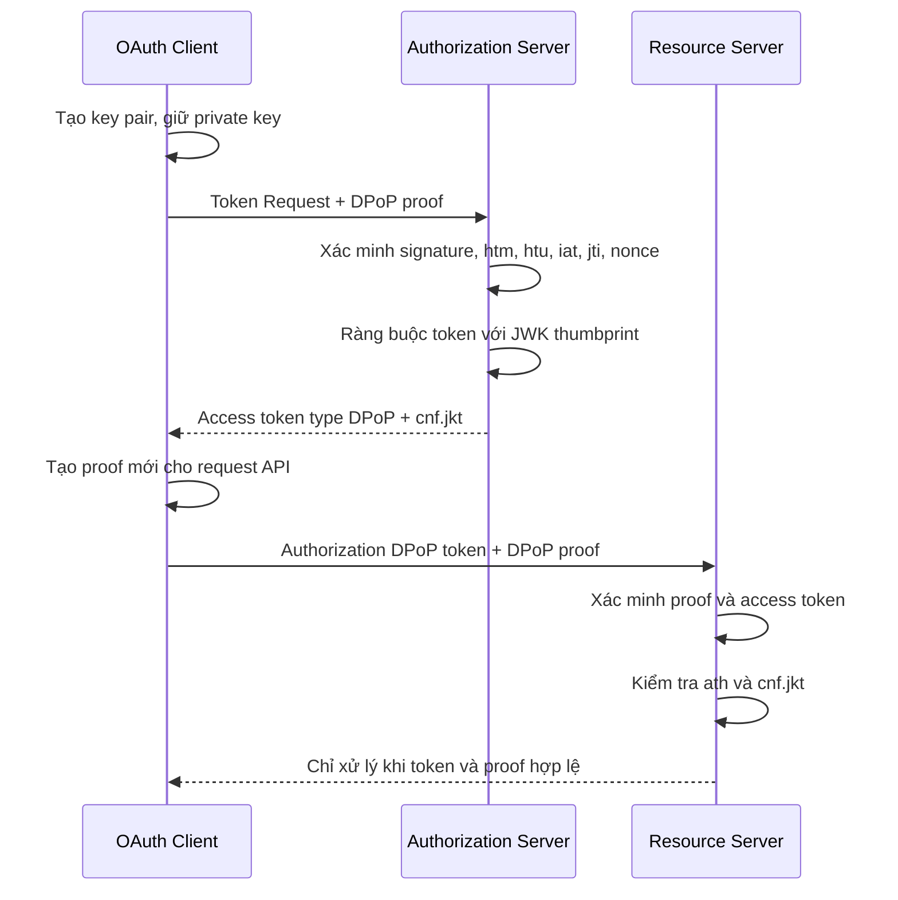
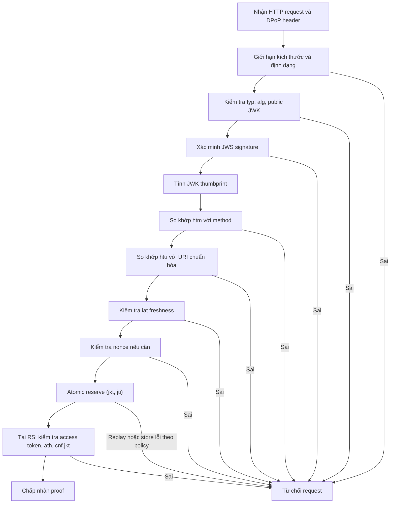

# Xác minh htm, htu, iat, jti và chữ ký của DPoP proof

## 1. Bối cảnh: access token cần được ràng buộc với người giữ khóa

Trong hệ thống OAuth 2.0/OpenID Connect sử dụng **Spring Security**, **Spring Authorization Server** và Spring Boot, access token dạng Bearer có một đặc điểm: bất kỳ bên nào sở hữu token đều có thể trình token tới Resource Server trong thời gian token còn hiệu lực.

Nếu access token bị lộ qua log, browser storage, proxy hoặc thiết bị bị xâm nhập, kẻ tấn công có thể dùng lại token từ một máy khác. TTL ngắn giảm khoảng thời gian rủi ro nhưng không ngăn việc sử dụng token bị đánh cắp ngay trong khoảng thời gian đó.

**Demonstrating Proof of Possession (DPoP)** được chuẩn hóa trong **RFC 9449**. DPoP bổ sung một proof JWT được client ký bằng private key mà client giữ. Khi gọi Token Endpoint hoặc Resource Server, client gửi proof trong HTTP header `DPoP`. Server xác minh chữ ký và claims gắn proof với request hiện tại.

Bài này tập trung vào năm kiểm tra cốt lõi: **`htm`** (HTTP method), **`htu`** (URI đích), **`iat`** (thời điểm tạo proof), **`jti`** (định danh proof dùng phát hiện replay) và **chữ ký/public JWK** (chứng minh bên gửi giữ private key tương ứng).

Ví dụ, `booking-bff` nhận DPoP-bound access token dành cho `booking-api`. Mỗi request API phải có proof mới được ký bởi cùng private key đã ràng buộc với token. Kẻ tấn công chỉ lấy được access token sẽ không thể tạo proof hợp lệ nếu không có private key.

Sau bài này, bạn có thể giải thích DPoP proof, xác minh JOSE header và chữ ký, kiểm tra `htm`/`htu`/`iat`/`jti`, triển khai replay detection, phân biệt Token Endpoint với Resource Server và kiểm thử các trường hợp tấn công trong ứng dụng Spring.

## 2. DPoP proof là gì?

DPoP proof là một **JWT có chữ ký (JWS)** do OAuth client tạo cho một request cụ thể. Nó không phải access token và không tự cấp quyền truy cập API. Proof thể hiện client đang sở hữu private key tương ứng với public key được nhúng trong JOSE header.

Một proof có cấu trúc compact JWS:

```text
BASE64URL(protected-header).
BASE64URL(payload-claims).
BASE64URL(signature)
```

Client gửi JWT trong header:

```http
DPoP: eyJ0eXAiOiJkcG9wK2p3dCIsImFsZyI6IkVTMjU2Iiw...
```

JWT decode được **không chứng minh chữ ký hợp lệ**. Server phải xác minh JWS bằng public key và sau đó kiểm tra claims theo request thực tế.

### 2.1. DPoP khác Bearer token thế nào?

| Khía cạnh | Bearer access token | DPoP-bound access token |
|---|---|---|
| Bằng chứng sử dụng | Người gửi trình token | Người gửi trình token và proof |
| Ràng buộc khóa | Không bắt buộc | Token gắn với public key thumbprint |
| Authorization header | `Authorization: Bearer ...` | `Authorization: DPoP ...` |
| Proof riêng | Không | `DPoP: <proof-jwt>` |
| Chỉ đánh cắp token | Có thể sử dụng trong thời hạn | Thiếu private key để tạo proof hợp lệ |
| Replay | Token có thể bị dùng lại | Proof phải qua freshness và replay checks |

DPoP giảm nguy cơ token bị sử dụng bởi bên không giữ khóa. Nó không bảo vệ khi attacker đồng thời lấy access token và private key, khi XSS có thể yêu cầu client ký proof hoặc khi thiết bị client bị kiểm soát.

### 2.2. Luồng tổng quát



Sơ đồ mô tả luồng khái quát. Authorization Server có thể yêu cầu nonce; khi đó client tạo proof mới theo challenge.

## 3. JOSE header và chữ ký proof

RFC 9449 yêu cầu proof JWT dùng JOSE header nhận dạng DPoP:

```json
{
  "typ": "dpop+jwt",
  "alg": "ES256",
  "jwk": {
    "kty": "EC",
    "crv": "P-256",
    "x": "PUBLIC_KEY_X",
    "y": "PUBLIC_KEY_Y"
  }
}
```

| Header | Vai trò | Quy tắc |
|---|---|---|
| `typ` | Nhận dạng DPoP proof JWT | Giá trị profile `dpop+jwt` |
| `alg` | Thuật toán ký | Chữ ký bất đối xứng trong allowlist |
| `jwk` | Public key xác minh proof | Chỉ chứa public key, không có private material |

### 3.1. Allowlist thuật toán

Server không được tin `alg` do client tự khai. Cần cấu hình allowlist thuật toán chữ ký bất đối xứng được thư viện và deployment hỗ trợ.

Từ chối `alg=none`, thuật toán đối xứng như HS256, thuật toán ngoài allowlist, key type/curve không tương thích hoặc cấu trúc JOSE không hợp lệ. RFC 9449 khuyến nghị ES256 cho khả năng tương thích; thuật toán khác chỉ được chấp nhận nếu server hỗ trợ và policy cho phép.

### 3.2. Public JWK

Proof mang public JWK để server xác minh chữ ký. JWK không được chứa private key parameter. Với EC public key, các trường thường có `kty`, `crv`, `x` và `y`; trường `d` là private scalar và không được xuất hiện.

Server cần parse JWK bằng thư viện JOSE đáng tin, kiểm tra key type/curve, xác minh chữ ký và tính JWK thumbprint theo RFC 7638.

Không tải khóa từ `jku` hoặc `x5u` do proof chỉ định. DPoP proof mang public key trong header; tải URL tùy ý có thể tạo SSRF hoặc trust injection.

### 3.3. Chữ ký hợp lệ chưa đủ

Proof ký hợp lệ vẫn có thể có method sai, URI sai, `iat` quá cũ, `jti` đã dùng hoặc nonce không hợp lệ. Tại Resource Server, proof còn phải ràng buộc với access token qua `ath` và `cnf.jkt`.

## 4. Claims của DPoP proof

Một proof ở Resource Server có thể chứa:

```json
{
  "jti": "unique-proof-id-7b6a",
  "htm": "GET",
  "htu": "https://booking-api.example.com/bookings/42",
  "iat": 1794825300,
  "ath": "BASE64URL_SHA256_OF_ACCESS_TOKEN"
}
```

| Claim | Ý nghĩa | Điều kiện |
|---|---|---|
| `jti` | Định danh duy nhất của proof | Bắt buộc |
| `htm` | HTTP method của request | Bắt buộc |
| `htu` | HTTP URI đích, không gồm query/fragment | Bắt buộc |
| `iat` | Thời điểm proof được tạo (NumericDate) | Bắt buộc |
| `ath` | Hash của access token được gửi kèm | Bắt buộc với proof tại Resource Server gắn cùng access token |
| `nonce` | Nonce do server cấp | Khi server yêu cầu |

Proof tại Token Endpoint và proof tại Resource Server có điều kiện khác nhau. Claim `ath` ràng buộc proof với access token trong request API; không áp dụng máy móc cho proof tại Token Endpoint.

## 5. Xác minh chữ ký và JWK thumbprint

Một validator nên thực hiện:

1. Kiểm tra compact JWS đúng cấu trúc và giới hạn kích thước.
2. Parse protected header.
3. Yêu cầu `typ=dpop+jwt`.
4. Kiểm tra `alg` thuộc allowlist bất đối xứng.
5. Parse `jwk` và xác nhận public-only key hợp lệ.
6. Xác minh chữ ký JWS bằng public key.
7. Tính RFC 7638 thumbprint của JWK.
8. Chỉ sau khi chữ ký hợp lệ mới tin các claims `htm`, `htu`, `iat` và `jti`.

Không ghi `jti` vào replay cache trước khi xác minh chữ ký. Nếu không, attacker có thể gửi proof giả để chiếm trước ID của proof hợp lệ.

### 5.1. Tính JWK thumbprint

DPoP dùng thumbprint của public key để ràng buộc access token. Thumbprint được tính từ tập member chuẩn của JWK theo RFC 7638, không phải hash toàn bộ JSON tùy ý hoặc hash chuỗi compact JWT.

```text
Public JWK
   |
   v
RFC 7638 canonical required members
   |
   v
UTF-8 JSON representation
   |
   v
SHA-256
   |
   v
Base64url without padding
   |
   v
jkt
```

Dùng implementation RFC 7638 từ thư viện JOSE đã được kiểm chứng; không serialize JWK theo thứ tự member tùy ý rồi hash raw JSON.

### 5.2. Ràng buộc access token bằng cnf.jkt

Khi AS cấp DPoP-bound access token, token có confirmation claim:

```json
{
  "cnf": {
    "jkt": "JWK_THUMBPRINT_OF_CLIENT_PUBLIC_KEY"
  }
}
```

Resource Server xác minh thumbprint public key trong proof hiện tại trùng với `cnf.jkt` trong access token. Token chỉ dùng được cùng key pair đã ràng buộc.

Nếu access token là JWT, RS xác minh chữ ký/issuer/audience/expiry của access token **riêng biệt** với chữ ký DPoP proof. Nếu token opaque, RS có thể cần introspection để lấy trạng thái và confirmation claim. Xác minh proof không thay thế xác minh access token.

## 6. Claim htm: ràng buộc HTTP method

`htm` là HTTP method mà client tạo proof cho, ví dụ GET, POST, PUT hoặc DELETE.

Request:

```http
GET /bookings/42 HTTP/1.1
Host: booking-api.example.com
Authorization: DPoP ACCESS_TOKEN
DPoP: SIGNED_DPOP_PROOF
```

Proof cần có:

```json
{
  "htm": "GET"
}
```

Server so sánh `htm` với HTTP method thực tế của request. Client không thể ký proof cho GET rồi gửi request DELETE.

Ví dụ không hợp lệ:

```text
Actual request method: POST
Proof htm: GET
Result: reject
```

Không suy ra method từ route hoặc query parameter. Dùng method thực tế mà application xử lý sau proxy theo contract đáng tin.

### 6.1. Kiểm thử htm

- Proof GET với request GET: qua bước method nếu các kiểm tra khác đúng.
- Proof GET với request POST: từ chối.
- Proof POST với request DELETE: từ chối.
- Method bị thay đổi qua proxy/rewrite: kiểm tra method mà application thực sự xử lý.
- Method sai định dạng: từ chối theo quy tắc xử lý chuẩn.

Method binding ngăn proof bị chuyển sang một thao tác HTTP khác; nó không thay thế authorization theo route hoặc scope.

## 7. Claim htu: ràng buộc URI đích

`htu` chứa HTTP URI của target endpoint, **không gồm query và fragment components**.

Ví dụ:

```text
Request URI:
https://booking-api.example.com/bookings/42?expand=items#section

htu:
https://booking-api.example.com/bookings/42
```

### 7.1. So sánh URI đầy đủ

Chỉ kiểm tra path `/bookings/42` là chưa đủ. URI còn gồm scheme, host, port và path. Proof cho:

```text
https://booking-api.example.com/bookings/42
```

không được chấp nhận cho:

```text
https://attacker.example.net/bookings/42
```

Server loại query/fragment rồi so sánh theo URI normalization phù hợp RFC 3986. Chú ý hostname casing, default port, dot segments, percent-encoding và authority. Chỉ áp dụng bước normalization được RFC cho phép; không tự chuẩn hóa path làm hai resource khác nhau trở thành một.

### 7.2. Reverse proxy và URI công khai

Ví dụ:

```text
Client-visible URL:
https://api.example.com/oauth/resource

Internal upstream:
http://booking-api-service:8080/oauth/resource
```

Client tạo `htu` theo URL công khai, trong khi application có thể nhìn thấy scheme HTTP và host nội bộ. Nếu validator so với URI nội bộ, proof hợp lệ có thể bị từ chối; nếu validator chấp nhận URI từ header không tin cậy, attacker có thể tác động target URI.

Cần định nghĩa URI công khai/canonical; chỉ tin forwarded headers từ reverse proxy đã xác thực; yêu cầu proxy xóa header caller gửi rồi thêm giá trị chuẩn; tạo target URI từ request context đã chuẩn hóa; và test trực tiếp, qua proxy, khi rewrite host/path.

Không lấy raw `X-Forwarded-Host` hoặc `Forwarded` từ Internet làm nguồn sự thật.

### 7.3. Query không được ràng buộc bởi htu

Vì query bị loại khỏi `htu`, hai request cùng method/path nhưng query khác nhau có thể có cùng `htm`/`htu`. DPoP không phải chữ ký cho toàn bộ HTTP message/body.

Nếu nghiệp vụ phụ thuộc query, body, tenant, idempotency key hoặc headers khác, ứng dụng cần validation/authorization riêng. Không tuyên bố DPoP proof ký toàn bộ request payload.

## 8. Claim iat: freshness và clock skew

`iat` là thời điểm tạo proof dưới dạng NumericDate. Server xác định proof có đủ mới hay không.

Một policy minh họa:

```text
now - maxProofAge <= iat <= now + allowedClockSkew
```

Ví dụ cấu hình nghiệp vụ:

```yaml
dpop:
  proof:
    max-age: 5m
    allowed-clock-skew: 30s
```

Các giá trị chỉ để minh họa, không phải mặc định của Spring hoặc con số bắt buộc trong RFC 9449. Chọn cửa sổ nhỏ nhất mà client, network và đồng hồ hệ thống thực tế đáp ứng.

### 8.1. Từ chối proof quá cũ hoặc ở tương lai

| Trường hợp | Kết quả |
|---|---|
| `iat` trong cửa sổ hợp lệ | Tiếp tục kiểm tra |
| `iat` cũ hơn max age | Từ chối |
| `iat` ở tương lai vượt clock skew | Từ chối |
| `iat` thiếu hoặc sai kiểu NumericDate | Từ chối |
| `iat` gây lỗi parse/overflow | Từ chối an toàn |

Không dùng thời gian từ client làm đồng hồ chuẩn. Client chỉ khai báo `iat`; server so sánh với clock của server.

### 8.2. Đồng bộ đồng hồ

Nếu AS, RS và client lệch giờ quá lớn, proof hợp lệ có thể bị từ chối. Cần đồng bộ giờ bằng NTP/clock service, theo dõi clock drift, giữ allowed skew nhỏ và nhất quán, không tăng cửa sổ lên hàng giờ để che lỗi hạ tầng.

**Freshness không ngăn replay một mình.** Kẻ tấn công có thể gửi lại proof trong cửa sổ còn hợp lệ. Cần `jti` và replay detection.

## 9. Claim jti: phát hiện replay

`jti` là định danh duy nhất của từng DPoP proof. Client phải tạo `jti` mới cho mỗi proof; server dùng nó để phát hiện proof đã được chấp nhận trước đó.

```text
Request A:
jkt = thumbprint(K)
jti = proof-001

Request B:
jkt = thumbprint(K)
jti = proof-002

Replay Request A:
jkt = thumbprint(K)
jti = proof-001  -> reject
```

### 9.1. Replay cache key

Một replay cache có thể dùng khóa logic:

```text
replayKey = (jwkThumbprint, jti)
```

Có thể bổ sung issuer/client/endpoint namespace theo thiết kế. Cùng một key pair không thể dùng lại cùng `jti` trong khoảng server còn chấp nhận proof.

### 9.2. Ghi replay state phải nguyên tử

Quy trình:

1. Xác minh chữ ký và claims cơ bản.
2. Tính JWK thumbprint.
3. Kiểm tra `iat` còn trong cửa sổ.
4. Thực hiện thao tác **put-if-absent** nguyên tử với `(jkt, jti)`.
5. Nếu key đã tồn tại, từ chối proof replay.
6. Nếu key mới, tiếp tục xử lý request theo transaction phù hợp.

Nếu chỉ làm GET rồi SET riêng rẽ, hai request đồng thời có thể cùng thấy key chưa tồn tại và đều được chấp nhận.

### 9.3. TTL replay cache

Giữ replay entry đủ lâu để proof không thể được chấp nhận lại khi vẫn nằm trong freshness window, gồm clock skew và biên xử lý. TTL cần được tính theo thời điểm nhận proof và policy thực tế để không xóa entry quá sớm.

Không xóa `jti` ngay sau khi API response hoàn tất nếu proof vẫn có thể được replay trong cửa sổ chấp nhận.

### 9.4. Nhiều instance phải chia sẻ replay detection

Nếu request đầu tới node A được chấp nhận, attacker có thể gửi lại proof tới node B. Nếu A và B có replay cache độc lập, B có thể chấp nhận lại.

Với môi trường nhiều node, dùng store chung hoặc cơ chế replay detection nhất quán, atomic. Nếu store không khả dụng, quyết định fail-closed hay degraded mode phải dựa trên threat model; không mặc nhiên bỏ replay detection rồi tiếp tục chấp nhận proof.

### 9.5. Không ghi jti trước khi xác minh chữ ký

Nếu attacker gửi JWT giả với `jti` của proof hợp lệ sắp đến, server có thể bị đánh lừa để đánh dấu ID đó đã dùng. Xác minh chữ ký và type/key trước khi ghi replay state. Sắp xếp validation để proof lỗi không chiếm `jti` của proof hợp lệ.

## 10. Nonce: challenge freshness do server cấp

RFC 9449 cho phép server yêu cầu client gửi nonce do server cấp trong proof tiếp theo. Nonce giúp giảm nguy cơ attacker tạo proof trước rồi chờ một thời gian mới replay.

Server có thể trả:

```http
DPoP-Nonce: SERVER_ISSUED_NONCE
```

Client tạo proof tiếp theo có claim:

```json
{
  "nonce": "SERVER_ISSUED_NONCE"
}
```

### 10.1. Nonce không thay thế iat và jti

- `iat` kiểm tra thời điểm proof được tạo.
- `jti` phát hiện cùng proof/ID đã được dùng.
- `nonce` ràng buộc proof với challenge gần đây của server.

Ba cơ chế bổ sung cho nhau. Không bỏ freshness hoặc replay cache chỉ vì đã yêu cầu nonce.

### 10.2. Retry sau nonce challenge

Nếu server yêu cầu nonce mà proof không có nonce hợp lệ, server có thể trả lỗi `use_dpop_nonce` và header `DPoP-Nonce`. Client cần nhận nonce, tạo proof mới với `jti` mới và `iat` mới, gắn nonce rồi ký lại.

Không gửi lại nguyên proof cũ chỉ bằng cách thay header; chữ ký sẽ không còn hợp lệ. Nonce không phải bearer secret dài hạn; server cần quản lý expiry và ràng buộc theo policy.

## 11. ath và liên kết proof với access token

Tại Resource Server, proof cần gắn với access token đang gửi trong request. Claim `ath` là hash của access token:

```text
ath = BASE64URL(
        SHA-256(ASCII(access_token))
      )
```

Base64url không padding. Hash tính trên chính chuỗi access token được trình, không phải decoded JWT payload hoặc token ID.

### 11.1. Vì sao cần ath?

Nếu proof chỉ gắn với method/URI và key, attacker có thể cố ghép proof với một access token khác. `ath` ràng buộc proof với đúng access token trong request.

Server tính lại hash từ access token nhận được và so sánh với `ath` sau khi proof đã được xác minh.

### 11.2. Header tới Resource Server

```http
GET /bookings/42 HTTP/1.1
Host: booking-api.example.com
Authorization: DPoP ACCESS_TOKEN_VALUE
DPoP: SIGNED_PROOF_WITH_ATH
```

Khi dùng DPoP-bound token, scheme trong Authorization header là `DPoP`, không phải `Bearer`. Header `DPoP` chứa proof JWT. RS xác minh cả hai và kiểm tra chúng liên hệ đúng.

### 11.3. So sánh ath và cnf.jkt

| Kiểm tra | Ràng buộc |
|---|---|
| `ath` | Proof này được tạo cho access token cụ thể đang gửi |
| `cnf.jkt` | Public key trong proof khớp key đã ràng buộc với token |
| `htm`/`htu` | Proof được tạo cho method và URI hiện tại |
| `iat`/`jti` | Proof còn mới và chưa bị replay |

Một request chỉ hợp lệ khi tất cả các kiểm tra cần thiết đều thành công.

## 12. Token Endpoint và Resource Server có ngữ cảnh khác nhau

DPoP được dùng khi client gọi Token Endpoint và khi client gọi Resource Server. Các bước signature, typ, htm, htu, iat và jti tương tự, nhưng claim bổ sung khác nhau.

| Kiểm tra | Token Endpoint | Resource Server |
|---|---|---|
| HTTP method/URI | Method và URI Token Endpoint, thường POST | Method và URI API |
| `htm`/`htu` | So khớp Token Endpoint request | So khớp resource request |
| Chữ ký proof | Public JWK trong proof | Public JWK trong proof |
| `iat`/`jti` | Freshness và replay | Freshness và replay |
| Nonce | AS có thể yêu cầu | RS có thể yêu cầu |
| `ath` | Không áp dụng như proof gắn access token API | Ràng buộc proof với access token |
| `cnf.jkt` | AS ràng buộc token được cấp với key proof | RS so khớp key proof với binding trong token |
| Client authentication | Vẫn theo registration/method | Không thay bằng client authentication ở API |

### 12.1. DPoP không thay client authentication

Tại Token Endpoint, AS vẫn xác thực client theo phương thức đã đăng ký nếu client cần authentication. DPoP proof chứng minh possession của key dùng cho sender constraint; nó không tự thay thế `client_secret_basic`, `private_key_jwt` hoặc mTLS trong mọi loại client.

### 12.2. Không yêu cầu ath ở Token Endpoint

Khi xin access token, client chưa có access token output để hash vào `ath`. Vì vậy, không áp dụng quy tắc `ath` của Resource Server vào proof Token Endpoint.

Ngược lại, Resource Server nhận access token và proof trong cùng request nên phải xác minh `ath`.

## 13. Thứ tự validation đề xuất



Thứ tự cụ thể có thể điều chỉnh để tối ưu chi phí, nhưng có hai nguyên tắc: **không tin claims trước khi xác minh chữ ký** và **không thực hiện side effect nghiệp vụ trước khi proof/access token được xác minh**.

Nếu replay entry được ghi trước bước cuối như `ath`/`cnf.jkt`, proof không hợp lệ có thể chiếm `jti`. Sắp xếp validation hoặc thiết kế reservation/commit để tránh tình huống này.

## 14. Xây dựng validator trong ứng dụng Spring

API và package cụ thể phụ thuộc phiên bản Spring Security/Spring Authorization Server. Trước khi tích hợp, kiểm tra phiên bản đang dùng có DPoP built-in hay không và dùng đúng public API. Nếu cần extension, giữ logic trong service chuyên biệt thay vì rải code trong controller.

Một interface nghiệp vụ có thể biểu diễn:

```java
public interface DPoPProofValidator {

    DPoPProofValidationResult validate(
        String compactProof,
        HttpServletRequest request,
        DPoPValidationContext context);
}
```

Context có thể chứa endpoint role, URI công khai đã chuẩn hóa theo trusted proxy, access token chỉ ở RS, nonce policy, clock/freshness window, replay store và allowed asymmetric algorithms.

### 14.1. Pseudocode

```text
validate(proof, request, context):
    enforce proof size and compact-JWS structure

    header = parse protected header
    require header.typ == "dpop+jwt"
    require header.alg in allowed asymmetric algorithms
    jwk = parse public-only JWK from header
    require key type and algorithm are compatible

    verify JWS signature using jwk
    jkt = RFC7638 thumbprint(jwk)

    claims = read verified payload
    require jti is non-empty
    require htm matches actual HTTP method
    require htu matches normalized target URI
    require iat is within freshness window
    require nonce when policy demands it

    if Resource Server:
        require ath matches SHA256(access_token)
        require jkt matches access_token.cnf.jkt

    atomically reserve (jkt, jti) in replay store
    reject if already reserved

    return validated proof context
```

Đây là pseudocode, không phải implementation production. Replay reservation và các bước kiểm tra cuối phải được thiết kế để proof lỗi không làm tiêu hao ID của proof hợp lệ.

### 14.2. Không truyền htm/htu từ caller làm expected value

Validator phải tự lấy method/target từ HTTP request và cấu hình trusted proxy. Không nhận hai giá trị do caller gửi rồi so sánh chúng với chính chúng.

Nếu proxy thay đổi scheme/host/path, cần adapter xác định external URI. Không cho caller điều khiển adapter qua forwarded headers không được lọc.

### 14.3. Replay store nguyên tử

Một abstraction:

```java
public interface DPoPReplayStore {

    boolean reserveIfAbsent(
        String jwkThumbprint,
        String proofJti,
        Duration retention);
}
```

`true` nghĩa key vừa được reserve; `false` nghĩa key đã tồn tại. Implementation Redis có thể dùng set-if-absent kèm TTL nguyên tử. Database có thể dùng unique constraint/transaction phù hợp.

Không trả `true` khi store timeout chỉ để request không bị gián đoạn, trừ khi có degraded policy đã đánh giá rủi ro. DPoP chống replay dựa vào khả năng ghi nhận proof đã dùng.

### 14.4. Tích hợp với Spring Authorization Server

Ở Token Endpoint, DPoP proof cần được xác minh trong pipeline trước khi token được phát hành và binding `cnf.jkt` được tạo. Dùng hỗ trợ built-in nếu phiên bản cung cấp; nếu custom, cân nhắc public extension points của Token Endpoint, authentication converter/provider và token customizer.

Không viết controller riêng tự phát token sau khi chỉ kiểm tra DPoP header. Điều đó có thể bỏ qua client authentication, grant validation, scope, token persistence và OAuth error handling.

Token customizer có thể dùng thumbprint đã xác minh từ context tin cậy để thêm `cnf.jkt` vào access token. Không tính thumbprint từ header chưa xác minh rồi ghi vào token.

### 14.5. Tích hợp với Spring Security Resource Server

Tại Resource Server, xác minh access token theo JWT decoder hoặc introspection; sau đó kiểm tra DPoP proof, `ath` và `cnf.jkt`. Nếu phiên bản chưa có hỗ trợ DPoP hoàn chỉnh, custom authentication filter/provider phải xử lý scheme `Authorization: DPoP` và header `DPoP`.

Không chỉ thay Bearer token resolver để chấp nhận scheme DPoP mà bỏ qua proof validation.

## 15. Error handling và nonce challenge

Khi proof không hợp lệ, server trả lỗi theo RFC 9449 và contract endpoint. Các trường hợp thường gặp:

| Lỗi | Hướng xử lý |
|---|---|
| Proof thiếu/sai định dạng | Từ chối request |
| Chữ ký không hợp lệ | Từ chối; không tin claims |
| `htm`/`htu` không khớp | Từ chối proof |
| `iat` quá cũ/tương lai | Từ chối proof |
| `jti` đã dùng | Từ chối replay |
| Nonce thiếu/sai khi bắt buộc | Challenge `use_dpop_nonce` và `DPoP-Nonce` khi phù hợp |
| `ath` không khớp token | Từ chối tại RS |
| `cnf.jkt` không khớp | Từ chối vì token gắn key khác |

Ví dụ Resource Server response:

```http
HTTP/1.1 401 Unauthorized
WWW-Authenticate: DPoP error="invalid_dpop_proof"
Cache-Control: no-store
```

Khi yêu cầu nonce, server cung cấp `DPoP-Nonce` và error phù hợp. Tại Token Endpoint, dùng OAuth Token Error Response; không redirect M2M client sang HTML login.

Không trả raw proof, access token, subject claims nhạy cảm, stack trace hoặc chi tiết network topology trong lỗi công khai. Dùng correlation ID và mã lỗi nội bộ đã redaction.

## 16. Những lỗi triển khai thường gặp

| Lỗi | Hệ quả | Cách xử lý |
|---|---|---|
| Chỉ parse JWT, không verify signature | Chấp nhận proof giả | Xác minh JWS bằng public JWK |
| Chấp nhận `alg=none` hoặc HMAC | Bỏ qua asymmetric proof | Allowlist thuật toán bất đối xứng |
| JWK có private member | Key material không hợp lệ/lộ lọt | Chỉ chấp nhận public JWK |
| Tin `jku`/`x5u` | SSRF/trust injection | Không tải URL từ proof |
| Bỏ qua `typ` | Nhầm JWT khác với DPoP | Yêu cầu `dpop+jwt` |
| Không so `htm` | Proof GET dùng cho DELETE | So method thực tế |
| Chỉ so path của `htu` | Host/scheme khác vẫn qua | So URI đầy đủ theo normalization |
| So URI internal sai | Proof hợp lệ bị từ chối | Dùng canonical external URI |
| Tin raw forwarded header | Caller điều khiển target | Chỉ tin proxy đã xác thực |
| Giữ query trong `htu` | Không tương thích RFC | Bỏ query và fragment |
| Chấp nhận `iat` quá cũ | Replay window kéo dài | Freshness window nhỏ |
| Chỉ dùng `iat`, bỏ `jti` | Replay trong freshness window | Atomic replay cache |
| Replay cache local từng pod | Replay qua pod khác | Shared/consistent store |
| Ghi `jti` trước chữ ký | Attacker chiếm ID | Verify signature trước side effect |
| Dùng cùng `jti` mọi request | Request sau bị coi replay | Sinh jti mới mỗi proof |
| Không kiểm tra `ath` | Ghép proof với token khác | Hash access token và so sánh |
| Không kiểm tra `cnf.jkt` | Token dùng với key khác | So thumbprint |
| Dùng Bearer cho DPoP-bound token | Mất sender constraint | Dùng Authorization DPoP |
| DPoP thay client authentication | Bỏ xác minh client | Giữ client auth riêng |
| Log proof/access token | Lộ credential | Redact và audit an toàn |

## 17. Ma trận kiểm thử DPoP proof

### 17.1. JOSE header và chữ ký

| Ca | Input | Kết quả mong đợi |
|---|---|---|
| Header hợp lệ | `typ=dpop+jwt`, alg cho phép, public JWK hợp lệ | Qua bước header |
| Sai typ | `typ=JWT` | Từ chối |
| Thiếu typ | Không có `typ` | Từ chối |
| `alg=none` | Không chữ ký | Từ chối |
| HMAC | `alg=HS256` | Từ chối |
| Sai chữ ký | Payload/header bị sửa | Từ chối |
| JWK thiếu coordinate | EC key thiếu `x` hoặc `y` | Từ chối |
| JWK có private `d` | Private material xuất hiện | Từ chối |
| Key/alg mismatch | RSA JWK với ES256 | Từ chối |
| JWK URL tùy ý | `jku`/`x5u` không tin | Không tải URL đó |

### 17.2. Claims

| Ca | Request/proof | Kết quả mong đợi |
|---|---|---|
| Method khớp | Request GET, `htm=GET` | Qua method check |
| Method sai | Request POST, `htm=GET` | Từ chối |
| URI khớp | `htu` đúng canonical target | Qua URI check |
| Host sai | `htu` trỏ host khác | Từ chối |
| Scheme sai | Proof HTTPS nhưng target HTTP | Từ chối |
| Query/fragment | `htu` không có query/fragment | Chuẩn hóa theo RFC |
| `iat` mới | Trong freshness window | Qua time check |
| `iat` quá cũ | Ngoài max age | Từ chối |
| `iat` tương lai | Vượt clock skew | Từ chối |
| Thiếu `jti` | Không có ID | Từ chối |
| JTI mới | Chưa có trong replay store | Có thể reserve |
| Replay cùng JTI/key | Gửi lại proof đã dùng | Từ chối |
| Nonce đúng | Nonce còn hiệu lực | Qua nonce check |
| Nonce sai/hết hạn | Không khớp challenge | Từ chối/challenge lại |

### 17.3. Resource Server binding

| Ca | Token/proof | Kết quả mong đợi |
|---|---|---|
| Token và proof cùng key | `cnf.jkt` khớp proof JWK | Qua binding |
| Proof key khác | Thumbprint không khớp | Từ chối |
| `ath` đúng | Hash đúng access token | Qua token binding |
| `ath` sai | Hash của token khác | Từ chối |
| Thiếu `ath` | Proof không gắn token | Từ chối |
| Authorization Bearer | Dùng Bearer với DPoP-bound token | Không chấp nhận theo DPoP policy |
| Authorization DPoP | Scheme đúng, proof hợp lệ | Có thể tiếp tục |
| Access token hết hạn | Proof hợp lệ nhưng token hết hạn | Từ chối |
| Audience sai | Token dành API khác | Từ chối |
| Replay trên node khác | Proof đã dùng tại pod A gửi tới pod B | Shared store từ chối |

## 18. Kiểm thử trong Spring Security và Spring Authorization Server

### 18.1. Unit test validator

Tách các phần để test độc lập: header validator (`typ`, `alg`, public-only JWK); signature verifier; URI validator; method validator; time validator với `Clock` giả; replay store atomic reserve/TTL; nonce validator; access token binding (`ath` và `cnf.jkt`).

Dùng test key để ký proof thật; không mock verifier luôn trả success rồi kết luận signature validation đúng.

### 18.2. Integration test Token Endpoint

Gửi Token Request qua đúng `SecurityFilterChain`:

1. Client authentication hợp lệ theo registration.
2. Grant được phép.
3. Header `DPoP` có proof với `htm=POST` và `htu` đúng URI Token Endpoint công khai.
4. AS xác minh signature, iat, jti và nonce.
5. AS phát token type DPoP và `cnf.jkt` phù hợp.
6. Thử proof sai signature, method, URI, freshness và replay.
7. Thử thiếu nonce khi AS yêu cầu; xác minh challenge response.
8. Xác minh lỗi DPoP không bỏ qua client authentication hoặc grant policy.

### 18.3. Integration test Resource Server

Gửi request với `Authorization: DPoP <access_token>` và `DPoP` proof mới, đúng method/URI. Claim `ath` phải tính từ đúng access token và `jkt` phải khớp `cnf.jkt`.

Sau đó thay từng thành phần một để chứng minh API từ chối. Test cần đi qua authentication filter/decoder thật, không chỉ gọi validator service.

### 18.4. Multi-instance test

Khởi chạy ít nhất hai instance dùng chung replay store:

1. Gửi proof hợp lệ tới node A.
2. Gửi lại cùng compact proof tới node B trong freshness window.
3. Xác minh node B từ chối replay.
4. Làm replay store unavailable và kiểm tra fail policy.
5. Gửi đồng thời cùng proof và xác minh chỉ một request reserve thành công.

Unit test dùng in-memory map không chứng minh replay protection trong hệ thống phân tán.

## 19. Vận hành và key lifecycle

### 19.1. Đồng bộ thời gian

Theo dõi clock offset giữa client, AS, RS và replay store. Nếu nhiều node có thời gian khác nhau, cùng một proof có thể được chấp nhận ở node này và bị từ chối ở node khác.

Dùng NTP/clock service, metric drift và cảnh báo. Không tăng freshness window vô hạn để giảm lỗi hỗ trợ.

### 19.2. Replay store

Theo dõi tỷ lệ duplicate `jti`, reservation success/failure, latency/error của Redis/database, eviction, replication lag và số request bị từ chối khi store unavailable.

Không đưa raw proof, token hoặc public JWK JSON vào metric labels.

### 19.3. Client key rotation

Access token DPoP-bound mang `cnf.jkt` của public key cụ thể. Khi client thay key pair, token cũ vẫn gắn với thumbprint cũ; proof ký bằng key mới không khớp `cnf.jkt` của token cũ. Client cần xin token mới được ràng buộc với key mới trước khi bỏ key cũ. Nếu key cũ bị lộ, ưu tiên thu hồi token liên quan theo chính sách.

### 19.4. Dữ liệu không được log

Không ghi raw DPoP proof JWT, access/refresh token, private key/private JWK, Authorization header hoặc DPoP header. Có thể log correlation ID, client registration ID, public JWK thumbprint, endpoint, method, nhóm lỗi và timestamp theo retention/access policy.

## 20. Checklist triển khai

- [ ] DPoP proof là signed JWT với `typ=dpop+jwt`.
- [ ] `alg` là thuật toán chữ ký bất đối xứng trong allowlist.
- [ ] `jwk` chỉ chứa public key và phù hợp thuật toán.
- [ ] Chữ ký được xác minh trước khi tin claims.
- [ ] JWK thumbprint tính theo RFC 7638.
- [ ] `htm` khớp HTTP method thực tế.
- [ ] `htu` khớp URI target sau khi bỏ query/fragment và normalize đúng RFC.
- [ ] Forwarded headers chỉ được tin từ proxy đã xác thực.
- [ ] `iat` nằm trong freshness window; clock được đồng bộ.
- [ ] `jti` mới và được reserve atomic trong replay store.
- [ ] Replay cache nhất quán giữa các instance.
- [ ] Nonce được kiểm tra khi server yêu cầu.
- [ ] Resource Server kiểm tra `ath` của đúng access token.
- [ ] Resource Server so `cnf.jkt` với thumbprint proof.
- [ ] DPoP-bound token dùng scheme `Authorization: DPoP`.
- [ ] Client authentication tại Token Endpoint vẫn được thực hiện riêng.
- [ ] Access token cũng được xác minh issuer, audience, expiry và scope.
- [ ] Key rotation tính đến token cũ gắn thumbprint cũ.
- [ ] Test chữ ký, htm, htu, iat, jti, nonce, ath, cnf và multi-instance replay.
- [ ] Không log proof, token hoặc private key.

### Kiến thức cốt lõi

DPoP chứng minh client đang giữ private key tương ứng với public key đã được ràng buộc vào access token. **Chữ ký** xác minh proof được tạo bởi key đó; **`htm` và `htu`** gắn proof với method/URI; **`iat`** giới hạn tuổi proof; **`jti`** cùng replay store ngăn dùng lại proof; **`ath` và `cnf.jkt`** liên kết proof với đúng access token và key đã cấp.

Trong Spring Security/Spring Authorization Server, dùng hỗ trợ DPoP của đúng phiên bản nếu có; nếu cần extension, tích hợp tại pipeline authentication/Token Endpoint và Resource Server qua public extension points. Không chỉ parse JWT, không tin forwarded headers tùy ý, không dùng replay cache cục bộ cho hệ thống nhiều node và không coi DPoP là thay thế client authentication, TLS hoặc authorization theo scope/audience.

## Tài liệu tham khảo

- [RFC 9449 — OAuth 2.0 Demonstrating Proof of Possession (DPoP)](https://www.rfc-editor.org/rfc/rfc9449)
- [RFC 7638 — JSON Web Key (JWK) Thumbprint](https://www.rfc-editor.org/rfc/rfc7638)
- [RFC 7515 — JSON Web Signature (JWS)](https://www.rfc-editor.org/rfc/rfc7515)
- [RFC 7517 — JSON Web Key (JWK)](https://www.rfc-editor.org/rfc/rfc7517)
- [RFC 7519 — JSON Web Token (JWT)](https://www.rfc-editor.org/rfc/rfc7519)
- [RFC 3986 — Uniform Resource Identifier (URI): Generic Syntax](https://www.rfc-editor.org/rfc/rfc3986)
- [RFC 6749 — The OAuth 2.0 Authorization Framework](https://www.rfc-editor.org/rfc/rfc6749)
- [RFC 6750 — OAuth 2.0 Bearer Token Usage](https://www.rfc-editor.org/rfc/rfc6750)
- [RFC 8705 — OAuth 2.0 Mutual-TLS Client Authentication and Certificate-Bound Access Tokens](https://www.rfc-editor.org/rfc/rfc8705)
- [Spring Authorization Server — Protocol Endpoints](https://docs.spring.io/spring-authorization-server/reference/protocol-endpoints.html)
- [Spring Authorization Server — Core Model / Components](https://docs.spring.io/spring-authorization-server/reference/core-model-components.html)
- [Spring Security — OAuth 2.0 Resource Server](https://docs.spring.io/spring-security/reference/servlet/oauth2/resource-server/index.html)
- [Spring Security — Servlet Architecture](https://docs.spring.io/spring-security/reference/servlet/architecture.html)
