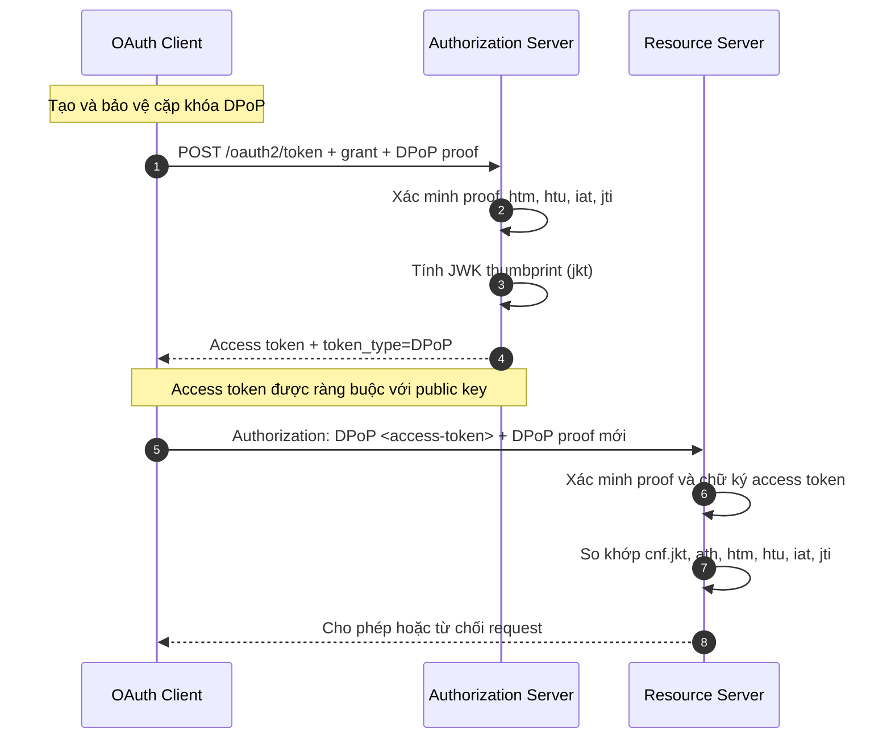

# Cấu hình hỗ trợ DPoP tại Token Endpoint theo phiên bản sử dụng

## 1. Mục tiêu: phát hành access token gắn với khóa của client

Trong mô-đun **SPRING_SECURITY_OAUTH2_OIDC_AUTHORIZATION_SERVER**, chúng ta học cách thiết kế, cấu hình, bảo mật, kiểm thử và vận hành OAuth 2.0/OpenID Connect Authorization Server bằng **Spring Security**, **Spring Authorization Server** và **Spring Boot**. Bài này tập trung vào việc bật và kiểm chứng hỗ trợ **DPoP tại Token Endpoint** theo phiên bản Spring đang dùng.

Access token dạng Bearer có một nhược điểm: bất kỳ ai lấy được token đều có thể sử dụng nó cho đến khi token hết hạn hoặc bị thu hồi. Server không biết người gửi request có phải client đã nhận token ban đầu hay không.

**DPoP (Demonstrating Proof of Possession, RFC 9449)** bổ sung bằng chứng sở hữu khóa. Client tạo một cặp khóa riêng/public, ký một JWT proof cho từng HTTP request và gửi proof qua header `DPoP`. Khi cấp access token, Authorization Server lấy public key trong proof, tính thumbprint và gắn token với khóa đó. Khi gọi Resource Server, client phải tiếp tục chứng minh mình giữ private key tương ứng.



DPoP tạo ra **sender-constrained access token**: chỉ client giữ private key đã ràng buộc mới có thể sử dụng token hợp lệ. Cơ chế này giảm nguy cơ token bị đánh cắp riêng lẻ bị dùng lại, nhưng không thay thế xác thực client, PKCE, TLS, scope, audience hoặc kiểm soát quyền nghiệp vụ.

### Phạm vi bài học

Sau bài này, bạn có thể:

1. Xác định phiên bản Spring Authorization Server có hỗ trợ DPoP tại Token Endpoint.
2. Phân biệt cấu hình Token Endpoint của Authorization Server với xác minh DPoP tại Resource Server.
3. Hiểu cấu trúc DPoP proof JWT và các claim cần thiết khi gọi Token Endpoint.
4. Cấu hình Spring Authorization Server để nhận DPoP proof và phát hành DPoP-bound access token.
5. Kiểm tra `token_type=DPoP`, claim `cnf.jkt` và metadata thuật toán ký.
6. Thiết kế kiểm thử cho proof không hợp lệ, replay, sai khóa, nonce và các grant khác nhau.

## 2. Xác định hỗ trợ theo phiên bản Spring

Điểm cần kiểm tra đầu tiên là phiên bản của **Spring Authorization Server** và **Spring Security** trong dependency graph. Hai phần có mốc hỗ trợ DPoP khác nhau:

| Thành phần | Mốc hỗ trợ | Ý nghĩa |
| --- | --- | --- |
| Spring Authorization Server **1.5+** | Hỗ trợ DPoP-bound access token tại Authorization Server; phát hành 1.5 GA ngày 20/05/2025 | Token Endpoint có thể nhận DPoP proof, xác minh proof và ràng buộc access token với public key |
| Spring Authorization Server **1.5.8** | Bản stable được tài liệu tham chiếu hiện hành mô tả | Có API metadata `dpop_signing_alg_values_supported` và `OAuth2TokenContext.DPOP_PROOF_KEY` |
| Spring Authorization Server **trước 1.5** | Chưa có hỗ trợ DPoP tích hợp theo API trên | Cần nâng cấp hoặc tự triển khai toàn bộ xử lý RFC 9449; không chỉ thêm header `DPoP` vào request |
| Spring Security **6.5+** | Có các thành phần Resource Server như `DPoPAuthenticationProvider` và `DPoPAuthenticationToken` | Có nền tảng xác minh DPoP proof khi truy cập protected resource |
| Spring Security **7.1+** | Có Java DSL `oauth2ResourceServer(...).dPoP(...)` | Có cấu hình thuận tiện để bật DPoP ở Resource Server |

**Phân biệt hai phía:** Spring Authorization Server xử lý DPoP proof khi client xin access token. Spring Security Resource Server xác minh proof khi client dùng token gọi API. Nâng cấp Authorization Server không tự động khiến mọi Resource Server cũ biết xác minh DPoP.

Với Spring Authorization Server 1.5.x, DPoP đã nằm trong luồng xử lý Token Endpoint mặc định. Bạn không cần thêm một grant type mới hoặc tạo một endpoint `/dpop/token` riêng. Việc tùy biến `OAuth2TokenEndpointConfigurer` chỉ cần thiết khi ứng dụng có yêu cầu riêng đối với converter, provider, response hoặc error handler.

### Kiểm tra dependency đang chạy

Với Maven:

```bash
mvn dependency:tree -Dincludes=org.springframework.security,org.springframework.security:spring-security-oauth2-authorization-server
```

Với Gradle:

```bash
./gradlew dependencyInsight --dependency spring-security-oauth2-resource-server
./gradlew dependencyInsight --dependency spring-security-oauth2-authorization-server
```

Hãy kiểm tra phiên bản thực tế sau khi Spring Boot BOM quản lý dependency. Không nâng riêng một module Spring Security hoặc Spring Authorization Server sang nhánh khác mà không kiểm tra ma trận tương thích.

**Nếu đang dùng phiên bản trước SAS 1.5:** lựa chọn dễ kiểm soát nhất là nâng cấp lên nhánh có hỗ trợ DPoP. Tự triển khai đòi hỏi xử lý proof signature, JWK, thumbprint, replay, token binding, response và tương thích Resource Server; thêm một filter đọc header `DPoP` là chưa đủ.

## 3. DPoP proof gửi đến Token Endpoint

Client tạo một JWT proof cho **mỗi request tới Token Endpoint**. JWT này khác access token: nó là bằng chứng ngắn hạn cho thấy client đang giữ private key tương ứng với public key được nhúng trong header.

### 3.1. JOSE header

Một DPoP proof hợp lệ có các thành phần chính:

| Trường | Giá trị/quy tắc |
| --- | --- |
| `typ` | Phải là `dpop+jwt` |
| `alg` | Thuật toán chữ ký bất đối xứng được server chấp nhận; không dùng `none` hoặc HMAC |
| `jwk` | Public JWK tương ứng với private key dùng ký proof; không được chứa private key |

Ví dụ cấu trúc header:

```json
{
  "typ": "dpop+jwt",
  "alg": "ES256",
  "jwk": {
    "kty": "EC",
    "crv": "P-256",
    "x": "PUBLIC_KEY_X",
    "y": "PUBLIC_KEY_Y"
  }
}
```

Các giá trị `PUBLIC_KEY_X` và `PUBLIC_KEY_Y` là placeholder. Client giữ private key ở local secure storage, keystore hoặc HSM phù hợp; chỉ public key được gửi trong proof.

### 3.2. JWT claims tại Token Endpoint

DPoP proof cho token request cần các claim:

| Claim | Ý nghĩa |
| --- | --- |
| `htm` | HTTP method của request, với Token Endpoint thông thường là `POST` |
| `htu` | URI đích của Token Endpoint; so khớp theo quy tắc RFC 9449, không gồm query và fragment |
| `iat` | Thời điểm proof được tạo |
| `jti` | ID duy nhất của proof, giúp nhận diện và chống replay |
| `nonce` | Chỉ có khi Authorization Server yêu cầu nonce theo cơ chế RFC 9449 |

Ví dụ payload:

```json
{
  "htm": "POST",
  "htu": "https://auth.example.com/oauth2/token",
  "iat": 1800000000,
  "jti": "2c6f7d15-9a77-4b8d-a9b2-6a42b01f54d3"
}
```

**Không thêm `ath` vào proof của Token Endpoint theo thói quen.** `ath` là hash của access token được gửi trong proof khi gọi Protected Resource. Tại thời điểm xin access token, client chưa có token đích để băm. Resource request sau đó phải có `ath`.

### 3.3. Vì sao mỗi request cần proof mới?

DPoP proof gắn với HTTP method, URI và thời điểm. Nếu client tái sử dụng cùng JWT cho request khác, `htm`, `htu`, `jti` hoặc cửa sổ `iat` có thể không còn hợp lệ. Vì vậy:

- tạo proof mới cho mỗi lần gửi Token Endpoint;
- không tái sử dụng proof cũ khi retry;
- dùng `jti` duy nhất, đủ ngẫu nhiên;
- đồng bộ thời gian giữa client và server;
- giữ private key an toàn và ổn định trong thời gian access token cần được sử dụng.

DPoP proof không phải một access token thứ hai. Nó chỉ có giá trị gắn với request cụ thể và public key được trình bày trong proof.

## 4. Luồng cấp DPoP-bound access token

Ví dụ client thực hiện Authorization Code Flow. Sau khi nhận authorization code, client gọi Token Endpoint và gửi DPoP proof:

```http
POST /oauth2/token HTTP/1.1
Host: auth.example.com
Content-Type: application/x-www-form-urlencoded
Authorization: Basic <client-credentials>
DPoP: <signed-dpop-proof-jwt>

grant_type=authorization_code
&client_id=orders-web
&code=AUTHORIZATION_CODE
&redirect_uri=https%3A%2F%2Forders.example.com%2Fcallback
&code_verifier=PKCE_VERIFIER
```

Header `Authorization` ở ví dụ trên phục vụ **client authentication** theo registration. Header `DPoP` chứa proof chứng minh quyền sở hữu private key. Hai cơ chế này có mục đích khác nhau; DPoP không tự thay thế `client_secret_basic`, `private_key_jwt` hoặc mTLS.

Authorization Server:

1. Xác thực client và xử lý grant theo registration.
2. Nhận proof JWT từ header `DPoP`.
3. Xác minh chữ ký bằng public JWK trong proof và kiểm tra `typ`, `alg`, `htm`, `htu`, `iat`, `jti`.
4. Kiểm tra nonce nếu chính sách của server yêu cầu.
5. Lấy public key, tính JWK SHA-256 thumbprint.
6. Gắn thumbprint với access token được phát hành.
7. Trả token response có `token_type=DPoP`.

Ví dụ response:

```http
HTTP/1.1 200 OK
Content-Type: application/json
Cache-Control: no-store
Pragma: no-cache

{
  "access_token": "DPoP_BOUND_ACCESS_TOKEN",
  "token_type": "DPoP",
  "expires_in": 300,
  "scope": "orders.read"
}
```

Giá trị token và thời hạn trong ví dụ chỉ để minh họa. Client phải đọc `token_type` từ response. Nếu server trả `Bearer`, client không được tự suy rằng token đã được ràng buộc với DPoP key.

### Claim xác nhận khóa trong JWT access token

Với JWT access token, public key binding thường được biểu diễn trong claim `cnf.jkt`:

```json
{
  "iss": "https://auth.example.com",
  "sub": "user-1042",
  "aud": ["orders-api"],
  "scope": "orders.read",
  "cnf": {
    "jkt": "BASE64URL_SHA256_JWK_THUMBPRINT"
  }
}
```

`jkt` là JWK SHA-256 thumbprint của public key trong DPoP proof. Resource Server so sánh thumbprint này với key của proof được gửi khi gọi API. Với opaque/reference token, thông tin binding phải có thể được Resource Server lấy qua Token Introspection hoặc cơ chế chia sẻ tin cậy khác.

**Không tự thêm hoặc ghi đè `cnf.jkt` bằng một claim do client gửi.** Binding phải được Authorization Server tạo từ proof đã xác minh. Nếu ứng dụng tùy biến token generator, cần giữ nguyên liên kết key này.

## 5. Cấu hình Token Endpoint trong Spring Authorization Server 1.5+

### 5.1. Dùng security chain mặc định

Trong Spring Authorization Server 1.5.x, DPoP đã được tích hợp vào đường xử lý access token request của Token Endpoint. Cấu hình Authorization Server thông thường vẫn dùng `OAuth2AuthorizationServerConfigurer` và `getEndpointsMatcher()`:

```java
package com.example.authserver;

import org.springframework.context.annotation.Bean;
import org.springframework.context.annotation.Configuration;
import org.springframework.core.annotation.Order;
import org.springframework.security.config.Customizer;
import org.springframework.security.config.annotation.web.builders.HttpSecurity;
import org.springframework.security.oauth2.server.authorization.config.annotation.web.configurers.OAuth2AuthorizationServerConfigurer;
import org.springframework.security.web.SecurityFilterChain;

@Configuration
public class AuthorizationServerSecurityConfig {

    @Bean
    @Order(1)
    SecurityFilterChain authorizationServerSecurityFilterChain(HttpSecurity http)
            throws Exception {

        OAuth2AuthorizationServerConfigurer authorizationServerConfigurer =
                OAuth2AuthorizationServerConfigurer.authorizationServer();

        http
            .securityMatcher(authorizationServerConfigurer.getEndpointsMatcher())
            .with(authorizationServerConfigurer, Customizer.withDefaults())
            .authorizeHttpRequests(authorize -> authorize.anyRequest().authenticated());

        return http.build();
    }
}
```

Đây là khung cấu hình filter chain. Ứng dụng vẫn cần các bean nền tảng như `RegisteredClientRepository`, `AuthorizationServerSettings`, `OAuth2AuthorizationService`, JWK source/token generator và các thành phần xác thực người dùng nếu hỗ trợ Authorization Code Flow.

**Không có một cờ DPoP riêng như `enableDpop(true)` trên Token Endpoint trong cấu hình chuẩn 1.5.x.** DPoP proof được xử lý trong pipeline mặc định khi client gửi header `DPoP` hợp lệ. Không cần tự thêm một grant type mới, filter đọc header hoặc endpoint riêng để nhận proof.

### 5.2. Vai trò của `OAuth2TokenEndpointConfigurer`

`OAuth2TokenEndpointConfigurer` cho phép mở rộng các bước trước, trong và sau xử lý token request:

| Extension point | Vai trò |
| --- | --- |
| `accessTokenRequestConverter(...)` | Thêm converter đọc request HTTP |
| `accessTokenRequestConverters(...)` | Truy cập danh sách converter mặc định để bổ sung hoặc tùy biến |
| `authenticationProvider(...)` | Thêm provider xử lý grant |
| `authenticationProviders(...)` | Truy cập danh sách provider mặc định |
| `accessTokenResponseHandler(...)` | Tùy biến response thành công |
| `errorResponseHandler(...)` | Tùy biến OAuth error response |

Token Endpoint mặc định đã có converter/provider cho các grant được hỗ trợ và tích hợp xử lý DPoP. Nếu ứng dụng tùy biến danh sách provider, **không xóa hoặc thay thế các provider mặc định một cách vô ý**. Làm vậy có thể khiến một grant hoặc cơ chế xác minh DPoP không còn được xử lý.

Nếu cần bổ sung validator nghiệp vụ, hãy dùng `authenticationProviders(...)` để duyệt và cấu hình provider phù hợp trong danh sách mặc định. Chỉ thay provider khi đã hiểu rõ trách nhiệm của nó và có test cho toàn bộ grant. Không gọi `providers.clear()` hoặc thay toàn bộ danh sách bằng một provider tự viết chỉ để kiểm tra header DPoP; việc đó có thể làm mất xử lý mặc định của Authorization Code, Refresh Token, Client Credentials hoặc DPoP.

### 5.3. DPoP áp dụng cho các grant nào?

Tài liệu Spring mô tả DPoP proof phải được gửi trong header `DPoP` trên mọi access token request, bất kể grant type. Các ví dụ bao gồm:

| Grant | Request tại Token Endpoint | Yêu cầu DPoP |
| --- | --- | --- |
| Authorization Code | `grant_type=authorization_code` | Gửi proof nếu muốn access token gắn khóa |
| Refresh Token | `grant_type=refresh_token` | Gửi proof mới; kiểm tra ràng buộc khóa của refresh token theo chính sách |
| Client Credentials | `grant_type=client_credentials` | Gửi proof nếu muốn token service được gắn với khóa client |
| Device Code | `grant_type=urn:ietf:params:oauth:grant-type:device_code` | Gửi proof nếu muốn access token được gắn khóa |
| Extension grant | Theo extension đã cài đặt | Chỉ hỗ trợ khi pipeline và policy của extension tương thích DPoP |

Một request có DPoP proof hợp lệ có thể nhận DPoP-bound access token. Nếu client không gửi proof và server không áp dụng chính sách bắt buộc DPoP, request có thể đi theo luồng Bearer thông thường. **Hỗ trợ DPoP không đồng nghĩa tự động bắt buộc mọi client dùng DPoP.**

Nếu tổ chức muốn bắt buộc DPoP cho một client hoặc một nhóm client, phải có policy thực thi rõ ràng tại server và kiểm thử trường hợp thiếu header proof. Không suy rằng chỉ có support RFC 9449 là server tự động từ chối tất cả token request không có DPoP.

## 6. Metadata và token context cho DPoP

### 6.1. Công bố thuật toán proof được hỗ trợ

Authorization Server Metadata có claim `dpop_signing_alg_values_supported` để công bố các thuật toán JWS được chấp nhận khi ký DPoP proof. Spring Authorization Server 1.5 có hằng metadata tương ứng và API builder `dPoPSigningAlgorithm(...)` / `dPoPSigningAlgorithms(...)`.

Ví dụ bổ sung các thuật toán mà server thực sự chấp nhận:

```java
// Trong cấu hình OAuth2AuthorizationServerConfigurer:
authorizationServer.authorizationServerMetadataEndpoint(metadata ->
        metadata.authorizationServerMetadataCustomizer(builder -> {
            builder.dPoPSigningAlgorithm("ES256");
            builder.dPoPSigningAlgorithm("RS256");
        }));
```

Đây là đoạn cấu hình **bổ sung vào** cấu hình Authorization Server hiện có. Danh sách thuật toán trong metadata phải khớp với proof verifier đang chạy; không công bố thuật toán mà server không thể xác minh. DPoP yêu cầu chữ ký bất đối xứng; không đưa `none` hoặc thuật toán HMAC vào danh sách.

Sau khi cấu hình, kiểm tra metadata tại endpoint discovery của Authorization Server, thường là:

```http
GET /.well-known/oauth-authorization-server HTTP/1.1
Host: auth.example.com
```

Response metadata có thể chứa:

```json
{
  "issuer": "https://auth.example.com",
  "token_endpoint": "https://auth.example.com/oauth2/token",
  "dpop_signing_alg_values_supported": [
    "ES256",
    "RS256"
  ]
}
```

Response trên được rút gọn để minh họa. Các claim metadata khác vẫn được giữ theo cấu hình của server. Client nên discovery metadata của issuer đáng tin thay vì tự suy đoán thuật toán hoặc hard-code endpoint.

### 6.2. `OAuth2TokenContext.DPOP_PROOF_KEY`

Spring Authorization Server 1.5 cung cấp key `OAuth2TokenContext.DPOP_PROOF_KEY` để truy cập DPoP proof JWT trong token context khi proof có mặt. Điều này hữu ích nếu ứng dụng có `OAuth2TokenCustomizer` hoặc token generator tùy chỉnh.

Nếu ứng dụng có `OAuth2TokenCustomizer<JwtEncodingContext>` hoặc token generator tùy chỉnh, có thể kiểm tra `context.hasKey(OAuth2TokenContext.DPOP_PROOF_KEY)` và đọc proof JWT đã được framework đưa vào context. Chỉ dùng dữ liệu cần thiết cho logic nội bộ; không log raw proof hoặc private key. Nếu ứng dụng đã có customizer cho access token, hãy gộp logic vào bean hiện tại để tránh nhiều bean cùng cạnh tranh một kiểu token customization.

**Không tự tạo lại `cnf.jkt` nếu đang dùng token generator mặc định.** Hãy để Spring Authorization Server tạo binding từ proof đã xác minh. Chỉ khi tự thay token generator hoặc phát hành token format riêng mới cần đảm bảo claim confirmation tương đương được tạo đúng và Resource Server có thể xác minh.

### 6.3. Phân biệt cấu hình Authorization Server và Resource Server

| Thành phần | Nhiệm vụ |
| --- | --- |
| Spring Authorization Server 1.5+ | Xác minh proof trên Token Endpoint và gắn khóa vào access token |
| Spring Security Resource Server 6.5+ | Có provider/token để xác minh DPoP-bound token khi gọi protected resource |
| Spring Security Resource Server 7.1+ | Có DSL `oauth2ResourceServer(...).dPoP(...)` để bật tích hợp thuận tiện |
| OAuth Client | Quản lý private key, tạo proof mới và gửi đúng header |

Nếu chỉ cấu hình Token Endpoint mà Resource Server vẫn chấp nhận token như Bearer thông thường, lợi ích sender-constraining không được thực thi ở nơi bảo vệ dữ liệu.

## 7. Tạo DPoP proof bằng Java và gọi Token Endpoint

### 7.1. Sinh proof JWT bằng Nimbus và Spring Security

Đoạn mã sau minh họa cách ký proof cho `POST /oauth2/token`. Khóa RSA ở đây chỉ là ví dụ; production nên dùng EC hoặc RSA theo thuật toán được hai phía thống nhất, quản lý private key trong keystore/HSM và không đưa private JWK vào header.

```java
import java.time.Instant;
import java.util.UUID;

import com.nimbusds.jose.jwk.JWKSet;
import com.nimbusds.jose.jwk.RSAKey;
import com.nimbusds.jose.jwk.source.JWKSource;
import com.nimbusds.jose.proc.SecurityContext;

import org.springframework.security.oauth2.jose.jws.SignatureAlgorithm;
import org.springframework.security.oauth2.jwt.JwsHeader;
import org.springframework.security.oauth2.jwt.Jwt;
import org.springframework.security.oauth2.jwt.JwtClaimsSet;
import org.springframework.security.oauth2.jwt.JwtEncoder;
import org.springframework.security.oauth2.jwt.JwtEncoderParameters;
import org.springframework.security.oauth2.jwt.NimbusJwtEncoder;

public final class DPoPProofFactory {

    private final JwtEncoder jwtEncoder;
    private final RSAKey signingKey;

    public DPoPProofFactory(RSAKey signingKey) {
        this.signingKey = signingKey;

        JWKSource<SecurityContext> jwkSource =
                (selector, context) -> selector.select(new JWKSet(signingKey));
        this.jwtEncoder = new NimbusJwtEncoder(jwkSource);
    }

    public String createTokenEndpointProof(String tokenEndpointUri) {
        JwsHeader header = JwsHeader.with(SignatureAlgorithm.RS256)
                .type("dpop+jwt")
                .jwk(signingKey.toPublicJWK().toJSONObject())
                .build();

        JwtClaimsSet claims = JwtClaimsSet.builder()
                .issuedAt(Instant.now())
                .claim("htm", "POST")
                .claim("htu", tokenEndpointUri)
                .id(UUID.randomUUID().toString())
                .build();

        Jwt proof = this.jwtEncoder.encode(
                JwtEncoderParameters.from(header, claims));
        return proof.getTokenValue();
    }
}
```

Trong ví dụ, `signingKey` phải chứa private key để ký; `toPublicJWK()` chỉ xuất public key vào header. Không lưu private key trong source code, không log proof JWT và không dùng lại `jti` giữa các request.

Nếu server yêu cầu nonce, client phải đưa nonce mới nhận vào claim `nonce` trước khi ký proof. Khi retry một token request, tạo **proof JWT mới** với `jti` mới; không gửi lại proof cũ.

### 7.2. Gửi token request

Ví dụ gọi Token Endpoint bằng HTTP client:

```http
POST /oauth2/token HTTP/1.1
Host: auth.example.com
Authorization: Basic <base64-client-id-and-secret>
Content-Type: application/x-www-form-urlencoded
DPoP: <signed-proof-jwt>

grant_type=client_credentials
&scope=inventory.read
```

Ví dụ này dùng `client_credentials` để nhấn mạnh DPoP độc lập với loại grant. Nếu client cần access token thay mặt người dùng, body sẽ dùng `authorization_code` và `code`/`redirect_uri`/`code_verifier` tương ứng; proof vẫn được gửi qua header `DPoP`.

### 7.3. Kiểm tra response và token

Khi server xác minh proof thành công và phát hành token ràng buộc khóa, response phải thông báo:

```json
{
  "access_token": "DPoP_BOUND_ACCESS_TOKEN",
  "token_type": "DPoP",
  "expires_in": 300,
  "scope": "inventory.read"
}
```

Nếu access token là JWT, kiểm tra claim `cnf.jkt` trong payload đã xác minh chữ ký. Thumbprint này phải bằng JWK SHA-256 thumbprint của public key trong proof. Chỉ decode payload để xem claim không phải bằng chứng token đáng tin; cần xác minh chữ ký, issuer, audience và thời hạn.

## 8. Cấu hình Resource Server để bắt buộc proof khi gọi API

Token Endpoint có thể phát hành DPoP-bound access token, nhưng API đích phải kiểm tra cả token và proof. Nếu Resource Server chỉ bật JWT Bearer validation mặc định, request DPoP chưa chắc được kiểm tra đầy đủ theo RFC 9449.

### 8.1. Spring Security 7.1+

Từ Spring Security 7.1, Java DSL có `.dPoP(...)` để bật hỗ trợ DPoP-bound access token:

```java
package com.example.ordersapi;

import org.springframework.context.annotation.Bean;
import org.springframework.context.annotation.Configuration;
import org.springframework.security.config.Customizer;
import org.springframework.security.config.annotation.web.builders.HttpSecurity;
import org.springframework.security.web.SecurityFilterChain;

@Configuration
public class ResourceServerSecurityConfig {

    @Bean
    SecurityFilterChain apiSecurityFilterChain(HttpSecurity http)
            throws Exception {

        return http
                .authorizeHttpRequests(authorize -> authorize
                        .requestMatchers("/api/orders/**").hasAuthority("SCOPE_orders.read")
                        .anyRequest().authenticated())
                .oauth2ResourceServer(resourceServer -> resourceServer
                        .jwt(Customizer.withDefaults())
                        .dPoP(Customizer.withDefaults()))
                .build();
    }
}
```

Ví dụ giả định đã có `JwtDecoder` hoặc cấu hình `issuer-uri` để xác minh access token. `dPoP(...)` bật đường xác thực DPoP; scope và business authorization vẫn phải được kiểm tra riêng.

Ví dụ cấu hình issuer:

```yaml
spring:
  security:
    oauth2:
      resourceserver:
        jwt:
          issuer-uri: https://auth.example.com
```

### 8.2. Spring Security 6.5 đến 7.0

Từ Spring Security 6.5 đã có `DPoPAuthenticationToken` và `DPoPAuthenticationProvider`, nhưng Java DSL `.dPoP(...)` được bổ sung ở 7.1. Với 6.5–7.0, nếu cần xác minh DPoP-bound token ở Resource Server, phải tích hợp các thành phần provider/converter theo API của đúng phiên bản hoặc nâng cấp lên 7.1+ để dùng DSL có sẵn.

Không tự viết một filter chỉ đọc header `DPoP` rồi cho request đi tiếp. Resource Server phải xác minh ít nhất:

- access token hợp lệ theo issuer, audience, chữ ký/trạng thái và thời hạn;
- proof JWT có chữ ký hợp lệ, `typ=dpop+jwt`, thuật toán bất đối xứng và public JWK hợp lệ;
- `htm` và `htu` khớp request thực tế;
- `iat` nằm trong cửa sổ chấp nhận và `jti` chưa được sử dụng;
- `ath` bằng base64url(SHA-256(access_token));
- thumbprint public key trong proof khớp `cnf.jkt` của token;
- access token được gửi bằng scheme `DPoP`, không dùng `Bearer`.

### 8.3. Request tới Protected Resource

Khác với Token Endpoint, khi gọi API client phải gửi access token trong Authorization header với scheme `DPoP` và gửi một proof JWT mới có claim `ath`:

```http
GET /api/orders/42 HTTP/1.1
Host: orders-api.example.com
Authorization: DPoP <DPoP_BOUND_ACCESS_TOKEN>
DPoP: <fresh-proof-jwt-with-ath>
```

Proof của resource request có thêm:

```json
{
  "htm": "GET",
  "htu": "https://orders-api.example.com/api/orders/42",
  "ath": "BASE64URL_SHA256_OF_ACCESS_TOKEN",
  "iat": 1800000010,
  "jti": "b1c3e7f5-2d4a-49b7-8d2a-6f3c5e7a9b10"
}
```

Client phải tạo proof mới cho từng HTTP request. Không gửi DPoP-bound token bằng `Authorization: Bearer`; Resource Server phải từ chối cách trình bày đó để tránh hạ cấp cơ chế sender-constraining.

## 9. Nonce, lỗi DPoP và cách retry

### 9.1. Nonce là cơ chế tùy chọn của RFC 9449

Authorization Server hoặc Resource Server **có thể** yêu cầu client đưa nonce do server cấp vào proof. Khi yêu cầu nonce:

1. Server trả response lỗi `use_dpop_nonce` và header `DPoP-Nonce`.
2. Client đọc nonce mới.
3. Client tạo proof JWT mới, thêm claim `nonce` chứa giá trị server cung cấp.
4. Client gửi lại request ban đầu với proof mới.

Ví dụ challenge ở Token Endpoint:

```http
HTTP/1.1 400 Bad Request
Content-Type: application/json
Cache-Control: no-store
DPoP-Nonce: SERVER_NONCE_VALUE

{
  "error": "use_dpop_nonce",
  "error_description": "A fresh DPoP nonce is required"
}
```

Nonce giúp server tăng khả năng chống replay bằng cách buộc proof gắn với một challenge gần thời điểm xử lý. Đây là **cơ chế tùy chọn**, không phải mọi server DPoP đều bắt buộc nonce. Tài liệu DPoP của Spring Authorization Server mô tả proof và token binding; khi cần server-provided nonce, hãy xác minh rõ tính năng của phiên bản đang triển khai hoặc bổ sung theo RFC 9449. Không giả định nonce luôn bật chỉ vì Token Endpoint hỗ trợ DPoP.

Khi client nhận nonce challenge, không gửi lại JWT proof cũ. Hãy tạo `jti` mới, cập nhật `iat`, thêm nonce và ký proof mới. Giữ nguyên grant parameters và client authentication theo quy tắc retry của client.

### 9.2. Phân biệt lỗi ở Token Endpoint và Resource Server

| Vị trí | Lỗi | Ý nghĩa | Hành động |
| --- | --- | --- | --- |
| Token Endpoint | `invalid_dpop_proof` | Proof thiếu claim, sai chữ ký, sai `htm`/`htu`, thuật toán không hợp lệ hoặc proof không hợp lệ | Tạo proof đúng request và gửi lại sau khi sửa nguyên nhân |
| Token Endpoint | `use_dpop_nonce` | Server yêu cầu nonce | Lấy `DPoP-Nonce`, tạo proof mới có `nonce` rồi retry |
| Token Endpoint | `invalid_client` | Xác thực OAuth client thất bại | Kiểm tra client ID, secret, assertion hoặc mTLS; DPoP không sửa lỗi này |
| Token Endpoint | `invalid_grant` | Authorization code/refresh token không hợp lệ hoặc không còn hiệu lực | Kiểm tra grant và token gốc |
| Resource Server | `invalid_dpop_proof` | Proof không hợp lệ hoặc không khớp HTTP request | Tạo proof mới với method/URI chính xác |
| Resource Server | `invalid_token` | Access token không hợp lệ hoặc key binding không khớp | Kiểm tra token, issuer, audience, thời hạn và key pair |
| Resource Server | `use_dpop_nonce` | Resource Server yêu cầu nonce | Dùng nonce trong proof của request kế tiếp |

Theo RFC 9449, lỗi proof tại Token Endpoint được trả dưới dạng OAuth error response HTTP 400; ở Protected Resource, lỗi xác thực thường được trả HTTP 401 cùng `WWW-Authenticate: DPoP`. Mã lỗi và status thực tế phải được kiểm thử với phiên bản server đang dùng.

### 9.3. Không nhầm DPoP với client authentication

Một request có thể có cả:

- `Authorization: Basic ...` hoặc client assertion/mTLS để xác thực OAuth client;
- `DPoP: ...` để chứng minh sở hữu private key được dùng ràng buộc access token.

Nếu header Basic sai, server vẫn có thể trả `invalid_client` dù proof DPoP hợp lệ. Nếu client authentication đúng nhưng proof sai, server có thể trả `invalid_dpop_proof`. Không gộp hai lớp lỗi thành một và không tắt client authentication để sửa lỗi DPoP.

## 10. Bảo mật và vận hành DPoP tại Token Endpoint

### 10.1. Quản lý khóa của client

- Tạo khóa DPoP riêng cho từng client hoặc từng ngữ cảnh bảo mật theo chính sách.
- Lưu private key trong OS keystore, secure enclave, HSM hoặc secret storage thích hợp.
- Không gửi private key trong header `jwk`; chỉ gửi public JWK.
- Không ghi private key, DPoP proof, access token hoặc refresh token vào log.
- Duy trì khả năng sử dụng đúng key pair trong thời gian token/refresh token còn hiệu lực.
- Khi key bị mất hoặc nghi lộ, thu hồi token liên quan và thực hiện lại authorization/token issuance với key mới theo chính sách.

DPoP giảm rủi ro khi access token bị lộ riêng lẻ. Nếu kẻ tấn công chiếm được cả access token và private key, hoặc điều khiển được tiến trình client, sender-constraining không còn bảo vệ được phiên đó.

### 10.2. Giới hạn thuật toán và xác minh proof

Server chỉ chấp nhận thuật toán chữ ký bất đối xứng đã được cấu hình. Không chấp nhận `none`, thuật toán HMAC hoặc public JWK chứa private material. Metadata `dpop_signing_alg_values_supported` phải phản ánh chính xác thuật toán mà proof verifier có thể xử lý.

Các kiểm tra cần bảo đảm:

- `typ` chính xác là `dpop+jwt`;
- `alg` nằm trong allowlist và là thuật toán bất đối xứng;
- chữ ký hợp lệ với public JWK trong proof;
- JWK không chứa private key;
- `htm`/`htu` khớp request thực tế;
- `iat` nằm trong khoảng thời gian chấp nhận;
- `jti` duy nhất và được dùng trong cơ chế chống replay;
- `nonce` khớp nếu server đã yêu cầu nonce.

### 10.3. Cấu hình reverse proxy và URI bên ngoài

Khi Authorization Server chạy sau ingress, load balancer hoặc reverse proxy, giá trị `htu` mà client ký phải khớp URL công khai mà server dùng để xác minh. Ví dụ client gọi `https://auth.example.com/oauth2/token` nhưng ứng dụng nội bộ nhìn thấy `http://auth-service:8080/oauth2/token`; nếu proxy headers và forwarded-header strategy không được cấu hình tin cậy, proof có thể bị từ chối hoặc validation sai.

Chỉ tin forwarded headers từ proxy được kiểm soát. Không cho client bên ngoài tự gửi `X-Forwarded-Host`/`X-Forwarded-Proto` rồi dùng trực tiếp các giá trị đó để xác minh DPoP.

### 10.4. Chống replay và đồng bộ thời gian

`jti` phải được kiểm tra tính duy nhất trong cửa sổ hiệu lực của proof. Với nhiều Authorization Server instance, cache replay hoặc kho trạng thái cần được chia sẻ để cùng một proof không thể được chấp nhận ở hai node khác nhau. Cần cân nhắc TTL, atomic insert và cleanup.

Đồng hồ giữa client, Authorization Server và Resource Server cần được đồng bộ. Cửa sổ chấp nhận `iat` quá rộng làm tăng cơ hội replay; cửa sổ quá hẹp gây lỗi cho client có clock skew. Hãy đặt giới hạn phù hợp và kiểm thử clock drift.

### 10.5. Token lifecycle và client policy

DPoP-bound access token vẫn cần TTL ngắn, audience phù hợp, scope tối thiểu và chính sách thu hồi. Với refresh token, kiểm tra việc token mới tiếp tục gắn với đúng khóa theo RFC 9449 và cấu hình phiên bản đang dùng.

Nếu chỉ một số client phải dùng DPoP, quản lý chính sách theo registration/owner và thực thi tại server. RFC 9449 định nghĩa metadata `dpop_bound_access_tokens` cho client; không giả định mọi phiên bản Spring Authorization Server đều có một builder field tương ứng trên `RegisteredClient`. Nếu API registration hiện tại chưa cung cấp cờ này, dùng thuộc tính/policy ứng dụng có kiểm soát và kiểm tra token request thiếu proof trước khi cấp Bearer token.

### 10.6. Log và metric

Có thể ghi correlation ID, client ID đã xác thực, grant type, kết quả validation, thuật toán proof, lý do từ chối đã phân loại và việc token được phát hành ở dạng DPoP/Bearer. Tránh log raw proof JWT, access token, refresh token, private key hoặc secret.

Theo dõi:

- tỷ lệ token request có DPoP proof và không có proof;
- số lượng `invalid_dpop_proof`, `use_dpop_nonce`, `invalid_client`;
- proof sai `htm`/`htu`, `iat` ngoài cửa sổ hoặc `jti` replay;
- số token phát hành có `token_type=DPoP`;
- tỷ lệ Resource Server từ chối do `cnf.jkt` không khớp;
- lỗi tương thích khi client/Resource Server nâng cấp phiên bản.

## 11. Kiểm thử hỗ trợ DPoP tại Token Endpoint

Kiểm thử phải xác nhận cả **token issuance** lẫn **token usage**. Chỉ nhận HTTP 200 từ Token Endpoint chưa chứng minh access token đã được ràng buộc đúng khóa.

### 11.1. Ma trận kiểm thử

| ID | Tình huống | Kết quả cần đạt |
| --- | --- | --- |
| DPOP-01 | Spring Authorization Server 1.5+ nhận token request có proof hợp lệ | Cấp DPoP-bound access token |
| DPOP-02 | Request Authorization Code có proof hợp lệ | Token response có `token_type=DPoP` |
| DPOP-03 | Request Client Credentials có proof hợp lệ | Token được ràng buộc với public key của proof |
| DPOP-04 | Request Refresh Token có proof hợp lệ và đúng key theo policy | Token mới giữ đúng key binding |
| DPOP-05 | Request không có proof trong deployment cho phép Bearer | Có thể cấp Bearer token theo policy |
| DPOP-06 | Client thuộc diện bắt buộc DPoP nhưng thiếu proof | Bị từ chối, không cấp Bearer ngoài chính sách |
| DPOP-07 | Header `typ` không phải `dpop+jwt` | Từ chối proof |
| DPOP-08 | Thuật toán `none` hoặc HMAC | Từ chối proof |
| DPOP-09 | Chữ ký proof không hợp lệ | Từ chối proof |
| DPOP-10 | JWK trong proof chứa private key | Từ chối proof |
| DPOP-11 | `htm` không phải `POST` tại Token Endpoint | Từ chối proof |
| DPOP-12 | `htu` không khớp URL Token Endpoint công khai | Từ chối proof |
| DPOP-13 | Thiếu `iat`, `jti`, `htm` hoặc `htu` | Từ chối proof |
| DPOP-14 | `iat` quá cũ hoặc ở tương lai ngoài cửa sổ | Từ chối proof |
| DPOP-15 | Gửi lại cùng proof/`jti` | Bị chặn bởi replay protection |
| DPOP-16 | Server yêu cầu nonce nhưng proof thiếu hoặc sai nonce | Trả `use_dpop_nonce` và `DPoP-Nonce` theo cấu hình |
| DPOP-17 | Client retry bằng proof mới chứa nonce | Request được xử lý nếu mọi kiểm tra khác hợp lệ |
| DPOP-18 | Token response của request có proof | `token_type=DPoP` |
| DPOP-19 | JWT access token có `cnf.jkt` | Thumbprint khớp public JWK của proof |
| DPOP-20 | Resource Server nhận token bằng scheme `DPoP` và proof có `ath` đúng | Request được xác thực nếu issuer/audience/scope hợp lệ |
| DPOP-21 | Token DPoP-bound gửi bằng scheme `Bearer` | Resource Server từ chối |
| DPOP-22 | Proof ở Resource Server dùng key khác với `cnf.jkt` | Resource Server từ chối |
| DPOP-23 | Proof resource request thiếu hoặc sai `ath` | Resource Server từ chối |
| DPOP-24 | Proof resource request có `htu` hoặc `htm` sai | Resource Server từ chối |
| DPOP-25 | Metadata công bố thuật toán không được server chấp nhận | Kiểm thử phát hiện metadata/verifier không nhất quán |
| DPOP-26 | Token được phát hành ở dạng opaque/reference | Resource Server lấy binding qua introspection hoặc cơ chế tương đương |
| DPOP-27 | Nhiều AS instance cùng xác minh một proof | Replay store dùng chung ngăn chấp nhận proof trùng |
| DPOP-28 | Proxy thay đổi scheme/host không đúng cấu hình | Proof không được chấp nhận sai; log chỉ ra lỗi URL binding |

### 11.2. Kiểm tra thumbprint

Sau khi nhận token JWT, lấy public JWK trong DPoP proof và tính JWK SHA-256 thumbprint theo RFC 7638. So sánh với `cnf.jkt` trong access token đã xác minh chữ ký:

```text
public JWK from DPoP proof
        |
        v
RFC 7638 JWK SHA-256 thumbprint
        |
        v
base64url thumbprint = access_token.cnf.jkt ?
        |
        +-- YES --> Key binding đúng
        |
        +-- NO  --> Từ chối token/proof pair
```

Không so sánh nguyên chuỗi JSON của JWK vì thứ tự field và biểu diễn JSON có thể khác nhau. Phải tính thumbprint theo canonical member set của loại khóa tương ứng.

### 11.3. Kiểm thử theo phiên bản

- Với SAS trước 1.5: test phải xác nhận DPoP chưa được hỗ trợ tích hợp; không đánh dấu đạt chỉ vì request chứa header `DPoP`.
- Với SAS 1.5+: test token endpoint, `token_type`, `cnf.jkt`, grant coverage và metadata.
- Với Spring Security Resource Server 6.5–7.0: test integration provider/converter theo cấu hình ứng dụng.
- Với Spring Security 7.1+: test cấu hình DSL `dPoP(...)` và các request DPoP-bound thực tế.
- Khi nâng cấp BOM, chạy lại cả positive và negative tests để phát hiện thay đổi về proof validation, token response hoặc metadata.

## 12. Bài tập và checklist production

### 12.1. Bài tập triển khai

Một ứng dụng `orders-web` dùng Authorization Code + PKCE để lấy token gọi `orders-api`. Hãy:

1. Xác định phiên bản Spring Authorization Server và Spring Security trong dependency graph.
2. Nâng cấp nếu server đang ở phiên bản trước SAS 1.5.
3. Tạo cặp khóa DPoP riêng cho client và bảo vệ private key.
4. Tạo proof cho `POST /oauth2/token` với `typ`, `alg`, `jwk`, `htm`, `htu`, `iat`, `jti`.
5. Gửi proof trong header `DPoP` khi đổi authorization code.
6. Kiểm tra response có `token_type=DPoP`.
7. Kiểm tra `cnf.jkt` của JWT access token khớp public key.
8. Cấu hình Resource Server tương thích để xác minh proof khi gọi API.
9. Gửi request không proof, proof sai key, proof cũ và proof có `ath` sai.
10. Ghi nhận kết quả kiểm thử và chính sách xử lý token/khóa khi client bị mất thiết bị.

### 12.2. Câu hỏi tự kiểm tra

**Câu 1.** DPoP có thay thế `client_secret_basic` hoặc `private_key_jwt` không?  
**Đáp án:** Không. DPoP chứng minh sở hữu khóa gắn với access token; client authentication xác minh OAuth client. Hai cơ chế có thể cùng xuất hiện.

**Câu 2.** Spring Authorization Server hỗ trợ DPoP tích hợp từ phiên bản nào?  
**Đáp án:** Spring Authorization Server 1.5.

**Câu 3.** Token Endpoint proof có bắt buộc claim `ath` không?  
**Đáp án:** Không. `ath` dùng cho DPoP proof khi gọi Protected Resource để ràng buộc proof với access token đang gửi.

**Câu 4.** `token_type=DPoP` có ý nghĩa gì?  
**Đáp án:** Access token được ràng buộc với public key của DPoP proof; client phải dùng scheme `DPoP` và proof mới khi gọi Resource Server.

**Câu 5.** Có thể gửi DPoP-bound token bằng `Authorization: Bearer` không?  
**Đáp án:** Không. Resource Server cần nhận scheme `DPoP` và proof tương ứng.

**Câu 6.** Spring Security 6.5 có DPoP Resource Server DSL `.dPoP(...)` chưa?  
**Đáp án:** Provider/token đã có từ 6.5; Java DSL thuận tiện `.dPoP(...)` có từ Spring Security 7.1.

**Câu 7.** DPoP proof có thể được tái sử dụng cho nhiều request không?  
**Đáp án:** Không. Tạo proof mới với `jti`, `iat`, `htm`, `htu` và `ath` phù hợp cho từng request.

### 12.3. Checklist trước production

- [ ] Spring Authorization Server đang ở phiên bản có hỗ trợ DPoP (1.5+).
- [ ] Spring Security Resource Server có hỗ trợ xác minh DPoP phù hợp (6.5+; DSL Java 7.1+).
- [ ] Client tạo và bảo vệ private key DPoP riêng.
- [ ] Proof dùng `typ=dpop+jwt`, thuật toán bất đối xứng được cho phép và public JWK không chứa private material.
- [ ] Token Endpoint kiểm tra `htm`, `htu`, `iat`, `jti` và nonce nếu được yêu cầu.
- [ ] Client vẫn xác thực OAuth client theo phương thức đã đăng ký.
- [ ] Token response có `token_type=DPoP` khi access token đã được sender-constrain.
- [ ] JWT access token có `cnf.jkt` khớp thumbprint của public key; opaque token có binding qua introspection.
- [ ] Metadata công bố đúng `dpop_signing_alg_values_supported`.
- [ ] Token Endpoint và Resource Server dùng URL công khai nhất quán khi xác minh `htu`.
- [ ] Resource Server yêu cầu scheme `DPoP`, proof mới và claim `ath`.
- [ ] Có replay protection dùng chung khi chạy nhiều instance.
- [ ] Nonce policy được triển khai và kiểm thử nếu hệ thống yêu cầu.
- [ ] Có test sai chữ ký, sai method/URI, sai key, proof replay, token Bearer downgrade và nonce.
- [ ] Log không chứa private key, proof JWT, access token, refresh token hoặc client secret.
- [ ] Có quy trình thu hồi token và thay khóa khi client bị mất hoặc nghi bị xâm nhập.

### Bản đồ ghi nhớ

```text
Spring Authorization Server < 1.5
  -> Chưa có DPoP support tích hợp tại Token Endpoint

Spring Authorization Server >= 1.5
  -> POST /oauth2/token + DPoP proof
  -> Xác minh proof
  -> Gắn public-key thumbprint vào access token
  -> token_type = DPoP
  -> JWT access token: cnf.jkt

Spring Security Resource Server:
  6.5+ -> DPoPAuthenticationProvider / DPoPAuthenticationToken
  7.1+ -> oauth2ResourceServer(...).dPoP(...)

Protected Resource request:
  Authorization: DPoP <access-token>
  DPoP proof mới + ath = BASE64URL(SHA-256(access-token))
  -> xác minh cnf.jkt, ath, htm, htu, iat, jti
```

**Điểm cần ghi nhớ:** Để cấu hình hỗ trợ DPoP tại Token Endpoint, hãy xác nhận Spring Authorization Server **1.5 trở lên** và giữ pipeline Token Endpoint mặc định để framework xác minh proof, gắn public key vào access token và trả `token_type=DPoP`. Resource Server cần phiên bản và cấu hình tương ứng để kiểm tra proof khi sử dụng token. DPoP chỉ đạt mục tiêu sender-constraining khi cả hai đầu cùng xác minh đúng khóa, request và vòng đời token.

## Tài liệu chuẩn để đối chiếu

- [RFC 9449 — OAuth 2.0 Demonstrating Proof of Possession (DPoP)](https://www.rfc-editor.org/rfc/rfc9449): proof JWT, token binding, nonce, protected resource request và security considerations.
- [Spring Authorization Server 1.5 goes GA](https://spring.io/blog/2025/05/20/spring-authorization-server-1-5-goes-ga/): thông báo hỗ trợ DPoP trong Spring Authorization Server 1.5.
- [Spring Authorization Server — Protocol Endpoints](https://docs.spring.io/spring-authorization-server/reference/protocol-endpoints.html): DPoP-bound access token tại Token Endpoint và các extension point.
- [Spring Authorization Server — OAuth2TokenContext API](https://docs.spring.io/spring-authorization-server/reference/api/java/org/springframework/security/oauth2/server/authorization/token/OAuth2TokenContext.html): `DPOP_PROOF_KEY` trong token context.
- [Spring Authorization Server — Authorization Server Metadata Claim Names](https://docs.spring.io/spring-authorization-server/reference/api/java/org/springframework/security/oauth2/server/authorization/OAuth2AuthorizationServerMetadataClaimNames.html): metadata `dpop_signing_alg_values_supported`.
- [Spring Security — OAuth 2.0 DPoP-bound Access Tokens](https://docs.spring.io/spring-security/reference/servlet/oauth2/resource-server/dpop-tokens.html): proof khi xin token, `cnf.jkt`, `ath` và request tới Resource Server.
- [Spring Security — DPoPAuthenticationProvider API](https://docs.spring.io/spring-security/reference/api/java/org/springframework/security/oauth2/server/resource/authentication/DPoPAuthenticationProvider.html): provider xác minh DPoP-bound access token.
- [Spring Security — OAuth2ResourceServerConfigurer API](https://docs.spring.io/spring-security/reference/api/java/org/springframework/security/config/annotation/web/configurers/oauth2/server/resource/OAuth2ResourceServerConfigurer.html): Java DSL `dPoP(...)` từ Spring Security 7.1.
