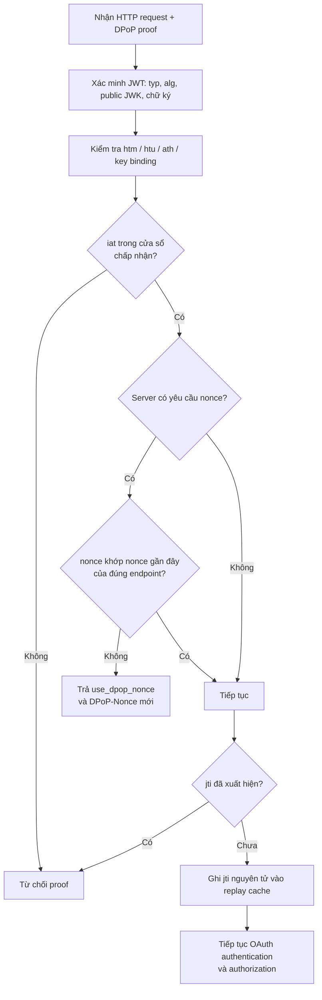
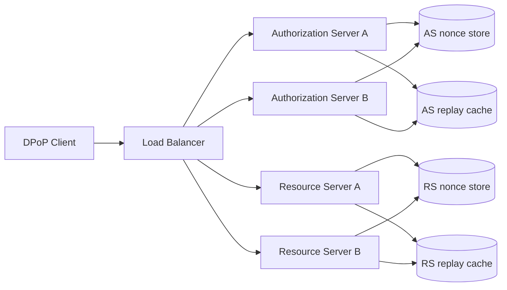
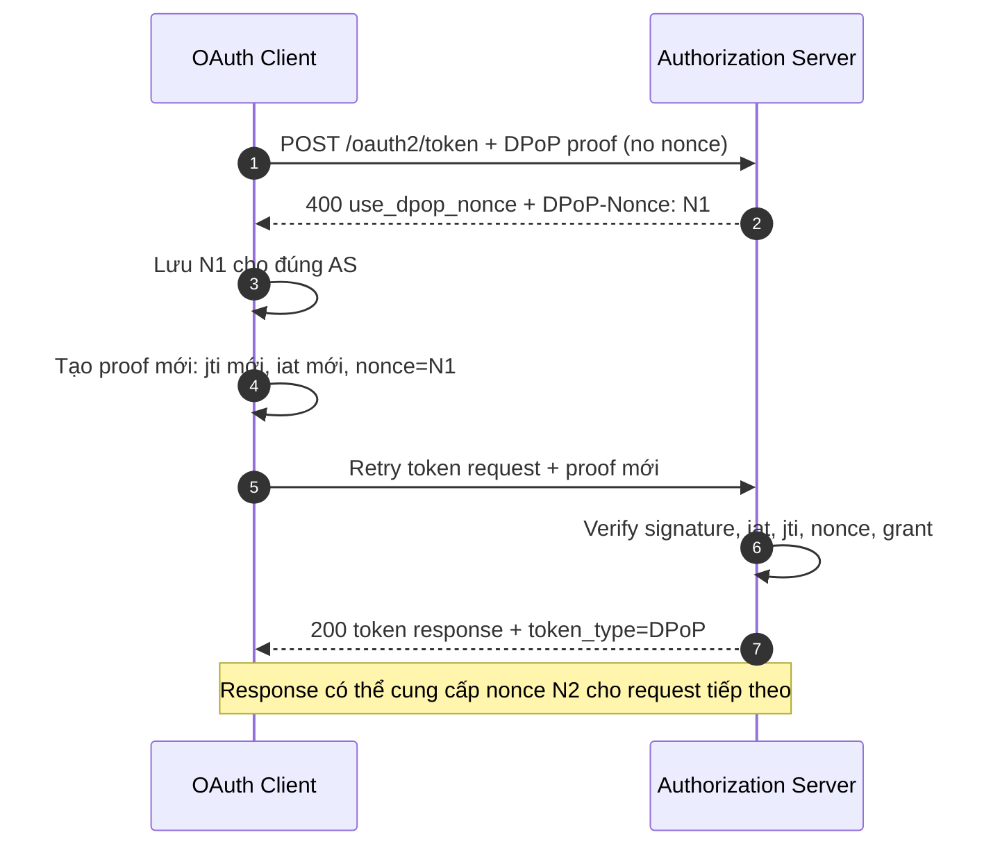
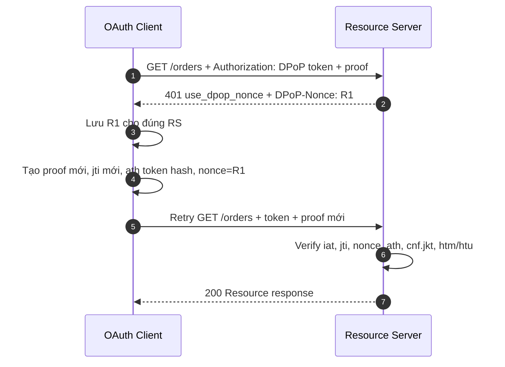

# Nonce, replay cache và giới hạn thời gian chấp nhận proof

## 1. Vì sao DPoP cần cả nonce, replay cache và giới hạn thời gian?

**DPoP (Demonstrating Proof of Possession)** là cơ chế OAuth 2.0 sender-constraining được chuẩn hóa trong **RFC 9449**. Thay vì chỉ dựa vào việc client có access token bearer, DPoP yêu cầu client ký một proof JWT bằng private key của mình và gửi proof trong HTTP header `DPoP`. Authorization Server gắn access token với public key tương ứng; Resource Server kiểm tra proof và ràng buộc key khi token được sử dụng.

DPoP làm giảm nguy cơ kẻ tấn công lấy được access token rồi dùng token đó trên một thiết bị khác. Tuy nhiên, nếu attacker lấy được **cả proof JWT đã ký**, họ có thể thử gửi lại proof đó tới cùng endpoint trong khoảng thời gian proof còn được chấp nhận. Một client bị kiểm soát cũng có thể tạo proof trước cho một thời điểm trong tương lai rồi mang proof sang thiết bị khác. Vì vậy, xác minh chữ ký và `htm`/`htu` là chưa đủ để chống mọi dạng replay.

Trong module **SPRING_SECURITY_OAUTH2_OIDC_AUTHORIZATION_SERVER**, chúng ta học cách thiết kế, cấu hình, bảo mật, kiểm thử và vận hành OAuth 2.0/OpenID Connect Authorization Server bằng **Spring Security và Spring Authorization Server trong Spring Boot**. Bài thuộc chương **DPoP**, tập trung vào ba kiểm soát phối hợp:

1. **Giới hạn thời gian chấp nhận proof:** chỉ chấp nhận `iat` nằm trong cửa sổ thời gian do server kiểm soát.
2. **Replay cache cho `jti`:** ghi nhận proof đã được dùng và từ chối lần sử dụng lại trong thời gian proof còn hợp lệ.
3. **Server-provided nonce:** server gửi challenge qua `DPoP-Nonce`; client đưa nonce vào proof kế tiếp để server hạn chế proof được tạo trước từ lâu.

Ba cơ chế này có vai trò khác nhau. `iat` giới hạn tuổi proof, `jti` phân biệt từng proof và giúp phát hiện replay, còn nonce ràng buộc proof với một challenge gần đây do đúng server phát hành. **Nonce không mặc nhiên là giá trị dùng một lần**; RFC 9449 cho phép client và server dùng lại cùng nonce trong thời gian nonce còn được chấp nhận, miễn là server vẫn theo dõi `jti` và từ chối proof trùng.

### Kết quả học tập

Sau bài học, bạn có thể:

- Mô tả chính xác claim `iat`, `jti`, `nonce`, `htm`, `htu`, `ath` và quan hệ với public key.
- Chọn cửa sổ thời gian chấp nhận proof, clock skew và thời gian giữ bản ghi replay.
- Thiết kế cache có ghi nguyên tử, giới hạn kích thước và dùng chung giữa các node.
- Phân biệt nonce của Authorization Server với nonce của Resource Server và OIDC `nonce`.
- Xử lý `use_dpop_nonce`, header `DPoP-Nonce`, retry bằng proof mới và cache header đúng cách.
- Tích hợp các validator DPoP có sẵn của Spring Security, nhận diện giới hạn của cache mặc định và kiểm thử nhiều instance.

**Phạm vi phiên bản:** phần Spring tham chiếu Spring Security 6.5.x/7.1.x và Spring Authorization Server 1.5.x hoặc dòng tích hợp Authorization Server trong Spring Security 7.x. API DPoP và khả năng tùy biến replay validator thay đổi theo phiên bản; hãy kiểm tra dependency và Javadoc của đúng dòng đang chạy. Các ví dụ cấu hình Resource Server dùng DSL DPoP của Spring Security 7.1 trở lên.

## 2. Proof JWT có những claim nào?

Một DPoP proof là JWT được client ký bằng private key. Header tối thiểu có:

| Header | Ý nghĩa |
| --- | --- |
| `typ` | Phải là `dpop+jwt`, giúp phân biệt proof với các JWT khác |
| `alg` | Thuật toán chữ ký bất đối xứng được hỗ trợ; không được là `none` hoặc MAC đối xứng |
| `jwk` | Public JWK dùng để xác minh chữ ký; tuyệt đối không chứa private key |

Payload cơ bản:

| Claim | Ý nghĩa | Yêu cầu |
| --- | --- | --- |
| `jti` | ID duy nhất của proof JWT | Bắt buộc; xác suất trùng phải không đáng kể trong cùng ngữ cảnh và cửa sổ hiệu lực |
| `htm` | HTTP method của request được proof bảo vệ | Bắt buộc; phải khớp method thực tế |
| `htu` | HTTP target URI của request, bỏ query và fragment | Bắt buộc; phải khớp URI thực tế theo quy tắc chuẩn hóa |
| `iat` | Thời điểm tạo proof | Bắt buộc; phải nằm trong cửa sổ chấp nhận của server |
| `ath` | SHA-256 hash của access token | Bắt buộc khi proof được gửi cùng access token tới Protected Resource |
| `nonce` | Nonce gần đây do AS hoặc RS cấp | Bắt buộc khi server tương ứng đã cung cấp nonce và yêu cầu client dùng nó |

Ví dụ payload minh họa cho request tới Resource Server:

```json
{
  "jti": "5b8d5c17-9d2a-4f4e-9f80-1dceab4b1201",
  "htm": "GET",
  "htu": "https://orders.example.com/api/orders",
  "iat": 1794820200,
  "ath": "BASE64URL_SHA256_OF_ACCESS_TOKEN",
  "nonce": "OPAQUE_SERVER_NONCE"
}
```

Các giá trị trên chỉ minh họa. `ath` là base64url không padding của SHA-256 trên ASCII bytes của access token. Không đưa query string hoặc fragment vào `htu`. Nonce là chuỗi opaque do server phát; client không tự tạo hoặc tự giải mã để suy luận thời gian.

### 2.1. jti phải mới cho mỗi HTTP request

RFC 9449 yêu cầu `jti` được tạo sao cho xác suất trùng với một proof khác trong cùng ngữ cảnh và thời gian hiệu lực là không đáng kể. Chuẩn nêu ví dụ tối thiểu **96 bit dữ liệu giả ngẫu nhiên** hoặc một UUID phiên bản 4.

Một proof JWT không phải vật có thể dùng lại cho nhiều request. Client phải tạo proof mới cho từng request, kể cả khi:

- Hai request cùng gọi một endpoint.
- Client retry request idempotent sau lỗi mạng.
- Client gửi lại cùng access token.
- Client nhận `use_dpop_nonce` và cần gửi lại request sau khi nhận nonce mới.

Mỗi lần retry cần `jti` mới, `iat` mới và chữ ký mới. Nếu server đã nhận request đầu tiên nhưng response bị mất, gửi lại proof cũ có thể bị replay cache từ chối. Client phải tạo proof mới; với request nghiệp vụ không idempotent, client còn cần cơ chế idempotency riêng để tránh thực hiện hành động hai lần.

**Phân biệt yêu cầu của RFC và mức bảo vệ triển khai:** RFC 9449 bắt buộc server giới hạn thời gian chấp nhận proof. Chuẩn nói server *có thể* lưu `jti` trong cửa sổ đó để ngăn cùng proof được dùng nhiều lần; kiểm tra single-use nghiêm ngặt tạo lớp chống replay rất mạnh nhưng có thể khó triển khai khi nhiều server không có shared state. Bài này thiết kế replay cache như một kiểm soát mạnh cho hệ thống cần chống replay giữa nhiều instance, không khẳng định RFC bắt buộc mọi deployment phải có distributed cache.

### 2.2. nonce không thay thế jti

`nonce` là challenge từ server, có thể được giữ lại và dùng trong nhiều proof cho tới khi server cung cấp nonce mới. `jti` nhận diện **một proof cụ thể**. Vì vậy:

- Nhiều proof khác nhau có thể mang cùng một nonce còn hiệu lực.
- Mỗi proof vẫn phải có `jti` khác nhau.
- Nếu cùng một proof JWT được gửi lại, server từ chối bằng replay detection dù nonce vẫn còn hợp lệ.
- Nếu nonce đã cũ hoặc không do đúng server phát hành, server từ chối proof ngay cả khi `jti` chưa từng xuất hiện.

Đừng xóa nonce khỏi kho chỉ vì một request đầu tiên đã dùng nó; điều đó sẽ làm các request đồng thời hoặc proof tiếp theo hợp lệ bị từ chối sai.

## 3. Ba kiểm soát và mối quan hệ giữa chúng

| Kiểm soát | Câu hỏi được trả lời | Cơ chế | Không giải quyết thay |
| --- | --- | --- | --- |
| **Thời gian iat** | Proof có được tạo trong khoảng thời gian server chấp nhận không? | So sánh `iat` với clock của server và clock skew | Không phát hiện một proof hợp lệ bị gửi lại hai lần |
| **Replay cache jti** | Proof ID này đã được chấp nhận trước đó chưa? | Ghi nhận `jti` nguyên tử và từ chối bản ghi trùng | Không ngăn client tạo proof trước nhiều giờ nếu `iat` được đặt trong tương lai hợp lệ hoặc nonce policy chưa áp dụng |
| **Nonce server** | Proof có chứa challenge gần đây do đúng endpoint phát hành không? | `DPoP-Nonce` response header và claim `nonce` trong proof | Không thay `jti` replay cache; nonce có thể được dùng lại |



Sơ đồ thể hiện các nhóm kiểm tra khái niệm. Thứ tự nội bộ có thể khác theo framework; điều quan trọng là request không được tiếp tục nếu proof sai chữ ký, sai request binding, quá cũ, thiếu nonce bắt buộc hoặc bị replay.

## 4. Giới hạn thời gian chấp nhận proof (iat)

### 4.1. Vì sao proof phải có thời hạn ngắn?

Nếu server chỉ xác minh chữ ký, `htm` và `htu`, một proof JWT đã bị đánh cắp vẫn có thể được gửi lại tới đúng endpoint/method. `iat` cho phép server giới hạn thời gian proof được chấp nhận. **RFC 9449 §11.1 yêu cầu server chỉ chấp nhận DPoP proof trong một khoảng thời gian giới hạn kể từ khi tạo**, và khuyến nghị khoảng tương đối ngắn, cỡ giây hoặc phút.

DPoP proof không bắt buộc phải có claim `exp` theo cấu trúc tối thiểu của RFC 9449. Server thường dùng `iat` cùng cửa sổ thời gian chấp nhận để xác định proof còn hợp lệ hay không. Vì vậy không được suy luận rằng thiếu `exp` thì proof có thời hạn vô hạn.

### 4.2. Công thức cửa sổ thời gian

Một chính sách thông dụng dùng clock skew đối xứng `S`:

```text
now - S <= iat <= now + S
```

Trong đó:

- `now` là thời điểm theo đồng hồ của server.
- `S` là độ lệch đồng hồ cho phép.
- Proof có `iat` quá cũ hơn `now - S` bị từ chối.
- Proof có `iat` quá xa trong tương lai hơn `now + S` bị từ chối.

Ví dụ với `S = 30 giây` và thời gian server hiện tại là 12:00:00:

| iat của proof | Kết quả |
| --- | --- |
| 11:59:20 | Từ chối: cũ hơn cửa sổ 30 giây |
| 11:59:35 | Chấp nhận về mặt thời gian |
| 12:00:00 | Chấp nhận về mặt thời gian |
| 12:00:20 | Có thể chấp nhận trong clock skew tương lai |
| 12:01:00 | Từ chối: nằm quá xa trong tương lai |

Đây chỉ là ví dụ minh họa. Một hệ thống có thể cấu hình cửa sổ cũ và cửa sổ tương lai khác nhau nếu validator hỗ trợ; không nhất thiết mọi triển khai phải dùng một giá trị đối xứng.

### 4.3. Không có một con số phù hợp cho mọi hệ thống

Chọn cửa sổ dựa trên:

- Sai lệch đồng hồ thực tế giữa client, gateway, AS và RS.
- Độ trễ mạng p95/p99, khu vực địa lý và các lần retry.
- Số lượng request, mức nhạy cảm của API và hậu quả nếu proof bị đánh cắp.
- Khả năng dùng server-provided nonce để dựa trên thời gian server thay vì tin hoàn toàn đồng hồ client.
- Đồng bộ thời gian bằng NTP hoặc cơ chế quản lý clock của hạ tầng.

Giá trị quá rộng làm tăng thời gian attacker có thể replay proof. Giá trị quá hẹp làm client hợp lệ bị từ chối khi clock drift hoặc mạng chậm. Không chọn vài phút chỉ để né lỗi đồng hồ nếu có thể đồng bộ clock tốt hơn.

### 4.4. Clock skew không phải thời gian sống của access token

Ba thời gian cần phân biệt:

| Thời gian | Áp dụng cho | Mục tiêu |
| --- | --- | --- |
| DPoP proof acceptance window | Proof JWT (iat) | Giới hạn proof có thể được dùng |
| Nonce validity window | Nonce do một AS/RS cấp | Giới hạn proof được tạo trước khi server phát challenge |
| Access token lifetime | Access token | Giới hạn thời gian API chấp nhận token theo token policy |

Access token còn hạn không có nghĩa proof cũ được phép sử dụng. Proof mới không làm access token hết hạn sớm. Nonce còn hiệu lực cũng không kéo dài thời hạn của proof có `iat` quá cũ.

### 4.5. iat trong tương lai và clock lệch

RFC 9449 cho phép server chấp nhận `iat` trong tương lai gần (cỡ giây hoặc phút) để dung sai clock offset. Nhưng một client độc hại có thể tự tạo proof với `iat` trong tương lai rất xa, ký bằng private key của nó và lưu lại để dùng sau. Nếu server chỉ chấp nhận một cửa sổ `iat` rộng, attacker có thể tận dụng cách này để chuẩn bị proof từ trước.

Server-provided nonce có thể giảm phụ thuộc vào đồng hồ client. Server có thể mã hóa hoặc lưu thời điểm server phát nonce, sau đó dùng thời điểm này để giới hạn proof. Client chỉ coi nonce là chuỗi opaque; server mới hiểu và xác minh thời điểm/phiên phát hành.

## 5. Replay cache cho jti

### 5.1. Quy trình single-use

Khi proof đã qua xác minh cấu trúc, chữ ký, request binding và thời gian:

1. Lấy `jti` từ payload đã xác minh.
2. Tạo khóa cache có namespace phù hợp, thường dựa trên hash của `jti` và/hoặc ngữ cảnh proof.
3. Thực hiện thao tác **insert-if-absent nguyên tử**.
4. Nếu khóa đã tồn tại, từ chối proof vì có khả năng bị replay.
5. Nếu insert thành công, tiếp tục xử lý request.
6. Giữ bản ghi cho đến khi proof không còn nằm trong cửa sổ thời gian có thể được chấp nhận.

Điểm quan trọng là kiểm tra và ghi phải **nguyên tử**. Nếu hai node cùng nhận một proof tại gần như cùng thời điểm, cả hai không được cùng đọc “chưa tồn tại” rồi đều cho qua.

### 5.2. Thời gian giữ bản ghi

Replay cache phải giữ `jti` ít nhất trong toàn bộ khoảng mà server còn có thể chấp nhận proof tương ứng. Nếu xóa entry quá sớm, proof cũ có thể được gửi lại trong cửa sổ còn hiệu lực.

Ví dụ:

```text
Proof iat:             12:00:00
Proof acceptance ends: 12:00:30
Replay cache expiry:   không sớm hơn 12:00:30
```

Nếu server chấp nhận proof có `iat` tương lai, phải tính thời điểm hết hạn cache phù hợp với chính sách đó. Không đặt TTL cache cố định 5 giây nếu cửa sổ proof có thể là 30 hoặc 60 giây.

Spring Security `DPoPProofReplayValidator` giữ `jti` trong cache tới khi proof hết hạn; Javadoc mô tả thời điểm hết hạn cache là `iat + clockSkew`. Mặc định `clockSkew` của validator là **30 giây**. Đây là mặc định của class, không phải giá trị bắt buộc của RFC và không nhất thiết phù hợp mọi deployment.

### 5.3. Cache phải có thao tác ghi nguyên tử

Các thao tác cần bảo đảm:

- `putIfAbsent` hoặc thao tác tương đương với semantics atomic.
- Một `jti` chỉ được insert thành công một lần trong namespace kiểm tra.
- Bản ghi có expiration rõ ràng và không bị xóa trước hạn.
- Nhiều instance nhìn thấy cùng trạng thái.
- Lỗi cache không được biến thành “không tìm thấy replay nên cho qua” nếu hệ thống yêu cầu chống replay fail-closed.

Nếu cache bị mất dữ liệu khi restart hoặc bị eviction do đầy, proof đã dùng có thể được chấp nhận lại. Do đó, chính sách capacity/eviction và behavior khi cache unavailable là một phần của bảo mật.

Với adapter distributed cache cho `DPoPProofReplayValidator`, cần đọc expiration metadata trong cache value và đặt TTL tương ứng; không để entry sống vô hạn và cũng không xóa trước khi proof rời cửa sổ chấp nhận. Spring `Cache` abstraction không tự bảo đảm mọi provider có cùng semantics TTL hoặc atomicity, nên cần xác minh implementation thực tế.

### 5.4. Giới hạn bộ nhớ và chống cache flooding

Attacker có thể tạo rất nhiều proof với `jti` khác nhau để làm đầy cache. Cần:

- Từ chối `jti` quá dài hoặc malformed.
- Lưu hash của `jti` thay vì giá trị tùy ý quá lớn.
- Giới hạn kích thước cache và số request theo key thumbprint/client khi phù hợp.
- Đặt TTL dựa trên thời gian proof còn có thể hợp lệ.
- Theo dõi cache hit, replay rejection, eviction, capacity và lỗi ghi.
- Có rate limiting bổ sung để ngăn client tạo proof với tốc độ bất thường.

Không được giải quyết flooding bằng cách evict ngẫu nhiên những `jti` còn nằm trong cửa sổ hiệu lực, vì entry bị evict có thể cho phép replay.

## 6. Nonce do Authorization Server hoặc Resource Server cấp

### 6.1. Mục tiêu của nonce challenge

Server-provided nonce làm cho client phải chứng minh proof được tạo **sau khi nhận một challenge do server phát**. Cơ chế này hạn chế client tạo proof trước hàng giờ hoặc hàng ngày rồi chuyển proof sang một thiết bị khác để sử dụng sau.

Nonce là giá trị opaque và **phải khó đoán**. Server có thể phát nonce khi:

- Client gửi DPoP proof không có nonce trong khi server yêu cầu.
- Nonce trong proof không khớp nonce còn được chấp nhận.
- Server muốn luân chuyển nonce theo chính sách.

RFC 9449 cho phép server quyết định khi nào phát nonce mới. Không có một tần suất hoặc TTL duy nhất bắt buộc cho mọi triển khai.

### 6.2. Challenge từ Authorization Server

Khi Token Endpoint yêu cầu nonce mà proof không có nonce hợp lệ, Authorization Server trả lỗi OAuth:

```http
HTTP/1.1 400 Bad Request
Content-Type: application/json
Cache-Control: no-store
DPoP-Nonce: AS_NONCE_VALUE

{
  "error": "use_dpop_nonce",
  "error_description": "Authorization server requires a recent DPoP nonce"
}
```

Client cần:

1. Đọc `DPoP-Nonce` từ response header.
2. Lưu nonce theo đúng Authorization Server/issuer.
3. Tạo **proof JWT mới** với claim `nonce` chứa giá trị nhận được.
4. Dùng `jti` mới và `iat` mới.
5. Retry request Token Endpoint theo chính sách retry an toàn.

Không gửi lại nguyên proof cũ sau khi nhận challenge; proof cũ không chứa nonce hoặc mang nonce không khớp, và `jti` cũ có thể đã được ghi vào replay cache.

### 6.3. Challenge từ Resource Server

Resource Server có thể yêu cầu nonce độc lập với Authorization Server. Theo RFC 9449, Resource Server trả HTTP 401 và chỉ rõ challenge trong `WWW-Authenticate`:

```http
HTTP/1.1 401 Unauthorized
WWW-Authenticate: DPoP error="use_dpop_nonce", error_description="Resource server requires a recent nonce"
DPoP-Nonce: RS_NONCE_VALUE
Cache-Control: no-store
```

Client tạo proof mới với nonce do **Resource Server đó** phát rồi gửi lại request. Không lấy nonce của Authorization Server đưa vào proof cho Resource Server.

### 6.4. Nonce của AS và RS là hai không gian riêng

| Thuộc tính | Authorization Server nonce | Resource Server nonce |
| --- | --- | --- |
| Server phát | Authorization Server | Resource Server |
| Request tiếp theo | Token Endpoint | Protected Resource Endpoint |
| Response challenge | HTTP 400 + OAuth `use_dpop_nonce` + `DPoP-Nonce` | HTTP 401 + `WWW-Authenticate: DPoP error="use_dpop_nonce"` + `DPoP-Nonce` |
| Phạm vi sử dụng | Chỉ tại AS phát hành | Chỉ tại RS phát hành |
| Mục đích | Hạn chế proof pre-generation cho token request | Hạn chế proof pre-generation/replay cho API request |

Nếu một client dùng nhiều AS/RS, phải lưu nonce theo đúng endpoint/issuer. Không dùng một biến global `currentNonce` cho tất cả host.

Khi server đã cung cấp nonce cho client, server **MUST NOT chấp nhận proof thiếu claim `nonce`**. Nếu cho phép bỏ nonce trong một request sau đó, attacker có thể hạ cấp client về chế độ proof không có challenge và vô hiệu hóa chính sách pre-generation.

### 6.5. Client nhận nonce mới trong response thành công

Server cũng có thể gửi `DPoP-Nonce` trong response HTTP 200 thay vì bắt client đi thêm một round trip để nhận challenge. Khi response thành công có nonce mới:

- Client **MUST** dùng nonce mới cho request tiếp theo tới server đó và tiếp tục dùng cho các request sau cho tới khi nhận nonce mới hơn.
- Response chứa `DPoP-Nonce` nên không được cache, ví dụ dùng `Cache-Control: no-store`, để client không nhận lại nonce cũ từ HTTP cache.
- Server không được phát nhiều hơn một header `DPoP-Nonce` trong cùng response.

Ví dụ:

```http
HTTP/1.1 200 OK
Content-Type: application/json
Cache-Control: no-store
DPoP-Nonce: NEXT_NONCE_VALUE

{
  "access_token": "ACCESS_TOKEN_PLACEHOLDER",
  "token_type": "DPoP",
  "expires_in": 600
}
```

### 6.6. CORS và browser-based client

Browser JavaScript không đọc được mọi response header theo mặc định. Nếu SPA cần đọc `DPoP-Nonce`, server phải expose header:

```http
Access-Control-Expose-Headers: DPoP-Nonce
```

Đồng thời cấu hình CORS với origin cụ thể, method/header cần thiết và credential policy phù hợp. Với Resource Server, browser client có thể cần đọc cả `DPoP-Nonce` và `WWW-Authenticate`, vì vậy expose đúng các header này. Không mở CORS `*` chỉ để cho client đọc nonce. DPoP nonce không thay `state`, PKCE hoặc CSRF protection.

## 7. Nonce có phải dùng một lần không?

**Không. Đây là điểm rất dễ triển khai sai.**

RFC 9449 phân biệt server-provided nonce với cryptographic one-time challenge. Client có thể dùng cùng một nonce trong nhiều proof, và server có thể chấp nhận cùng nonce nhiều lần. Điều kiện là server vẫn theo dõi `jti` và từ chối proof đã dùng trong thời gian nonce đó còn hiệu lực.

Ví dụ:

| Request | Nonce | `jti` | Kết quả |
| --- | --- | --- | --- |
| Request A | `N1` | `J1` | Chấp nhận; ghi `J1` |
| Request B | `N1` | `J2` | Chấp nhận; `J2` mới, `N1` vẫn hợp lệ |
| Replay A | `N1` | `J1` | Từ chối vì `J1` đã xuất hiện |
| Request C | `N1` | `J3` | Chấp nhận nếu `N1` vẫn trong cửa sổ nonce |
| Request D | `N0` đã cũ | `J4` | Từ chối vì nonce không còn được chấp nhận |
| Request E | `N2` mới | `J5` | Chấp nhận sau khi client nhận `N2` từ server |

Nếu xóa `N1` ngay sau Request A, Request B có thể bị từ chối dù hoàn toàn hợp lệ. Nếu giữ `N1` vô thời hạn, proof được tạo trước có thể tiếp tục sử dụng; vì vậy nonce cần cửa sổ hiệu lực hoặc cơ chế rotation có kiểm soát.

### 7.1. Giữ một cửa sổ nonce gần đây

RFC mô tả client thường chỉ cần giữ **một nonce hiện tại**, còn server giữ một **cửa sổ nonce gần đây** để xử lý các tình huống client/server tạm thời không đồng bộ. Khi server phát nonce mới, client cập nhật giá trị hiện tại; server có thể tiếp tục chấp nhận một số nonce trước đó trong thời gian overlap do policy quyết định.

Một chính sách triển khai có thể:

- Phát nonce mới sau một số request, sau một khoảng thời gian hoặc theo rủi ro.
- Chấp nhận nonce vừa phát và một số nonce gần đây trong thời gian ngắn để xử lý request đồng thời.
- Gắn nonce với đúng AS/RS và có thể thêm key thumbprint/client context.
- Từ chối nonce chưa từng phát, quá cũ, sai endpoint hoặc sai context.
- Xóa nonce state khi hết cửa sổ; không dùng nonce làm session credential dài hạn.

Thời gian overlap cần dựa trên độ trễ và concurrency thực tế. Không nên áp đặt một TTL cụ thể từ ví dụ tài liệu cho mọi hệ thống.

### 7.2. Nonce và jti phối hợp để chống hai kiểu tấn công

| Tình huống | Nonce giúp gì? | Replay cache giúp gì? |
| --- | --- | --- |
| Attacker tạo proof trước nhiều giờ | Server có thể yêu cầu nonce mới phát gần đây; proof cũ không có challenge phù hợp | Nếu `jti` mới thì cache chưa thấy, nên chỉ replay cache không ngăn pre-generation |
| Attacker lấy proof hiện tại rồi gửi lại | Nonce có thể vẫn hợp lệ và được phép dùng lại | Cache phát hiện `jti` đã được sử dụng |
| Client gửi proof hợp lệ với nonce cũ | Từ chối nonce không còn trong cửa sổ | `jti` có thể chưa xuất hiện; replay cache không thay kiểm tra nonce |
| Hai request hợp lệ dùng cùng nonce | Chấp nhận nếu nonce còn hợp lệ | `jti` khác nhau nên cả hai được chấp nhận |

## 8. Thiết kế nonce store và replay cache trong môi trường nhiều node

### 8.1. Hai loại state khác nhau

| State | Nội dung cần lưu | Thời gian lưu |
| --- | --- | --- |
| Nonce store | Nonce đã phát, endpoint/issuer, thời điểm phát/hết hạn và context binding nếu có | Trong cửa sổ nonce gần đây |
| Replay cache | `jti` đã dùng, proof `iat`, thời điểm hết hạn và key thumbprint/context cần thiết | Tới khi proof không còn được chấp nhận |

Không gộp hai kho state thành một tập nonce duy nhất. Nonce có thể được dùng lại; `jti` phải phân biệt từng proof. Nếu cùng một record cache đại diện cả hai khái niệm mà không có semantics rõ ràng, rất dễ xóa nonce quá sớm hoặc không chặn replay.

### 8.2. Mô hình nhiều instance



Nếu node A nhận proof và ghi `jti` vào bộ nhớ cục bộ, sau đó node B nhận bản replay, B không biết proof đã dùng. Tương tự, nếu node A phát nonce nhưng node B không nhận diện nonce đó, client sẽ bị challenge lặp lại hoặc request hợp lệ bị từ chối.

Với cluster:

- Dùng shared store/cache cho các node cùng một AS hoặc cùng một RS.
- Bảo đảm `putIfAbsent` là atomic trên toàn cluster.
- Đặt namespace riêng cho AS issuer và từng RS/resource origin.
- Lưu thời điểm hết hạn và dọn entry sau khi proof/nonce không còn hợp lệ.
- Xử lý lỗi kết nối cache theo fail-closed nếu chính sách yêu cầu chống replay nghiêm ngặt.
- Kiểm thử request A tới node 1 và replay cùng proof tới node 2.

**AS và RS không dùng chung nonce namespace.** Có thể dùng cùng hạ tầng Redis/cluster, nhưng keyspace, issuer/endpoint và policy phải tách riêng.

### 8.3. Chọn cache có khả năng chống race

Cache phân tán cần semantics tương đương:

```text
insertIfAbsent(key, value, expiresAt)

if inserted:
    accept proof
else:
    reject replay
```

Không triển khai bằng chuỗi thao tác `GET` rồi `PUT` tách rời; hai node có thể cùng thấy key chưa tồn tại. Redis có thể dùng thao tác tương đương `SET NX` kèm expiration; các hệ thống khác phải cung cấp transaction/atomic compare-and-set tương ứng. Đây là ví dụ về yêu cầu semantics, không phải lệnh copy nguyên trạng cho mọi cache provider.

## 9. Spring Security và Spring Authorization Server

### 9.1. DPoP support trong Spring

Spring Security 6.5 và Spring Authorization Server 1.5 có hỗ trợ DPoP-bound access token. Trong flow, client gửi DPoP proof ở header `DPoP` tới Token Endpoint; Authorization Server xác minh proof và gắn access token với public key bằng confirmation claim `cnf.jkt`. Response thành công dùng `token_type: DPoP`.

Ở Resource Server, Spring Security 7.1 cung cấp DSL `dPoP()` để xác minh proof và binding của DPoP-bound access token. Không được giả định rằng chỉ bật JWT Resource Server là đã bật DPoP validation.

### 9.2. Validator replay proof của Spring

Spring Security cung cấp `org.springframework.security.oauth2.jwt.DPoPProofReplayValidator` để:

- Yêu cầu proof có `iat` và nằm trong cửa sổ thời gian được cấu hình.
- Yêu cầu proof có `jti` chưa được sử dụng.
- Dùng Spring `Cache` để lưu `jti` và metadata liên quan.
- Giữ `jti` tới thời điểm proof hết hạn theo `iat + clockSkew`.

Javadoc ghi nhận class này có từ Spring Security **6.5.12**; mặc định `clockSkew` là **30 giây**. Đối với `InMemoryCache`, tài liệu hiện hành nêu mặc định tối đa **100.000 entries** và **1.000 requests trên mỗi JWK thumbprint**. Những con số này là default triển khai, không phải yêu cầu của RFC.

### 9.3. Ví dụ cấu hình validator

Ví dụ dưới đây minh họa tạo validator với cache:

```java
import java.time.Duration;

import org.springframework.cache.Cache;
import org.springframework.security.oauth2.jwt.DPoPProofReplayValidator;

public final class DPoPReplayConfiguration {

    private DPoPReplayConfiguration() {
    }

    public static DPoPProofReplayValidator replayValidator(Cache sharedCache) {
        DPoPProofReplayValidator validator =
                new DPoPProofReplayValidator(sharedCache);
        validator.setClockSkew(Duration.ofSeconds(30));
        return validator;
    }
}
```

`sharedCache` phải là implementation có semantics ghi nguyên tử và expiry phù hợp. Nếu chạy một node để học hoặc test, có thể dùng:

```java
import org.springframework.security.oauth2.jwt.DPoPProofReplayValidator;

var localCache = new DPoPProofReplayValidator.InMemoryCache();
localCache.setMaxSize(100_000);
localCache.setMaxRequestsPerKey(1_000);
```

**Không dùng `InMemoryCache` mặc định cho cluster production.** Javadoc nêu rõ cache này chỉ hoạt động cho single-node; clustered deployment cần distributed `Cache` như Redis hoặc Hazelcast. Khi dùng cache phân tán, adapter phải giữ đúng `putIfAbsent`/expiry semantics mà validator mong đợi.

### 9.4. Ghép validator vào proof decoder factory

`DPoPProofJwtDecoderFactory` cung cấp decoder và validator mặc định cho các claim request binding, thời gian, key thumbprint, access token hash và `jti`. Khi bổ sung replay cache riêng, cần giữ các kiểm tra mặc định và thêm validator có cache được chia sẻ:

```java
import java.util.List;

import org.springframework.cache.Cache;
import org.springframework.security.oauth2.jwt.DPoPProofJwtDecoderFactory;
import org.springframework.security.oauth2.jwt.DPoPProofReplayValidator;

public final class DPoPProofDecoderConfiguration {

    private DPoPProofDecoderConfiguration() {
    }

    public static DPoPProofJwtDecoderFactory decoderFactory(Cache sharedCache) {
        DPoPProofReplayValidator replayValidator =
                new DPoPProofReplayValidator(sharedCache);

        DPoPProofJwtDecoderFactory factory = new DPoPProofJwtDecoderFactory();
        factory.setJwtValidatorFactory(
                DPoPProofJwtDecoderFactory.createDefaultJwtValidatorFactory(
                        List.of(replayValidator)));
        return factory;
    }
}
```

Đây là mẫu ghép validator theo API Spring Security có từ 6.5.12. Hãy kiểm tra đúng version vì default validator chain và cache nội bộ có thể thay đổi giữa các bản vá. Mục tiêu là **không làm mất kiểm tra `htm`, `htu`, `iat`, `jkt`, `ath` và `jti` mặc định**, đồng thời bảo đảm có một replay check dùng chung giữa các node. Nếu phiên bản đã có replay validator mặc định, việc thêm validator chia sẻ có thể tạo thêm một lần kiểm tra cục bộ; tối ưu chain chỉ sau khi đã xác minh behavior của đúng version.

### 9.5. Resource Server DSL trong Spring Security 7.1+

Ví dụ cấu hình:

```java
import org.springframework.context.annotation.Bean;
import org.springframework.context.annotation.Configuration;
import org.springframework.security.config.Customizer;
import org.springframework.security.config.annotation.web.builders.HttpSecurity;
import org.springframework.security.oauth2.jwt.DPoPProofContext;
import org.springframework.security.oauth2.jwt.JwtDecoderFactory;
import org.springframework.security.web.SecurityFilterChain;

@Configuration
public class DPoPResourceServerConfiguration {

    @Bean
    SecurityFilterChain apiSecurity(
            HttpSecurity http,
            JwtDecoderFactory<DPoPProofContext> dPoPProofDecoderFactory)
            throws Exception {

        http
            .authorizeHttpRequests(authorize ->
                    authorize.anyRequest().authenticated())
            .oauth2ResourceServer(oauth2 -> oauth2
                .jwt(Customizer.withDefaults())
                .dPoP(dPoP -> dPoP.dPoPProofVerifierFactory(
                        dPoPProofDecoderFactory)));

        return http.build();
    }
}
```

DSL `.dPoP(...)` ở đây theo tài liệu Spring Security 7.1.x. Không copy nguyên cấu hình này sang Spring Security 6.5 nếu API của version đó chưa có cùng DSL; hãy đối chiếu version cụ thể. Cấu hình này minh họa Resource Server; Authorization Server có luồng xác minh proof riêng tại Token Endpoint.

### 9.6. Spring có tự động triển khai nonce challenge không?

Không nên mặc định rằng DPoP support đồng nghĩa đã có toàn bộ nonce protocol. Tài liệu Spring Security hiện hành mô tả proof verification và các validator mặc định cho `htm`, `htu`, `iat`, `jkt`, `ath`, `jti`; danh sách này không mô tả một cơ chế phát `DPoP-Nonce`, xử lý `use_dpop_nonce` hoặc lưu/đối chiếu nonce.

Nếu threat model yêu cầu server-provided nonce, cần bổ sung:

1. Nonce issuer/store tại Authorization Server và/hoặc Resource Server.
2. Logic trả `DPoP-Nonce` cùng `use_dpop_nonce` đúng HTTP status/headers.
3. Validator kiểm tra `nonce` trong proof theo đúng issuer/endpoint và cửa sổ nonce gần đây.
4. Client retry logic tạo proof mới với `jti` mới.
5. Cache headers, CORS expose header và integration tests.

Các extension points cụ thể phụ thuộc version và filter/provider pipeline. Không nên thêm một controller độc lập đứng ngoài DPoP validation rồi coi đó là triển khai hoàn chỉnh; nonce phải được kiểm tra trong cùng ngữ cảnh request đã xác minh chữ ký, client/key binding và endpoint.

## 10. Mô hình triển khai nonce service

### 10.1. Giao diện nghiệp vụ

Một nonce service có thể được thiết kế theo các thao tác:

```java
import java.time.Instant;

public interface DPoPNonceService {

    String issueNonce(
            String issuerOrResourceId,
            String jwkThumbprint,
            Instant issuedAt,
            Instant expiresAt);

    boolean isRecentlyIssued(
            String issuerOrResourceId,
            String jwkThumbprint,
            String nonce,
            Instant now);
}
```

Giao diện là ví dụ kiến trúc, không phải interface có sẵn trong Spring. Implementation cần:

- Sinh nonce bằng CSPRNG, không dùng counter hoặc timestamp thuần có thể đoán.
- Lưu mapping nonce → issuer/resource, thời điểm phát, thời điểm hết hạn và context binding.
- Giữ một cửa sổ nonce gần đây để xử lý concurrency/rotation.
- Không tiêu thụ nonce sau lần dùng đầu tiên.
- Xóa nonce state khi hết hạn.
- Không ghi raw nonce vào log hoặc metrics.

Nếu nonce mang timestamp server được bảo vệ bằng MAC hoặc được ánh xạ tới state server-side, chỉ server mới có thể xác minh thời điểm phát. Client chỉ lưu và gửi lại chuỗi opaque.

### 10.2. Pseudocode kiểm tra nonce

```text
function validateProofNonce(proof, endpointContext):
    if endpointContext.dpopNonceRequired is false:
        return ACCEPT_NONCE_CHECK

    if proof.nonce is missing:
        return CHALLENGE_WITH_NEW_NONCE

    if nonceStore.wasIssuedRecently(
            endpointContext.issuerOrResource,
            proof.jwkThumbprint,
            proof.nonce):
        return ACCEPT_NONCE_CHECK

    return CHALLENGE_WITH_NEW_NONCE

function challengeClient():
    nonce = nonceService.issueNewUnpredictableNonce()
    return OAuth error use_dpop_nonce + DPoP-Nonce header
```

Đây chỉ là bước kiểm tra nonce; request vẫn phải vượt qua chữ ký, `typ`, `alg`, `jwk`, `htm`, `htu`, `iat`, `ath`, key binding và replay cache. Không trả `use_dpop_nonce` cho một request có client authentication sai hoặc proof malformed nếu làm vậy sẽ tạo side channel không cần thiết.

### 10.3. Rotation và request đồng thời

Giả sử client có 4 request đồng thời, tất cả đều dùng nonce `N1`. Server có thể nhận request đầu tiên và phát nonce `N2` trong response. Ba request còn lại mang `N1` có thể vẫn đang trên đường truyền.

Nếu server lập tức xóa `N1`, những request còn lại sẽ bị challenge lại dù chúng được tạo trong lúc `N1` còn hợp lệ. Một nonce window ngắn cho phép server chấp nhận `N1` trong thời gian overlap, trong khi client chuyển sang `N2` cho request tiếp theo.

Để tránh race:

- Client cập nhật nonce theo response mới nhất từ đúng endpoint.
- Server giữ nonce gần đây theo policy, không chỉ một giá trị overwrite tức thời.
- Mỗi request vẫn dùng `jti` riêng.
- Khi nhận `use_dpop_nonce`, client tạo proof mới và retry có giới hạn.
- Không retry vô hạn nếu server liên tục trả nonce mismatch; ghi metric và kết thúc theo policy.

## 11. Client xử lý nonce challenge và retry

### 11.1. Luồng Token Endpoint



### 11.2. Luồng Protected Resource



### 11.3. Không dùng lại proof khi retry

Mẫu retry sai:

```text
1. Gửi proof P1 với jti=J1, không có nonce.
2. Server trả use_dpop_nonce.
3. Client thêm nonce vào request nhưng gửi lại JWT P1.
```

Mẫu đúng:

```text
1. Gửi proof P1 với jti=J1.
2. Server trả use_dpop_nonce và nonce N1.
3. Client tạo proof P2:
       jti = J2 (mới)
       iat = thời điểm hiện tại
       nonce = N1
       htm / htu = request sẽ gửi
       ath = hash access token nếu gọi Resource Server
4. Ký P2 bằng private key tương ứng và retry.
```

Nếu request trước có thể đã được thực hiện nhưng response bị mất, retry nghiệp vụ phải cân nhắc idempotency key. DPoP `jti` chỉ ngăn proof replay; nó không tự bảo đảm business operation chỉ được thực hiện một lần.

## 12. Những lỗi triển khai thường gặp

| Lỗi | Hậu quả | Cách sửa |
| --- | --- | --- |
| Chỉ xác minh chữ ký, bỏ qua `iat` | Proof bị đánh cắp có thể dùng lại lâu hơn cần thiết | Cửa sổ proof ngắn, kiểm tra clock skew |
| Không lưu `jti` đã dùng | Cùng proof có thể replay trong cửa sổ thời gian | Replay cache single-use |
| Cache local khi chạy nhiều node | Replay tới node khác không thấy entry cũ | Shared distributed cache, atomic insert |
| Dùng `GET` rồi `PUT` riêng | Hai node có thể cùng chấp nhận một proof | `putIfAbsent`/CAS atomic |
| TTL cache ngắn hơn proof acceptance window | Entry biến mất khi proof vẫn hợp lệ | Giữ `jti` tới hết cửa sổ chấp nhận |
| Cache đầy rồi evict entry còn hiệu lực | Proof cũ có thể replay | Capacity planning, bounded input, không evict entry live tùy tiện |
| Dùng một nonce global cho mọi server | Nonce AS có thể bị gửi nhầm tới RS | Namespace theo issuer/resource endpoint |
| Coi nonce là one-time | Request đồng thời dùng nonce hợp lệ bị từ chối | Nonce window; `jti` mới là định danh single-use |
| Dùng lại `jti` khi retry | Request retry bị replay validator từ chối | Tạo proof mới với `jti` mới |
| `iat` window quá rộng | Tăng thời gian replay/pre-generation | Giảm clock skew, đồng bộ clock, cân nhắc nonce |
| `iat` window quá hẹp | Client hợp lệ bị lỗi do clock drift/network | Đo clock skew và latency thực tế |
| Tin `iat` tương lai xa | Proof có thể được pre-generate | Giới hạn future skew, dùng server nonce |
| Bỏ nonce sau một lần dùng | Request hợp lệ tiếp theo bị challenge sai | Giữ nonce trong thời gian server cho phép |
| Cache response có `DPoP-Nonce` | Client nhận nonce cũ và retry thất bại | `Cache-Control: no-store` |
| Quên expose `DPoP-Nonce` qua CORS | SPA không đọc được nonce challenge | `Access-Control-Expose-Headers: DPoP-Nonce` |
| Dùng OIDC `nonce` thay DPoP `nonce` | Nhầm hai giao thức và phạm vi | DPoP nonce chỉ do AS/RS phát |
| Bỏ kiểm tra `ath` tại Resource Server | Proof có thể bị ghép với access token khác | So hash token với `ath` |
| Chỉ bật JWT decoder, không bật DPoP filter/provider | Token DPoP có thể bị xử lý như bearer tùy cấu hình | Dùng DPoP Resource Server support của version |

## 13. Kiểm thử nonce, replay cache và thời gian

### 13.1. Ma trận kiểm thử bắt buộc

| ID | Kịch bản | Kết quả mong đợi |
| --- | --- | --- |
| D01 | Proof có `iat` trong cửa sổ hợp lệ, `jti` mới | Chấp nhận qua kiểm tra thời gian/replay |
| D02 | Proof quá cũ | Từ chối |
| D03 | Proof có `iat` quá xa trong tương lai | Từ chối |
| D04 | Proof có `iat` tương lai nhỏ trong clock skew | Kết quả theo policy đã cấu hình |
| D05 | Cùng proof gửi hai lần tới cùng endpoint | Lần đầu có thể thành công; lần hai bị replay cache từ chối |
| D06 | Cùng `jti` được gửi đồng thời tới hai node | Chỉ một request có thể insert thành công |
| D07 | Cùng nonce nhưng `jti` khác nhau | Chấp nhận nếu nonce còn hiệu lực và các kiểm tra khác đạt |
| D08 | Cùng nonce và cùng proof/`jti` gửi lại | Từ chối do replay |
| D09 | Không có nonce khi server yêu cầu | AS trả `use_dpop_nonce` + `DPoP-Nonce` |
| D10 | Nonce sai hoặc không được server phát | Từ chối và có thể cấp nonce mới |
| D11 | Nonce quá cũ | Từ chối |
| D12 | Nonce do AS phát gửi tới RS | RS từ chối nếu không thuộc nonce namespace của RS |
| D13 | Nonce do RS A phát gửi tới RS B | RS B từ chối |
| D14 | Response thành công chứa nonce mới | Client dùng nonce mới cho request kế tiếp |
| D15 | Client retry với proof cũ | Từ chối; client phải tạo `jti` mới |
| D16 | Client retry với proof mới và nonce đúng | Chấp nhận nếu grant/token hợp lệ |
| D17 | CORS SPA đọc response challenge | Header `DPoP-Nonce` được expose |
| D18 | Response có `DPoP-Nonce` bị cache | Test phát hiện response không có `no-store` |
| D19 | Cache full/eviction | Không xóa tùy tiện entry proof còn hợp lệ |
| D20 | Replay cache unavailable | Fail-closed hoặc hành vi sự cố đúng policy |
| D21 | AS nhiều node | Nonce và replay state nhất quán giữa các node AS |
| D22 | RS nhiều node | Replay ở node khác vẫn bị phát hiện |
| D23 | Hai AS cùng được client dùng | Nonce không bị dùng chéo issuer |
| D24 | Proof thiếu `ath` khi gọi Resource Server | Từ chối |
| D25 | `ath` không khớp access token | Từ chối |
| D26 | `htm` hoặc `htu` không khớp | Từ chối |
| D27 | JWK chứa private key hoặc dùng thuật toán không hợp lệ | Từ chối |
| D28 | `jti` quá dài/malformed | Từ chối trước khi chiếm cache quá mức |
| D29 | Cache restart giữa cửa sổ replay | Đánh giá đúng nguy cơ mất replay state và recovery policy |
| D30 | Clock drift giữa các node | Các node cùng áp dụng cửa sổ và clock policy nhất quán |

### 13.2. Test bằng clock có thể điều khiển

Đừng dùng `Thread.sleep()` thật cho mọi bài test thời gian. Dùng `Clock` giả hoặc `Clock.fixed(...)` khi validator hỗ trợ để kiểm tra:

- Proof ngay trong cửa sổ.
- Proof ở đúng ranh giới.
- Proof cũ hơn giới hạn một giây.
- Proof tương lai trong và ngoài clock skew.
- Cache entry hết hạn đúng lúc proof không còn được chấp nhận.

`DPoPProofReplayValidator` có `setClock(...)` và `setClockSkew(...)`, thuận tiện để viết test ổn định. Khi test replay cache, cần kiểm tra cả hai request song song chứ không chỉ gọi validator tuần tự.

### 13.3. Kiểm thử race condition

Một test quan trọng:

1. Tạo một proof hợp lệ duy nhất.
2. Gửi đồng thời cùng proof tới hai instance Resource Server.
3. Xác nhận tối đa một request vượt qua replay check.
4. Lặp lại test khi hai instance dùng distributed cache.

Nếu cả hai request đều thành công, cache chưa bảo đảm thao tác atomic hoặc các node chưa dùng chung state. Đây là lỗi bảo mật cần xử lý trước production.

## 14. Vận hành và quan sát

### 14.1. Metric hữu ích

Theo dõi theo endpoint/server và phiên bản ứng dụng:

- Số proof được chấp nhận và từ chối.
- Tỷ lệ từ chối vì `iat` quá cũ/tương lai.
- Số replay rejection theo `jti`.
- Số `use_dpop_nonce` challenge.
- Tỷ lệ retry thành công sau nonce challenge.
- Nonce mismatch/stale nonce.
- Replay cache hit/miss/size/eviction/put-if-absent failure.
- Độ trễ cache và lỗi kết nối distributed cache.
- Tỷ lệ proof bị từ chối vì `ath`, `htm`, `htu`, key thumbprint.

Không ghi raw proof JWT, access token, private key hoặc nonce vào log. Dùng correlation ID an toàn, endpoint ID và error category.

### 14.2. Cảnh báo cần có

- Replay cache tăng nhanh bất thường hoặc đạt capacity.
- Tỷ lệ `use_dpop_nonce` tăng đột ngột sau rollout.
- Nonce mismatch tập trung ở một node hoặc một region.
- Clock skew distribution tăng vượt ngưỡng policy.
- Cache distributed bị timeout hoặc mất kết nối.
- Nhiều request dùng cùng `jti` hoặc `jti` có độ dài bất thường.
- Client liên tục retry cùng proof thay vì tạo proof mới.

### 14.3. Khi cache mất dữ liệu

Nếu replay cache bị flush hoặc mất state, những proof còn trong cửa sổ hợp lệ có thể được gửi lại và không còn entry để phát hiện. Cần:

- Hạn chế thao tác clear cache trong giờ hoạt động.
- Có persistence/replication phù hợp với SLA chống replay.
- Sau sự cố cache, đánh giá proof còn trong acceptance window; có thể tạm từ chối DPoP requests hoặc yêu cầu client tạo proof mới theo quy trình nonce.
- Không tự tăng clock skew để “giảm lỗi” khi cache đang mất state.
- Ghi nhận sự cố và kiểm thử phục hồi.

## 15. Checklist production

**Proof validation**

- [ ] Kiểm tra `typ=dpop+jwt`, asymmetric `alg`, public JWK và chữ ký.
- [ ] Kiểm tra `htm`, `htu`, `iat`, và `ath` khi request mang access token.
- [ ] Access token key binding `cnf.jkt` khớp thumbprint public key trong proof.
- [ ] Mỗi HTTP request có proof mới và `jti` duy nhất.
- [ ] Cửa sổ `iat` ngắn, có clock skew phù hợp và clock sync.

**Replay cache**

- [ ] Replay cache dùng atomic insert-if-absent.
- [ ] `jti` entry được giữ hết cửa sổ proof còn hợp lệ.
- [ ] Cache giới hạn kích thước, `jti` input và eviction.
- [ ] Cluster dùng distributed cache; không dựa vào local in-memory cache.
- [ ] Lỗi cache có hành vi fail-closed hoặc policy sự cố được phê duyệt.

**Nonce**

- [ ] Nonce sinh bằng CSPRNG và không thể đoán.
- [ ] AS và mỗi RS có nonce namespace riêng.
- [ ] Nonce gắn với issuer/endpoint và context phù hợp.
- [ ] Nonce window cho phép concurrency/rotation, không xóa sau lần dùng đầu.
- [ ] `use_dpop_nonce` và `DPoP-Nonce` response đúng HTTP semantics.
- [ ] Client retry bằng proof mới, `jti` mới, `iat` mới.
- [ ] Response chứa nonce mới không bị cache; CORS expose header nếu cần.

**Spring và vận hành**

- [ ] Đúng phiên bản Spring Security/SAS và API DPoP được hỗ trợ.
- [ ] Giữ default validators; custom replay validator/cache được tích hợp và test.
- [ ] Resource Server thực sự bật DPoP authentication.
- [ ] Không log proof/token/nonce/private key.
- [ ] Có test nhiều node, concurrency, clock drift, cache failure và nonce rotation.

## 16. Tài liệu tham khảo

- [RFC 9449 — OAuth 2.0 Demonstrating Proof of Possession (DPoP), §4.2–4.3](https://www.rfc-editor.org/rfc/rfc9449#section-4.2): cấu trúc proof JWT, `jti`, `htm`, `htu`, `iat`, `ath`, `nonce` và validation.
- [RFC 9449 §8 — Authorization Server-Provided Nonce](https://www.rfc-editor.org/rfc/rfc9449#section-8): `DPoP-Nonce`, `use_dpop_nonce`, nonce window và rotation.
- [RFC 9449 §9 — Resource Server-Provided Nonce](https://www.rfc-editor.org/rfc/rfc9449#section-9): nonce challenge ở Protected Resource.
- [RFC 9449 §11.1–11.3 — Replay, Pre-generation và Nonce Downgrade](https://www.rfc-editor.org/rfc/rfc9449#section-11.1): giới hạn thời gian proof, replay cache và server-provided nonce.
- [Spring Security — OAuth 2.0 DPoP-bound Access Tokens](https://docs.spring.io/spring-security/reference/servlet/oauth2/resource-server/dpop-tokens.html): DPoP proof, token binding và Resource Server.
- [Spring Security API — DPoPProofReplayValidator](https://docs.spring.io/spring-security/reference/api/java/org/springframework/security/oauth2/jwt/DPoPProofReplayValidator.html): `iat`, `jti`, cache, clock skew và thời điểm hết hạn entry.
- [Spring Security API — DPoPProofReplayValidator.InMemoryCache](https://docs.spring.io/spring-security/reference/api/java/org/springframework/security/oauth2/jwt/DPoPProofReplayValidator.InMemoryCache.html): giới hạn single-node, max size và max requests per key.
- [Spring Security API — DPoPProofJwtDecoderFactory](https://docs.spring.io/spring-security/reference/api/java/org/springframework/security/oauth2/jwt/DPoPProofJwtDecoderFactory.html): validator factory và cách bổ sung validator.
- [Spring Security — Protocol Endpoints](https://docs.spring.io/spring-security/reference/servlet/oauth2/authorization-server/protocol-endpoints.html): DPoP-bound access token request tại Authorization Server.

**Kết luận:** DPoP an toàn hơn khi server đồng thời giới hạn tuổi proof, theo dõi `jti` để phát hiện proof bị dùng lại và yêu cầu nonce gần đây để hạn chế proof được tạo trước. **Nonce có thể được dùng lại; `jti` thì phải mới cho mỗi proof.** Replay cache phải giữ state hết cửa sổ chấp nhận và dùng chung giữa các node. Trong Spring Security, `DPoPProofReplayValidator` cung cấp nền tảng kiểm tra `iat`/`jti`, nhưng cache mặc định chỉ phù hợp single-node; server-provided nonce cần được triển khai và kiểm thử theo RFC 9449, không được giả định đã tự động bật chỉ vì hệ thống hỗ trợ DPoP.
