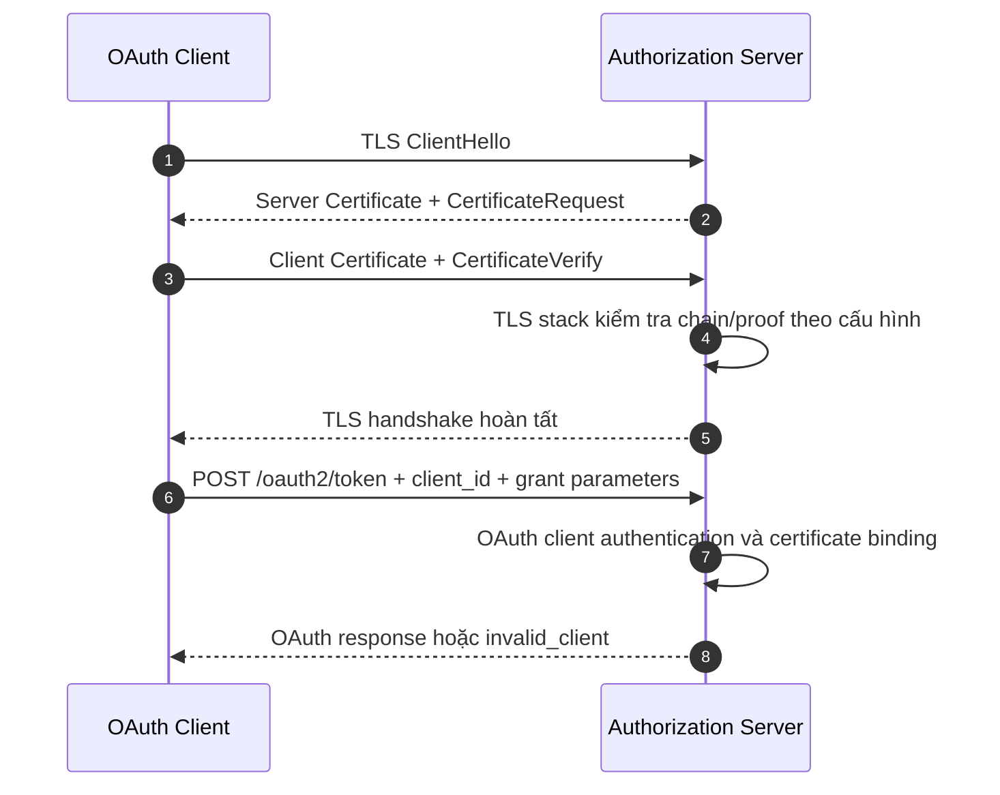

# Cấu hình tls_client_auth và self_signed_tls_client_auth

## 1. Bài toán: xác thực OAuth client bằng chứng chỉ

Một dịch vụ `billing-worker` cần gọi Token Endpoint để lấy access token cho API thanh toán. Cách quen thuộc là gửi `client_id` và `client_secret` qua HTTP Basic. Shared secret phải được phân phối, lưu trữ, rotate và bảo vệ trên nhiều môi trường; nếu secret bị lộ, kẻ tấn công có thể giả danh client cho đến khi credential bị thu hồi.

**Mutual TLS (mTLS)** bổ sung xác thực hai chiều ở tầng TLS: client xác minh certificate của Authorization Server, còn server yêu cầu certificate của client và kiểm tra bằng chứng sở hữu private key tương ứng. OAuth 2.0 Mutual-TLS Client Authentication được chuẩn hóa trong **RFC 8705**.

RFC 8705 định nghĩa hai phương thức xác thực client bằng chứng chỉ:

- **`tls_client_auth`**: phương thức PKI, dựa trên certificate chain được xác minh bởi CA tin cậy và thông tin certificate subject đã gắn với client.
- **`self_signed_tls_client_auth`**: phương thức self-signed, không dựa vào CA chain; Authorization Server so sánh certificate trong TLS handshake với certificate đã đăng ký cho client qua JWK Set.

Trong Spring Authorization Server, hai phương thức này được xử lý bởi OAuth client authentication filter và `X509ClientCertificateAuthenticationProvider`. Bài học tập trung vào cách đăng ký client, cấu hình TLS, kiểm tra certificate và vận hành an toàn trong Spring Boot.

Bài thuộc chương **mTLS** của module `SPRING_SECURITY_OAUTH2_OIDC_AUTHORIZATION_SERVER`. Mục tiêu của module là **học cách thiết kế, cấu hình, bảo mật, kiểm thử và vận hành OAuth 2.0/OpenID Connect Authorization Server bằng Spring Security và Spring Authorization Server trong ứng dụng Spring Boot**.

### Sau bài này, bạn có thể

1. Phân biệt TLS handshake, OAuth client authentication và certificate-bound access token.
2. Chọn `tls_client_auth` hay `self_signed_tls_client_auth` theo mô hình PKI.
3. Cấu hình `RegisteredClient` với `ClientSettings.x509CertificateSubjectDN` hoặc `ClientSettings.jwkSetUrl`.
4. Thiết lập TLS listener, trust store và ranh giới tin cậy khi terminate TLS ở reverse proxy.
5. Kiểm tra certificate chain, subject/SAN, thời hạn và binding giữa client ID với certificate.
6. Bật certificate-bound access token và xác minh proof-of-possession ở Resource Server.
7. Kiểm thử certificate hợp lệ, certificate sai, rotation, revocation và proxy forwarding.

> **Phạm vi phiên bản:** Ví dụ sử dụng API của Spring Authorization Server **1.5.8** và Spring Security 6.x. API có thể khác ở các dòng khác; đối chiếu dependency đang triển khai. Ghi chú bổ sung của bài được giao để trống, không có ràng buộc riêng.

## 2. mTLS có những lớp bảo vệ nào?

Trong TLS một chiều thông thường, client xác minh certificate của server. Trong **mutual TLS**, server cũng yêu cầu certificate của client và kiểm tra bằng chứng sở hữu private key tương ứng thông qua TLS handshake.



TLS handshake diễn ra **trước HTTP request**. Client certificate không phải trường JSON/form body, không phải header Authorization và cũng không phải authorization grant. Server lấy certificate từ TLS connection do web server/container cung cấp, sau đó OAuth authentication provider liên kết certificate với `client_id`.

| Khái niệm | Câu hỏi được trả lời | Ví dụ |
| --- | --- | --- |
| **TLS server authentication** | Client có đang kết nối đúng Authorization Server? | Client xác minh server certificate và hostname |
| **mTLS client authentication** | Bên kết nối có sở hữu private key của certificate đã đăng ký? | Server nhận certificate và xác minh binding với client |
| **Certificate-bound access token** | Bên gọi Resource Server có đang giữ đúng certificate đã gắn với token? | Resource Server so thumbprint trong `cnf` |

OAuth client authentication và certificate-bound access token **có thể được dùng độc lập hoặc kết hợp** theo RFC 8705. Bật mTLS client authentication ở Token Endpoint không tự động có nghĩa Resource Server đã kiểm tra certificate-bound access token.

## 3. So sánh hai phương thức mTLS

| Tiêu chí | `tls_client_auth` (PKI) | `self_signed_tls_client_auth` |
| --- | --- | --- |
| Certificate | Được cấp trong PKI, thường bởi CA nội bộ/doanh nghiệp | Certificate self-signed do client quản lý |
| Kiểm tra chain | TLS stack xác minh chain tới CA/trust anchor | Không dựa vào CA chain; ứng dụng đối chiếu certificate đã đăng ký |
| Binding client | Subject DN hoặc thuộc tính certificate đã đăng ký | Certificate trong client JWK Set, biểu diễn bằng `x5c` |
| Spring setting chính | `ClientSettings.x509CertificateSubjectDN` | `ClientSettings.jwkSetUrl` |
| Quản lý trust | CA, intermediate, CRL/OCSP hoặc quy trình PKI | Certificate registration/JWKS rotation và loại bỏ certificate cũ |
| Phù hợp | Doanh nghiệp có CA và lifecycle certificate tập trung | Service-to-service tự quản lý key/certificate, không vận hành CA đầy đủ |
| Rủi ro chính | CA/trust store sai, mapping subject quá rộng, thu hồi chậm | JWKS URI bị chiếm quyền, certificate cũ còn được tin, cache không an toàn |

**Self-signed không có nghĩa là tin mọi certificate tự ký.** Server vẫn phải so certificate nhận được với certificate đã đăng ký cho đúng client. Nếu chỉ tắt kiểm tra CA chain mà không có certificate binding ở tầng ứng dụng, bất kỳ bên nào cũng có thể tự tạo certificate để thử giả danh client.

### 3.1. Khi nào chọn PKI?

Chọn `tls_client_auth` khi tổ chức có CA nội bộ/doanh nghiệp, quy trình cấp phát và thu hồi certificate, trust store được quản lý tập trung, và danh tính service có thể biểu diễn ổn định qua Subject DN hoặc SAN.

### 3.2. Khi nào chọn self-signed?

Chọn `self_signed_tls_client_auth` khi client tự quản lý certificate và có thể đăng ký public certificate qua `jwks` hoặc `jwks_uri`. Phương thức này giảm phụ thuộc CA nhưng chuyển trách nhiệm tin cậy sang quy trình đăng ký certificate/JWKS. Cần bảo vệ JWKS URL, nội dung và quy trình cập nhật certificate.

### 3.3. Không chọn phương thức chỉ theo tên

Certificate self-signed có thể được dùng trong một mô hình PKI riêng nếu được trust anchor phù hợp tin cậy. Ngược lại, certificate do CA ký không tự động trở thành credential hợp lệ của mọi OAuth client. **Điều quyết định là phương thức đăng ký và kiểm tra binding mà Authorization Server áp dụng cho client.**

## 4. client_id vẫn bắt buộc khi xác thực bằng mTLS

RFC 8705 yêu cầu request sử dụng mTLS client authentication phải có tham số `client_id`. Server cần nhận diện client trước, sau đó kiểm tra certificate TLS được trình có đúng certificate/identity mà client đó đã đăng ký không.

Ví dụ:

```http
POST /oauth2/token HTTP/1.1
Host: auth.example.com
Content-Type: application/x-www-form-urlencoded

client_id=billing-worker&
grant_type=client_credentials&
scope=billing.read
```

- Certificate được gửi trong **TLS handshake**, không nằm trong body.
- `client_id` xác định registration cần kiểm tra.
- `grant_type` và `scope` mô tả quyền OAuth client muốn sử dụng.
- Không cần `client_secret` hoặc HTTP Basic nếu registration dùng mTLS.

Nếu không có certificate, certificate không khớp client hoặc client ID không tồn tại, Authorization Server từ chối xác thực client với OAuth error phù hợp, thông thường `invalid_client`. Không phát access token.

## 5. TLS listener: yêu cầu client certificate như thế nào?

Authorization Server phải chạy trên TLS listener có khả năng **yêu cầu client certificate** trong handshake. Nếu chỉ bật OAuth method trong `RegisteredClient` mà TLS listener không yêu cầu/không chuyển certificate tới ứng dụng, OAuth provider không có dữ liệu để xác minh.

### 5.1. Optional hay mandatory client certificate?

Một Authorization Server có thể phục vụ đồng thời client dùng `tls_client_auth`, `self_signed_tls_client_auth`, `client_secret_basic`, `private_key_jwt` và public client dùng `none`.

Khi nhiều phương thức cùng tồn tại trên một listener, TLS thường cần **yêu cầu certificate nhưng cho phép handshake tiếp tục nếu client không gửi certificate**. Với Spring Boot embedded server, cấu hình tương ứng thường là `server.ssl.client-auth: want`; tên/value chính xác phụ thuộc web server/container.

Sau handshake, OAuth layer quyết định client nào **bắt buộc** có certificate theo `RegisteredClient.clientAuthenticationMethods`. Client đăng ký `tls_client_auth` mà không có certificate vẫn bị từ chối, dù TLS listener cho phép kết nối không có certificate.

Nếu toàn bộ client trên listener đều phải dùng mTLS, có thể cân nhắc chế độ bắt buộc certificate (ví dụ `need`) theo container. Khi đó client không gửi certificate bị TLS từ chối trước khi đến OAuth filter. Tách listener/hostname nếu cần phục vụ các nhóm client có chính sách khác nhau.

### 5.2. Cấu hình TLS minh họa với Spring Boot

Ví dụ khung cấu hình cho mô hình PKI:

```yaml
server:
  port: 9000
  ssl:
    enabled: true
    key-store: file:/etc/auth-server/server.p12
    key-store-type: PKCS12
    # Nạp password qua secret manager hoặc cơ chế secret injection của môi trường.
    trust-store: file:/etc/auth-server/client-ca-trust.p12
    trust-store-type: PKCS12
    # Nạp trust-store password qua secret manager.
    client-auth: want
```

Đây là ví dụ cho **PKI trust model**; kiểm tra cấu hình cụ thể của embedded Tomcat/Jetty/Undertow và cách server sử dụng trust store. Không commit password, private key hoặc keystore vào source control. Dùng secret manager, file permission tối thiểu và certificate rotation có kiểm soát.

`want` cho phép handshake hoàn tất khi không có client certificate trong những server/container hỗ trợ chế độ optional. Với self-signed method, TLS stack phải được cấu hình phù hợp để không từ chối certificate chỉ vì nó không chain tới CA tin cậy; certificate sau đó phải được ứng dụng so khớp với JWK Set đã đăng ký. **Không dùng trust-all chung cho hệ thống PKI** để làm cho self-signed certificate hoạt động.

### 5.3. PKI và self-signed trên cùng một listener

Đây là điểm cần thiết kế cẩn thận: PKI yêu cầu TLS trust chain validation, còn self-signed method dựa trên certificate match trong JWK Set thay vì CA chain. Nếu TLS listener loại bỏ self-signed certificate trước khi HTTP request đến Spring, provider không thể kiểm tra JWK Set.

Các lựa chọn:

- Dùng listener/hostname riêng với trust policy tương ứng cho từng phương thức.
- Dùng TLS termination/proxy được thiết kế để chuyển certificate đã xác minh một cách an toàn và có cơ chế trust rõ ràng.
- Chỉ triển khai một phương thức trên listener nếu không cần phối hợp hai trust model.

Không tắt xác minh certificate toàn cục trên listener PKI chỉ để chấp nhận một client self-signed.

## 6. Certificate X.509 cần kiểm tra gì?

Certificate X.509 chứa public key và các thuộc tính định danh, thời hạn, issuer, subject và extensions. TLS handshake còn chứng minh client đang sở hữu private key tương ứng thông qua CertificateVerify.

| Kiểm tra | Ý nghĩa |
| --- | --- |
| Certificate chain | Chain tới CA/trust anchor được phép hay không (PKI method) |
| Validity | `notBefore` và `notAfter` có bao phủ thời điểm hiện tại không |
| Subject DN | Subject có khớp registration của client không |
| Subject Alternative Name (SAN) | Có DNS/URI/IP/email identity đúng policy không |
| Key Usage / Extended Key Usage | Certificate có được phép dùng cho client authentication không |
| Signature algorithm/key strength | Chữ ký CA, key size/curve đáp ứng baseline không |
| Revocation | Certificate đã bị thu hồi theo CRL/OCSP hoặc registry nội bộ chưa |
| Proof of possession | Client chứng minh sở hữu private key trong TLS handshake |
| Client binding | Certificate thực tế thuộc đúng `client_id` được gửi trong request không |

Không chỉ kiểm tra Subject DN nếu hệ thống cần định danh duy nhất theo workload. Subject DN có thể được cấp theo template chung; SAN URI/DNS hoặc custom certificate verifier có thể phù hợp hơn.

## 7. Cấu hình tls_client_auth trong RegisteredClient

Spring Authorization Server 1.5.8 hỗ trợ `ClientAuthenticationMethod.TLS_CLIENT_AUTH`. Certificate verifier mặc định của phương thức PKI kiểm tra **Subject Distinguished Name** của client certificate với `ClientSettings.x509CertificateSubjectDN`.

Ví dụ:

```java
RegisteredClient billingWorker = RegisteredClient.withId(
                UUID.randomUUID().toString())
        .clientId("billing-worker")
        .clientAuthenticationMethod(ClientAuthenticationMethod.TLS_CLIENT_AUTH)
        .authorizationGrantType(AuthorizationGrantType.CLIENT_CREDENTIALS)
        .scope("billing.read")
        .clientSettings(ClientSettings.builder()
                .x509CertificateSubjectDN(
                    "CN=billing-worker,OU=Platform,O=Example,C=VN")
                .build())
        .build();
```

Đây là registration minh họa. Subject DN phải khớp giá trị certificate thực tế theo cách provider kiểm tra. Tránh tự đoán thứ tự RDN, escaping hoặc canonicalization; hãy đọc certificate và viết integration test với certificate thật.

### 7.1. Quy trình xác thực PKI

1. Client mở TLS connection và gửi certificate chain.
2. TLS stack xác minh chain tới CA/trust anchor.
3. Client gửi token request với `client_id` và grant parameters.
4. `OAuth2ClientAuthenticationFilter` nhận thông tin X.509 từ TLS connection.
5. `X509ClientCertificateAuthenticationProvider` xác định registration và gọi certificate verifier.
6. Default verifier so subject DN với `x509CertificateSubjectDN`.
7. Nếu hợp lệ, OAuth client authentication thành công; grant provider tiếp tục kiểm tra scope/authorization.

**TLS chain validation và OAuth client binding là hai kiểm tra khác nhau.** Một certificate chain hợp lệ chỉ chứng minh certificate được cấp bởi CA tin cậy; nó vẫn phải được gắn với đúng client ID.

## 8. Cấu hình self_signed_tls_client_auth với client JWKS

Với phương thức self-signed, Spring Authorization Server 1.5.8 dùng `ClientSettings.jwkSetUrl` để truy xuất JWK Set của client. JWK đại diện certificate thông qua trường **`x5c`**. Provider mặc định tìm certificate trong TLS handshake và so khớp với certificate đã đăng ký.

Ví dụ registration:

```java
RegisteredClient inventoryWorker = RegisteredClient.withId(
                UUID.randomUUID().toString())
        .clientId("inventory-worker")
        .clientAuthenticationMethod(
                ClientAuthenticationMethod.SELF_SIGNED_TLS_CLIENT_AUTH)
        .authorizationGrantType(AuthorizationGrantType.CLIENT_CREDENTIALS)
        .scope("inventory.read")
        .clientSettings(ClientSettings.builder()
                .jwkSetUrl("https://inventory.example.com/.well-known/mtls-jwks.json")
                .build())
        .build();
```

JWKS URL phải thuộc nguồn mà Authorization Server tin cậy và được đăng ký/quản trị theo policy. Không lấy URL tùy ý từ token request hoặc header do client tự khai.

### 8.1. JWK Set chứa certificate như thế nào?

Ví dụ JWK Set minh họa:

```json
{
  "keys": [
    {
      "kty": "RSA",
      "kid": "inventory-client-cert-2026-01",
      "use": "sig",
      "x5c": [
        "BASE64_DER_ENCODED_X509_CERTIFICATE"
      ],
      "n": "BASE64URL_RSA_MODULUS",
      "e": "AQAB"
    }
  ]
}
```

`x5c` là mảng certificate DER được Base64 encode theo định dạng JWK; nó **không phải** Base64URL của PEM có dấu `-----BEGIN CERTIFICATE-----`. Với RSA, public key parameters `n`/`e` vẫn được yêu cầu và phải khớp public key trong certificate đầu tiên của `x5c` theo quy tắc JWK. Với EC, các thành phần public key tương ứng là `crv`, `x` và `y`.

JWK Set ở trên là placeholder, không phải certificate thật. Không đưa private key parameters vào JWKS.

### 8.2. Vì sao cần JWKS URL?

JWKS URL giúp Authorization Server lấy certificate hiện tại đã được client công bố. Khi certificate được rotate, client có thể cập nhật JWK Set; server tải lại và so khớp certificate mới mà không cần thay đổi trực tiếp toàn bộ registration nếu policy/cache cho phép.

Đây là **nguồn dữ liệu tin cậy**: phải bảo vệ DNS/TLS/host, giới hạn egress, timeout, cache và quy trình cập nhật. Nếu endpoint JWKS bị chiếm quyền, attacker có thể cố đăng ký certificate của họ vào danh sách được tin cậy cho client.

## 9. Cấu hình Spring Security và Spring Authorization Server

### 9.1. OAuth client authentication filter

Trong Spring Authorization Server 1.5.8, `OAuth2ClientAuthenticationFilter` xử lý client authentication trong Authorization Server `SecurityFilterChain`. Converter mặc định có `X509ClientCertificateAuthenticationConverter` cùng các converter cho JWT assertion, Basic, form secret và public client. Provider tương ứng có `X509ClientCertificateAuthenticationProvider`.

Ví dụ khung cấu hình:

```java
@Configuration
class AuthorizationServerSecurityConfig {

    @Bean
    @Order(1)
    SecurityFilterChain authorizationServerSecurityFilterChain(HttpSecurity http)
            throws Exception {

        OAuth2AuthorizationServerConfigurer authorizationServer =
                OAuth2AuthorizationServerConfigurer.authorizationServer();

        http
            .securityMatcher(authorizationServer.getEndpointsMatcher())
            .with(authorizationServer, Customizer.withDefaults())
            .authorizeHttpRequests(authorize ->
                authorize.anyRequest().authenticated());

        return http.build();
    }
}
```

Đây là khung filter chain, chưa phải ứng dụng độc lập. Cần thêm `RegisteredClientRepository`, `OAuth2AuthorizationService`, `AuthorizationServerSettings`, token generator/key source và các bean cần thiết. TLS listener cũng phải được cấu hình riêng; đoạn SecurityFilterChain không tự tạo server certificate, trust store hay yêu cầu client certificate ở handshake.

### 9.2. Khi nào cần custom certificate verifier?

Default PKI verifier của Spring Authorization Server 1.5.8 kiểm tra Subject DN. Nếu policy cần kiểm tra SAN URI, SAN DNS, serial number hoặc thuộc tính khác, có thể cấu hình `X509ClientCertificateAuthenticationProvider` với certificate verifier riêng thông qua `clientAuthentication(...).authenticationProviders(...)`.

Ví dụ skeleton theo API tài liệu:

```java
private Consumer<List<AuthenticationProvider>> configureCertificateVerifier() {
    return providers -> providers.forEach(provider -> {
        if (provider instanceof X509ClientCertificateAuthenticationProvider x509) {
            Consumer<OAuth2ClientAuthenticationContext> verifier = context -> {
                OAuth2ClientAuthenticationToken authentication =
                        context.getAuthentication();
                RegisteredClient registeredClient = context.getRegisteredClient();

                X509Certificate[] chain =
                        (X509Certificate[]) authentication.getCredentials();
                X509Certificate certificate = chain[0];

                // TODO:
                // 1. Lấy SAN/subject từ certificate đã được TLS stack kiểm tra.
                // 2. So khớp với identity đã đăng ký cho registeredClient.
                // 3. Ném OAuth2AuthenticationException nếu binding không hợp lệ.
            };
            x509.setCertificateVerifier(verifier);
        }
    });
}
```

Đây là **skeleton**, không phải verifier production hoàn chỉnh. Phải kiểm tra null/empty chain, certificate validity, expected identity và lỗi theo giao thức. Không chỉ log mismatch rồi tiếp tục. Nếu thay provider/converter, giữ lại xử lý mặc định cần thiết cho các client authentication method khác.

## 10. Client gửi request mTLS tới Token Endpoint

### 10.1. HTTP request không chứa certificate field

Client gửi:

```http
POST /oauth2/token HTTP/1.1
Host: auth.example.com
Content-Type: application/x-www-form-urlencoded

client_id=billing-worker&
grant_type=client_credentials&
scope=billing.read
```

Certificate và proof-of-possession được trao đổi **trong TLS handshake** trước HTTP. Request body vẫn tuân theo OAuth 2.0 Token Endpoint; mTLS thay đổi cách server xác thực client.

### 10.2. Dùng curl trong môi trường thử nghiệm

Với PKI client certificate:

```bash
curl --request POST "https://auth.example.com/oauth2/token" \
  --cert ./billing-worker-chain.pem \
  --key ./billing-worker-private-key.pem \
  --cacert ./authorization-server-ca.pem \
  --header "Content-Type: application/x-www-form-urlencoded" \
  --data-urlencode "client_id=billing-worker" \
  --data-urlencode "grant_type=client_credentials" \
  --data-urlencode "scope=billing.read"
```

- `--cert` gửi client certificate/chain trong TLS handshake.
- `--key` cung cấp private key tương ứng để client chứng minh sở hữu.
- `--cacert` xác minh certificate của **Authorization Server**; không phải cách đăng ký client certificate với OAuth server.
- Không dùng `--insecure` để bỏ xác minh server certificate trong production.

Với self-signed client certificate, `--cacert` vẫn dùng để xác minh **server certificate**. Client certificate self-signed được server đối chiếu qua JWKS registration; hai chiều trust không nên bị nhầm.

### 10.3. Response OAuth thành công

Nếu client authentication và grant hợp lệ, response có thể là:

```http
HTTP/1.1 200 OK
Content-Type: application/json
Cache-Control: no-store
Pragma: no-cache

{
  "access_token": "ACCESS_TOKEN_EXAMPLE",
  "token_type": "Bearer",
  "expires_in": 600,
  "scope": "billing.read"
}
```

mTLS không thay đổi định dạng response OAuth. Client vẫn phải kiểm tra `access_token`, `token_type`, thời hạn và scope; không log token raw.

## 11. Certificate-bound access token: binding ở tầng Resource Server

RFC 8705 còn định nghĩa cách **ràng buộc access token với client certificate**. Khi bật tính năng này, Authorization Server tính SHA-256 thumbprint của certificate và gắn vào token.

Ví dụ JWT access token có claim:

```json
{
  "iss": "https://auth.example.com",
  "aud": ["billing-api"],
  "scope": ["billing.read"],
  "cnf": {
    "x5t#S256": "BASE64URL_SHA256_CERTIFICATE_THUMBPRINT"
  }
}
```

`cnf` là confirmation claim. `x5t#S256` biểu diễn SHA-256 thumbprint của certificate X.509 ở dạng Base64URL không padding. Khi gọi Resource Server, client phải sử dụng **cùng certificate/private key** đã gắn với token để thiết lập mTLS connection.

### 11.1. Bật trong Spring Authorization Server

Ví dụ cấu hình cho client:

```java
RegisteredClient mtlsClient = RegisteredClient.withId(
                UUID.randomUUID().toString())
        .clientId("mtls-client")
        .clientAuthenticationMethod(ClientAuthenticationMethod.TLS_CLIENT_AUTH)
        .authorizationGrantType(AuthorizationGrantType.CLIENT_CREDENTIALS)
        .scope("billing.read")
        .clientSettings(ClientSettings.builder()
                .x509CertificateSubjectDN(
                    "CN=mtls-client,OU=Platform,O=Example,C=VN")
                .build())
        .tokenSettings(TokenSettings.builder()
                .x509CertificateBoundAccessTokens(true)
                .build())
        .build();
```

Theo Spring Authorization Server 1.5.8, `TokenSettings.x509CertificateBoundAccessTokens(true)` bật binding cho access token được phát hành. Ví dụ này đồng thời dùng `tls_client_auth`; tuy nhiên **mTLS client authentication và certificate-bound token là hai cơ chế bổ sung**, không phải cùng một cờ.

### 11.2. Resource Server phải kiểm tra certificate

Resource Server cần:

1. Yêu cầu client thiết lập mTLS theo policy của API.
2. Lấy certificate client từ TLS layer đáng tin cậy.
3. Xác minh chữ ký/issuer/audience/expiry/scope của access token.
4. Tính SHA-256 thumbprint của certificate thực tế.
5. So sánh với `cnf.x5t#S256` trong token.
6. Từ chối token bằng `401 invalid_token` nếu certificate không khớp hoặc không có certificate khi token yêu cầu binding.

**Chỉ xác minh JWT signature là chưa đủ.** Nếu API bỏ qua `cnf`, attacker có thể dùng bearer token bị đánh cắp mà không cần sở hữu private key certificate.

Spring Resource Server có thể cần custom validation/filter hoặc tích hợp ở tầng gateway để lấy certificate của TLS connection và đối chiếu với claim. Không giả định `JwtDecoder` mặc định tự đọc certificate của HTTP request và hoàn thành proof-of-possession.

### 11.3. Gọi Resource Server với cùng certificate

```bash
curl "https://billing-api.example.com/invoices" \
  --cert ./billing-worker-chain.pem \
  --key ./billing-worker-private-key.pem \
  --cacert ./billing-api-ca.pem \
  --header "Authorization: Bearer $ACCESS_TOKEN"
```

Nếu dùng certificate khác, dù access token còn hạn và chữ ký hợp lệ, Resource Server phải từ chối do thumbprint mismatch.

## 12. Certificate rotation và revocation

Certificate có thời hạn. Khi certificate hết hạn hoặc được thay mới, client cần chuyển sang certificate mới và cập nhật binding theo đúng phương thức.

### 12.1. Rotation với PKI

1. Yêu cầu CA cấp certificate mới cho client.
2. Đăng ký identity mới/subject/SAN với Authorization Server theo quy trình.
3. Cập nhật trust store nếu CA/intermediate thay đổi.
4. Chuyển client sang certificate mới theo lịch.
5. Thu hồi certificate cũ qua CRL/OCSP hoặc registry/policy tương ứng.
6. Theo dõi client auth failures và gỡ mapping cũ sau khi migration hoàn tất.

Nếu certificate-bound access token đang dùng certificate cũ, token đó không thể được dùng với certificate mới vì thumbprint khác. Client phải lấy access token mới gắn với certificate mới; Resource Server từ chối certificate mismatch.

### 12.2. Rotation với self-signed JWKS

1. Client tạo certificate/key pair mới và giữ private key trong secret store/HSM.
2. Publish certificate mới trong JWK Set đã đăng ký.
3. Chờ Authorization Server refresh JWKS/cache theo policy.
4. Chuyển client sang certificate mới và xác minh authentication thành công.
5. Gỡ certificate cũ khỏi JWKS sau khi migration/overlap hoàn tất.
6. Nếu private key cũ bị lộ, loại bỏ certificate cũ khẩn cấp và đánh giá token/authorization bị ảnh hưởng.

Không dùng lại `kid` cho certificate khác. `kid` nên định danh ổn định cho từng key/certificate version.

### 12.3. Revocation không chỉ là hết hạn

Certificate có thể bị thu hồi trước `notAfter` vì private key bị lộ, workload bị xóa hoặc quyền client thay đổi. PKI có thể dùng CRL/OCSP; self-signed method cần cập nhật JWK Set/registration và cache. Xác định độ trễ thu hồi tối đa và cách xử lý khi CA/OCSP/JWKS endpoint không truy cập được.

## 13. Reverse proxy và TLS termination: ranh giới tin cậy

Trong production, TLS thường được terminate tại load balancer, ingress hoặc API gateway trước Spring Boot. Khi đó, backend có thể không còn TLS session gốc và không tự nhìn thấy client certificate.

Nếu proxy chuyển certificate identity cho ứng dụng:

- Proxy phải thực sự yêu cầu và xác minh client certificate ở TLS handshake.
- Proxy-to-application phải là kết nối nội bộ được bảo vệ, ưu tiên mTLS.
- Proxy phải **xóa mọi header certificate do client bên ngoài tự gửi** trước khi thêm metadata đã xác minh.
- Backend chỉ tin metadata từ proxy nằm trong trust boundary; chặn đường truy cập trực tiếp bypass proxy.
- Chuẩn hóa encoding/PEM/header theo hợp đồng đã kiểm thử; giới hạn kích thước header/certificate chain.
- Không chỉ tin `X-Client-Cert` hoặc `X-SSL-Client-Cert` nếu chưa chứng minh nguồn header.

RFC 8705 xem việc truyền certificate metadata qua intermediary là vấn đề triển khai cần được bảo vệ. Nếu proxy không chuyển certificate theo cơ chế mà Servlet container/Spring nhận biết, `X509ClientCertificateAuthenticationProvider` có thể không có certificate để xác minh.

### 13.1. Hai TLS hop không tự động là một mTLS session

Kết nối client → proxy và proxy → Spring là **hai TLS session riêng**. Certificate của client chỉ có ý nghĩa với backend nếu proxy đã xác minh nó và chuyển bằng chứng một cách xác thực. Certificate của proxy trên hop thứ hai không thay thế certificate của OAuth client.

### 13.2. Forwarded headers không chứng minh danh tính

`Forwarded`, `X-Forwarded-Proto` và `X-Forwarded-For` mô tả thông tin proxy/network; chúng không tự chứng minh client certificate. Dùng đúng cơ chế TLS/client certificate propagation của hạ tầng và cấu hình trusted proxy riêng.

## 14. Những lỗi xác thực phổ biến

| Triệu chứng | Nguyên nhân có thể | Hướng kiểm tra |
| --- | --- | --- |
| TLS handshake bị từ chối trước HTTP | Client không gửi certificate khi listener yêu cầu bắt buộc, chain không tin cậy, certificate hết hạn | TLS logs, trust store, client-auth mode, clock |
| HTTP tới Token Endpoint nhưng `invalid_client` | Không có certificate ở request attribute hoặc client ID/certificate không khớp | TLS termination, client_id, X509 provider/verifier |
| PKI client bị từ chối | Subject DN khác registration, CA/intermediate thiếu, SAN policy | Đọc certificate thực tế, trust chain, setting DN |
| Self-signed client bị từ chối | JWKS URL sai, không có `x5c` hoặc certificate không match | JWK Set response, cache, certificate DER, client binding |
| Certificate hợp lệ nhưng sai client | Mapping subject/certificate dùng chung hoặc đăng ký nhầm | Registration uniqueness, subject/SAN/JWK match |
| Sau rotation không xác thực được | JWKS cache cũ, trust store chưa cập nhật, client chưa chuyển certificate | Rotation timeline và cache |
| Token API trả 401 dù JWT signature đúng | Certificate thumbprint không khớp `cnf` | Certificate ở API handshake, `x5t#S256` |
| Proxy hoạt động khi direct TLS, lỗi sau ingress | Client certificate không được chuyển an toàn tới backend | Ingress config, servlet request attribute, trusted header |
| Một số client secret khác bị lỗi TLS | Listener đang bắt buộc certificate toàn cục | `want`/`need` và phân tách listener |
| SAN URI không được kiểm tra | Default verifier chỉ kiểm tra Subject DN | Cấu hình custom certificate verifier |

## 15. Ma trận kiểm thử mTLS

| Ca thử | Thiết lập | Kết quả mong đợi |
| --- | --- | --- |
| PKI certificate hợp lệ | Chain tới CA tin cậy, subject DN khớp registration | Client authentication thành công |
| PKI thiếu intermediate | Chain không xây dựng được | TLS handshake hoặc trust validation thất bại |
| PKI certificate hết hạn | `notAfter` đã qua | Từ chối certificate |
| PKI certificate chưa có hiệu lực | `notBefore` ở tương lai | Từ chối certificate |
| PKI subject DN mismatch | Certificate hợp lệ nhưng DN không khớp client | `invalid_client` |
| PKI SAN mismatch | Custom verifier yêu cầu SAN không khớp | `invalid_client` |
| PKI certificate bị revoke | CRL/OCSP/registry báo revoked | Từ chối theo revocation policy |
| Self-signed certificate hợp lệ | Certificate có trong client JWKS `x5c` | Client authentication thành công |
| Self-signed certificate lạ | Certificate tự ký nhưng không có trong JWKS | `invalid_client` |
| Self-signed JWKS URL lỗi | Không tải được JWK Set | Fail theo policy; không tin certificate tùy ý |
| Self-signed JWKS không có x5c | JWK chỉ có public key, không có certificate cần đối chiếu | Từ chối |
| Client ID khác certificate binding | Certificate của client A nhưng gửi client_id B | `invalid_client` |
| Không gửi client certificate | Client đăng ký mTLS | Bị TLS hoặc OAuth layer từ chối |
| Dùng Basic thay mTLS | Client chỉ cho phép tls_client_auth | `invalid_client` |
| Certificate private key sai | Không chứng minh được possession | TLS handshake thất bại |
| Certificate rotation | Thêm cert mới, chuyển client, gỡ cert cũ | Chỉ cert được đăng ký hiện tại được chấp nhận theo policy |
| Certificate-bound token hợp lệ | API handshake dùng cùng cert, `cnf` khớp | Resource Server chấp nhận |
| Certificate-bound token sai cert | Token hợp lệ nhưng certificate khác | `401 invalid_token` |
| Bearer token không có cnf | API policy yêu cầu certificate-bound | Từ chối theo policy resource |
| TLS terminate tại proxy | Proxy xác minh và truyền certificate an toàn | Backend nhận đúng certificate identity |
| Spoof header từ Internet | Client gửi header giả `X-Client-Cert` | Proxy xóa header; backend không tin dữ liệu giả |
| Direct backend bypass | Bỏ qua ingress/proxy | Bị network policy chặn |
| Mixed client authentication | Listener optional cert; Basic client không gửi cert | Basic client vẫn hoạt động theo registration |
| mTLS-only listener | Listener yêu cầu cert | Client không có cert bị chặn ở TLS |
| Nhiều instance | Registration/JWKS chung, request tới node khác nhau | Certificate binding nhất quán |

### 15.1. Kiểm thử theo lớp

**TLS test:** kiểm tra handshake, chain, key possession, hostname, protocol/cipher policy và certificate request mode.

**OAuth integration test:** kiểm tra client ID, authentication method, registration, subject DN/JWKS match và OAuth error.

**Resource Server test:** kiểm tra chữ ký/issuer/audience/scope cùng certificate thumbprint nếu token được bound.

**Infrastructure test:** kiểm tra ingress, proxy header spoofing, direct bypass, certificate rotation và behavior nhiều node.

Không chỉ mock `X509Certificate` trong unit test rồi kết luận mTLS đã hoạt động. Phải có ít nhất một kiểm thử TLS thực tế giữa client và listener/proxy.

## 16. Bảo mật vận hành

### 16.1. Bảo vệ private key

Private key của client certificate cần được giữ trong keystore/secret manager/HSM phù hợp. Không đóng gói private key production vào container image, repository, frontend hoặc file cấu hình được commit. Giới hạn quyền đọc, audit thao tác và có quy trình rotate khi workload thay đổi.

### 16.2. Giám sát certificate lifecycle

Theo dõi certificate sắp hết hạn, số lần `invalid_client`, lỗi trust chain, lỗi JWKS fetch, certificate mismatch và thay đổi key/certificate. Cảnh báo trước thời điểm hết hạn đủ lâu để CA/client có thể rotation an toàn.

### 16.3. Thu hồi và sự cố lộ khóa

Khi private key bị lộ:

1. Chặn certificate/client credential bị ảnh hưởng theo incident policy.
2. Thu hồi certificate PKI hoặc gỡ certificate khỏi JWKS self-signed.
3. Cân nhắc revoke access/refresh token và authorization liên quan.
4. Đánh giá Resource Server policy nếu certificate-bound token có thể bị lạm dụng.
5. Tạo key pair mới, đăng ký certificate mới và xác minh end-to-end.
6. Audit token issuance/access trong khoảng thời gian nghi ngờ compromise.

Chỉ xóa certificate khỏi JWKS chưa chắc thu hồi ngay access token bearer đã phát hành. Nếu token không certificate-bound, attacker có thể tiếp tục dùng token bị đánh cắp cho đến khi token hết hạn hoặc bị revoke theo cơ chế server hỗ trợ.

### 16.4. TLS version và cipher policy

Ưu tiên TLS 1.2/1.3 theo baseline hiện hành, tắt protocol/cipher suite yếu, dùng certificate/key phù hợp và kiểm tra tương thích client. Không bật TLS cũ chỉ để hỗ trợ một workload chưa nâng cấp nếu chưa có đánh giá rủi ro và kế hoạch migration.

## 17. Tình huống tổng hợp: hai workload, hai phương thức certificate

Một doanh nghiệp có hai service:

**Billing Worker** nằm trong PKI nội bộ. CA cấp certificate với Subject DN ổn định. Registration dùng `tls_client_auth` và `x509CertificateSubjectDN`. Ingress/Authorization Server xác minh chain; Spring provider so khớp DN với client ID. Worker lấy access token qua Client Credentials.

**Inventory Worker** chạy ở môi trường đối tác không dùng chung CA. Client tự tạo certificate và công bố JWK Set qua HTTPS. Registration dùng `self_signed_tls_client_auth` và `jwkSetUrl`. Authorization Server lấy JWK Set, đối chiếu certificate `x5c` trong TLS handshake với certificate được đăng ký cho đúng client.

Nếu cả hai workload cần proof-of-possession khi gọi API, tổ chức bật `x509CertificateBoundAccessTokens(true)` cho registration phù hợp và cấu hình Resource Server kiểm tra `cnf.x5t#S256`. Khi Inventory Worker rotate certificate, token gắn với certificate cũ không thể dùng với certificate mới; worker cần lấy token mới sau khi registration/JWKS cập nhật.

Đội vận hành giữ PKI trust store, JWKS cache, certificate lifecycle, ingress propagation và token validation trong cùng một quy trình audit. Nhờ đó, mTLS không chỉ hoạt động ở một handshake mà duy trì binding đúng xuyên suốt OAuth token issuance và API access.

## 18. Checklist trước production

- [ ] Chọn rõ `tls_client_auth` hay `self_signed_tls_client_auth` cho từng client.
- [ ] TLS listener yêu cầu client certificate đúng chế độ; mixed authentication không vô tình bắt mọi client phải có cert.
- [ ] PKI trust store có CA/intermediate phù hợp; certificate chain, validity, key usage và revocation được kiểm tra.
- [ ] `RegisteredClient` dùng đúng method; `client_id` bắt buộc và binding với certificate được xác minh.
- [ ] PKI registration có `x509CertificateSubjectDN` hoặc custom verifier cho SAN/identity phù hợp.
- [ ] Self-signed registration có `jwkSetUrl` đáng tin, JWKS HTTPS, certificate `x5c` khớp public key và có cache/rotation policy.
- [ ] TLS termination/proxy truyền certificate metadata qua trust boundary an toàn; header spoofing và direct bypass bị chặn.
- [ ] Không dùng trust-all hoặc tắt chain validation toàn cục cho PKI chỉ để hỗ trợ self-signed.
- [ ] Client private key được bảo vệ, có rotation/backup/audit và không nằm trong source control.
- [ ] Nếu bật certificate-bound access token, Resource Server kiểm tra `cnf.x5t#S256` với certificate thực tế.
- [ ] Test certificate hợp lệ, sai, hết hạn, bị revoke, mismatch client ID, rotation và proxy.
- [ ] Có metrics/cảnh báo cho expiry, invalid_client, JWKS failure và certificate mismatch.

## 19. Tổng kết

**`tls_client_auth` và `self_signed_tls_client_auth` đều xác thực OAuth client bằng chứng chỉ X.509 qua mTLS handshake, nhưng khác nhau ở cách thiết lập niềm tin cho certificate:**

1. **PKI (`tls_client_auth`):** TLS stack xác minh certificate chain tới CA tin cậy; Spring Authorization Server 1.5.8 mặc định so khớp Subject DN với `ClientSettings.x509CertificateSubjectDN`.
2. **Self-signed (`self_signed_tls_client_auth`):** server không dựa vào CA chain; nó so certificate trong handshake với certificate `x5c` trong JWK Set lấy từ `ClientSettings.jwkSetUrl`.
3. **Client binding:** cả hai cần `client_id` và phải chứng minh certificate thuộc đúng registration; không có certificate hoặc mismatch thì từ chối `invalid_client`.
4. **Certificate-bound access token:** là lớp proof-of-possession bổ sung. Nếu bật, Resource Server phải so thumbprint certificate thực tế với `cnf.x5t#S256`; mTLS client authentication đơn thuần không tự hoàn thành kiểm tra này.
5. **Vận hành:** trust store/JWKS, private key, rotation, revocation, TLS termination và proxy trust boundary phải được quản lý đồng bộ.

Trong Spring Authorization Server, `X509ClientCertificateAuthenticationProvider` cùng cấu hình `RegisteredClient` là phần OAuth authentication; TLS server/container và hạ tầng ingress là phần handshake. Cả hai phải được cấu hình và kiểm thử như một chuỗi tin cậy hoàn chỉnh.

### Tài liệu tham khảo

- [RFC 8705 — OAuth 2.0 Mutual-TLS Client Authentication and Certificate-Bound Access Tokens](https://www.rfc-editor.org/rfc/rfc8705)
- [RFC 8446 — The Transport Layer Security (TLS) Protocol Version 1.3](https://www.rfc-editor.org/rfc/rfc8446)
- [RFC 5280 — Internet X.509 Public Key Infrastructure Certificate and CRL Profile](https://www.rfc-editor.org/rfc/rfc5280)
- [RFC 7517 — JSON Web Key (JWK), including x5c](https://www.rfc-editor.org/rfc/rfc7517)
- [RFC 6749 — OAuth 2.0 Authorization Framework](https://www.rfc-editor.org/rfc/rfc6749)
- [Spring Authorization Server 1.5.8 — Configuration Model: Mutual-TLS Client Authentication](https://docs.spring.io/spring-authorization-server/reference/configuration-model.html)
- [Spring Authorization Server — Core Model Components](https://docs.spring.io/spring-authorization-server/reference/core-model-components.html)
- [Spring Security — Servlet Authentication Architecture](https://docs.spring.io/spring-security/reference/servlet/authentication/architecture.html)
