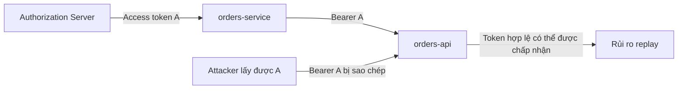
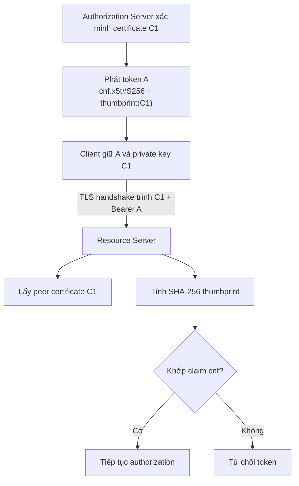
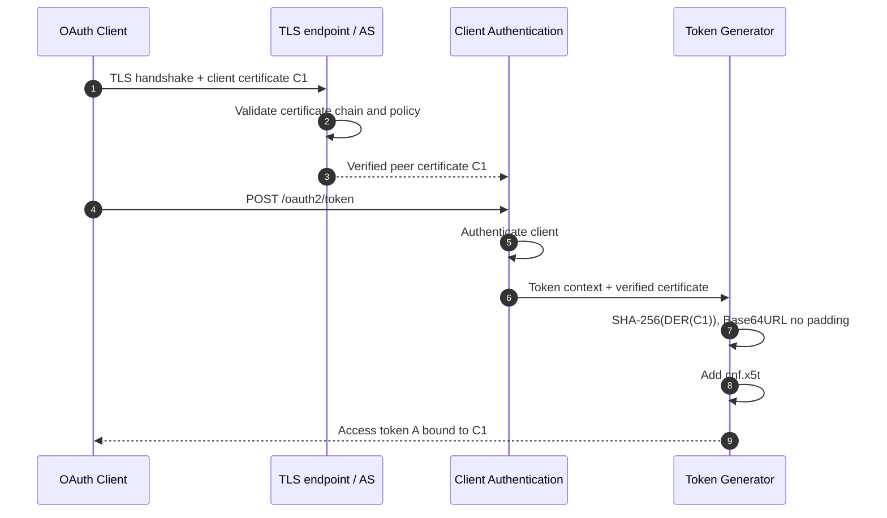
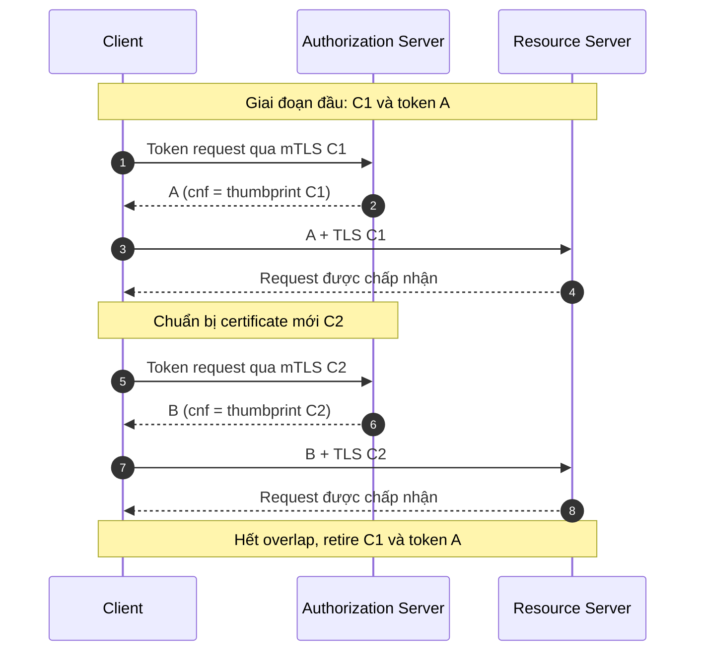

# Claim cnf.x5t#S256 và kiểm tra certificate binding

Trong OAuth 2.0, access token dạng Bearer thường có thể được sử dụng bởi bất kỳ bên nào nắm giữ token. Nếu token bị sao chép khỏi log, bộ nhớ hoặc một máy client bị xâm nhập, kẻ tấn công có thể gửi token đó tới Resource Server trong thời gian token còn hiệu lực.

**Mutual TLS certificate-bound access token** giảm rủi ro này bằng cách ràng buộc access token với chứng thư X.509 mà client đã trình bày trong kết nối TLS. Authorization Server ghi dấu vân tay chứng thư vào claim **`cnf.x5t#S256`**. Khi client gọi Resource Server, client phải thiết lập kết nối TLS bằng chính chứng thư tương ứng; Resource Server tính lại thumbprint từ chứng thư peer và so sánh với claim đã được xác minh trong token.

Claim `cnf` là một **confirmation claim**: nó mô tả bằng chứng khóa/chứng thư mà bên trình token phải sở hữu. Với mTLS, member `x5t#S256` chứa SHA-256 thumbprint của chứng thư X.509. Nó không phải tên subject DN, serial number, thumbprint của public key riêng lẻ hay chuỗi PEM được hash tùy ý.

Bài học thuộc chương **mTLS** của module **SPRING_SECURITY_OAUTH2_OIDC_AUTHORIZATION_SERVER**, với mục tiêu học cách thiết kế, cấu hình, bảo mật, kiểm thử và vận hành OAuth 2.0/OpenID Connect Authorization Server bằng Spring Security và Spring Authorization Server trong Spring Boot.

Sau bài học, bạn có thể:

- Giải thích ý nghĩa của `cnf` và `x5t#S256` theo RFC 8705.
- Tính đúng certificate thumbprint từ DER-encoded X.509 certificate.
- Phân biệt mTLS client authentication với certificate-bound access token.
- Phát hành JWT hoặc reference token có certificate binding từ chứng thư TLS đã được xác thực.
- Kiểm tra chứng thư client tại Resource Server và so sánh thumbprint với token claim/introspection metadata.
- Xác định ranh giới tin cậy khi TLS kết thúc tại reverse proxy hoặc API gateway.
- Thiết kế rotation chứng thư, xử lý token cũ và kiểm thử trường hợp thiếu chứng thư, sai chứng thư hoặc token bị đánh cắp.

## 1. Vấn đề: bearer token có thể bị dùng lại khi bị đánh cắp

Giả sử ứng dụng `orders-service` được cấp access token A để gọi `orders-api`. Nếu token A là bearer token thông thường, Resource Server chỉ cần token hợp lệ; người gửi không cần chứng minh đang giữ một khóa hay chứng thư cụ thể.



Nếu token được ràng buộc với certificate C1, request chỉ được chấp nhận khi kết nối TLS tới API trình đúng certificate C1 và token chứa thumbprint tương ứng:



Một attacker chỉ lấy được chuỗi token A nhưng không có private key tương ứng với C1 sẽ không thể hoàn tất TLS client authentication bằng chứng thư đó. Vì vậy token bị đánh cắp khó sử dụng lại ở một kết nối khác.

**Certificate binding không loại bỏ mọi rủi ro:** nếu attacker chiếm được cả token và private key, kiểm soát tiến trình client, hoặc khai thác một proxy được tin cậy để giả mạo thông tin peer certificate, họ vẫn có thể sử dụng token. mTLS bổ sung bằng chứng possession vào bearer-token flow; nó không thay thế xác thực người dùng, authorization theo scope/audience, bảo vệ endpoint hay quản lý khóa.

## 2. Hai khái niệm cần phân biệt: mTLS client authentication và certificate-bound token

Cùng sử dụng chứng thư client trong TLS nhưng hai cơ chế có mục đích khác nhau.

| Cơ chế | Được kiểm tra ở đâu? | Câu hỏi được trả lời |
| --- | --- | --- |
| **mTLS client authentication** | Khi client kết nối tới Authorization Server/token endpoint. | Client nào đang gọi token endpoint và chứng thư có được AS tin cho client đó không? |
| **Certificate-bound access token** | Khi client trình access token tại Resource Server. | Bên đang sử dụng access token có trình đúng certificate đã ràng buộc với token không? |

Hai cơ chế có thể được dùng cùng nhau. Ví dụ confidential client dùng `tls_client_auth` tại token endpoint, AS xác minh certificate C1, sau đó phát access token A có `cnf.x5t#S256` tương ứng C1. Khi gọi API, client lại phải trình C1 trong TLS handshake.

Nhưng chúng không đồng nhất:

- Một client có thể được xác thực bằng mTLS tại token endpoint mà token phát ra **không được ràng buộc** với certificate nếu policy/implementation không thực hiện binding.
- Một access token có thể được ràng buộc với certificate được trình tại token request dù client authentication ở token endpoint sử dụng phương thức khác, nếu AS có cơ chế đáng tin để nhận diện certificate TLS và policy cho phép.
- Certificate binding phải được kiểm tra tại Resource Server. Chỉ xác thực client tại AS không đủ để ngăn token bị dùng lại ở API.
- Subject DN được đăng ký cho client có thể không đổi khi certificate được cấp lại. Thumbprint certificate mới vẫn khác thumbprint cũ.

**Quy tắc thiết kế:** xác định riêng chính sách xác thực client ở AS và chính sách proof-of-possession ở Resource Server. Không suy ra rằng một bên đã dùng mTLS thì toàn bộ access token tự động được certificate-bound.

## 3. Claim cnf.x5t#S256 theo RFC 8705

RFC 8705 định nghĩa cách ràng buộc OAuth access token với client certificate. Với JWT access token, confirmation claim có cấu trúc:

```json
{
  "iss": "https://login.example.com",
  "sub": "orders-service",
  "aud": ["orders-api"],
  "scope": "orders.read",
  "cnf": {
    "x5t#S256": "<BASE64URL_SHA256_CERT_THUMBPRINT>"
  },
  "exp": 1980000300
}
```

Đây là payload minh họa, không phải token đã ký. Claim `cnf` là JSON object; `x5t#S256` là member mô tả certificate thumbprint. Tên member có ký tự `#` và phân biệt chính xác; không đổi thành `x5t`, `x5t-S256` hoặc `x5t#sha256`.

### 3.1. Cách tính thumbprint

Giá trị `x5t#S256` được tính bằng:

1. Lấy chứng thư X.509 client dạng DER (binary certificate encoding).
2. Tính SHA-256 trên toàn bộ byte DER.
3. Mã hóa digest bằng Base64URL.
4. Bỏ padding `=` ở cuối chuỗi.

Công thức:

```text
thumbprint = BASE64URL_NOPAD(SHA-256(certificate.getEncoded()))
```

Không hash chuỗi PEM, subject DN, serial number, public key bytes hoặc một certificate chain được nối tùy ý. Thumbprint định danh **toàn bộ certificate**. Cùng một public key nhưng certificate được cấp lại với serial/validity/issuer khác sẽ có thumbprint khác nếu DER encoding khác.

### 3.2. Ví dụ tính thumbprint bằng Java

```java
package com.example.security.mtls;

import java.security.MessageDigest;
import java.security.NoSuchAlgorithmException;
import java.security.cert.CertificateEncodingException;
import java.security.cert.X509Certificate;
import java.util.Base64;

public final class CertificateThumbprints {

    private CertificateThumbprints() {
    }

    public static String x5tS256(X509Certificate certificate) {
        try {
            byte[] der = certificate.getEncoded();
            byte[] digest = MessageDigest.getInstance("SHA-256")
                .digest(der);

            return Base64.getUrlEncoder()
                .withoutPadding()
                .encodeToString(digest);
        } catch (CertificateEncodingException
                 | NoSuchAlgorithmException ex) {
            throw new IllegalStateException(
                "Cannot calculate X.509 certificate thumbprint", ex);
        }
    }
}
```

SHA-256 được Java runtime hỗ trợ theo chuẩn. `certificate.getEncoded()` trả encoding DER của certificate. Kết quả Base64URL không padding thường có 43 ký tự cho digest 256 bit.

Không log certificate/private key chỉ để debug thumbprint. Nếu cần đối chiếu trong môi trường vận hành, có thể log `kid` nội bộ, certificate serial/fingerprint đã được quản trị hoặc correlation ID theo chính sách dữ liệu.

### 3.3. Ví dụ tính thumbprint bằng OpenSSL

Trong môi trường shell có OpenSSL, có thể tính từ file certificate PEM bằng pipeline chuyển sang DER rồi SHA-256/Base64URL. Cú pháp cụ thể có khác biệt giữa GNU/Linux và PowerShell; ví dụ Bash:

```bash
openssl x509 -in client-cert.pem -outform DER \
  | openssl dgst -sha256 -binary \
  | openssl base64 -A \
  | tr '+/' '-_' \
  | tr -d '='
```

Đầu vào là **certificate public**, không phải private key. Lệnh chỉ minh họa phép tính thumbprint; trong ứng dụng nên dùng API X.509 thay vì gọi tiến trình shell cho mỗi request.

## 4. Certificate binding được tạo ở Authorization Server

AS chỉ được gắn thumbprint của certificate mà nó đã nhận và xác minh từ TLS connection đáng tin cậy. Không lấy `x5t#S256` do client tự gửi trong form hoặc header rồi sao chép vào token.

Quy trình phát hành khái niệm:

1. Client thiết lập TLS tới token endpoint và trình client certificate nếu kết nối yêu cầu.
2. TLS stack xác minh chain, validity, key usage, trust anchor và các policy certificate cần thiết.
3. AS xác định certificate peer thực sự của connection.
4. Client authentication được thực hiện theo cấu hình, ví dụ `tls_client_auth`; hoặc AS áp dụng policy khác nhưng vẫn có bằng chứng TLS certificate đáng tin.
5. Khi phát access token, AS tính thumbprint từ certificate đã xác minh.
6. AS thêm `cnf: { "x5t#S256": ... }` vào token claims/metadata.
7. Client nhận token và dùng đúng certificate/private key tương ứng khi gọi Resource Server.



**Điểm nhạy cảm là nguồn certificate:** đối tượng dùng để tính thumbprint phải là certificate đã được TLS layer xác thực. Một HTTP header như `X-Client-Cert` do client Internet tự gửi không phải bằng chứng TLS peer.

### 4.1. Nếu TLS kết thúc tại reverse proxy

Trong production, TLS có thể kết thúc tại load balancer/API gateway trước khi request tới Spring Boot. Khi đó servlet container phía sau có thể không trực tiếp nhìn thấy certificate client ban đầu.

Có hai lựa chọn:

- **TLS passthrough/termination tại ứng dụng:** Spring/Tomcat nhận TLS handshake và có thể đọc peer certificate từ servlet request attribute.
- **TLS termination tại proxy tin cậy:** proxy xác thực client certificate, loại bỏ mọi header certificate do client gửi từ Internet, rồi truyền thông tin certificate đã xác minh tới ứng dụng qua một kênh proxy-to-app được bảo vệ. Ứng dụng chỉ tin header đó khi request chắc chắn đến từ proxy đã xác thực.

Không được bật trust một header forwarded certificate trên endpoint có thể truy cập trực tiếp từ Internet. Nếu attacker tự đặt header, họ có thể yêu cầu AS phát token ràng buộc với certificate giả.

### 4.2. Không dùng subject DN thay cho thumbprint

Một client registration có thể kiểm tra certificate subject DN như `CN=orders-service,O=Example`. Đây là thông tin hữu ích để nhận diện client theo policy, nhưng không chứng minh đó là đúng certificate đã ràng buộc với access token.

Hai certificate khác nhau có thể cùng subject DN nhưng có thumbprint khác. Certificate binding phải dùng `x5t#S256` tính từ certificate cụ thể, không chỉ so sánh DN.

## 5. Cấu hình certificate-bound access token trong Spring Authorization Server

Trong Spring Authorization Server **1.3 trở lên**, certificate-bound access token có hỗ trợ cấu hình sẵn qua `TokenSettings.x509CertificateBoundAccessTokens(true)`. Khi client dùng `tls_client_auth` hoặc `self_signed_tls_client_auth`, AS có thể lấy certificate đã được xác minh trong quá trình client authentication, tính SHA-256 thumbprint và gắn nó vào access token dưới claim `cnf.x5t#S256`. Đây là lựa chọn ưu tiên cho use case chuẩn.

`OAuth2TokenCustomizer` chỉ cần thiết khi bạn có yêu cầu bổ sung hoặc quy trình phát hành riêng mà cấu hình built-in không đáp ứng, hoặc đang làm việc với phiên bản cũ chưa có setting này. Nếu tự tùy biến, phần quan trọng vẫn là lấy đúng certificate từ client authentication/TLS context đã xác minh, không lấy giá trị thumbprint do client tự khai.

### 5.1. Bật certificate-bound access token bằng TokenSettings

Với Spring Authorization Server 1.3+, cấu hình `x509CertificateBoundAccessTokens(true)` trên `TokenSettings` của client. Phương thức client authentication phải là `tls_client_auth` hoặc `self_signed_tls_client_auth` để AS có certificate từ quá trình xác thực client.

```java
RegisteredClient mtlsClient = RegisteredClient
    .withId("mtls-client-internal-id")
    .clientId("mtls-client")
    .clientAuthenticationMethod(ClientAuthenticationMethod.TLS_CLIENT_AUTH)
    .authorizationGrantType(AuthorizationGrantType.CLIENT_CREDENTIALS)
    .scope("orders.read")
    .clientSettings(ClientSettings.builder()
        .x509CertificateSubjectDN(
            "CN=mtls-client,OU=Platform,O=Example,C=VN")
        .build())
    .tokenSettings(TokenSettings.builder()
        .x509CertificateBoundAccessTokens(true)
        .accessTokenTimeToLive(Duration.ofMinutes(5))
        .build())
    .build();
```

Trong cấu hình này:

- `ClientAuthenticationMethod.TLS_CLIENT_AUTH` yêu cầu client xác thực tại token endpoint bằng certificate theo PKI mTLS.
- `x509CertificateSubjectDN(...)` khai báo subject DN mà AS mong đợi cho client certificate; nó là bước xác thực client, không phải thumbprint binding.
- `x509CertificateBoundAccessTokens(true)` yêu cầu AS ràng buộc access token với certificate đã nhận trong client authentication. SAS tính SHA-256 thumbprint và gắn vào confirmation claim.
- `accessTokenTimeToLive(...)` giới hạn thời gian token có thể được dùng; binding không thay thế expiration.
- Setting nằm trên từng `RegisteredClient`, vì vậy chỉ các client được bật policy mới yêu cầu certificate-bound access token.

Nếu dùng `SELF_SIGNED_TLS_CLIENT_AUTH`, client certificate được xác minh theo JWK Set/client registration tương ứng; cấu hình cụ thể khác PKI mTLS. Kiểm tra phiên bản và policy certificate verifier của ứng dụng trước khi bật.

**Đây là cơ chế built-in nên dùng cho luồng chuẩn.** Không thêm customizer khác để ghi đè `cnf` cùng lúc nếu không có lý do rõ ràng; hai nơi cùng ghi claim có thể gây xung đột hoặc tạo thumbprint sai.


### 5.2. Chuẩn bị customizer riêng khi không dùng được built-in

Định nghĩa một abstraction ứng dụng để lấy thumbprint từ client authentication context đã xác minh:

```java
package com.example.authserver.mtls;

import java.util.Optional;

import org.springframework.security.oauth2.core.AuthorizationGrantType;
import org.springframework.security.oauth2.server.authorization.client.RegisteredClient;

public interface VerifiedClientCertificateResolver {

    Optional<String> resolveX5tS256(
        RegisteredClient registeredClient,
        AuthorizationGrantType grantType
    );
}
```

Đây là interface do ứng dụng định nghĩa, không phải API có sẵn của Spring Authorization Server. Implementation phải lấy certificate từ TLS peer context hoặc dữ liệu đã được một proxy tin cậy xác thực. Không triển khai bằng cách đọc một request parameter tùy ý. Resolver thường cần một request-scoped hoặc request-bound context để lấy peer certificate của đúng token request; không giả định `JwtEncodingContext.getPrincipal()` luôn là đối tượng client authentication hay chứa certificate. Nếu hệ thống xử lý token generation bất đồng bộ, phải truyền certificate context an toàn theo request thay vì dùng ThreadLocal có thể rò rỉ giữa request.

### 5.3. JWT customizer cho custom issuance

Ví dụ customizer chỉ thêm binding cho access token và chỉ với client được policy yêu cầu certificate-bound token:

```java
package com.example.authserver.mtls;

import java.util.Map;

import org.springframework.context.annotation.Bean;
import org.springframework.context.annotation.Configuration;
import org.springframework.security.oauth2.server.authorization.OAuth2TokenType;
import org.springframework.security.oauth2.server.authorization.token.JwtEncodingContext;
import org.springframework.security.oauth2.server.authorization.token.OAuth2TokenCustomizer;

@Configuration(proxyBeanMethods = false)
public class MtlsBoundJwtCustomizerConfig {

    @Bean
    OAuth2TokenCustomizer<JwtEncodingContext> mtlsJwtCustomizer(
            VerifiedClientCertificateResolver certificateResolver,
            CertificateBindingPolicy bindingPolicy) {

        return context -> {
            if (!OAuth2TokenType.ACCESS_TOKEN.equals(
                    context.getTokenType())) {
                return;
            }

            if (!bindingPolicy.requiresCertificateBinding(
                    context.getRegisteredClient(),
                    context.getAuthorizationGrantType())) {
                return;
            }

            String thumbprint = certificateResolver.resolveX5tS256(
                    context.getRegisteredClient(),
                    context.getAuthorizationGrantType()
                )
                .orElseThrow(() -> new IllegalStateException(
                    "Required verified client certificate is missing"));

            context.getClaims().claim(
                "cnf",
                Map.of("x5t#S256", thumbprint)
            );
        };
    }
}
```

`CertificateBindingPolicy` cũng là service nghiệp vụ của ứng dụng. Cách nhận diện client authentication object và truy cập TLS certificate phụ thuộc phiên bản Spring Authorization Server, phương thức client authentication và cách TLS được terminate. Hãy triển khai resolver theo đúng hạ tầng thực tế; ví dụ trên minh họa **điểm gắn claim**, không tuyên bố certificate tự động có sẵn trong mọi `context.getPrincipal()`.

Nếu binding là điều kiện bắt buộc mà resolver không tìm thấy certificate, phải **fail closed**. Không phát token thiếu `cnf` rồi hy vọng Resource Server tự suy ra certificate.

### 5.4. Đừng gắn cnf vào ID token ngoài ý muốn

`JwtGenerator` có thể tạo nhiều loại JWT tùy grant và cấu hình OIDC. Nếu customizer được gọi cho ID token, không nên vô tình gắn claim certificate-bound access token vào ID token. Điều kiện `OAuth2TokenType.ACCESS_TOKEN` giới hạn logic vào access token.

Không thêm `cnf` vào mọi token chỉ vì client đã từng dùng mTLS. Policy cần xác định token nào thực sự bị ràng buộc và Resource Server nào sẽ kiểm tra nó.

### 5.5. Xác minh certificate của client theo policy

Với `tls_client_auth` kiểu PKI, Spring Authorization Server sử dụng `X509ClientCertificateAuthenticationProvider` để xác thực certificate chain nhận được trong TLS handshake. Certificate verifier mặc định so sánh subject DN của certificate với giá trị `ClientSettings.x509CertificateSubjectDN` đã đăng ký.

Nếu hệ thống cần kiểm tra thêm thuộc tính khác, chẳng hạn Subject Alternative Name (SAN), có thể tùy biến certificate verifier thông qua provider. Việc tùy biến này thuộc bước **client authentication**. Nó không thay thế setting `TokenSettings.x509CertificateBoundAccessTokens(true)` chịu trách nhiệm ràng buộc access token với certificate.

Với `self_signed_tls_client_auth`, AS xác minh certificate theo JWK Set URL đã đăng ký cho client và certificate trong JWK có thể được biểu diễn qua `x5c`. Chọn PKI mTLS hay self-signed mTLS theo mô hình quản trị CA/key của tổ chức.


## 6. Reference access token và introspection

Với access token dạng reference/opaque, Resource Server không đọc JWT claims trực tiếp. Authorization Server cần lưu certificate confirmation metadata cùng trạng thái token và trả nó qua introspection khi được phép.

Khi dùng `TokenSettings.x509CertificateBoundAccessTokens(true)`, hãy kiểm tra integration test của phiên bản Spring Authorization Server đang chạy để xác nhận `cnf` được lưu và trả trong introspection response cho reference token. Resource Server opaque-token chỉ có thể kiểm tra binding nếu nested `cnf.x5t#S256` được giữ trong attributes từ introspection.

`OAuth2TokenCustomizer<OAuth2TokenClaimsContext>` là extension point cho trường hợp ứng dụng tự quản lý reference token generation hoặc cần custom claims riêng. Không thêm customizer thứ hai chỉ để lặp lại chức năng certificate binding mà setting built-in đã thực hiện. Ví dụ sau là mẫu fallback cho custom issuance:

```java
package com.example.authserver.mtls;

import java.util.Map;

import org.springframework.context.annotation.Bean;
import org.springframework.context.annotation.Configuration;
import org.springframework.security.oauth2.server.authorization.OAuth2TokenType;
import org.springframework.security.oauth2.server.authorization.token.OAuth2TokenClaimsContext;
import org.springframework.security.oauth2.server.authorization.token.OAuth2TokenCustomizer;

@Configuration(proxyBeanMethods = false)
public class MtlsBoundReferenceCustomizerConfig {

    @Bean
    OAuth2TokenCustomizer<OAuth2TokenClaimsContext>
            mtlsReferenceCustomizer(
                VerifiedClientCertificateResolver certificateResolver,
                CertificateBindingPolicy bindingPolicy) {

        return context -> {
            if (!OAuth2TokenType.ACCESS_TOKEN.equals(
                    context.getTokenType())) {
                return;
            }

            if (!bindingPolicy.requiresCertificateBinding(
                    context.getRegisteredClient(),
                    context.getAuthorizationGrantType())) {
                return;
            }

            String thumbprint = certificateResolver.resolveX5tS256(
                    context.getRegisteredClient(),
                    context.getAuthorizationGrantType()
                )
                .orElseThrow(() -> new IllegalStateException(
                    "Required verified client certificate is missing"));

            context.getClaims().claims(claims ->
                claims.put("cnf", Map.of("x5t#S256", thumbprint))
            );
        };
    }
}
```

Cần xác minh bằng integration test rằng phiên bản Spring Authorization Server đang dùng lưu custom claim và trả đúng `cnf` trong introspection response. Không giả định việc thêm claim vào builder tự động bảo đảm mọi cấu hình persistence/serialization đều giữ được nó.

Introspection response minh họa:

```json
{
  "active": true,
  "client_id": "orders-service",
  "scope": "orders.read",
  "token_type": "Bearer",
  "cnf": {
    "x5t#S256": "<BASE64URL_SHA256_CERT_THUMBPRINT>"
  }
}
```

Resource Server opaque-token integration phải lấy được `cnf` attribute từ introspection principal và thực hiện certificate comparison như với JWT. Nếu custom introspector chuyển đổi hoặc loại bỏ nested claim, cần điều chỉnh mapping để giữ cấu trúc `cnf`.

## 7. Resource Server kiểm tra certificate binding

Khi request tới Resource Server, cần kiểm tra đồng thời:

1. TLS handshake thành công và certificate peer được trust theo policy.
2. Access token hợp lệ: chữ ký/introspection, issuer, expiration, audience và scope.
3. Token có claim `cnf.x5t#S256` nếu endpoint yêu cầu certificate-bound token.
4. Thumbprint của peer certificate trên **chính kết nối TLS đó** khớp với giá trị trong token.
5. Authorization nghiệp vụ vẫn cho phép principal thực hiện hành động trên tài nguyên.

Nếu token không có `cnf`, endpoint yêu cầu mTLS-bound token phải từ chối. Nếu token có `cnf` nhưng request không trình certificate, cũng phải từ chối. Nếu certificate có mặt nhưng thumbprint khác, không được coi token là bearer thông thường để fallback.

### 7.1. Hàm kiểm tra thumbprint với JWT

Ví dụ service kiểm tra claim:

```java
package com.example.resourceserver.mtls;

import java.nio.charset.StandardCharsets;
import java.security.MessageDigest;
import java.security.cert.X509Certificate;
import java.util.Map;

import org.springframework.security.oauth2.jwt.Jwt;
import org.springframework.security.oauth2.server.resource.InvalidBearerTokenException;

public final class CertificateBindingVerifier {

    public void verify(Jwt jwt, X509Certificate peerCertificate) {
        Map<String, Object> cnf = jwt.getClaimAsMap("cnf");
        Object value = cnf == null ? null : cnf.get("x5t#S256");

        if (!(value instanceof String expected) || expected.isBlank()) {
            throw new InvalidBearerTokenException(
                "Certificate confirmation claim is missing");
        }

        if (peerCertificate == null) {
            throw new InvalidBearerTokenException(
                "Client certificate is required");
        }

        String actual =
            CertificateThumbprints.x5tS256(peerCertificate);

        boolean matches = MessageDigest.isEqual(
            expected.getBytes(StandardCharsets.US_ASCII),
            actual.getBytes(StandardCharsets.US_ASCII)
        );

        if (!matches) {
            throw new InvalidBearerTokenException(
                "Client certificate does not match access token");
        }
    }
}
```

`CertificateThumbprints` là utility tính thumbprint đã trình bày ở mục 3. So sánh bằng `MessageDigest.isEqual` giúp tránh một số khác biệt về timing khi so sánh chuỗi. Thumbprint vốn không phải secret, nhưng phép so sánh này vẫn phù hợp.

Đoạn này minh họa verifier cho JWT. Với opaque token, thay bước lấy `cnf` từ `Jwt` bằng attributes từ `OAuth2AuthenticatedPrincipal` sau introspection; thuật toán so sánh certificate thumbprint giữ nguyên.

### 7.2. Lấy peer certificate trong servlet application

Khi TLS kết thúc trực tiếp tại Servlet container, Servlet API cung cấp certificate chain qua request attribute:

```java
X509Certificate[] chain = (X509Certificate[]) request.getAttribute(
    "jakarta.servlet.request.X509Certificate");

X509Certificate peerCertificate =
    chain != null && chain.length > 0 ? chain[0] : null;
```

Phần tử đầu tiên là certificate của peer (client certificate leaf) trong chain theo servlet container. Xác minh chính xác attribute name theo phiên bản Jakarta Servlet/container đang dùng. Nếu TLS kết thúc ở proxy và container không nhận client certificate gốc, attribute này có thể không tồn tại; khi đó cần cơ chế forwarding certificate từ proxy đã được xác thực.

Không lấy certificate từ một request header do client tự gửi. Nếu gateway forward PEM hoặc fingerprint, gateway phải xóa header cùng tên do Internet gửi vào, xác thực client certificate ở TLS layer, rồi truyền metadata đã kiểm chứng qua kết nối proxy-to-app được bảo vệ.

### 7.3. Gắn verifier sau bearer authentication

Certificate-binding check cần chạy **sau khi access token đã được xác minh và Authentication đã được tạo**, nhưng trước khi controller xử lý request. Trong Spring Security, có thể triển khai một filter riêng và đặt sau `BearerTokenAuthenticationFilter`:

```java
http.addFilterAfter(
    certificateBindingFilter,
    BearerTokenAuthenticationFilter.class
);
```

Filter cần:

- Chỉ áp dụng cho các route/API yêu cầu certificate-bound access token.
- Lấy JWT/opaque principal đã được authentication filter xác minh.
- Lấy peer certificate từ TLS connection hoặc proxy metadata đã xác thực.
- Kiểm tra `cnf.x5t#S256` và từ chối nếu thiếu/mismatch.
- Trả lỗi authentication phù hợp, thường là `401 invalid_token`, không cho request đi tiếp.
- Không ghi raw access token, certificate private key hoặc toàn bộ certificate vào log.

Đây là điểm tích hợp kiến trúc; cách lấy authentication principal và cấu hình exception handling cần khớp với loại token, servlet stack và phiên bản Spring Security cụ thể.

## 8. TLS termination và proxy là ranh giới bảo mật trọng yếu

Certificate binding chỉ đáng tin nếu Resource Server biết certificate nào thực sự được client trình trong TLS handshake. Khi có load balancer, ingress controller hoặc API gateway, phải xác định rõ bên nào kết thúc TLS và bên nào chịu trách nhiệm xác thực certificate.

| Kiến trúc | Nguồn certificate Resource Server có thể tin |
| --- | --- |
| Client TLS trực tiếp tới Spring/Tomcat | Peer certificate do TLS connector/container cung cấp. |
| Client TLS tới gateway, gateway gọi app bằng TLS riêng | Metadata certificate do gateway xác minh và forward qua kênh gateway-to-app được bảo vệ. |
| Client TLS tới gateway nhưng app có thể truy cập trực tiếp từ Internet | Không được tin header certificate forwarded nếu không chặn đường truy cập trực tiếp và xác thực gateway. |
| Gateway forward header nhưng không strip header đầu vào | Không an toàn: attacker có thể tự gửi header giả. |
| Nhiều proxy trong chuỗi | Phải xác định proxy nào được trust, thứ tự hop và nơi chuẩn hóa certificate metadata. |

Một thiết kế proxy an toàn thường cần:

1. Gateway yêu cầu và xác minh client certificate bằng trust store, chain validation và policy.
2. Gateway loại bỏ tất cả header certificate do request bên ngoài cung cấp.
3. Gateway tạo header nội bộ chứa certificate hoặc thumbprint đã xác minh.
4. Gateway gọi Resource Server qua mTLS nội bộ hoặc mạng được giới hạn truy cập.
5. Resource Server chỉ chấp nhận metadata certificate khi peer connection thực sự là gateway tin cậy.
6. Có test chứng minh request đi thẳng tới app không thể giả mạo certificate header.

Nếu có thể, terminate mTLS ngay tại Resource Server giúp ranh giới kiểm tra rõ hơn. Nếu dùng proxy, hãy xem certificate forwarding là một giao thức nội bộ có xác thực, không phải một header HTTP thông thường.

## 9. Kiểm tra certificate chain và trust policy

Thumbprint match **không thay thế certificate validation**. Trước khi so sánh, TLS stack phải xác minh certificate được trình có thể tin theo trust store và policy của hệ thống.

Các kiểm tra thường gồm:

- Certificate chain dẫn tới trust anchor được cấu hình.
- Certificate còn trong validity period (`notBefore`/`notAfter`).
- Key Usage và Extended Key Usage phù hợp vai trò client authentication.
- Certificate không bị thu hồi theo CRL/OCSP hoặc cơ chế revocation policy được triển khai.
- Host/service/client identity phù hợp với registration và policy.
- Thuật toán, độ dài khóa và CA nằm trong danh sách cho phép.
- Certificate được trình ở đúng TLS connection dùng cho API request.

**Thumbprint chỉ trả lời:** “Certificate này có đúng là certificate đã được ràng buộc với token không?” Nó không trả lời: “Certificate này có đáng tin không?” Hai câu hỏi phải được kiểm tra độc lập.

## 10. Certificate rotation và token đã được ràng buộc

Certificate-bound token gắn với **một certificate cụ thể**. Khi client thay certificate C1 bằng C2, token A có `cnf.x5t#S256` của C1 sẽ không khớp C2 dù C2 được cấp cho cùng client và cùng subject DN.

### 10.1. Rotation thông thường

Một kế hoạch rotation có overlap:

1. Đăng ký và tin cậy certificate C2.
2. Cấp quyền để client sử dụng C2 ở token endpoint và Resource Server.
3. Client xác thực bằng C2 và xin token mới B, trong đó `cnf` chứa thumbprint C2.
4. Client chuyển traffic sang B + C2.
5. Giữ C1 được tin cậy trong thời gian các token A còn hiệu lực nếu policy cho phép.
6. Khi token A hết hạn/revoke và client không còn sử dụng C1, loại bỏ C1 khỏi trust/registration.
7. Theo dõi lỗi mismatch để phát hiện client còn giữ token cũ hoặc rollout chưa đồng bộ.



### 10.2. Emergency certificate compromise

Nếu private key của C1 bị lộ:

- Ngừng cấp token mới ràng buộc với C1.
- Thu hồi certificate tại PKI/CA theo quy trình; cấu hình TLS endpoint kiểm tra revocation phù hợp.
- Loại bỏ C1 khỏi client trust/registration.
- Xem xét revoke các authorization/token đã ràng buộc với C1.
- Đảm bảo Resource Server không còn chấp nhận TLS handshake bằng C1.
- Cấp C2, phát token mới và theo dõi mismatch/replay.
- Điều tra việc token A và private key C1 có thể đã bị lấy cùng nhau.

Nếu Resource Server vẫn trust C1 và chỉ kiểm tra thumbprint, attacker giữ cả A và C1 có thể tiếp tục dùng token. Vì vậy cần **thu hồi certificate tại TLS trust layer** và quản lý trạng thái token theo yêu cầu, không chỉ chờ access token hết hạn.

### 10.3. Không thay certificate nhưng giữ token cũ

Khi certificate hết hạn, token bound với certificate đó không nên được chuyển sang certificate mới bằng cách thay claim tại Resource Server. Client cần xin token mới được AS ràng buộc với certificate C2. Không cho phép một certificate khác dùng token cũ chỉ vì subject DN/client ID giống nhau.

## 11. JWT và opaque token: nơi Resource Server đọc cnf

| Token format | Nơi lấy `cnf` | Việc Resource Server phải làm |
| --- | --- | --- |
| JWT access token | JWT claim đã được xác minh chữ ký và claims. | Đọc `cnf.x5t#S256`, lấy peer certificate và so sánh thumbprint. |
| Reference/opaque access token | Introspection response từ AS. | Đọc `cnf.x5t#S256` trong authenticated principal, lấy peer certificate và so sánh. |

Với JWT, không đọc claim trước khi decoder xác minh chữ ký. Với opaque token, không tự parse chuỗi token; chỉ tin metadata introspection khi kết nối và client authentication tới AS hợp lệ.

Trong cả hai trường hợp, `active=true` của introspection hoặc chữ ký JWT hợp lệ **chưa đủ** để cho request đi tiếp nếu route yêu cầu mTLS-bound token. Cần certificate comparison ở Resource Server.

Nếu hệ thống hỗ trợ cả bound token và unbound token, phải xác định policy theo route/resource/client. Một API có thể chỉ chấp nhận token có `cnf`; một API khác có thể chấp nhận cả hai loại. Không tự fallback từ bound-token mismatch sang bearer-token acceptance.

## 12. Lỗi thường gặp và cách xử lý

### 12.1. Token có cnf nhưng request không có client certificate

TLS connector/gateway chưa yêu cầu certificate, client không cấu hình keystore, hoặc certificate forwarding không hoạt động. Nếu route yêu cầu binding, từ chối request; sửa TLS configuration/client certificate provisioning. Không bỏ qua claim để request chạy tiếp.

### 12.2. Thumbprint mismatch dù cùng subject DN

Client đã được cấp certificate mới hoặc Resource Server nhận nhầm certificate ở proxy chain. So sánh thumbprint từ certificate DER thực tế, kiểm tra certificate leaf và xác minh token đang dùng được phát hành cho certificate nào. DN giống nhau không đồng nghĩa certificate giống nhau.

### 12.3. Claim cnf không xuất hiện trong JWT

Kiểm tra customizer có chạy cho `ACCESS_TOKEN`, client/grant có được binding policy yêu cầu, resolver có lấy được verified peer certificate và token generator có gắn customizer. Nếu bắt buộc mTLS, thiếu certificate phải làm phát hành thất bại.

### 12.4. Claim cnf không xuất hiện trong introspection

Kiểm tra reference-token customizer, persistence/serialization authorization state và response của introspection endpoint. Xác nhận phiên bản SAS lưu custom claims và mapping không loại bỏ nested `cnf` object.

### 12.5. Resource Server thấy header certificate nhưng vẫn bị từ chối

Kiểm tra header có bị proxy strip, servlet attribute có tồn tại, gateway có forward đúng leaf certificate, app có nhận request từ gateway tin cậy và certificate DER có được khôi phục chính xác không. Không hash chuỗi PEM hoặc URL-encoded header nếu cần hash DER.

### 12.6. Một số instance pass, instance khác fail

Có thể các instance dùng trust store, certificate revocation data, proxy configuration hoặc policy khác nhau. Đồng bộ trust anchors, CA bundle, certificate metadata, TLS settings và customizer. Kiểm tra load balancer có kết nối tới instance không nhận được forwarded certificate.

### 12.7. Client vẫn dùng token cũ sau khi đổi certificate

Token cũ gắn thumbprint C1; client đang gửi token A cùng C2. Client phải xin token mới B bằng C2 và cập nhật token store đồng bộ. Không đổi thumbprint trong token đã phát hành.

### 12.8. TLS handshake thành công nhưng certificate binding fail

TLS handshake chỉ xác minh certificate được chấp nhận theo TLS policy; nó không tự so sánh certificate với claim của access token. Cần giữ bước binding verifier riêng tại Resource Server.

## 13. Ma trận kiểm thử certificate binding

| Kịch bản | Kết quả mong đợi |
| --- | --- |
| Token A có cnf của C1, request trình C1 hợp lệ | Binding pass; tiếp tục kiểm tra scope/audience/resource. |
| Token A có cnf của C1, request trình C2 | Từ chối với invalid token/binding mismatch. |
| Token A có cnf, request không trình certificate | Từ chối trên route yêu cầu mTLS-bound token. |
| Token không có cnf trên route bắt buộc binding | Từ chối; không fallback thành bearer token. |
| JWT bị sửa cnf nhưng chữ ký không hợp lệ | JWT decoder từ chối trước khi dùng claim. |
| JWT có cnf đúng nhưng issuer sai | Từ chối issuer validation. |
| JWT có cnf đúng nhưng audience sai | Từ chối audience validation. |
| Certificate C1 hết hạn hoặc chain không tin cậy | TLS handshake/policy từ chối. |
| Certificate C1 bị revoke và revocation checking bật | TLS/client certificate validation từ chối theo policy. |
| Certificate C1 và C2 cùng subject DN nhưng khác DER | Thumbprint khác; token C1 không khớp C2. |
| Client gửi header X-Client-Cert giả | Bị strip/ignore; không ảnh hưởng certificate được xác minh. |
| Gateway forward certificate hợp lệ qua kênh tin cậy | Resource Server khôi phục đúng leaf certificate và so sánh. |
| App truy cập trực tiếp, bỏ qua gateway | Không thể giả mạo forwarded certificate; request bị chặn hoặc không có trust metadata. |
| Reference token introspection trả cnf của C1 | Resource Server so sánh C1 và chỉ chấp nhận match. |
| Introspection trả active=false | Từ chối token, không cần tiếp tục binding. |
| Client đổi từ C1 sang C2 và xin token mới | Token mới có thumbprint C2; request C2 được chấp nhận. |
| Token cũ A dùng với C1 trong overlap | Có thể được chấp nhận nếu token còn active và C1 vẫn được trust. |
| Token cũ A dùng với C2 | Từ chối do mismatch. |
| C1 compromise và bị loại khỏi trust | TLS handshake với C1 bị từ chối; token A không còn dùng được qua C1. |
| Token có cnf sai kiểu hoặc thiếu member x5t#S256 | Từ chối theo validation policy. |
| Certificate chain có nhiều cert | Dùng leaf peer certificate để tính thumbprint, không hash toàn bộ chain. |
| Nhiều instance dùng trust policy khác nhau | Test phát hiện kết quả không nhất quán trước rollout. |

### 13.1. Test tính thumbprint

Với một certificate test fixture:

1. Đọc certificate X.509 bằng `CertificateFactory`.
2. Tính thumbprint qua `CertificateThumbprints.x5tS256`.
3. Tính độc lập bằng OpenSSL từ cùng certificate DER.
4. Assert hai kết quả giống nhau.
5. Đổi sang certificate khác có cùng subject DN nhưng khác serial/key/validity; assert thumbprint khác.
6. Xác nhận output là Base64URL không padding và không có ký tự `+`, `/`, `=`.

### 13.2. Test integration end-to-end

Một test tích hợp nên:

1. Tạo test CA và client certificate C1/C2.
2. Cấu hình Authorization Server nhận mTLS và xác minh client certificate.
3. Xin access token A qua TLS bằng C1.
4. Giải mã JWT sau khi xác minh chữ ký hoặc introspect reference token; assert `cnf.x5t#S256` bằng thumbprint C1.
5. Gọi Resource Server bằng A + C1; assert thành công.
6. Gọi Resource Server bằng A + C2; assert bị từ chối.
7. Gọi bằng A nhưng không certificate; assert bị từ chối.
8. Xin token B qua C2; assert B + C2 thành công.
9. Thử certificate không tin cậy, hết hạn, revoked và forwarded header giả.
10. Kiểm tra log/trace không chứa private key hoặc raw token.

Không chỉ mock claim `cnf` trong controller test. Cần kiểm tra certificate thực tế đi qua TLS stack/proxy và token đi qua authentication filter.

## 14. Bài thực hành: ràng buộc token với certificate của orders-service

Một hệ thống có `orders-service` là confidential client và `orders-api` là Resource Server. AS xác thực client bằng mTLS. Access token có scope `orders.read` và TTL 5 phút.

Tình huống:

- `09:00`: client kết nối bằng certificate C1 và nhận token A.
- `09:01`: token A có `cnf.x5t#S256` bằng thumbprint C1.
- `09:02`: một tiến trình khác lấy được chuỗi token A nhưng chỉ có certificate C2.
- `09:03`: orders-service được cấp certificate C2 mới cùng subject DN với C1.
- `09:04`: client gửi token A qua TLS bằng C2.
- `09:05`: client xin token B qua TLS bằng C2.

Hãy trả lời:

1. Vì sao tiến trình có token A nhưng không có private key C1 không thể sử dụng token như bearer thông thường?
2. Token A + C2 ở `09:04` phải được Resource Server xử lý thế nào?
3. Vì sao cùng subject DN không làm thumbprint C1 và C2 bằng nhau?
4. Giá trị `x5t#S256` được tính từ DER certificate, PEM string hay public key?
5. Nếu AS xác thực client bằng mTLS nhưng không gắn `cnf`, token có certificate-bound không?
6. Resource Server cần lấy peer certificate từ đâu khi TLS kết thúc tại API gateway?
7. Vì sao không thể tin header `X-Client-Cert` do Internet gửi trực tiếp?
8. Khi token A bị lộ cùng private key C1, mTLS binding còn bảo vệ được gì?
9. Nếu C1 bị revoke, những lớp nào cần cập nhật để ngừng chấp nhận token A?
10. Nếu token là opaque, Resource Server lấy `cnf` bằng cách nào?
11. Khi certificate rotation, cần overlap và cập nhật token ra sao?
12. Vì sao chữ ký JWT hợp lệ chưa đủ để kết luận certificate binding pass?

**Gợi ý:** token A ràng buộc với certificate C1 cụ thể. C2 có cùng DN vẫn có thumbprint khác; client phải xin token mới B được gắn thumbprint C2. Resource Server kiểm tra certificate peer của TLS connection, claim đã được xác minh và các điều kiện authorization thông thường.

## 15. Checklist triển khai cnf.x5t#S256

- [ ] Đã xác định client nào và API nào bắt buộc certificate-bound access token.
- [ ] Đã phân biệt mTLS client authentication tại AS với certificate binding tại Resource Server.
- [ ] Với Spring Authorization Server 1.3+, client dùng `tls_client_auth`/`self_signed_tls_client_auth` được cấu hình `TokenSettings.x509CertificateBoundAccessTokens(true)` khi cần binding.
- [ ] AS lấy certificate từ TLS peer đã được xác minh hoặc metadata proxy có trust chain rõ ràng.
- [ ] Không lấy certificate thumbprint từ request parameter/header tự khai của client.
- [ ] Thumbprint được tính từ DER-encoded X.509 certificate bằng SHA-256 và Base64URL không padding.
- [ ] JWT/reference access token có claim `cnf` với member chính xác `x5t#S256`.
- [ ] Nếu binding bắt buộc mà không lấy được verified certificate, AS fail closed và không phát token unbound.
- [ ] JWT Resource Server xác minh chữ ký, issuer, audience, expiration và scope trước khi dùng claim.
- [ ] Opaque Resource Server introspect token qua endpoint được xác thực và giữ được nested `cnf` metadata.
- [ ] Resource Server lấy peer certificate từ TLS connection hoặc proxy đã xác thực và so sánh thumbprint.
- [ ] Token thiếu `cnf` hoặc certificate mismatch bị từ chối; không fallback sang bearer acceptance.
- [ ] TLS proxy strip header certificate do client gửi và chỉ forward metadata qua kênh tin cậy.
- [ ] Certificate chain, validity, key usage và revocation được kiểm tra độc lập với thumbprint matching.
- [ ] Certificate rotation phát token mới gắn C2; token cũ chỉ được dùng với C1 trong overlap nếu policy cho phép.
- [ ] Emergency compromise có quy trình dừng cấp token, revoke certificate, cập nhật trust/cache và revoke token liên quan.
- [ ] Có test cùng certificate, certificate khác, thiếu certificate, sai chain, proxy header giả, JWT và opaque token.
- [ ] Logs không chứa private key, raw token hoặc certificate material không cần thiết.
- [ ] Mọi Resource Server instance áp dụng cùng certificate trust và binding policy.

**Ghi nhớ:** `cnf.x5t#S256` ràng buộc access token với **một X.509 client certificate cụ thể** bằng SHA-256 thumbprint của DER certificate. Resource Server phải so sánh claim đã được xác minh với certificate peer trên TLS connection. mTLS client authentication, certificate chain validation và certificate-bound token verification là các bước liên quan nhưng có trách nhiệm khác nhau; chỉ khi chúng được kết hợp đúng, token bị đánh cắp riêng lẻ mới khó bị replay.

**Tài liệu tham khảo:**

- [RFC 8705 — OAuth 2.0 Mutual-TLS Client Authentication and Certificate-Bound Access Tokens](https://www.rfc-editor.org/rfc/rfc8705.html): client authentication bằng mTLS, certificate-bound access token và `x5t#S256`.
- [RFC 7800 — Proof-of-Possession Key Semantics for JWTs](https://www.rfc-editor.org/rfc/rfc7800.html): confirmation claim `cnf` và proof-of-possession semantics.
- [RFC 7519 — JSON Web Token (JWT)](https://www.rfc-editor.org/rfc/rfc7519.html): cấu trúc JWT và claims.
- [RFC 7662 — OAuth 2.0 Token Introspection](https://www.rfc-editor.org/rfc/rfc7662.html): introspection response và trạng thái token.
- [RFC 5280 — Internet X.509 Public Key Infrastructure Certificate and CRL Profile](https://www.rfc-editor.org/rfc/rfc5280.html): certificate path validation và CRL.
- [Spring Authorization Server — Core Model and Components](https://docs.spring.io/spring-authorization-server/reference/core-model-components.html): RegisteredClient, token generator và authorization state.
- [Spring Authorization Server — Configuration Model](https://docs.spring.io/spring-authorization-server/reference/configuration-model.html): mTLS client authentication và certificate-bound access token bằng `TokenSettings.x509CertificateBoundAccessTokens(true)`.
- [Spring Authorization Server — TokenSettings API](https://docs.spring.io/spring-authorization-server/reference/api/java/org/springframework/security/oauth2/server/authorization/settings/TokenSettings.Builder.html): API và phiên bản hỗ trợ cấu hình certificate-bound access token.
- [Spring Authorization Server — Protocol Endpoints](https://docs.spring.io/spring-authorization-server/reference/protocol-endpoints.html): token endpoint và custom token generation.
- [Spring Security — OAuth2 Resource Server](https://docs.spring.io/spring-security/reference/servlet/oauth2/resource-server/index.html): xác minh JWT/opaque token và tích hợp filter chain.
- [Jakarta Servlet Specification](https://jakarta.ee/specifications/servlet/): request attributes và client certificate exposure khi TLS kết thúc tại servlet container.


