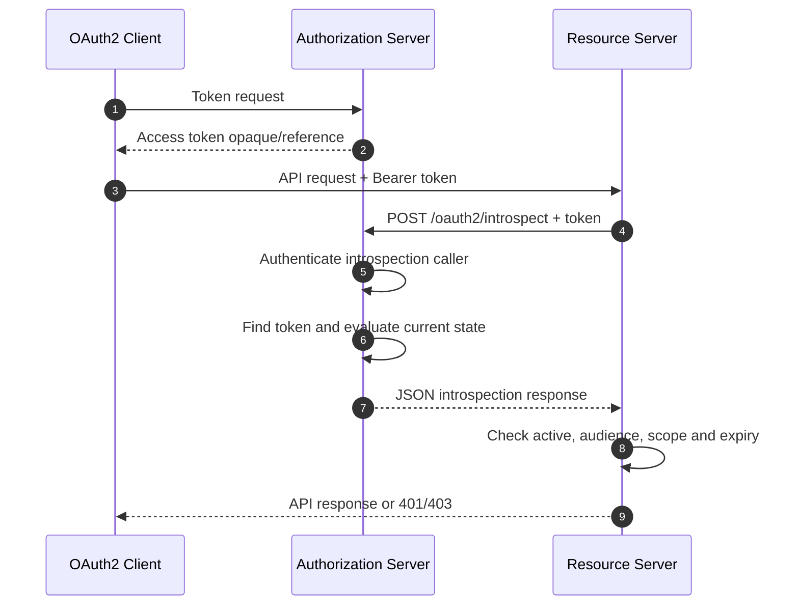
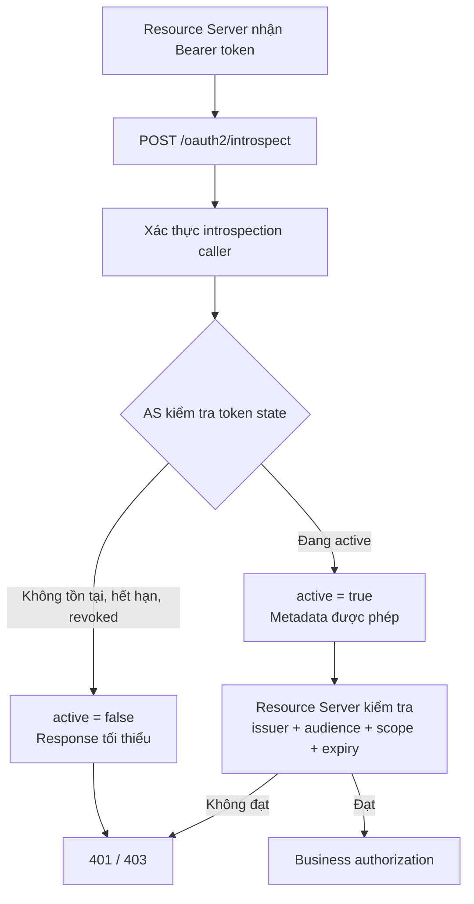

# Ý nghĩa của active và các thông tin trả về

## 1. Mục tiêu và bối cảnh

Trong chương **Introspection** của module **SPRING_SECURITY_OAUTH2_OIDC_AUTHORIZATION_SERVER**, OAuth 2.0 Token Introspection theo **RFC 7662** cho phép một protected resource hỏi Authorization Server (AS) xem token có đang hoạt động hay không và lấy metadata cần thiết để quyết định có chấp nhận request hay không.

Với **Spring Security**, **Spring Authorization Server (SAS)** và **Spring Boot**, introspection đặc biệt hữu ích khi access token là opaque/reference token hoặc khi Resource Server cần trạng thái token cập nhật từ AS. Endpoint thường gặp là `POST /oauth2/introspect`. Caller phải được xác thực theo chính sách của AS; response có thể tiết lộ thông tin nhạy cảm nên không phải API công khai cho mọi client.

Bài học tập trung vào câu hỏi **`active` có nghĩa gì và AS có thể trả về những thông tin nào**. Sau bài này, bạn có thể:

- Giải thích ý nghĩa của `active: true` và `active: false` theo RFC 7662.
- Phân biệt token hợp lệ về cú pháp/chữ ký với token đang active theo AS.
- Diễn giải `scope`, `client_id`, `username`, `token_type`, `exp`, `iat`, `nbf`, `sub`, `aud`, `iss`, `jti` và `cnf`.
- Hiểu vì sao response cho token active có thể chứa các field khác nhau theo loại token và policy.
- Biết vì sao response cho token inactive thường không tiết lộ lý do cụ thể.
- Thiết kế response theo nguyên tắc tối thiểu hóa dữ liệu, bảo vệ caller và Resource Server.
- Tích hợp introspection với SAS, Spring Security Resource Server và opaque token.
- Kiểm thử revoke/expire, client binding, audience, cache, privacy và lỗi endpoint.

**Phạm vi phiên bản:** Ví dụ hướng tới **Spring Authorization Server 1.x / Spring Security 6.x / Spring Boot 3.x**. API introspection endpoint, token storage và extension point phụ thuộc phiên bản. RFC 7662 là chuẩn giao thức nền; thuộc tính tùy chọn chỉ xuất hiện khi AS có dữ liệu và policy cho phép.

## 2. Introspection trong kiến trúc OAuth 2.0

Access token là credential mà client gửi tới Resource Server. Resource Server cần biết token có được AS công nhận, còn hiệu lực và đủ quyền cho tài nguyên đang truy cập hay không. Nếu token là JWT, Resource Server có thể xác minh cục bộ chữ ký, issuer, expiry, audience và claims. Nếu token là opaque, Resource Server không thể tự đọc trạng thái bên trong; nó có thể gọi introspection endpoint.



Introspection không phải Token Endpoint và không phát token mới. Đây là **truy vấn trạng thái và metadata** của token đã tồn tại. Response cũng không phải user profile endpoint; nó chỉ trả dữ liệu liên quan token theo RFC và policy.

### 2.1. JWT và opaque token

| Đặc điểm | JWT/self-contained access token | Opaque/reference access token |
| --- | --- | --- |
| Cách xác minh thường gặp | Resource Server xác minh chữ ký và claims cục bộ | Resource Server gọi introspection hoặc cơ chế tra cứu tin cậy |
| Trạng thái revoke | Có thể khó phản ánh ngay nếu chỉ xác minh offline | AS có thể phản ánh trạng thái hiện tại qua introspection |
| Dữ liệu token | Claims có thể đọc được nếu JWS không mã hóa | Không thể suy nội dung từ chuỗi token |
| Phụ thuộc mạng tới AS | Có thể không cần trên mỗi request | Thường cần, trừ khi có cache |
| Cache | JWKS/metadata và policy token | Cache introspection response theo TTL/policy |

Opaque token không đồng nghĩa “không có claims”. Metadata vẫn được lưu tại AS hoặc token store; introspection endpoint trả một phần metadata cho Resource Server đủ quyền.

## 3. Ý nghĩa chính xác của active

RFC 7662 định nghĩa `active` là thuộc tính boolean cho biết token được gửi trong request introspection hiện đang **active** hay không. Đây là kết quả đánh giá của AS, không phải chỉ là kết quả parse token.

### 3.1. Khi nào token có thể active?

Một access token thường active khi AS xác định:

- Token tồn tại và được AS nhận diện.
- Token chưa hết hạn.
- Token chưa bị revoke hoặc invalidated.
- Token chưa bị vô hiệu bởi trạng thái authorization/client theo policy.

Điều kiện chính xác phụ thuộc loại token, grant, AS và policy. Ví dụ token có thể bị vô hiệu khi user thu hồi consent, administrator revoke authorization, client bị disable hoặc security event làm token invalidated. Không phải mọi AS đều áp dụng cùng một danh sách nguyên nhân.

Quyền của caller là một kiểm tra riêng ở endpoint. Nếu caller không được phép introspect, AS phải từ chối caller; không biến lỗi phân quyền của caller thành kết luận rằng token inactive.

**`active=true` không có nghĩa request API chắc chắn được phép.** Resource Server còn phải kiểm tra audience/resource, scope/authority, tenant, ownership, business rules và policy khác.

### 3.2. Khi nào token inactive?

Token thường được báo inactive nếu:

- Không tồn tại hoặc AS không nhận diện được.
- Hết hạn.
- Đã bị revoke.
- Không còn hợp lệ theo trạng thái authorization hoặc client.
- AS không thể coi token là active theo policy.

Ví dụ:

```json
{
  "active": false
}
```

Theo RFC 7662, với token inactive, AS **nên** chỉ trả `active: false` và không tiết lộ thêm metadata. Điều này giảm khả năng caller dùng endpoint để dò token, tìm user, client, scope hoặc thời hạn của credential không hợp lệ.

Đừng phụ thuộc vào việc phân biệt “token không tồn tại”, “token hết hạn” và “token bị revoke” qua response. Nếu cần chẩn đoán, dùng audit/telemetry nội bộ có kiểm soát.

### 3.3. active không phải quyết định authorization cuối cùng

Một token có thể active nhưng:

- Không có scope cần cho endpoint.
- Audience không chứa API đang nhận request.
- Token được cấp cho client khác với client mà API cho phép.
- Token không mang tenant/subject context phù hợp.
- Token đã bị policy nghiệp vụ chặn ở lớp ứng dụng.

Ví dụ:

```json
{
  "active": true,
  "scope": "orders.read",
  "client_id": "mobile-app",
  "sub": "user-482",
  "aud": ["orders-api"],
  "iss": "https://auth.example.com",
  "exp": 1790000300
}
```

Orders API có thể tiếp tục xử lý GET nếu audience và scope đúng; token này không đủ quyền cho thao tác ghi hoặc gọi Billing API.

### 3.4. Active không phải trạng thái đăng nhập

Access token active không chứng minh user đang mở browser hoặc session login tại thời điểm request. Token có thể còn hiệu lực sau khi browser đóng. Ngược lại, browser session còn tồn tại không làm access token đã revoke trở nên active.

Với Client Credentials, token active thường đại diện workload/client; không có end-user login để suy ra từ `active`. Không diễn giải mọi token active thành “người dùng đang online”.

## 4. Các thuộc tính response theo RFC 7662

RFC 7662 định nghĩa một số thuộc tính response chuẩn. `active` là thuộc tính bắt buộc; những thuộc tính còn lại là tùy chọn và phụ thuộc thông tin AS có thể trả một cách an toàn.

| Thuộc tính | Kiểu dữ liệu thường gặp | Ý nghĩa |
| --- | --- | --- |
| `active` | Boolean | Token có active hay không |
| `scope` | String | Scope được cấp, thường phân tách bằng khoảng trắng |
| `client_id` | String | Client mà token được cấp cho |
| `username` | String | Tên người dùng mà token đại diện, nếu phù hợp |
| `token_type` | String | Loại token, ví dụ `Bearer` |
| `exp` | Number (Unix time) | Thời điểm token hết hạn |
| `iat` | Number (Unix time) | Thời điểm token được phát hành |
| `nbf` | Number (Unix time) | Thời điểm token bắt đầu có hiệu lực |
| `sub` | String | Subject mà token đại diện |
| `aud` | String hoặc array | Audience/resource mà token hướng tới |
| `iss` | String | Issuer của token |
| `jti` | String | Định danh duy nhất của token |

Response có thể bổ sung thông tin theo profile hoặc extension. Không bắt buộc mọi AS phải trả đủ mọi thuộc tính cho tất cả token.

### 4.1. scope

`scope` mô tả phạm vi quyền đã được cấp cho token:

```json
{
  "active": true,
  "scope": "orders.read orders.export"
}
```

Resource Server có thể ánh xạ scope thành authority, ví dụ `SCOPE_orders.read` và `SCOPE_orders.export`. Cần phân biệt **scope được yêu cầu** với **scope thực tế được cấp**: Resource Server chỉ dùng response introspection do AS xác nhận, không dùng lại scope client tự khai trong request ban đầu.

Scope không tự mô tả toàn bộ business authorization. API vẫn cần kiểm tra ownership, tenant và điều kiện nghiệp vụ.

### 4.2. client_id

`client_id` xác định OAuth2 client mà AS gắn với token. Nó hữu ích để Resource Server áp dụng policy theo loại ứng dụng, workload hoặc integration partner.

Không nhầm `client_id` với `sub`:

- `client_id` là OAuth2 client.
- `sub` là subject của token.
- Với delegated/user grant, subject có thể là người dùng và client là ứng dụng thay mặt user.
- Với Client Credentials, subject có thể biểu thị client/service account theo model của AS.

Nếu API chỉ cho một số client gọi, hãy so khớp `client_id` với allowlist đã cấu hình ở Resource Server; đừng tin giá trị do caller tự gửi ngoài token/introspection response.

### 4.3. username và sub

`username` là tên người dùng có thể được trả nếu token đại diện user và policy cho phép. Nó không phải định danh ổn định để làm khóa dữ liệu chính.

`sub` thường thích hợp hơn để liên kết subject theo issuer. Resource Server nên dùng cặp `iss` + `sub` khi định danh subject giữa các issuer; cùng một chuỗi `sub` ở hai issuer khác nhau không mặc nhiên là cùng người.

Không trả `username` nếu API chỉ cần `sub` hoặc một subject identifier. Username có thể chứa PII, thay đổi theo thời gian và giúp caller suy ra thông tin tài khoản.

### 4.4. token_type

`token_type` thường có giá trị `Bearer` cho bearer token. Nó mô tả kiểu sử dụng token; **không phải** dấu hiệu phân biệt access token với refresh token. `token_type_hint` trong request introspection cũng chỉ là gợi ý giúp AS tra cứu hiệu quả hơn, không phải bằng chứng về loại token.

Resource Server phải có contract chỉ chấp nhận access token cho API. AS có thể giới hạn token types được introspect cho caller/resource hoặc trả metadata theo policy. Không dùng một refresh token làm Bearer access token chỉ vì introspection báo active và `token_type=Bearer`.

### 4.5. exp, iat và nbf

Ba thuộc tính thời gian thường là Unix timestamp tính bằng giây:

- `exp`: sau thời điểm này token không còn được chấp nhận.
- `iat`: thời điểm AS phát token.
- `nbf`: token không được chấp nhận trước thời điểm này.

Ví dụ:

```json
{
  "active": true,
  "iat": 1789999700,
  "nbf": 1789999700,
  "exp": 1790000300
}
```

Resource Server nên kiểm tra các giá trị thời gian theo policy và clock skew hợp lý. Nếu AS đã tính `active`, Resource Server vẫn cần tôn trọng expiry/metadata và không cache response lâu hơn thời điểm token hết hiệu lực.

### 4.6. aud và iss

`aud` cho biết resource hoặc audience mà token được phát hành cho. `iss` xác định AS phát hành token.

Resource Server phải xác minh `iss` thuộc issuer tin cậy và `aud` phù hợp API hiện tại. Token active dành cho `billing-api` không tự động được chấp nhận ở `orders-api`.

Không lấy audience từ request header do client gửi. Audience phải đến từ token metadata do AS xác thực và được đối chiếu với cấu hình Resource Server.

### 4.7. jti

`jti` là định danh duy nhất của token, hữu ích cho audit, correlation và một số chiến lược denylist/revocation. Không dùng `jti` làm secret hoặc coi việc biết `jti` là bằng chứng sở hữu token. Nếu log `jti`, vẫn cần đánh giá khả năng liên kết với người dùng và retention policy.

## 5. Thuộc tính mở rộng và token binding

RFC 7662 cho phép introspection response có thêm thuộc tính ngoài các field chuẩn. Extension phải có contract rõ ràng giữa AS và Resource Server.

### 5.1. cnf và sender-constrained token

Với token gắn với khóa phía client hoặc cơ chế sender-constrained, response có thể chứa claim `cnf` để mô tả confirmation/key binding:

```json
{
  "active": true,
  "cnf": {
    "jkt": "BASE64URL_THUMBPRINT_OF_CLIENT_PUBLIC_KEY"
  }
}
```

`cnf` không có nghĩa introspection endpoint tự kiểm tra request API đã chứng minh sở hữu private key. Resource Server cần xác minh sender constraint tương ứng, ví dụ DPoP proof hoặc mTLS certificate binding theo profile triển khai.

Không bỏ qua `cnf` khi API yêu cầu proof-of-possession; token active vẫn có thể bị từ chối nếu request không chứng minh được khóa liên kết.

### 5.2. Tenant, roles và permissions

AS có thể trả extension fields như `tenant_id`, `roles` hoặc `permissions` khi Resource Server thực sự cần. Nhưng phải xác định:

- Nguồn dữ liệu có thẩm quyền.
- Quan hệ giữa tenant và client/resource.
- Quyền có phạm vi toàn cục hay chỉ trong một API.
- Thời điểm dữ liệu được chụp vào token và ảnh hưởng khi quyền thay đổi.
- Client nào được phép nhìn thấy extension.
- Cách version schema và xử lý khi field vắng mặt.

Không trả toàn bộ profile hoặc danh sách quyền nội bộ cho mọi introspection caller. Nếu API cần quyền chi tiết, cân nhắc policy endpoint riêng thay vì biến introspection thành directory API.

### 5.3. Không nhầm introspection response với JWT payload

Introspection response là **JSON contract** giữa AS và protected resource. Nó có thể chứa field tương tự JWT claims, nhưng không bắt buộc trùng payload hoặc format token. Với opaque token, response là cách AS công bố metadata được phép; với JWT, AS cũng có thể introspect nếu endpoint/policy hỗ trợ, nhưng Resource Server không nên giả định response bằng nguyên văn JWT payload.

## 6. Vì sao response inactive nên tối thiểu?

Giả sử caller gửi một chuỗi token sai. Nếu AS trả:

```json
{
  "active": false,
  "reason": "token_expired",
  "username": "alice@example.com",
  "client_id": "payroll-portal",
  "scope": "salary.read",
  "exp": 1790000000
}
```

response này làm lộ rằng token từng thuộc user/client cụ thể, từng có scope nào và hết hạn khi nào. Nó có thể giúp attacker dò credential hoặc thu thập thông tin nội bộ.

Response phù hợp hơn:

```json
{
  "active": false
}
```

RFC 7662 khuyến nghị không trả thêm metadata khi token inactive. AS vẫn có thể ghi lý do chi tiết vào audit nội bộ với quyền truy cập giới hạn. Caller chỉ cần biết token không active để từ chối request.

### 6.1. Không biến lỗi hệ thống thành inactive một cách âm thầm

Cần phân biệt:

- Token được kiểm tra và kết luận không active → response JSON `active=false`.
- Caller không được xác thực/không có quyền introspect → lỗi authentication/authorization của endpoint.
- AS không thể truy cập token store hoặc dependency lỗi → server-side failure phù hợp, không giả vờ đã xác minh token inactive.
- Request introspection sai cấu trúc → lỗi request theo contract.

Nếu database timeout mà AS trả `active=false`, Resource Server có thể coi mọi credential hợp lệ đều bị thu hồi. Ngược lại, trả `active=true` từ cache quá lâu có thể cho phép token đã revoke tiếp tục được sử dụng.

## 7. Client authentication và quyền xem metadata

Introspection endpoint thường được bảo vệ bởi **client authentication**. Chỉ protected resource hoặc client được cấp quyền mới nên hỏi trạng thái token. Client bất kỳ không được dùng endpoint để kiểm tra token của mọi user.

### 7.1. Ai là caller?

Trong mô hình điển hình, Resource Server có một client identity riêng để gọi introspection. Credential này khác với access token mà user/client gửi vào API:

- **Inbound bearer token:** token cần kiểm tra.
- **Introspection client credential:** chứng minh Resource Server được phép hỏi AS.

Không dùng token đang được introspect làm credential xác thực endpoint nếu profile không định nghĩa như vậy.

### 7.2. Các phương thức xác thực

Tùy đăng ký client và phiên bản SAS, AS có thể hỗ trợ:

- `client_secret_basic`.
- `client_secret_post`.
- `private_key_jwt`.
- `tls_client_auth` hoặc phương thức dựa trên mTLS khi được cấu hình.

Dùng phương thức phù hợp threat model; ưu tiên asymmetric/workload identity khi có thể. Không gửi client secret trong query string hoặc log.

### 7.3. Phân quyền introspection caller

Có thể giới hạn:

- Client nào được gọi introspection.
- Token nào caller được phép kiểm tra.
- Metadata nào caller được xem.
- Audience/resource nào thuộc phạm vi caller.
- Rate limit, audit và quota theo client.

Ví dụ Resource Server `orders-api` chỉ nên introspect token mà nó có lý do hợp lệ để kiểm tra, và chỉ cần metadata liên quan tới Orders API. Không trả username/email cho service không cần.

## 8. Cấu hình Token Introspection trong Spring Authorization Server

SAS cung cấp endpoint introspection trong cấu hình Authorization Server. Endpoint thường là `/oauth2/introspect`, nhưng path thực tế phụ thuộc `AuthorizationServerSettings`.

### 8.1. Khung SecurityFilterChain

```java
@Configuration(proxyBeanMethods = false)
@EnableWebSecurity
public class AuthorizationServerSecurityConfig {

    @Bean
    @Order(1)
    SecurityFilterChain authorizationServerChain(
            HttpSecurity http) throws Exception {

        OAuth2AuthorizationServerConfigurer as =
                OAuth2AuthorizationServerConfigurer.authorizationServer();

        http
            .securityMatcher(as.getEndpointsMatcher())
            .with(as, Customizer.withDefaults())
            .authorizeHttpRequests(authorize ->
                    authorize.anyRequest().authenticated());

        return http.build();
    }

    @Bean
    @Order(2)
    SecurityFilterChain applicationChain(
            HttpSecurity http) throws Exception {

        http
            .authorizeHttpRequests(authorize ->
                    authorize.anyRequest().authenticated())
            .formLogin(Customizer.withDefaults());

        return http.build();
    }
}
```

Đây là bộ khung security chain, chưa phải cấu hình AS hoàn chỉnh. Cần có `RegisteredClientRepository`, `OAuth2AuthorizationService`, token generator/signing key và các bean cần thiết. Client authentication cho introspection được xử lý theo cấu hình client authentication của AS.

### 8.2. Đăng ký Resource Server client

Ví dụ đăng ký một Resource Server confidential client:

```java
RegisteredClient ordersResource = RegisteredClient
        .withId("orders-resource-001")
        .clientId("orders-resource")
        .clientSecret(passwordEncoder.encode(
                resourceServerClientSecret))
        .clientAuthenticationMethod(
                ClientAuthenticationMethod.CLIENT_SECRET_BASIC)
        .authorizationGrantType(
                AuthorizationGrantType.CLIENT_CREDENTIALS)
        .build();
```

Đoạn code minh họa cấu trúc client; quyền introspection cần được giới hạn bằng policy của AS và đối chiếu với phiên bản SAS. Không mặc định chỉ cần đăng ký một scope tên `token.introspect` là framework tự áp dụng mọi authorization rule. AS cần kiểm soát caller đã xác thực và phạm vi token/metadata caller được phép xem.

### 8.3. Token store là nguồn trạng thái

Với opaque access token, `OAuth2AuthorizationService` lưu authorization và token metadata. Introspection provider dùng trạng thái đó để xác định token active và xây response. Vì vậy:

- In-memory service phù hợp demo/test, không tự động phù hợp production/HA.
- JDBC hoặc implementation dùng storage bền vững phù hợp hệ thống nhiều instance.
- Revoke/expire state phải được phản ánh nhất quán.
- Nếu token bị xóa/invalidated, introspection phải theo policy đã định.
- Clock của các node và cleanup job phải nhất quán.

Không xây introspection controller đọc một bảng tự chế khác với nguồn token SAS sử dụng; hai nguồn state khác nhau dễ dẫn tới API nhận token đã revoke.

## 9. Dữ liệu introspection response trong SAS

Provider mặc định của SAS tạo response theo authorization/token state và thông tin có sẵn. Field thực tế phụ thuộc loại token, grant, principal, scopes, token format và phiên bản framework.

Ví dụ response cho opaque access token:

```json
{
  "active": true,
  "client_id": "mobile-app",
  "scope": "orders.read",
  "token_type": "Bearer",
  "exp": 1790000300,
  "iat": 1790000000,
  "sub": "user-482",
  "aud": ["orders-api"],
  "iss": "https://auth.example.com"
}
```

Không coi JSON trên là snapshot cố định của SAS. Hãy kiểm tra response integration test trên đúng version và policy đã cấu hình.

### 9.1. Field hữu ích cho access token

Thông tin thường hữu ích:

- `active` để biết trạng thái token.
- `scope` để áp dụng quyền.
- `client_id` để áp dụng policy client.
- `sub` để liên kết subject.
- `aud` để giới hạn API.
- `iss` và thời gian để xác minh nguồn/thời hạn.
- `token_type` để xác định kiểu sử dụng.
- `cnf` hoặc extension tương ứng nếu có sender constraint.

### 9.2. Không dùng refresh token làm access token

`token_type` có thể là `Bearer` cho cả credential bearer; nó không thay thế việc xác định loại token theo contract. Resource Server chỉ nên nhận access token. AS nên giới hạn caller và token types có thể introspect theo use case; nếu endpoint cho phép kiểm tra nhiều loại token, Resource Server phải có cách xác định token được chấp nhận theo contract thay vì dựa vào `token_type` đơn lẻ.

## 10. Tùy biến thông tin trả về và giảm thiểu dữ liệu

RFC 7662 cho phép mở rộng response, nhưng việc thêm field phải có lý do và được bảo vệ. Trước khi trả một thuộc tính, hãy hỏi:

1. Resource Server có thật sự cần field này để xác thực/ủy quyền không?
2. Caller nào được phép thấy field?
3. Field có chứa PII, dữ liệu tenant hoặc thông tin bảo mật nội bộ không?
4. Field có stale khi user/client/permission thay đổi không?
5. Resource Server sẽ fail closed ra sao khi field vắng mặt hoặc schema version thay đổi?
6. Có thể lấy dữ liệu qua API riêng có authorization rõ hơn không?

### 10.1. Response tối thiểu

Orders API chỉ cần trạng thái, scope, audience và expiry:

```json
{
  "active": true,
  "scope": "orders.read",
  "aud": ["orders-api"],
  "exp": 1790000300,
  "iss": "https://auth.example.com"
}
```

Nếu không cần username, email, display name hay toàn bộ roles, đừng trả chúng chỉ vì AS có dữ liệu.

### 10.2. Response mở rộng có kiểm soát

Một service nội bộ có thể cần tenant context và token confirmation:

```json
{
  "active": true,
  "scope": "orders.read",
  "aud": ["orders-api"],
  "iss": "https://auth.example.com",
  "exp": 1790000300,
  "tenant_id": "tenant-42",
  "cnf": {
    "jkt": "PUBLIC_KEY_THUMBPRINT"
  }
}
```

Đây là extension contract của ứng dụng, không phải field bắt buộc cho mọi introspection response. Resource Server cần kiểm tra schema, kiểu dữ liệu và nguồn phát hành; không coi `tenant_id` là bằng chứng user có quyền truy cập mọi dữ liệu của tenant.

### 10.3. Không serialize toàn bộ authorization object

`OAuth2Authorization` có thể chứa metadata và token state nội bộ. Không serialize object này trực tiếp ra JSON. Chọn từng field được phép, loại bỏ private metadata và không để token value, refresh token hoặc authorization code lộ trong response.

## 11. Resource Server tiêu thụ introspection response

Spring Security Resource Server có opaque token support để gọi introspection endpoint và chuyển kết quả thành authentication. Cấu hình cần endpoint và credential của Resource Server:

```yaml
spring:
  security:
    oauth2:
      resourceserver:
        opaquetoken:
          introspection-uri: https://auth.example.com/oauth2/introspect
          client-id: orders-resource
          client-secret: RESOURCE_SERVER_INTROSPECTION_SECRET
```

Đây là properties phổ biến; secret cần được inject từ secret manager/environment, không lưu plaintext trong Git. Tên property và cách cấu hình cần xác minh theo Spring Security version.

### 11.1. Authorization theo scope

```java
@Bean
SecurityFilterChain resourceServerChain(HttpSecurity http)
        throws Exception {

    http
        .authorizeHttpRequests(authorize -> authorize
                .requestMatchers(HttpMethod.GET, "/orders/**")
                .hasAuthority("SCOPE_orders.read")
                .requestMatchers(HttpMethod.POST, "/orders/**")
                .hasAuthority("SCOPE_orders.write")
                .anyRequest().denyAll())
        .oauth2ResourceServer(resourceServer ->
                resourceServer.opaqueToken(Customizer.withDefaults()));

    return http.build();
}
```

Spring Security dùng kết quả introspection để tạo principal/authorities theo converter mặc định hoặc converter được cấu hình. Cần kiểm tra cách scope được ánh xạ trong phiên bản đang chạy. **Active chỉ là điều kiện đầu tiên**; endpoint vẫn cần scope và business authorization.

### 11.2. Custom OpaqueTokenIntrospector

Nếu response có extension fields hoặc policy riêng, có thể triển khai `OpaqueTokenIntrospector` hoặc decorate introspector mặc định:

```java
public final class OrdersTokenIntrospector
        implements OpaqueTokenIntrospector {

    private final OpaqueTokenIntrospector delegate;

    public OrdersTokenIntrospector(
            OpaqueTokenIntrospector delegate) {
        this.delegate = delegate;
    }

    @Override
    public OAuth2AuthenticatedPrincipal introspect(String token) {
        OAuth2AuthenticatedPrincipal principal =
                delegate.introspect(token);

        Object aud = principal.getAttribute("aud");
        boolean intendedForOrders =
                aud instanceof String value
                        ? "orders-api".equals(value)
                        : aud instanceof Collection<?> values
                                && values.contains("orders-api");

        if (!intendedForOrders) {
            throw new BadOpaqueTokenException(
                    "Token is not intended for Orders API");
        }

        return principal;
    }
}
```

Đây là ví dụ decorator. Kiểu dữ liệu `aud` phải được xác nhận từ response thật; code xử lý cả string và collection. Exception message gửi client nên trung tính; không đưa token hoặc claims nhạy cảm vào response.

### 11.3. Phân biệt 401 và 403

| Trường hợp | Kết quả thường gặp |
| --- | --- |
| Token không tồn tại/expired/revoked, `active=false` | 401 Unauthorized |
| Introspection endpoint không truy cập được | Theo availability/fail policy; request không được coi là đã xác thực |
| Token active nhưng thiếu scope | 403 Forbidden |
| Token active nhưng audience không phù hợp | Từ chối authentication/authorization theo policy |
| Token active và scope đúng nhưng sai ownership/tenant | 403 hoặc business-specific denial |

Không tự chuyển lỗi introspection network thành `active=true` để tăng availability. Điều đó có thể chấp nhận token mà AS không xác nhận được trạng thái.

## 12. Cache introspection response

Gọi AS trên mọi API request tăng độ trễ và tải. Cache giảm chi phí nhưng tạo khoảng trễ khi token bị revoke.

### 12.1. Quy tắc TTL

Với response active, TTL cache nên bị chặn bởi:

- Thời gian còn lại đến `exp`.
- Chính sách revoke và mức chấp nhận stale authorization.
- Cache-control/TTL do AS công bố nếu có.
- Mức rủi ro của API và token.
- Clock skew và propagation delay.

Không cache response active lâu hơn thời điểm token hết hạn. Với API nhạy cảm, TTL có thể ngắn hoặc không cache để phản ánh revoke nhanh hơn.

Với `active=false`, có thể cache ngắn để tránh liên tục tra token sai, nhưng không làm lộ kết quả cho caller khác hoặc dùng raw token làm log key.

### 12.2. Cache key và bảo vệ credential

Token là secret. Cache key phải được bảo vệ và không xuất hiện trong metrics/log. Có thể dùng keyed hash/HMAC của token làm cache key nếu cần ẩn raw value, với key quản lý riêng. Bảo vệ cache storage, backup và quyền truy cập; không lưu response chứa PII lâu hơn cần thiết.

### 12.3. Revoke trong khoảng cache

Nếu AS revoke token ngay sau khi Resource Server cache `active=true`, Resource Server có thể tiếp tục chấp nhận đến khi cache entry hết hạn. Đây là trade-off giữa availability/latency và độ tươi trạng thái. Chọn TTL dựa trên rủi ro thực tế và có cơ chế purge/invalidation nếu hệ thống hỗ trợ.

## 13. Lỗi introspection và chính sách fail behavior

Phân loại ít nhất bốn nhóm:

| Nhóm lỗi | Ví dụ | Hành vi |
| --- | --- | --- |
| Token inactive | Token không tồn tại, hết hạn, revoke | Từ chối credential |
| Caller invalid | Introspection client secret sai | Bảo vệ endpoint, ghi audit, không tiết lộ metadata |
| Request malformed | Thiếu `token` hoặc tham số sai | Trả lỗi request theo endpoint contract |
| Dependency/server failure | Database/KMS/network timeout | Không giả vờ token đã xác minh; áp fail policy và telemetry |

### 13.1. Fail closed

Với API nhạy cảm, khi không thể liên lạc introspection endpoint và không có cached response còn hiệu lực, lựa chọn an toàn thường là **không chấp nhận request**. Đây là fail closed: giảm availability để tránh cấp quyền khi trạng thái chưa được xác minh.

### 13.2. Cache hỗ trợ availability

Nếu policy cho phép dùng kết quả đã xác minh gần đây, cache có thể phục vụ trong giới hạn stale window được phê duyệt. Không kéo dài TTL chỉ vì AS đang outage. Cache entry không được biến thành giấy phép vô thời hạn.

### 13.3. Timeout, retry và circuit breaker

- Đặt connect/read timeout phù hợp latency budget.
- Retry có giới hạn cho lỗi transient, có backoff/jitter.
- Không retry liên tục cho `active=false` hoặc `invalid_client`.
- Dùng circuit breaker/bulkhead để AS outage không làm cạn thread pool API.
- Theo dõi timeout, 5xx, 401/403 và cache hit.
- Không log token request/response body.

## 14. Bảo vệ Introspection Endpoint

### 14.1. Rate limit và chống enumeration

Endpoint có thể bị lạm dụng để dò token. Bảo vệ bằng:

- Client authentication theo policy.
- Allowlist Resource Server/clients được introspect.
- Rate limit theo authenticated client và nguồn mạng.
- Request body size/parameter limits.
- Generic inactive response.
- Audit caller, số request, error rate và spike bất thường.
- TLS bắt buộc trên mọi kết nối.

Không dùng rate limit per-IP duy nhất nếu có NAT hoặc nhiều service dùng chung egress. Không để caller tự khai `client_id` rồi được áp quota theo danh tính chưa xác thực.

### 14.2. Bảo vệ token trong transit

- Dùng HTTPS/TLS giữa Resource Server và AS.
- Không gửi token trong URL/query string.
- Không ghi raw token vào access log, tracing hoặc exception.
- Bảo vệ introspection client credential như production secret.
- Hạn chế endpoint theo network/workload phù hợp, nhưng network location không thay client authentication.

## 15. Kiểm thử ý nghĩa active và response metadata

### 15.1. Ma trận trạng thái token

| Tình huống | Response mong đợi |
| --- | --- |
| Token opaque tồn tại, chưa hết hạn, chưa revoke | `active=true` |
| Token không tồn tại | `active=false` |
| Token hết hạn | `active=false` |
| Token đã revoke | `active=false` |
| Token invalidated theo client/user policy | `active=false` nếu policy AS quy định |
| Caller không được introspect | Endpoint từ chối caller; không trả active |
| Introspection store unavailable | Server-side failure, không giả định inactive/active |
| Refresh token gửi tới resource chỉ nhận access token | Bị từ chối theo token-type policy |
| Token active nhưng sai audience | Resource Server từ chối |
| Token active nhưng thiếu scope | Resource Server trả 403 |
| Token active, scope/audience hợp lệ | Request có thể tiếp tục tới business authorization |

### 15.2. Ma trận claims

| Test case | Điều cần xác minh |
| --- | --- |
| `scope` có nhiều giá trị | Chuỗi scope parse đúng và authority mapping đúng |
| `client_id` | Là client AS gắn với token |
| `sub`/`username` | Đúng semantics theo grant, không rò PII không cần |
| `aud` | Khớp resource/API |
| `iss` | Khớp issuer tin cậy |
| `exp`/`iat`/`nbf` | Unix time và boundary/clock skew đúng |
| `token_type` | Resource Server áp dụng token type policy |
| `cnf` | Sender constraint được xác minh ở API khi cần |
| Extension fields | Schema/type/version và caller visibility đúng |
| Inactive response | Không tiết lộ metadata token |
| Active response | Chỉ trả field được policy cho phép |

### 15.3. Kiểm thử với MockMvc

Ví dụ kiểm tra token không tồn tại qua endpoint:

```java
@Test
void unknownTokenIsReportedInactive() throws Exception {
    mockMvc.perform(post("/oauth2/introspect")
            .contentType(MediaType.APPLICATION_FORM_URLENCODED)
            .with(httpBasic(
                    "orders-resource",
                    resourceServerClientSecret))
            .param("token", "UNKNOWN_OPAQUE_TOKEN"))
        .andExpect(status().isOk())
        .andExpect(jsonPath("$.active").value(false))
        .andExpect(jsonPath("$.scope").doesNotExist())
        .andExpect(jsonPath("$.sub").doesNotExist());
}
```

Đây là skeleton; test context phải có client introspection hợp lệ, authorization/token service và endpoint chain đúng. Status/header thực tế có thể phụ thuộc cấu hình và version; mục tiêu chính là kiểm tra inactive response không rò metadata.

### 15.4. Kiểm thử revoke end-to-end

1. Tạo access token opaque hợp lệ.
2. Gọi introspection bằng Resource Server client; xác nhận `active=true`.
3. Revoke token/authorization theo endpoint và policy hệ thống.
4. Gọi introspection lại sau khi state đã được cập nhật.
5. Xác nhận `active=false` và metadata nhạy cảm không còn xuất hiện.
6. Lặp lại trên AS nhiều instance để xác minh persistence/replication.
7. Nếu Resource Server có cache, xác minh TTL/invalidation đúng trade-off đã chọn.

Đừng chỉ mock introspection response trong Resource Server test rồi kết luận revoke state ở AS hoạt động.

## 16. Những lỗi thường gặp

| Hiện tượng | Nguyên nhân | Hướng xử lý |
| --- | --- | --- |
| Token inactive nhưng API vẫn cho truy cập | Resource Server bỏ qua `active` hoặc cache quá lâu | Kiểm tra introspector, cache TTL và fail behavior |
| Token active nhưng API từ chối | Audience/scope/tenant policy không khớp | Kiểm tra metadata và authority mapping |
| Response inactive tiết lộ username/client | Custom response handler thêm metadata không cần | Chỉ trả `active=false` cho inactive |
| Mọi token bị inactive | Sai token store, issuer, token format hoặc state replication | Kiểm tra `OAuth2AuthorizationService` và token record |
| Introspection 401 | Caller client authentication sai | Kiểm tra registered client/method/credential |
| Introspection 404 | Sai endpoint path hoặc security chain | Kiểm tra `AuthorizationServerSettings` |
| Resource Server không gửi client authentication | Opaque token properties chưa cấu hình đúng | Kiểm tra introspection URI/client ID/secret |
| AS outage làm API chậm/hết thread | Timeout/retry không giới hạn | Timeout, bulkhead, circuit breaker và cache policy |
| Token revoke chưa có hiệu lực ngay | Cache active response còn hạn | Giảm TTL hoặc dùng invalidation |
| Refresh token bị nhận như access token | Không kiểm tra token type/usage | Chỉ cho access token theo contract API |
| Audience không có trong response | AS chưa cung cấp hoặc response mapper bỏ field | Xác minh token metadata và policy |
| Scope mapping sai | Scope format/custom converter khác mặc định | Kiểm tra response thực và authority converter |
| Raw token xuất hiện trong log | Logging form body/header | Redact gateway, tracing và application logs |

## 17. Checklist nghiệm thu

- [ ] Hiểu `active` là trạng thái do AS đánh giá theo token store/policy.
- [ ] Không xem `active=true` là authorization cuối cùng.
- [ ] Inactive response tối thiểu, không tiết lộ lý do/token metadata không cần.
- [ ] Phân biệt token inactive với introspection caller invalid và server failure.
- [ ] Chỉ client/resource được phép mới gọi introspection endpoint.
- [ ] Bảo vệ bằng client authentication và HTTPS.
- [ ] Resource Server kiểm tra audience, scope, issuer và token usage theo policy.
- [ ] Diễn giải `sub`, `client_id` và `username` đúng theo grant.
- [ ] Xử lý `exp`, `iat`, `nbf` bằng Unix time và clock policy.
- [ ] Chỉ trả extension fields khi có use case, contract và quyền xem rõ.
- [ ] Xác minh `cnf` khi sử dụng sender-constrained token.
- [ ] Không serialize toàn bộ `OAuth2Authorization` ra response.
- [ ] Cache response active không vượt expiry và stale window được phê duyệt.
- [ ] Timeout/retry/circuit breaker không tạo fail-open ngoài ý muốn.
- [ ] Không log token, introspection credential hoặc raw response nhạy cảm.
- [ ] Có test unknown/expired/revoked token, wrong audience, missing scope và AS outage.
- [ ] Có integration test revoke trên storage và nhiều AS instance.
- [ ] Có metrics active/inactive/error/latency/cache mà không dùng raw token làm label.

## 18. Bản đồ ghi nhớ



**`active` trả lời câu hỏi “AS có còn công nhận token này là active không?”; các thuộc tính còn lại cung cấp ngữ cảnh để Resource Server đưa ra quyết định.** Resource Server phải kết hợp trạng thái đó với audience, scope, issuer, token usage và business authorization. Trong Spring Authorization Server, token store là nguồn trạng thái quan trọng; introspection caller phải được xác thực, inactive response cần tối thiểu và cache phải cân bằng độ tươi của revoke với availability. Thiết kế đúng các ranh giới này giúp opaque token được xác minh an toàn và nhất quán trong hệ thống OAuth2/OIDC.
