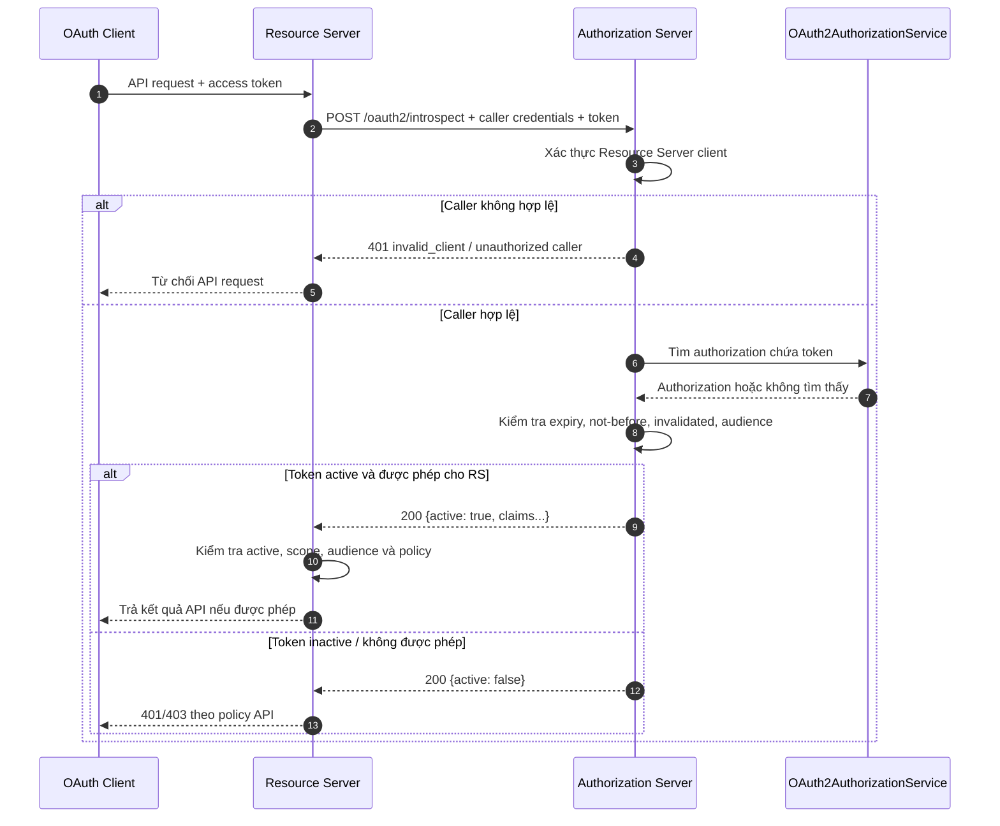

# Tra cứu token hết hạn, bị thu hồi hoặc không tồn tại

## 1. Vì sao Resource Server cần introspection?

Trong mô-đun **SPRING_SECURITY_OAUTH2_OIDC_AUTHORIZATION_SERVER**, chúng ta học cách thiết kế, cấu hình, bảo mật, kiểm thử và vận hành OAuth 2.0/OpenID Connect Authorization Server bằng **Spring Security**, **Spring Authorization Server** và **Spring Boot**. Bài này tập trung tra cứu trạng thái token khi token hết hạn, bị thu hồi hoặc không tồn tại bằng **OAuth 2.0 Token Introspection (RFC 7662)**.

Resource Server nhận access token từ client khi client gọi API. Nếu token là chuỗi opaque, Resource Server không thể tự đọc claims để biết token đại diện cho ai, có scope nào hoặc còn hiệu lực hay không. Ngay cả với JWT, việc xác minh chữ ký và `exp` cũng không tự cho biết token đã bị thu hồi ở Authorization Server sau thời điểm phát hành.

**Token Introspection** cung cấp một giao thức để Resource Server hỏi Authorization Server về trạng thái hiện tại và metadata của token. Authorization Server trả về JSON có trường bắt buộc `active`, cùng các thông tin tùy chọn như `scope`, `client_id`, `sub`, `aud`, `iss`, `exp` và `iat`.

Một access token thường được xem là active khi:

- token được Authorization Server này phát hành hoặc có thể xác minh theo trust policy;
- thời điểm sử dụng đã bắt đầu và token chưa hết hạn;
- token chưa bị thu hồi hoặc vô hiệu hóa;
- token được phép sử dụng tại Resource Server đang hỏi.

RFC 7662 để Authorization Server quyết định chi tiết trạng thái active, nhưng yêu cầu server thực hiện tất cả kiểm tra trạng thái có liên quan trước khi trả kết quả. Resource Server dựa vào câu trả lời đó để quyết định cho phép hay từ chối request.

### Mục tiêu học tập

Sau bài này, bạn có thể:

1. Phân biệt token hết hạn, token bị thu hồi, token không tồn tại và token không được phép sử dụng tại Resource Server.
2. Hiểu vì sao các trường hợp token inactive được trả về bằng `active: false`, thường với HTTP 200.
3. Phân biệt lỗi token inactive với lỗi xác thực client gọi Introspection Endpoint.
4. Cấu hình Token Introspection Endpoint trong Spring Authorization Server.
5. Hiểu vai trò của `OAuth2AuthorizationService`, `OAuth2TokenIntrospectionAuthenticationProvider` và trạng thái token.
6. Gửi introspection request, đọc response và kiểm tra trạng thái token tại Resource Server.
7. Thiết kế cache, xử lý lỗi mạng, kiểm thử và vận hành introspection an toàn.

## 2. Ba trường hợp cần tra cứu và kết quả chuẩn

Đề bài tập trung vào ba tình huống thường gặp. Từ góc nhìn của Resource Server, cả ba đều có cùng một kết quả giao thức:

| Trạng thái token | Điều xảy ra ở Authorization Server | Introspection response |
| --- | --- | --- |
| **Hết hạn** | `exp` đã qua hoặc thời điểm hiệu lực không còn nằm trong cửa sổ cho phép | `{"active": false}` |
| **Bị thu hồi/vô hiệu hóa** | Token đã bị revoke hoặc bị đánh dấu invalidated trong authorization state | `{"active": false}` |
| **Không tồn tại** | Authorization Server không tìm thấy token hoặc không thể xác minh token được gửi | `{"active": false}` |

RFC 7662 yêu cầu Authorization Server không tiết lộ lý do cụ thể khiến token inactive. Response inactive nên chỉ chứa claim bắt buộc `active=false`. Điều này ngăn một bên thứ ba dùng Introspection Endpoint để dò xem một chuỗi có phải token từng được phát hành hay không, token đã hết hạn hay đã bị thu hồi.

Ví dụ:

```http
HTTP/1.1 200 OK
Content-Type: application/json
Cache-Control: no-store

{
  "active": false
}
```

**Đây không phải lỗi giao thức.** Resource Server đã xác thực thành công, gửi một truy vấn hợp lệ và nhận được kết luận rằng token không được sử dụng. Resource Server phải từ chối request API tương ứng.

### Phân biệt với lỗi của bên gọi introspection

| Tình huống | HTTP/OAuth response điển hình | Ý nghĩa |
| --- | --- | --- |
| Token được hỏi hết hạn, bị revoke hoặc không tồn tại | `200 OK`, `active=false` | Truy vấn hợp lệ; token không active |
| Client credentials của Resource Server sai | `401 Unauthorized`, thường có `invalid_client` | Resource Server không được phép gọi endpoint |
| Bearer credential dùng để bảo vệ endpoint thiếu quyền hoặc không hợp lệ | `401 Unauthorized` | Caller không được phép introspect |
| Thiếu tham số `token` hoặc request sai định dạng | `400 Bad Request`, `invalid_request` | Request introspection không hợp lệ |
| Endpoint không truy cập được hoặc timeout | Không có introspection response hợp lệ | Lỗi hạ tầng/kết nối; không thể kết luận token active |

Đừng biến mọi HTTP 401 thành `active=false`, cũng đừng coi mọi HTTP 200 là token active. Resource Server phải đọc boolean `active` trong response và xử lý lỗi kết nối riêng.

## 3. Quy trình introspection theo RFC 7662

Resource Server gọi Introspection Endpoint bằng HTTP POST với body `application/x-www-form-urlencoded`. Request phải được bảo vệ bằng TLS và caller phải được xác thực/ủy quyền.



Luồng có hai quyết định độc lập:

1. **Caller authorization:** Resource Server có quyền hỏi Authorization Server về trạng thái token hay không?
2. **Token status:** Token được hỏi có active và được phép sử dụng tại Resource Server này hay không?

Chỉ khi caller hợp lệ, Authorization Server mới xử lý truy vấn token. Nếu token không active, server trả `active=false`; nếu caller không hợp lệ, server trả OAuth error tương ứng.

Trong Spring Authorization Server, provider mặc định tra cứu authorization record và trạng thái token. Nếu hệ thống cần giới hạn riêng Resource Server nào được hỏi token nào, hoặc áp dụng audience policy theo caller, hãy triển khai policy tương ứng qua extension point. Không suy ra rằng chỉ vì token có `active=true` thì mọi Resource Server đều được phép sử dụng token đó.

### 3.1. Introspection request

Hai tham số chính:

| Tham số | Bắt buộc | Ý nghĩa |
| --- | --- | --- |
| `token` | Có | Chuỗi token cần kiểm tra |
| `token_type_hint` | Không | Gợi ý token là `access_token` hay `refresh_token`, giúp tối ưu lookup |

`token_type_hint` chỉ là **gợi ý**, không phải bằng chứng về loại token. Nếu server không tìm thấy token theo hint, RFC yêu cầu tiếp tục tìm trên các loại token được hỗ trợ. Server cũng có thể bỏ qua hint nếu có thể tự nhận diện token.

Ví dụ:

```http
POST /oauth2/introspect HTTP/1.1
Host: auth.example.com
Authorization: Basic <base64-resource-server-client-id-and-secret>
Accept: application/json
Content-Type: application/x-www-form-urlencoded

token=ACCESS_TOKEN_TO_CHECK
&token_type_hint=access_token
```

Không đặt token trong query string. HTTP POST giúp tránh đưa giá trị token vào URL, browser history, proxy log và các hệ thống ghi log request URL.

### 3.2. Response khi token active

```json
{
  "active": true,
  "scope": "orders.read orders.write",
  "client_id": "orders-web",
  "username": "alice",
  "sub": "user-1042",
  "aud": [
    "orders-api"
  ],
  "iss": "https://auth.example.com",
  "exp": 1800000300,
  "iat": 1800000000,
  "token_type": "Bearer"
}
```

`active` là claim bắt buộc. Những claim còn lại là tùy chọn theo RFC 7662 và chính sách của Authorization Server. Resource Server không được giả định response luôn có đủ `username`, `sub`, `aud` hoặc `scope`; phải xác định rõ các claim cần thiết trong hợp đồng tích hợp.

### 3.3. Response khi token inactive

```json
{
  "active": false
}
```

Không yêu cầu Authorization Server trả `reason=expired`, `reason=revoked` hoặc `reason=not_found`. Nếu Resource Server cần telemetry, hãy ghi nhận rằng kết quả introspection là inactive mà không suy ra nguyên nhân cụ thể từ response.

## 4. Hiểu rõ expiry, revocation và token không tồn tại

### 4.1. Token hết hạn

Access token có thời hạn hiệu lực. Nếu response introspection chứa `exp`, đó là thời điểm token hết hạn dưới dạng Unix timestamp. Authorization Server phải đánh giá thời hạn trước khi trả `active=true`.

Một token có thể tồn tại trong database sau khi hết hạn để phục vụ kiểm tra, audit hoặc xử lý refresh. Việc bản ghi còn trong kho không làm token active trở lại. Trạng thái hiệu lực được quyết định bởi thời gian và metadata của token.

Ví dụ:

```text
issued_at = 10:00:00
expires_at = 10:05:00
current_time = 10:06:30

token record exists = true
token expired      = true
token active       = false
```

Không dùng việc tìm thấy bản ghi token làm điều kiện duy nhất để trả `active=true`.

### 4.2. Token bị thu hồi hoặc vô hiệu hóa

Token có thể bị thu hồi trước `exp`, ví dụ:

- Resource Owner thu hồi quyền đã cấp;
- người dùng đăng xuất khỏi một phiên cần vô hiệu hóa token;
- quản trị viên phát hiện credential bị lộ và thu hồi;
- refresh token family bị revoke theo chính sách;
- Authorization Server chủ động vô hiệu hóa authorization hoặc token.

RFC 7009 định nghĩa Token Revocation Endpoint để client yêu cầu thu hồi token. Khi trạng thái revoke đã được ghi nhận, Introspection Endpoint phải phản ánh trạng thái đó bằng `active=false`.

Trong Spring Authorization Server, `OAuth2Authorization.Token` có metadata cho trạng thái invalidated và các phương thức `isInvalidated()`, `isExpired()`, `isBeforeUse()` và `isActive()`. `OAuth2Authorization.Builder.invalidate(token)` là một phần API để đánh dấu token bị vô hiệu hóa trong authorization state. Khi ứng dụng dùng luồng revocation mặc định, hãy để provider và `OAuth2AuthorizationService` quản lý cập nhật trạng thái.

### 4.3. Token không tồn tại hoặc không nhận diện được

Các nguyên nhân có thể gồm:

- token chưa từng được Authorization Server phát hành;
- token bị gửi sai hoặc bị cắt mất ký tự;
- token thuộc issuer khác mà server hiện tại không tin cậy;
- authorization record đã bị xóa theo retention/cleanup;
- token không nằm trong các loại token mà server hỗ trợ introspection.

Nếu Authorization Server không tìm thấy token, response vẫn là `active=false`. Không trả `invalid_token` như một OAuth error chỉ vì token không có trong kho. Truy vấn token hợp lệ nhưng token không nhận diện được là một kết quả introspection bình thường.

### 4.4. Token hợp lệ nhưng không dành cho Resource Server này

Một token có thể được ký đúng, chưa hết hạn và chưa bị thu hồi, nhưng có audience dành cho API khác. Theo RFC 7662, Authorization Server phải xác định token có thể được sử dụng tại Resource Server đang gọi introspection hay không. Nếu không, trả `active=false`.

Điều này giúp tránh trường hợp `billing-api` dùng token chỉ dành cho `orders-api`. Resource Server cũng nên kiểm tra audience trong response nếu hợp đồng yêu cầu, kể cả khi Authorization Server đã áp dụng audience policy.

### Bảng tổng hợp quyết định

| Kiểm tra | Kết quả | `active` |
| --- | --- | --- |
| Token được nhận diện, trong thời gian hiệu lực, chưa revoke và đúng audience | Cho phép tiếp tục kiểm tra scope/policy | `true` |
| `exp` đã qua | Inactive | `false` |
| `nbf` chưa tới | Inactive | `false` |
| Token bị revoke/invalidated | Inactive | `false` |
| Token không tìm thấy | Inactive | `false` |
| Token không được phép cho Resource Server gọi introspection | Inactive | `false` |

**Điểm quan trọng:** API trả `active=true` không tự động có nghĩa mọi request được phép. Resource Server còn phải kiểm tra scope, audience, tenant, quyền nghiệp vụ và các điều kiện truy cập khác.

## 5. Spring Authorization Server xử lý introspection như thế nào?

Spring Authorization Server cung cấp sẵn Token Introspection Endpoint trong cấu hình Authorization Server mặc định. Các thành phần chính:

| Thành phần | Trách nhiệm |
| --- | --- |
| `AuthorizationServerSettings` | Khai báo đường dẫn Introspection Endpoint |
| `OAuth2TokenIntrospectionEndpointConfigurer` | Tùy biến converter, provider, response handler và error handler |
| `OAuth2TokenIntrospectionEndpointFilter` | Nhận HTTP POST tại endpoint |
| `OAuth2TokenIntrospectionAuthenticationConverter` | Chuyển HTTP request thành introspection authentication request |
| `OAuth2TokenIntrospectionAuthenticationProvider` | Xác thực caller và xử lý truy vấn token |
| `OAuth2AuthorizationService` | Tra cứu và quản lý authorization/token state |
| `OAuth2Authorization.Token` | Giữ token cùng metadata expiry/invalidated và trạng thái active |

### 5.1. Default endpoint và provider

`OAuth2AuthorizationServerConfiguration` cung cấp cấu hình mặc định cho các protocol endpoint, trong đó có Token Introspection Endpoint. Đường dẫn mặc định là:

```text
/oauth2/introspect
```

`OAuth2TokenIntrospectionEndpointFilter` mặc định sử dụng:

- `OAuth2TokenIntrospectionAuthenticationConverter` để đọc request;
- `OAuth2TokenIntrospectionAuthenticationProvider` để xử lý authentication;
- success handler nội bộ để trả `OAuth2TokenIntrospection`;
- `OAuth2ErrorAuthenticationFailureHandler` để trả OAuth error khi caller/request không hợp lệ.

Provider mặc định nhận `RegisteredClientRepository` và `OAuth2AuthorizationService`. Kho authorization giúp server tìm token; metadata của token giúp xác định token còn hiệu lực, đã hết hạn hay bị vô hiệu hóa. API `OAuth2Authorization.Token.isActive()` cung cấp kết quả trạng thái, bên cạnh `isExpired()`, `isBeforeUse()` và `isInvalidated()`.

### 5.2. Cấu hình endpoint trong AuthorizationServerSettings

Nếu ứng dụng chưa khai báo `AuthorizationServerSettings` riêng, cấu hình mặc định đã sử dụng `/oauth2/introspect`. Bạn có thể khai báo rõ đường dẫn và issuer:

```java
package com.example.authserver;

import org.springframework.context.annotation.Bean;
import org.springframework.context.annotation.Configuration;
import org.springframework.security.oauth2.server.authorization.settings.AuthorizationServerSettings;

@Configuration
public class AuthorizationServerEndpointConfig {

    @Bean
    AuthorizationServerSettings authorizationServerSettings() {
        return AuthorizationServerSettings.builder()
                .issuer("https://auth.example.com")
                .tokenIntrospectionEndpoint("/oauth2/introspect")
                .build();
    }
}
```

Nếu project đã có bean `AuthorizationServerSettings` để cấu hình issuer, token endpoint, revocation endpoint hoặc PAR endpoint, hãy bổ sung `tokenIntrospectionEndpoint(...)` vào bean hiện tại. Không tạo hai bean settings cạnh tranh nhau.

### 5.3. Đăng ký endpoint trong SecurityFilterChain

Ví dụ cấu hình với API Spring Authorization Server 1.5.x:

```java
package com.example.authserver;

import org.springframework.context.annotation.Bean;
import org.springframework.context.annotation.Configuration;
import org.springframework.core.annotation.Order;
import org.springframework.security.config.Customizer;
import org.springframework.security.config.annotation.web.builders.HttpSecurity;
import org.springframework.security.oauth2.server.authorization.config.annotation.web.configurers.OAuth2AuthorizationServerConfigurer;
import org.springframework.security.web.SecurityFilterChain;

@Configuration
public class AuthorizationServerSecurityConfig {

    @Bean
    @Order(1)
    SecurityFilterChain authorizationServerSecurityFilterChain(HttpSecurity http)
            throws Exception {

        OAuth2AuthorizationServerConfigurer authorizationServerConfigurer =
                OAuth2AuthorizationServerConfigurer.authorizationServer();

        http
            .securityMatcher(authorizationServerConfigurer.getEndpointsMatcher())
            .with(authorizationServerConfigurer, authorizationServer ->
                authorizationServer
                    .tokenIntrospectionEndpoint(Customizer.withDefaults())
            );

        return http.build();
    }
}
```

Đây là phần cấu hình endpoint trong filter chain của Authorization Server. Ứng dụng vẫn cần các bean nền tảng như `RegisteredClientRepository`, `AuthorizationServerSettings`, `OAuth2AuthorizationService`, token generator/JWK và các filter chain cho phần ứng dụng nếu có.

**Không tạo controller REST riêng cho `/oauth2/introspect`.** Endpoint filter mặc định đã kết nối client authentication, converter, provider và response handler. Một controller tự viết có thể vô tình bỏ qua xác thực caller, tra cứu token hoặc quy tắc trả lỗi.

### 5.4. Vai trò của OAuth2AuthorizationService

`OAuth2AuthorizationService` quản lý các authorization record và cung cấp phương thức tra cứu token:

```java
OAuth2Authorization authorization =
        authorizationService.findByToken(token, tokenType);
```

Kết quả là authorization chứa token hoặc `null` nếu không tìm thấy. Hai triển khai phổ biến là:

| Implementation | Đặc điểm |
| --- | --- |
| `InMemoryOAuth2AuthorizationService` | Dùng cho demo/kiểm thử đơn node; dữ liệu mất khi restart và không chia sẻ giữa instance |
| `JdbcOAuth2AuthorizationService` | Lưu authorization state trong database; phù hợp hệ thống cần trạng thái bền vững và nhiều node khi cấu hình schema đúng |

Nếu server phát hành token nhưng không lưu hoặc không thể khôi phục trạng thái tương ứng, introspection không thể chỉ dựa vào việc token “trông giống JWT” để kết luận token đã được phát hành và chưa bị thu hồi. Với JWT self-contained, có thể thiết kế provider riêng để xác minh chữ ký/claims và kiểm tra revocation store; với mô hình Spring Authorization Server mặc định, hãy giữ authorization state có thể tra cứu.

### 5.5. Token state trong Spring Authorization Server

`OAuth2Authorization.Token` là wrapper giữ token và metadata. Những trạng thái quan trọng:

| API | Ý nghĩa |
| --- | --- |
| `isExpired()` | Token đã qua thời điểm hết hạn |
| `isBeforeUse()` | Token chưa đến thời điểm được phép sử dụng |
| `isInvalidated()` | Token đã bị đánh dấu vô hiệu hóa, ví dụ sau revoke |
| `isActive()` | Kết quả tổng hợp token có active tại thời điểm kiểm tra hay không |

Khi token bị revoke qua Revocation Endpoint mặc định, provider cập nhật authorization state để token không còn được xem là active. Khi introspection tra cứu cùng authorization record, trạng thái invalidated được dùng để trả `active=false`.

**Không xóa token record ngay khi revoke nếu logic nghiệp vụ hoặc audit cần giữ authorization state.** Trạng thái invalidated cho phép phân biệt nội bộ token đã được ghi nhận rồi bị thu hồi với token chưa từng được lưu. Cả hai vẫn trả `active=false` ra ngoài theo RFC 7662.

## 6. Xác thực Resource Server gọi Introspection Endpoint

Introspection Endpoint nhận token có thể bị kẻ tấn công dò đoán. Vì vậy RFC 7662 yêu cầu bảo vệ endpoint bằng TLS và bắt buộc caller phải được xác thực hoặc có credential được ủy quyền. Thông thường caller là một Resource Server đã đăng ký tại Authorization Server.

### 6.1. Đăng ký Resource Server client

Ví dụ đăng ký service `orders-api` làm confidential client để gọi Introspection Endpoint bằng `client_secret_basic`:

```java
import java.util.UUID;

import org.springframework.context.annotation.Bean;
import org.springframework.security.crypto.password.PasswordEncoder;
import org.springframework.security.oauth2.core.AuthorizationGrantType;
import org.springframework.security.oauth2.core.ClientAuthenticationMethod;
import org.springframework.security.oauth2.server.authorization.client.InMemoryRegisteredClientRepository;
import org.springframework.security.oauth2.server.authorization.client.RegisteredClient;
import org.springframework.security.oauth2.server.authorization.client.RegisteredClientRepository;

@Bean
RegisteredClientRepository registeredClientRepository(PasswordEncoder passwordEncoder) {
    // Demo chỉ có một Resource Server client; production cần repository bền vững
    // và giữ các client registrations khác của hệ thống.
    RegisteredClient ordersApi = RegisteredClient
            .withId(UUID.randomUUID().toString())
            .clientId("orders-api")
            .clientSecret(passwordEncoder.encode("lab-only-change-this-secret"))
            .clientAuthenticationMethod(ClientAuthenticationMethod.CLIENT_SECRET_BASIC)
            .authorizationGrantType(AuthorizationGrantType.CLIENT_CREDENTIALS)
            .build();

    return new InMemoryRegisteredClientRepository(ordersApi);
}
```

Đặt phương thức `@Bean` này trong một lớp `@Configuration`; ví dụ giả định ứng dụng đã có bean `PasswordEncoder`. Lưu registration qua `RegisteredClientRepository`. Secret chỉ dùng trong lab; production cần secret manager và lưu dạng hash bằng `PasswordEncoder`. Có thể dùng `private_key_jwt` hoặc mTLS thay cho shared secret nếu chính sách yêu cầu.

`CLIENT_CREDENTIALS` trong ví dụ thể hiện loại client service có thể sử dụng trong hệ thống. Nó không phải tham số của introspection request và không có nghĩa Resource Server phải xin một access token mới cho mỗi lần introspection.

### 6.2. Client authentication khác với token được hỏi

Một introspection request có hai credential riêng:

- **Caller credential:** xác thực Resource Server đang gọi endpoint, ví dụ Basic credentials của `orders-api`.
- **Token parameter:** access token mà Resource Server nhận từ client và muốn hỏi trạng thái.

Không dùng access token đang được kiểm tra làm client secret hoặc Basic credential để introspect chính nó. Caller credential phải thuộc về Resource Server có quyền truy cập endpoint.

Ví dụ:

```http
POST /oauth2/introspect HTTP/1.1
Host: auth.example.com
Authorization: Basic <orders-api-client-credentials>
Content-Type: application/x-www-form-urlencoded

token=TOKEN_RECEIVED_FROM_CLIENT
&token_type_hint=access_token
```

### 6.3. Giới hạn Resource Server được phép introspect

Xác thực client thành công mới chỉ chứng minh caller là client đã đăng ký. Ứng dụng vẫn cần chính sách xác định Resource Server nào được phép introspect token và token nào được phép sử dụng tại Resource Server đó.

RFC 7662 yêu cầu nếu Resource Server không được phép introspect một token cụ thể, Authorization Server phải trả `active=false` như với token không hợp lệ. Không trả thêm lý do vì điều đó có thể tiết lộ thông tin về token hoặc cấu trúc hệ thống.

Spring Authorization Server cung cấp extension point `authenticationProviders(...)` trên `OAuth2TokenIntrospectionEndpointConfigurer` để bổ sung hoặc cấu hình provider. Nếu cần allowlist client, ràng buộc audience hoặc giới hạn claim theo từng Resource Server, hãy triển khai policy ở provider/response path phù hợp và giữ các kiểm tra mặc định. Không chỉ kiểm tra một `client_id` từ body vì danh tính caller phải lấy từ client principal đã được Spring xác thực.

### 6.4. Không công khai Introspection Endpoint

Không cho browser hoặc public SPA gọi trực tiếp endpoint này bằng token của người dùng. Resource Server backend cần xác thực riêng, và endpoint nên chỉ được mở qua HTTPS, network policy và rate limit phù hợp. Nếu client credential sai, server trả lỗi xác thực; nếu token được hỏi không tồn tại, server trả `active=false`.

## 7. Kết nối Spring Security Resource Server với Introspection Endpoint

Khi Resource Server sử dụng opaque token, Spring Security có thể gọi Introspection Endpoint để xác minh token và lấy authorities/claims. Đây là phần phía Resource Server; cấu hình này không thay thế endpoint và provider ở Authorization Server.

### 7.1. Cấu hình bằng Spring Boot

Ví dụ cấu hình trong `application.yml`:

```yaml
spring:
  security:
    oauth2:
      resourceserver:
        opaquetoken:
          introspection-uri: https://auth.example.com/oauth2/introspect
          client-id: orders-api
          client-secret: ${ORDERS_API_INTROSPECTION_SECRET}
```

Các giá trị `client-id` và `client-secret` là credential của Resource Server dùng để xác thực với Introspection Endpoint. Lưu secret trong environment/secret manager, không commit vào repository.

### 7.2. Bật opaque token support trong SecurityFilterChain

```java
package com.example.ordersapi;

import org.springframework.context.annotation.Bean;
import org.springframework.context.annotation.Configuration;
import org.springframework.security.config.Customizer;
import org.springframework.security.config.annotation.web.builders.HttpSecurity;
import org.springframework.security.web.SecurityFilterChain;

@Configuration
public class ResourceServerSecurityConfig {

    @Bean
    SecurityFilterChain apiSecurityFilterChain(HttpSecurity http)
            throws Exception {

        return http
                .authorizeHttpRequests(authorize -> authorize
                        .requestMatchers("/api/orders/**")
                            .hasAuthority("SCOPE_orders.read")
                        .anyRequest().authenticated())
                .oauth2ResourceServer(resourceServer ->
                        resourceServer.opaqueToken(Customizer.withDefaults()))
                .build();
    }
}
```

Khi cấu hình opaque token, Spring Security dùng introspector để gọi URI đã cấu hình, xác thực caller bằng client credentials, đọc claim `active` và chuyển các claim cần thiết thành `OAuth2AuthenticatedPrincipal`. Token inactive không được chấp nhận làm authentication thành công.

### 7.3. Phân biệt opaque token với JWT offline validation

| Cách xác minh | Resource Server làm gì? | Nhận biết revoke tức thời? |
| --- | --- | --- |
| JWT + `JwtDecoder` | Xác minh chữ ký, issuer, audience, thời hạn và claims tại chỗ | Không tự biết revoke nếu không có state/check bổ sung |
| Opaque token + introspection | Gửi token tới Authorization Server để hỏi trạng thái | Có thể nhận biết revoke sau khi trạng thái được cập nhật, tùy cache |
| JWT + introspection | Gửi cả JWT tới endpoint để hỏi trạng thái tập trung | Có thể nhận biết revoke nếu Authorization Server lưu/tra được token và áp dụng policy |

Không phải mọi JWT đều tự động được introspect chỉ vì nó có thể giải mã. Authorization Server phải có cách nhận diện, xác minh và đánh giá trạng thái của token đó. Với Spring Authorization Server mặc định, authorization record được lưu trong `OAuth2AuthorizationService`, vì vậy endpoint có thể tra cứu token theo trạng thái đã lưu.

### 7.4. Resource Server xử lý response

| Introspection result | Quyết định ở Resource Server |
| --- | --- |
| `active=true`, audience hợp lệ, có scope cần thiết | Cho phép xử lý request theo business policy |
| `active=true`, nhưng thiếu scope | Từ chối quyền, thường là HTTP 403 |
| `active=false` | Không xác thực token; thường trả HTTP 401 với `invalid_token` |
| Caller credentials sai ở endpoint | Không thể hoàn tất introspection; xử lý như lỗi cấu hình/ủy quyền giữa các service |
| Authorization Server timeout/không truy cập được | Không có bằng chứng token active; từ chối request hoặc áp dụng chính sách outage được thiết kế rõ ràng |

Không biến lỗi mạng thành `active=true`. Nếu Resource Server tiếp tục dùng cache cũ trong thời gian outage, thời gian chấp nhận stale result phải có giới hạn và được đánh giá theo mức độ nhạy cảm của API.

## 8. Thực hành tra cứu token

### 8.1. Gửi request bằng HTTP

Ví dụ Resource Server hỏi token:

```http
POST /oauth2/introspect HTTP/1.1
Host: auth.example.com
Authorization: Basic <base64-orders-api-credentials>
Accept: application/json
Content-Type: application/x-www-form-urlencoded

token=eyJhbGciOiJSUzI1NiJ9.ACCESS_TOKEN_PAYLOAD.SIGNATURE
&token_type_hint=access_token
```

Token mẫu chỉ để minh họa. Trong môi trường thực, không dán token thật vào ticket, chat hoặc log.

### 8.2. Thử bằng PowerShell

Đặt token và client secret vào environment variables của lab trước khi chạy:

```powershell
$token = $env:LAB_ACCESS_TOKEN
$clientSecret = $env:LAB_INTROSPECTION_SECRET

if ([string]::IsNullOrWhiteSpace($token) -or
        [string]::IsNullOrWhiteSpace($clientSecret)) {
    throw "Can cau hinh LAB_ACCESS_TOKEN va LAB_INTROSPECTION_SECRET"
}

$responseJson = curl.exe -sS `
    -u ("orders-api:" + $clientSecret) `
    -H "Accept: application/json" `
    -H "Content-Type: application/x-www-form-urlencoded" `
    --data-urlencode "token=$token" `
    --data-urlencode "token_type_hint=access_token" `
    "https://auth.example.com/oauth2/introspect"

$result = $responseJson | ConvertFrom-Json
if ($result.active -eq $true) {
    "Token is active"
    $result | Select-Object active, client_id, sub, aud, scope, exp
}
else {
    "Token is inactive"
}
```

Script chỉ in một số metadata khi token active và không in token đầu vào. Trong production, cần bảo đảm `curl.exe -u` không làm lộ credential qua process arguments hoặc shell diagnostics; ưu tiên HTTP client có secret handling an toàn hơn. Không bật verbose mode hoặc ghi raw response chứa thông tin nhận dạng vào log không được bảo vệ.

### 8.3. Thử ba trường hợp

Trong môi trường test, chuẩn bị ba giá trị:

1. Token access còn hạn và chưa bị revoke.
2. Token đã hết hạn hoặc đã được revoke qua Revocation Endpoint.
3. Một chuỗi ngẫu nhiên không phải token đã phát hành.

Kết quả cần quan sát:

| Token | HTTP status introspection | Body |
| --- | --- | --- |
| Active | `200 OK` | `active=true` cùng metadata được phép |
| Expired | `200 OK` | Chỉ `active=false` |
| Revoked | `200 OK` | Chỉ `active=false` |
| Unknown/random | `200 OK` | Chỉ `active=false` |

Sau đó thử lại với client secret sai. Lần này server phải từ chối **caller** (thường `401 invalid_client`), không trả `active=false` cho token.

### 8.4. Kiểm tra discovery metadata

Authorization Server Metadata theo RFC 8414 có thể công bố:

```json
{
  "issuer": "https://auth.example.com",
  "introspection_endpoint": "https://auth.example.com/oauth2/introspect",
  "introspection_endpoint_auth_methods_supported": [
    "client_secret_basic"
  ]
}
```

Đây là response rút gọn để minh họa. Client nên discovery metadata từ issuer đáng tin, kiểm tra URL endpoint và phương thức xác thực được công bố. Khi thay đổi path introspection hoặc client authentication methods, cập nhật metadata và kiểm thử client discovery.

## 9. Cache, độ trễ thu hồi và xử lý lỗi

Introspection thêm một network call vào luồng xác thực API. Resource Server có thể cache response để giảm tải, nhưng cache cũng làm chậm thời điểm nhận biết token bị revoke.

### 9.1. Chọn TTL cache

RFC 7662 cho phép Resource Server cache response và yêu cầu cân nhắc trade-off giữa hiệu năng và độ mới của trạng thái token. Nếu response có claim `exp`, cache **không được sống lâu hơn thời điểm hết hạn**.

Một chính sách thực tế:

| Kết quả | Hướng cache |
| --- | --- |
| `active=true` | TTL ngắn; giới hạn thêm bởi thời gian còn lại tới `exp` và độ trễ revoke chấp nhận được |
| `active=false` | Có thể cache ngắn để giảm truy vấn lặp; không lưu quá lâu khi có khả năng trạng thái lookup chưa đồng bộ |
| Caller `401` | Không cache như trạng thái token; đây là lỗi credential của Resource Server |
| Timeout/5xx/network error | Không cache thành `active=true` hoặc `active=false`; đây là lỗi hạ tầng |

Ví dụ:

```text
token exp còn 20 giây
cache policy tối đa 30 giây
=> cache TTL thực tế không vượt 20 giây

token có thể bị revoke bất kỳ lúc nào
=> TTL 30 giây có thể tạo cửa sổ dùng token sau revoke tối đa gần 30 giây
```

Nếu API xử lý dữ liệu nhạy cảm hoặc yêu cầu revoke gần như tức thời, giảm TTL mạnh hoặc tắt cache. Với API ít nhạy cảm, TTL ngắn có thể là cân bằng hợp lý giữa độ trễ và tải hệ thống.

### 9.2. Cache key và dữ liệu nhạy cảm

- Dùng hash an toàn của token làm cache key nếu không cần giữ raw token trong cache.
- Không ghi raw token vào cache diagnostic, metrics label hoặc distributed tracing.
- Cache response theo cả token và ngữ cảnh Resource Server nếu Authorization Server trả kết quả khác nhau theo caller/audience.
- Khi token bị revoke, có thể chủ động invalidation cache qua event hoặc message bus nếu hệ thống có cơ chế đồng bộ.
- Khi cache entry hết hạn, query lại Authorization Server; không tự gia hạn trạng thái active.

Nếu response introspection được lọc claim theo từng Resource Server, không dùng chung một cache entry giữa nhiều Resource Server có quyền xem claim khác nhau.

### 9.3. Khi Authorization Server không truy cập được

Introspection endpoint timeout, TLS lỗi, DNS lỗi hoặc trả HTTP 5xx không phải là bằng chứng token inactive và cũng không phải là bằng chứng token active.

Resource Server nên áp dụng **fail closed** cho request cần xác minh trạng thái trực tuyến: không cấp quyền khi không có câu trả lời đáng tin. Một số hệ thống có thể tiếp tục dùng positive cache trong một cửa sổ rất ngắn để tăng availability; nếu chọn cách đó, cần ghi rõ thời gian stale tối đa, API nào được phép và rủi ro revoke trong cửa sổ này.

Không chuyển lỗi hạ tầng thành response `active=false` cho caller như thể token đã bị thu hồi. Hãy ghi nhận riêng lỗi dependency để đội vận hành có thể phân biệt outage của Authorization Server với việc client gửi token hết hạn.

## 10. Xử lý lỗi và chẩn đoán

| Hiện tượng | Nguyên nhân thường gặp | Hướng kiểm tra |
| --- | --- | --- |
| `200 OK`, `active=false` | Token hết hạn, bị revoke, không tồn tại hoặc không dành cho caller | Kiểm tra token ở môi trường phát hành; không yêu cầu server tiết lộ nguyên nhân trong response |
| `401 invalid_client` | Basic secret/assertion/mTLS sai hoặc client chưa đăng ký | Kiểm tra `RegisteredClient`, authentication method và credential |
| `400 invalid_request` | Thiếu `token`, body sai content type hoặc request parameter không hợp lệ | Kiểm tra POST form body và encoding |
| `404` tại `/oauth2/introspect` | Sai path, settings hoặc filter chain không chứa endpoint | Kiểm tra `AuthorizationServerSettings` và `getEndpointsMatcher()` |
| `401` ở Resource Server | Token inactive hoặc introspection caller không được xác thực | Xem log phân loại ở Resource Server và Authorization Server |
| `403` ở Resource Server | Token active nhưng thiếu scope/quyền nghiệp vụ | Kiểm tra scope mapping và authorization rule |
| Token đã revoke nhưng API vẫn chấp nhận | Cache positive còn hiệu lực hoặc authorization state chưa đồng bộ | Kiểm tra cache TTL, revocation update và shared repository |
| Token còn hạn nhưng `active=false` | Token chưa tới `nbf`, invalidated, audience sai hoặc không tìm thấy authorization record | Kiểm tra token metadata và policy caller/target |
| Unknown token trả 401 | Custom implementation đang coi token lookup miss là OAuth error | Sửa behavior để caller hợp lệ nhận `200 active=false` |
| Introspection timeout | Authorization Server, database hoặc mạng gặp sự cố | Kiểm tra latency, health, connection pool và retry budget |
| Resource Server không thấy claim `scope` | Response không phát claim hoặc mapper không ánh xạ đúng | Kiểm tra `OAuth2TokenIntrospection` và authority converter |

### 10.1. Phân biệt ba lớp lỗi

1. **Caller authentication failure:** Resource Server không chứng minh được danh tính với Authorization Server; trả OAuth error như `invalid_client`.
2. **Token inactive:** caller hợp lệ nhưng token không dùng được; trả `200` với `active=false`.
3. **Infrastructure failure:** không nhận được response hợp lệ; Resource Server xử lý như lỗi phụ thuộc, không giả định trạng thái token.

Nếu ba lớp này bị gộp làm một, việc điều tra sẽ khó hơn và có nguy cơ vô tình cho phép token khi Authorization Server đang lỗi.

### 10.2. Những cách sửa lỗi không an toàn

- Không bỏ client authentication để xử lý `401 invalid_client`.
- Không đổi mọi `active=false` thành `active=true` khi Resource Server không truy cập được endpoint.
- Không tăng cache TTL vô hạn để giảm tải database.
- Không trả lý do `expired`, `revoked` hoặc `unknown` cho caller không được phép biết.
- Không log token đầy đủ để chẩn đoán một request lỗi.
- Không bỏ kiểm tra audience hoặc scope chỉ vì introspection đã trả `active=true`.

## 11. Kiểm thử token expiry, revocation và unknown token

Kiểm thử cần xác minh cả kết quả protocol ở Authorization Server và quyết định truy cập tại Resource Server.

### 11.1. Ma trận kiểm thử

| ID | Tình huống | Kết quả mong đợi |
| --- | --- | --- |
| INT-01 | Caller Resource Server được xác thực, token active | `200`, `active=true` và metadata được phép |
| INT-02 | Token đã hết hạn | `200`, chỉ `active=false` |
| INT-03 | Token bị revoke qua Revocation Endpoint | `200`, chỉ `active=false` |
| INT-04 | Chuỗi token không tồn tại | `200`, chỉ `active=false` |
| INT-05 | Token thuộc issuer không được tin cậy | Inactive hoặc bị từ chối theo trust policy; không cấp quyền |
| INT-06 | Token chưa tới `nbf` | `200`, `active=false` |
| INT-07 | Token active nhưng audience không dành cho Resource Server | `200`, `active=false` |
| INT-08 | Caller client secret sai | `401`, `invalid_client` |
| INT-09 | Caller không được đăng ký | Từ chối xác thực caller |
| INT-10 | Thiếu tham số `token` | `400`, `invalid_request` |
| INT-11 | `token_type_hint=access_token`, token là refresh token | Server tìm tiếp loại token được hỗ trợ theo RFC |
| INT-12 | Token active nhưng scope không đủ | Introspection có thể `active=true`; API trả 403 |
| INT-13 | Resource Server gọi endpoint qua HTTP thường | TLS/network policy từ chối |
| INT-14 | Token bị revoke nhưng positive cache chưa hết hạn | Hành vi phù hợp TTL đã định; kiểm tra cửa sổ stale |
| INT-15 | Token bị revoke và cache đã hết hạn | Lần introspection kế tiếp trả `active=false` |
| INT-16 | Authorization Server timeout | Resource Server không cấp quyền dựa trên giả định active |
| INT-17 | Authorization Server trả 5xx | Xử lý như dependency failure, không coi là `active=false` |
| INT-18 | Request introspection có raw token trong query string | Endpoint không sử dụng GET/query; chỉ nhận POST form |
| INT-19 | Caller không được phép xem token của Resource Server khác | `active=false` và không có metadata bổ sung |
| INT-20 | Token unknown được truy vấn nhiều lần | Rate limit/monitoring ngăn token scanning |
| INT-21 | Introspection response không có claim `active` | Resource Server coi response không hợp lệ và từ chối |
| INT-22 | `active=true` nhưng response thiếu claim scope mà API yêu cầu | Từ chối quyền theo policy |
| INT-23 | Nhiều Authorization Server instance cùng phục vụ introspection | Các node nhìn thấy cùng trạng thái revoke/expiry |
| INT-24 | Cleanup xóa authorization record cũ | Token không còn được tìm thấy và vẫn trả `active=false` |

### 11.2. Test revocation end-to-end

Một test integration có thể thực hiện theo thứ tự:

1. Lấy access token hợp lệ cho client thử nghiệm.
2. Gọi Introspection Endpoint và xác nhận `active=true`.
3. Gọi Revocation Endpoint để thu hồi access token theo client authentication.
4. Gọi Introspection Endpoint lại bằng cùng token.
5. Xác nhận `active=false` và không có metadata bổ sung.
6. Gọi API được bảo vệ; Resource Server phải từ chối token sau khi cache/TTL theo test đã được xử lý.

Đừng chỉ test HTTP response của Revocation Endpoint. Cần test trạng thái quan sát được tại Introspection Endpoint và API đích, vì cache hoặc nhiều authorization store có thể làm trạng thái không đồng bộ.

### 11.3. Test unknown token

Tạo một chuỗi ngẫu nhiên không có trong test fixture, rồi gọi introspection bằng caller credentials hợp lệ. Kết quả phải là `200` và `active=false`. Sau đó lặp lại với caller credentials sai để chứng minh hai trường hợp có response khác nhau.

## 12. Vận hành, bài tập và checklist production

### 12.1. Bảo vệ endpoint và dữ liệu

- Bắt buộc TLS và kiểm tra chứng thư server ở Resource Server.
- Chỉ cho các Resource Server đã đăng ký gọi Introspection Endpoint.
- Dùng client authentication mạnh; cân nhắc `private_key_jwt` hoặc mTLS cho service quan trọng.
- Rate limit theo caller client, IP/network identity và số request lỗi.
- Giới hạn kích thước request body và độ dài token parameter.
- Không log raw token, client secret hoặc toàn bộ response chứa dữ liệu nhận dạng.
- Chỉ trả metadata token mà Resource Server đó cần để ra quyết định.

### 12.2. Lưu trữ và đồng bộ trạng thái

Trong môi trường nhiều instance, tất cả Authorization Server node phải dùng authorization store có thể chia sẻ trạng thái token. Khi token bị revoke ở node A, introspection ở node B phải nhìn thấy invalidation sau khi transaction được commit.

Kiểm tra:

- `OAuth2AuthorizationService` dùng chung giữa các node;
- transaction lưu trạng thái revoke được commit trước khi báo hoàn tất;
- cache ở Authorization Server không giữ token status cũ;
- cleanup job không xóa record còn cần cho audit hoặc xử lý refresh;
- backup/restore không làm sống lại token đã bị revoke;
- đồng hồ node được đồng bộ để đánh giá `exp` và `nbf` nhất quán.

### 12.3. Metrics và audit

Theo dõi các chỉ số:

- số introspection request thành công theo caller client;
- tỷ lệ `active=true` và `active=false`;
- số lỗi `invalid_client`, `invalid_request`, timeout và 5xx;
- latency p50/p95/p99 của endpoint và authorization store;
- số truy vấn token unknown hoặc bị rate limit;
- thời gian từ lúc revoke tới khi Resource Server quan sát `active=false`;
- cache hit/miss và TTL còn lại của positive response.

Không gắn raw token hoặc hash token không kiểm soát vào metrics label vì có thể tạo cardinality rất cao. Dùng correlation ID và client ID đã xác thực để điều tra.

### 12.4. Bài tập thực hành

Thiết lập Authorization Server và Resource Server `orders-api`:

1. Cấu hình endpoint `/oauth2/introspect`.
2. Đăng ký Resource Server client bằng `client_secret_basic` trong môi trường lab.
3. Cấu hình Spring Security Resource Server dùng opaque token introspection.
4. Phát hành một access token còn hạn và xác nhận `active=true`.
5. Thu hồi token bằng Revocation Endpoint, sau đó kiểm tra `active=false`.
6. Chờ một access token khác hết hạn rồi kiểm tra lại.
7. Gửi chuỗi token ngẫu nhiên và xác nhận `active=false`.
8. Gửi request introspection bằng secret sai và xác nhận lỗi caller là `401`.
9. Thử cache TTL ngắn và quan sát độ trễ nhận biết revoke.
10. Chạy test qua hai Authorization Server instance để xác nhận trạng thái nhất quán.

### 12.5. Câu hỏi tự kiểm tra

**Câu 1.** Token đã hết hạn có được trả HTTP 401 từ Introspection Endpoint không?  
**Đáp án:** Không, nếu caller được xác thực và request hợp lệ. Endpoint trả `200` với `active=false`.

**Câu 2.** Token không tồn tại có phải OAuth error không?  
**Đáp án:** Không. Đây là kết quả token inactive; response không nên tiết lộ lý do.

**Câu 3.** Vì sao client secret sai lại khác token bị revoke?  
**Đáp án:** Secret sai là lỗi xác thực caller; token bị revoke là kết quả truy vấn hợp lệ về trạng thái token.

**Câu 4.** `token_type_hint` có quyết định loại token không?  
**Đáp án:** Không. Nó chỉ là hint; server phải tìm tiếp các loại token hỗ trợ nếu không tìm thấy theo hint.

**Câu 5.** Token JWT có `exp` trong tương lai có chắc active không?  
**Đáp án:** Không. Nó còn có thể bị revoke, chưa tới `nbf`, sai issuer, sai audience hoặc không được phép cho Resource Server.

**Câu 6.** Resource Server có thể cache `active=true` vô thời hạn không?  
**Đáp án:** Không. Cache tạo cửa sổ dùng token sau revoke; nếu response có `exp`, cache không được vượt thời điểm đó.

**Câu 7.** Khi Authorization Server timeout, Resource Server nên mặc định token active hay inactive?  
**Đáp án:** Không có response đáng tin để kết luận. Với request cần introspection trực tuyến, phải từ chối hoặc áp dụng chính sách outage có giới hạn, không mặc định active.

### 12.6. Checklist trước production

- [ ] Introspection Endpoint chỉ hoạt động qua HTTPS.
- [ ] Resource Server caller được đăng ký và xác thực bằng phương thức phù hợp.
- [ ] Chỉ Resource Server được phê duyệt mới được truy vấn token.
- [ ] Token parameter gửi bằng POST form body, không nằm trong URL.
- [ ] Token không tồn tại, hết hạn, bị revoke hoặc sai audience trả `active=false`.
- [ ] Response inactive không tiết lộ lý do hoặc metadata bổ sung.
- [ ] Caller credentials sai trả OAuth error phù hợp, không trả `active=false`.
- [ ] Authorization Server kiểm tra expiry, not-before, revocation, signature và audience theo loại token.
- [ ] `token_type_hint` được xử lý như hint, không phải quyết định tin cậy.
- [ ] Resource Server kiểm tra `active`, scope, audience và business policy.
- [ ] Cache TTL được giới hạn theo `exp` và thời gian revoke chấp nhận được.
- [ ] Lỗi mạng/5xx được tách khỏi trạng thái token inactive và xử lý fail closed.
- [ ] Nhiều Authorization Server instance dùng chung authorization state.
- [ ] Có test end-to-end cho active, expired, revoked, unknown, invalid caller và outage.
- [ ] Log/metrics không chứa raw token hoặc client secret.

### Bản đồ ghi nhớ

```text
Resource Server
   |
   | POST /oauth2/introspect
   | caller authentication + token parameter
   v
Authorization Server
   |
   +--> Caller không hợp lệ
   |       -> 401 invalid_client / unauthorized caller
   |
   +--> Caller hợp lệ
           |
           v
       OAuth2AuthorizationService.findByToken(...)
           |
           +--> Không tìm thấy
           |       -> 200 { active: false }
           |
           +--> Tìm thấy
                   |
                   +--> expired / before-use / invalidated / wrong audience
                   |       -> 200 { active: false }
                   |
                   +--> active và được phép cho Resource Server
                           -> 200 { active: true, metadata... }

Resource Server:
   active=false -> từ chối token
   active=true  -> tiếp tục kiểm tra scope/audience/business policy
   timeout/5xx  -> không giả định active
```

**Điểm cần ghi nhớ:** Với một introspection request hợp lệ và caller đã được xác thực, token hết hạn, bị thu hồi, không tồn tại hoặc không được phép sử dụng tại Resource Server đều được biểu diễn bằng `200 OK` và `active=false`. `401 invalid_client` dành cho lỗi xác thực caller. Spring Authorization Server kết nối Introspection Endpoint với `OAuth2AuthorizationService` và trạng thái token; Resource Server phải đọc `active`, áp dụng scope/audience policy và quản lý cache đủ ngắn để không tiếp tục chấp nhận token đã bị thu hồi.

## Tài liệu chuẩn để đối chiếu

- [RFC 7662 — OAuth 2.0 Token Introspection](https://www.rfc-editor.org/rfc/rfc7662.html): request/response, trạng thái active, lỗi caller, caching và security considerations.
- [RFC 7009 — OAuth 2.0 Token Revocation](https://www.rfc-editor.org/rfc/rfc7009.html): cách client yêu cầu thu hồi access token và refresh token.
- [Spring Authorization Server — Protocol Endpoints](https://docs.spring.io/spring-authorization-server/reference/protocol-endpoints.html): Introspection Endpoint configurer, converter, provider, response handler và error handler.
- [Spring Authorization Server — Configuration Model](https://docs.spring.io/spring-authorization-server/reference/configuration-model.html): endpoint mặc định và `AuthorizationServerSettings`.
- [Spring Authorization Server — OAuth2TokenIntrospectionAuthenticationProvider API](https://docs.spring.io/spring-authorization-server/reference/api/java/org/springframework/security/oauth2/server/authorization/authentication/OAuth2TokenIntrospectionAuthenticationProvider.html): provider mặc định xử lý introspection.
- [Spring Authorization Server — OAuth2Authorization.Token API](https://docs.spring.io/spring-authorization-server/reference/api/java/org/springframework/security/oauth2/server/authorization/OAuth2Authorization.Token.html): trạng thái expired, before-use, invalidated và active.
- [Spring Authorization Server — JdbcOAuth2AuthorizationService API](https://docs.spring.io/spring-authorization-server/reference/api/java/org/springframework/security/oauth2/server/authorization/JdbcOAuth2AuthorizationService.html): tra cứu authorization theo token.
- [Spring Security — OAuth 2.0 Resource Server Opaque Tokens](https://docs.spring.io/spring-security/reference/servlet/oauth2/resource-server/opaque-token.html): cấu hình Resource Server gọi Introspection Endpoint.
