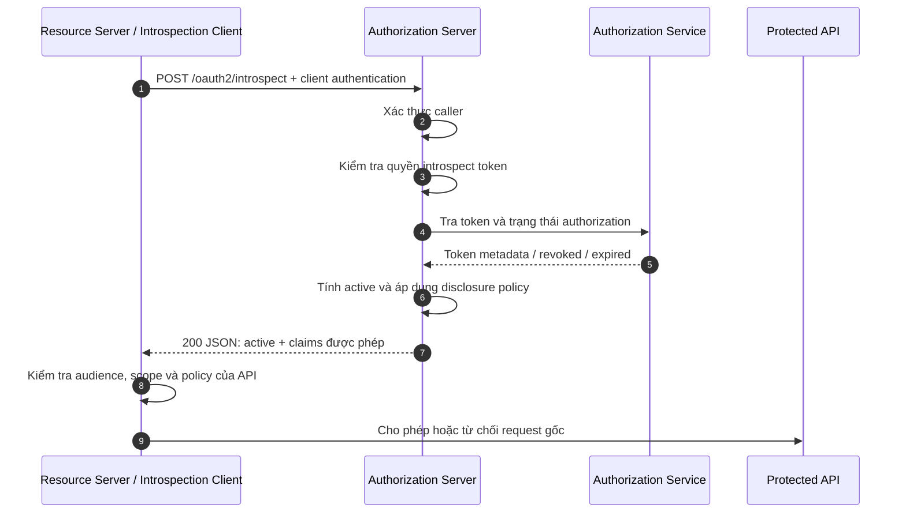

# Lọc claims và hạn chế tiết lộ dữ liệu token cho client gọi introspection

## 1. Vì sao introspection cần chính sách tiết lộ dữ liệu?

Một API gateway nhận access token từ nhiều client và gọi **Token Introspection Endpoint** của Authorization Server để kiểm tra token còn hiệu lực hay không. Response introspection có thể chứa `active`, `scope`, `client_id`, `sub`, `username`, `aud`, `iss`, thời hạn và các claim mở rộng. Nếu server trả mọi dữ liệu cho mọi caller, một API chỉ cần biết token có quyền `orders.read` có thể vô tình nhận thêm tên người dùng, định danh nội bộ, tenant, quyền của dịch vụ khác hoặc thông tin nghiệp vụ nhạy cảm.

**RFC 7662 cho phép Authorization Server trả các tập metadata khác nhau cho từng protected resource.** Ví dụ, `orders-api` chỉ cần biết token active, scope và audience; `audit-service` có thể cần thêm subject và token ID theo quyền đã được phê duyệt. Không có lý do để cả hai nhận cùng một bộ claim rộng.

Điểm cốt lõi của bài là tách ba quyết định:

1. **Client authentication:** ai đang gọi introspection endpoint?
2. **Introspection authorization:** caller có được phép hỏi về token cụ thể này và token có hợp lệ cho resource đó không?
3. **Claim disclosure:** caller được xem những metadata nào trong response?

Một client xác thực thành công chưa đồng nghĩa được quyền introspect mọi token hoặc đọc mọi claim. Việc giới hạn trường response là một phần của kiểm soát truy cập và bảo vệ quyền riêng tư.

Bài thuộc chương **Introspection** của module `SPRING_SECURITY_OAUTH2_OIDC_AUTHORIZATION_SERVER`. Mục tiêu tổng thể của module là **học cách thiết kế, cấu hình, bảo mật, kiểm thử và vận hành OAuth 2.0/OpenID Connect Authorization Server bằng Spring Security và Spring Authorization Server trong ứng dụng Spring Boot**.

### Sau bài này, bạn có thể

1. Đọc đúng response RFC 7662 và phân biệt `active` với các claim metadata tùy chọn.
2. Giải thích vì sao response cho token không hợp lệ hoặc caller không được phép phải chỉ chứa `active: false`.
3. Xây dựng allowlist claim theo introspection client, protected resource, audience và scope.
4. Cấu hình `OAuth2TokenIntrospectionEndpointConfigurer` trong Spring Authorization Server 1.5.x.
5. Tùy chỉnh `introspectionResponseHandler` để lọc claim mà vẫn giữ response JSON đúng giao thức.
6. Tránh lộ PII, token raw, lý do revoke và metadata nội bộ qua endpoint, log, cache hoặc metric.
7. Kiểm thử các trường hợp token active/inactive, caller không được phép, scope disclosure và claim mở rộng.

> **Phạm vi phiên bản:** Ví dụ Java sử dụng API của Spring Authorization Server 1.5.8 và Spring Security 6.x. Kiểm tra đúng dependency của dự án trước khi áp dụng. Ghi chú bổ sung của bài được giao để trống, không có ràng buộc riêng.

## 2. Introspection Endpoint làm gì?

Token Introspection cho phép một **protected resource** hỏi Authorization Server về trạng thái hiện tại và metadata của token đã nhận. Điều này hữu ích khi resource server sử dụng opaque/reference token, cần trạng thái revoke tập trung hoặc cần thông tin authorization không nằm trong token.



Introspection response hỗ trợ resource server đưa ra quyết định authorization; **nó không tự động cho phép request nghiệp vụ**. Resource server vẫn phải kiểm tra token dành cho đúng audience, có scope cần thiết và đáp ứng policy của endpoint.

### 2.1. Introspection khác JWT local validation

| Cách xác minh | Resource Server làm gì? | Điểm mạnh | Đánh đổi |
| --- | --- | --- | --- |
| **JWT local validation** | Tải public key, xác minh chữ ký và claims tại chỗ | Không cần gọi Authorization Server mỗi request; độ trễ thấp | Trạng thái revoke có thể không cập nhật ngay nếu không có cơ chế bổ sung |
| **Opaque token + introspection** | Gửi token đến endpoint để hỏi trạng thái | Có trạng thái tập trung, phù hợp token reference | Tạo phụ thuộc mạng, tải endpoint và dữ liệu response cần bảo vệ |
| **JWT + introspection** | Dùng cả local signature verification và trạng thái tập trung | Có thể bổ sung kiểm tra revoke/metadata động | Tăng độ phức tạp và chi phí vận hành |

Không phải mọi JWT đều bắt buộc introspect; cũng không phải opaque token tự động an toàn hơn JWT. Chọn theo yêu cầu revocation, latency, availability, privacy và khả năng vận hành.

### 2.2. Ai được gọi endpoint?

RFC 7662 yêu cầu introspection endpoint được bảo vệ bằng transport security và **phải yêu cầu một hình thức authorization** để chống token scanning. Phương thức có thể là OAuth client authentication hoặc một access token riêng có quyền gọi endpoint.

Trong Spring Authorization Server, client authentication mặc định được yêu cầu cho Token Introspection Endpoint. Các phương thức client authentication có thể dùng phụ thuộc `RegisteredClient` và cấu hình server, ví dụ `client_secret_basic`, `private_key_jwt` hoặc mTLS. Sau bước này, server vẫn cần chính sách xác định client nào được introspect token nào.

**Không công khai endpoint để bất kỳ ai gửi một chuỗi token và hỏi token đó có tồn tại hay không.** Đây là cách tạo oracle cho token enumeration và dò quét credential.

## 3. Định dạng request và response theo RFC 7662

### 3.1. Request

Introspection request dùng HTTP POST với body `application/x-www-form-urlencoded`. Tham số `token` là bắt buộc; `token_type_hint` là tùy chọn.

Ví dụ protected resource xác thực bằng HTTP Basic:

```http
POST /oauth2/introspect HTTP/1.1
Host: auth.example.com
Authorization: Basic <BASE64_CLIENT_CREDENTIALS>
Content-Type: application/x-www-form-urlencoded
Accept: application/json

token=OPAQUE_ACCESS_TOKEN&
token_type_hint=access_token
```

Ý nghĩa:

- `token`: giá trị access token hoặc refresh token cần introspect.
- `token_type_hint`: gợi ý loại token để tối ưu tra cứu; không phải bằng chứng token thuộc loại đó.
- `Authorization`: xác thực caller của endpoint; đây là credential của introspection client, không phải token đang được hỏi.

Nếu server không tìm thấy token theo hint, RFC yêu cầu mở rộng tra cứu trên các loại token được hỗ trợ. Server có thể bỏ qua hint nếu tự nhận diện token.

### 3.2. Response khi token active

Response là JSON. `active` là trường bắt buộc; các trường metadata còn lại là tùy chọn theo RFC 7662 và policy của server.

```http
HTTP/1.1 200 OK
Content-Type: application/json
Cache-Control: no-store
Pragma: no-cache

{
  "active": true,
  "client_id": "orders-web",
  "scope": "orders.read",
  "sub": "user-4821",
  "aud": ["orders-api"],
  "iss": "https://auth.example.com",
  "exp": 1794003600,
  "iat": 1794000000
}
```

Đây là response minh họa. Server có thể trả ít trường hơn; không có quy định bắt buộc phải tiết lộ toàn bộ claim có sẵn trong JWT hoặc authorization record.

### 3.3. Response khi token inactive

Khi token không tồn tại, hết hạn, bị revoke hoặc caller không được phép introspect token cụ thể, RFC 7662 yêu cầu trả response với `active: false`. Để tránh tiết lộ trạng thái nội bộ, server **không nên trả thêm thông tin** về token inactive, kể cả lý do inactive.

```http
HTTP/1.1 200 OK
Content-Type: application/json
Cache-Control: no-store
Pragma: no-cache

{
  "active": false
}
```

Không trả:

```json
{
  "active": false,
  "reason": "refresh_token_revoked",
  "username": "alice@example.com",
  "client_id": "orders-web",
  "revoked_at": "2026-11-16T08:30:00Z"
}
```

Thông tin đó có thể giúp bên gọi suy ra người dùng nào tồn tại, client nào đã phát token hoặc thời điểm một token bị thu hồi. Khi một introspection request được xác thực đúng nhưng token không active hoặc caller không được phép biết token, đó **không phải OAuth protocol error**; response vẫn là HTTP 200 với `active: false`.

### 3.4. Lỗi xác thực caller khác token inactive

| Tình huống | Kết quả |
| --- | --- |
| Caller xác thực hợp lệ, token active và caller được phép | HTTP 200, `active: true` + claims được phép |
| Caller xác thực hợp lệ, token không tồn tại/hết hạn/revoke | HTTP 200, chỉ `active: false` |
| Caller xác thực hợp lệ nhưng không được phép introspect token này | HTTP 200, chỉ `active: false` |
| Client credentials sai | HTTP 401 hoặc OAuth client-auth error phù hợp |
| Bearer credential dùng để gọi introspection không hợp lệ/không đủ quyền | HTTP 401 theo cơ chế authorization đó |
| Request thiếu `token` hoặc sai định dạng | OAuth error/HTTP status theo protocol handler |

Không biến mọi token inactive thành HTTP 401. Nếu trả status khác nhau cho “token không tồn tại”, “token revoked” và “token thuộc resource khác”, endpoint trở thành oracle rò rỉ trạng thái.

## 4. Các claim introspection thường gặp

RFC 7662 định nghĩa một số response member chuẩn. Ngoài `active`, các member dưới đây đều tùy chọn.

| Claim | Kiểu/ý nghĩa | Có thể nhạy cảm ở đâu? |
| --- | --- | --- |
| `active` | Boolean: token có active theo policy không | Bản thân trạng thái cũng là dữ liệu cần bảo vệ khỏi caller trái phép |
| `scope` | Chuỗi scope cách nhau bằng dấu cách | Có thể tiết lộ API, chức năng hoặc quyền nội bộ |
| `client_id` | Client OAuth đã yêu cầu token | Có thể tiết lộ kiến trúc ứng dụng/đối tác |
| `username` | Định danh dễ đọc của resource owner | Có thể là PII hoặc email |
| `token_type` | Loại token, ví dụ Bearer | Có thể giúp caller suy luận cơ chế xác thực |
| `exp` | Thời điểm hết hạn, Unix timestamp giây | Cho biết vòng đời token |
| `iat` | Thời điểm token được phát hành | Có thể làm lộ lịch sử hoạt động |
| `nbf` | Thời điểm token bắt đầu có hiệu lực | Metadata thời gian |
| `sub` | Subject của token, thường là định danh resource owner | Có thể là ID nội bộ/PII |
| `aud` | Resource/audience mà token dành cho | Có thể tiết lộ topology/API |
| `iss` | Issuer của token | Thường cần để xác định trust domain |
| `jti` | ID token | Có thể liên kết log hoặc sự kiện người dùng |
| Extension claims | Metadata mở rộng theo service | Có thể chứa tenant, role, email, entitlement hoặc thông tin nhạy cảm |

### 4.1. Scope là một chuỗi, không phải JSON array

Theo RFC 7662, `scope` trong introspection response là JSON string với các scope phân tách bằng dấu cách:

```json
{
  "active": true,
  "scope": "orders.read orders.write"
}
```

Không tự đổi thành:

```json
{
  "active": true,
  "scope": ["orders.read", "orders.write"]
}
```

Resource Server phải xử lý scope theo đúng định dạng response và kiểm tra scope cần thiết cho API. Không dựa vào chuỗi scope từ request client ban đầu; introspection response mới là trạng thái server xác nhận.

### 4.2. client_id có hai vai trò khác nhau

Trong một lần introspection có hai client identity:

- **Introspection caller:** Resource Server/client đang xác thực để gọi `/oauth2/introspect`.
- **Token owner client (`client_id` trong response):** OAuth client đã được cấp token đang hỏi.

Ví dụ `billing-api` là caller introspection, còn `orders-web` là client đã yêu cầu access token. Nếu trả claim `client_id`, giá trị đó thường là `orders-web`, không phải `billing-api`.

Đừng nhầm hai danh tính này khi xây allowlist. Chính caller `billing-api` được dùng để chọn disclosure policy; claim `client_id` trong token metadata mô tả nguồn gốc token.

### 4.3. sub và username không đồng nghĩa

`sub` là định danh subject, thường machine-readable; `username` là định danh human-readable. Không nên đưa email, tên đầy đủ hoặc username vào mọi introspection response nếu API chỉ cần một subject ID ổn định.

Nếu API cần đối chiếu người dùng, ưu tiên định danh opaque/pseudonymous phù hợp thay vì PII trực tiếp. Việc ánh xạ subject sang hồ sơ người dùng có thể được thực hiện trong hệ thống có quyền phù hợp.

## 5. Nguyên tắc claim disclosure: chỉ trả điều caller cần

RFC 7662 cho phép Authorization Server trả response khác nhau cho các protected resource khác nhau. Ví dụ, server có thể giới hạn số scope trả về cho từng resource để resource đó không biết thêm về phần còn lại của hệ thống.

Thiết kế disclosure policy theo **caller đã xác thực**, không theo tham số `resource` hoặc `client_id` mà caller tự gửi rồi tin ngay.

### 5.1. Ma trận disclosure ví dụ

| Introspection caller | Mục đích | Claims có thể được phép |
| --- | --- | --- |
| `orders-api` | Kiểm tra quyền truy cập đơn hàng | `active`, `scope`, `aud`, `exp`, `sub` opaque |
| `billing-api` | Kiểm tra quyền thanh toán | `active`, `scope`, `aud`, `exp`, `client_id`, `sub` opaque |
| `analytics-api` | Tính số liệu tổng hợp | `active`, `scope`, `aud`, `exp`; không cần username/sub |
| `audit-service` | Đối chiếu sự kiện bảo mật | `active`, `client_id`, `aud`, `exp`, `iat`, `jti` nếu policy phê duyệt |
| `support-tool` | Hỗ trợ kỹ thuật | Chỉ các trường tối thiểu; không mặc định có quyền đọc PII |

Đây là ma trận minh họa, không phải danh sách claim bắt buộc. Mỗi resource chỉ nên nhận trường có mục đích xử lý rõ ràng.

### 5.2. Ba tầng policy

**Tầng 1 — Endpoint access:** caller có xác thực và được phép gọi introspection endpoint không?

**Tầng 2 — Token visibility:** caller có quyền biết token này có active cho resource của nó không? Kiểm tra audience/resource binding, tenant, client relationship hoặc policy đã đăng ký.

**Tầng 3 — Claim disclosure:** nếu token được phép introspect, caller được nhận những claim nào? Dùng allowlist theo client/resource và phân loại dữ liệu.

Không dùng claim filtering để thay thế tầng 1 hoặc tầng 2. Nếu một caller không được phép introspect token, response phải là `active: false` không có metadata bổ sung.

### 5.3. Allowlist an toàn hơn denylist

**Allowlist:** chỉ trả các claim đã được duyệt. Claim mới được thêm vào token sẽ không tự động xuất hiện trong introspection response.

**Denylist:** trả tất cả rồi loại một số claim. Khi developer bổ sung `national_id`, `email`, `tenant_secret` hoặc claim nội bộ mới, denylist có thể bỏ sót và vô tình tiết lộ dữ liệu.

Với dữ liệu token, hãy ưu tiên allowlist:

```java
Set<String> allowedClaims = Set.of(
        "scope",
        "client_id",
        "aud",
        "exp"
);
```

Không mặc định đưa `sub`, `username`, `email`, `roles`, `groups`, `tenant_id` hoặc `jti` vào mọi response.

## 6. Xác định caller và phạm vi token được phép introspect

### 6.1. Xác thực caller bằng RegisteredClient

Spring Authorization Server sử dụng `RegisteredClientRepository` và client authentication filter để xác thực caller trước khi xử lý introspection request. `OAuth2ClientAuthenticationToken` cung cấp `RegisteredClient` đã xác thực thông qua `getRegisteredClient()`.

Khi xây dựng policy, lấy danh tính caller từ authentication principal do Spring xác thực, không lấy từ:

- `client_id` tùy ý trong form body.
- Header do client tự tạo như `X-Resource-Name`.
- Query parameter `audience=...` chưa được kiểm chứng.
- Claim trong token đang được introspect.

Các giá trị đó có thể là dữ liệu đầu vào; chúng không thay thế danh tính caller đã xác thực.

### 6.2. Audience và resource binding

Giả sử token có `aud = ["orders-api"]`. `billing-api` không nên được phép nhận `active: true` cho token này chỉ vì nó biết token string. Authorization Server có thể dùng audience/resource binding để xác định token có hợp lệ cho resource gọi introspection không.

Quyết định này cần thống nhất với cách hệ thống cấp token và Resource Server kiểm tra audience. Không suy ra rằng chỉ cần `aud` có mặt là server tự động đã có chính sách authorization đầy đủ.

### 6.3. Tenant isolation

Với multi-tenant system, disclosure policy nên kiểm tra tenant binding giữa:

- Introspection caller/registered client.
- Authorization/token đang được hỏi.
- Resource/audience mục tiêu.
- Tenant hoặc organization context đã được cấp quyền.

Nếu không thể chứng minh token thuộc tenant mà caller được phép phục vụ, trả `active: false` và không tiết lộ tenant ID hoặc lý do từ chối.

### 6.4. Không tin token_type_hint như một quyền

`token_type_hint=access_token` chỉ giúp server chọn chiến lược tra cứu. Nó không cấp quyền truy cập token, không chứng minh token active và không cho phép trả thêm claims. Token type và trạng thái phải được Authorization Server xác minh từ dữ liệu thật.

## 7. Cấu hình Introspection Endpoint trong Spring Authorization Server

Trong Spring Authorization Server 1.5.x, `OAuth2AuthorizationServerConfigurer` cho phép tùy chỉnh `tokenIntrospectionEndpoint(...)`.

### 7.1. SecurityFilterChain

Ví dụ cấu hình endpoint:

```java
@Bean
@Order(1)
SecurityFilterChain authorizationServerSecurityFilterChain(
        HttpSecurity http,
        AuthenticationSuccessHandler filteredIntrospectionResponseHandler)
        throws Exception {

    OAuth2AuthorizationServerConfigurer authorizationServer =
            OAuth2AuthorizationServerConfigurer.authorizationServer();

    http
        .securityMatcher(authorizationServer.getEndpointsMatcher())
        .with(authorizationServer, server ->
            server.tokenIntrospectionEndpoint(introspection ->
                introspection.introspectionResponseHandler(
                    filteredIntrospectionResponseHandler
                )
            )
        )
        .authorizeHttpRequests(authorize ->
            authorize.anyRequest().authenticated());

    return http.build();
}
```

Đây là phần cấu hình endpoint; ứng dụng còn cần `RegisteredClientRepository`, `OAuth2AuthorizationService`, `AuthorizationServerSettings`, các client authentication method và những bean của Authorization Server. Mặc định Spring đã cấu hình converter/provider/handler cho introspection; khi thay response handler, cần giữ đúng JSON response và các header bảo mật.

### 7.2. Các extension point

| Extension point | Vai trò |
| --- | --- |
| `introspectionRequestConverter(...)` | Chuyển HTTP request thành `OAuth2TokenIntrospectionAuthenticationToken` |
| `introspectionRequestConverters(...)` | Tùy chỉnh danh sách converter mặc định |
| `authenticationProvider(...)` | Thêm provider xử lý introspection request |
| `authenticationProviders(...)` | Tùy chỉnh danh sách provider |
| `introspectionResponseHandler(...)` | Tùy chỉnh response sau khi provider xử lý thành công |
| `errorResponseHandler(...)` | Tùy chỉnh OAuth error response |

**Đối với lọc claims, response handler là điểm hậu xử lý phù hợp** khi muốn giữ provider mặc định chịu trách nhiệm tra token và xác định trạng thái. Nếu cần kiểm tra caller có được phép introspect token cụ thể hay không, policy đó cần được áp dụng trước khi quyết định trả `active: true`; có thể thực hiện trong provider tùy chỉnh hoặc trong lớp policy được response handler gọi trước khi tạo response.

Không thay converter/provider mặc định chỉ để ẩn một trường JSON. Thay sai lớp có thể bỏ qua xác minh client, token lookup, expiry hoặc revocation.

## 8. Lọc claims bằng introspectionResponseHandler

Spring Authorization Server 1.5.8 cung cấp:

- `OAuth2TokenIntrospectionAuthenticationToken.getTokenClaims()` để lấy kết quả introspection.
- `OAuth2TokenIntrospectionAuthenticationToken.getPrincipal()` để lấy client principal đã xác thực.
- `OAuth2ClientAuthenticationToken.getRegisteredClient()` để xác định caller.
- `OAuth2TokenIntrospection.withClaims(...)` để tạo response với tập claims được chọn.
- `OAuth2TokenIntrospectionHttpMessageConverter` để serialize response theo định dạng introspection.

### 8.1. Chính sách disclosure riêng

Định nghĩa một abstraction để policy không bị gắn cứng vào response handler:

```java
public interface IntrospectionDisclosurePolicy {

    boolean mayIntrospect(
            RegisteredClient caller,
            Map<String, Object> tokenClaims);

    Set<String> allowedClaims(RegisteredClient caller);
}
```

Triển khai policy bằng cấu hình server-side, ví dụ mapping `clientId` sang allowlist, resource/audience được phép và tenant relationship. Không cho client introspection tự gửi danh sách claim muốn nhận rồi dùng danh sách đó làm policy.

### 8.2. Response handler mẫu

Ví dụ sau minh họa allowlist theo caller và quy tắc `active: false` khi caller không được phép biết token:

```java
@Bean
AuthenticationSuccessHandler filteredIntrospectionResponseHandler(
        IntrospectionDisclosurePolicy disclosurePolicy) {

    OAuth2TokenIntrospectionHttpMessageConverter converter =
            new OAuth2TokenIntrospectionHttpMessageConverter();

    return (request, response, authentication) -> {
        OAuth2TokenIntrospectionAuthenticationToken result =
                (OAuth2TokenIntrospectionAuthenticationToken) authentication;

        OAuth2ClientAuthenticationToken clientPrincipal =
                (OAuth2ClientAuthenticationToken) result.getPrincipal();
        RegisteredClient caller = clientPrincipal.getRegisteredClient();

        Map<String, Object> sourceClaims =
                result.getTokenClaims().getClaims();

        boolean active = Boolean.TRUE.equals(sourceClaims.get("active"));
        Map<String, Object> responseClaims = new LinkedHashMap<>();
        responseClaims.put("active", active);

        if (active && disclosurePolicy.mayIntrospect(caller, sourceClaims)) {
            Set<String> allowed = disclosurePolicy.allowedClaims(caller);

            for (String claimName : allowed) {
                if (!"active".equals(claimName)
                        && sourceClaims.containsKey(claimName)) {
                    responseClaims.put(claimName, sourceClaims.get(claimName));
                }
            }
        } else if (active) {
            // Caller không được phép introspect token cụ thể này.
            // Không tiết lộ lý do hoặc metadata token.
            responseClaims.clear();
            responseClaims.put("active", false);
        }

        OAuth2TokenIntrospection filtered =
                OAuth2TokenIntrospection.withClaims(responseClaims).build();

        response.setHeader("Cache-Control", "no-store");
        response.setHeader("Pragma", "no-cache");
        converter.write(
                filtered,
                MediaType.APPLICATION_JSON,
                new ServletServerHttpResponse(response)
        );
    };
}
```

Đoạn code minh họa các API của Spring Authorization Server 1.5.8. Cần bổ sung import, bean `IntrospectionDisclosurePolicy` và test theo đúng dependency thực tế.

Trong implementation production, `mayIntrospect(...)` và `allowedClaims(...)` phải fail closed khi policy store lỗi, thiếu registration hoặc không xác định được resource. Không bắt exception rồi quay về response claims mặc định; nếu policy không thể đưa ra quyết định, không được tiết lộ metadata.

Điểm quan trọng:

1. `active` luôn được giữ vì đây là trường bắt buộc của RFC 7662.
2. Khi token inactive, response chỉ có `active: false`.
3. Khi token active nhưng caller không được phép introspect token đó, response được đổi thành `active: false` và không có metadata khác.
4. Khi caller được phép, chỉ những claim trong allowlist mới được copy.
5. `active` không thể bị loại bởi allowlist.
6. Không ghi token raw hoặc toàn bộ source claims vào log.

### 8.3. Policy ví dụ theo client

Một implementation đơn giản có thể khai báo:

```java
Map<String, Set<String>> claimAllowlist = Map.of(
    "orders-api", Set.of("scope", "aud", "exp", "sub"),
    "billing-api", Set.of("scope", "aud", "exp", "client_id"),
    "analytics-api", Set.of("scope", "aud", "exp"),
    "audit-service", Set.of("client_id", "aud", "exp", "iat", "jti")
);
```

Đây chỉ là ví dụ allowlist. Production cần thêm kiểm tra `mayIntrospect(...)` dựa trên audience, resource, tenant, loại token và quan hệ client. Một allowlist chỉ theo client ID có thể chưa đủ nếu cùng một client phục vụ nhiều resource hoặc tenant.

### 8.4. Tránh trả claim có giá trị null hoặc sai kiểu

Khi lọc, không tự chuyển đổi kiểu dữ liệu:

- `active` phải là boolean.
- `exp`, `iat`, `nbf` là Unix timestamp tính bằng giây khi được trả theo RFC.
- `scope` là string với các scope phân tách bằng dấu cách.
- `aud` có thể là string hoặc danh sách string.
- `sub`, `iss`, `client_id` là string.

Không biến timestamp thành chuỗi ngày giờ hoặc đổi `scope` thành array nếu hợp đồng API vẫn là RFC 7662. Nếu một claim không tồn tại trong source response, bỏ qua thay vì tạo giá trị giả.

## 9. Mở rộng claim và dữ liệu nhạy cảm

Một access token có thể mang claims bổ sung để Resource Server đưa ra quyết định. Nhưng việc token có claim không đồng nghĩa introspection response phải trả claim đó cho mọi caller.

Ví dụ token có:

```json
{
  "sub": "usr-4821",
  "scope": "orders.read",
  "aud": ["orders-api"],
  "tenant_id": "tenant-17",
  "email": "alice@example.com",
  "roles": ["CUSTOMER", "SUPPORT"],
  "internal_risk_score": 12
}
```

Một `orders-api` có thể chỉ cần:

```json
{
  "active": true,
  "scope": "orders.read",
  "aud": ["orders-api"],
  "sub": "usr-4821"
}
```

`email`, `roles`, `tenant_id` hoặc `internal_risk_score` chỉ được tiết lộ khi có mục đích và quyền rõ ràng. Trong nhiều hệ thống, API chỉ cần một subject ID opaque và tự truy vấn hồ sơ qua service có quyền phù hợp.

### 9.1. Phân loại claim trước khi phát hành

| Nhóm dữ liệu | Ví dụ | Cách xử lý |
| --- | --- | --- |
| Trạng thái giao thức | `active`, `exp`, `nbf` | Chỉ trả khi cần; inactive chỉ `active: false` |
| Quyền truy cập | `scope`, `aud` | Giới hạn theo resource, không tiết lộ scope của API khác |
| Định danh kỹ thuật | `client_id`, `jti`, `iss` | Chỉ trả cho caller có nhu cầu vận hành/ủy quyền |
| Định danh người dùng | `sub`, `username` | Ưu tiên subject opaque; không mặc định trả username/email |
| Hồ sơ cá nhân | `email`, `phone_number`, `name`, địa chỉ | Cần mục đích và allowlist rõ ràng |
| Phân quyền nội bộ | `roles`, `groups`, `tenant_id` | Chỉ trả phạm vi tối thiểu, kiểm tra tenant/resource binding |
| Dữ liệu nội bộ | `risk_score`, fraud marker, policy version | Không tiết lộ ra ngoài nếu caller không có quyền đặc biệt |
| Bí mật | password, private key, client secret, token raw | Không bao giờ đưa vào introspection response |

### 9.2. Đừng trả toàn bộ JWT payload

Không triển khai handler kiểu:

```java
// Không nên: trả toàn bộ claims chỉ vì đã có sẵn.
return token.getTokenClaims().getClaims();
```

JWT payload có thể chứa custom claims dành cho một Resource Server cụ thể. Introspection endpoint có thể phục vụ nhiều resource; trả toàn bộ claims làm lộ dữ liệu giữa các miền nghiệp vụ.

### 9.3. Không dùng introspection để lấy profile người dùng

Introspection là giao thức kiểm tra token và authorization metadata. Nó không phải API hồ sơ người dùng. Nếu client cần tên/email/avatar, hãy dùng OIDC UserInfo hoặc API profile được bảo vệ bằng scope/consent tương ứng.

Không biến `username` trong introspection response thành cách thay thế UserInfo endpoint, nhất là khi caller chỉ cần kiểm tra `active` và `scope`.

## 10. Lọc scope theo từng protected resource

RFC 7662 nêu rõ Authorization Server có thể giới hạn scope trả về cho từng protected resource. Điều này hữu ích khi một token có nhiều scope nhưng mỗi API chỉ cần biết phần quyền liên quan.

Ví dụ token được cấp:

```json
{
  "scope": "orders.read orders.write billing.read profile.read"
}
```

`orders-api` chỉ cần:

```json
{
  "active": true,
  "scope": "orders.read orders.write"
}
```

`billing-api` chỉ cần:

```json
{
  "active": true,
  "scope": "billing.read"
}
```

Không trả `profile.read` hoặc scope của API khác nếu resource không cần. Đây vừa là data minimization, vừa giảm khả năng một resource suy luận topology và quyền của toàn hệ thống.

### 10.1. Scope disclosure không được cấp thêm quyền

Lọc scope là **giảm thông tin được tiết lộ**, không phải sửa quyền thực tế của token để cấp thêm quyền. Nếu token chỉ có `orders.read`, response không thể tự thêm `orders.write`.

Nếu policy resource yêu cầu scope không có trong token, Resource Server phải từ chối request. Không biến response handler thành nơi tự nâng scope.

### 10.2. Phân biệt scope được cấp và scope được tiết lộ

Có hai tập:

- **Granted scopes:** quyền thật được Authorization Server cấp cho token.
- **Disclosed scopes:** tập scope mà caller introspection được phép nhìn thấy.

Disclosed scopes phải là tập con phù hợp của granted scopes theo policy. Nếu API cần biết token có quyền cụ thể nhưng scope đó bị ẩn, hãy thiết kế policy result phù hợp thay vì tiết lộ toàn bộ scope cho tất cả caller.

## 11. Token không được phép introspect: trả active false

Một caller có thể xác thực thành công nhưng không được phép biết token thuộc resource khác. RFC 7662 yêu cầu trường hợp này được biểu diễn giống token không active: `active: false` và không có metadata bổ sung.

| Caller | Token audience | Kết quả |
| --- | --- | --- |
| `orders-api` | `orders-api` | Có thể `active: true` và scope/claims được phép |
| `orders-api` | `billing-api` | `active: false` nếu policy không cho introspect |
| `billing-api` | `billing-api` | Có thể `active: true` và claims theo allowlist |
| `analytics-api` | `orders-api`, `billing-api` | Chỉ được introspect nếu policy cho phép; response scope có thể bị giới hạn |
| Client không có quyền introspection | Bất kỳ audience | Từ chối ở bước client authentication/endpoint authorization |

Không trả `403 token_belongs_to_billing_api` cho `orders-api` nếu response đó làm lộ resource khác tồn tại. `active: false` tránh phân biệt token không tồn tại, bị revoke và không thuộc phạm vi caller.

### 11.1. Tách endpoint access và token visibility

Nếu caller không có quyền gọi introspection endpoint, có thể từ chối bằng client authentication/authorization error phù hợp. Nếu caller được phép gọi endpoint nhưng token cụ thể nằm ngoài phạm vi của nó, trả `active: false`.

Sự khác biệt này giúp vận hành rõ ràng:

- **Không được gọi endpoint:** credential hoặc entitlement của caller sai.
- **Được gọi endpoint nhưng token không thuộc phạm vi:** response inactive, không tiết lộ lý do.

## 12. Bảo vệ request, response và log

### 12.1. Token gửi vào request là bí mật

Introspection request chứa raw token trong form body. Vì vậy:

- Chỉ dùng HTTPS.
- Không đưa token vào query string hoặc URL path.
- Không log body request ở reverse proxy/APM.
- Không đưa token vào exception message, tracing tag hoặc metric label.
- Không gửi token qua kênh hỗ trợ hoặc ticket không được bảo vệ.

### 12.2. Response cũng có thể chứa dữ liệu nhạy cảm

Introspection response có thể chứa `sub`, `username`, `client_id`, `aud`, scope và extension claims. Resource Server cần bảo vệ response trong memory/log/cache và chỉ chia sẻ với thành phần có quyền.

Có thể đặt `Cache-Control: no-store` và `Pragma: no-cache` trong response handler khi muốn hạn chế lưu trữ qua HTTP caches. Nếu resource server chủ động cache kết quả để giảm tải, cần cache policy riêng với TTL ngắn và đánh giá độ trễ phát hiện revoke.

### 12.3. Không log raw claims

Log phù hợp có thể gồm correlation ID, client ID của caller (nếu được phép ghi), kết quả active/inactive, resource policy đã áp dụng, mã lỗi nội bộ và latency.

Tránh log raw token, toàn bộ `OAuth2TokenIntrospection.getClaims()`, username/email/subject nếu không cần, claim mở rộng hoặc chi tiết lý do token inactive được trả cho bên ngoài.

Nếu cần audit đầy đủ hơn, lưu sự kiện có kiểm soát quyền truy cập, retention và masking; không sử dụng log ứng dụng như kho lưu token.

## 13. Cache và độ tươi của trạng thái token

RFC 7662 cho phép protected resource cache introspection response để giảm độ trễ và tải endpoint, nhưng cache làm giảm tính kịp thời của thông tin.

Ví dụ:

- Token được introspect lúc 10:00 và active.
- Resource Server cache response 5 phút.
- Token bị revoke lúc 10:01.
- Resource Server có thể tiếp tục dùng kết quả cache tới 10:05 nếu không có cơ chế invalidation.

### 13.1. Chọn TTL theo rủi ro

| Loại API | Cache policy gợi ý | Lý do |
| --- | --- | --- |
| Đọc dữ liệu ít nhạy cảm | TTL ngắn có thể chấp nhận | Cân bằng latency và revoke delay |
| Thanh toán/chuyển tiền | TTL rất ngắn hoặc introspect trực tiếp | Revoke/authorization state cần cập nhật nhanh |
| API có PII | TTL ngắn, bảo vệ cache và dữ liệu | Hạn chế tồn tại metadata nhạy cảm |
| API nội bộ tải cao | TTL ngắn + cache key an toàn | Giảm tải nhưng kiểm soát stale status |
| Token gần hết hạn | TTL không vượt thời gian còn hiệu lực | Tránh cache active sau `exp` |

Không dùng TTL dài hơn thời gian còn lại của token. Nếu response chứa `exp`, Resource Server có thể tính TTL tối đa dựa trên `exp` và giới hạn vận hành.

### 13.2. Cache key phải gắn với token và context

Nếu response thay đổi theo protected resource/caller, cache key không thể chỉ là raw token. Cần xét ít nhất token fingerprint an toàn (hash), introspection client/resource identity, tenant/context nếu policy phụ thuộc tenant và policy version nếu thay đổi policy phải có hiệu lực nhanh.

Nếu dùng cùng một cache entry cho hai resource, API ít quyền có thể nhận response claims đã tạo cho API nhiều quyền.

### 13.3. Cache response đã lọc

Cache **response cuối cùng đã áp dụng disclosure policy** cho caller cụ thể. Không lấy một response đầy đủ từ cache rồi trả lại cho client khác. Khi policy thay đổi, có cơ chế invalidate hoặc version cache phù hợp.

## 14. Cấu hình policy và lưu trữ trong ứng dụng

Không có một trường chuẩn duy nhất trong `RegisteredClient` quy định allowlist claim introspection cho mọi hệ thống. Có thể lưu policy trong cấu hình riêng, database hoặc custom settings theo client.

Ví dụ mô hình policy:

```java
public record IntrospectionClientPolicy(
        Set<String> allowedAudiences,
        Set<String> allowedClaims,
        Set<String> allowedScopes,
        Set<String> allowedTenants) {
}
```

Một policy service có thể:

1. Lấy client đã xác thực từ `OAuth2ClientAuthenticationToken`.
2. Tra policy theo client ID.
3. Kiểm tra audience/resource của token.
4. Kiểm tra tenant binding nếu có.
5. Xác định token có được introspect không.
6. Tạo allowlist claim và scope phù hợp.

Không nên cho phép cấu hình policy động từ request introspection nếu chưa có xác thực và kiểm soát quyền quản trị riêng.

### 14.1. Client-specific policy trong RegisteredClient

Nếu dùng custom `ClientSettings` hoặc một bảng policy riêng:

- Gắn policy với internal registered-client ID ổn định, không chỉ một chuỗi client ID có thể thay đổi.
- Có schema/version và validation khi lưu.
- Chỉ admin/service có quyền mới được sửa allowlist.
- Audit mọi thay đổi policy.
- Khi policy không tìm thấy hoặc lỗi đọc, fail closed: không tiết lộ thêm claim.

### 14.2. Không để allowlist rỗng có nghĩa là “cho tất cả”

Một lỗi cấu hình nguy hiểm là:

```java
if (allowedClaims.isEmpty()) {
    return sourceClaims; // Không an toàn
}
```

Nếu policy rỗng hoặc thiếu, nên trả tối thiểu `active` hoặc từ chối introspection theo chính sách. Không diễn giải “chưa cấu hình” thành “được xem tất cả”.

## 15. Ma trận kiểm thử lọc claims và quyền introspection

| Ca thử | Thiết lập | Kết quả mong đợi |
| --- | --- | --- |
| Token active, caller đúng resource | Token active, audience phù hợp | `active: true` + allowlist |
| Token active, caller sai resource | Audience không thuộc caller | `active: false` duy nhất |
| Token không tồn tại | Không có authorization record | `active: false` duy nhất |
| Token hết hạn | `exp` đã qua | `active: false` duy nhất |
| Token bị revoke | Token invalidated | `active: false` duy nhất |
| Client credentials sai | Basic/JWT assertion sai | HTTP 401/error phù hợp |
| Caller không được phép gọi endpoint | Client chưa có quyền introspection | Bị từ chối trước khi tra token |
| Caller được gọi nhưng không được xem token | Policy token visibility không đạt | `active: false` duy nhất |
| Allowlist chỉ có scope/aud/exp | Token có thêm username/email | Response không chứa username/email |
| Allowlist rỗng | Policy thiếu hoặc cấu hình rỗng | Không trả thêm claim |
| Claim source không có field | Allowlist có `jti`, token không có | Bỏ qua field, không tạo giả |
| Scope disclosure | Token có nhiều scope, resource cần subset | Chỉ trả scope được phép |
| Caller khác nhau | Hai resource cùng hỏi token | Response khác theo policy, không dùng chung cache |
| Subject PII | Token có email/username | Chỉ trả khi policy cho phép |
| Extension claim nhạy cảm | Token có `tenant_secret`/risk score | Không xuất hiện nếu không được allowlist |
| Inactive token | Có username, sub, reason nội bộ | Chỉ `active: false` |
| Client ID confusion | Caller là `billing-api`, token owner là `orders-web` | Policy dùng caller; claim `client_id` mô tả token owner |
| `token_type_hint` sai | Hint refresh nhưng token access | Server vẫn tìm trên token types hỗ trợ |
| Cache theo caller | Cùng token, hai disclosure policies | Không trả response của caller A cho caller B |
| Cache sau revoke | Response active đã cache rồi token bị revoke | TTL/revocation behavior theo policy, không vượt `exp` |
| Policy service unavailable | Không tra được allowlist | Fail closed, không trả toàn bộ claims |
| Policy bị sửa | Remove claim khỏi allowlist | Cache/policy version cập nhật theo thiết kế |
| Unknown claim mới | Developer thêm claim vào JWT | Không tự xuất hiện do dùng allowlist |
| Raw token logging | Bật request logging | Test chứng minh token không xuất hiện trong log |
| Response headers | Response introspection | Có `Cache-Control: no-store` nếu policy yêu cầu |
| Resource audience mismatch | Token audience khác API | Resource Server không cho truy cập |
| Token active nhưng thiếu scope | API cần `orders.write` | Introspection active không làm request được phép |
| Nhiều tenant | Token thuộc tenant khác | `active: false` nếu caller không được phép biết |
| Opaque token | Authorization Service lưu reference token | Provider tra cứu trạng thái chính xác |
| JWT access token | JWT có claims, authorization state | Introspection theo trạng thái server, không chỉ decode payload |
| Multi-instance | Hai node có cùng policy/authorization state | Response và disclosure nhất quán |

### 15.1. Kiểm thử response JSON

Pseudocode kiểm thử:

```java
var response = introspect("orders-api", activeOrdersToken);

assertThat(response.status()).isEqualTo(200);
assertThat(response.json().get("active")).isEqualTo(true);
assertThat(response.json().get("scope")).isEqualTo("orders.read");
assertThat(response.json().containsKey("email")).isFalse();
assertThat(response.json().containsKey("tenant_secret")).isFalse();
```

Với token không được phép introspect:

```java
var response = introspect("orders-api", billingToken);

assertThat(response.status()).isEqualTo(200);
assertThat(response.json()).containsOnlyKeys("active");
assertThat(response.json().get("active")).isEqualTo(false);
```

Đây là pseudocode kiểm thử; `introspect(...)` và assertion helper là hàm test do ứng dụng xây dựng.

### 15.2. Test negative claims

Đừng chỉ kiểm tra claim được phép có mặt. Hãy kiểm tra rõ các claim không được phép **không xuất hiện**: `email`, `phone_number`, `username`, `tenant_id`, `roles`, `groups`, `internal_risk_score`, `jti` nếu caller không cần và custom claim được thêm ở bản phát hành sau.

Negative assertions giúp phát hiện việc developer vô tình thêm claim vào token hoặc response handler.

## 16. Troubleshooting

| Hiện tượng | Nguyên nhân có thể | Cách xử lý |
| --- | --- | --- |
| Caller nhận quá nhiều claims | Handler trả toàn bộ `getClaims()` hoặc dùng denylist | Dùng allowlist theo client/resource |
| Inactive response có username | Handler copy claim trước khi kiểm tra `active` | Nhánh inactive chỉ tạo `active: false` |
| Client A nhìn thấy scope của API B | Disclosure policy không theo caller/audience | Kiểm tra caller principal, resource binding và cache key |
| `active: true` cho token audience khác | Chưa áp dụng token visibility policy | Kiểm tra audience/resource trước khi trả active |
| `active: false` dù token còn hạn | Token revoked, resource mismatch hoặc storage không đồng nhất | Kiểm tra authorization state và caller policy |
| Client credentials sai nhưng response là active false | Nhầm lỗi caller với token inactive | Xác thực caller trước; lỗi auth trả HTTP/OAuth error |
| Scope có định dạng array | Custom serializer sai hợp đồng | Giữ `scope` là space-delimited string |
| `client_id` trong response là caller | Nhầm client introspection với client sở hữu token | Lấy token claim `client_id`; policy dùng caller principal |
| Response có email ngoài dự kiến | Claim custom bị copy mặc định | Thêm negative test và allowlist |
| Resource Server vẫn dùng token sau revoke | Cache TTL quá dài | Giảm TTL hoặc invalidate cache |
| Resource khác nhận cache entry | Cache key không gắn caller/context | Thêm caller/resource/policy version vào key |
| Không serialize được OAuth2TokenIntrospection | Dùng handler sai converter | Dùng `OAuth2TokenIntrospectionHttpMessageConverter` |
| Handler ClassCastException | Principal không phải `OAuth2ClientAuthenticationToken` | Kiểm tra client auth flow và fail closed |
| Policy lỗi nhưng response đầy đủ | Fallback cho phép tất cả | Fail closed khi policy unavailable |

Trình tự điều tra: xác minh caller đã authenticate → token lookup/active status → quyền introspect token → allowlist theo caller/resource → response handler/serializer → cache/log/proxy/multi-instance.

## 17. Tình huống tổng hợp: ba API, ba mức disclosure

Một doanh nghiệp có `orders-api`, `billing-api` và `analytics-api`. Các API đều dùng opaque access token và gọi cùng `/oauth2/introspect`.

Một token được cấp cho `orders-web` với scope `orders.read billing.read profile.read` và audience gồm `orders-api`, `billing-api`.

**Orders API** chỉ cần biết token có active và có `orders.read`. Response:

```json
{
  "active": true,
  "scope": "orders.read",
  "aud": ["orders-api"],
  "exp": 1794003600
}
```

**Billing API** cần biết token có quyền `billing.read`, nhưng không cần subject hoặc email:

```json
{
  "active": true,
  "scope": "billing.read",
  "aud": ["billing-api"],
  "exp": 1794003600
}
```

**Analytics API** không nằm trong audience được phép introspect token này. Response:

```json
{
  "active": false
}
```

Analytics API không biết token có tồn tại hay không, không biết người dùng nào được cấp token và không biết hệ thống có `billing.read`. Cả ba API dùng một endpoint nhưng nhận dữ liệu đúng với phạm vi của mình.

## 18. Checklist trước production

- [ ] Introspection Endpoint chỉ dùng HTTPS và yêu cầu authorization của caller.
- [ ] Client authentication được kiểm tra trước token lookup.
- [ ] Có policy xác định caller nào được introspect token nào.
- [ ] `active` luôn có mặt và là boolean.
- [ ] Inactive token hoặc token ngoài phạm vi caller chỉ trả `active: false`.
- [ ] Claims active dùng allowlist theo client/resource/audience/tenant.
- [ ] Scope được giới hạn cho protected resource và vẫn ở định dạng string theo RFC.
- [ ] Không mặc định trả `sub`, `username`, email, roles, tenant hoặc extension claims.
- [ ] Không dùng request parameter chưa tin cậy để chọn disclosure policy.
- [ ] Không log raw token, raw claims hoặc lý do token inactive.
- [ ] Cache policy có TTL phù hợp, không vượt `exp`, và cache key gắn với caller/resource context.
- [ ] Policy service unavailable thì fail closed.
- [ ] Response JSON giữ kiểu dữ liệu RFC 7662 và có header cache phù hợp.
- [ ] Integration test gồm token inactive, caller không được phép, claim leakage và cross-resource cache.
- [ ] Resource Server vẫn kiểm tra audience/scope/policy sau khi nhận `active: true`.

## 19. Tổng kết

Token introspection cung cấp trạng thái và metadata token cho protected resource. **Response phải phản ánh đúng quyền của caller, và mỗi claim chỉ được tiết lộ khi resource đó thực sự cần.**

1. **Xác thực caller:** bảo vệ endpoint để chống token scanning.
2. **Ủy quyền introspection:** kiểm tra caller có được phép biết token cụ thể này không; nếu không, trả `active: false` duy nhất.
3. **Lọc claims:** dùng allowlist theo client/resource/audience/tenant; không copy toàn bộ JWT payload.
4. **Bảo vệ dữ liệu:** hạn chế PII, scope của resource khác, custom claims, raw token và log.
5. **Giữ giao thức:** `active` bắt buộc; inactive response không giải thích lý do; scope là chuỗi cách nhau bằng dấu cách.
6. **Vận hành:** cache ngắn theo caller/context, kiểm thử negative claims và fail closed khi policy không khả dụng.

Trong Spring Authorization Server 1.5.8, `OAuth2TokenIntrospectionEndpointConfigurer` cung cấp `introspectionResponseHandler(...)` để kiểm soát response sau khi provider xử lý request. Kết hợp handler này với policy caller-aware, `OAuth2TokenIntrospection` và `OAuth2TokenIntrospectionHttpMessageConverter` giúp giữ đúng định dạng RFC 7662 trong khi hạn chế tiết lộ dữ liệu.

### Tài liệu tham khảo

- [RFC 7662 — OAuth 2.0 Token Introspection](https://www.rfc-editor.org/rfc/rfc7662)
- [RFC 6749 — The OAuth 2.0 Authorization Framework](https://www.rfc-editor.org/rfc/rfc6749)
- [RFC 6750 — OAuth 2.0 Bearer Token Usage](https://www.rfc-editor.org/rfc/rfc6750)
- [RFC 9700 — Best Current Practice for OAuth 2.0 Security](https://www.rfc-editor.org/rfc/rfc9700)
- [Spring Authorization Server 1.5.8 — Protocol Endpoints: Token Introspection](https://docs.spring.io/spring-authorization-server/reference/protocol-endpoints.html)
- [Spring Authorization Server 1.5.8 — OAuth2TokenIntrospection](https://docs.spring.io/spring-authorization-server/reference/api/java/org/springframework/security/oauth2/server/authorization/OAuth2TokenIntrospection.html)
- [Spring Authorization Server 1.5.8 — OAuth2TokenIntrospectionEndpointConfigurer](https://docs.spring.io/spring-authorization-server/reference/api/java/org/springframework/security/oauth2/server/authorization/config/annotation/web/configurers/OAuth2TokenIntrospectionEndpointConfigurer.html)
- [Spring Authorization Server 1.5.8 — OAuth2TokenIntrospectionHttpMessageConverter](https://docs.spring.io/spring-authorization-server/reference/api/java/org/springframework/security/oauth2/server/authorization/http/converter/OAuth2TokenIntrospectionHttpMessageConverter.html)
- [Spring Authorization Server — Core Model Components](https://docs.spring.io/spring-authorization-server/reference/core-model-components.html)
