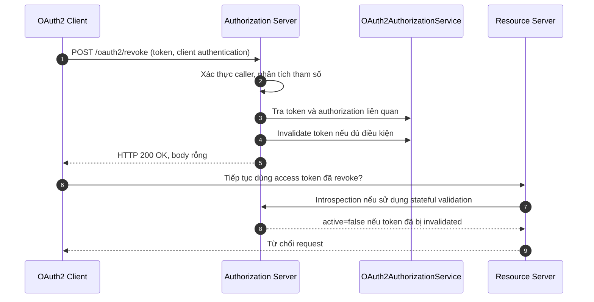
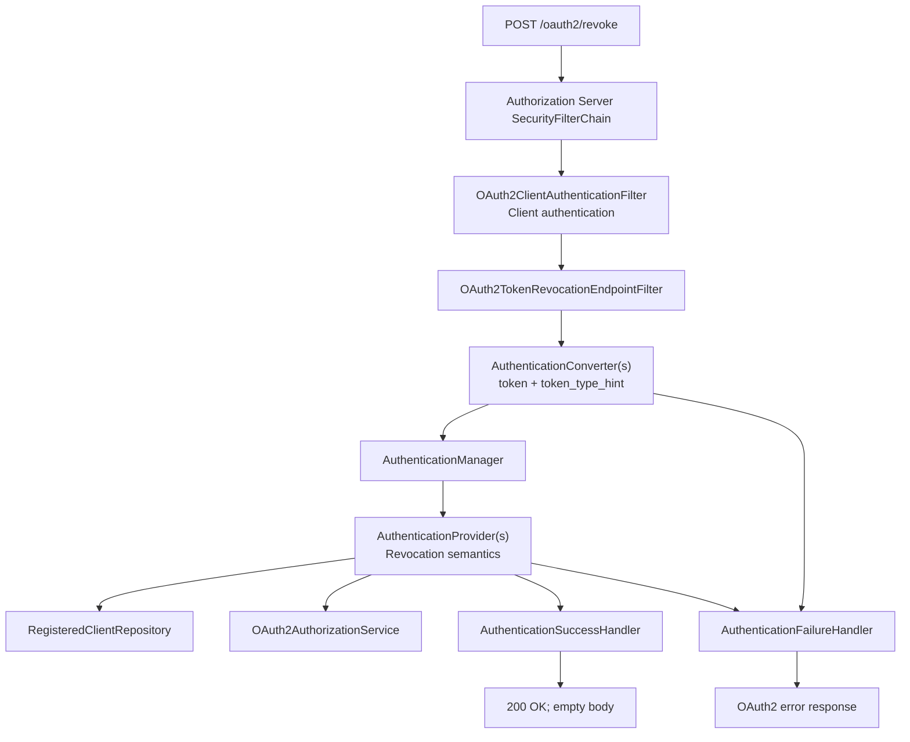
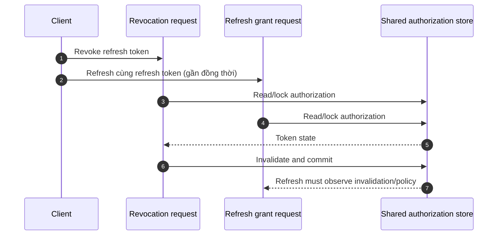
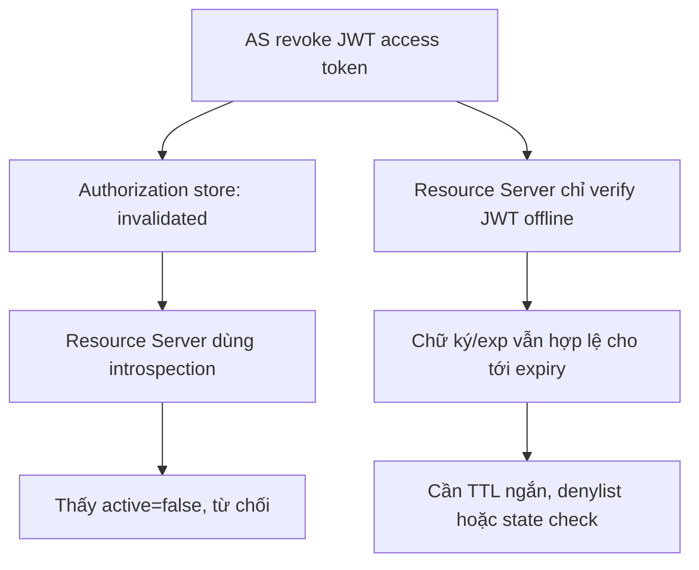
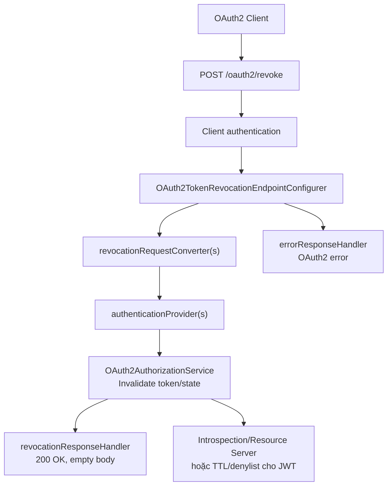

# OAuth2TokenRevocationEndpointConfigurer và điểm tùy chỉnh

## 1. Mục tiêu, phạm vi và tình huống sử dụng

Trong chương **Revocation** của module **SPRING_SECURITY_OAUTH2_OIDC_AUTHORIZATION_SERVER**, việc **thu hồi token (token revocation)** cho phép một OAuth 2.0 client thông báo với Authorization Server (AS) rằng một token không nên tiếp tục được sử dụng. Với **Spring Security**, **Spring Authorization Server (SAS)** và **Spring Boot**, điểm tích hợp chính là `OAuth2TokenRevocationEndpointConfigurer` — bộ cấu hình pipeline xử lý **Token Revocation Endpoint** theo RFC 7009.

Bài học tập trung vào cách hoạt động của endpoint, sáu điểm tùy chỉnh, quan hệ với trạng thái authorization, các nguyên tắc bảo mật và cách kiểm thử. Đây không phải bài hướng dẫn tự phát hoặc tự ký JWT bên ngoài SAS.

Sau bài này, bạn có thể:

- Giải thích mục đích của `POST /oauth2/revoke` và hợp đồng RFC 7009, bao gồm `token`, `token_type_hint`, HTTP 200 và lỗi OAuth2.
- Phân biệt thu hồi **access token**, **refresh token** và thu hồi toàn bộ authorization/token family theo chính sách.
- Cấu hình `OAuth2TokenRevocationEndpointConfigurer` trong `OAuth2AuthorizationServerConfigurer` và đúng `SecurityFilterChain`.
- Nhận diện các extension point `revocationRequestConverter(s)`, `authenticationProvider(s)`, `revocationResponseHandler` và `errorResponseHandler`.
- Thêm kiểm tra request, business policy, audit và monitoring mà vẫn giữ các bộ xử lý chuẩn.
- Hiểu giới hạn của thu hồi JWT tự chứa khi Resource Server xác minh offline, đồng thời chọn introspection, token lifetime hoặc denylist phù hợp.
- Kiểm thử idempotency, không tiết lộ token, client authentication, race condition, cache và hoạt động nhiều instance.

**Phiên bản:** Code minh họa hướng tới API thông dụng của **Spring Authorization Server 1.x**, **Spring Security 6.x** và **Spring Boot 3.x**. Tên lớp, danh sách provider mặc định hoặc signature có thể khác khi nâng version; hãy đối chiếu dependency thực tế. Một số đoạn code được đánh dấu là *khung tích hợp*, không phải ứng dụng có thể chạy độc lập.

## 2. Token revocation giải quyết vấn đề nào?

Token thường có thời hạn:

- **Access token** có TTL tương đối ngắn, dùng tại Resource Server.
- **Refresh token** có thể sống lâu hơn, dùng tại Token Endpoint để xin access token mới.
- Người dùng có thể logout, rút quyền đồng ý; quản trị viên có thể khóa client, hoặc client phát hiện refresh token bị mất.

Nếu chỉ chờ `exp`, token có thể còn được sử dụng trong khoảng thời gian không mong muốn. RFC 7009 cung cấp cách gửi yêu cầu **chủ động vô hiệu hóa token** tại Authorization Server.



**Quan trọng:** Đoạn cuối sơ đồ giả định Resource Server sử dụng introspection hoặc một cơ chế kiểm tra trạng thái cập nhật. Nếu API chỉ xác minh chữ ký JWT offline, chữ ký JWT cũ vẫn hợp lệ về mặt mật mã; thao tác revocation tại AS **không tự động khiến API ngừng chấp nhận JWT lập tức**.

### 2.1. Revocation, expiration, logout và introspection

| Khái niệm | Mục đích | Thời điểm/đầu ra |
| --- | --- | --- |
| `exp`/expiration | Token tự hết hiệu lực theo thời gian | Được kiểm tra ở bên nhận hoặc AS |
| Token revocation | Client yêu cầu AS vô hiệu một token | `POST /oauth2/revoke`, không phát token |
| Token introspection | Resource Server hỏi AS trạng thái/metadata token | `POST /oauth2/introspect` với `active` |
| OAuth2 Token Endpoint | Đổi code, refresh hoặc grant khác lấy token | `POST /oauth2/token`, có token response |
| OIDC logout | Kết thúc session đăng nhập và/hoặc thông báo client | Giao thức logout riêng; không đồng nghĩa revoke mọi token |
| Refresh token rotation | Thay refresh token khi sử dụng để giảm replay | Thực hiện trong luồng refresh grant, không thay revocation endpoint |

Logout ở client chỉ xóa cookie/local token chưa chắc đã thu hồi token ở AS. Ngược lại, revoke refresh token chưa tự động xóa session OIDC tại browser. Chính sách “logout toàn bộ” cần thiết kế phối hợp nhiều cơ chế.

## 3. Hợp đồng HTTP theo RFC 7009

### 3.1. Request bắt buộc có `token`

Revocation request được gửi qua **HTTPS**, phương thức **POST**, với form body `application/x-www-form-urlencoded`:

```http
POST /oauth2/revoke HTTP/1.1
Host: auth.example.com
Authorization: Basic <REDACTED_CLIENT_CREDENTIALS>
Content-Type: application/x-www-form-urlencoded
Accept: application/json

token=OPAQUE_REFRESH_TOKEN&token_type_hint=refresh_token
```

| Tham số | Bắt buộc | Ý nghĩa |
| --- | --- | --- |
| `token` | Có | Giá trị token client muốn yêu cầu thu hồi |
| `token_type_hint` | Không | Gợi ý kiểu token, ví dụ `access_token` hoặc `refresh_token` |

Token là credential nhạy cảm: không đặt ở query string, URL, access log hoặc browser history. `Authorization` trong ví dụ chỉ minh họa `client_secret_basic`; client authentication method thực tế phải khớp `RegisteredClient` và chính sách AS.

**`token_type_hint` chỉ là gợi ý**, không phải chứng minh loại token. AS có thể tra cứu loại còn lại nếu không tìm thấy ở loại được gợi ý; không được bỏ kiểm tra client, trạng thái token hoặc ràng buộc authorization chỉ vì caller khai `refresh_token`.

### 3.2. Response thành công: HTTP 200 và body rỗng

Ví dụ phản hồi:

```http
HTTP/1.1 200 OK
Cache-Control: no-store
Pragma: no-cache
Content-Length: 0
```

Các header kiểm soát cache có thể được thêm theo chính sách; body thành công **không phải** JSON chứa `revoked=true` hoặc token mới. Điểm quan trọng của RFC 7009 là AS phản hồi **HTTP 200** cả khi token đã được thu hồi thành công **và khi client đưa vào token không hợp lệ/không tồn tại**, để tránh tiết lộ trạng thái token.

**Không suy từ HTTP 200 rằng token từng tồn tại**, thuộc client, hay mọi bản sao tại Resource Server đã lập tức không còn được chấp nhận. Với cùng token, gửi revoke lặp lại là tình huống hợp lệ về giao thức và nên cho ra cùng kiểu success response.

### 3.3. Phản hồi lỗi

Một số lỗi cần phân biệt với token không tồn tại:

| Tình huống | Phản hồi dự kiến |
| --- | --- |
| `token` không tồn tại hoặc đã revoke | **200 OK**; không tiết lộ token state |
| Thiếu `token`, tham số sai cấu trúc | OAuth2 `invalid_request`, thường 400 |
| Client authentication không hợp lệ | OAuth2 `invalid_client`; status/header theo authentication method |
| AS không hỗ trợ revocation đối với loại token | `unsupported_token_type` theo RFC 7009, khi áp dụng |
| Dependency/database lỗi | Lỗi server phù hợp; không giả vờ revoke thành công |
| Caller không được phép thực hiện hành động theo policy | Lỗi authorization phù hợp; tránh tiết lộ token thuộc ai |

`unsupported_token_type` không phải `unsupported_grant_type` của Token Endpoint. Đừng sử dụng một mã lỗi chung cho mọi trường hợp.

Ví dụ lỗi khi thiếu tham số:

```http
HTTP/1.1 400 Bad Request
Content-Type: application/json
Cache-Control: no-store

{"error":"invalid_request"}
```

Lỗi `invalid_client` có thể yêu cầu HTTP 401/`WWW-Authenticate` phù hợp, đặc biệt với HTTP Basic; không copy một header Basic sang mọi method `private_key_jwt`/mTLS.

## 4. Ý nghĩa thu hồi access token và refresh token

### 4.1. Khi revoke access token

AS đánh dấu access token được yêu cầu là không còn active theo token store/policy. Access token đã revoke không nên được AS báo `active=true` khi Resource Server introspect lại.

**Nhưng** với JWT access token tự chứa:

- Nội dung và chữ ký JWS đã phát hành không thay đổi.
- Resource Server offline có thể tiếp tục chấp nhận nếu token chưa hết hạn, chữ ký/issuer/audience/scope vẫn đúng.
- Muốn ngăn truy cập nhanh, Resource Server cần introspection, denylist, versioned-session check, event-driven invalidation hoặc TTL đủ ngắn.
- Không tự cho rằng xóa record ở AS sẽ khiến mọi API tự “biết” revocation.

### 4.2. Khi revoke refresh token

Refresh token dùng xin access token mới. Nếu refresh token đã bị revoke, Token Endpoint phải từ chối refresh grant tương ứng, thường bằng `invalid_grant`.

RFC 7009 quy định khi revoke refresh token, AS **nên** vô hiệu cả access token dựa trên cùng authorization grant nếu hệ thống hỗ trợ access token revocation. Ngược lại, khi revoke access token, AS **có thể** vô hiệu refresh token liên quan theo chính sách.

| Token được yêu cầu thu hồi | Tác động tối thiểu | Tác động liên đới cần thiết kế |
| --- | --- | --- |
| Access token | Token đó không còn active tại AS | Có thể thu hồi refresh token/authorization liên quan theo policy |
| Refresh token | Không được refresh tiếp | Nên cân nhắc vô hiệu hóa các access token cùng grant theo RFC 7009 |
| Refresh token family bị phát hiện replay | Chặn credential/family theo security policy | Có thể thu hồi cả family/authorization, bắt buộc đăng nhập lại |
| Logout toàn bộ phiên | Không được suy ra chỉ từ một revoke request | Cần phối hợp revocation, session logout, thông báo clients và policy |

SAS default provider có hành vi cụ thể theo token state và phiên bản; **không mặc định mọi request revoke access token sẽ luôn vô hiệu toàn bộ refresh token family**. Nếu nghiệp vụ cần chính sách mạnh hơn, phải thiết kế extension có tests.

### 4.3. Thu hồi một token khác thu hồi toàn bộ authorization

Một `OAuth2Authorization` có thể chứa nhiều token/state của cùng grant. Có ít nhất ba cấp độ kiểm soát:

1. **Single token:** vô hiệu riêng token được yêu cầu.
2. **Grant authorization:** vô hiệu token liên quan tới một authorization.
3. **Token family/session:** vô hiệu các refresh token và access token liên quan theo cây rotation hoặc phiên đăng nhập.

Không xóa toàn bộ authorization chỉ vì có một request revoke access token nếu người dùng hoặc business policy chỉ yêu cầu thu hồi một credential. Ngược lại, trong sự cố refresh-token reuse, thu hồi một giá trị token đơn lẻ có thể không đủ.

## 5. Vị trí `OAuth2TokenRevocationEndpointConfigurer` trong SAS DSL

SAS tổ chức các endpoint trong `OAuth2AuthorizationServerConfigurer`. `tokenRevocationEndpoint(...)` là điểm cấu hình revocation pipeline bên trong AS `SecurityFilterChain`.

```java
@Configuration(proxyBeanMethods = false)
@EnableWebSecurity
public class AuthorizationServerSecurityConfig {

    @Bean
    @Order(1)
    SecurityFilterChain authorizationServerChain(HttpSecurity http)
            throws Exception {

        OAuth2AuthorizationServerConfigurer as =
                OAuth2AuthorizationServerConfigurer.authorizationServer();

        http
            .securityMatcher(as.getEndpointsMatcher())
            .with(as, server -> server
                    .tokenRevocationEndpoint(revoke -> {
                        // Chỉ tùy biến khi có yêu cầu rõ ràng.
                    })
                    .oidc(Customizer.withDefaults()))
            .authorizeHttpRequests(authorize ->
                    authorize.anyRequest().authenticated())
            .exceptionHandling(exceptions ->
                    exceptions.defaultAuthenticationEntryPointFor(
                            new LoginUrlAuthenticationEntryPoint("/login"),
                            new MediaTypeRequestMatcher(MediaType.TEXT_HTML)))
            .oauth2ResourceServer(resourceServer ->
                    resourceServer.jwt(Customizer.withDefaults()));

        return http.build();
    }

    @Bean
    @Order(2)
    SecurityFilterChain applicationChain(HttpSecurity http)
            throws Exception {

        http.authorizeHttpRequests(authorize ->
                    authorize.anyRequest().authenticated())
            .formLogin(Customizer.withDefaults());

        return http.build();
    }
}
```

**Giới hạn của ví dụ:** Đây là khung DSL để nhìn vị trí endpoint, không phải Authorization Server chạy độc lập. Cần có `RegisteredClientRepository`, `OAuth2AuthorizationService`, token generators, signing keys, issuer và user authentication phù hợp. OIDC chỉ bật nếu ứng dụng dùng OIDC và có các bean tương ứng.

Nếu hệ thống không cần custom revocation behavior, **giữ cấu hình mặc định**. SAS có converter/provider và response handling chuẩn cho endpoint; không cần viết lại toàn bộ logic chỉ để hỗ trợ RFC 7009.

### 5.1. Endpoint path và issuer

Đường dẫn mặc định thường là `/oauth2/revoke`, nhưng có thể cấu hình qua `AuthorizationServerSettings`:

```java
@Bean
AuthorizationServerSettings authorizationServerSettings() {
    return AuthorizationServerSettings.builder()
            .issuer("https://auth.example.com")
            .tokenRevocationEndpoint("/oauth2/revoke")
            .build();
}
```

Nếu thay path, phải đồng bộ client configuration, gateway, metadata khi có công bố và security matcher. Không dựng `@PostMapping("/oauth2/revoke")` song song với SAS filter, vì có thể tạo một đường xử lý bỏ qua client authentication/authorization state.

## 6. Kiến trúc pipeline của revocation



Đây là sơ đồ trách nhiệm khái niệm: chi tiết filter ordering và exception flow phụ thuộc cấu hình SAS/Spring Security.

| Chặng | Thành phần | Trách nhiệm |
| --- | --- | --- |
| Chọn HTTP endpoint | `SecurityFilterChain`, `OAuth2TokenRevocationEndpointFilter` | Đưa request vào đúng revocation flow |
| Xác thực caller | `OAuth2ClientAuthenticationFilter` và providers | Chứng minh client identity theo method đăng ký |
| Parse request | `AuthenticationConverter` | Kiểm tra form, `token` và hint |
| Xử lý revoke | `AuthenticationProvider` | Xác minh client/token relationship, áp dụng policy, invalidation |
| Lưu trạng thái | `OAuth2AuthorizationService` | Persist token/authorization invalidation |
| Trả thành công | `AuthenticationSuccessHandler` | HTTP 200, body rỗng |
| Trả lỗi | `AuthenticationFailureHandler` | OAuth2 error JSON, status/header phù hợp |

**Phân biệt:** Client authentication là phần của `clientAuthentication(...)`/client auth providers; revocation validation và state update thuộc `tokenRevocationEndpoint(...)`. Không tự kiểm tra client secret trong request converter rồi bỏ qua các phương thức auth đã đăng ký.

## 7. Các extension point của `OAuth2TokenRevocationEndpointConfigurer`

### 7.1. Bảng API

| API | Kiểu tham số | Mục đích | Lỗi thường gặp |
| --- | --- | --- | --- |
| `revocationRequestConverter(...)` | `AuthenticationConverter` | Thêm converter cho request revocation | Nhận nhầm request, bỏ kiểm tra token/hint |
| `revocationRequestConverters(...)` | `Consumer<List<AuthenticationConverter>>` | Xem/điều chỉnh danh sách converters | Xóa default converter hoặc thay thứ tự không kiểm thử |
| `authenticationProvider(...)` | `AuthenticationProvider` | Bổ sung provider xử lý authentication token revocation | Bypass client binding, token state hoặc trả success trước persistence |
| `authenticationProviders(...)` | `Consumer<List<AuthenticationProvider>>` | Xem/điều chỉnh danh sách providers | `supports(...)` quá rộng, nhiều provider xung đột |
| `revocationResponseHandler(...)` | `AuthenticationSuccessHandler` | Tùy biến HTTP response thành công | Trả thông tin về token/tình trạng revoke |
| `errorResponseHandler(...)` | `AuthenticationFailureHandler` | Tùy biến OAuth2 error response | Tiết lộ token, lẫn `invalid_client` với invalid token |

Trong SAS 1.x có các lớp liên quan như `OAuth2TokenRevocationAuthenticationConverter`, `OAuth2TokenRevocationAuthenticationProvider` và `OAuth2TokenRevocationAuthenticationToken`. Khi thay đổi framework version, kiểm tra chữ ký API và default behavior bằng integration tests.

### 7.2. Chọn điểm tùy chỉnh đúng

- **Kiểm tra token form bị trùng hoặc quá dài:** converter hoặc filter/body limiter trước endpoint.
- **Thêm client/token policy đặc thù:** provider hoặc policy service được gọi trước khi state update.
- **Ghi audit và metrics:** decorate provider/service hoặc event handling, không ghi raw token.
- **Cần revoke refresh token family:** logic domain/state mutation có transaction, test race; không đặt trong HTTP success handler.
- **Thay response HTTP theo interoperability contract:** success/error handler; vẫn bảo toàn RFC 7009.
- **Thay client authentication method:** `clientAuthentication(...)`, không phải `revocationRequestConverter(...)`.
- **Muốn token mới có claims khác:** token customizer/generator, không phải revocation endpoint.
- **Muốn Resource Server nhận revoke gần realtime:** introspection/cache invalidation/denylist/event design, không chỉ thay revocation handler.

Không dùng danh sách consumer để loại bỏ mặc định nếu chưa hiểu tác động. Sử dụng điểm mở rộng nhỏ nhất đủ đáp ứng yêu cầu.

## 8. Request converter: kiểm tra cấu trúc, không tự revoke

`AuthenticationConverter#convert(HttpServletRequest)` nhận form request, xác định cấu trúc hợp lệ rồi trả một `Authentication` mô tả yêu cầu revocation cho provider. Converter không có nhiệm vụ xóa token trong database hoặc phát token mới.

### 8.1. Các bất biến quan trọng

- `token` phải hiện diện đúng format và không phải chuỗi trống.
- Khi có `token_type_hint`, cần kiểm soát số lần xuất hiện và encoding.
- Tránh parameter pollution: `token=A&token=B` phải bị từ chối theo policy, không tùy ý lấy giá trị đầu.
- Giới hạn độ dài token/body để giảm memory/CPU/storage DoS.
- Không ghi token hoặc client secret vào log.
- Không sử dụng request parameter `client_id` như bằng chứng danh tính client.
- Không coi một hint không nhận diện được là chứng cứ token invalid, vì RFC nói hint chỉ hỗ trợ tra cứu.

### 8.2. Wrapper bảo toàn converter mặc định

Ví dụ thêm validation cho số lần xuất hiện của tham số, sau đó **ủy quyền converter chuẩn**:

```java
public final class StrictRevocationRequestConverter
        implements AuthenticationConverter {

    private final AuthenticationConverter delegate;

    public StrictRevocationRequestConverter(
            AuthenticationConverter delegate) {
        this.delegate = delegate;
    }

    @Override
    public Authentication convert(HttpServletRequest request) {
        String[] tokens = request.getParameterValues("token");
        String[] hints = request.getParameterValues("token_type_hint");

        if (tokens == null || tokens.length != 1
                || !StringUtils.hasText(tokens[0])
                || tokens[0].length() > 8192
                || (hints != null && hints.length > 1)) {

            throw new OAuth2AuthenticationException(
                    new OAuth2Error(
                            OAuth2ErrorCodes.INVALID_REQUEST));
        }

        return delegate.convert(request);
    }
}
```

`8192` chỉ là giới hạn **minh họa**, cần chọn theo token format thực tế. Lớp này không đọc raw bytes và không chứng minh chống body-size DoS tuyệt đối; hãy cấu hình thêm giới hạn form/body tại reverse proxy/container. Converter vẫn dùng delegate để xử lý ngữ nghĩa giao thức, kể cả `token_type_hint`.

### 8.3. Đăng ký qua danh sách converter

```java
authorizationServer.tokenRevocationEndpoint(revoke ->
        revoke.revocationRequestConverters(converters -> {
            for (int i = 0; i < converters.size(); i++) {
                AuthenticationConverter current = converters.get(i);

                if (current instanceof
                        OAuth2TokenRevocationAuthenticationConverter) {

                    converters.set(i,
                            new StrictRevocationRequestConverter(
                                    current));
                }
            }
        }));
```

Đây là đoạn cấu hình trong ngữ cảnh biến `authorizationServer`, không phải bean đầy đủ. Cần kiểm tra runtime class mặc định đúng phiên bản SAS. Nếu default converter không nằm trong list như dự kiến, không tự thêm một converter nhận mọi request; hãy báo lỗi cấu hình/test thất bại và xử lý rõ ràng.

**Không tự tạo `OAuth2TokenRevocationAuthenticationToken` mà đánh dấu client principal authenticated bằng input do client tự khai.** Client principal phải đến từ client authentication chain.

## 9. Authentication provider: kiểm tra quyền và cập nhật state

`AuthenticationProvider` xử lý request revocation đã được converter chuyển đổi. Provider chuẩn của SAS phối hợp client principal, token state và `OAuth2AuthorizationService` để thực hiện semantics phù hợp.

### 9.1. Những kiểm tra không được bỏ

| Kiểm tra | Vì sao cần? |
| --- | --- |
| Caller được xác thực bằng method đã đăng ký | Tránh client không có quyền gọi endpoint |
| Client liên quan đúng token/authorization theo policy | Không cho client A tùy tiện revoke token của B |
| Token type được hỗ trợ | Xử lý `access_token`, `refresh_token` hoặc token khác đúng semantics |
| Token đang active hay đã revoke | Lưu idempotency; không tiết lộ tồn tại token |
| Cập nhật authorization/token state thành công | Không trả “thành công thực sự” trước khi persistence hoàn tất |
| Scope và side effects liên đới | Không vô hiệu rộng hơn/nông hơn policy |
| Race condition/transaction | Tránh refresh token được đổi cùng lúc với revoke nhưng vẫn sống trái chính sách |
| Audit an toàn | Biết ai yêu cầu, kết quả nghiệp vụ nào, không lộ raw token |

### 9.2. Provider decorator cho business policy

Khi muốn áp thêm policy mà không viết lại toàn bộ revocation, một lựa chọn là **decorate** provider chuẩn:

```java
public final class PolicyGuardedRevocationProvider
        implements AuthenticationProvider {

    private final AuthenticationProvider delegate;
    private final RevocationAdmissionPolicy admissionPolicy;

    public PolicyGuardedRevocationProvider(
            AuthenticationProvider delegate,
            RevocationAdmissionPolicy admissionPolicy) {
        this.delegate = delegate;
        this.admissionPolicy = admissionPolicy;
    }

    @Override
    public boolean supports(Class<?> authentication) {
        return delegate.supports(authentication);
    }

    @Override
    public Authentication authenticate(Authentication authentication) {
        admissionPolicy.validateCaller(authentication);

        Authentication result = delegate.authenticate(authentication);

        // Chỉ audit metadata không nhạy cảm. Đừng log token.
        admissionPolicy.auditCompleted(authentication);
        return result;
    }
}
```

`RevocationAdmissionPolicy` là interface/service **do ứng dụng định nghĩa**, không phải API SAS có sẵn. Các hàm phải kiểm tra **client principal đã được xác thực**, không tin `client_id` trong form. `auditCompleted` chỉ nên ghi thông tin an toàn (client ID đã xác thực, correlation ID, loại tác vụ, thời gian), không ghi token hoặc kết luận token có tồn tại hay không cho caller.

### 9.3. Đăng ký decorator vào provider list

```java
authorizationServer.tokenRevocationEndpoint(revoke ->
        revoke.authenticationProviders(providers -> {
            ListIterator<AuthenticationProvider> iterator =
                    providers.listIterator();

            while (iterator.hasNext()) {
                AuthenticationProvider candidate = iterator.next();

                if (candidate instanceof
                        OAuth2TokenRevocationAuthenticationProvider) {

                    iterator.set(
                            new PolicyGuardedRevocationProvider(
                                    candidate, revocationAdmissionPolicy));
                }
            }
        }));
```

Biến `authorizationServer` và `revocationAdmissionPolicy` được cung cấp bởi cấu hình ứng dụng; snippet chỉ minh họa cách bọc provider. Khi có nhiều provider custom, kiểm tra thứ tự và `supports(...)` để không xử lý nhầm authentication token. Nếu policy từ chối, phải dùng exception/mã lỗi được thiết kế rõ ràng, không trả `Authentication` thành công giả.

### 9.4. Những việc không nên làm trong provider

- Xóa toàn bộ authorization của client chỉ vì request chứa một token không khớp.
- Trả lỗi chứa token hoặc lý do token không tồn tại cho caller.
- Trả HTTP 200 trước khi state update thất bại.
- Tự cấp refresh token mới khi revoke.
- Bỏ qua authentication vì request đến từ network nội bộ.
- Ghi DB state ở một repository không đồng bộ với `OAuth2AuthorizationService` SAS sử dụng.
- Xây thêm custom grant logic trong revocation provider.

## 10. `OAuth2AuthorizationService` và persistence

`OAuth2AuthorizationService` là nơi SAS lưu `OAuth2Authorization` cùng token metadata. Tại thời điểm revoke, provider tra authorization liên quan token, áp dụng invalidation rồi lưu trạng thái theo implementation.

### 10.1. In-memory và JDBC

| Implementation | Phù hợp | Giới hạn |
| --- | --- | --- |
| `InMemoryOAuth2AuthorizationService` | Demo, local, test đơn giản | State không bền/không chia sẻ tự động giữa replica |
| `JdbcOAuth2AuthorizationService` | Môi trường cần persistence bền | Cần schema migration, transaction, index và vận hành DB |
| Store riêng được tích hợp đúng contract | Redis/DB chuyên biệt theo yêu cầu | Phải đảm bảo atomicity, serialization, expiry và semantics SAS |

Khi AS có nhiều instance, revoke ở node A phải ảnh hưởng introspection/refresh xử lý ở node B. Nếu mỗi node dùng in-memory state độc lập, client có thể nhận kết quả khác nhau tùy load balancer.

### 10.2. Invalidation và xóa record khác nhau

Không nên coi “xóa row token” là lựa chọn duy nhất. SAS có token metadata và các authorization liên quan; xóa toàn bộ row có thể làm mất audit, consent state hoặc thông tin cần phục vụ quy tắc token family. Cần chọn rõ:

- Đánh dấu invalidated theo token.
- Invalidate cả authorization khi policy yêu cầu.
- Cleanup record hết hạn theo retention policy riêng.

Nếu tự triển khai persistence, chỉ trả success sau khi transaction state update được commit theo contract; lỗi DB phải có telemetry và response an toàn.

### 10.3. Concurrency với refresh token

Một race đáng chú ý:



Sơ đồ diễn giải mục tiêu **nhất quán**, không khẳng định framework tự khóa DB theo cách đó. Với concurrent requests, cần test transaction isolation, optimistic locking/atomic update hoặc cơ chế phù hợp store. Nếu refresh hoàn tất trước revoke, có thể đã phát token mới; policy phải nói rõ có revoke token liên đới hay không.

## 11. Tùy biến success handler

`revocationResponseHandler(AuthenticationSuccessHandler)` cho phép thay cách endpoint trả phản hồi thành công.

### 11.1. Giữ hợp đồng RFC 7009

Success handler custom vẫn phải:

- Trả **HTTP 200 OK** cả khi token được revoke và token không hợp lệ/không được nhận diện.
- **Không trả body chứa token, token owner, revoked state hoặc refresh token mới**.
- Không redirect browser đến URL do request cung cấp.
- Không làm lộ thông tin client/authorization qua header.
- Không viết response trước khi provider/state update hoàn tất theo thiết kế.
- Có cache headers và logging phù hợp security policy.

Đăng ký bằng DSL:

```java
authorizationServer.tokenRevocationEndpoint(revoke ->
        revoke.revocationResponseHandler(customRevocationSuccessHandler));
```

`customRevocationSuccessHandler` là `AuthenticationSuccessHandler` do ứng dụng cung cấp và kiểm thử.

### 11.2. Khi nào nên giữ mặc định?

Nếu chỉ muốn ghi audit, đếm metric, bổ sung tracing an toàn hoặc xử lý token-family state, nên xem xét service/provider/event integration thay vì thay response handler. Handler mặc định giúp giữ những chi tiết protocol như HTTP status và empty body.

Một custom handler vừa gọi default handler **vừa ghi JSON lần nữa** có thể làm double-write/mixed response. Nếu cần decorate, chỉ thực hiện side effect an toàn trước khi response commit, không tự phát response có field mới.

## 12. Tùy biến error handler

`errorResponseHandler(AuthenticationFailureHandler)` kiểm soát cách trả lỗi revocation endpoint.

### 12.1. Bảng mã lỗi

| Mã/kịch bản | Ý nghĩa | Cách xử lý |
| --- | --- | --- |
| `invalid_request` | Thiếu `token`, tham số trùng hoặc malformed | HTTP lỗi JSON; không leak token |
| `invalid_client` | Client authentication thất bại | Status/header theo method; audit an toàn |
| `unsupported_token_type` | AS không hỗ trợ revoke loại token được gợi ý/yêu cầu theo RFC 7009 | Không nhầm `unsupported_grant_type` |
| Client không được phép theo policy | Authz failure | Không lộ token có thuộc client khác hay không |
| Storage/dependency failure | Không thể hoàn thành xử lý | HTTP 5xx thích hợp; không giả thành success/inactive |

**Token không tồn tại không phải lỗi `invalid_token` để trả về caller** trong luồng revocation thông thường: RFC 7009 muốn kết quả 200 không tiết lộ tồn tại token.

### 12.2. Đăng ký handler

```java
authorizationServer.tokenRevocationEndpoint(revoke ->
        revoke.errorResponseHandler(customRevocationErrorHandler));
```

Handler phải trả JSON OAuth2 với error code phù hợp, không chứa stack trace, raw token, secret, private key hoặc PII. Không chuyển token revocation lỗi thành HTML login redirect cho back-channel clients.

### 12.3. Không làm lộ token qua thông báo lỗi

Tránh:

```json
{
  "error": "invalid_token",
  "error_description": "Refresh token belongs to user alice@example.com"
}
```

Đây là ví dụ **anti-pattern**, không phải response nên trả. Nó biến endpoint thành token enumeration oracle. Nếu cần chi tiết điều tra, lưu trong audit được kiểm soát và chỉ gửi correlation ID an toàn cho caller.

## 13. Client authentication và phân quyền revocation

Một confidential client phải xác thực theo `ClientAuthenticationMethod` đã đăng ký. Thường gặp:

- `client_secret_basic`.
- `client_secret_post`.
- `private_key_jwt`.
- `tls_client_auth` hoặc mTLS method khác khi AS hỗ trợ.

Public clients không có secret bảo mật; AS cần chính sách phù hợp với loại token và caller. Không giả định mọi public client được phép revoke token của mọi client chỉ vì biết chuỗi token. Cũng không biến một `client_id` do request tự khai thành authentication principal.

### 13.1. Token thuộc client khác

Ví dụ client A gửi token từng được phát cho client B. AS phải bảo vệ ràng buộc token–client và tránh rò sự tồn tại token. Cách trả lỗi/thành công tùy framework/profile, nhưng **không bao giờ** cho A thu hồi token của B mà không có quyền rõ ràng.

### 13.2. Giới hạn abuse

- Rate limit theo authenticated client, không chỉ IP.
- Giới hạn độ dài token/body và parameter count.
- Bảo vệ bằng HTTPS/TLS và credential storage.
- Không log raw `token`, `Authorization` header hoặc form body.
- Không cho `token_type_hint` kích hoạt database scan tùy ý không giới hạn.
- Audit spike revocation, invalid client và store errors.

Revocation có thể bị lạm dụng thành DoS nếu attacker có quyền revoke token của người khác. Việc giữ client binding và quota quan trọng như ở Token Endpoint.

## 14. JWT access token và giới hạn của thu hồi tức thời

### 14.1. Vì sao chữ ký JWT không thay đổi sau revoke?

JWT self-contained thường được Resource Server xác minh bằng public JWKS. Khi revoke, AS cập nhật state ở token store nhưng JWT đã phát vẫn giữ chữ ký hợp lệ.



Một Resource Server offline không tự biết database AS đã đổi. Muốn “revoke ngay” cần một cơ chế truyền/tìm trạng thái bổ sung.

### 14.2. Những lựa chọn thiết kế

| Giải pháp | Độ tươi revocation | Trade-off |
| --- | --- | --- |
| Opaque token + introspection mỗi request | Có thể gần realtime | Tăng network latency và tải AS |
| Introspection + TTL cache ngắn | Có trễ tối đa theo cache | Cân bằng performance/revoke |
| JWT TTL ngắn | Chờ token hết hạn | Đơn giản, nhưng không thu hồi ngay |
| JWT + denylist theo `jti` | Có thể nhanh nếu store/propagation tốt | Thêm state, cache, HA và cleanup |
| JWT + event-driven invalidation | Gần realtime khi event delivery đáng tin | Phức tạp eventual consistency, retry/replay |
| Session/token version check | Hiệu quả theo user/client/session policy | Cần shared state/check tại API |

Chọn theo threat model. API tài chính hoặc yêu cầu khóa khẩn cấp có thể cần state check với latency thấp hơn TTL JWT; API ít nhạy cảm có thể chấp nhận access token TTL ngắn.

### 14.3. Vai trò của introspection sau revoke

Nếu AS introspect JWT dựa trên `OAuth2AuthorizationService` và state, nó có thể trả `active=false` sau invalidation. Nhưng nếu Resource Server không gọi introspection, thay đổi này không có tác dụng lên request hiện tại.

Cache introspection `active=true` quá lâu tạo một cửa sổ chấp nhận token đã revoke. TTL cache phải giới hạn bởi `exp`, security policy và mức chấp nhận revoke delay.

## 15. Revocation và refresh token rotation

Refresh token rotation giảm replay bằng cách cấp refresh token mới và vô hiệu token cũ sau mỗi lần sử dụng. Khi có bằng chứng refresh token cũ bị tái sử dụng:

- Đây có thể là dấu hiệu credential bị đánh cắp.
- AS có thể phải thu hồi cả token family theo security policy.
- Client có thể cần đăng nhập lại.
- Audit cần ghi nhận token-family event mà không log raw token.

Không nhầm “rotation bình thường” với “client chủ động gọi `/oauth2/revoke`”. Cả hai đều cập nhật token state nhưng có trigger và mục đích khác nhau.

### 15.1. Family revocation cần nhất quán

Một workflow sản xuất có thể phải cập nhật nhiều token rows liên quan. Nếu chỉ vô hiệu token hiện tại rồi bỏ qua descendant refresh token đã được phát, attacker vẫn có thể tiếp tục refresh. Cần mô hình quan hệ/token family rõ ràng, transaction/locking và integration tests nhiều instance.

Đừng tự tạo family model bằng cách ghép chuỗi token hoặc dùng prefix token value. Dùng định danh authorization/family an toàn trong token metadata/store.

## 16. Ví dụ kiểm thử HTTP

### 16.1. Gửi revocation request

Ví dụ bằng `curl`:

```bash
curl -i -X POST "https://auth.example.com/oauth2/revoke" \
  -u "portal-web:REDACTED_CLIENT_SECRET" \
  -H "Content-Type: application/x-www-form-urlencoded" \
  --data-urlencode "token=REDACTED_REFRESH_TOKEN" \
  --data-urlencode "token_type_hint=refresh_token"
```

Đây là ví dụ định dạng, **không đưa secret thật vào lịch sử shell**. Trong production hãy sử dụng secret injection/credential handling không để lộ qua process list, shell history hoặc CI logs.

### 16.2. MockMvc test cho token không tồn tại

```java
@Test
void unknownTokenReturnsSuccessWithoutMetadata() throws Exception {
    mockMvc.perform(post("/oauth2/revoke")
            .contentType(MediaType.APPLICATION_FORM_URLENCODED)
            .with(httpBasic("portal-web", testClientSecret))
            .param("token", "UNKNOWN_TEST_TOKEN"))
        .andExpect(status().isOk())
        .andExpect(content().string(""));
}
```

Đây là skeleton; cần test context có registered client đúng method/secret encoder, token authorization service và AS security chain. Nếu client auth sai, response có thể là `invalid_client` trước khi revocation provider xử lý.

### 16.3. Test invalid request

```java
@Test
void missingTokenIsInvalidRequest() throws Exception {
    mockMvc.perform(post("/oauth2/revoke")
            .contentType(MediaType.APPLICATION_FORM_URLENCODED)
            .with(httpBasic("portal-web", testClientSecret)))
        .andExpect(status().isBadRequest())
        .andExpect(jsonPath("$.error").value("invalid_request"));
}
```

Cần thêm test trùng `token`, request body quá lớn, hint không được hỗ trợ và content type sai. Đừng coi một request malformed được trả 200 là thành công nếu converter đã bỏ qua kiểm tra cấu trúc.

## 17. Ma trận kiểm thử nghiệp vụ và bảo mật

### 17.1. Token state và idempotency

| Kịch bản | Kỳ vọng |
| --- | --- |
| Revoke refresh token hợp lệ của client | HTTP 200; refresh grant sau đó thất bại |
| Revoke access token opaque hợp lệ | HTTP 200; introspection sau đó `active=false` |
| Revoke token không tồn tại | HTTP 200; body không tiết lộ token state |
| Revoke token đã revoke | HTTP 200; idempotent behavior |
| Revoke token đã hết hạn | HTTP 200 theo contract |
| Gửi `token_type_hint` sai nhưng token tìm được | Không dựa vào hint để bỏ validation; xử lý theo RFC/policy |
| Grant token family có liên đới | Các token được vô hiệu theo policy đã tài liệu hóa |
| DB write fail | Không giả báo đã hoàn thành state update; lỗi an toàn |
| Revoke ở node A, introspect ở node B | Nhìn thấy cùng state qua shared storage |
| Revoke và refresh đồng thời | Không phát token trái policy do race |
| Client A cố revoke token B | Không có revocation trái quyền và không leak token state |

### 17.2. Client authentication, HTTP và privacy

| Kịch bản | Kỳ vọng |
| --- | --- |
| Không có client authentication khi bắt buộc | `invalid_client`/unauthorized |
| Secret sai | Không thay đổi token state |
| Client auth method không được đăng ký | Từ chối |
| Thiếu `token` | `invalid_request` |
| Hai `token` parameters | Từ chối malformed request theo policy |
| Token rất dài | Chặn theo budget, không làm cạn tài nguyên |
| Revocation thành công | HTTP 200, body rỗng |
| Token không tồn tại | Cùng kiểu success response, không enumeration |
| Error handler custom | JSON/status/header đúng; không lộ secret |
| Success handler custom | Không trả `revoked`/token details |
| Audit | Không ghi raw token/refresh token/client secret |
| Retry request | Không tạo trạng thái/side effect trái policy |

### 17.3. JWT và Resource Server

| Kịch bản | Kỳ vọng |
| --- | --- |
| Revoke JWT nhưng API chỉ verify offline | API có thể vẫn chấp nhận đến `exp`; đây là giới hạn đã được đánh giá |
| Revoke JWT + introspection | AS trả inactive theo token state |
| Revoke JWT + denylist `jti` | API từ chối sau khi denylist được cập nhật/propagated |
| Cache introspection active còn hạn | Xác định cửa sổ revoke delay tối đa |
| JWKS key rotation | Không nhầm key rotation với per-token revocation |
| Audience/scope sai | API từ chối dù token chưa revoke |
| Token sender-constrained | Resource Server vẫn kiểm tra proof-of-possession |

## 18. Quan sát hệ thống và xử lý sự cố

### 18.1. Metrics nên theo dõi

- Số request `POST /oauth2/revoke` và latency P50/P95/P99.
- Tỷ lệ HTTP 200, `invalid_request`, `invalid_client` và server errors.
- Số lỗi persistence/transaction/concurrency.
- Tỷ lệ refresh grant `invalid_grant` sau revocation.
- Tỷ lệ introspection `active=false` sau revoke.
- Thời gian đồng bộ token state giữa AS replicas.
- Cache hit/stale window tại Resource Servers.
- Tần suất token-family incident và revoke bulk theo policy.

**Không dùng token value, client secret hoặc Authorization header làm metric label.** Dùng client ID đã xác thực và correlation ID không chứa credential với quyền truy cập phù hợp.

### 18.2. Bảng troubleshooting

| Triệu chứng | Nguyên nhân khả dĩ | Kiểm tra |
| --- | --- | --- |
| `POST /oauth2/revoke` trả 404 | Path sai hoặc AS chain không nhận endpoint | `AuthorizationServerSettings`, `getEndpointsMatcher()` |
| Trả HTML login | Application chain/entry point xử lý nhầm | `@Order`, client authentication filter |
| `invalid_client` | Secret/method/assertion không hợp lệ | `RegisteredClient` và client auth providers |
| `invalid_request` | Thiếu/trùng token hoặc form sai | Converter và request parsing |
| `unsupported_token_type` | Token type không được hỗ trợ theo policy | Hint và supported token types |
| HTTP 200 nhưng refresh vẫn thành công | State không được invalidated/đọc từ store khác | `OAuth2AuthorizationService` và transaction |
| HTTP 200 nhưng JWT vẫn gọi API được | Resource Server xác minh offline | TTL, introspection, denylist, cache |
| Revoke chỉ hiệu lực ở một replica | In-memory store hoặc replication chậm | Shared persistence/HA |
| Custom provider phá grant khác | `supports` quá rộng hoặc bỏ provider mặc định | Provider list và regression tests |
| Revoke làm mất cả authorization không mong muốn | Policy xóa quá rộng | Phân biệt token/grant/family revocation |
| Success handler trả JSON metadata | Handler custom sai RFC 7009 | Trả empty body |
| Token bị lộ trong log | Log form body/exception/trace | Redaction và retention |
| Revocation làm tăng DB load | Scan token, thiếu index/rate limit | Token lookup/index, quotas, metrics |

## 19. Các anti-pattern cần tránh

| Anti-pattern | Rủi ro | Thay thế |
| --- | --- | --- |
| Tự viết controller `@PostMapping("/oauth2/revoke")` cấp quyền bằng `client_id` form | Bypass client authentication và SAS pipeline | Dùng `OAuth2TokenRevocationEndpointConfigurer` |
| Trả 404 cho token không tồn tại | Biến endpoint thành oracle dò token | RFC 7009: HTTP 200 success |
| Trả `{"revoked": true}` và tên user | Làm lộ token state/PII | HTTP 200, body rỗng |
| Tin hoàn toàn `token_type_hint` | Sai loại token hoặc bỏ kiểm tra | Hint chỉ hỗ trợ tra cứu |
| Xóa toàn bộ authorization không kiểm soát | Thu hồi quá rộng, mất state/audit | Policy và scope revocation rõ |
| Thay provider chuẩn bằng provider thiếu client binding | Client A revoke token B | Delegate/giữ standard validation |
| Ghi raw token vào audit | Lộ credential | Correlation ID/HMAC identifier an toàn |
| Cho rằng JWT revoke có hiệu lực offline ngay | API vẫn chấp nhận token đã ký | Introspection/denylist/TTL |
| Dùng cache introspection vô hạn | Token revoked vẫn active tại API | TTL ngắn + invalidation |
| Retry vô hạn khi DB lỗi | DoS và cạn thread | Timeout, bounded retry, circuit breaker |
| Thay success handler để sửa token claims | Không liên quan token generation | Dùng token customizer |
| Revoke refresh token nhưng bỏ qua token family policy | Credential liên đới vẫn có thể dùng | Thiết kế và test family revocation |

## 20. Checklist nghiệm thu

- [ ] Hiểu RFC 7009: `token` bắt buộc, `token_type_hint` tùy chọn, HTTPS POST form.
- [ ] HTTP 200 với body rỗng cho token được revoke hoặc không hợp lệ/không tồn tại.
- [ ] Client authentication đúng phương thức đã đăng ký và không lấy `client_id` form làm danh tính tin cậy.
- [ ] Không lộ trạng thái token, user, client hoặc credential qua success/error response.
- [ ] Có giới hạn body size, parameter count và rate limit.
- [ ] SecurityFilterChain AS nhận đúng `/oauth2/revoke` và không bị ứng dụng trả HTML login.
- [ ] Converter/provider custom không xóa các thành phần mặc định.
- [ ] Provider bảo vệ token–client relationship và không revoke chéo client ngoài policy.
- [ ] State update dùng đúng `OAuth2AuthorizationService` và transaction/consistency phù hợp.
- [ ] Chính sách single token, grant hoặc token family được tài liệu hóa.
- [ ] Refresh token đã revoke không thể xin token mới.
- [ ] Đã đánh giá ảnh hưởng liên đới access token khi revoke refresh token theo RFC.
- [ ] Resource Server có chiến lược xử lý JWT đã revoke (nếu yêu cầu).
- [ ] Cache introspection/denylist có TTL và propagation phù hợp.
- [ ] Success/error handlers giữ OAuth2 HTTP contract và không lộ token.
- [ ] Không log token, client secret, Authorization header, form body.
- [ ] Có test unknown/expired/already revoked token và malformed request.
- [ ] Có test cross-client revocation, concurrency giữa refresh/revoke, nhiều AS replica.
- [ ] Có metric về latency/error/state propagation và incident response.

## 21. Tổng kết



**`OAuth2TokenRevocationEndpointConfigurer` là điểm mở rộng pipeline thu hồi token, không phải cách để bỏ qua giao thức.** RFC 7009 yêu cầu request chuẩn, caller được xác thực và response thành công không tiết lộ token có tồn tại. Converter xử lý cấu trúc; provider quyết định quyền và cập nhật trạng thái; response handlers bảo toàn HTTP contract. Trong Spring Authorization Server, cần phân biệt revoke access token/refresh token/authorization family và nhớ rằng **JWT đã ký có thể vẫn hợp lệ khi API chỉ xác minh offline**. Khi bảo vệ client binding, đồng bộ token store, thiết kế cache và kiểm thử đồng thời, revocation sẽ hỗ trợ kiểm soát vòng đời OAuth2/OIDC an toàn và nhất quán.
