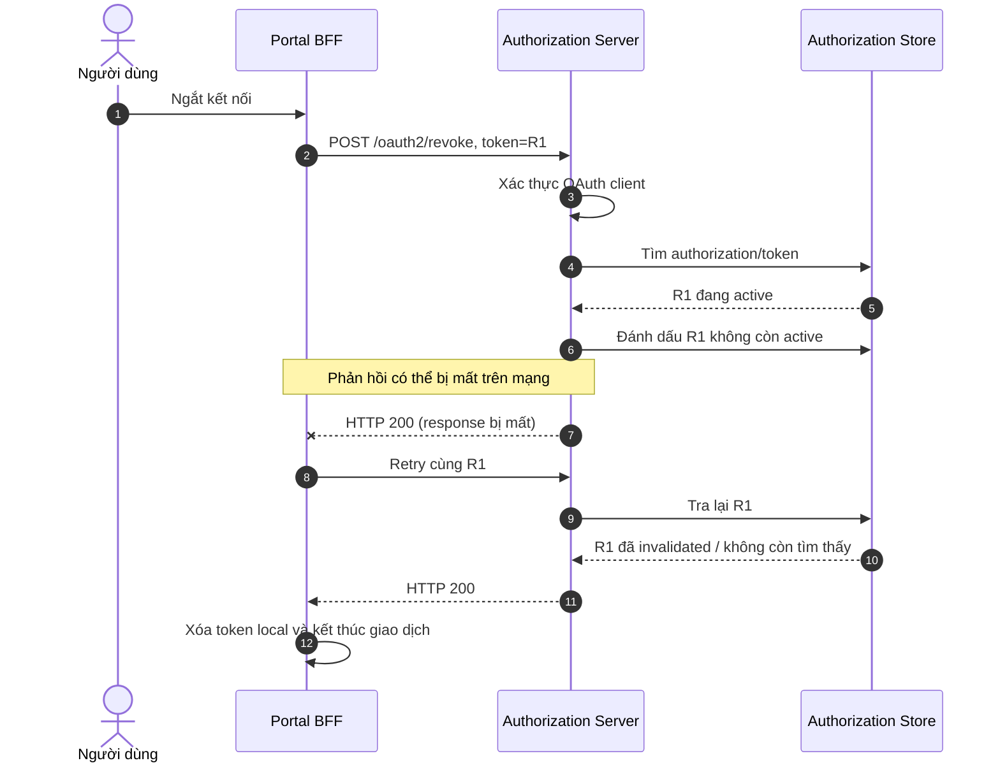
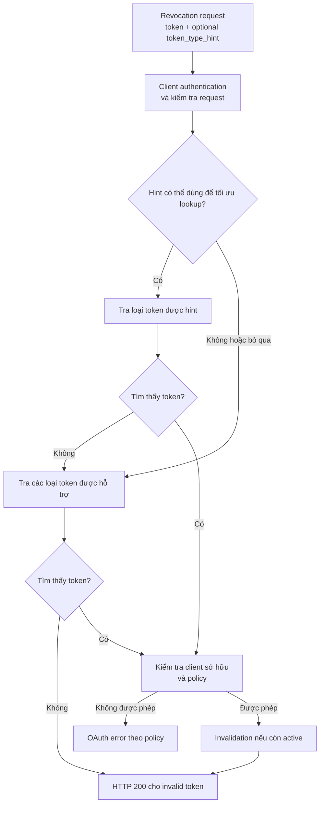
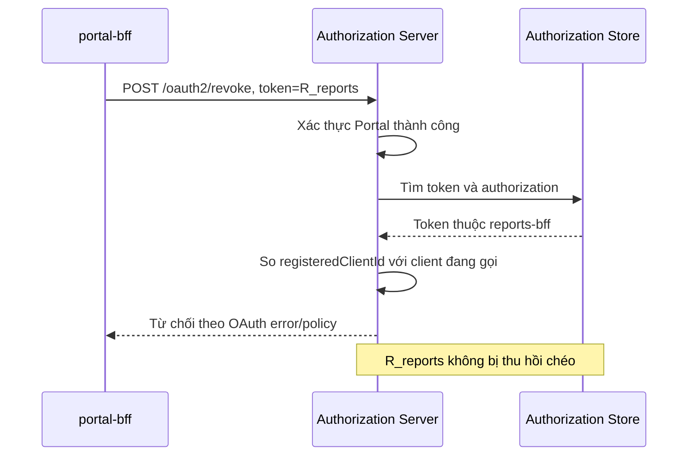
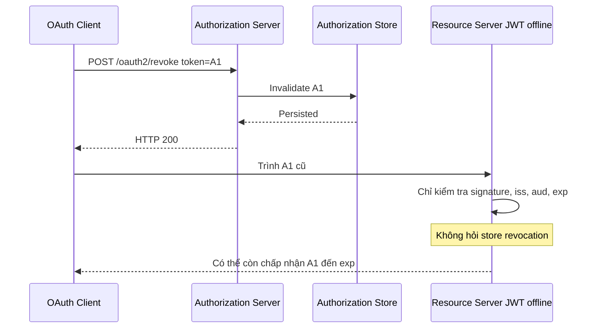
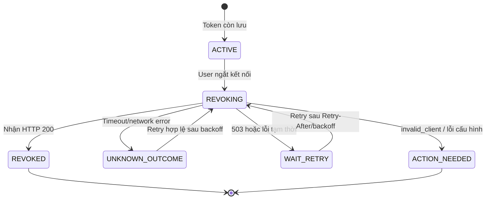
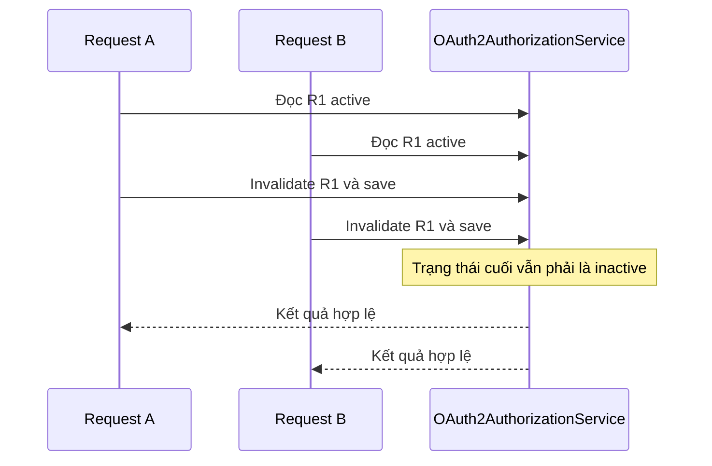

# Phản hồi khi token không tồn tại và tính lặp lại an toàn của thao tác

Một OAuth client muốn đăng xuất người dùng, ngắt kết nối ứng dụng hoặc ngừng sử dụng refresh token sẽ gọi **Token Revocation Endpoint** của Authorization Server. Điều gì xảy ra nếu token đó đã bị thu hồi, đã hết hạn, không còn trong database hoặc request được gửi lại sau khi kết nối mạng bị ngắt?

Theo **RFC 7009 — OAuth 2.0 Token Revocation**, khi request hợp lệ và client đã vượt qua những kiểm tra cần thiết, Authorization Server phản hồi **HTTP 200** cho cả hai tình huống: token đã được thu hồi thành công **và** token không còn hợp lệ. Client không cần biết token đã tồn tại hay đã bị thu hồi trước đó: mục tiêu của thao tác là khiến credential **không còn sử dụng được**, và trạng thái đó đã đạt được.

Đây là cơ sở cho tính **lặp lại an toàn** (*idempotent behavior*) của thao tác revocation: gửi lại cùng một yêu cầu hợp lệ không được làm token sống lại, phát sinh một quyền truy cập mới hoặc trả lỗi chỉ vì token đã được xử lý ở lần trước. Tuy nhiên, **HTTP 200 không có nghĩa mọi lỗi đều bị che đi**: thiếu tham số `token`, client authentication sai hoặc token thuộc client khác là những trường hợp cần tách riêng.

Bài thuộc chương **Revocation** trong mô-đun **SPRING_SECURITY_OAUTH2_OIDC_AUTHORIZATION_SERVER**, với mục tiêu học cách thiết kế, cấu hình, bảo mật, kiểm thử và vận hành OAuth 2.0/OpenID Connect Authorization Server bằng **Spring Security** và **Spring Authorization Server** trong ứng dụng Spring Boot. Trọng tâm là **phản hồi cho token không tồn tại và semantics khi gọi lại endpoint**, đồng thời làm rõ những giới hạn đối với JWT tự chứa, lỗi giao thức và hoạt động trong môi trường nhiều node.

> **Nguyên tắc quan trọng:** Với request revocation hợp lệ của một client được phép, **token không tồn tại, đã hết hạn hoặc đã được thu hồi** không phải lý do để trả `invalid_grant`. Thông thường kết quả là **HTTP 200**, không tiết lộ token từng tồn tại hay chưa. Nhưng **client authentication và kiểm tra quyền thu hồi vẫn bắt buộc**; không dùng quy tắc HTTP 200 để bỏ qua chúng.

**Phạm vi triển khai:** Các ví dụ sử dụng Spring Boot 3.x, Spring Security 6.x và Spring Authorization Server 1.5.x; phiên bản mới có thể thay đổi package, API hoặc hành vi mặc định. Hãy kiểm thử HTTP thực tế với dependency đang dùng, thay vì chỉ dựa vào tên filter/provider.

## 1. Vì sao revocation phải chấp nhận việc gọi lặp?

Giả sử **Portal BFF** đang giữ refresh token `R1` của một authorization cho người dùng `user-123`. Khi người dùng chọn “Ngắt kết nối”, backend gọi `POST /oauth2/revoke`.

Có thể xảy ra bốn tình huống:

1. **R1 còn hiệu lực:** server thu hồi R1 và trả HTTP 200.
2. **R1 đã được thu hồi:** một tab hoặc dịch vụ khác đã hoàn tất thao tác trước đó; server vẫn trả HTTP 200.
3. **R1 không tìm thấy:** record đã bị xóa, token chưa từng tồn tại hoặc bị sai chuỗi; với request client hợp lệ, server trả HTTP 200 theo quy tắc invalid-token.
4. **Server đã thu hồi nhưng response bị mất:** client không biết lần đầu đã thành công nên gửi lại request. Lần sau nhận HTTP 200 và có thể hoàn tất luồng dọn trạng thái của mình.



Yếu tố cần phân biệt: việc client gọi lặp **không nhất thiết khiến backend ghi cùng một bản ghi nhiều lần**. Implementation có thể phát hiện token đã invalidated và không cần ghi nữa. Điều quan trọng là **trạng thái và kết quả giao thức** không bị phá vỡ khi request lặp.

### 1.1. Ý nghĩa của HTTP 200 trong RFC 7009

| Tình huống sau khi xác thực và kiểm tra request | Kết quả đối với client | Tại sao? |
|---|---|---|
| Token còn hiệu lực, thu hồi thành công | HTTP `200` | Mục tiêu thu hồi được thực hiện |
| Token đã bị thu hồi | HTTP `200` | Credential đã không còn hợp lệ |
| Token đã hết hạn | HTTP `200` | Credential không còn sử dụng được |
| Token không tồn tại | HTTP `200` | Không tiết lộ tình trạng tồn tại |
| Server không tìm thấy token do hint sai | Tiếp tục tìm các loại được hỗ trợ; khi vẫn không có thì HTTP `200` | `token_type_hint` không phải nguồn sự thật |
| Token thuộc client khác | **Không tự coi là thành công** | Client cần được kiểm tra quyền thu hồi token |
| Client credentials sai | Lỗi client authentication | Không có quyền thực hiện thao tác |
| Request thiếu `token` | Lỗi request | Yêu cầu chưa đủ điều kiện xử lý |

RFC 7009, mục 2.1, yêu cầu xác minh credential của confidential client và kiểm tra token có được phát cho **client gọi revocation** hay không. Nếu kiểm tra quyền này thất bại, request bị từ chối bằng lỗi phù hợp. Vì vậy, **đừng đồng nhất “không tìm thấy token” với “đã tìm thấy token của client khác”** rồi chủ động trả HTTP 200 cho mọi trường hợp mà bỏ qua kiểm tra ownership.

### 1.2. Định nghĩa idempotent trong ngữ cảnh này

Một thao tác là idempotent khi áp dụng nhiều lần cho cùng trạng thái đích vẫn giữ kết quả cuối tương đương áp dụng một lần. Đối với revocation:

```text
Revoke(active R1)   -> R1 inactive
Revoke(inactive R1) -> R1 inactive
Revoke(unknown R1)  -> Không tạo R1 mới
```

Ở **góc nhìn client được phép gọi**, request hợp lệ cho một token đã invalidated vẫn nhận thành công theo giao thức. Idempotent **không đồng nghĩa** request không có side effect: lần đầu thực sự có thể cập nhật database, audit và trạng thái liên quan. Những side effect không cần thiết ở các lần sau nên được tránh hoặc quản lý theo một chính sách rõ ràng.

## 2. Giao thức Token Revocation theo RFC 7009

### 2.1. Endpoint, phương thức và tham số

Spring Authorization Server cung cấp **OAuth2 Token Revocation Endpoint** mặc định tại:

```text
POST https://login.example.com/oauth2/revoke
Content-Type: application/x-www-form-urlencoded
```

Request mẫu từ một **confidential OAuth client**:

```http
POST /oauth2/revoke HTTP/1.1
Host: login.example.com
Authorization: Basic <base64(client_id:client_secret)>
Content-Type: application/x-www-form-urlencoded

token=REFRESH_TOKEN_VALUE&token_type_hint=refresh_token
```

| Tham số | Mức yêu cầu | Vai trò |
|---|---|---|
| `token` | **Bắt buộc** | Credential mà client muốn thu hồi |
| `token_type_hint` | Tùy chọn | Gợi ý `access_token` hoặc `refresh_token` để tối ưu tra cứu |
| Client authentication | Theo loại client/method đã đăng ký | Xác minh danh tính client có quyền gọi |

Không truyền `token` ở URL query string hoặc HTTP GET: nó có thể xuất hiện trong browser history, access log, referer hoặc proxy log. Token Revocation Endpoint sử dụng HTTPS và POST với body form.

### 2.2. Response thành công không phải một JSON trạng thái

Ví dụ minh họa hợp lệ:

```http
HTTP/1.1 200 OK
Cache-Control: no-store
Pragma: no-cache
Content-Length: 0

```

RFC 7009 quy định HTTP **200** nếu token đã được thu hồi thành công **hoặc** token không hợp lệ. Client không nên phụ thuộc vào response body để phân biệt hai tình huống; nội dung body không có vai trò quyết định trong contract thành công.

Không thiết kế response dạng:

```json
{
  "exists": false,
  "was_revoked": true,
  "owner": "user-123",
  "revoked_at": "2026-11-16T12:00:00Z"
}
```

Các trường này **không thuộc contract revocation thành công của RFC 7009** và có thể làm lộ tình trạng token, danh tính người dùng hoặc thời điểm token được sử dụng. Thông tin kiểm toán cần được ghi trong **kênh nội bộ bảo vệ**, không đưa vào response public của Token Revocation Endpoint.

### 2.3. Vì sao không dùng HTTP 404 cho token lạ?

Nếu endpoint trả:

- `200` khi token tồn tại và vừa bị thu hồi;
- `404` khi token không tồn tại;
- `409` khi token đã được thu hồi;

thì client hoặc kẻ quan sát có thể suy ra **trạng thái của token** từ mã phản hồi. Hơn nữa, client phải viết nhiều nhánh xử lý cho cùng mục tiêu “credential không còn hiệu lực”.

RFC 7009 cố ý gom **token đã thu hồi** và **token không hợp lệ** vào kết quả `200`. Việc gom response giúp đơn giản hóa retry và giảm một kênh tiết lộ sự tồn tại của token. Tuy nhiên, thời gian đáp ứng, thông tin lỗi, log, quota và các side channel vẫn cần được thiết kế cẩn thận — không thể coi HTTP 200 đồng nhất là biện pháp chống enumeration hoàn chỉnh.

## 3. Ba nhóm kết quả phải tách riêng

### 3.1. Thành công về trạng thái token: 200

Khi client authentication hợp lệ, request đúng cấu trúc và token đã mất hiệu lực hoặc được thu hồi hợp lệ, server phản hồi HTTP `200`. Client nên:

1. Không sử dụng lại token;
2. Xóa hoặc thay thế credential trong token store của mình;
3. Đánh dấu hoạt động ngắt kết nối là hoàn tất theo nghiệp vụ;
4. Không diễn giải HTTP 200 thành “token chắc chắn đã từng tồn tại”;
5. Kiểm tra thêm logout session/ủy quyền liên quan nếu sản phẩm cần.

### 3.2. Lỗi xác thực client hoặc request

Các lỗi điển hình:

| Tình huống | Mã lỗi OAuth thường gặp | Cần làm |
|---|---|---|
| Client ID/secret hoặc client assertion sai | `invalid_client` | Không tiết lộ token; sửa credential/registration |
| Thiếu `token` | `invalid_request` | Sửa form body và contract |
| Có nhiều `token` parameter trái policy | `invalid_request` | Từ chối request mơ hồ |
| Token được phát cho client khác | Lỗi từ chối theo RFC 7009 và implementation | Không cho thu hồi chéo client |
| Trình bày loại token mà server không hỗ trợ thu hồi | `unsupported_token_type` | Kiểm tra loại token/policy |
| Sai HTTP method/content type | 4xx/lỗi request phù hợp | Không chuyển thành kết quả revocation thành công |

**Không cố định một mã lỗi OAuth cụ thể** cho mọi trường hợp không khớp client sở hữu token khi chưa kiểm tra code và phiên bản Spring Authorization Server đang dùng. Điều bắt buộc là quyền của client phải được thực thi và thông điệp không làm lộ thông tin token không cần thiết.

### 3.3. Server không thể thực hiện revocation

Nếu Authorization Server trả **HTTP 503**, RFC 7009 yêu cầu client **giả định token vẫn tồn tại** và có thể retry sau một khoảng hợp lý. Server có thể gửi header `Retry-After`.

```http
HTTP/1.1 503 Service Unavailable
Retry-After: 30
Cache-Control: no-store

```

Khi đó:

- Không đánh dấu server-side token đã chắc chắn bị thu hồi;
- Thực hiện retry có giới hạn, exponential backoff và jitter theo policy;
- Đưa thao tác vào hàng đợi bảo vệ nếu ứng dụng cần bảo đảm ngắt kết nối;
- Không spam endpoint trong vòng lặp vô hạn;
- Có thể xóa credential local để client ngừng dùng ngay, **nhưng** cần phân biệt việc xóa local với revocation đã được AS xác nhận.

Lỗi mạng sau khi gửi request có thể rơi vào tình huống **không biết kết quả**: server đã xử lý nhưng response chưa đến client. Nhờ semantics lặp lại an toàn, client có thể retry request hợp lệ. Tuy nhiên, nếu credential client hết hạn hoặc bị thu hồi giữa các lần retry, mã lỗi mới sẽ phản ánh **thay đổi quyền của caller**, không phủ nhận tính lặp lại của thao tác token.

## 4. token_type_hint chỉ là gợi ý, không phải nguồn sự thật

RFC 7009 cho phép:

```text
token_type_hint=access_token
token_type_hint=refresh_token
```

Mục tiêu là giúp Authorization Server tìm token nhanh hơn khi có nhiều bảng/index dành cho các loại token. **Hint không được thay thế việc xác minh token thực tế.**

### 4.1. Hint đúng

Client gửi R1 là refresh token với `token_type_hint=refresh_token`. Server có thể tra cứu refresh token index trước. Nếu tìm thấy và mọi kiểm tra khác hợp lệ, server thu hồi theo policy.

### 4.2. Hint sai nhưng token có thật

Client gửi một **refresh token** với `token_type_hint=access_token`. RFC 7009 yêu cầu nếu không tìm thấy token theo hint, Authorization Server phải mở rộng tìm kiếm qua **các loại token mà nó hỗ trợ**. Server cũng được phép **bỏ qua hint** và tự xác định loại token.



Không xây custom provider trả “không tìm thấy, 200” **ngay khi lookup theo hint thất bại** nếu token có thể tồn tại ở index của loại khác. Đó là lỗi vừa làm revocation không hoạt động, vừa vi phạm quy tắc xử lý hint.

### 4.3. Hint không nhận biết hoặc sai chuỗi

`token_type_hint=foobar` hoặc một hint không được hỗ trợ **không tự tạo lỗi** chỉ vì giá trị hint lạ. RFC 7009 quy định hint không hợp lệ được bỏ qua, không quyết định revocation response.

Phân biệt rõ:

- **Hint lạ:** client chỉ đưa gợi ý không nhận biết, có thể bỏ qua để tra token.
- **Loại token thực tế không được hỗ trợ thu hồi:** có thể dùng lỗi `unsupported_token_type` theo RFC 7009.

Không tự trả `unsupported_token_type` chỉ vì `token_type_hint` không phải một trong hai chuỗi quen thuộc.

## 5. Kiểm tra client ownership trước khi thu hồi

### 5.1. Vì sao client không được thu hồi token của ứng dụng khác?

Giả sử có hai OAuth clients:

- `portal-bff` giữ refresh token `R_portal`;
- `reports-bff` giữ refresh token `R_reports`.

Nếu `portal-bff` biết giá trị `R_reports` và gọi revocation endpoint, Authorization Server **không được cho Portal vô hiệu token của Reports chỉ nhờ biết chuỗi token**. Token là bearer credential, nhưng revocation theo RFC 7009 yêu cầu kiểm tra client làm request.



Không biến quy tắc “unknown token trả 200” thành một shortcut cho việc **đã tìm thấy token thuộc client khác**. Phải bảo đảm không có side effect thu hồi trái quyền. Việc có trả cùng lỗi/generic response cho những trường hợp cụ thể nào còn phụ thuộc implementation, nhưng **không tiết lộ chi tiết chủ sở hữu của token trong response**.

### 5.2. Client authentication độc lập với token lookup

Spring Authorization Server có `OAuth2ClientAuthenticationFilter` xử lý xác thực client theo registration. Một confidential client dùng `client_secret_basic`, `private_key_jwt` hoặc mTLS theo cấu hình phù hợp. Nếu authentication sai, server phải trả lỗi trước khi xử lý thao tác token nhạy cảm.

Không lấy `client_id` trần từ form body rồi tự xem đó là client đã được xác thực. Với public clients không giữ được secret, loại client và cách xác thực/định danh được phép cần tuân thủ khả năng framework và policy; không tự mở revocation endpoint để bất kỳ caller nào cũng có thể thu hồi mọi token.

### 5.3. Thứ tự kiểm tra quan trọng

Một pipeline khái niệm:

```text
HTTP request
    -> đúng method/body/parameters
    -> client authentication / identification
    -> token lookup (hint chỉ tối ưu)
    -> token ownership / policy
    -> token active? (có thể đã inactive)
    -> invalidate khi được phép và cần thiết
    -> HTTP 200 nếu thành công/invalid token
```

Nếu token hoàn toàn không tìm thấy, pipeline không thể xác minh ownership của một record không tồn tại và có thể hoàn tất bằng HTTP 200 sau khi request/client đủ điều kiện. Nếu token được tìm thấy, kiểm tra binding với registered client là quan trọng để không thu hồi chéo.

## 6. Spring Authorization Server thực hiện ở đâu?

### 6.1. Endpoint mặc định và các class

Trong Spring Authorization Server 1.5.x, endpoint mặc định là `/oauth2/revoke`. Cơ chế chính gồm:

| Thành phần | Vai trò |
|---|---|
| `OAuth2TokenRevocationEndpointFilter` | Nhận POST revocation request |
| `OAuth2TokenRevocationAuthenticationConverter` | Chuyển form parameters thành authentication request |
| `OAuth2TokenRevocationAuthenticationProvider` | Kiểm tra client, token, authorization và thực hiện revocation |
| `OAuth2AuthorizationService` | Tra cứu/lưu trạng thái `OAuth2Authorization` và các token liên quan |
| `OAuth2TokenRevocationEndpointConfigurer` | Cấu hình converters, providers và response/error handlers |
| `OAuth2ClientAuthenticationFilter` | Thực hiện client authentication theo phương thức đã đăng ký |
| `AuthorizationServerSettings` | Cấu hình issuer và endpoint URL |

Các thành phần filter/provider của Spring xử lý sẵn phần lớn RFC 7009. **Không cần viết một `@PostMapping("/oauth2/revoke")` riêng chỉ để trả HTTP 200**: tự triển khai dễ bỏ qua client authentication, ownership, token invalidation hoặc phản hồi lỗi chuẩn.

### 6.2. Cấu hình protocol chain

Ví dụ Spring Security 6.x với Spring Authorization Server 1.5.x:

```java
package example.authserver.config;

import org.springframework.context.annotation.Bean;
import org.springframework.context.annotation.Configuration;
import org.springframework.core.annotation.Order;
import org.springframework.security.config.Customizer;
import org.springframework.security.config.annotation.web.builders.HttpSecurity;
import org.springframework.security.oauth2.server.authorization.config.annotation.web.configurers.OAuth2AuthorizationServerConfigurer;
import org.springframework.security.web.SecurityFilterChain;

@Configuration(proxyBeanMethods = false)
public class AuthorizationServerSecurityConfig {

    @Bean
    @Order(1)
    SecurityFilterChain authorizationServerSecurityFilterChain(
            HttpSecurity http) throws Exception {

        OAuth2AuthorizationServerConfigurer as =
                OAuth2AuthorizationServerConfigurer.authorizationServer();

        http
            .securityMatcher(as.getEndpointsMatcher())
            .with(as, server -> server
                .tokenRevocationEndpoint(Customizer.withDefaults()))
            .authorizeHttpRequests(authorize -> authorize
                .anyRequest().authenticated());

        return http.build();
    }

    @Bean
    @Order(2)
    SecurityFilterChain applicationSecurityFilterChain(HttpSecurity http)
            throws Exception {

        http.authorizeHttpRequests(authorize -> authorize
                .anyRequest().authenticated())
            .formLogin(Customizer.withDefaults());

        return http.build();
    }
}
```

Đoạn mã minh họa **protocol chain** và điểm cấu hình revocation; không phải ví dụ Spring Boot chạy độc lập. Cần đăng ký `RegisteredClientRepository`, `OAuth2AuthorizationService`, issuer, đăng nhập người dùng và những thành phần Authorization Server khác cho các grant/kiểu token đang dùng.

Gọi `tokenRevocationEndpoint(Customizer.withDefaults())` giúp nhấn mạnh endpoint được cấu hình; trong cấu hình Authorization Server mặc định, endpoint **đã được hỗ trợ**, không phải tính năng chỉ tồn tại khi gọi method này.

### 6.3. Đặt endpoint và issuer tường minh

```java
import org.springframework.context.annotation.Bean;
import org.springframework.security.oauth2.server.authorization.settings.AuthorizationServerSettings;

@Bean
AuthorizationServerSettings authorizationServerSettings() {
    return AuthorizationServerSettings.builder()
            .issuer("https://login.example.com")
            .tokenRevocationEndpoint("/oauth2/revoke")
            .build();
}
```

Đây là đường dẫn mặc định. Nếu đổi thành `/oauth2/v1/revoke`, phải đồng bộ metadata, client configuration, proxy routing và integration tests. Không để Client gọi một endpoint ở node/issuer khác với nơi token được phát.

### 6.4. Extension points có thể tùy chỉnh

`OAuth2TokenRevocationEndpointConfigurer` có:

- `revocationRequestConverter(...)` và `revocationRequestConverters(...)`;
- `authenticationProvider(...)` và `authenticationProviders(...)`;
- `revocationResponseHandler(...)`;
- `errorResponseHandler(...)`.

Mục tiêu của custom logic có thể là audit, tenant policy hoặc yêu cầu thu hồi liên quan. Nhưng không thay success handler để **phân biệt public response giữa token tồn tại và không tồn tại**, vì như vậy đi ngược ý nghĩa RFC 7009.

**Lưu ý quan trọng:** `authenticationProvider(customProvider)` thường **thêm** provider vào danh sách. Nếu provider mặc định vẫn nhận request trước custom provider, policy có thể bị bỏ qua. Khi cần thay hoặc bọc provider, sử dụng `authenticationProviders(...)` để kiểm soát danh sách, bảo toàn validation mặc định và viết integration test chứng minh custom rule thực thi.

## 7. OAuth2AuthorizationService và trạng thái token

### 7.1. Authorization và các token liên quan

Spring Authorization Server lưu trạng thái cấp quyền trong `OAuth2Authorization`. Tùy grant, một authorization có thể mang:

- Authorization code (nếu có);
- Access token và metadata của nó;
- Refresh token và metadata;
- OIDC ID token hoặc các token khác;
- `registeredClientId`, principal, scopes, grant type và attributes.

`OAuth2AuthorizationService` cho phép tra authorization bằng ID hoặc token, đồng thời lưu lại trạng thái mới. Các implementation thông dụng gồm `InMemoryOAuth2AuthorizationService` và `JdbcOAuth2AuthorizationService`.

Với production, in-memory store theo từng node thường không phù hợp nếu một node phát token nhưng node khác nhận revocation request. Cần persistence chia sẻ và chiến lược consistency.

### 7.2. Khác biệt giữa “không tìm thấy” và “đã invalidated”

Với `OAuth2AuthorizationService.findByToken(value, tokenType)`:

- `null` có thể nghĩa là token không tồn tại trong store hoặc không còn được lưu/truy vấn;
- Một `OAuth2Authorization` tìm được có thể chứa token metadata đã được đánh dấu **invalidated**;
- Token có thể còn record nhưng đã **expired**;
- Một custom store có thể xóa hẳn record/token ngay khi revoke.

**Không ép client phải phân biệt các trạng thái này qua response HTTP.** Với request hợp lệ và token không còn sử dụng được, contract revocation trả HTTP 200.

Ví dụ kiểm tra trạng thái **bên trong test/service được phân quyền**, không phải endpoint public:

```java
import org.springframework.security.oauth2.core.OAuth2TokenType;
import org.springframework.security.oauth2.server.authorization.OAuth2Authorization;
import org.springframework.security.oauth2.server.authorization.OAuth2AuthorizationService;

OAuth2Authorization auth = authorizationService.findByToken(
        refreshTokenValue, OAuth2TokenType.REFRESH_TOKEN);

if (auth == null) {
    // Không tìm được authorization trong store hiện tại.
} else if (auth.getRefreshToken() != null
        && !auth.getRefreshToken().isActive()) {
    // Refresh token đã inactive: hết hạn hoặc bị invalidated.
}
```

Đoạn trên chỉ phục vụ kiểm tra trạng thái trong môi trường tin cậy. Không hiển thị `auth == null` hoặc `isActive()` cho bên ngoài để trả response khác nhau theo sự tồn tại của token.

### 7.3. Cập nhật trạng thái đúng cách

Trong Spring Authorization Server, `OAuth2Authorization.Builder` hỗ trợ thao tác `invalidate(token)` để đánh dấu token không còn active theo metadata. Một minh họa **thuần nội bộ**:

```java
OAuth2Authorization authorization = authorizationService.findByToken(
        refreshTokenValue, OAuth2TokenType.REFRESH_TOKEN);

if (authorization != null && authorization.getRefreshToken() != null
        && authorization.getRefreshToken().isActive()) {

    // Trước đây cần có client authentication, ownership check
    // và chính sách liên đới đã được thực thi.
    OAuth2Authorization updated = OAuth2Authorization.from(authorization)
            .invalidate(authorization.getRefreshToken().getToken())
            .build();

    authorizationService.save(updated);
}
```

**Không sao chép đoạn này vào một controller revocation công khai.** Nó cố ý **không** thực hiện client authentication, ownership validation, cascading policy, concurrency control hoặc HTTP response. Provider mặc định của Spring nên là nguồn xử lý giao thức trừ khi có nhu cầu tùy chỉnh được kiểm thử.

### 7.4. Có cần xóa bản ghi hoàn toàn?

Đánh dấu invalidated giúp giữ metadata cần cho authorization, kiểm toán và xử lý trạng thái. Xóa record hoàn toàn có thể khiến mọi token liên quan biến mất hoặc ảnh hưởng các luồng refresh/consent chưa dự kiến. Chính sách cleanup phải xét:

- Token được thu hồi là access hay refresh token?
- Có nhiều token cùng thuộc authorization không?
- Cần audit trail trong bao lâu?
- Khi xóa record, những token khác sẽ như thế nào?
- Đang có refresh request/rotation đồng thời hay không?

Không dùng `authorizationService.remove(authorization)` như một thay thế mặc định cho việc thu hồi **một token riêng lẻ** nếu chưa đánh giá ảnh hưởng lên toàn bộ authorization.

## 8. Revocation access token và refresh token khác nhau thế nào?

### 8.1. RFC 7009 quy định chính sách liên đới

RFC 7009 yêu cầu implementation **hỗ trợ thu hồi refresh token** và **khuyến nghị hỗ trợ thu hồi access token**. Nếu revocation refresh token và server hỗ trợ access-token revocation, RFC khuyến nghị đồng thời vô hiệu các access token dựa trên cùng authorization grant. Nếu revoke access token, server **có thể** thu hồi refresh token liên quan tùy policy.

| Token được gửi để revoke | Hành động cơ bản | Liên đới cần quyết định |
|---|---|---|
| Refresh token `R1` | Vô hiệu R1 | Có thu hồi access token cùng grant, token family hoặc authorization? |
| Access token `A1` | Vô hiệu A1 nếu hỗ trợ | Có thu hồi R1 không? |
| Token đã hết hạn | Không còn quyền sử dụng | Có cần dọn metadata liên quan không? |
| Token không tồn tại | Không có token để thay đổi | Trả HTTP 200 nếu client/request hợp lệ |
| Token thuộc client khác | Không được thu hồi trái quyền | Từ chối theo chính sách xác minh client |

**Không giả định** thao tác revoke refresh token trong Spring Authorization Server tự động làm mọi JWT access token đã phát ngừng được Resource Server chấp nhận tức thời. Cần kiểm tra thực tế provider, persistence và cách API xác minh token.

### 8.2. Refresh token rotation tạo thêm trường hợp idempotent

Một client BFF bật `reuseRefreshTokens(false)` có thể nhận `R2` sau khi refresh bằng `R1`. Nếu nó giữ bản copy R1 và gọi revoke:

- R1 có thể đã invalidated do rotation;
- Request revocation hợp lệ cho R1 không cần tạo lỗi `invalid_grant`;
- Revocation R1 **không đồng nghĩa** R2 tự bị thu hồi nếu không có chính sách token family/authorization tương ứng;
- Client muốn ngắt kết nối thật sự nên thu hồi **token hiện hành R2** và xử lý authorization/session theo chính sách.

Idempotence của revocation không có nghĩa một token cũ bị revoked sẽ tự đại diện cho tất cả token hậu duệ được phát sau đó.

### 8.3. Logout khác revocation

**Logout** kết thúc một phiên đăng nhập local/SSO hoặc làm sạch session. **Revocation** tác động lên token/authorization. **Consent withdrawal** xóa quyền người dùng từng chấp thuận cho client. Ba việc này có thể được kết hợp trong chức năng “Ngắt liên kết”, nhưng không phải cùng một API.

Đừng xem HTTP 200 từ `/oauth2/revoke` là bằng chứng tất cả browser session, mọi access token và consent đã bị xóa. Sản phẩm phải định nghĩa rõ phạm vi thao tác.

## 9. JWT tự chứa, opaque token và tính nhất quán revocation

### 9.1. Opaque token hoặc introspection

Với opaque access token, Resource Server thường hỏi Authorization Server qua `/oauth2/introspect` để biết token còn active không. Nếu revocation được ghi trong shared authorization store, một lần introspection tiếp theo có thể trả:

```json
{
  "active": false
}
```

Khi đó API có thể ngừng chấp nhận token theo kết quả introspection. Nhưng nếu có cache introspection, vẫn có một **khoảng trễ** giữa revocation và lần làm mới trạng thái.

### 9.2. JWT self-contained được Resource Server xác minh offline

Với JWT access token, Resource Server có thể chỉ kiểm tra chữ ký, issuer, audience, `exp` và scope **không gọi về Authorization Server**. Khi đó:

1. Authorization Server đánh dấu token bị thu hồi trong kho;
2. Token đã phát vẫn có chữ ký mật mã hợp lệ;
3. Resource Server không kiểm tra trạng thái kho revocation nên vẫn có thể chấp nhận token cho đến hết hạn;
4. HTTP 200 ở revocation endpoint **không chứng minh** mọi Resource Server đã thấy sự kiện thu hồi.



Đây là **giới hạn kiến trúc** của JWT bearer tự chứa, không phải lỗi riêng của RFC 7009. Nếu cần thu hồi access token gần như tức thời, hãy cân nhắc introspection, denylist theo `jti`, event-driven revocation hoặc access token TTL ngắn; mỗi giải pháp có trade-off về tải, cache, tính sẵn sàng và nhất quán.

### 9.3. “An toàn lặp lại” khác “hiệu lực tức thời toàn hệ thống”

- **Idempotent revocation:** server phản hồi nhất quán khi cùng token đã invalidated được gửi lại.
- **Durable revocation:** trạng thái thu hồi được lưu bền vững và các node nhất quán.
- **Propagation:** Resource Servers nhận biết trạng thái thu hồi.
- **Session termination:** phiên client/user bị kết thúc đúng mục tiêu.

Không đo hiệu quả của tất cả các lớp trên bằng một assertion duy nhất `status().isOk()`.

## 10. Revocation Endpoint cần bảo vệ khỏi token enumeration

### 10.1. Không trả chi tiết token có từng tồn tại không

Một endpoint có thể vô tình tiết lộ thông tin qua:

- Mã HTTP khác nhau giữa token thật và token lạ;
- `error_description` cho biết chủ sở hữu hoặc trạng thái token;
- Response JSON có `exists`, `revokedAt` hoặc `tokenOwner`;
- Header riêng chỉ xuất hiện khi token tìm thấy;
- Timing chênh lệch quá lớn giữa lookup hit và miss;
- Rate limit/quota phân biệt token hợp lệ với không hợp lệ cho caller bên ngoài.

Trả HTTP 200 cho token không tồn tại là một lớp giảm tiết lộ thông tin, nhưng **không đảm bảo constant-time processing** và không thay cho các kiểm soát trên.

### 10.2. Không bỏ client authentication để “tránh lộ”

Giấu trạng thái token không có nghĩa cho phép caller vô danh spam token bất kỳ. Client authentication/identification, kiểm tra quyền và rate limiting phải có trước hoặc trong pipeline. Nếu có client public, cần chính sách phù hợp loại client; tránh một đường dẫn bypass dành cho “client không có secret” nhưng lại cho phép thu hồi token của client khác.

### 10.3. Chống DoS và brute-force

Token Revocation Endpoint có thể bị lạm dụng bằng lượng lớn token ngẫu nhiên:

- Giới hạn body size và số lượng tham số;
- Rate limit theo client đã xác thực, địa chỉ nguồn và tín hiệu rủi ro;
- Dùng index để tra cứu token hiệu quả;
- Tránh quét toàn bộ kho token với mỗi hint lạ;
- Thực thi timeout/concurrency limits cho database;
- Ghi metric các lỗi và sự cố tải, không log raw token;
- Không để audit pipeline đồng bộ trở thành điểm nghẽn tạo 503 hàng loạt.

Nếu có outage, server cần trả lỗi phù hợp thay vì giả vờ HTTP 200 cho mọi request chưa được lưu. “200 giả” có thể khiến client tin rằng credential đã mất hiệu lực khi thực tế vẫn active.

## 11. Cách OAuth client triển khai retry an toàn

### 11.1. Client state machine

Một client quản lý revocation có thể giữ trạng thái:



Không nên retry vô hạn một token bằng credentials client sai. Sau `invalid_client`, cần sửa client authentication/registration; nếu client đã bị thu hồi, quyền gọi endpoint cũng đã thay đổi.

### 11.2. Pseudocode retry có giới hạn

```javascript
// Pseudocode dành cho backend/client tin cậy.
// revokeOnce() thực hiện POST form qua HTTPS và không log token.
async function revokeWithRetry(revokeOnce, token, maxAttempts = 3) {
  for (let attempt = 1; attempt <= maxAttempts; attempt++) {
    let response;

    try {
      response = await revokeOnce(token);
    } catch (networkError) {
      // Timeout: kết quả lần gọi trước có thể đã thành công.
      if (attempt === maxAttempts) {
        return { status: "unknown", reason: "network" };
      }
      await waitWithBackoff(attempt);
      continue;
    }

    if (response.status === 200) {
      return { status: "revoked_or_already_invalid" };
    }

    if (response.status === 503) {
      if (attempt === maxAttempts) {
        return { status: "unknown", reason: "service_unavailable" };
      }
      await waitWithBackoff(attempt, response.retryAfter);
      continue;
    }

    // invalid_client, invalid_request hoặc lỗi không thể retry tự động:
    return { status: "action_required", httpStatus: response.status };
  }

  return { status: "unknown" };
}
```

Đây là **pseudocode**, không phải thư viện retry hoàn chỉnh: `waitWithBackoff`, request timeout, jitter, hủy tác vụ, idempotency của nghiệp vụ và bảo vệ credential phải được triển khai thực tế. Nếu app ngừng cho người dùng dùng token ngay, có thể **xóa token local**, nhưng vẫn phải theo dõi phần server-side revocation khi kết quả là `unknown`.

### 11.3. Không cần tạo idempotency key tùy tiện

RFC 7009 đã định nghĩa hành vi phù hợp cho token không còn hợp lệ. Client không cần tự gửi header `Idempotency-Key` để được phép gọi lại revocation; đó không phải field chuẩn của RFC. Nếu hệ thống có workflow doanh nghiệp bao ngoài, có thể dùng request/correlation ID riêng cho audit/job processing nhưng **không thay đổi contract giao thức chuẩn**.

### 11.4. Khi nào client dừng retry?

- **HTTP 200:** dừng, xóa token khỏi kho client.
- **503/network timeout:** retry có giới hạn, backoff; khi vượt giới hạn thì ghi trạng thái “chưa chắc chắn”.
- **invalid_client:** dừng; sửa credentials, không gửi lại cùng secret sai.
- **invalid_request:** dừng; sửa form/request.
- **unsupported_token_type:** dừng; kiểm tra loại token và policy server.
- **Client bị disabled:** dừng; cần xử lý quản trị thay vì thử đăng nhập và revoke liên tục.

## 12. Ví dụ curl cho token không tồn tại và token đã thu hồi

### 12.1. Thu hồi refresh token thật trong môi trường test

Giả sử Portal BFF đã hoàn tất Authorization Code Flow và nhận refresh token từ Authorization Server:

```bash
curl --request POST "https://login.example.com/oauth2/revoke" \
  --user "$PORTAL_CLIENT_ID:$PORTAL_CLIENT_SECRET" \
  --header "Content-Type: application/x-www-form-urlencoded" \
  --data-urlencode "token=$PORTAL_REFRESH_TOKEN" \
  --data-urlencode "token_type_hint=refresh_token" \
  --include
```

Response kỳ vọng nếu client và request hợp lệ: HTTP `200`, không cần nội dung body. **Chỉ chạy trong môi trường test**, không in token thật ra chat, ticket, log CI hoặc biên bản kiểm thử.

### 12.2. Gửi lại cùng refresh token

Gọi lại cùng request khi token R1 đã bị invalidated:

```bash
curl --request POST "https://login.example.com/oauth2/revoke" \
  --user "$PORTAL_CLIENT_ID:$PORTAL_CLIENT_SECRET" \
  --header "Content-Type: application/x-www-form-urlencoded" \
  --data-urlencode "token=$PORTAL_REFRESH_TOKEN" \
  --data-urlencode "token_type_hint=refresh_token" \
  --include
```

Với token không còn hiệu lực và client vẫn có quyền gửi request, kỳ vọng **HTTP 200**. Nếu bạn nhận `invalid_grant` chỉ vì R1 đã revoked, custom handler có thể đang áp semantics của **Token Endpoint** lên **Revocation Endpoint**.

### 12.3. Gửi token không tồn tại

```bash
curl --request POST "https://login.example.com/oauth2/revoke" \
  --user "$PORTAL_CLIENT_ID:$PORTAL_CLIENT_SECRET" \
  --header "Content-Type: application/x-www-form-urlencoded" \
  --data-urlencode "token=nonexistent-test-token-12345" \
  --data-urlencode "token_type_hint=refresh_token" \
  --include
```

Kỳ vọng theo RFC: HTTP `200` nếu client xác thực hợp lệ, request đúng định dạng và token không được tìm thấy. Không có token nào được tạo hoặc làm mới chỉ vì request này.

### 12.4. Thử hint sai

Với một **refresh token test còn active**, gửi `token_type_hint=access_token`. Nếu không tìm thấy token trong index access token, server phải vẫn có khả năng tra cứu các loại token được hỗ trợ và thu hồi đúng refresh token. Test riêng với hint `unknown_kind` để bảo đảm server không trả lỗi chỉ vì hint lạ.

### 12.5. Không coi HTTP 200 là token hợp lệ

Một lỗi diễn giải ngược: nếu một token ngẫu nhiên nhận `200` từ revocation, điều đó **không** chứng minh token tồn tại hay từng được phát. Revocation không phải token introspection. Muốn kiểm tra trạng thái token theo quyền của một caller được phép, sử dụng Token Introspection Endpoint và chính sách riêng; không biến revocation thành API “kiểm tra token”.

## 13. Kiểm thử tự động với Spring Boot và MockMvc

### 13.1. Test endpoint trả 200 cho token không tồn tại

Mẫu integration test sau giả định Spring test context đã có một confidential client `portal-bff` với secret `test-secret`, protocol chain của Spring Authorization Server và `OAuth2AuthorizationService`:

```java
import static org.springframework.security.test.web.servlet.request
        .SecurityMockMvcRequestPostProcessors.httpBasic;
import static org.springframework.test.web.servlet.request
        .MockMvcRequestBuilders.post;
import static org.springframework.test.web.servlet.result
        .MockMvcResultMatchers.status;

import org.junit.jupiter.api.Test;
import org.springframework.beans.factory.annotation.Autowired;
import org.springframework.boot.test.autoconfigure.web.servlet.AutoConfigureMockMvc;
import org.springframework.boot.test.context.SpringBootTest;
import org.springframework.http.MediaType;
import org.springframework.test.web.servlet.MockMvc;

@SpringBootTest
@AutoConfigureMockMvc
class RevocationEndpointTests {

    @Autowired
    MockMvc mvc;

    @Test
    void unknownTokenDoesNotBecomeAnError() throws Exception {
        mvc.perform(post("/oauth2/revoke")
                .with(httpBasic("portal-bff", "test-secret"))
                .contentType(MediaType.APPLICATION_FORM_URLENCODED)
                .param("token", "nonexistent-random-test-value")
                .param("token_type_hint", "refresh_token"))
            .andExpect(status().isOk());
    }
}
```

**Các import static được xuống dòng để đọc**, nhưng Java import statement phải nằm đúng cú pháp source code của dự án (giữa các thành phần của import có thể xuống dòng như whitespace nếu token không bị tách). Nếu dùng project convention nghiêm ngặt, đặt từng import thành một dòng. Test chỉ có ý nghĩa nếu `portal-bff` thật sự được đăng ký, secret được encode đúng và endpoint authentication hoạt động.

Không phải unit test stub của một controller trả `200`; phải chạy **filter chain và provider thực**. Khi dùng mock authentication bỏ qua OAuth2ClientAuthenticationFilter, test sẽ không chứng minh yêu cầu client auth được thực thi.

### 13.2. Kiểm thử token đã được revoke

Một test end-to-end nên:

1. Dùng client test lấy một access/refresh token hợp lệ theo grant được đăng ký.
2. Kiểm tra token thật sự active qua token exchange/introspection hoặc authorization store phù hợp.
3. POST revocation lần đầu và assert HTTP `200`.
4. POST revocation lần thứ hai với **cùng token** và assert HTTP `200`.
5. Kiểm tra token không được dùng để refresh/call API trong kiến trúc kiểm tra trạng thái phù hợp.
6. Kiểm tra không có token mới được phát chỉ vì request revocation.
7. Nếu log audit, kiểm tra đã phân biệt lần đầu invalidation và lần lặp mà **không ghi token raw**.

Không dùng token mock chưa từng tồn tại để chứng minh **thao tác thu hồi token thật**; test token lạ và test token có thật cần là hai testcase riêng.

### 13.3. Kiểm thử token_type_hint sai

Tạo **refresh token R1 còn active**, gọi revoke R1 với `token_type_hint=access_token`, rồi thử refresh lại. Kỳ vọng R1 không sử dụng được theo policy. Điều này chứng minh server không bỏ sót token chỉ vì client hint sai.

### 13.4. Kiểm thử client ownership

Tạo token R1 cho client A, thực hiện revocation bằng credentials của client B. Kỳ vọng:

- R1 **không bị thu hồi** trái quyền;
- Server trả OAuth error/response theo đúng contract đã xác minh;
- Không rò rỉ thông tin chủ sở hữu token;
- Client A vẫn có thể quản lý token của mình;
- Test không dùng chung token/fixture gây side effect từ testcase khác.

### 13.5. Kiểm thử malformed request

```java
@Test
void missingTokenParameterIsNotAnIdempotentSuccess() throws Exception {
    mvc.perform(post("/oauth2/revoke")
            .with(httpBasic("portal-bff", "test-secret"))
            .contentType(MediaType.APPLICATION_FORM_URLENCODED))
        .andExpect(status().isBadRequest());
}
```

Đây là ví dụ method cần đặt trong class test ở trên. **HTTP 200 cho unknown token không áp dụng khi thiếu hẳn tham số bắt buộc `token`.**

## 14. Ma trận kiểm thử đầy đủ

| Case | Client/request | Kỳ vọng bảo mật |
|---|---|---|
| Token thật active | Client sở hữu token, request đúng | HTTP `200`; token không còn active trong store |
| Token đã revoked | Gửi lại cùng token bằng client hợp lệ | HTTP `200` |
| Token expired | Token đã quá hạn | HTTP `200` khi request/client hợp lệ |
| Token không tồn tại | Giá trị ngẫu nhiên chưa từng cấp | HTTP `200` |
| Token bị xóa khỏi store | Record đã cleanup | HTTP `200` |
| Thiếu `token` | Request không có token parameter | Lỗi `invalid_request`/4xx |
| Trùng token parameter | Hai giá trị token | Từ chối request mơ hồ |
| Hint đúng | Refresh token + refresh_token hint | Thu hồi đúng token |
| Hint sai | Refresh token + access_token hint | Vẫn tra cứu loại hỗ trợ và thu hồi |
| Hint không biết | `token_type_hint=unknown` | Không tự báo lỗi chỉ vì hint |
| Client secret sai | Client auth thất bại | `invalid_client`; không tác động token |
| Client không tồn tại | Client authentication sai | Từ chối |
| Client B revoke token A | Token thuộc client A | Không thu hồi chéo client; lỗi phù hợp |
| Không có quyền revoke loại token | Server không hỗ trợ loại đó | `unsupported_token_type` nếu áp dụng |
| Đổi GET thay POST | GET `/oauth2/revoke` | Không xử lý như POST revocation |
| Content type sai | JSON body thay form | Không tự xử lý như form hợp lệ |
| Retry sau response loss | Lần đầu thành công nhưng client timeout | Lần tiếp theo có thể HTTP `200` |
| 503 + Retry-After | Store tạm không khả dụng | Không xác nhận đã thu hồi; retry có backoff |
| Revoke R1 trước refresh | R1 inactive | Refresh grant bằng R1 thất bại |
| Revoke R1 sau rotation | R1 đã inactive, R2 còn active | Không tự giả định R2 bị thu hồi |
| Revoke access JWT | AS đánh dấu inactive | Resource Server offline có thể vẫn nhận JWT đến expiry |
| Opaque token + introspection | Token bị revoke | `active=false` khi trạng thái được cập nhật |
| Nhiều node | Issuance node A, revocation node B | Shared store nhất quán |
| Race refresh vs revoke | Hai thao tác cùng authorization | Không cấp token trái policy, xử lý race |
| Audit | Known/unknown/repeated revocation | Không log token raw, không làm lộ chủ sở hữu |
| Rate limiting | Nhiều token random | Không làm sập kho lookup; phản hồi lỗi khi quá tải |

### 14.1. Không dùng HTTP status duy nhất để test hiệu quả

Có hai lớp assertion:

**Lớp giao thức:** HTTP 200 cho token không tồn tại/đã thu hồi, lỗi đúng cho client authentication và request sai, không leak token details.

**Lớp trạng thái:** Token thật sau revocation không thể được sử dụng theo mô hình kiểm tra hiệu lực, metadata store phản ánh invalidation, các token liên quan được xử lý theo policy, không bị mất cập nhật vì concurrency.

Chỉ nhìn HTTP 200 có thể khiến một endpoint bị lỗi ghi database vẫn trông như thành công; cần test end-to-end từ issuance đến hành vi bị từ chối.

## 15. Đồng thời, database và nhiều node

### 15.1. Hai request revocation cùng đến

Hai request hợp lệ cùng thu hồi R1 có thể đến gần đồng thời:



Trong tình huống này, cả hai request có thể được coi là thành công theo semantics revocation nếu client hợp lệ và không có xung đột policy. Tuy nhiên, nếu có refresh rotation đồng thời hoặc các token khác đang được thêm vào authorization, một thao tác **read-modify-write toàn bộ record** có thể ghi đè cập nhật mới. Cần transaction/isolation, optimistic locking hoặc chiến lược atomic update phù hợp.

### 15.2. Retry và tính bền vững

Nếu server trả HTTP 200 **trước khi commit trạng thái revocation**, sau đó database transaction rollback, client có thể tin sai rằng token đã được thu hồi. Một hệ thống cần bảo đảm success response phản ánh state update đã được hoàn tất theo cơ chế persistence.

Trong cluster, node B phải quan sát revocation do node A ghi, và Resource Server qua introspection phải đọc dữ liệu nhất quán. Không dùng `InMemoryOAuth2AuthorizationService` độc lập cho từng node production rồi mong mọi revocation lan truyền.

### 15.3. Caching và độ trễ

Cần kiểm tra:

- Cache token lookup ở Authorization Server;
- Cache introspection ở Resource Server;
- JWT offline không tra trạng thái revocation;
- Replica lag hoặc event propagation;
- TTL/cleanup của authorization records;
- Race giữa refresh token rotation và revocation.

HTTP 200 vẫn là kết quả giao thức cho lần thu hồi hợp lệ, nhưng tiêu chí sản phẩm về **thời gian mất hiệu lực trên mọi API** cần test và đo riêng.

## 16. Lỗi vận hành hay gặp

| Triệu chứng | Nguyên nhân khả dĩ | Cách chẩn đoán |
|---|---|---|
| Revoke unknown token trả 404 | Custom controller tra DB và ném not-found | Đưa response về semantics RFC 7009 |
| Revoke lần thứ hai trả `invalid_grant` | Trộn logic refresh grant với revocation | Idempotent success cho token đã inactive |
| Revoke với hint sai không có tác dụng | Lookup chỉ theo hint, không fallback | Mở tra cứu các loại token được hỗ trợ |
| Client B thu hồi được token của A | Thiếu ownership validation | Kiểm tra `registeredClientId` và client authentication |
| Token thật không đổi trạng thái nhưng trả 200 | Persistence lỗi hoặc custom success handler | Kiểm tra transaction/authorization service |
| Revoke thành công nhưng JWT vẫn gọi API được | Resource Server chỉ xác minh chữ ký/expiry | Xem chiến lược revocation propagation/TTL |
| Revoke refresh nhưng access token vẫn active | Cascading policy chưa phù hợp, JWT offline | Quy định token-family/grant policy và API validation |
| Token không tìm thấy sau restart | In-memory authorization store | Sử dụng persistence phù hợp |
| Node A revoke, node B vẫn active | Store/cache không đồng bộ | Shared DB, cache invalidation, cluster tests |
| Token endpoint có redirect tới login | Sai SecurityFilterChain hoặc entry point | Kiểm tra protocol matcher, client authentication |
| 503 bị client coi là 200 | Retry handler gom mọi 2xx/5xx thành success | Tách transient failure và unknown outcome |
| Client retry quá nhiều | Không có backoff/Retry-After | Thêm giới hạn, jitter, circuit breaker |
| Log lộ token raw | HTTP request logging hoặc APM capture body | Redact token/Authorization headers |
| Timing khác biệt token thật/giả | Lookup, audit hoặc response code khác | Đánh giá side channel theo threat model |
| Revoke token lạ gây DB overload | Không có rate limit, lookup không có index | Index lookup, quota và traffic safeguards |
| Logout xong vẫn có session ở app khác | Revocation không phải global logout | Thiết kế logout/consent/device management riêng |

### 16.1. Đừng “sửa” bằng cách trả 200 cho mọi request

Một anti-pattern:

```java
// KHÔNG ĐÚNG: trả 200 ngay cả khi client authentication sai
@PostMapping("/oauth2/revoke")
public ResponseEntity<Void> revoke(@RequestParam String token) {
    return ResponseEntity.ok().build();
}
```

Đoạn trên không xác minh client, không thay đổi trạng thái token và không bảo đảm mục tiêu revocation. Trả HTTP 200 cho token lạ **chỉ có ý nghĩa sau khi request và các kiểm tra cần thiết đã hợp lệ**.

## 17. Quan sát, audit và bảo vệ dữ liệu

### 17.1. Chỉ số hữu ích

Nên theo dõi:

- Số request revocation theo client và môi trường;
- Tỷ lệ HTTP 200, lỗi client authentication, malformed request và 503;
- Độ trễ từ receipt đến commit revocation;
- Tỷ lệ retry/timeout;
- Lỗi authorization store hoặc DB saturation;
- Số trường hợp token active được invalidated theo loại;
- Các lần revoke liên quan token đã inactive, chỉ dưới dạng aggregate an toàn;
- Propagation lag đến introspection/cache nếu hệ thống đo được.

Không dùng tỷ lệ HTTP 200 để suy ra **bao nhiêu token đã tồn tại** vì invalid/unknown cũng trả 200. Nếu cần số lượng revocation thật, đo trong hệ thống nội bộ được phân quyền, không phơi ra public response.

### 17.2. Log an toàn

Có thể log:

```text
event=oauth_revocation
client_id=portal-bff
outcome=accepted
http_status=200
request_id=trace-123
latency_ms=23
```

Không log nguyên `token`, `client_secret`, HTTP Basic header, cookie, refresh token, access token hoặc toàn bộ request body. Nếu cần liên kết sự kiện, dùng định danh nội bộ hoặc HMAC fingerprint phù hợp chính sách, không làm credential có thể khôi phục từ log.

### 17.3. Audit một lần và request lặp

Hệ thống có thể ghi một sự kiện **token transition active→invalidated** khi có thay đổi thực, đồng thời ghi request metadata cho mỗi lần gọi nếu cần. Cần tránh để những lần retry gây ra hàng loạt sự kiện “đã thu hồi token mới” hoặc trigger side effect downstream nhiều lần. Đặc biệt khi có event bus báo ngắt quyền, event phát sinh từ state transition cần có cơ chế deduplication/transactional outbox phù hợp.

Không đưa thông tin audit nội bộ sang HTTP response để client đoán token từng tồn tại.

## 18. Bài tập thực hành và câu hỏi tự đánh giá

### 18.1. Bài tập: Ngắt liên kết Portal

**Bối cảnh:** Portal BFF có access token A1, refresh token R1 và một browser session. Người dùng bấm “Ngắt liên kết”. Authorization Server chạy trên nhiều node, dùng `JdbcOAuth2AuthorizationService`, Orders API kiểm tra access token.

**Yêu cầu:**

1. Đăng ký confidential client dùng `client_secret_basic`, Authorization Code và refresh grant đúng policy.
2. Cấu hình `/oauth2/revoke` từ Spring Authorization Server.
3. Dùng API OAuth lấy token thật trong test, sau đó revoke R1.
4. Gọi lại revoke R1 hai lần; xác minh **các lần hợp lệ đều HTTP 200**.
5. Gửi token ngẫu nhiên chưa từng phát; xác minh HTTP 200.
6. Gửi hint sai; xác minh server vẫn tìm và thu hồi token đúng.
7. Gửi thiếu `token`, secret sai, client khác: xác minh lỗi/không có side effect.
8. Ngắt kết nối mạng sau request lần đầu; retry có giới hạn và xác minh trạng thái.
9. Kiểm tra refresh grant bằng R1 bị từ chối; đối chiếu access token A1 theo chính sách propagation.
10. Chạy test đa node và race giữa revoke/refresh; tránh lost update.
11. Kiểm tra log không chứa token/secret và dashboard không coi mọi HTTP 200 là token đã tồn tại.
12. Định nghĩa rõ browser logout, consent withdrawal và revoke token có liên quan hay độc lập trong sản phẩm.

**Tiêu chí đạt:** Unknown/expired/already-revoked token không làm client bị lỗi không cần thiết; client authentication và ownership vẫn được kiểm tra; không cấp lại token từ credential đã thu hồi; retry không làm token sống lại; Resource Server có hành vi theo đúng kiến trúc JWT/opaque đã chọn.

### 18.2. Câu hỏi tự đánh giá

1. Vì sao RFC 7009 yêu cầu HTTP 200 cả khi token không tồn tại?
2. Nếu R1 đã bị thu hồi, gửi lại cùng R1 có nên trả `invalid_grant` không?
3. Tính lặp lại an toàn của revocation có nghĩa hoàn toàn không có side effect không?
4. Nếu client authentication sai, có nên trả HTTP 200 vì “không muốn lộ token” không?
5. Token không tìm thấy khác token đã tìm thấy nhưng thuộc client khác ở điểm nào?
6. `token_type_hint` là mệnh lệnh bắt buộc hay chỉ là gợi ý? Nếu hint sai cần xử lý gì?
7. `unsupported_token_type` liên quan loại token thực tế hay mọi giá trị hint lạ?
8. Khi nhận HTTP 503, client cần giả định trạng thái token thế nào?
9. HTTP 200 chứng minh access token JWT đã bị mọi Resource Server từ chối ngay chưa? Vì sao?
10. Vì sao xóa token local và revocation server-side là hai việc riêng?
11. Khi revoke refresh token, các access token liên quan có chắc chắn bị vô hiệu ở mọi kiến trúc không?
12. Một test chỉ assert HTTP 200 cho token ngẫu nhiên có chứng minh chức năng revocation hoạt động đúng chưa?
13. Trong cluster, race giữa refresh token rotation và revocation có thể gây mất cập nhật nào?
14. Vì sao metrics “HTTP 200 revocation” không phải số token thật bị thu hồi?
15. Khi nào cần một cơ chế token family, introspection/denylist hoặc event propagation bổ sung?

## 19. Tài liệu tham khảo

- [RFC 7009 — OAuth 2.0 Token Revocation](https://www.rfc-editor.org/rfc/rfc7009): tham số `token`, `token_type_hint`, HTTP 200 cho invalid token, xử lý lỗi, client authentication và chính sách thu hồi liên đới.
- [RFC 6749 — OAuth 2.0](https://www.rfc-editor.org/rfc/rfc6749): client authentication, token types, token endpoint và error response.
- [Spring Authorization Server — Protocol Endpoints](https://docs.spring.io/spring-authorization-server/reference/protocol-endpoints.html): `OAuth2TokenRevocationEndpointConfigurer` và extension points.
- [Spring Authorization Server — Configuration Model](https://docs.spring.io/spring-authorization-server/reference/configuration-model.html): `AuthorizationServerSettings`, đường dẫn `/oauth2/revoke` và client authentication.
- [Spring Authorization Server — Core Model / Components](https://docs.spring.io/spring-authorization-server/reference/core-model-components.html): `OAuth2Authorization`, `OAuth2AuthorizationService`, trạng thái token và JDBC/in-memory storage.
- [Spring Security — Resource Server JWT](https://docs.spring.io/spring-security/reference/servlet/oauth2/resource-server/jwt.html): kiểm tra chữ ký và claims của JWT; cần chính sách khác nếu muốn revocation tức thời.
- [RFC 7662 — OAuth 2.0 Token Introspection](https://www.rfc-editor.org/rfc/rfc7662): trường `active` và khác biệt giữa kiểm tra trạng thái với thao tác thu hồi.

**Ghi nhớ:** Token Revocation Endpoint là một thao tác hướng tới **trạng thái cuối token không còn hợp lệ**, không phải API hỏi token có từng tồn tại không. Theo RFC 7009, một client được phép gửi request hợp lệ sẽ nhận **HTTP 200** cho token đã thu hồi, đã hết hạn hoặc không tìm thấy; gửi lại request không được làm token sống lại. Nhưng client authentication, ownership, định dạng request, lỗi tạm thời và giới hạn của JWT offline vẫn phải xử lý riêng. Trong Spring Authorization Server, nên giữ pipeline mặc định và kiểm thử cả **response giao thức** lẫn **trạng thái thực tế ở authorization store/Resource Server** để revocation an toàn khi retry, chạy nhiều node và xảy ra lỗi mạng.
