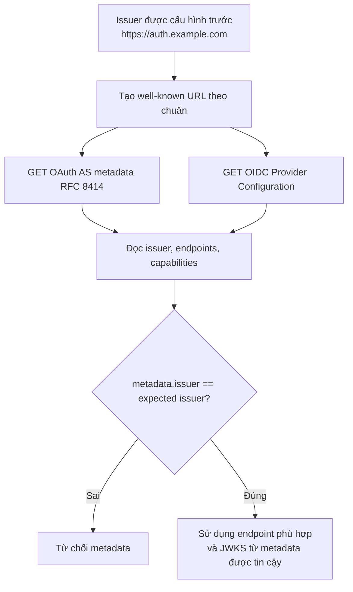
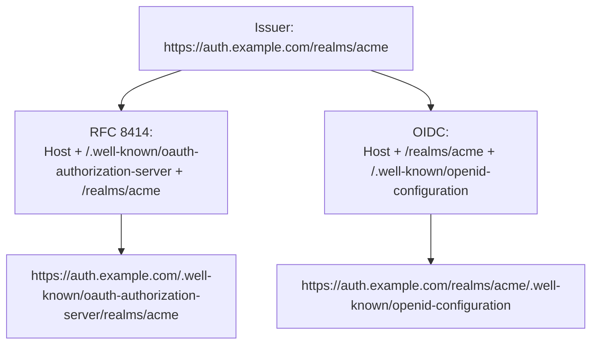
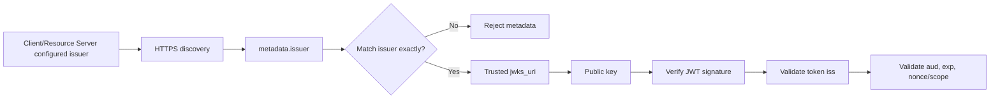
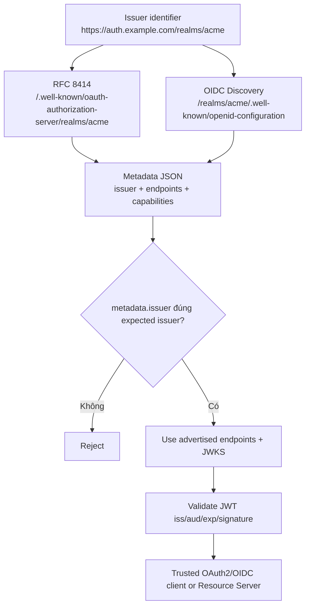

# Đường dẫn well-known và quan hệ với issuer

## 1. Mục tiêu và bối cảnh

Trong chương **Metadata và Discovery** của module **SPRING_SECURITY_OAUTH2_OIDC_AUTHORIZATION_SERVER**, Authorization Server không chỉ cần triển khai các endpoint như `/oauth2/authorize`, `/oauth2/token` và `/oauth2/jwks`. Nó còn cần công bố một **metadata document** để OAuth 2.0 clients, OpenID Connect Relying Parties và Resource Servers có thể khám phá các endpoint, thuật toán và khả năng được hỗ trợ.

Bài học tập trung vào mối quan hệ giữa **issuer identifier** và **đường dẫn `.well-known`**, đặc biệt là hai chuẩn thường đi cùng Spring Security/Spring Authorization Server (SAS):

- **OAuth 2.0 Authorization Server Metadata — RFC 8414:** convention `/.well-known/oauth-authorization-server`.
- **OpenID Connect Discovery 1.0:** convention `/.well-known/openid-configuration`.

Hai đường dẫn đều phục vụ discovery nhưng **không phải hai tên gọi thay thế hoàn toàn cho nhau**. Khi issuer có path, quy tắc xây URL của chúng đặc biệt dễ nhầm.

Sau bài học, bạn có thể:

- Giải thích issuer là gì và vì sao metadata `issuer` phải khớp issuer mà client tin cậy.
- Xây đúng đường dẫn well-known cho issuer ở root và issuer có path.
- Phân biệt RFC 8414 metadata với OIDC Provider Configuration.
- Cấu hình issuer cố định và OIDC discovery trong Spring Authorization Server.
- Phân biệt **issuer URL**, **đường dẫn well-known**, **đường dẫn endpoint** và **JWKS URL**.
- Kiểm tra metadata khi Authorization Server chạy sau reverse proxy, ingress hoặc context path.
- Thiết kế discovery phù hợp với OAuth2 Client, OIDC Client và Resource Server.
- Kiểm thử tính nhất quán, chặn host-header poisoning, issuer mix-up và lỗi multi-tenancy.

**Phạm vi:** Các ví dụ minh họa API thông dụng của **Spring Authorization Server 1.x**, **Spring Security 6.x** và **Spring Boot 3.x**. Các trường metadata, route và cách tự cấu hình có thể khác theo version, profile và số endpoint được bật; hãy đối chiếu dependency cùng response thực tế. Mục tiêu của module là giúp thiết kế, cấu hình, bảo mật, kiểm thử và vận hành OAuth 2.0/OpenID Connect Authorization Server đáng tin cậy trong ứng dụng Spring Boot.

## 2. Issuer là định danh của Authorization Server

**Issuer** là URL định danh một Authorization Server hoặc OpenID Provider (OP), ví dụ:

```text
https://auth.example.com
```

Issuer **không đơn giản** là host, cũng không nhất thiết là đường dẫn prefix của tất cả OAuth endpoints. Nó đóng vai trò **trust anchor dạng định danh** để các bên nhận nhận biết “metadata và token này được phát hành bởi ai”.

Một issuer hợp lệ trong những ngữ cảnh này thường có các thuộc tính:

- Là HTTPS URL ở production.
- Có scheme, host và có thể có path.
- Không chứa query string hoặc fragment.
- Được cấu hình nhất quán và ổn định.
- Được client/Resource Server **dự kiến từ trước**, thay vì lấy tùy ý từ token hoặc input do attacker kiểm soát.
- Khớp chính xác với trường `issuer` của metadata trả về.
- Khớp với claim `iss` trong ID Token, và với `iss` trong JWT access token theo profile/configuration được áp dụng.

Ví dụ issuer theo tenant:

```text
https://auth.example.com/realms/acme
```

Trong mô hình multi-tenant, issuer có path có thể giúp phân biệt từng tenant/realm. Tuy nhiên, **chỉ thay chuỗi issuer không tự tạo ra multi-tenancy hoàn chỉnh**: mỗi issuer còn cần route discovery, client registration, key policy, storage isolation và token validation tương ứng.

### 2.1. Issuer không phải token endpoint

| Địa chỉ | Vai trò |
| --- | --- |
| `https://auth.example.com` | Issuer identifier |
| `https://auth.example.com/.well-known/oauth-authorization-server` | OAuth 2.0 AS metadata document theo RFC 8414 cho issuer root |
| `https://auth.example.com/.well-known/openid-configuration` | OIDC Provider Configuration cho issuer root |
| `https://auth.example.com/oauth2/authorize` | Authorization Endpoint |
| `https://auth.example.com/oauth2/token` | Token Endpoint |
| `https://auth.example.com/oauth2/jwks` | JWK Set Endpoint |
| `https://auth.example.com/oauth2/introspect` | Token Introspection Endpoint, nếu được hỗ trợ |
| `https://auth.example.com/oauth2/revoke` | Token Revocation Endpoint, nếu được hỗ trợ |

Những endpoint trên là **ví dụ bố trí thường gặp**. Client không nên suy mọi endpoint bằng cách nối path vào issuer. **Metadata mới là nguồn thông tin về các endpoint được quảng bá**, và response phải được xác minh gắn với issuer đã tin cậy.

### 2.2. Issuer khác hostname nội bộ

AS chạy trong container có thể lắng nghe:

```text
http://authorization-service:9000
```

Nhưng issuer cho người dùng/client bên ngoài là:

```text
https://auth.example.com
```

`authorization-service` là internal DNS, không phải issuer public. Nếu issuer bị sinh từ request nội bộ, metadata và JWT có thể chứa `http://authorization-service:9000`; client bên ngoài sẽ gặp lỗi xác minh `iss` hoặc cố truy cập endpoint không thể định tuyến.

**Production nên cấu hình issuer rõ ràng**, không phụ thuộc vào Host header hoặc network path của request ngẫu nhiên.

## 3. Well-known endpoint là gì?

Cơ chế `.well-known` (theo RFC 8615 về well-known URIs) cho phép các giao thức chuẩn định nghĩa một vị trí có thể dự đoán để công bố cấu hình. OAuth/OIDC dùng well-known document để client tìm endpoint mà không cần hard-code toàn bộ URL.

Điều quan trọng:

- `/.well-known/...` là **đường dẫn để lấy tài liệu**, không phải chính issuer.
- Tài liệu thường là **JSON** chứa `issuer` và các URL/capabilities.
- URL well-known có thể được **suy ra từ issuer theo quy tắc của chuẩn**.
- URL của các endpoint được khai báo bên trong metadata có thể có route hoặc host khác issuer trong giới hạn cấu hình/trust được hỗ trợ.
- Client phải kiểm tra field `issuer` trong JSON đúng issuer đã kỳ vọng; chỉ nhận HTTP 200 hoặc JSON hợp lệ là chưa đủ.



## 4. Hai chuẩn discovery cần phân biệt

### 4.1. OAuth 2.0 Authorization Server Metadata — RFC 8414

RFC 8414 chuẩn hóa tài liệu metadata cho OAuth 2.0 Authorization Server. Suffix well-known thường dùng là:

```text
/.well-known/oauth-authorization-server
```

Ví dụ issuer root:

```text
Issuer:
https://auth.example.com

OAuth AS metadata:
https://auth.example.com/.well-known/oauth-authorization-server
```

Metadata có thể quảng bá Authorization Endpoint, Token Endpoint, JWKS URL, revocation, introspection, grant/response types và authentication methods. Việc một field có mặt còn phụ thuộc server hỗ trợ tính năng đó hay không.

### 4.2. OpenID Connect Discovery 1.0

OIDC định nghĩa **OpenID Provider Configuration** tại:

```text
/.well-known/openid-configuration
```

Với issuer root:

```text
Issuer:
https://auth.example.com

OIDC Discovery:
https://auth.example.com/.well-known/openid-configuration
```

OIDC metadata có thêm những thông tin dành cho client xác thực người dùng, chẳng hạn `userinfo_endpoint`, `subject_types_supported` và `id_token_signing_alg_values_supported`. Không suy rằng một AS chỉ hỗ trợ OAuth 2.0 sẽ có toàn bộ contract OIDC.

### 4.3. Bảng so sánh

| Tiêu chí | OAuth AS metadata (RFC 8414) | OIDC Discovery 1.0 |
| --- | --- | --- |
| Well-known suffix | `oauth-authorization-server` | `openid-configuration` |
| Đối tượng | OAuth2 Clients, Resource Servers và hệ thống tích hợp | OIDC Relying Parties và hệ thống cần OP metadata |
| Trọng tâm | OAuth endpoints, grants, auth methods, capabilities | OIDC authentication, ID Token, UserInfo, OP capabilities |
| Field định danh | `issuer` | `issuer` |
| JWT public keys | `jwks_uri` nếu được công bố/phù hợp | `jwks_uri` theo OIDC OP metadata |
| Có nghĩa hỗ trợ OIDC? | Không nhất thiết | Có, khi response là OIDC Provider Configuration hợp lệ |
| Có thể cùng tồn tại? | Có | Có |
| Với issuer có path | Well-known path được **chèn giữa host và issuer path** | Well-known suffix được **nối sau issuer path** theo OIDC Discovery |

**Điểm phân biệt quan trọng nhất của bài:** Với issuer **không có path**, hai URL trông rất giống nhau — chỉ khác tên document. Với issuer **có path**, cấu trúc URL **khác vị trí**, không chỉ thay một chuỗi ở cuối.

## 5. Quy tắc URL cho issuer root

Khi issuer không có path cụ thể:

```text
ISSUER = https://auth.example.com

RFC 8414:
https://auth.example.com/.well-known/oauth-authorization-server

OIDC Discovery:
https://auth.example.com/.well-known/openid-configuration
```

Hai cơ chế đều dùng cùng origin. Tuy nhiên đây là **hai endpoint metadata khác nhau** với schema/requirements tương ứng.

Một ứng dụng có thể đồng thời trả cả hai JSON documents nếu hỗ trợ OAuth AS Metadata và OIDC. Khi chỉ dùng OAuth, có thể chỉ cần RFC 8414 tùy contract client.

### 5.1. Đừng hard-code hai đường dẫn như alias của nhau

Không nên cấu hình proxy để mọi request `/.well-known/oauth-authorization-server` và `/.well-known/openid-configuration` luôn trả cùng một object tùy tiện. Một số field trùng nhau, nhưng các yêu cầu metadata và khả năng công bố của OIDC khác OAuth.

Nếu có proxy/router trỏ đến cùng implementation, vẫn phải đảm bảo **từng response đúng schema và nội dung** theo chuẩn mà URL đại diện.

## 6. Quy tắc URL cho issuer có path — trường hợp dễ sai nhất

Giả sử issuer là:

```text
https://auth.example.com/realms/acme
```

### 6.1. RFC 8414: chèn well-known **trước issuer path**

Theo cách xây URL của RFC 8414:

```text
Issuer:
https://auth.example.com/realms/acme

OAuth AS Metadata:
https://auth.example.com/.well-known/oauth-authorization-server/realms/acme
```

Phần `/realms/acme` của issuer **đứng sau** suffix `/.well-known/oauth-authorization-server`.

### 6.2. OIDC Discovery: nối well-known **sau issuer path**

Theo OIDC Discovery 1.0:

```text
Issuer:
https://auth.example.com/realms/acme

OIDC Provider Configuration:
https://auth.example.com/realms/acme/.well-known/openid-configuration
```

Phần `/realms/acme` xuất hiện **trước** `/.well-known/openid-configuration`.

### 6.3. Đặt cạnh nhau để không nhầm

| Issuer | URL theo RFC 8414 | URL theo OIDC Discovery |
| --- | --- | --- |
| `https://auth.example.com` | `https://auth.example.com/.well-known/oauth-authorization-server` | `https://auth.example.com/.well-known/openid-configuration` |
| `https://auth.example.com/tenant-a` | `https://auth.example.com/.well-known/oauth-authorization-server/tenant-a` | `https://auth.example.com/tenant-a/.well-known/openid-configuration` |
| `https://auth.example.com/realms/acme` | `https://auth.example.com/.well-known/oauth-authorization-server/realms/acme` | `https://auth.example.com/realms/acme/.well-known/openid-configuration` |

Sơ đồ vị trí đường dẫn:



**Không áp dụng công thức `ISSUER + "/.well-known/oauth-authorization-server"` cho issuer có path.** Công thức đó không tuân thứ tự đường dẫn của RFC 8414.

### 6.4. Phiên bản, gateway và khả năng đa issuer

Một thư viện hoặc server có thể hỗ trợ thêm route tương thích ngoài route chuẩn. Không suy từ việc một URL “trả 200” rằng URL đó là chuẩn cho mọi client. Nếu cần multi-tenant, cấu hình router/ingress và kiểm thử URL đúng chuẩn của từng issuer.

Với Spring Authorization Server, **không chỉ đặt `issuer(".../realms/acme")` rồi mặc định cả hai well-known paths và mọi endpoint sẽ được tạo/mapped chính xác cho tenant**. Routing, security filter chains, context/tenant resolution, client repository và public URLs còn cần triển khai/phối hợp riêng theo phiên bản.

## 7. Ví dụ OAuth Authorization Server Metadata JSON

Một document tại `https://auth.example.com/.well-known/oauth-authorization-server` có thể như sau:

```json
{
  "issuer": "https://auth.example.com",
  "authorization_endpoint": "https://auth.example.com/oauth2/authorize",
  "token_endpoint": "https://auth.example.com/oauth2/token",
  "jwks_uri": "https://auth.example.com/oauth2/jwks",
  "response_types_supported": ["code"],
  "grant_types_supported": [
    "authorization_code",
    "refresh_token",
    "client_credentials"
  ],
  "token_endpoint_auth_methods_supported": [
    "client_secret_basic",
    "private_key_jwt"
  ],
  "code_challenge_methods_supported": ["S256"],
  "revocation_endpoint": "https://auth.example.com/oauth2/revoke",
  "introspection_endpoint": "https://auth.example.com/oauth2/introspect"
}
```

Đây là **ví dụ lý thuyết**, không phải output đảm bảo của mọi SAS version. Những endpoint và method được quảng bá phải khớp tính năng thực sự được bật/cấu hình; không quảng bá `private_key_jwt` khi ứng dụng không xử lý đúng phương thức đó.

### 7.1. Ý nghĩa các trường quan trọng

| Field | Vai trò | Điều cần kiểm tra |
| --- | --- | --- |
| `issuer` | Định danh của AS | Phải khớp issuer kỳ vọng |
| `authorization_endpoint` | Endpoint bắt đầu authorization | URL public, đúng redirect và HTTPS |
| `token_endpoint` | Endpoint đổi grant lấy token | Dùng client auth đúng method |
| `jwks_uri` | Public JWK Set cho xác minh JWT | Đúng origin/key policy, không chứa private keys |
| `response_types_supported` | Các response type AS hỗ trợ | Client không chọn type ngoài cấu hình |
| `grant_types_supported` | Các grant types hỗ trợ | Không có nghĩa mọi client đều được dùng mọi grant |
| `token_endpoint_auth_methods_supported` | Các phương thức xác thực client ở Token Endpoint | Phải khớp registered clients và providers |
| `code_challenge_methods_supported` | Các phương thức PKCE được hỗ trợ | Ưu tiên S256 theo security profile |
| `revocation_endpoint` | Endpoint RFC 7009 | Có khi hỗ trợ/công bố revocation |
| `introspection_endpoint` | Endpoint RFC 7662 | Có khi hỗ trợ/công bố introspection |

**Capability của AS không phải quyền của từng client.** Ví dụ metadata có `client_credentials` nhưng client `portal-web` vẫn phải được đăng ký grant đó nếu muốn dùng.

### 7.2. Field có thể vắng mặt

Metadata fields có điều kiện theo tiêu chuẩn/profile. Không coi việc thiếu mọi trường tùy chọn là server hỏng. Nhưng nếu client cần một tính năng — như PKCE, introspection hoặc revocation — thì phải xác minh tài liệu quảng bá endpoint/capability phù hợp hoặc có cấu hình out-of-band đáng tin cậy.

## 8. Ví dụ OIDC Provider Configuration JSON

Khi bật OIDC, một document minh họa ở `https://auth.example.com/.well-known/openid-configuration`:

```json
{
  "issuer": "https://auth.example.com",
  "authorization_endpoint": "https://auth.example.com/oauth2/authorize",
  "token_endpoint": "https://auth.example.com/oauth2/token",
  "userinfo_endpoint": "https://auth.example.com/userinfo",
  "jwks_uri": "https://auth.example.com/oauth2/jwks",
  "response_types_supported": ["code"],
  "subject_types_supported": ["public"],
  "id_token_signing_alg_values_supported": ["RS256"],
  "scopes_supported": ["openid", "profile", "email"],
  "claims_supported": ["sub", "iss", "aud", "exp", "iat", "email"]
}
```

Các giá trị chỉ **mang tính minh họa**; SAS có thể dùng `/userinfo` hoặc endpoint path khác tùy version và cấu hình. Không copy mẫu này để làm reverse-proxy static JSON nếu runtime thực tế có cấu hình khác.

### 8.1. Field khác OAuth metadata

- `userinfo_endpoint`: nơi OIDC client gọi lấy user claims bằng access token phù hợp.
- `subject_types_supported`: các loại subject identifier của OP, ví dụ `public` hoặc `pairwise` theo khả năng.
- `id_token_signing_alg_values_supported`: thuật toán ký ID Token được hỗ trợ.
- `claims_supported`: các claims OP có thể hỗ trợ; không đảm bảo mọi claim đều có trong từng ID Token.
- `end_session_endpoint`: có thể được quảng bá khi OP hỗ trợ logout phù hợp.

OIDC client vẫn phải xác minh ID Token theo OIDC Core: chữ ký, `iss`, `aud`, `exp`, `nonce`/`auth_time` và các điều kiện flow tương ứng. Discovery **không thay thế token validation**.

### 8.2. Một metadata document không phải ID Token

Metadata chỉ quảng bá cấu hình. Client không dùng `issuer` trong JSON làm bằng chứng rằng user đã đăng nhập. ID Token phải được phát hành sau authentication flow và được xác minh bằng các quy tắc riêng.

## 9. Quan hệ giữa issuer, metadata và claim `iss`

Có thể xem đây là chuỗi tin cậy:



Ba giá trị khác nhau nhưng phải nhất quán:

1. **Issuer kỳ vọng**: cấu hình ở OIDC Client/Resource Server.
2. **`issuer` trong discovery JSON**: AS tự khai định danh của nó.
3. **`iss` trong JWT**: token khẳng định issuer đã phát hành.

Nếu AS công bố metadata `issuer=https://auth.example.com` nhưng ID Token có `iss=http://auth-internal:9000`, client phải từ chối token vì sai issuer.

### 9.1. So khớp chính xác, không chỉ cùng hostname

Những chuỗi sau **không được mặc định coi là cùng issuer**:

```text
https://auth.example.com
https://auth.example.com/
http://auth.example.com
https://auth.example.com/realms/acme
https://auth.example.com/realms/other
https://AUTH.example.com
```

Một số thao tác chuẩn hóa URL ở tầng HTTP/DNS có thể tồn tại, nhưng OIDC/metadata issuer matching có yêu cầu chính xác riêng. Đừng tự hạ chuẩn thành so sánh hostname, bỏ path hoặc “startsWith”.

### 9.2. Không lấy issuer tùy ý từ token để gọi discovery

Một token do attacker tự tạo có thể chứa:

```json
{
  "iss": "https://attacker.example",
  "sub": "admin",
  "aud": "orders-api",
  "exp": 1890000000
}
```

Nếu Resource Server lấy bất kỳ `iss` nào trong token chưa xác minh rồi tải metadata/JWKS và tin key mới tìm được, attacker có thể dựng issuer của riêng mình và khiến API chấp nhận token giả.

**Đúng:** Resource Server có danh sách issuer được tin cậy từ cấu hình, hoặc một resolver multi-tenant kiểm soát chặt chẽ. Metadata/JWKS chỉ được khám phá trong phạm vi những issuer đã được phê duyệt.

### 9.3. Audience và issuer kiểm tra hai điều khác nhau

`iss` cho biết **ai phát hành**. `aud` cho biết **ai là bên nhận**. Resource Server phải kiểm tra cả hai; một token đúng issuer nhưng `aud=billing-api` không tự động hợp lệ ở `orders-api`.

## 10. Cấu hình `AuthorizationServerSettings` trong SAS

Với Spring Authorization Server, cấu hình issuer chính thức thường nằm trong bean `AuthorizationServerSettings`:

```java
@Configuration(proxyBeanMethods = false)
public class AuthorizationServerSettingsConfig {

    @Bean
    AuthorizationServerSettings authorizationServerSettings() {
        return AuthorizationServerSettings.builder()
                .issuer("https://auth.example.com")
                .authorizationEndpoint("/oauth2/authorize")
                .tokenEndpoint("/oauth2/token")
                .jwkSetEndpoint("/oauth2/jwks")
                .build();
    }
}
```

Trong ví dụ:

- `issuer(...)` đặt định danh public ổn định.
- `authorizationEndpoint(...)` xác định path endpoint authorization trong ứng dụng.
- `tokenEndpoint(...)` xác định path endpoint token.
- `jwkSetEndpoint(...)` xác định path JWKS.

**Issuer không tự động là URL prefix của mọi endpoint.** Endpoint paths là cấu hình riêng, và URL public phải được tạo/định tuyến đúng với servlet context path và reverse proxy.

### 10.1. Vì sao nên cấu hình issuer rõ trong production?

Nếu không cấu hình issuer, một số thiết lập SAS có thể suy ra issuer từ request hiện tại. Điều đó có thể hữu ích khi thử nghiệm local, nhưng trong production dễ sinh các vấn đề:

- Reverse proxy gửi Host/scheme nội bộ.
- Request trực tiếp tới AS dùng hostname khác public domain.
- Load balancer có nhiều hostnames.
- Gateway không xử lý `Forwarded`/`X-Forwarded-*` nhất quán.
- Attacker cố tình gửi Host header độc hại.

Cấu hình issuer cố định giảm nguy cơ metadata/token issuer thay đổi theo request. Sau khi cấu hình, cần kiểm thử public discovery và token `iss` thực tế.

### 10.2. Không dùng issuer path để suy mọi route

Ví dụ:

```java
AuthorizationServerSettings.builder()
        .issuer("https://auth.example.com/realms/acme")
        .tokenEndpoint("/oauth2/token")
        .build();
```

Không nên tự kết luận token endpoint public chắc chắn là:

```text
https://auth.example.com/realms/acme/oauth2/token
```

hay:

```text
https://auth.example.com/oauth2/token
```

chỉ từ hai dòng cấu hình. URL cuối cùng còn phụ thuộc context path, ingress rewrites, multitenant routing và cách phiên bản SAS dựng endpoint URLs. **Đọc JSON metadata thực tế và thử HTTP routing end-to-end** trước khi công bố client integration.

## 11. Bật OIDC Discovery trong `SecurityFilterChain`

OAuth AS Metadata thường đi cùng cấu hình endpoint của Authorization Server. OIDC Provider Configuration cần bật OIDC trong SAS khi ứng dụng phục vụ OIDC clients:

```java
@Configuration(proxyBeanMethods = false)
@EnableWebSecurity
public class AuthorizationServerSecurityConfig {

    @Bean
    @Order(1)
    SecurityFilterChain authorizationServerSecurityFilterChain(
            HttpSecurity http) throws Exception {

        OAuth2AuthorizationServerConfigurer authorizationServer =
                OAuth2AuthorizationServerConfigurer.authorizationServer();

        http
            .securityMatcher(authorizationServer.getEndpointsMatcher())
            .with(authorizationServer, configurer ->
                    configurer.oidc(Customizer.withDefaults()))
            .authorizeHttpRequests(authorize ->
                    authorize.anyRequest().authenticated())
            .exceptionHandling(exceptions ->
                    exceptions.defaultAuthenticationEntryPointFor(
                            new LoginUrlAuthenticationEntryPoint("/login"),
                            new MediaTypeRequestMatcher(MediaType.TEXT_HTML)));

        return http.build();
    }

    @Bean
    @Order(2)
    SecurityFilterChain appSecurityFilterChain(
            HttpSecurity http) throws Exception {

        http.authorizeHttpRequests(authorize ->
                    authorize.anyRequest().authenticated())
            .formLogin(Customizer.withDefaults());

        return http.build();
    }
}
```

Đây là **bộ khung minh họa**, không phải Authorization Server chạy độc lập. Cần `RegisteredClientRepository`, `OAuth2AuthorizationService`, `OAuth2AuthorizationConsentService` khi cần, `JWKSource<SecurityContext>`/`JwtDecoder` cho OIDC/JWT, user authentication, issuer và token generator theo version.

### 11.1. Metadata endpoint có phải đăng nhập không?

Discovery thường cần công khai cho clients, ví dụ một OIDC client tải provider configuration trước khi người dùng đăng nhập. Đừng áp authentication hoặc redirect login HTML lên `/.well-known/...` một cách vô tình.

Tuy nhiên, endpoint được phục vụ qua filter chain và security matcher thực tế. Nếu JSON metadata trả `302 /login` hoặc `401` trái contract, cần kiểm tra `@Order`, matcher, OIDC enablement và các rule custom; không mở toàn bộ AS endpoint chỉ để “sửa discovery”.

### 11.2. Khi nào không nên bật OIDC?

Nếu Authorization Server chỉ triển khai OAuth 2.0 để cấp quyền API và không cung cấp OpenID Connect authentication, **không nhất thiết bật OIDC**. Clients OAuth thông thường có thể khám phá AS metadata theo RFC 8414 mà không cần ID Token/UserInfo.

Một `/.well-known/openid-configuration` tồn tại nhưng OP không triển khai các chức năng OIDC cần thiết có thể khiến client khởi tạo flow sai. Chỉ quảng bá những tính năng thực sự được hỗ trợ.

## 12. Spring Boot properties và các bên tiêu thụ discovery

### 12.1. Spring Security OAuth2 Client / OIDC Client

Một Spring Boot OAuth2 Client có thể dùng issuer để khám phá provider metadata:

```yaml
spring:
  security:
    oauth2:
      client:
        registration:
          portal:
            provider: corporate-auth
            client-id: portal-web
            client-secret: ${PORTAL_CLIENT_SECRET}
            authorization-grant-type: authorization_code
            redirect-uri: "{baseUrl}/login/oauth2/code/{registrationId}"
            scope: openid,profile
        provider:
          corporate-auth:
            issuer-uri: https://auth.example.com
```

Đây là client configuration, **không phải cấu hình Authorization Server**. `issuer-uri` phải trỏ đến issuer identifier, không phải URL `openid-configuration`. Tính năng discovery và thứ tự fallback giữa OIDC/OAuth metadata phụ thuộc version Spring Security và registration type.

Client registration vẫn phải được tạo tại AS với đúng `client_id`, secret/method, redirect URI và scopes; discovery không tự đăng ký client.

### 12.2. Spring Security Resource Server (JWT)

Resource Server thường cấu hình issuer:

```yaml
spring:
  security:
    oauth2:
      resourceserver:
        jwt:
          issuer-uri: https://auth.example.com
```

Spring Security có thể dùng issuer này để khám phá metadata và JWKS, sau đó kiểm tra claim `iss`. Nhưng Resource Server còn cần kiểm tra `aud` và quyền `scope` theo API; chỉ có issuer và chữ ký hợp lệ chưa đủ business authorization.

Nếu cần tránh discovery ở startup hoặc làm việc với hệ thống đặc biệt, có thể cấu hình `jwk-set-uri` theo hỗ trợ của Spring Security, nhưng phải giữ issuer/audience validation phù hợp.

### 12.3. Đừng dùng URL metadata làm issuer-uri

Sai:

```yaml
spring:
  security:
    oauth2:
      resourceserver:
        jwt:
          issuer-uri: https://auth.example.com/.well-known/openid-configuration
```

Giá trị trên là **URL tài liệu discovery**, không phải issuer. Client có thể tạo sai đường dẫn well-known hoặc so khớp `iss` sai.

Đúng:

```yaml
spring:
  security:
    oauth2:
      resourceserver:
        jwt:
          issuer-uri: https://auth.example.com
```

## 13. Reverse proxy, ingress và servlet context path

Trong production, AS có thể chạy phía sau:

```text
Internet -> https://auth.example.com -> Ingress/Proxy
         -> http://authorization-service:9000 -> Spring Boot
```

Proxy có thể terminate TLS, đổi Host, rewrite path hoặc thêm context prefix. Nếu metadata sinh internal URL hoặc public path không route được, client sẽ thất bại dù AS backend vẫn chạy tốt.

### 13.1. Các lỗi thường gặp

| External expectation | Backend thấy | Hậu quả nếu cấu hình sai |
| --- | --- | --- |
| `https://auth.example.com` | `http://authorization-service:9000` | Metadata `issuer` hoặc token `iss` sai |
| `https://auth.example.com/oauth2/token` | `http://service:9000/oauth2/token` | Token endpoint public không đúng URL |
| `https://auth.example.com/oauth2/jwks` | `http://service:9000/oauth2/jwks` | Resource Server không tải được key |
| `https://auth.example.com/realms/acme/.well-known/openid-configuration` | Internal path khác | OIDC discovery trả 404 |
| `https://auth.example.com/.well-known/oauth-authorization-server/realms/acme` | Proxy không map route theo RFC 8414 | OAuth discovery cho path issuer thất bại |

### 13.2. Forwarded headers phải đến từ proxy tin cậy

Các header như `Forwarded`, `X-Forwarded-Proto`, `X-Forwarded-Host` và `X-Forwarded-Prefix` có thể giúp ứng dụng biết public origin/path. Spring Boot có các cách cấu hình xử lý forwarded headers, ví dụ:

```yaml
server:
  forward-headers-strategy: framework
```

**Không bật tin forwarded headers một cách mù quáng từ Internet.** Nếu client có thể tự gửi `X-Forwarded-Host: attacker.example` và ứng dụng dùng nó tạo issuer/URLs, có thể gây issuer poisoning, redirect sai hoặc đưa JWKS/token endpoint đến host của attacker.

Thực hành an toàn:

1. Reverse proxy loại bỏ các forwarded headers do Internet client gửi.
2. Proxy tự đặt lại scheme/host/prefix được xác thực.
3. Backend chỉ chấp nhận forwarded headers qua network/proxy tin cậy.
4. Issuer production được cấu hình cố định.
5. Test external URLs qua chính public ingress, không chỉ gọi localhost.

### 13.3. Context path và URL rewriting

Nếu ứng dụng có `server.servlet.context-path=/auth` nhưng public proxy che bỏ hoặc thêm `/auth`, cần quyết định một contract rõ:

- Public issuer chứa `/auth` hay không?
- Public well-known paths được router phục vụ theo chuẩn tương ứng không?
- Metadata `authorization_endpoint`/`token_endpoint`/`jwks_uri` có path nào?
- Browser redirect, form login và consent URLs có hoạt động qua ingress không?
- Resource Server tải JWKS từ URL công bố được không?

Không có một phép nối chuỗi universal dùng được cho mọi proxy + issuer path. Kết quả đúng là **bộ URL public mà clients thực sự truy cập được, đi kèm metadata issuer chính xác**.

## 14. Multi-tenant: mỗi issuer là một ranh giới tin cậy

Trong mô hình multi-tenant, hai realm có thể dùng cùng host nhưng issuer khác path:

```text
https://auth.example.com/realms/acme
https://auth.example.com/realms/contoso
```

Các bên nhận cần gắn metadata/JWKS và registration với **đúng issuer**, không chỉ hostname.

### 14.1. Ví dụ mapping chuẩn

| Realm | RFC 8414 metadata | OIDC metadata |
| --- | --- | --- |
| `acme` | `https://auth.example.com/.well-known/oauth-authorization-server/realms/acme` | `https://auth.example.com/realms/acme/.well-known/openid-configuration` |
| `contoso` | `https://auth.example.com/.well-known/oauth-authorization-server/realms/contoso` | `https://auth.example.com/realms/contoso/.well-known/openid-configuration` |

Trong mỗi document:

- `issuer` phải bằng issuer của chính realm đó.
- Endpoint URLs phải route tới đúng tenant/realm.
- Authorization Code, client registrations, consent và token state phải được phân vùng đúng policy.
- Key material/JWKS có thể được chia sẻ hoặc tách theo thiết kế, nhưng token phải có `iss` chính xác và Resource Server chỉ tin issuer được phép.
- Không được dùng token của tenant A như token của tenant B chỉ vì `sub` hoặc `kid` giống nhau.

### 14.2. Không tin tenant chỉ từ query parameter

Nếu request tới `/.well-known/openid-configuration?tenant=acme`, AS không nên dựa vào query tự khai để công bố metadata của tenant khác khi contract issuer yêu cầu path rõ ràng. Client phải có issuer identifier đã được phê duyệt và route một cách nhất quán.

### 14.3. Không xem việc bật multi-tenancy là một boolean

Một hệ thống production có thể cần tenant resolver, routing, client repository partitioning, per-tenant authorization context, keys và metadata generation. Việc có đúng well-known URL là **điều kiện cần cho discovery**, không phải bảo đảm toàn bộ các endpoint của từng tenant đã an toàn.

## 15. Discovery, JWKS và key rotation

Metadata thường chứa `jwks_uri`, ví dụ:

```json
{
  "issuer": "https://auth.example.com",
  "jwks_uri": "https://auth.example.com/oauth2/jwks"
}
```

Resource Server và OIDC Client sử dụng public keys từ JWKS để xác minh JWT được AS ký. `jwks_uri` là **URL của bộ public keys**, không phải private key source.

### 15.1. Những kiểm tra tối thiểu

- JWKS URL thực sự truy cập được qua HTTPS.
- Public JWK không chứa RSA private parameters (`d`, `p`, `q`, `dp`, `dq`, `qi`) hoặc EC private `d`.
- JWT JOSE header `kid` khớp public key phù hợp.
- Algorithm `alg` được allowlist, không tin `alg=none` hoặc algorithm không được phê duyệt.
- `iss` khớp issuer cố định.
- `aud` khớp client ID (ID Token) hoặc Resource Server/API (access token theo profile).
- `exp`/`nbf`/`iat` và các điều kiện flow được kiểm tra.

### 15.2. Xoay khóa không đòi đổi issuer

Thay signing key thường làm thay `kid` và public JWKS, **không nên thay issuer** nếu Authorization Server vẫn là cùng entity. Nếu đổi issuer, clients và Resource Servers phải xem đó là một thay đổi trust configuration lớn hơn key rotation.

Khi xoay khóa, JWKS nên có thời gian overlap công bố public key cũ và mới để token chưa hết hạn vẫn được xác minh. Metadata `jwks_uri` thường có thể giữ ổn định; nội dung JWKS mới thay đổi theo key lifecycle.

### 15.3. Cache metadata và JWKS

Các clients có thể cache discovery JSON/JWKS. Nếu thay endpoint paths, issuer hoặc keys:

- Tính thời gian cache TTL/propagation.
- Không thay `kid` theo cách khiến cache chọn nhầm key.
- Không rút public key cũ quá sớm.
- Có kế hoạch rollout/rollback cho metadata và các client registrations.
- Theo dõi unknown `kid`, issuer mismatch và discovery 404/5xx.

Không cache metadata “vĩnh viễn” ở client nếu hệ thống cần hỗ trợ key/endpoint rotation. Tuy nhiên, cũng không bắt client tải discovery cho mọi API request; nên tuân chính sách cache và khả năng thư viện.

## 16. Bảo mật quá trình discovery

### 16.1. HTTPS và nguồn tin cậy

Discovery response thường không cần client authentication, nhưng nó chứa các URL ảnh hưởng trực tiếp đến OAuth flow. Bảo vệ bằng:

- HTTPS với certificate validation.
- Issuer allowlist/configuration chính xác.
- Không follow redirects tùy ý đến host không tin cậy khi tải metadata/JWKS.
- Giới hạn URL schemes/origins theo policy.
- Bảo vệ DNS, proxy và egress paths phù hợp.
- Không coi một `200 JSON` từ host attacker là trusted metadata.

### 16.2. SSRF và issuer confusion

Một hệ thống multi-tenant cho phép user đưa vào issuer URL tùy ý có thể bị tấn công SSRF nếu backend tự tải metadata từ địa chỉ nội bộ như `127.0.0.1`, link-local hoặc metadata service của cloud. Nếu nghiệp vụ buộc phải khám phá issuer được user đề xuất, cần quy trình kiểm duyệt/allowlist và network egress restrictions.

Không lấy `issuer`, `jwks_uri` hoặc `authorization_endpoint` từ một JWT chưa xác minh rồi truy cập trực tiếp. Token header `jku`/`x5u` cũng không phải nguồn URL đáng tin khi chưa có policy rõ ràng.

### 16.3. OAuth mix-up và nhiều issuer

Khi client tương tác với nhiều AS, cần giữ từng authorization transaction gắn với issuer ban đầu, state/PKCE và các metadata endpoints phù hợp. Không đổi Token Endpoint chỉ vì browser callback mang tham số lạ. Theo profile hỗ trợ, issuer identification trong authorization response (ví dụ RFC 9207 `iss` response parameter) có thể giúp chống mix-up, nhưng không thay issuer validation từ discovery.

### 16.4. Vì sao metadata public vẫn cần bảo vệ?

Dù metadata không chứa private key, nếu attacker thay được nội dung metadata, họ có thể hướng clients tới token endpoint hoặc JWKS sai. Do đó, công khai **không đồng nghĩa được phép sửa đổi**. Cần HTTPS, cấu hình trust và kiểm tra tính toàn vẹn/khớp issuer theo giao thức.

## 17. Kiểm tra discovery bằng HTTP

### 17.1. Kiểm tra issuer root

Ví dụ trên terminal với `curl`:

```bash
curl --fail-with-body -i \
  "https://auth.example.com/.well-known/oauth-authorization-server"

curl --fail-with-body -i \
  "https://auth.example.com/.well-known/openid-configuration"
```

Kỳ vọng:

- Status `200 OK` nếu endpoint được bật.
- `Content-Type` tương thích JSON.
- Body là JSON object đúng schema.
- `issuer` chính xác `https://auth.example.com`.
- Endpoint URLs là public HTTPS URLs mà client thực sự truy cập được.
- Không có redirect tới HTML login hoặc internal host.
- OIDC document chỉ tồn tại khi server hỗ trợ và bật OIDC theo cấu hình.

Một AS OAuth-only có thể không cung cấp OIDC well-known document; đó không nhất thiết là lỗi.

### 17.2. Kiểm tra issuer có path

Với `https://auth.example.com/realms/acme`:

```bash
# RFC 8414: well-known suffix đứng trước issuer path.
curl -i \
  "https://auth.example.com/.well-known/oauth-authorization-server/realms/acme"

# OIDC Discovery: well-known suffix đứng sau issuer path.
curl -i \
  "https://auth.example.com/realms/acme/.well-known/openid-configuration"
```

Không dùng response thành công của một URL tùy chỉnh để kết luận cả hai chuẩn đã được hỗ trợ. Phải kiểm tra route tương ứng, `issuer` trong JSON và metadata semantics.

### 17.3. Kiểm tra giá trị JSON bằng `jq`

```bash
curl -fsS \
  "https://auth.example.com/.well-known/oauth-authorization-server" \
  | jq '{
      issuer,
      authorization_endpoint,
      token_endpoint,
      jwks_uri,
      grant_types_supported
    }'
```

Với OIDC:

```bash
curl -fsS \
  "https://auth.example.com/.well-known/openid-configuration" \
  | jq '{
      issuer,
      authorization_endpoint,
      token_endpoint,
      jwks_uri,
      userinfo_endpoint,
      id_token_signing_alg_values_supported
    }'
```

Các lệnh chỉ minh họa; `jq` là tiện ích dòng lệnh, không phải dependency Java. Khi dùng host/issuer thật, không thêm `-k` để bỏ TLS certificate validation chỉ vì certificate đang cấu hình sai.

## 18. Kiểm thử bằng Spring Security / MockMvc

### 18.1. Kiểm tra OAuth metadata

```java
@Test
void oauthMetadataContainsConfiguredIssuer() throws Exception {
    mockMvc.perform(
            get("/.well-known/oauth-authorization-server"))
        .andExpect(status().isOk())
        .andExpect(content().contentTypeCompatibleWith(
                MediaType.APPLICATION_JSON))
        .andExpect(jsonPath("$.issuer")
                .value("https://auth.example.com"))
        .andExpect(jsonPath("$.token_endpoint")
                .value("https://auth.example.com/oauth2/token"));
}
```

Đây là skeleton integration test: context cần SAS security filter chain, `AuthorizationServerSettings` và các bean hạ tầng đúng version. Với proxy/context path, cần thêm tests sử dụng forwarded headers **đã đi qua lớp proxy tin cậy** hoặc end-to-end HTTP qua ingress.

### 18.2. Kiểm tra OIDC metadata

```java
@Test
void oidcProviderConfigurationContainsIssuerAndJwksUri()
        throws Exception {

    mockMvc.perform(
            get("/.well-known/openid-configuration"))
        .andExpect(status().isOk())
        .andExpect(jsonPath("$.issuer")
                .value("https://auth.example.com"))
        .andExpect(jsonPath("$.jwks_uri")
                .value("https://auth.example.com/oauth2/jwks"))
        .andExpect(jsonPath("$.id_token_signing_alg_values_supported")
                .isArray());
}
```

Test này cần đã bật OIDC. Không kỳ vọng mọi claim/algorithms đều có giá trị như ví dụ nếu AS dùng thuật toán hoặc profile khác.

### 18.3. Test token `iss` khớp metadata

Test end-to-end nên:

1. Gọi discovery và lấy `issuer` dự kiến.
2. Hoàn thành authorization code/OIDC flow với registered client test.
3. Nhận ID Token hoặc JWT access token.
4. Xác minh **chữ ký** bằng JWKS đúng issuer; không chỉ decode payload.
5. Xác minh claim `iss` bằng giá trị `issuer` trong metadata và issuer đã cấu hình.
6. Xác minh `aud`, `exp`, `nonce`/PKCE theo loại token và flow.
7. Thử dùng token với Resource Server trust issuer khác → phải bị từ chối.

`MockMvc` test metadata không chứng minh JWT signature validation hoặc reverse proxy correctness. Đó là các tầng test riêng.

## 19. Ma trận kiểm thử đường dẫn và bảo mật

| Test case | Kỳ vọng |
| --- | --- |
| Issuer root và RFC 8414 URL | Metadata tồn tại, `issuer` khớp |
| Issuer root và OIDC URL khi đã bật OIDC | OIDC metadata tồn tại, `issuer` khớp |
| Issuer có path — RFC 8414 | URL chèn well-known trước path, JSON khớp issuer |
| Issuer có path — OIDC | URL nối well-known sau path, JSON khớp issuer |
| OAuth-only không bật OIDC | Không quảng bá OIDC capability giả |
| Metadata `issuer` không khớp issuer configured | Client phải từ chối |
| Metadata chứa `http://internal-host` trong production | Fail test public URLs |
| `jwks_uri` không route được | Discovery/JWT validation integration test fail |
| Public JWKS chứa private key fields | Block release, xử lý security incident |
| JWT có `iss` sai | Client/Resource Server từ chối |
| JWT đúng issuer nhưng `aud` sai | Resource Server từ chối |
| Proxy chèn `X-Forwarded-Host` từ attacker | Host poisoning bị chặn |
| Direct backend request dùng internal Host | Không làm thay đổi issuer public |
| Đổi signing key nhưng issuer không đổi | Token mới dùng key mới, public JWKS overlap |
| Client cache metadata cũ | Rollout/TTL/compatibility được kiểm chứng |
| Realm A metadata trả issuer của realm B | Fail, không cross-tenant |
| Issuer user-supplied trỏ 127.0.0.1/link-local | Không bị backend fetch trái policy (SSRF defense) |
| Authorization Endpoint trả HTML login hợp lệ nhưng metadata bị redirect login | Discovery test fail, sửa matcher |
| Proxy rewrite làm URL /.well-known 404 | Routing test fail, sửa ingress |
| Metadata quảng bá grant/method không được hỗ trợ | Compatibility test fail |
| Metadata đúng nhưng Token Endpoint khác public path | End-to-end client test fail |

## 20. Troubleshooting các lỗi phổ biến

| Triệu chứng | Nguyên nhân khả dĩ | Hướng kiểm tra |
| --- | --- | --- |
| `/.well-known/oauth-authorization-server` trả 404 | Route chưa bật, issuer path/proxy rewrite sai | Endpoint mapping, matcher, ingress |
| `/.well-known/openid-configuration` trả 404 | Chưa bật OIDC hoặc route khác | `oidc(Customizer.withDefaults())` và version |
| Well-known trả `302 /login` | Security filter chain/matcher/authorization rules sai | `@Order`, endpoint filter chain, exception handling |
| JSON trả `issuer=http://localhost:9000` | AS suy issuer từ request nội bộ | `AuthorizationServerSettings.issuer(...)` |
| Client báo `invalid issuer` | Metadata issuer khác client config/ID Token `iss` | So khớp chính xác scheme, host, path |
| Issuer path tạo OAuth well-known URL sai | Dùng công thức nối suffix kiểu OIDC | RFC 8414 path insertion |
| OIDC discovery với issuer path không có response | Proxy/AS không map issuer-path suffix | OIDC route và tenant resolution |
| `jwks_uri` 404 hoặc key set rỗng | JWKSource/JWKS mapping/proxy path sai | JWK bean, JWK endpoint, public URL |
| JWT bị từ chối sau rotation | `kid`/cache/JWKS overlap không đúng | JOSE header, public JWK set, cache TTL |
| Browser authorize được nhưng client token exchange lỗi | Metadata token endpoint URL không khớp external route | Discovery JSON và proxy path |
| Mỗi replica trả issuer/endpoint khác nhau | Dynamic request issuer, config không đồng bộ | Issuer pinning, shared configuration |
| Host header khác làm đổi metadata | Tin Host/forwarded header từ client | Proxy sanitization và issuer cố định |
| Resource Server khởi động lỗi vì không discovery được | Metadata unavailable/TLS cert/network | HTTPS, outbound connectivity, startup behavior |
| Multi-tenant client nhận metadata của tenant khác | Tenant resolver/caching key không gắn issuer path | Isolation và cache per issuer |
| Client nhận metadata đúng nhưng ID Token sai issuer | Token generator/issuer context không đồng bộ | `iss` token và metadata integration test |

### 20.1. Phân biệt lỗi cấu hình với lỗi giao thức

- **404:** thường do route/feature/path; không nên “sửa” bằng cách tắt validation token.
- **302 login:** discovery bị xử lý như browser-protected resource; cần sửa filter chain.
- **Issuer mismatch:** thay issuer/configuration theo trust agreement; không nới validator thành so hostname.
- **JWKS unavailable:** sửa network, JWKS endpoint hoặc key source; không bỏ chữ ký JWT.
- **Tenant mismatch:** cô lập routing/token/metadata; không chọn tenant chỉ bằng token chưa xác minh.

## 21. Checklist nghiệm thu

- [ ] Issuer production cố định, public HTTPS và không có query/fragment.
- [ ] Issuer được phân biệt với URL well-known và endpoint paths.
- [ ] RFC 8414 URL được xây bằng cách chèn `/.well-known/oauth-authorization-server` giữa origin và issuer path.
- [ ] OIDC URL được xây bằng cách nối `/.well-known/openid-configuration` sau issuer path.
- [ ] Khi issuer ở root, cả hai well-known URL chỉ khác suffix.
- [ ] Metadata `issuer` khớp chính xác expected issuer.
- [ ] Token `iss` khớp issuer được cấu hình và xác minh chữ ký/JWKS.
- [ ] AS chỉ quảng bá endpoint, scopes, grant và client auth methods thực sự hỗ trợ.
- [ ] OIDC Provider Configuration chỉ được quảng bá khi OIDC đã được bật và cấu hình đủ.
- [ ] `AuthorizationServerSettings` cấu hình issuer, endpoints nhất quán.
- [ ] Proxy/ingress giữ public scheme/host/path chính xác.
- [ ] Chỉ tin forwarded headers từ proxy đã kiểm soát.
- [ ] Metadata/JWKS public URL truy cập được qua HTTPS, không redirect HTML login.
- [ ] JWKS không chứa private key material; key rotation có public overlap.
- [ ] OAuth2/OIDC client được cấu hình issuer URI, không phải URL JSON well-known.
- [ ] Resource Server chỉ tin issuer được phê duyệt, kiểm tra `aud` và quyền API.
- [ ] Multi-tenant routing/caching/token storage được gắn với đúng issuer.
- [ ] Discovery không cho user-supplied issuer gây SSRF hoặc issuer mix-up.
- [ ] Đã test root issuer, path issuer, 404, proxy rewrite, mismatch, JWT validation và key rotation.
- [ ] Đã kiểm tra discovery end-to-end trên public ingress, không chỉ localhost.

## 22. Tổng kết



**Well-known là địa chỉ để khám phá; issuer là định danh được tin cậy.** Với issuer root, URL RFC 8414 và OIDC trông tương tự; với issuer có path, **RFC 8414 chèn well-known trước path, còn OIDC Discovery nối well-known sau path**. Trong Spring Authorization Server, phải cấu hình issuer rõ, bật OIDC khi cần, kiểm tra metadata/JWKS qua public ingress và xác minh `issuer`/`iss` nhất quán. Khi giữ đúng ranh giới giữa issuer, discovery URL, endpoint URLs và JWT verification, hệ thống Spring Boot có thể vận hành OAuth 2.0/OpenID Connect an toàn, dễ tích hợp và tránh các lỗi issuer mismatch, reverse-proxy poisoning và cross-tenant trust confusion.
