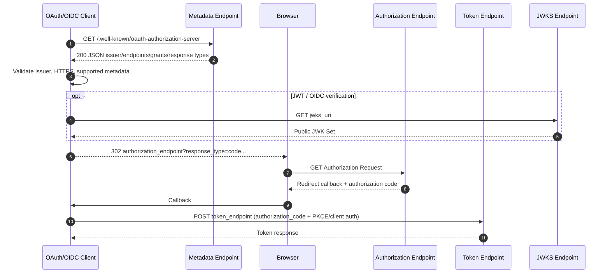

# Các trường endpoints, grant_types_supported và response_types_supported

## 1. Bài toán: client biết Authorization Server hỗ trợ gì bằng cách nào?

Một ứng dụng Java dùng Spring Security OAuth2 Client cần đăng nhập người dùng qua một Authorization Server. Nếu nhóm phát triển phải cấu hình thủ công từng URL, rất dễ nhầm `/oauth2/authorize` với `/oauth2/token`, gọi nhầm endpoint nội bộ sau reverse proxy hoặc giả định server hỗ trợ một grant thực tế đã bị tắt.

**OAuth 2.0 Authorization Server Metadata** (RFC 8414) và **OpenID Connect Discovery 1.0** giải quyết việc công bố một tài liệu JSON chuẩn để client khám phá các endpoint và khả năng giao thức của nhà cung cấp định danh. Trong tài liệu này, ba nhóm trường là trọng tâm:

1. **Các endpoint**: client nên gửi yêu cầu đến URL nào.
2. **`grant_types_supported`**: server tuyên bố hỗ trợ những cách thức lấy token nào.
3. **`response_types_supported`**: Authorization Endpoint hỗ trợ những giá trị `response_type` nào khi phản hồi authorization request.

Ví dụ một server chỉ sử dụng Authorization Code + PKCE, Client Credentials và Refresh Token có thể công bố `response_types_supported=["code"]` dù `grant_types_supported` gồm nhiều giá trị. Đó **không phải mâu thuẫn**: hai trường mô tả hai khía cạnh khác nhau.

Bài thuộc chương **Metadata và Discovery** của module `SPRING_SECURITY_OAUTH2_OIDC_AUTHORIZATION_SERVER`, nhằm **học cách thiết kế, cấu hình, bảo mật, kiểm thử và vận hành OAuth 2.0/OpenID Connect Authorization Server bằng Spring Security và Spring Authorization Server trong ứng dụng Spring Boot**. Bài tập trung vào ý nghĩa contract công khai, cách tạo metadata với Spring và cách kiểm thử không quảng cáo sai khả năng.

### Mục tiêu học tập

Sau bài này, bạn có thể:

- Đọc metadata RFC 8414 và OIDC Provider Configuration, giải thích các endpoint quan trọng.
- Phân biệt yêu cầu **bắt buộc**, **tùy chọn** và **mặc định khi trường bị lược bỏ** trong RFC 8414.
- Giải thích `grant_types_supported` khác `response_types_supported`, `response_modes_supported` và `scopes_supported`.
- Kiểm tra metadata có tương thích với `RegisteredClient`, `AuthorizationServerSettings` và các authentication provider thực tế không.
- Tùy biến `OAuth2AuthorizationServerMetadataEndpointConfigurer` hoặc `OidcProviderConfigurationEndpointConfigurer` khi thật sự cần.
- Xác minh discovery ở môi trường reverse proxy, context path, HTTPS, đa issuer và khóa JWKS.
- Viết integration tests cho endpoint availability, giá trị metadata, client interoperability và các cấu hình không được hỗ trợ.

> **Phạm vi:** Ví dụ Spring Java ưu tiên **Spring Authorization Server 1.5.x / Spring Security 6.x**. Với Spring Security 7.x hoặc các bản Spring Authorization Server khác, đối chiếu package, DSL và hành vi mặc định trước khi áp dụng. Không có ghi chú chuyên biệt bổ sung trong đầu vào bài học.

## 2. Discovery là một hợp đồng công khai, không phải endpoint cấp token

Client truy xuất một JSON document từ một địa chỉ `.well-known` bằng HTTPS. JSON cho biết server có những URL và khả năng gì; sau đó client mới thực hiện authorization request hoặc token request theo grant đã đăng ký.



**Metadata không cấp quyền và không thay thế kiểm tra authorization.** Nếu metadata nêu `client_credentials`, một public SPA không vì thế mà tự được dùng Client Credentials. Server vẫn phải kiểm tra registration và chính sách xác thực client.

### 2.1. Hai kiểu tài liệu cần nhận diện

| Kiểu discovery | Chuẩn | Well-known path điển hình | Mục đích |
| --- | --- | --- | --- |
| OAuth Authorization Server Metadata | **RFC 8414** | `/.well-known/oauth-authorization-server` | Công bố cấu hình OAuth 2.0 |
| OIDC Provider Configuration | **OpenID Connect Discovery 1.0** | `/.well-known/openid-configuration` | Công bố OAuth + những thuộc tính cần cho OIDC |

Cùng một Spring Authorization Server có thể phục vụ cả hai tài liệu. **Không giả định hai JSON hoàn toàn giống nhau**: OIDC Provider Configuration yêu cầu thêm các trường OIDC như `subject_types_supported` và `id_token_signing_alg_values_supported`.

Khi dùng issuer có path, cách đặt well-known path của hai chuẩn khác nhau; phần 15 sẽ phân tích cụ thể.

## 3. Ví dụ hoàn chỉnh về OAuth Authorization Server Metadata

Giả sử issuer công khai là `https://login.example.com`, server hỗ trợ Authorization Code + PKCE, Client Credentials, Refresh Token và Device Authorization.

```http
GET /.well-known/oauth-authorization-server HTTP/1.1
Host: login.example.com
Accept: application/json
```

Một response hợp lệ, được rút gọn theo tính năng minh họa:

```http
HTTP/1.1 200 OK
Content-Type: application/json
```

```json
{
  "issuer": "https://login.example.com",
  "authorization_endpoint": "https://login.example.com/oauth2/authorize",
  "token_endpoint": "https://login.example.com/oauth2/token",
  "jwks_uri": "https://login.example.com/oauth2/jwks",
  "introspection_endpoint": "https://login.example.com/oauth2/introspect",
  "revocation_endpoint": "https://login.example.com/oauth2/revoke",
  "device_authorization_endpoint": "https://login.example.com/oauth2/device_authorization",
  "pushed_authorization_request_endpoint": "https://login.example.com/oauth2/par",
  "response_types_supported": [
    "code"
  ],
  "grant_types_supported": [
    "authorization_code",
    "refresh_token",
    "client_credentials",
    "urn:ietf:params:oauth:grant-type:device_code"
  ],
  "token_endpoint_auth_methods_supported": [
    "client_secret_basic",
    "private_key_jwt"
  ],
  "scopes_supported": [
    "openid",
    "profile",
    "orders.read"
  ],
  "code_challenge_methods_supported": [
    "S256"
  ]
}
```

**Đây là metadata minh họa, không phải output mặc định cam kết của mọi phiên bản Spring.** Chỉ công bố `pushed_authorization_request_endpoint`, `device_authorization_endpoint`, `jwks_uri` hoặc một thuật toán/grant khi hệ thống triển khai thực sự cung cấp khả năng tương ứng. Nếu OAuth-only và không bật OpenID Connect, `openid`/`profile` trong `scopes_supported` không nên làm người dùng hiểu rằng OIDC đang hoạt động.

### 3.1. Quy ước kiểu dữ liệu

| Field | JSON type | Ví dụ |
| --- | --- | --- |
| `issuer` | String, URL | `"https://login.example.com"` |
| `authorization_endpoint` | String, URL | `"https://login.example.com/oauth2/authorize"` |
| `token_endpoint` | String, URL | `"https://login.example.com/oauth2/token"` |
| `jwks_uri` | String, URL | `"https://login.example.com/oauth2/jwks"` |
| `grant_types_supported` | Array of strings | `["authorization_code","client_credentials"]` |
| `response_types_supported` | Array of strings | `["code"]` |
| `token_endpoint_auth_methods_supported` | Array of strings | `["client_secret_basic"]` |
| `code_challenge_methods_supported` | Array of strings | `["S256"]` |

Theo RFC 8414, các trường nhiều giá trị được biểu diễn bằng **JSON array**; **mảng rỗng không được xuất hiện** trong response metadata RFC 8414. Không xuất `"grant_types_supported":"authorization_code"` như một chuỗi đơn hoặc `"response_types_supported":[]` rồi hy vọng client tự suy luận.

## 4. Những endpoint chính và điều kiện công bố

### 4.1. Bảng tra cứu các trường endpoint

| Metadata field | Vai trò | Đặc điểm/điều kiện |
| --- | --- | --- |
| `issuer` | Định danh duy nhất Authorization Server | **REQUIRED** theo RFC 8414; HTTPS, không query/fragment; đối chiếu chính xác khi discovery |
| `authorization_endpoint` | Điểm nhận authorization request từ user-agent | **REQUIRED**, trừ khi server không hỗ trợ grant dùng Authorization Endpoint |
| `token_endpoint` | Điểm trao đổi code hoặc credentials lấy token | **REQUIRED**, trừ trường hợp server chỉ hỗ trợ Implicit Grant theo ngoại lệ RFC 8414 |
| `jwks_uri` | Địa chỉ public JWK Set để xác minh chữ ký | **OPTIONAL** theo RFC 8414; nếu có phải HTTPS; tùy vào khả năng phát token ký và key source |
| `registration_endpoint` | Dynamic Client Registration | OPTIONAL; không công bố nếu thực tế không bật registration |
| `introspection_endpoint` | OAuth Token Introspection (RFC 7662) | OPTIONAL; bảo vệ bằng client authentication/authorization |
| `revocation_endpoint` | OAuth Token Revocation (RFC 7009) | OPTIONAL; không giả định mọi client có quyền revoke mọi token |
| `device_authorization_endpoint` | Client khởi tạo Device Authorization (RFC 8628) | OPTIONAL; không phải URL nhập user code |
| `pushed_authorization_request_endpoint` | Pushed Authorization Request (RFC 9126) | OPTIONAL; client POST authorization parameters qua back-channel |
| `userinfo_endpoint` | OIDC UserInfo (OIDC Discovery) | OIDC-specific; cần bật OIDC UserInfo và bảo vệ bằng access token |
| `end_session_endpoint` | OIDC RP-Initiated Logout | OIDC-specific; kiểm tra logout endpoint có được hỗ trợ và bật hay không |

Các chữ **REQUIRED/OPTIONAL** trong bảng đề cập đến yêu cầu của **RFC 8414** khi áp dụng, không phải việc mọi server bắt buộc triển khai tất cả endpoint. Ngoại lệ cho `token_endpoint` là trường hợp Implicit-only mang tính lịch sử; **không phải khuyến nghị thiết kế hiện đại**.

### 4.2. Vì sao không phải endpoint nào cũng giống nhau?

**Authorization Endpoint** nhận redirect qua browser, cần login/consent và xử lý `response_type`. **Token Endpoint** nhận HTTP POST trực tiếp, xác thực client khi áp dụng và xử lý `grant_type`. **Introspection/Revocation** nhận token cần kiểm tra/thu hồi, với chính sách kiểm soát caller riêng. **JWKS** công bố public keys, không nhận authorization code.

Nối nhầm endpoint dẫn đến lỗi giao thức hoặc lộ bí mật. Ví dụ gửi `client_secret` lên query string của Authorization Endpoint sẽ làm lộ secret; gửi authorization code vào JWKS endpoint không có nghĩa.

### 4.3. JWKS URL không phải là signing key

`jwks_uri` trỏ đến JSON chứa **public keys**; không bao giờ đưa private JWK parameters như `d`, `p`, `q` vào endpoint công khai. Client dùng `kid`/`alg` từ token header để chọn public key phù hợp, nhưng vẫn phải xác minh issuer, audience, expiry và allowlist thuật toán.

Spring Authorization Server 1.5.x chỉ đăng ký JWK Set Endpoint khi có bean `JWKSource<SecurityContext>` phù hợp. Nếu không có, đừng quảng cáo `jwks_uri` như thể endpoint đang sẵn sàng.

## 5. grant_types_supported: server hỗ trợ những cách lấy token nào?

`grant_types_supported` là **JSON array** chứa các giá trị OAuth `grant_type` mà Authorization Server hỗ trợ.

| Giá trị grant type | Luồng chính | Endpoint/bước liên quan |
| --- | --- | --- |
| `authorization_code` | User xác thực/đồng ý; client đổi code lấy token | Authorization Endpoint → Token Endpoint |
| `refresh_token` | Client đổi refresh token lấy access token mới | Token Endpoint |
| `client_credentials` | Dịch vụ xác thực chính nó, không có end-user tương tác | Token Endpoint |
| `urn:ietf:params:oauth:grant-type:device_code` | Thiết bị giới hạn nhập liệu, người dùng xác nhận trên thiết bị khác | Device Authorization + verification + Token Endpoint |
| `urn:ietf:params:oauth:grant-type:token-exchange` | Trao đổi một token đầu vào lấy token khác theo chính sách | Token Endpoint, nếu triển khai RFC 8693 |
| `implicit` | Lịch sử: token được trả qua front-channel | Không khuyến nghị triển khai mới theo OAuth Security BCP |
| `password` | Legacy Resource Owner Password Credentials | Không khuyến nghị/không dùng cho thiết kế OAuth hiện đại |

Spring Authorization Server 1.5.x có các provider cho những grant được hỗ trợ bởi phiên bản thực tế; ví dụ nhiều bản 1.x hỗ trợ Authorization Code, Client Credentials, Refresh Token, Device Code và Token Exchange. **Không suy ra khả năng đã bật chỉ từ tên class có trong dependency**. Cần kiểm tra configurer, provider, registration, chính sách và integration tests.

### 5.1. Mối quan hệ giữa grant type và bước browser

- `authorization_code` cần một authorization request có `response_type=code`, sau đó Token Endpoint xử lý `grant_type=authorization_code`.
- `client_credentials` **không sử dụng Authorization Endpoint**, chỉ gọi Token Endpoint với `grant_type=client_credentials`.
- `refresh_token` chỉ chạy ở Token Endpoint với `grant_type=refresh_token`.
- Device Code có endpoint chuẩn để cấp `device_code` và luồng xác nhận riêng; không vì thế có `response_type=device_code`.
- Token Exchange không tạo `response_type=token-exchange` ở Authorization Endpoint.

### 5.2. Ví dụ Token Endpoint với Client Credentials

```http
POST /oauth2/token HTTP/1.1
Host: login.example.com
Authorization: Basic <ENCODED_CLIENT_CREDENTIALS>
Content-Type: application/x-www-form-urlencoded

grant_type=client_credentials&scope=orders.read
```

`client_credentials` là giá trị **grant type**. Nó được dùng trong body Token Endpoint, không nằm trong query `response_type` của trình duyệt.

### 5.3. Ví dụ Authorization Code + PKCE

Yêu cầu ở browser:

```http
GET /oauth2/authorize?response_type=code&client_id=orders-web&
redirect_uri=https%3A%2F%2Forders.example.com%2Fcallback&
scope=openid%20orders.read&
state=RANDOM_STATE&
code_challenge=BASE64URL_SHA256_VERIFIER&
code_challenge_method=S256 HTTP/1.1
Host: login.example.com
```

Sau login/consent, client nhận code và gọi:

```http
POST /oauth2/token HTTP/1.1
Host: login.example.com
Content-Type: application/x-www-form-urlencoded
Authorization: Basic <ENCODED_CLIENT_CREDENTIALS>

grant_type=authorization_code&code=AUTH_CODE&
redirect_uri=https%3A%2F%2Forders.example.com%2Fcallback&
code_verifier=ORIGINAL_SECRET_VERIFIER
```

Các request trên được xuống dòng để trình bày; URL/form body thực tế phải encode đúng. `code_challenge` tại Authorization Endpoint và `code_verifier` tại Token Endpoint có vai trò khác nhau. **PKCE là cơ chế bảo vệ flow, không phải một grant_type riêng.**

## 6. response_types_supported: Authorization Endpoint trả gì?

`response_types_supported` là **REQUIRED** theo RFC 8414 và là JSON array chứa các giá trị `response_type` mà Authorization Endpoint hỗ trợ.

Trong mô hình Authorization Code hiện đại:

```json
{
  "response_types_supported": ["code"]
}
```

`code` chỉ ra Authorization Endpoint sẽ phát **authorization code**, không phát access token trực tiếp qua browser. Nó phù hợp với yêu cầu `response_type=code` và sau đó Token Endpoint sử dụng `grant_type=authorization_code`.

### 6.1. Các response type có thể gặp

| `response_type` | Ý nghĩa | Lưu ý |
| --- | --- | --- |
| `code` | Trả authorization code | Chọn mặc định hợp lý cho các hệ thống mới; sử dụng PKCE |
| `token` | Implicit flow trả access token qua front-channel | Legacy, rủi ro; không quảng cáo nếu không hỗ trợ |
| `id_token` | OIDC Implicit flow chỉ trả ID Token | OIDC legacy |
| `code id_token` | OIDC Hybrid flow trả code + ID Token | Chỉ dùng khi OP thực sự hỗ trợ |
| `code token` | Hybrid/combined response tùy profile | Cần kiểm tra chuẩn và implementation |
| `code id_token token` | OIDC Hybrid flow có code/ID Token/access token | Tránh mặc định hỗ trợ nếu hệ thống chỉ dùng Code Flow |

Các response type có nhiều thành phần là **một chuỗi gồm các giá trị phân cách bằng dấu cách**, không phải những grant types riêng. Ví dụ:

```json
{
  "response_types_supported": [
    "code",
    "code id_token"
  ]
}
```

Đây là ví dụ mô tả một provider hỗ trợ nhiều kiểu phản hồi; **không áp dụng cho server chỉ hỗ trợ Code Flow**. Đừng thêm `id_token`, `token` hoặc các kiểu Hybrid chỉ để metadata trông đầy đủ.

### 6.2. Vì sao response_types_supported không chứa client_credentials?

`client_credentials` không có bước browser authorization. Nó là một `grant_type` ở Token Endpoint. Do đó:

```json
{
  "grant_types_supported": [
    "authorization_code",
    "client_credentials",
    "refresh_token"
  ],
  "response_types_supported": [
    "code"
  ]
}
```

Đây là cấu hình logic và phổ biến: server cấp token bằng ba grant nhưng chỉ một kiểu phản hồi tại Authorization Endpoint.

### 6.3. response_types_supported không phải response_modes_supported

Hai khái niệm độc lập:

- **`response_type`**: trả loại kết quả nào, ví dụ `code`.
- **`response_mode`**: vận chuyển kết quả qua kênh nào, ví dụ `query`, `fragment` hoặc `form_post` khi được hỗ trợ.

Một yêu cầu có thể dùng `response_type=code&response_mode=query`. Quảng cáo `response_types_supported=["code"]` không tự nói rằng server hỗ trợ `form_post`. Nếu không công bố `response_modes_supported`, RFC 8414 mô tả mặc định `["query","fragment"]` cho metadata parameter này; **không hiểu mặc định lịch sử như chỉ thị nên bật fragment cho mọi flow**.

## 7. Bảng đối chiếu grant type và response type

| Luồng OAuth/OIDC | `grant_type` ở Token Endpoint | `response_type` ở Authorization Endpoint | Tham số metadata liên quan |
| --- | --- | --- | --- |
| Authorization Code | `authorization_code` | `code` | Hai trường đều cần phản ánh |
| Authorization Code + PKCE | `authorization_code` | `code` | `code_challenge_methods_supported` thêm `S256` |
| Client Credentials | `client_credentials` | **Không có** | Chỉ grant type |
| Refresh Token | `refresh_token` | **Không có** | Chỉ grant type |
| Device Authorization | `urn:ietf:params:oauth:grant-type:device_code` | **Không có** | `device_authorization_endpoint` |
| Token Exchange | `urn:ietf:params:oauth:grant-type:token-exchange` | **Không có** | Server/token exchange policy |
| Implicit (legacy) | `implicit` trong metadata grant list | `token` hoặc OIDC implicit response | Không khuyến nghị cho ứng dụng mới |
| OIDC Hybrid (legacy) | Thường dùng `authorization_code` khi đổi code | `code id_token` hoặc các kết hợp khác | Phải bật và triển khai đúng OIDC Hybrid |

**Không có quan hệ một-một giữa phần tử hai mảng.** Nhiều grant types không dùng Authorization Endpoint; một grant dạng authorization code có thể tương ứng với nhiều response type ở provider OIDC hỗ trợ Hybrid.

### 7.1. Metadata cấp server khác quyền của từng client

Một Authorization Server có thể quảng cáo:

```json
{
  "grant_types_supported": [
    "authorization_code",
    "client_credentials",
    "refresh_token"
  ],
  "response_types_supported": [
    "code"
  ]
}
```

Nhưng mỗi client có quyền riêng:

| Client | Grant types trong registration | Ý nghĩa |
| --- | --- | --- |
| `orders-web` | `authorization_code`, `refresh_token` | Có thể login người dùng và refresh khi được cấp |
| `orders-worker` | `client_credentials` | Không được dùng user-agent Code Flow |
| `orders-spa` | `authorization_code` | Public client, dùng PKCE, không lưu secret |

Metadata chỉ là **khả năng toàn cục**. Authorization Server vẫn đối chiếu `RegisteredClient.authorizationGrantTypes`, redirect URI, client authentication method, scope và policy ở từng request. Không lấy union của registration rồi kết luận một client được phép dùng tất cả.

## 8. Các trường capability thường đi cùng

| Trường | Kiểu | Ý nghĩa | Điểm cần tránh |
| --- | --- | --- | --- |
| `scopes_supported` | Array of strings | Scope mà server muốn công bố là hỗ trợ | Không bắt buộc liệt kê mọi scope nội bộ; không tự cấp scope |
| `response_modes_supported` | Array of strings | Cách trả authorization response | `form_post` chỉ thêm nếu thực sự được hỗ trợ |
| `code_challenge_methods_supported` | Array of strings | Các PKCE code challenge method, ví dụ `S256` | Không quảng cáo `plain` nếu policy cấm |
| `token_endpoint_auth_methods_supported` | Array of strings | Phương thức xác thực client tại Token Endpoint | Không đồng nghĩa mọi client được dùng mọi method |
| `token_endpoint_auth_signing_alg_values_supported` | Array of strings | JWS algorithms cho JWT client authentication tại Token Endpoint | Không phải thuật toán ký access token hoặc ID Token |
| `introspection_endpoint_auth_methods_supported` | Array of strings | Phương thức xác thực caller ở introspection | Bảo vệ chống token enumeration |
| `revocation_endpoint_auth_methods_supported` | Array of strings | Phương thức xác thực client ở revocation | Không đồng nghĩa quyền thu hồi mọi token |
| `tls_client_certificate_bound_access_tokens` | Boolean | Khả năng phát access token ràng buộc client certificate theo RFC 8705 | Không bật giá trị này nếu Resource Server không xử lý PoP |
| `dpop_signing_alg_values_supported` | Array of strings | JWS algorithms cho DPoP proof khi triển khai RFC 9449 | Chỉ công bố nếu thực tế có DPoP support |
| `pushed_authorization_request_endpoint` | URL | PAR Endpoint (RFC 9126) | Cần bảo đảm endpoint tồn tại, dùng HTTPS |
| `require_pushed_authorization_requests` | Boolean | Chính sách yêu cầu dùng PAR theo RFC 9126 | Giá trị `true` phải được enforcement, không chỉ đưa vào JSON |

Phân biệt ba điều:

1. **Metadata capability** công bố giao thức server có thể xử lý.
2. **Client registration** giới hạn client được sử dụng phần nào của giao thức.
3. **Security policy/resource behavior** quyết định một token, client hay authentication method có được chấp nhận ở bước cụ thể không.

### 8.1. Thuật toán ký token khác JWT client authentication

`token_endpoint_auth_signing_alg_values_supported=["RS256","ES256"]` nói về thuật toán **client assertion JWT** dùng để client xác thực với Token Endpoint. Nó **không** bảo đảm access token được server ký bằng RS256/ES256.

Trong OIDC, `id_token_signing_alg_values_supported` công bố các thuật toán ký **ID Token**. Cần đối chiếu `TokenSettings.idTokenSignatureAlgorithm(...)` của từng `RegisteredClient` với key source và khả năng OIDC Client.

### 8.2. scopes_supported là khả năng, không phải consent đã có

Metadata `scopes_supported=["openid","orders.read"]` không có nghĩa người dùng đã đồng ý `orders.read` hoặc tất cả client có thể yêu cầu scope đó. Authorization Endpoint/Token Endpoint vẫn kiểm tra đăng ký và consent/authorization policy.

## 9. Field bắt buộc, tùy chọn và giá trị mặc định khi vắng mặt

Đọc đúng các từ **REQUIRED**, **OPTIONAL** và **RECOMMENDED** trong RFC là đặc biệt quan trọng khi kiểm tra metadata.

| Field | RFC 8414 | Quy tắc |
| --- | --- | --- |
| `issuer` | REQUIRED | URI HTTPS không query/fragment; phải khớp issuer dùng truy cập metadata |
| `authorization_endpoint` | REQUIRED có ngoại lệ | Bắt buộc trừ khi không hỗ trợ grant cần Authorization Endpoint |
| `token_endpoint` | REQUIRED có ngoại lệ | Bắt buộc trừ khi server chỉ hỗ trợ Implicit Grant |
| `response_types_supported` | REQUIRED | RFC 8414 yêu cầu JSON array có giá trị; không được tùy tiện lược bỏ hoặc trả mảng rỗng |
| `scopes_supported` | RECOMMENDED | Có thể không công bố scope nội bộ nhạy cảm |
| `grant_types_supported` | OPTIONAL | Nếu vắng mặt, mặc định trong RFC là `["authorization_code","implicit"]` |
| `response_modes_supported` | OPTIONAL | Nếu vắng mặt, RFC mô tả mặc định `["query","fragment"]` |
| `token_endpoint_auth_methods_supported` | OPTIONAL | Nếu vắng mặt, mặc định `client_secret_basic` |
| `jwks_uri` | OPTIONAL | Nếu có phải HTTPS; chỉ quảng cáo khi endpoint thực sự dùng được |
| `introspection_endpoint` / `revocation_endpoint` | OPTIONAL | Chỉ công bố khi triển khai |

**Cảnh báo quan trọng:** Mặc định `["authorization_code","implicit"]` khi thiếu `grant_types_supported` là **ngữ nghĩa metadata theo RFC 8414**, không phải chứng cứ server Spring đang bật Implicit Grant và không phải khuyến nghị bật nó. Vì vậy với triển khai hiện đại **nên công bố rõ danh sách grant thực sự hỗ trợ** để client không suy luận sai.

Tương tự, một mảng được công bố nhưng rỗng không hợp lệ theo quy tắc RFC 8414 cho metadata claims nhiều giá trị: nếu không có giá trị để công bố, hãy xét có nên bỏ field theo yêu cầu tương ứng, không trả `[]` một cách tùy tiện.

### 9.1. Không thêm grant chưa triển khai cho đẹp metadata

Nếu server chỉ cấu hình Authorization Code + Client Credentials, không nên công bố `implicit`, `password`, Device Code hoặc Token Exchange như thể được hỗ trợ. Với các extension grant, phải có `AuthenticationConverter`/`AuthenticationProvider`, validation, token generation và test trước khi quảng cáo.

### 9.2. Tính nhất quán OIDC

Khi bật OpenID Connect, OIDC Provider Configuration có thêm các trường bắt buộc: `subject_types_supported` và `id_token_signing_alg_values_supported` (cùng các trường OAuth cần thiết). `issuer` trong provider metadata phải khớp `iss` của ID Token. Không suy diễn OIDC chỉ từ việc OAuth metadata có `openid` trong `scopes_supported`.

## 10. Spring Authorization Server tạo metadata ra sao?

Spring Authorization Server 1.5.x cung cấp `OAuth2AuthorizationServerConfigurer` và `OAuth2AuthorizationServerMetadataEndpointConfigurer`. Khi cấu hình Authorization Server SecurityFilterChain, framework có thể công bố OAuth metadata ở well-known URL theo chuẩn.

### 10.1. Những thành phần liên quan

| Thành phần Spring | Vai trò |
| --- | --- |
| `AuthorizationServerSettings` | Issuer và đường dẫn endpoint mặc định/tùy chỉnh |
| `OAuth2AuthorizationServerConfigurer` | Gắn filter chain và các endpoint của Authorization Server |
| `OAuth2AuthorizationServerMetadataEndpointConfigurer` | Cho phép tùy biến metadata RFC 8414 |
| `OAuth2AuthorizationServerMetadataEndpointFilter` | Xử lý GET metadata và serialize response |
| `OidcConfigurer` | Bật các endpoint OIDC cần thiết |
| `OidcProviderConfigurationEndpointConfigurer` | Tùy biến OIDC Provider Configuration |
| `RegisteredClientRepository` | Quản lý client registrations; không thay metadata capability toàn cục |
| `JWKSource<SecurityContext>` | Nguồn key để ký JWT và công bố JWK Set khi endpoint được cấu hình |

### 10.2. Ví dụ AuthorizationServerSettings

```java
import org.springframework.context.annotation.Bean;
import org.springframework.context.annotation.Configuration;
import org.springframework.security.oauth2.server.authorization.settings.AuthorizationServerSettings;

@Configuration
class IssuerAndEndpointConfiguration {
    @Bean
    AuthorizationServerSettings authorizationServerSettings() {
        return AuthorizationServerSettings.builder()
                .issuer("https://login.example.com")
                .authorizationEndpoint("/oauth2/authorize")
                .tokenEndpoint("/oauth2/token")
                .tokenIntrospectionEndpoint("/oauth2/introspect")
                .tokenRevocationEndpoint("/oauth2/revoke")
                .jwkSetEndpoint("/oauth2/jwks")
                .pushedAuthorizationRequestEndpoint("/oauth2/par")
                .deviceAuthorizationEndpoint("/oauth2/device_authorization")
                .build();
    }
}
```

Đây là cấu hình **URI/path và issuer**, không tự động bật mọi grant chỉ vì có đường dẫn. Các endpoint cần filter/provider/bean tương ứng. Một `AuthorizationServerSettings` có đường dẫn `/oauth2/jwks` không đồng nghĩa endpoint JWKS đã sẵn sàng nếu không có `JWKSource`.

### 10.3. SecurityFilterChain cho OAuth metadata

```java
import org.springframework.context.annotation.Bean;
import org.springframework.core.annotation.Order;
import org.springframework.security.config.annotation.web.builders.HttpSecurity;
import org.springframework.security.oauth2.server.authorization.config.annotation.web.configurers.OAuth2AuthorizationServerConfigurer;
import org.springframework.security.web.SecurityFilterChain;

@Bean
@Order(1)
SecurityFilterChain authorizationServerSecurityFilterChain(
        HttpSecurity http) throws Exception {

    OAuth2AuthorizationServerConfigurer authorizationServer =
            OAuth2AuthorizationServerConfigurer.authorizationServer();

    http
        .securityMatcher(authorizationServer.getEndpointsMatcher())
        .with(authorizationServer, server -> {
            // OAuth Authorization Server Metadata Endpoint được cấu hình
            // cùng các endpoint OAuth của Authorization Server.
        })
        .authorizeHttpRequests(authorize ->
            authorize.anyRequest().authenticated());

    return http.build();
}
```

Đây là **skeleton**, chưa phải ứng dụng đầy đủ. Cần đăng ký `RegisteredClientRepository`, `OAuth2AuthorizationService`, `AuthorizationServerSettings`, key/token services và security chain dành cho đăng nhập người dùng khi dùng Authorization Code. Metadata endpoint có thể được truy cập công khai dù nhiều endpoint giao thức khác yêu cầu authentication; xác minh hành vi thật bằng integration tests, không áp dụng cấu hình chặn metadata một cách vô ý.

## 11. Tùy biến grant_types_supported và response_types_supported

Điểm mở rộng chính thức trong Spring Authorization Server 1.5.x:

```java
.authorizationServerMetadataEndpoint(metadata ->
    metadata.authorizationServerMetadataCustomizer(
        authorizationServerMetadataCustomizer
    )
)
```

`authorizationServerMetadataCustomizer` nhận builder của `OAuth2AuthorizationServerMetadata`. Builder hỗ trợ `grantTypes(Consumer<List<String>>)` và `responseTypes(Consumer<List<String>>)` để thêm/thay/loại giá trị.

### 11.1. Ví dụ tùy biến có kiểm soát

```java
@Bean
@Order(1)
SecurityFilterChain authorizationServerSecurityFilterChain(
        HttpSecurity http) throws Exception {

    OAuth2AuthorizationServerConfigurer server =
            OAuth2AuthorizationServerConfigurer.authorizationServer();

    http.securityMatcher(server.getEndpointsMatcher())
        .with(server, authorizationServer ->
            authorizationServer.authorizationServerMetadataEndpoint(metadata ->
                metadata.authorizationServerMetadataCustomizer(builder -> {
                    // CHỈ khai báo những giá trị đã kiểm chứng là được hỗ trợ.
                    builder.responseTypes(types -> {
                        types.clear();
                        types.add("code");
                    });

                    builder.grantTypes(grants -> {
                        grants.clear();
                        grants.add("authorization_code");
                        grants.add("client_credentials");
                        grants.add("refresh_token");
                    });
                })
            )
        )
        .authorizeHttpRequests(authorize ->
            authorize.anyRequest().authenticated());

    return http.build();
}
```

Ví dụ cố ý công bố `response_types_supported=["code"]` và ba grant types cho một hệ thống **đã cấu hình đúng ba grant đó**. Nó không tự kích hoạt grant tương ứng. Nếu ứng dụng còn hỗ trợ Device Code hoặc Token Exchange, cần quảng cáo các grant đó một cách chính xác; không copy danh sách mẫu như hardcoded truth.

### 11.2. Tránh tùy biến sai

Một số lỗi:

- `types.add("client_credentials")`: sai vì Client Credentials không phải response type.
- `grants.add("code")`: sai vì grant type là `authorization_code`, còn `code` là response type.
- `grants.add("password")` cho client legacy đã ngưng dùng: quảng cáo sai và có thể dẫn client tới flow nguy hiểm.
- `builder.issuer("https://internal:9000")` sau proxy, trong khi ID Token dùng issuer công khai: tạo mismatch và mất interoperability.
- `builder.responseTypes(types -> types.clear())`: làm danh sách bắt buộc rỗng.

**Không tùy chỉnh để che lỗi cấu hình.** Nếu metadata nói hỗ trợ một grant nhưng Token Endpoint luôn trả `unsupported_grant_type`, trước hết cần xác định capability thực tế và policy đăng ký; không sửa JSON độc lập với luồng giao thức.

### 11.3. Tách capability config khỏi client registration

Một cách vận hành bền vững là có một cấu hình capability được kiểm soát:

```yaml
app:
  oauth2:
    advertised-grant-types:
      - authorization_code
      - refresh_token
      - client_credentials
    advertised-response-types:
      - code
```

Đây là **configuration model tùy chỉnh**, không phải Spring Boot auto-property chuẩn. Đọc cấu hình này vào một bean có validation và sử dụng khi thiết lập metadata. Cũng cần integration tests bảo đảm mọi capability được quảng cáo có implementation tương ứng. Không để client bên ngoài gửi danh sách grant mà server dùng trực tiếp để công bố.

## 12. OIDC Discovery: giống OAuth metadata ở đâu, khác ở đâu?

Khi bật OpenID Connect, Spring Authorization Server cung cấp `OidcConfigurer` và `OidcProviderConfigurationEndpointConfigurer`.

### 12.1. Bật OIDC Provider Configuration

```java
@Bean
@Order(1)
SecurityFilterChain authorizationServerSecurityFilterChain(
        HttpSecurity http) throws Exception {

    OAuth2AuthorizationServerConfigurer server =
            OAuth2AuthorizationServerConfigurer.authorizationServer();

    http.securityMatcher(server.getEndpointsMatcher())
        .with(server, authorizationServer ->
            authorizationServer.oidc(oidc ->
                oidc.providerConfigurationEndpoint(provider ->
                    provider.providerConfigurationCustomizer(builder -> {
                        builder.responseTypes(types -> {
                            types.clear();
                            types.add("code");
                        });
                    })
                )
            )
        )
        .authorizeHttpRequests(authorize ->
            authorize.anyRequest().authenticated());

    return http.build();
}
```

Đây là skeleton nhấn mạnh provider metadata. Một OIDC Server thực tế cần `JwtDecoder`, `JWKSource`, login/user authentication, ID Token/claims và các bean OIDC liên quan. **OIDC không được tự động bật chỉ bằng cách tạo client có scope `openid`**.

### 12.2. OIDC Provider Configuration ví dụ

```json
{
  "issuer": "https://login.example.com",
  "authorization_endpoint": "https://login.example.com/oauth2/authorize",
  "token_endpoint": "https://login.example.com/oauth2/token",
  "jwks_uri": "https://login.example.com/oauth2/jwks",
  "userinfo_endpoint": "https://login.example.com/userinfo",
  "response_types_supported": ["code"],
  "grant_types_supported": [
    "authorization_code",
    "refresh_token"
  ],
  "subject_types_supported": ["public"],
  "id_token_signing_alg_values_supported": ["RS256"],
  "scopes_supported": ["openid", "profile"]
}
```

Đây chỉ là ví dụ OIDC Code Flow. `subject_types_supported` và `id_token_signing_alg_values_supported` là những field **bắt buộc** trong OIDC Discovery. Nếu provider thực tế dùng pairwise subject hoặc ES256 signing ID Token thì metadata phải mô tả đúng. Cũng không cần công bố `userinfo_endpoint` nếu endpoint không được bật.

### 12.3. Mặc định lịch sử của OIDC Discovery

OIDC Discovery có các quy tắc mặc định lịch sử tương tự ở `grant_types_supported`. Tuy nhiên, đối với hệ thống mới nên dùng Code Flow + PKCE và công bố danh sách capability thực tế; **không bật Implicit Grant chỉ vì một trường tùy chọn có default trong tiêu chuẩn**.

### 12.4. OAuth metadata và OIDC metadata phải nhất quán

Khi cùng một issuer có cả hai endpoint metadata, kiểm tra:

- `issuer` giống nhau chính xác và khớp token `iss`.
- Các URL `authorization_endpoint`, `token_endpoint`, `jwks_uri` phù hợp cùng deployment.
- `response_types_supported` phản ánh đúng những flow mà OIDC provider và OAuth endpoint thực sự xử lý.
- `grant_types_supported` không mâu thuẫn với implementation và registration.
- Các trường riêng OIDC, ví dụ `id_token_signing_alg_values_supported`, đúng với key source và ID Token configuration.

Hai document không nhất thiết chứa mọi field giống nhau, nhưng không được tự đưa ra những tuyên bố trái ngược về cùng capability.

## 13. Discovery metadata không thay RegisteredClient

Giả sử server hỗ trợ Authorization Code, Client Credentials, Refresh Token, Device Code và PAR. Một client cụ thể vẫn chỉ có thể dùng những grant đã đăng ký.

```java
RegisteredClient ordersWeb = RegisteredClient.withId(
                UUID.randomUUID().toString())
        .clientId("orders-web")
        .clientSecret(encodedClientSecret)
        .clientAuthenticationMethod(
                ClientAuthenticationMethod.CLIENT_SECRET_BASIC)
        .authorizationGrantType(AuthorizationGrantType.AUTHORIZATION_CODE)
        .authorizationGrantType(AuthorizationGrantType.REFRESH_TOKEN)
        .redirectUri("https://orders.example.com/callback")
        .scope("openid")
        .scope("orders.read")
        .clientSettings(ClientSettings.builder()
                .requireProofKey(true)
                .build())
        .build();
```

Các import và secret encoder được lược bỏ trong ví dụ. `requireProofKey(true)` yêu cầu PKCE cho Authorization Code client, nhưng **không thay đổi `grant_types_supported` thành một grant mới**.

### 13.1. Tại sao client_credentials có trong metadata mà Orders Web vẫn bị từ chối?

Vì `orders-web` không có `AuthorizationGrantType.CLIENT_CREDENTIALS` trong registration. Metadata là tập khả năng của server; registration là tập quyền từng client. Token Endpoint phải từ chối khi client cố dùng grant chưa được đăng ký, thường với `unauthorized_client` theo policy.

### 13.2. Tại sao scope có trong metadata mà client vẫn không xin được?

`scopes_supported` không phải danh sách scope được phép cho tất cả client. `RegisteredClient.scopes` và authorization policy còn quyết định khả năng yêu cầu scope. Người dùng có thể cần consent và Resource Server có thể có quyền/role riêng.

### 13.3. Tại sao metadata có Token Endpoint nhưng browser không được gọi trực tiếp?

`token_endpoint` cho client biết địa chỉ. Cách gọi và client authentication vẫn do OAuth flow quy định. Confidential client không được đưa secret vào browser chỉ vì endpoint có trong public JSON; public client phải dùng PKCE và quy tắc tương ứng.

## 14. Các endpoint mở rộng và các lưu ý quảng cáo capability

### 14.1. Device Authorization

Khi hỗ trợ RFC 8628:

```json
{
  "device_authorization_endpoint": "https://login.example.com/oauth2/device_authorization",
  "grant_types_supported": [
    "authorization_code",
    "urn:ietf:params:oauth:grant-type:device_code"
  ],
  "response_types_supported": ["code"]
}
```

Device client gửi POST tới Device Authorization Endpoint để nhận `device_code`/`user_code`/`verification_uri`. Người dùng mở `verification_uri` và nhập code, client polling Token Endpoint bằng device grant. **`verification_uri` được trả trong device authorization response**, không phải đồng nhất với `authorization_endpoint` hay bắt buộc cố định trong metadata.

### 14.2. Pushed Authorization Requests (PAR)

Khi hỗ trợ RFC 9126:

```json
{
  "pushed_authorization_request_endpoint": "https://login.example.com/oauth2/par",
  "response_types_supported": ["code"],
  "grant_types_supported": ["authorization_code"]
}
```

PAR client gửi các authorization parameters qua back-channel rồi browser sử dụng `request_uri` ở Authorization Endpoint. **PAR không tạo thêm grant type**. Nếu metadata thêm `require_pushed_authorization_requests: true`, server phải thực sự bắt buộc PAR ở Authorization Endpoint theo phạm vi áp dụng.

### 14.3. Token Exchange

Nếu hỗ trợ RFC 8693, grant value đúng là:

```text
urn:ietf:params:oauth:grant-type:token-exchange
```

Không ghi `"token_exchange"` hoặc `"exchange_token"` nếu contract được định nghĩa theo RFC 8693. Không quảng cáo vì class Token Exchange có mặt trong dependency nhưng endpoint chưa cấu hình provider/policy.

### 14.4. Revocation và Introspection

`revocation_endpoint` và `introspection_endpoint` mô tả URL độc lập với Token Endpoint. Các endpoint này cần client authentication/authorization theo chính sách; không phải mọi caller được quyền thu hồi hoặc kiểm tra token của client khác.

## 15. Issuer có path, reverse proxy và TLS termination

Địa chỉ **issuer công khai** quyết định URL discovery. Đây là nơi rất dễ nhầm khi Spring Boot chạy sau reverse proxy và dùng context path.

Giả sử public issuer là:

```text
https://login.example.com/auth
```

Theo RFC 8414, well-known URI được **chèn giữa hostname và path của issuer**:

```text
https://login.example.com/.well-known/oauth-authorization-server/auth
```

Trong OIDC Discovery, với issuer path `/auth`, provider configuration được lấy theo vị trí:

```text
https://login.example.com/auth/.well-known/openid-configuration
```

**Không ghép đường dẫn hai chuẩn theo cùng một công thức**. Cần kiểm tra ingress/proxy routes vì một số deployment có thể thêm rewrite/prefix gây 404 hoặc trả nhầm JSON.

### 15.1. Endpoint URLs có thể mang prefix của public issuer

Metadata trong ví dụ có thể gồm:

```json
{
  "issuer": "https://login.example.com/auth",
  "authorization_endpoint": "https://login.example.com/auth/oauth2/authorize",
  "token_endpoint": "https://login.example.com/auth/oauth2/token",
  "jwks_uri": "https://login.example.com/auth/oauth2/jwks",
  "response_types_supported": ["code"],
  "grant_types_supported": ["authorization_code"]
}
```

Đây là **URL public**, có thể khác đường dẫn servlet nội bộ. Không quảng cáo `http://localhost:9000`, private host hoặc internal Kubernetes DNS cho client ngoài mạng.

### 15.2. Forwarded headers cần trust boundary

Nếu TLS terminate tại ingress:

- Cấu hình `AuthorizationServerSettings.issuer(...)` cố định theo public issuer khi có thể.
- Chỉ tin `Forwarded`/`X-Forwarded-Host`/`X-Forwarded-Proto` từ reverse proxy được tin cậy.
- Proxy cần xóa các header forwarded do client bên ngoài tự gửi.
- Tránh host-header injection để tạo `issuer` hoặc `token_endpoint` giả.
- Không cộng context path hai lần trong issuer và endpoint path.

Nếu issuer thay đổi ngoài dự kiến, JWT `iss` và metadata có thể lệch; client/resource server sẽ từ chối xác minh token. Đây là lỗi bảo mật/tương thích, không nên “sửa” bằng cách bỏ issuer validation.

## 16. Client xử lý metadata thế nào cho an toàn?

Một client dùng metadata để cấu hình endpoint vẫn phải **xác minh metadata trước khi sử dụng**.

### 16.1. Quy trình phía client

1. Có **expected issuer** từ cấu hình tin cậy, không nhận tùy tiện từ người dùng chưa xác minh.
2. Tạo đúng well-known URL cho chuẩn đang dùng.
3. GET qua HTTPS, xác minh TLS server certificate và hostname.
4. Phân tích JSON theo schema, kiểm tra các trường bắt buộc.
5. So sánh `issuer` **chính xác** với expected issuer.
6. Xác minh endpoint URLs và `jwks_uri` theo trust policy.
7. Kiểm tra grant/response type/PKCE/auth method mà client cần có được công bố không.
8. Không chấp nhận thuật toán yếu hoặc grant khác chỉ vì metadata có thêm giá trị.
9. Cache metadata/JWKS có TTL/refresh hợp lý và ghi nhận thay đổi contract.

RFC 8414 yêu cầu issuer trong response khớp issuer dùng để tạo well-known URL; nếu khác, client **không được dùng metadata đó**.

### 16.2. Tránh SSRF và discovery từ issuer không tin cậy

Nếu ứng dụng cho phép người dùng nhập một issuer bất kỳ rồi backend tự GET metadata, có nguy cơ SSRF hoặc kết nối vào địa chỉ nội bộ. Dùng allowlist hoặc onboarding flow tin cậy, chặn private/link-local/reserved IP và redirect ngoài policy, kiểm tra DNS rebinding theo hạ tầng.

### 16.3. Không tin metadata hơn protocol validation

Metadata chỉ công bố khả năng. Client vẫn phải:

- Sinh/so khớp `state` cho browser flow.
- Sinh `code_verifier` và dùng PKCE S256 khi được hỗ trợ/yêu cầu.
- Kiểm tra redirect URI/callback và `iss` trong ID Token.
- Pin/allowlist chữ ký JWT theo client policy.
- Kiểm tra `aud`/`exp`/`nonce` khi áp dụng.

Không để server “gợi ý” `none` hoặc implicit rồi tự động tắt các bảo vệ đã cấu hình.

## 17. Đọc metadata bằng curl và jq

### 17.1. Kiểm tra HTTP response

```bash
curl --fail-with-body --silent --show-error --include \
  "https://login.example.com/.well-known/oauth-authorization-server"
```

Mong đợi HTTP 200, `Content-Type: application/json` và một JSON object có `issuer`, endpoint URLs, `response_types_supported`.

### 17.2. In các trường quan trọng

```bash
curl --fail-with-body --silent --show-error \
  "https://login.example.com/.well-known/oauth-authorization-server" \
  | jq '{
      issuer,
      authorization_endpoint,
      token_endpoint,
      jwks_uri,
      grant_types_supported,
      response_types_supported,
      token_endpoint_auth_methods_supported,
      code_challenge_methods_supported
    }'
```

### 17.3. Kiểm tra grant và response type bằng jq

```bash
curl --fail-with-body --silent --show-error \
  "https://login.example.com/.well-known/oauth-authorization-server" \
  | jq -e '
      .issuer == "https://login.example.com"
      and (.response_types_supported | index("code") != null)
      and (.grant_types_supported | index("authorization_code") != null)
    '
```

Lệnh chỉ xác minh **các tuyên bố metadata**, chưa chứng minh Token Endpoint/Authorization Endpoint xử lý đúng flow. Cần chạy integration tests với client được đăng ký thật.

### 17.4. Khi bật OIDC

```bash
curl --fail-with-body --silent --show-error \
  "https://login.example.com/.well-known/openid-configuration" \
  | jq '{
      issuer,
      authorization_endpoint,
      token_endpoint,
      jwks_uri,
      response_types_supported,
      grant_types_supported,
      subject_types_supported,
      id_token_signing_alg_values_supported
    }'
```

Trước khi kết luận OIDC metadata sai, kiểm tra OIDC đã được bật và bean/endpoint OIDC cần thiết hoạt động.

## 18. Ma trận kiểm thử metadata và capability

| Ca kiểm thử | Dữ liệu / điều kiện | Kết quả mong đợi |
| --- | --- | --- |
| RFC 8414 discovery | GET well-known OAuth URL | HTTP 200 JSON đúng issuer |
| OIDC discovery được bật | GET well-known OIDC URL | HTTP 200 JSON có OIDC required fields |
| OIDC chưa bật | GET openid-configuration | Không quảng cáo hỗ trợ OIDC giả |
| Issuer không khớp | JSON issuer khác expected | Client từ chối metadata |
| Issuer có context path | Public issuer `/auth` | Đúng URL well-known theo từng chuẩn |
| TLS termination | App chạy HTTP nội bộ, public HTTPS | JSON không chứa internal host/HTTP URLs |
| Metadata schema | Field nhiều giá trị | JSON array, không phải string |
| Empty array | `response_types_supported=[]` | Bị phát hiện là vi phạm contract |
| Response type code | `response_types_supported=["code"]` | Authorization Code request hoạt động |
| Unsupported response type | Request `response_type=token` khi chỉ có code | Từ chối, không cấp token front-channel |
| Authorization Code grant | `grant_types_supported` có `authorization_code` | Client đúng registration đổi code được |
| Client Credentials grant | `grant_types_supported` có `client_credentials` | Registered confidential client gọi token endpoint được |
| Unauthorized grant | Client chỉ có code xin client_credentials | Từ chối dù server metadata có grant |
| Refresh Token | `refresh_token` advertised | Refresh flow hoạt động khi token/client đủ điều kiện |
| Device Code | Grant Device Code + endpoint được công bố | Device Authorization và polling hoạt động |
| Device Code response type | JSON chứa `response_type=device_code` | Bị xem là cấu hình sai |
| Token Exchange | URN grant có trong metadata | Provider thực sự xử lý exchange và policy |
| PAR endpoint | URL được công bố | HTTPS POST PAR trả request_uri hợp lệ |
| JWKS advertised | `jwks_uri` có trong JSON | GET public JWKS hoạt động, không có private params |
| No JWKSource | Không cấu hình key source | Không quảng cáo jwks_uri giả |
| Introspection advertised | URL có trong JSON | Endpoint có client authorization và token lookup |
| Revocation advertised | URL có trong JSON | Revoke theo RFC/policy, không mở công khai |
| PKCE advertised | `code_challenge_methods_supported=["S256"]` | Code Flow + PKCE được xử lý đúng |
| Auth methods advertised | Basic/JWT/mTLS trong JSON | Chỉ method thực hỗ trợ; đăng ký từng client vẫn áp dụng |
| OIDC signing algorithms | OIDC có `id_token_signing_alg_values_supported` | Alg khớp ID Token/key source/client |
| Metadata duplicate/conflict | OAuth/OIDC cùng issuer, URL khác logic | Phát hiện và sửa deployment mismatch |
| Proxy header spoofing | Gửi `X-Forwarded-Host` giả từ ngoài | Metadata không bị đổi issuer/endpoint |
| Multi-instance | GET metadata ở nhiều node | Issuer/capability/keys nhất quán |
| Rolling upgrade | Node phiên bản khác nhau | Không quảng cáo grant chưa đồng bộ |
| Client metadata cache | Capability thay đổi sau deploy | Refresh theo TTL/invalidation và không dùng metadata cũ vô hạn |
| Client unknown issuer | User input URL nội bộ | Chặn SSRF theo policy |
| Unsupported algorithm | Metadata có value không được verifier cho phép | Client không tự nới allowlist |
| Registration endpoint | Dynamic registration bị tắt | Không công bố registration_endpoint giả |

### 18.1. Tự động hóa integration test với MockMvc

Ví dụ pseudocode theo ý tưởng JUnit + Spring Security test:

```java
mockMvc.perform(get("/.well-known/oauth-authorization-server"))
    .andExpect(status().isOk())
    .andExpect(content().contentTypeCompatibleWith(MediaType.APPLICATION_JSON))
    .andExpect(jsonPath("$.issuer").value("https://login.example.com"))
    .andExpect(jsonPath("$.response_types_supported[0]").value("code"))
    .andExpect(jsonPath("$.grant_types_supported").isArray());
```

Đây là một kiểm thử contract tối thiểu, không thay thế kiểm thử luồng. Môi trường test cần cấu hình issuer/endpoint thực, bean Authorization Server và security chain. Nếu provider hỗ trợ grant theo thứ tự khác, nên kiểm tra bằng matcher membership thay vì phụ thuộc thứ tự mảng.

### 18.2. Test negative capability

Phải có test chứng minh những flow **không** được quảng cáo cũng **không** được chạy:

- `response_type=token` không được phát token nếu server chỉ Code Flow.
- `grant_type=password` bị từ chối nếu policy không hỗ trợ.
- Public SPA không dùng `client_credentials` chỉ vì metadata công bố grant này.
- Client chưa đăng ký không dùng `private_key_jwt` hoặc mTLS tùy ý.
- PAR metadata có endpoint nhưng request bypass PAR bị từ chối nếu yêu cầu PAR bắt buộc.

## 19. Troubleshooting: metadata hiển thị đúng mà client vẫn lỗi

| Triệu chứng | Nguyên nhân có thể | Cách xử lý |
| --- | --- | --- |
| GET well-known 404 | Chưa bật endpoint, security matcher sai, ingress rewrite path | Kiểm tra SecurityFilterChain và route công khai |
| GET OAuth well-known có nhưng OIDC well-known không có | Chưa bật OIDC | Thêm `oidc(...)` và bean OIDC cần thiết |
| `issuer` sai URL nội bộ | Reverse proxy/forwarded headers/issuer config | Đặt canonical public issuer cố định |
| `issuer` không khớp ID Token | Metadata/ID Token bị tạo từ khác nguồn issuer | Đồng bộ issuer và kiểm tra token `iss` |
| Authorization Code client không chạy | Metadata có `code` nhưng RegisteredClient sai redirect/grant | Kiểm tra registration và PKCE |
| Client Credentials trả unauthorized_client | Client không đăng ký grant | Phân biệt server capability và quyền client |
| Grant advertised nhưng unsupported_grant_type | Provider hoặc endpoint chưa xử lý grant | Kiểm tra configurer/provider, sửa metadata |
| JWKS 404 | Chưa đăng ký JWKSource | Kiểm tra bean và path issuer/proxy |
| JWKS hoạt động nhưng verify fail | `kid`/`alg`/issuer/audience không khớp | Kiểm tra key source, token và decoder policy |
| `response_types_supported` chứa `token` ngoài dự kiến | Copy metadata cũ/Implicit | Chỉ giữ flow thực hỗ trợ và cần thiết |
| OIDC Provider metadata thiếu trường | OIDC chưa cấu hình hoặc customizer xóa required claim | Giữ OIDC required fields |
| Device URI bị nhầm | Dùng device_authorization_endpoint làm verification_uri | Phân biệt authorization response device và metadata |
| PAR URI trả 404 | Có metadata nhưng endpoint chưa thực sự bật | Kiểm tra PAR configurer và proxy route |
| Metadata khác nhau giữa các node | Rolling deployment không đồng bộ | Kiểm tra version/config/issuer và readiness |
| Client chấp nhận issuer từ URL bất kỳ | Discovery trust model yếu | Pin issuer, chống SSRF, xác minh HTTPS |

Trình tự debug thực tế: **public issuer → well-known URL → HTTP status/content type → JSON schema → endpoint availability → actual grant/response handling → RegisteredClient → client security validation**.

## 20. Thiết kế vận hành metadata ổn định

### 20.1. Metadata là API contract có versioning thực tế

Không cần version JSON theo kiểu tự phát, nhưng mọi thay đổi endpoint hoặc capability đều có thể ảnh hưởng client. Cần có:

- Inventory các client/resource server phụ thuộc metadata.
- Hợp đồng issuer/endpoint ổn định.
- Migration plan khi đổi hostname/path.
- Thông báo khi bỏ grant/response type đã từng hỗ trợ.
- Test hồi quy các giá trị metadata qua mỗi release.
- Theo dõi lỗi client discovery, issuer mismatch, 404, unsupported_grant_type và JWKS refresh.

### 20.2. Không công bố bí mật vận hành

Metadata có thể được đọc công khai theo thiết kế, nên không chứa:

- Client secret hoặc private key.
- Internal service URL hoặc địa chỉ management nội bộ.
- JWT signing private parameters.
- Database credentials, tenant secret, KMS identifiers nhạy cảm.
- Thông tin người dùng hoặc session.

Danh sách capability cũng có thể tiết lộ một phần bề mặt giao thức. Chỉ công bố điều cần thiết và thực sự hỗ trợ; không coi metadata là nơi đặt cấu hình debug.

### 20.3. Cache và rolling deployment

Client có thể cache metadata và JWKS. Nếu triển khai khả năng mới:

1. Bật endpoint/provider và kiểm tra ở mọi node.
2. Bảo đảm key source, URLs và issuer nhất quán.
3. Sau đó mới quảng cáo capability trong metadata.
4. Cho client refresh cache theo TTL và kiểm tra tương thích.

Khi loại bỏ capability, đảo trình tự hợp lý: thông báo/migration, không phá client cũ ngay; gỡ metadata và tắt xử lý theo kế hoạch. **Không có nghĩa metadata thay thế feature flag runtime**.

## 21. Tình huống tổng hợp: từ OAuth-only đến OIDC + PAR

Một hệ thống ban đầu chỉ phục vụ service-to-service qua `client_credentials`. Sau đó nhóm phát triển thêm đăng nhập người dùng qua Authorization Code + PKCE, OIDC ID Token và PAR.

**Giai đoạn A — Client Credentials**

Server có Token Endpoint và `grant_types_supported` công bố `client_credentials`. Trước khi có Authorization Endpoint phục vụ flow browser, **không được quảng cáo `code` nếu chưa hỗ trợ**. Cần lưu ý giới hạn thiết kế: RFC 8414 vẫn quy định `response_types_supported` là trường bắt buộc và mảng rỗng không hợp lệ; một server hoàn toàn token-only, không hỗ trợ bất kỳ response type nào, phải đánh giá rõ khả năng đáp ứng metadata profile này thay vì xuất một JSON tự mâu thuẫn. Không đưa capability giả vào metadata chỉ để vượt qua schema validation.

**Giai đoạn B — Authorization Code + PKCE**

Thêm Authorization Endpoint, registration redirect URI, PKCE S256, login/consent. Metadata có `authorization_endpoint`, `response_types_supported=["code"]` và `grant_types_supported` gồm `authorization_code`. Kiểm thử callback/token exchange và state/PKCE.

**Giai đoạn C — OIDC**

Bật `oidc(...)`, JWKSource/JwtDecoder, ID Token và UserInfo theo cấu hình. Cung cấp `/.well-known/openid-configuration` có `subject_types_supported` và `id_token_signing_alg_values_supported`. Không tuyên bố implicit/hybrid nếu không thực sự hỗ trợ.

**Giai đoạn D — PAR**

Bật PAR Endpoint, công bố `pushed_authorization_request_endpoint`. Nếu policy yêu cầu mọi authorization request phải qua PAR, enforce tại Authorization Endpoint và công bố metadata `require_pushed_authorization_requests` theo đúng chuẩn.

Sau mỗi giai đoạn, integration tests phải xác nhận **metadata ⇄ endpoint thật ⇄ grant/provider ⇄ registration ⇄ security policy** nhất quán.

## 22. Checklist trước production

- [ ] Đã định nghĩa canonical public `issuer`, URL HTTPS và well-known path đúng chuẩn.
- [ ] OAuth Metadata Endpoint trả HTTP 200 JSON và issuer khớp chính xác.
- [ ] OIDC Provider Configuration chỉ được công bố khi OIDC thực sự bật và đầy đủ trường required.
- [ ] `authorization_endpoint`, `token_endpoint`, `jwks_uri` và các optional endpoint trỏ đúng public URL đang hoạt động.
- [ ] Không quảng cáo endpoint giả hoặc internal hostname.
- [ ] `response_types_supported` là JSON array và chỉ chứa các response types thực sự hỗ trợ.
- [ ] `grant_types_supported` nêu rõ các grants được triển khai; không dựa vào default lịch sử Implicit Grant.
- [ ] Không nhầm `client_credentials`/`refresh_token`/Device Code/Token Exchange với `response_type`.
- [ ] `token_endpoint_auth_methods_supported` phản ánh đúng server, không ngầm cấp quyền từng client.
- [ ] `code_challenge_methods_supported` phản ánh chính sách PKCE, ưu tiên `S256`.
- [ ] `RegisteredClient` giới hạn grant, auth method, scopes và redirect URI theo từng ứng dụng.
- [ ] Các OIDC fields/ID Token algorithms khớp với implementation và key source.
- [ ] TLS termination, context path và forwarded headers được kiểm tra chống host-header injection.
- [ ] Client kiểm tra issuer, HTTPS, schema và hạn chế SSRF khi discovery.
- [ ] Cấu hình metadata được cập nhật cùng endpoint/provider khi rolling deployment.
- [ ] Integration tests kiểm tra cả capability có/không có, proxy, nhiều node và migration.
- [ ] Metadata không tiết lộ secret, private key hoặc management URL nội bộ.

## 23. Tổng kết

Ba nhóm trường quan trọng nhất cần được hiểu như một hợp đồng:

1. **Endpoints** trả lời **gửi request tới đâu**. `authorization_endpoint` phục vụ browser authorization, `token_endpoint` xử lý token request, `jwks_uri` cung cấp public keys; optional endpoints chỉ công bố khi đã sẵn sàng.
2. **`grant_types_supported`** trả lời **server có thể cấp token theo những grant nào**. Nó không nói mọi client đều được dùng mọi grant.
3. **`response_types_supported`** trả lời **Authorization Endpoint hỗ trợ những dạng phản hồi nào**; `code` phù hợp Authorization Code, còn `client_credentials`/`refresh_token` không phải response types.
4. **Metadata ≠ RegisteredClient.** Server capability, client permission và runtime validation là ba tầng khác nhau.
5. **Discovery phải an toàn và nhất quán.** Issuer, URLs, proxy routing, JWKS, OIDC fields và thuật toán phải được xác minh end-to-end; không dùng JSON làm lớp quảng cáo tách rời implementation.

Trong Spring Authorization Server 1.5.x, `AuthorizationServerSettings` quản lý issuer/path, `OAuth2AuthorizationServerMetadataEndpointConfigurer` tùy biến OAuth metadata và `OidcProviderConfigurationEndpointConfigurer` tùy biến OIDC metadata. Hãy kiểm thử endpoint thật cùng những grant/response types được công bố trước khi triển khai production.

### Tài liệu tham khảo

- [RFC 8414 — OAuth 2.0 Authorization Server Metadata](https://www.rfc-editor.org/rfc/rfc8414)
- [OpenID Connect Discovery 1.0 — OpenID Provider Metadata](https://openid.net/specs/openid-connect-discovery-1_0.html)
- [RFC 6749 — OAuth 2.0 Authorization Framework](https://www.rfc-editor.org/rfc/rfc6749)
- [RFC 7591 — OAuth 2.0 Dynamic Client Registration Protocol](https://www.rfc-editor.org/rfc/rfc7591)
- [RFC 7636 — Proof Key for Code Exchange (PKCE)](https://www.rfc-editor.org/rfc/rfc7636)
- [RFC 8628 — OAuth 2.0 Device Authorization Grant](https://www.rfc-editor.org/rfc/rfc8628)
- [RFC 8693 — OAuth 2.0 Token Exchange](https://www.rfc-editor.org/rfc/rfc8693)
- [RFC 9126 — OAuth 2.0 Pushed Authorization Requests](https://www.rfc-editor.org/rfc/rfc9126)
- [RFC 9700 — OAuth 2.0 Security Best Current Practice](https://www.rfc-editor.org/rfc/rfc9700)
- [Spring Authorization Server 1.5.8 — Configuration Model](https://docs.spring.io/spring-authorization-server/reference/configuration-model.html)
- [Spring Authorization Server 1.5.8 — Protocol Endpoints](https://docs.spring.io/spring-authorization-server/reference/protocol-endpoints.html)
- [Spring Authorization Server 1.5.8 — AuthorizationServerSettings API](https://docs.spring.io/spring-authorization-server/reference/api/java/org/springframework/security/oauth2/server/authorization/settings/AuthorizationServerSettings.html)
- [Spring Authorization Server 1.5.8 — AbstractOAuth2AuthorizationServerMetadata.AbstractBuilder API](https://docs.spring.io/spring-authorization-server/reference/api/java/org/springframework/security/oauth2/server/authorization/AbstractOAuth2AuthorizationServerMetadata.AbstractBuilder.html)
