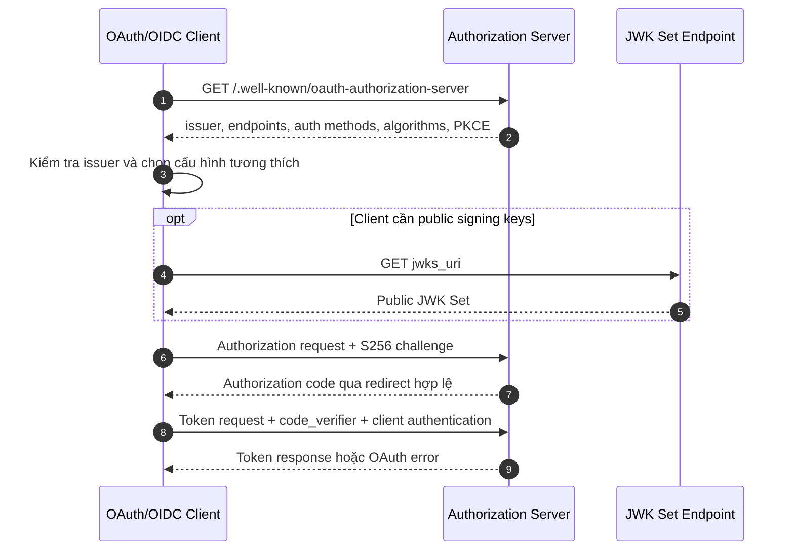
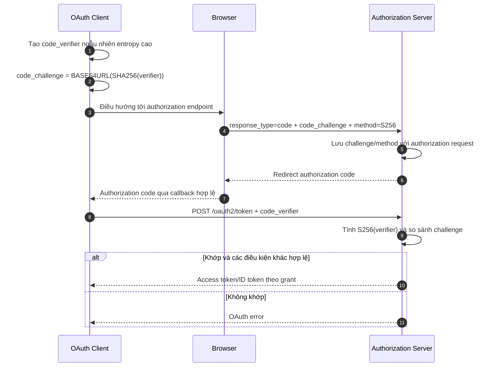
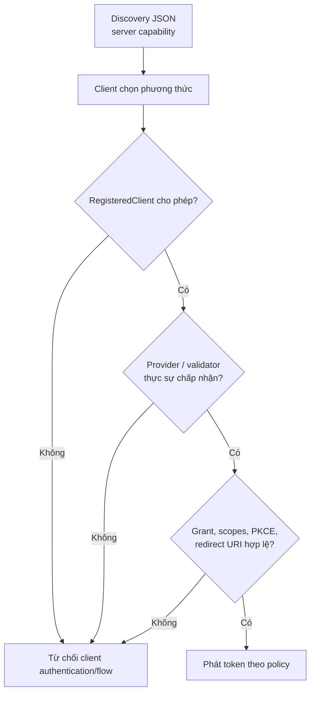

# Công bố authentication methods, signing algorithms và khả năng PKCE

Khi một ứng dụng OAuth 2.0 hoặc OpenID Connect kết nối với Authorization Server, nó cần biết **máy chủ cung cấp endpoint nào, chấp nhận phương thức xác thực client nào, hỗ trợ thuật toán chữ ký nào và có hỗ trợ PKCE hay không**. Nếu những thông tin này chỉ nằm trong tài liệu thủ công, client và server rất dễ cấu hình lệch nhau sau một lần triển khai hoặc nâng cấp.

**Authorization Server Metadata** theo RFC 8414 và **OpenID Provider Configuration** theo OpenID Connect Discovery công bố các khả năng đó dưới dạng JSON tại những địa chỉ well-known. Thông qua discovery, OAuth client có thể đọc các trường như `token_endpoint_auth_methods_supported`, `token_endpoint_auth_signing_alg_values_supported` và `code_challenge_methods_supported` trước khi lựa chọn luồng tương tác phù hợp.

Tuy nhiên, **metadata là lời công bố khả năng hỗ trợ, không phải cơ chế thực thi chính sách bảo mật**. Một máy chủ quảng cáo `S256` không tự động yêu cầu mọi client dùng PKCE; một máy chủ quảng cáo `private_key_jwt` không có nghĩa tất cả registered clients được phép dùng phương thức đó. Backend phải thật sự thực thi điều được công bố.

Bài thuộc chương **Metadata và Discovery** của module **SPRING_SECURITY_OAUTH2_OIDC_AUTHORIZATION_SERVER**, tập trung vào cách thiết kế, cấu hình, bảo mật, kiểm thử và vận hành OAuth 2.0/OpenID Connect Authorization Server bằng Spring Security và Spring Authorization Server trong ứng dụng Spring Boot.

Sau bài học, bạn có thể:

- Phân biệt OAuth 2.0 Authorization Server Metadata và OpenID Connect Provider Configuration.
- Diễn giải đúng các metadata về client authentication methods, JWT client-assertion signing algorithms, ID token signing algorithms và PKCE.
- Hiểu ranh giới giữa khả năng toàn cục do metadata công bố và quyền được cấu hình trên từng `RegisteredClient`.
- Cấu hình issuer, endpoint discovery và metadata customizers của Spring Authorization Server.
- Đăng ký client dùng `private_key_jwt` hoặc `client_secret_basic` và yêu cầu PKCE bằng `ClientSettings`.
- Kiểm thử metadata khớp với hành vi thực tế của Authorization Endpoint và Token Endpoint.
- Lập kế hoạch thay đổi khả năng hỗ trợ, cấu hình cache/proxy và tránh làm client tự động bị hỏng sau rollout.

## 1. Discovery giải quyết vấn đề gì?

Giả sử hệ thống có:

- `login.example.com` chạy Spring Authorization Server.
- `portal.example.com` là OAuth/OIDC client tương tác với trình duyệt.
- `orders-api` là Resource Server xác minh access token.
- Một batch client khác xác thực bằng `private_key_jwt`.

Các bên không nên đoán rằng Token Endpoint luôn hỗ trợ HTTP Basic, ID token luôn ký `RS256`, hoặc PKCE luôn dùng một phương thức tùy ý. Discovery cho phép client đọc hợp đồng công khai của issuer.



Discovery đặc biệt quan trọng trong các tình huống:

1. **Onboarding client mới:** biết server hỗ trợ `client_secret_basic`, `private_key_jwt` hay mTLS.
2. **Chuyển sang xác thực mạnh hơn:** biết server có chấp nhận JWT client assertion ký bằng thuật toán mong muốn không.
3. **Yêu cầu PKCE:** biết `S256` được hỗ trợ để client xây dựng `code_challenge` và `code_verifier`.
4. **Bảo trì issuer và public keys:** biết `issuer`, `token_endpoint`, `authorization_endpoint` và `jwks_uri` chính xác.
5. **Kiểm thử hợp đồng sau deploy:** so sánh metadata giữa các instance để tránh hiện tượng client chạy được ở node A nhưng thất bại ở node B.

**Lưu ý:** discovery không thay thế đăng ký client, không thay thế xác thực client, không cấp quyền scope và không bảo đảm mọi grant đều được bật cho từng client.

## 2. Hai loại metadata: OAuth 2.0 và OpenID Connect

### 2.1. OAuth 2.0 Authorization Server Metadata — RFC 8414

Với issuer minh họa `https://login.example.com`, URL well-known phổ biến là:

```http
GET /.well-known/oauth-authorization-server HTTP/1.1
Host: login.example.com
Accept: application/json
```

Response chứa các thông tin OAuth như `issuer`, `authorization_endpoint`, `token_endpoint`, `jwks_uri`, `grant_types_supported`, `response_types_supported`, authentication methods và PKCE methods.

Với issuer có path, cách xây dựng URL well-known theo RFC 8414 khác trường hợp issuer ở root: tiền tố well-known được chèn theo quy tắc của RFC, không chỉ nối chuỗi tùy tiện vào cuối URI. Luôn đối chiếu metadata URL thật với issuer và cấu hình proxy.

### 2.2. OpenID Connect Discovery

Khi bật OIDC, Provider Configuration thường được truy cập tại:

```http
GET /.well-known/openid-configuration HTTP/1.1
Host: login.example.com
Accept: application/json
```

Ngoài các metadata OAuth có liên quan, OIDC bổ sung `userinfo_endpoint`, `subject_types_supported`, `id_token_signing_alg_values_supported` và những trường OIDC khác tùy tính năng.

Với OIDC, `id_token_signing_alg_values_supported` là metadata **bắt buộc**, thể hiện thuật toán máy chủ có thể dùng để ký ID token. Nó **không cùng ý nghĩa** với `token_endpoint_auth_signing_alg_values_supported`.

### 2.3. So sánh

| Đặc điểm | OAuth 2.0 AS Metadata | OIDC Provider Configuration |
| --- | --- | --- |
| Tiêu chuẩn chính | RFC 8414 | OpenID Connect Discovery 1.0 |
| URL minh họa với issuer root | `/.well-known/oauth-authorization-server` | `/.well-known/openid-configuration` |
| Phạm vi | OAuth endpoints, grants, client authentication, PKCE, keys | OAuth metadata liên quan cộng thông tin xác thực danh tính OIDC |
| Trường về client auth | `token_endpoint_auth_methods_supported` | Có thể công bố trường tương ứng |
| Trường về JWT client auth | `token_endpoint_auth_signing_alg_values_supported` | Có thể công bố trường tương ứng |
| Trường PKCE | `code_challenge_methods_supported` | Có thể công bố trường tương ứng |
| ID token signing alg | Không phải trọng tâm RFC 8414 | `id_token_signing_alg_values_supported` |
| Kích hoạt trong Spring AS | Authorization Server Metadata Endpoint | Phải bật OIDC bằng `.oidc(...)` |

Không tự giả định hai document được Spring Authorization Server tạo ra sẽ có **tập trường giống hệt nhau**. Khi tùy biến, cần kiểm tra cả hai endpoint đang được sử dụng bởi client.

## 3. Nhóm metadata cần công bố

Một response minh họa cho deployment có Authorization Code, Client Credentials, PKCE S256 và JWT client authentication:

```json
{
  "issuer": "https://login.example.com",
  "authorization_endpoint": "https://login.example.com/oauth2/authorize",
  "token_endpoint": "https://login.example.com/oauth2/token",
  "jwks_uri": "https://login.example.com/oauth2/jwks",
  "response_types_supported": ["code"],
  "grant_types_supported": ["authorization_code", "client_credentials"],
  "token_endpoint_auth_methods_supported": [
    "client_secret_basic",
    "private_key_jwt",
    "none"
  ],
  "token_endpoint_auth_signing_alg_values_supported": ["RS256"],
  "code_challenge_methods_supported": ["S256"]
}
```

**Đây là JSON minh họa cho một deployment được cấu hình theo hợp đồng đó, không phải output mặc định được cam kết của Spring Authorization Server.** Các giá trị phải phản ánh converter/provider thực sự được cài đặt, chính sách từng client và thuật toán được chấp nhận. Việc công bố `none` chỉ có ý nghĩa khi server có public clients sử dụng cơ chế phù hợp, không phải cho phép confidential clients bỏ xác thực.

| Metadata | Kiểu | Ý nghĩa |
| --- | --- | --- |
| `issuer` | String URL | Định danh issuer để client/resource server kiểm tra nguồn phát hành. |
| `authorization_endpoint` | String URL | Endpoint bắt đầu authorization flow. |
| `token_endpoint` | String URL | Endpoint đổi code, refresh hoặc dùng grant được hỗ trợ. |
| `jwks_uri` | String URL | Địa chỉ public JWK Set để xác minh chữ ký của server, nếu có. |
| `response_types_supported` | Array of strings | Các response type được AS hỗ trợ. |
| `grant_types_supported` | Array of strings | Những grant type mà server triển khai. |
| `token_endpoint_auth_methods_supported` | Array of strings | Phương thức xác thực client mà Token Endpoint hỗ trợ. |
| `token_endpoint_auth_signing_alg_values_supported` | Array of strings | Thuật toán JWS được chấp nhận cho client assertion JWT tại Token Endpoint. |
| `code_challenge_methods_supported` | Array of strings | Phương thức PKCE được Authorization Server hỗ trợ. |
| `introspection_endpoint_auth_methods_supported` | Array of strings | Phương thức auth cho Token Introspection Endpoint, nếu được công bố. |
| `revocation_endpoint_auth_methods_supported` | Array of strings | Phương thức auth cho Token Revocation Endpoint, nếu được công bố. |
| `id_token_signing_alg_values_supported` | Array of strings | Thuật toán ký ID token trong OIDC Provider Configuration. |

Ba trường trọng tâm ở đây là **client authentication methods**, **client authentication signing algorithms** và **PKCE challenge methods**. Chúng không nên bị gom lại thành một list “thuật toán được hỗ trợ” vì phục vụ ba bước giao thức khác nhau.

## 4. token_endpoint_auth_methods_supported — phương thức xác thực client

Trường `token_endpoint_auth_methods_supported` là JSON array chứa tên các phương thức xác thực client mà Token Endpoint có thể xử lý.

Các tên phổ biến:

| Giá trị | Cách hoạt động | Lưu ý |
| --- | --- | --- |
| `client_secret_basic` | Client ID và secret được gửi bằng HTTP Basic Authentication. | Phải dùng TLS; secret được lưu an toàn, không ghi log. |
| `client_secret_post` | Client ID và secret nằm trong form body của token request. | Không nên dùng nếu có lựa chọn an toàn, phù hợp hơn; vẫn cần TLS. |
| `client_secret_jwt` | Client ký JWT assertion bằng secret chung. | Phải kiểm tra JWT claims, chữ ký, thời hạn, audience và chống replay. |
| `private_key_jwt` | Client ký JWT assertion bằng private key. | AS xác minh bằng public key/JWKS đã gắn với client. |
| `tls_client_auth` | Client được xác thực bằng certificate theo PKI mTLS. | Certificate phải được TLS stack xác minh và đối chiếu client registration. |
| `self_signed_tls_client_auth` | Client certificate được xác thực theo key/certificate đã đăng ký. | Khác PKI mTLS về trust/registration. |
| `none` | Public client không có client authentication secret. | Không biến confidential client thành anonymous; token/grant vẫn bị ràng buộc client và policy. |

Đây là **giá trị giao thức**; dùng đúng tên string. Không viết các nhãn tự chế như `basic`, `jwt`, `mutual_tls` hoặc `no_auth` trong metadata chuẩn.

### 4.1. Hỗ trợ trên server khác quyền của từng client

Giả sử metadata quảng cáo:

```json
{
  "token_endpoint_auth_methods_supported": [
    "client_secret_basic",
    "private_key_jwt"
  ]
}
```

Điều đó chỉ nói Token Endpoint có khả năng xử lý cả hai phương thức. Client `reporting-worker` được đăng ký `private_key_jwt` **không tự được quyền** chuyển sang `client_secret_basic` chỉ vì phương thức này có trong metadata.

Trong Spring Authorization Server, quyền của client được cấu hình tại `RegisteredClient.clientAuthenticationMethods`, còn validation thực hiện qua client authentication converters/providers. Server phải chấp nhận request **chỉ khi phương thức request dùng được server hỗ trợ và được chính client đó đăng ký**.

### 4.2. Confidential client và public client

- Confidential client có thể giữ client secret, private key hoặc certificate và thường phải xác thực khi gọi Token Endpoint.
- Public client, ví dụ native app hoặc SPA, không thể giữ secret một cách an toàn. Khi được cấu hình `none`, client vẫn phải gửi `client_id` đúng quy tắc và đáp ứng PKCE/redirect URI/code binding cùng các chính sách khác.
- `none` ở đây là **client authentication method**, hoàn toàn khác `alg=none` trong một JWT client assertion.

Không sử dụng metadata để bỏ qua client authentication sau một request lỗi. Một confidential client có secret sai phải bị từ chối, không tự thử lại với `none`.

### 4.3. RFC 8414 có default khi trường bị lược bỏ

Theo RFC 8414, nếu `token_endpoint_auth_methods_supported` không xuất hiện, giá trị mặc định về mặt metadata là `client_secret_basic`. Đây là **quy tắc diễn giải trường tùy chọn**, không phải bằng chứng rằng server triển khai mọi phương thức client authentication khác.

Trong hệ thống có PKI mTLS, `private_key_jwt` hoặc public clients, nên công bố rõ danh sách thực tế để tránh client SDK suy luận sai. Nhưng đừng công bố phương thức chưa được bật chỉ để làm response “đầy đủ”.

## 5. token_endpoint_auth_signing_alg_values_supported — thuật toán ký JWT client assertion

Trường `token_endpoint_auth_signing_alg_values_supported` là JSON array các tên thuật toán JWS mà Token Endpoint chấp nhận để kiểm tra chữ ký trên **JWT client assertion** của:

- `private_key_jwt`;
- `client_secret_jwt`.

Theo RFC 8414 `2:

- Nếu `token_endpoint_auth_methods_supported` có `private_key_jwt` hoặc `client_secret_jwt`, trường thuật toán signing này **MUST được công bố**.
- Khi trường bị lược bỏ, **không có thuật toán mặc định nào được suy ra**.
- Giá trị `none` **MUST NOT** được công bố.
- Server **SHOULD** hỗ trợ `RS256`.

Các thuật toán có thể gặp gồm:

| Thuật toán | Nhóm | Dùng phù hợp với |
| --- | --- | --- |
| `RS256` | RSA PKCS#1 v1.5 + SHA-256 | `private_key_jwt` với RSA key và policy cho phép. |
| `PS256` | RSA-PSS + SHA-256 | `private_key_jwt` với RSA key và policy cho phép. |
| `ES256` | ECDSA P-256 + SHA-256 | `private_key_jwt` với EC key phù hợp. |
| `HS256` | HMAC-SHA-256 | `client_secret_jwt` với secret đủ mạnh và policy phù hợp. |

Không mặc định mọi thuật toán liệt kê đều dùng được với mọi phương thức hoặc mọi client. Ví dụ `HS256` không phải lựa chọn hợp lý cho một client chỉ được đăng ký `private_key_jwt` với RSA public key.

### 5.1. JWT client assertion dùng để làm gì?

Một client dùng `private_key_jwt` sẽ gửi request như:

```http
POST /oauth2/token HTTP/1.1
Host: login.example.com
Content-Type: application/x-www-form-urlencoded

grant_type=client_credentials&scope=reports.read&client_id=reporting-worker&client_assertion_type=urn%3Aietf%3Aparams%3Aoauth%3Aclient-assertion-type%3Ajwt-bearer&client_assertion=<SIGNED_CLIENT_JWT>
```

JWT assertion được ký bởi **client**, không phải Authorization Server. Các claims quan trọng có thể gồm issuer/subject bằng client ID, audience hướng tới Token Endpoint/AS theo quy tắc validation, thời hạn rất ngắn và một định danh chống replay.

Server phải xác minh JWT signature bằng key thích hợp của registered client (hoặc shared secret trong `client_secret_jwt`), cùng các claims bảo mật. **Metadata chỉ mô tả thuật toán được chấp nhận; nó không thay thế JWT assertion validation.**

### 5.2. Không nhầm signing của client với signing của Authorization Server

Một Authorization Server có thể:

- Chấp nhận `RS256` để **xác minh JWT client assertion** tại Token Endpoint.
- Dùng `ES256` để **ký ID token** gửi cho OIDC client.
- Dùng `RS256` hoặc `PS256` để **ký JWT access token** được Resource Server xác minh.
- Có `dpop_signing_alg_values_supported` riêng cho **DPoP proof JWTs**, nếu bật DPoP.

Bốn mục đích không tương đương:

| Metadata/configuration | Chủ thể ký | Đối tượng cần xác minh |
| --- | --- | --- |
| `token_endpoint_auth_signing_alg_values_supported` | OAuth client | JWT client assertion tại Token Endpoint |
| `id_token_signing_alg_values_supported` | OpenID Provider | OIDC ID token |
| JWT access token signing policy | Authorization Server | Access token cho Resource Server |
| `dpop_signing_alg_values_supported` | OAuth client | DPoP proof JWT khi được triển khai |

Đặc biệt, **`jwks_uri` trong issuer metadata công bố public keys của Authorization Server**, không tự cung cấp key của mọi client dùng `private_key_jwt`. Client keys được cấu hình bằng client registration/JWK Set URL tương ứng.

### 5.3. Đổi thuật toán là thay đổi hợp đồng

Nếu metadata trước đây công bố `RS256` và server đột ngột chỉ chấp nhận `ES256`, các clients chưa đổi khóa và JWT assertion signer có thể nhận `invalid_client`. Cần chuẩn bị giai đoạn tương thích, rollout keys và per-client settings trước khi bỏ thuật toán cũ.

Không công bố `alg=none` cho JWT client assertion, không tin `alg` chỉ vì nó nằm trong JWT header và không tự động chọn key/thuật toán từ URL không được tin trong assertion.

## 6. id_token_signing_alg_values_supported của OIDC

Trong OpenID Connect Discovery, `id_token_signing_alg_values_supported` là **bắt buộc** và liệt kê JWS signing algorithms mà OpenID Provider có thể sử dụng để ký ID token.

Response OIDC minh họa:

```json
{
  "issuer": "https://login.example.com",
  "authorization_endpoint": "https://login.example.com/oauth2/authorize",
  "token_endpoint": "https://login.example.com/oauth2/token",
  "jwks_uri": "https://login.example.com/oauth2/jwks",
  "response_types_supported": ["code"],
  "subject_types_supported": ["public"],
  "id_token_signing_alg_values_supported": ["RS256"],
  "token_endpoint_auth_methods_supported": [
    "client_secret_basic",
    "private_key_jwt"
  ],
  "token_endpoint_auth_signing_alg_values_supported": ["RS256"],
  "code_challenge_methods_supported": ["S256"]
}
```

Đây vẫn là tài liệu minh họa cho deployment cụ thể. Giá trị `id_token_signing_alg_values_supported` phải khớp encoder/signing keys được Authorization Server dùng cho ID token; giá trị client-auth signing algorithms phải khớp validator của client assertion.

Thư viện có thể công bố thêm trường khác như `claims_supported`, `scopes_supported`, `userinfo_endpoint` và `end_session_endpoint` khi tính năng tương ứng được bật.

Khi client xác minh ID token, nó phải kiểm tra chữ ký bằng public JWK của issuer, `iss`, `aud`, `exp`, `nonce` nếu flow yêu cầu và các điều kiện OIDC liên quan. **Không lấy `token_endpoint_auth_signing_alg_values_supported` để cấu hình ID token verifier.**

## 7. code_challenge_methods_supported — khả năng PKCE

Theo RFC 8414, `code_challenge_methods_supported` là một JSON array tùy chọn công bố các phương thức `code_challenge_method` mà server hỗ trợ cho **Proof Key for Code Exchange (PKCE)**.

Ví dụ:

```json
{
  "code_challenge_methods_supported": ["S256"]
}
```

Hai phương thức gốc trong RFC 7636 là:

| Phương thức | Cách tạo challenge | Khuyến nghị |
| --- | --- | --- |
| `S256` | `BASE64URL-ENCODE(SHA256(ASCII(code_verifier)))`, không padding. | **Ưu tiên**; bảo vệ verifier tốt hơn trước việc lộ authorization request. |
| `plain` | `code_challenge = code_verifier`. | Chỉ dùng khi tương thích cũ và chính sách cho phép; không chủ động hạ cấp từ `S256`. |

RFC 9700 (OAuth 2.0 Security Best Current Practice) yêu cầu Authorization Server hỗ trợ PKCE và yêu cầu public clients sử dụng PKCE trong authorization code flow. Confidential clients cũng nên dùng PKCE để chống code injection và các kiểu tấn công liên quan.

### 7.1. Một authorization code flow dùng S256



PKCE tạo một ràng buộc giữa authorization request và token exchange; attacker chỉ có authorization code nhưng không có verifier sẽ không đổi code thành token được.

### 7.2. Tạo challenge đúng cách

`code_verifier` phải là chuỗi ngẫu nhiên entropy cao, dùng tập ký tự RFC 7636 cho phép và có độ dài từ 43 đến 128 ký tự. Với `S256`:

```text
code_challenge = BASE64URL_NOPAD(
    SHA256(ASCII(code_verifier))
)
```

Ví dụ vector chuẩn RFC 7636:

```text
code_verifier:
dBjftJeZ4CVP-mB92K27uhbUJU1p1r_wW1gFWFOEjXk

code_challenge:
E9Melhoa2OwvFrEMTJguCHaoeK1t8URWbuGJSstw-cM
```

Không dùng tên người dùng, session ID, timestamp hoặc một hằng số cố định làm verifier. Không gửi `code_verifier` ngay trong authorization request khi dùng `S256`; verifier phải được giữ cho token exchange.

### 7.3. Metadata hỗ trợ S256 khác policy bắt buộc PKCE

Ba câu sau **khác nhau**:

1. Server có hỗ trợ `S256` hay không? — Trả lời bởi `code_challenge_methods_supported` nếu được công bố chính xác.
2. Client nào bắt buộc dùng PKCE? — Phụ thuộc registration và authorization policy, ví dụ `ClientSettings.requireProofKey(true)`.
3. Request có code verifier hợp lệ hay không? — Được kiểm tra bởi Authorization/Token Endpoint khi request thực sự xảy ra.

Một metadata response có `["S256"]` **không có nghĩa mọi client đã bật `requireProofKey`**. Ngược lại, một registered client bắt buộc PKCE nhưng metadata không công bố khả năng PKCE sẽ khiến client khó tự cấu hình.

### 7.4. Không tự động fallback sang plain

Nếu client hỗ trợ `S256` nhưng nhận lỗi do verifier/challenge sai, không thử lại bằng `plain` để “chạy được”. Có thể đó là lỗi lưu verifier, sai redirect, authorization code bị dùng, hoặc một cuộc tấn công downgrade.

Chỉ quảng cáo `plain` nếu server thực sự còn hỗ trợ, đã xác định rủi ro tương thích cũ và có biện pháp hạn chế. Không thêm `plain` vào metadata để vượt qua một test client SDK.

## 8. Mối quan hệ giữa metadata toàn cục và RegisteredClient

Metadata công bố **khả năng mà Authorization Server có thể xử lý trên toàn hệ thống**; `RegisteredClient` quy định **một client cụ thể được dùng khả năng nào**.

| Khả năng | Công bố ở metadata | Cấu hình per-client |
| --- | --- | --- |
| Client authentication | `token_endpoint_auth_methods_supported` | `RegisteredClient.clientAuthenticationMethod(...)` |
| JWT client assertion alg | `token_endpoint_auth_signing_alg_values_supported` | `ClientSettings.tokenEndpointAuthenticationSigningAlgorithm(...)` |
| PKCE methods | `code_challenge_methods_supported` | `ClientSettings.requireProofKey(true)` yêu cầu PKCE, không tự thiết lập alg allowlist |
| Grant types | `grant_types_supported` | `RegisteredClient.authorizationGrantType(...)` |
| Scopes | `scopes_supported` | `RegisteredClient.scope(...)` |
| Redirect URI | Authorization Server xử lý `authorization_endpoint` | `RegisteredClient.redirectUri(...)` |

Ví dụ một confidential client dùng JWT assertion với RSA, Authorization Code + PKCE:

```java
RegisteredClient client = RegisteredClient.withId("portal-record-id")
    .clientId("portal-oidc")
    .clientAuthenticationMethod(
        ClientAuthenticationMethod.PRIVATE_KEY_JWT)
    .authorizationGrantType(
        AuthorizationGrantType.AUTHORIZATION_CODE)
    .redirectUri(
        "https://portal.example.com/login/oauth2/code/login")
    .scope("openid")
    .scope("profile")
    .clientSettings(ClientSettings.builder()
        .jwkSetUrl("https://portal.example.com/.well-known/jwks.json")
        .tokenEndpointAuthenticationSigningAlgorithm(
            SignatureAlgorithm.RS256)
        .requireProofKey(true)
        .build())
    .build();
```

Các import tùy phiên bản Spring Authorization Server; đây là trích đoạn registration, chưa bao gồm repository, private key của client, user authentication hay filter chains.

Giải thích:

- `PRIVATE_KEY_JWT`: client này phải xác thực bằng JWT client assertion.
- `jwkSetUrl(...)`: URL public JWK của **client**, dùng để AS xác minh assertion.
- `tokenEndpointAuthenticationSigningAlgorithm(RS256)`: client assertion của client này phải dùng RS256.
- `requireProofKey(true)`: authorization code flow của client này phải dùng PKCE.
- `scope(...)` và `redirectUri(...)`: policy của client, không được suy ra từ metadata toàn cục.

**Không sửa metadata để cấp phép cho client.** Muốn bật `private_key_jwt` cho client, phải cập nhật registration và validation tương ứng. Muốn bắt buộc PKCE, phải cập nhật policy và kiểm thử actual flow.

## 9. Các endpoint metadata trong Spring Authorization Server

Với Spring Authorization Server chạy trên Spring Boot, metadata được tạo bởi các filter/endpoint configurer thuộc **Spring Security filter chain**, không phải REST controller mà ứng dụng tự viết.

Các thành phần chính:

| Thành phần | Chức năng |
| --- | --- |
| `OAuth2AuthorizationServerConfigurer` | Áp dụng nhóm endpoint OAuth 2.0 của Authorization Server vào `HttpSecurity`. |
| `OAuth2AuthorizationServerMetadataEndpointConfigurer` | Tùy biến response OAuth 2.0 Authorization Server Metadata. |
| `OAuth2AuthorizationServerMetadataEndpointFilter` | Phục vụ JSON RFC 8414. |
| `OidcConfigurer` | Bật các endpoint OpenID Connect khi được cấu hình. |
| `OidcProviderConfigurationEndpointConfigurer` | Tùy biến response OpenID Provider Configuration. |
| `OidcProviderConfigurationEndpointFilter` | Phục vụ JSON OIDC Discovery. |
| `AuthorizationServerSettings` | Quy định issuer, endpoint paths và cấu hình định tuyến liên quan. |
| `RegisteredClientRepository` | Lưu phương thức auth, grants, scopes và client-specific settings, **không phải nơi chứa JSON metadata chung**. |

### 9.1. Bật OAuth metadata và OIDC discovery

OAuth2 Authorization Server Metadata Endpoint nằm trong các endpoint mặc định của Spring Authorization Server được cấu hình theo đường dẫn well-known. OpenID Connect Provider Configuration Endpoint chỉ được bật khi ứng dụng kích hoạt OIDC.

Một ví dụ rút gọn:

```java
@Bean
SecurityFilterChain authorizationServerSecurityFilterChain(
        HttpSecurity http) throws Exception {

    OAuth2AuthorizationServerConfigurer authorizationServer =
        OAuth2AuthorizationServerConfigurer.authorizationServer();

    http
        .securityMatcher(authorizationServer.getEndpointsMatcher())
        .with(authorizationServer, server -> server
            .oidc(Customizer.withDefaults()));

    return http.build();
}
```

Đây là trích đoạn tập trung vào **kích hoạt endpoint**. Ứng dụng thực tế vẫn cần các beans khác như `RegisteredClientRepository`, `OAuth2AuthorizationService`, `JWKSource`, `JwtDecoder` khi bật các chức năng OIDC liên quan, cùng login security chain và exception handling phù hợp. Không dùng ví dụ như một ứng dụng hoàn chỉnh.

### 9.2. Issuer phải tường minh và ổn định

`AuthorizationServerSettings` giúp công bố issuer nhất quán:

```java
@Bean
AuthorizationServerSettings authorizationServerSettings() {
    return AuthorizationServerSettings.builder()
        .issuer("https://login.example.com")
        .build();
}
```

Khi hoạt động sau reverse proxy, issuer trong metadata phải trùng với issuer mà client và Resource Server tin cậy, không tự đổi giữa `http://localhost:9000` và `https://login.example.com` theo từng node.

Khi issuer chứa path, dùng cấu hình đúng RFC/discovery thay vì tự nối đường dẫn well-known sai. Test cả `/.well-known/oauth-authorization-server` và `/.well-known/openid-configuration` theo issuer thực tế.

### 9.3. JWKS và discovery liên quan nhau nhưng không phải một endpoint

Metadata `jwks_uri` trỏ tới public JWK Set của Authorization Server. Bản thân metadata không chứa private key và không chứng minh client nào sở hữu key dùng cho `private_key_jwt`.

Trong Spring Authorization Server, JWK Set endpoint được cấu hình khi có `JWKSource<SecurityContext>` phù hợp. Không công bố một `jwks_uri` trỏ tới endpoint chưa chạy hoặc trả private JWK material.

## 10. Tùy biến trường metadata theo API Spring Authorization Server

Spring Authorization Server cung cấp hai extension points khác nhau:

- OAuth: `authorizationServerMetadataEndpoint(...).authorizationServerMetadataCustomizer(...)`.
- OIDC: `oidc(...).providerConfigurationEndpoint(...).providerConfigurationCustomizer(...)`.

Builder thường dùng các phương thức typed như:

- `tokenEndpointAuthenticationMethod(...)` hoặc `tokenEndpointAuthenticationMethods(...)`;
- `codeChallengeMethod(...)` hoặc `codeChallengeMethods(...)`;
- `idTokenSigningAlgorithm(...)` hoặc `idTokenSigningAlgorithms(...)` trên OIDC builder;
- `claim(name, value)` cho metadata mở rộng hoặc metadata không có typed setter.

### 10.1. Ví dụ customizer có kiểm soát

Giả sử deployment thực sự đã triển khai PKCE `S256`, JWT client authentication chấp nhận RS256 cho `private_key_jwt` và HS256 cho `client_secret_jwt`, và ID token signer chỉ dùng RS256.

```java
package com.example.authserver.config;

import java.util.List;

import org.springframework.context.annotation.Bean;
import org.springframework.context.annotation.Configuration;
import org.springframework.core.annotation.Order;
import org.springframework.security.config.annotation.web.builders.HttpSecurity;
import org.springframework.security.oauth2.server.authorization.config.annotation.web.configurers.OAuth2AuthorizationServerConfigurer;
import org.springframework.security.web.SecurityFilterChain;

@Configuration(proxyBeanMethods = false)
class AuthorizationServerDiscoveryConfig {

    private static final List<String> CLIENT_ASSERTION_ALGORITHMS =
        List.of("RS256", "HS256");

    @Bean
    @Order(1)
    SecurityFilterChain authorizationServerSecurityFilterChain(
            HttpSecurity http) throws Exception {

        OAuth2AuthorizationServerConfigurer authorizationServer =
            OAuth2AuthorizationServerConfigurer.authorizationServer();

        http
            .securityMatcher(authorizationServer.getEndpointsMatcher())
            .with(authorizationServer, server -> server
                .authorizationServerMetadataEndpoint(endpoint ->
                    endpoint.authorizationServerMetadataCustomizer(metadata -> {
                        metadata.codeChallengeMethods(methods -> {
                            if (!methods.contains("S256")) {
                                methods.add("S256");
                            }
                        });
                        metadata.claim(
                            "token_endpoint_auth_signing_alg_values_supported",
                            CLIENT_ASSERTION_ALGORITHMS);
                    }))
                .oidc(oidc ->
                    oidc.providerConfigurationEndpoint(endpoint ->
                        endpoint.providerConfigurationCustomizer(metadata -> {
                            metadata.codeChallengeMethods(methods -> {
                                if (!methods.contains("S256")) {
                                    methods.add("S256");
                                }
                            });
                            metadata.claim(
                                "token_endpoint_auth_signing_alg_values_supported",
                                CLIENT_ASSERTION_ALGORITHMS);
                            metadata.idTokenSigningAlgorithms(algorithms -> {
                                algorithms.clear();
                                algorithms.add("RS256");
                            });
                        }))));

        return http.build();
    }
}
```

**Cảnh báo trước khi sao chép:** ví dụ này chỉ minh họa cách viết metadata customizer, không cấu hình các client authentication providers, JWT assertion validators, ID token encoder hay PKCE validator. Các list `CLIENT_ASSERTION_ALGORITHMS` và `["RS256"]` chỉ chính xác khi cấu hình runtime của deployment chấp nhận đúng những thuật toán đó. Nếu ứng dụng không hỗ trợ HS256, không công bố HS256. Nếu ID token signer dùng ES256, phải sửa OIDC metadata tương ứng.

Không xóa hàng loạt default authentication methods của metadata builder để tạo “cấu hình bảo mật” bằng JSON. Muốn tắt một authentication method thực sự, phải thay đổi converters/providers, policy/registration liên quan và kiểm thử runtime; sau đó metadata mới được thu hẹp theo.

### 10.2. Vì sao dùng claim(...) cho JWT client signing algorithms?

Trong API Spring Authorization Server 1.5.x, metadata builders có các phương thức typed cho `tokenEndpointAuthenticationMethods(...)` và `codeChallengeMethods(...)`. Để công bố `token_endpoint_auth_signing_alg_values_supported` khi chưa có typed builder method tương ứng, có thể dùng:

```java
metadata.claim(
    "token_endpoint_auth_signing_alg_values_supported",
    List.of("RS256", "HS256")
);
```

Đây là cơ chế tùy biến JSON metadata, **không phải lệnh bật RS256 hoặc HS256 cho decoder client assertion**. Hãy xác minh cấu hình `ClientSettings.tokenEndpointAuthenticationSigningAlgorithm(...)` và cách provider chấp nhận JWT assertion để tránh công bố sai.

### 10.3. Phân biệt thêm vào list với thay thế list

Hai thao tác không giống nhau:

```java
// Thêm S256 nếu chưa có, không loại bỏ method hiện hữu.
metadata.codeChallengeMethods(methods -> {
    if (!methods.contains("S256")) {
        methods.add("S256");
    }
});
```

```java
// Chỉ dùng khi backend THỰC SỰ được giới hạn đúng phương thức này.
metadata.codeChallengeMethods(methods -> {
    methods.clear();
    methods.add("S256");
});
```

Khai báo list `["S256"]` nhưng backend vẫn chấp nhận `plain` là hợp đồng không đầy đủ; công bố thêm `plain` mà backend từ chối lại làm client SDK chọn sai. Quy tắc là: metadata phải đúng sự thật, không dùng để “chỉ đạo” backend.

### 10.4. Metadata cho introspection và revocation

Nếu deployment có `/oauth2/introspect` và `/oauth2/revoke`, hãy kiểm tra thêm:

- `introspection_endpoint_auth_methods_supported`;
- `revocation_endpoint_auth_methods_supported`;
- các trường thuật toán JWT client authentication cho từng endpoint nếu tiêu chuẩn/đặc tả mà deployment áp dụng yêu cầu.

Không mặc định cả ba endpoint chấp nhận giống hệt nhau. Ví dụ Resource Server gọi introspection bằng `client_secret_basic` trong khi một số Token Endpoint clients dùng `private_key_jwt`. Thêm phương thức mới vào Token Endpoint không tự cấu hình endpoint khác.

### 10.5. Lưu ý khác biệt phiên bản Spring Authorization Server và Spring Security 7

Các đoạn Java trong bài dùng API và import của **Spring Authorization Server 1.5.x**. Từ nhánh **Spring Security 7**, chức năng Authorization Server được tích hợp vào Spring Security và package của `OAuth2AuthorizationServerConfigurer` chuyển sang `org.springframework.security.config.annotation.web.configurers.oauth2.server.authorization`. Cách cấu hình qua `HttpSecurity.oauth2AuthorizationServer(...)` cũng cần đối chiếu với tài liệu phiên bản tương ứng.

Khi nâng cấp, hãy kiểm tra **đúng phiên bản dependency trong dự án**, các metadata builders/configurers hiện hữu và kết quả hai endpoint discovery thực tế; không sửa package import một cách máy móc rồi giả định hành vi phát metadata không thay đổi.


## 11. Metadata công khai không đồng nghĩa bất kỳ client nào được dùng

Một attacker có thể đọc discovery JSON như mọi client hợp lệ. Điều này hoàn toàn bình thường: metadata mô tả giao thức công khai, không phải thông tin bí mật.

Ngược lại, server cần tiếp tục thực thi các ranh giới bảo mật:



**Ví dụ:** server hỗ trợ `client_secret_basic` và `private_key_jwt`. Client `reporting-worker` chỉ được đăng ký `private_key_jwt`. Khi nó gửi Basic credentials, client authentication phải bị từ chối dù Basic là phương thức server-wide được công bố.

Với PKCE, nếu registered client yêu cầu proof key, request authorization code thiếu challenge phải bị từ chối; việc metadata có `S256` không tự xử lý lỗi đó.

### 11.1. Không dùng discovery JSON làm nguồn quyết định authorization

Từng service vẫn phải xác minh access token theo issuer, audience, chữ ký/thời hạn và policy của API. `jwks_uri` chỉ cung cấp public keys của issuer, không có nghĩa tất cả access tokens được ký bằng key đó đều được mọi Resource Server chấp nhận.

### 11.2. Không tin metadata URL từ nguồn tùy ý

Client phải biết issuer kỳ vọng qua cấu hình/trust store trước khi gọi discovery. Nếu nhận một issuer URL từ request người dùng, token chưa xác minh hoặc dữ liệu không đáng tin rồi tải metadata/JWKS từ URL đó, hệ thống có thể bị SSRF, lừa tin issuer giả hoặc tải dữ liệu từ mạng nội bộ.

Tránh:

- Tùy ý follow redirect discovery từ HTTPS sang HTTP.
- Tin issuer trả về khác issuer đã được cấu hình mà không xác minh.
- Dùng metadata từ staging để xác minh token production.
- Cho phép remote JWKS URI không được giới hạn theo issuer/cấu hình.
- Cache metadata của nhiều issuer dưới cùng một key mà không phân biệt issuer.

## 12. Kiểm chứng metadata bằng curl và jq

Trước khi cấu hình client SDK, hãy kiểm tra endpoint thật từ đúng network/TLS context của client.

### 12.1. Đọc OAuth 2.0 metadata

```bash
curl --fail --silent --show-error \
  --header 'Accept: application/json' \
  'https://login.example.com/.well-known/oauth-authorization-server' \
  | jq '{
      issuer,
      authorization_endpoint,
      token_endpoint,
      token_endpoint_auth_methods_supported,
      token_endpoint_auth_signing_alg_values_supported,
      code_challenge_methods_supported
    }'
```

Kiểm tra:

- `issuer` đúng tuyệt đối, gồm scheme, host và path nếu có.
- `token_endpoint` dùng HTTPS và trỏ tới đúng môi trường.
- Auth methods khớp với client authentication converters/providers.
- Nếu quảng cáo JWT client authentication thì signing algorithms có mặt và không có `none`.
- PKCE methods là danh sách thực sự hỗ trợ.

### 12.2. Đọc OIDC provider configuration

```bash
curl --fail --silent --show-error \
  'https://login.example.com/.well-known/openid-configuration' \
  | jq '{
      issuer,
      jwks_uri,
      token_endpoint_auth_methods_supported,
      token_endpoint_auth_signing_alg_values_supported,
      id_token_signing_alg_values_supported,
      code_challenge_methods_supported
    }'
```

Nếu endpoint OIDC trả 404, hãy kiểm tra OIDC đã được bật bằng `.oidc(...)` chưa, request có đúng issuer/path hay không và proxy/security matcher có định tuyến endpoint đúng không. **Không bật OIDC chỉ để làm một OAuth-only client hết lỗi** nếu sản phẩm không cần OIDC; thay vào đó dùng OAuth AS metadata phù hợp.

### 12.3. Assertion tự động cho issuer và PKCE S256

```bash
curl --fail --silent --show-error \
  'https://login.example.com/.well-known/oauth-authorization-server' \
  | jq --exit-status --arg issuer 'https://login.example.com' '
      .issuer == $issuer
      and (.code_challenge_methods_supported | type == "array")
      and (.code_challenge_methods_supported | index("S256") != null)
    '
```

Lệnh sẽ trả nonzero nếu metadata không thỏa assertion. Cần phân biệt **endpoint không truy cập được** với **JSON thiếu trường**; `curl --fail` và `jq --exit-status` giúp pipeline phát hiện lỗi, nhưng nên lưu response/header an toàn cho chẩn đoán.

### 12.4. Kiểm tra quy tắc signing alg không có none

```bash
curl --fail --silent --show-error \
  'https://login.example.com/.well-known/oauth-authorization-server' \
  | jq --exit-status '
      (.token_endpoint_auth_methods_supported // []) as $methods
      | if ($methods | index("private_key_jwt") != null
                or index("client_secret_jwt") != null)
        then
          (.token_endpoint_auth_signing_alg_values_supported | type == "array")
          and (.token_endpoint_auth_signing_alg_values_supported | length > 0)
          and (.token_endpoint_auth_signing_alg_values_supported
               | index("none") == null)
        else true end
    '
```

Đây là ví dụ kiểm tra contract: chỉ dùng phép kiểm tra này sau khi xác minh cú pháp `jq` trên môi trường CI đang chạy, và bổ sung test từng thuật toán với client assertion hợp lệ/thất bại. Một JSON đúng hình thức không chứng minh provider thực sự xác minh chữ ký an toàn.

## 13. Kiểm thử hành vi: metadata phải khớp runtime

Kiểm thử chỉ đọc JSON là chưa đủ. Một hệ thống có thể công bố `S256` nhưng không kiểm tra `code_verifier`; hoặc công bố `private_key_jwt` nhưng thiếu decoder/client key.

### 13.1. Ma trận kiểm thử metadata

| Kịch bản | Kỳ vọng |
| --- | --- |
| GET OAuth metadata bằng HTTPS | Trả JSON hợp lệ; `issuer`/endpoint URLs nhất quán. |
| GET OIDC configuration khi bật OIDC | Có `id_token_signing_alg_values_supported` và trường OIDC bắt buộc. |
| GET OIDC khi OIDC tắt | Không giả rằng OIDC tồn tại; OAuth metadata vẫn dùng được. |
| `private_key_jwt` được công bố | Có `token_endpoint_auth_signing_alg_values_supported` không rỗng, không có `none`. |
| Server chỉ hỗ trợ RS256 cho JWT assertion | Metadata không công bố ES256/HS256 như lựa chọn đã triển khai. |
| Server có public client | `none` chỉ được công bố khi cách xử lý public client tương ứng tồn tại. |
| Client bị đăng ký `PRIVATE_KEY_JWT` gửi Basic | Bị từ chối dù Basic có trong metadata server-wide. |
| Client `PRIVATE_KEY_JWT` gửi assertion RS256 hợp lệ | Được xác thực nếu mọi điều kiện claims/key/policy hợp lệ. |
| JWT assertion thay đổi payload nhưng giữ chữ ký cũ | Bị từ chối. |
| JWT assertion dùng `alg=none` | Bị từ chối. |
| Assertion hết hạn hoặc sai audience | Bị từ chối. |
| Request Authorization Code có `S256` đúng | Có thể nhận code khi các điều kiện khác hợp lệ. |
| Token exchange với verifier đúng | Có thể đổi code chưa dùng thành token. |
| Token exchange với verifier sai | Bị từ chối, không phát token. |
| Public client yêu cầu PKCE nhưng request thiếu challenge | Authorization request bị từ chối theo policy. |
| Chỉ công bố `S256` nhưng client gửi `plain` | Hành vi phải khớp policy đã công bố; test phát hiện drift. |
| Same issuer, hai instance trả hai danh sách methods khác nhau | CI/canary cảnh báo metadata không đồng nhất. |
| `jwks_uri` trả lỗi hoặc sai môi trường | Discovery integration test thất bại. |
| Metadata qua reverse proxy trả issuer nội bộ | Test phát hiện URL/issuer mismatch. |

### 13.2. Integration test với MockMvc

Trong Spring Boot, có thể dùng `MockMvc` gọi metadata endpoint thông qua filter chain thật. Một trích đoạn kiểm tra contract:

```java
@SpringBootTest
@AutoConfigureMockMvc
class AuthorizationServerMetadataTests {

    @Autowired
    MockMvc mockMvc;

    @Test
    void publishesS256AndCorrectIssuer() throws Exception {
        mockMvc.perform(get(
                "/.well-known/oauth-authorization-server"))
            .andExpect(status().isOk())
            .andExpect(jsonPath("$.issuer")
                .value("https://login.example.com"))
            .andExpect(jsonPath("$.code_challenge_methods_supported")
                .isArray())
            .andExpect(jsonPath(
                "$.code_challenge_methods_supported[0]")
                .value("S256"));
    }
}
```

Đây là test minh họa, cần imports/test configuration và issuer/filter chain phù hợp. Nếu deployment công bố nhiều PKCE methods hoặc thứ tự không cố định, **không assert S256 nằm ở vị trí 0**. Thay bằng assertion kiểm tra array contains `S256` để test không phụ thuộc thứ tự phần tử.

Bổ sung test HTTP thật qua reverse proxy hoặc môi trường canary để xác minh URL được nhìn thấy từ client, vì MockMvc nội bộ không phát hiện mọi lỗi forwarded headers hoặc CDN.

### 13.3. Test âm tính quan trọng

- JWT assertion ký bằng thuật toán không được phép nhưng tên alg hợp lệ.
- JWT assertion sai issuer/subject/audience, replay cùng `jti` hoặc hết hạn.
- Một registered client cố dùng authentication method của client khác.
- Authorization Code + PKCE sai verifier hoặc thiếu verifier.
- Request khai `code_challenge_method` không được hỗ trợ.
- Metadata có `S256` trong khi backend không validate PKCE.
- Metadata công bố RSA algorithm nhưng client JWKS không có key tương ứng.
- OIDC `id_token_signing_alg_values_supported` khác thuật toán trên ID token thật.

Đặc biệt, **mã lỗi từ Token Endpoint không nhất thiết chỉ ra ngay metadata sai**. Ví dụ `invalid_client` có thể do client secret, JWT assertion, client registration hoặc thuật toán không khớp. Kiểm tra cả metadata, registration và logs bảo mật đã che credential.

## 14. Những lỗi thường gặp khi triển khai

### 14.1. Metadata quảng cáo private_key_jwt nhưng client nhận invalid_client

Kiểm tra `RegisteredClient` có `PRIVATE_KEY_JWT` không, `ClientSettings.jwkSetUrl` có đúng URL public JWKS của client không, JWKS có key/kid phù hợp không, signing algorithm per-client đã đặt đúng chưa và JWT assertion có claims `iss`/`sub`/`aud`/`exp`/`jti` hợp lệ không.

Không “sửa” bằng cách tắt signature verification hoặc tự chuyển về `client_secret_basic` nếu client chưa được đăng ký phương thức đó.

### 14.2. id_token_signing_alg_values_supported không khớp ID token thật

Kiểm tra cấu hình `JWKSource`, `JwtEncoder`, `JwtGenerator`, `JwsHeader` customization và key selector. Metadata phải phản ánh thuật toán mà ID token generator thực sự phát hành, không phải thuật toán client assertion verifier hỗ trợ.

### 14.3. Client dùng plain dù metadata có S256

Kiểm tra phiên bản SDK, code tạo verifier/challenge, request authorization có `code_challenge_method=S256`, và policy backend có thực sự từ chối `plain` hay không. Nếu policy yêu cầu S256-only, cần kiểm tra rejection ở authorization provider; việc chỉ đổi metadata không đủ.

### 14.4. Thiếu code_challenge_methods_supported

Trường này được RFC 8414 định nghĩa là OPTIONAL, nhưng việc thiếu có thể khiến SDK không phát hiện khả năng PKCE. Kiểm tra metadata builder, OIDC configuration builder và phiên bản Spring Authorization Server.

Đừng suy luận rằng server không hỗ trợ PKCE chỉ từ một field vắng mặt; kiểm chứng flow và hợp đồng triển khai. Tuy nhiên, với deployment yêu cầu PKCE, nên công bố rõ `S256` để client tự cấu hình an toàn.

### 14.5. OAuth metadata đúng nhưng OIDC discovery thiếu trường

Hai endpoint có hai customizer. Việc chỉ thêm field vào `authorizationServerMetadataCustomizer` không bảo đảm OIDC Provider Configuration đã có field tương ứng. Sửa `providerConfigurationCustomizer` hoặc cấu hình OIDC generator thực tế, rồi test cả hai endpoint.

### 14.6. Một số client lỗi sau khi bật mTLS hoặc thay signing algorithm

Có thể metadata thay sớm hơn backend/client registration, client assertion alg thay đổi hoặc proxy không chuyển tiếp client certificate. Cần rollout theo giai đoạn: hỗ trợ khả năng mới trên backend trước, kiểm thử, cập nhật metadata, chuyển client, sau đó loại bỏ khả năng cũ.

### 14.7. 404 ở /.well-known/openid-configuration

Kiểm tra OIDC đã bật chưa và URL issuer chính xác chưa. Một OAuth Authorization Server không bắt buộc phải triển khai OIDC; RFC 8414 endpoint có thể tồn tại độc lập. Nếu OIDC đã bật nhưng endpoint 404 sau proxy, kiểm tra context path, route và filter chain security matcher.

### 14.8. Metadata bị cache cũ sau deploy

CDN, reverse proxy hoặc client có thể cache discovery JSON. Khi thêm phương thức mới, cache cũ có thể khiến client không nhìn thấy khả năng đó. Khi xóa phương thức cũ, cache cũ có thể khiến client tiếp tục sử dụng phương thức đã bị gỡ. Cần chính sách Cache-Control/TTL, rollback và overlap rõ ràng.

## 15. Thay đổi metadata trong vận hành production

Discovery là hợp đồng công khai với nhiều OAuth clients. Thay đổi một phần tử list có thể trở thành **breaking change** dù API Java của server không thay đổi.

### 15.1. Rollout thêm private_key_jwt

Một kế hoạch an toàn:

1. Chuẩn bị key management, JWK Set URL hoặc client public key registration.
2. Bật và kiểm thử `private_key_jwt` trong client authentication converters/providers.
3. Đăng ký client thử nghiệm có phương thức `PRIVATE_KEY_JWT` và signing algorithm phù hợp.
4. Kiểm thử JWT client assertion với chữ ký hợp lệ/sai, audience, exp và replay.
5. Công bố `private_key_jwt` và signing algorithms thực sự hỗ trợ trong metadata.
6. Chuyển một nhóm client sang ký assertion; theo dõi `invalid_client` và latency xác minh key.
7. Mở rộng rollout, chỉ gỡ secret-based methods khi mọi client tương ứng đã di chuyển.

**Không công bố trước rồi mới bắt đầu viết provider.** Client SDK có thể tự chọn phương thức mới ngay khi nhìn thấy metadata.

### 15.2. Rollout yêu cầu PKCE S256

1. Xác minh Authorization/Token Endpoint xử lý `S256` chuẩn.
2. Cập nhật SDK/client để sinh verifier entropy cao và lưu an toàn giữa hai request.
3. Bật `ClientSettings.requireProofKey(true)` cho public clients và các confidential clients phù hợp.
4. Công bố `code_challenge_methods_supported` có `S256` trong cả discovery endpoint client sử dụng.
5. Kiểm thử thiếu/sai challenge, thiếu/sai verifier và code reuse.
6. Theo dõi lỗi `invalid_request`/`invalid_grant` quanh rollout.
7. Nếu cần ngừng `plain`, thực thi từ chối trong runtime trước hoặc phối hợp cùng metadata; không chỉ xóa `plain` khỏi JSON.

### 15.3. Rollout thuật toán ký ID token

Thay `id_token_signing_alg_values_supported` cần được phối hợp với signing keys/JWKS, OIDC client decoders, cache JWKS và key rotation. Không xóa public key cũ khỏi JWKS trước khi những ID token cũ đã hết thời hạn sử dụng cần xác minh, trừ trường hợp xử lý sự cố key compromise.

Một chính sách tốt là giữ hỗ trợ thuật toán cũ trong overlap hợp lý, cập nhật các client, giám sát key/alg đang dùng rồi mới loại bỏ.

### 15.4. Quan sát drift giữa metadata và runtime

Có thể thu thập các metrics hoặc sự kiện:

| Quan sát | Tín hiệu cần chú ý |
| --- | --- |
| Tỷ lệ `invalid_client` theo method | Một phương thức được công bố nhưng thực tế bị từ chối hàng loạt. |
| JWT client assertion failures theo alg | Client chọn thuật toán không khớp metadata/registration. |
| PKCE missing/mismatch failures | Client chưa chuyển sang S256 hoặc lưu verifier sai. |
| Discovery endpoint 4xx/5xx | Metadata không sẵn sàng trong thời gian client onboarding/startup. |
| Metadata hash/version theo AS instance | Các instance đang công bố khả năng khác nhau. |
| JWKS fetch failures | Issuer signing keys không sẵn sàng cho verifier. |
| Discovery response cache age | CDN/client vẫn thấy khả năng cũ sau deploy. |

Tránh dùng raw client secret, client JWT assertion, access token, authorization code hoặc verifier làm metric label hay log field. Đối với client ID, kiểm soát cardinality và truy cập log theo quy định.

## 16. Checklist công bố metadata an toàn và đúng chuẩn

- [ ] Có `AuthorizationServerSettings.issuer` tường minh và nhất quán qua proxy, metadata và token.
- [ ] RFC 8414 endpoint hoạt động tại URL well-known phù hợp issuer.
- [ ] OIDC Provider Configuration được bật và test khi ứng dụng thực sự triển khai OIDC.
- [ ] `token_endpoint_auth_methods_supported` chỉ chứa phương thức được Token Endpoint hỗ trợ.
- [ ] Từng client vẫn bị ràng buộc bởi `RegisteredClient.clientAuthenticationMethods`.
- [ ] Confidential clients không được tự fallback thành public `none` khi authentication lỗi.
- [ ] Nếu công bố `private_key_jwt`/`client_secret_jwt`, `token_endpoint_auth_signing_alg_values_supported` hiện diện và không rỗng.
- [ ] Thuật toán `none` không xuất hiện trong JWT client assertion signing algorithms.
- [ ] JWT client assertion alg list khớp provider validation và per-client signing policy.
- [ ] OIDC `id_token_signing_alg_values_supported` khớp ID token signer thật, không nhầm với client assertion alg.
- [ ] `jwks_uri` trỏ public JWK Set đúng issuer, không chứa private key.
- [ ] `code_challenge_methods_supported` công bố các PKCE methods thực sự được server hỗ trợ.
- [ ] `S256` được ưu tiên; client không tự downgrade sang `plain` sau lỗi S256.
- [ ] Các client cần PKCE đã bật `ClientSettings.requireProofKey(true)` và backend kiểm tra verifier.
- [ ] Customizer OAuth metadata và OIDC provider configuration được cấu hình riêng khi cần.
- [ ] Không dùng metadata customization để thay thế authentication providers, token validation hoặc registration policy.
- [ ] Introspection/revocation authentication methods được công bố đúng nếu endpoint hoạt động.
- [ ] HTTPS, issuer pinning và well-known URL được kiểm tra nhằm tránh SSRF/issuer substitution.
- [ ] CI kiểm tra JSON schema, issuer, algorithms, PKCE fields và JWT client-auth conditions.
- [ ] Integration tests bao phủ private_key_jwt, client_secret_basic, wrong method, missing/sai PKCE, JWT alg sai.
- [ ] Multi-instance và reverse proxy trả metadata nhất quán; cache/TTL/rollout được quản lý.
- [ ] Không đưa credentials, private keys, runtime secrets hoặc dữ liệu người dùng vào metadata.
- [ ] Có tài liệu tương thích và kế hoạch rollout khi bỏ authentication method hoặc thuật toán cũ.

**Ghi nhớ:** `token_endpoint_auth_methods_supported` mô tả **những cách client có thể xác thực**; `token_endpoint_auth_signing_alg_values_supported` mô tả **thuật toán để xác minh chữ ký JWT client assertion**; `code_challenge_methods_supported` mô tả **các phương thức PKCE được Authorization Server hỗ trợ**. `id_token_signing_alg_values_supported` là tập thuật toán khác, dành cho **ID token do OpenID Provider ký**. Mọi thông tin được công bố cần khớp với backend thực tế và registration của từng client; discovery không tự bật bảo mật.

## 17. Tài liệu tham khảo

- [RFC 8414 — OAuth 2.0 Authorization Server Metadata](https://www.rfc-editor.org/rfc/rfc8414.html): các trường metadata, default rules và well-known endpoint.
- [OpenID Connect Discovery 1.0](https://openid.net/specs/openid-connect-discovery-1_0.html): OpenID Provider Configuration và `id_token_signing_alg_values_supported`.
- [OpenID Connect Core 1.0](https://openid.net/specs/openid-connect-core-1_0.html): ID token, client authentication và validation.
- [RFC 7636 — Proof Key for Code Exchange](https://www.rfc-editor.org/rfc/rfc7636.html): `code_verifier`, `code_challenge`, `S256` và `plain`.
- [RFC 9700 — Best Current Practice for OAuth 2.0 Security](https://www.rfc-editor.org/rfc/rfc9700.html): yêu cầu PKCE và ngăn downgrade.
- [RFC 7523 — JWT Profile for OAuth 2.0 Client Authentication and Authorization Grants](https://www.rfc-editor.org/rfc/rfc7523.html): JWT client assertion và validation.
- [RFC 7591 — OAuth 2.0 Dynamic Client Registration](https://www.rfc-editor.org/rfc/rfc7591.html): `token_endpoint_auth_method` và client metadata.
- [Spring Authorization Server — Protocol Endpoints](https://docs.spring.io/spring-authorization-server/reference/protocol-endpoints.html): `OAuth2AuthorizationServerMetadataEndpointConfigurer` và `OidcProviderConfigurationEndpointConfigurer`.
- [Spring Authorization Server — Configuration Model](https://docs.spring.io/spring-authorization-server/reference/configuration-model.html): issuer, default endpoints và OIDC configuration.
- [Spring Authorization Server — Metadata Builder API](https://docs.spring.io/spring-authorization-server/reference/api/java/org/springframework/security/oauth2/server/authorization/AbstractOAuth2AuthorizationServerMetadata.AbstractBuilder.html): typed setters cho methods, PKCE và `claim(...)`.
- [Spring Authorization Server — OIDC Provider Configuration Builder API](https://docs.spring.io/spring-authorization-server/reference/api/java/org/springframework/security/oauth2/server/authorization/oidc/OidcProviderConfiguration.Builder.html): `idTokenSigningAlgorithm(...)`.
- [Spring Authorization Server — ClientSettings.Builder API](https://docs.spring.io/spring-authorization-server/reference/api/java/org/springframework/security/oauth2/server/authorization/settings/ClientSettings.Builder.html): `requireProofKey` và `tokenEndpointAuthenticationSigningAlgorithm`.
- [IANA OAuth Parameters Registry](https://www.iana.org/assignments/oauth-parameters): tên phương thức auth, code challenge methods và các giá trị được đăng ký.


