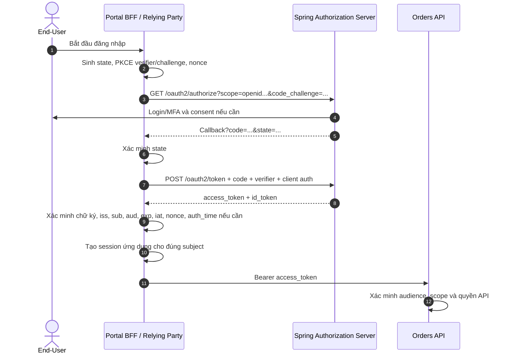
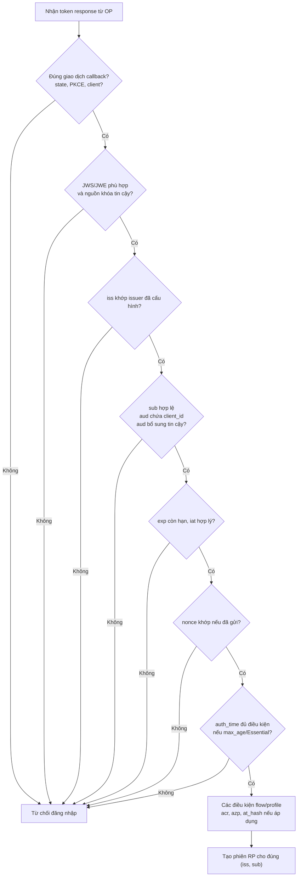
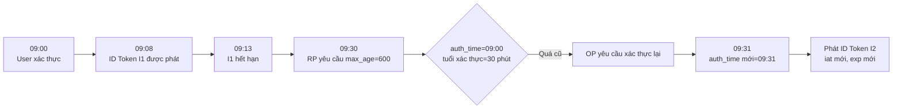

# ID Token và các claims iss, sub, aud, exp, iat, auth_time

**OpenID Connect (OIDC)** bổ sung một lớp xác thực danh tính người dùng trên nền OAuth 2.0. Trong OAuth 2.0, access token chủ yếu giúp client truy cập tài nguyên được bảo vệ; nó không phải bằng chứng chuẩn hóa để một ứng dụng kết luận **ai vừa đăng nhập, bằng nhà cung cấp danh tính nào, tại thời điểm nào**. OIDC đưa ra **ID Token** để biểu diễn những thông tin cốt lõi của sự kiện xác thực đó.

ID Token là một **JSON Web Token (JWT)** do OpenID Provider (OP), ở đây là **Spring Authorization Server**, phát cho **Relying Party (RP)**, tức OIDC client. RP phải xác minh chữ ký và những claims ràng buộc token với **issuer, chủ thể, client nhận token và thời gian xác thực**. Một ID Token chứa đủ chuỗi `iss`, `sub`, `aud`, `exp`, `iat` chưa chắc đã an toàn: **các giá trị phải đúng và được kiểm tra theo ngữ cảnh giao dịch**.

Bài thuộc chương **OIDC Core và ID Token** của mô-đun **SPRING_SECURITY_OAUTH2_OIDC_AUTHORIZATION_SERVER**. Mục tiêu chung là học cách thiết kế, cấu hình, bảo mật, kiểm thử và vận hành OAuth 2.0/OpenID Connect Authorization Server bằng Spring Security và Spring Authorization Server trong ứng dụng Spring Boot. Trọng tâm bài này là **ý nghĩa, điều kiện xuất hiện, cách phát hành và cách xác minh sáu claims**: `iss`, `sub`, `aud`, `exp`, `iat` và `auth_time`.

> **Quy tắc nhớ nhanh:** `iss` cho biết **ai phát**, `sub` cho biết **người dùng nào**, `aud` cho biết **client nào được nhận**, `exp` cho biết **đến khi nào token hết hiệu lực**, `iat` cho biết **lúc nào ID Token được phát**, còn `auth_time` cho biết **lần người dùng được xác thực thực sự diễn ra lúc nào**.

**Phạm vi kỹ thuật:** Nội dung theo OpenID Connect Core 1.0 (Errata Set 2) và API thường dùng của Spring Authorization Server 1.5.x/Spring Security 6.x trong Spring Boot 3.x. Các bản mới có thể khác về API/cấu hình; cần xác minh với phiên bản đang triển khai. Bài này đề cập ưu tiên **Authorization Code Flow + PKCE**; các flow hybrid/implicit có quy tắc bổ sung và không nên được suy diễn từ ví dụ code flow.

## 1. ID Token dùng để xác thực, không dùng làm access token

### 1.1. Các tác nhân và vai trò

| Vai trò | Ví dụ | Trách nhiệm |
|---|---|---|
| **End-User** | Nhân viên truy cập Portal | Xác thực qua OP |
| **OpenID Provider (OP)** | `https://login.example.com` | Xác thực người dùng, phát ID Token, công bố metadata/JWKS |
| **Relying Party (RP)** | `portal-bff` | Khởi tạo đăng nhập, xác minh ID Token, tạo phiên ứng dụng |
| **OAuth client** | Chính RP `portal-bff` | Giữ client ID, xác thực tại token endpoint khi thích hợp |
| **Resource Server** | Orders API | Xác minh **access token** và quyền gọi API |
| **Browser** | Trình duyệt nhân viên | Đi qua login, consent và callback |

ID Token được **RP tiêu thụ** để xác minh đăng nhập. Orders API không nên nhận ID Token như Bearer credential chỉ vì token này cũng là JWT và có chữ ký hợp lệ.

### 1.2. So sánh ba loại token

| Token | Mục đích | Audience điển hình | Được gửi đến đâu? |
|---|---|---|---|
| **ID Token** | Khẳng định thông tin xác thực End-User cho RP | `client_id` của RP | Từ OP đến RP, thường qua token response |
| **Access Token** | Ủy quyền gọi API/Resource Server | API/resource identifier theo profile | Client gửi tới API |
| **Refresh Token** | Xin token mới theo authorization đã cấp | Dành cho Token Endpoint/authorization context | Client gửi tới OP, không gửi API |

Không dùng `sub` trong ID Token như một phương tiện thay thế `scope`, tenant authorization hoặc kiểm tra quyền thao tác. RP có thể biết người dùng là ai, nhưng điều đó **không tự cấp quyền** đọc tất cả đơn hàng của người dùng đó.

### 1.3. ID Token xuất hiện khi nào?

Trong OIDC Authorization Code Flow, client yêu cầu scope `openid` ở Authorization Endpoint. Sau khi user đăng nhập và hoàn tất authorization, RP nhận **authorization code** qua callback, đổi code ở Token Endpoint và nhận **ID Token** cùng access token nếu request hợp lệ.



**Không tạo session RP trước khi ID Token được kiểm tra thành công.** Một token chỉ được Base64URL-decode để xem payload nhưng chưa xác minh chữ ký và claims **không phải** bằng chứng đăng nhập đáng tin.

## 2. Cấu trúc ID Token và sáu claims cốt lõi

### 2.1. JSON minh họa

Một ID Token được ký thường có dạng ba phần JWS Compact Serialization:

```text
BASE64URL(JWS_HEADER).BASE64URL(PAYLOAD).BASE64URL(SIGNATURE)
```

Payload giải mã **minh họa**, không phải ID Token thật có thể dùng trong production:

```json
{
  "iss": "https://login.example.com",
  "sub": "user-8b3a",
  "aud": "portal-bff",
  "exp": 1795003600,
  "iat": 1795000000,
  "auth_time": 1794999700,
  "nonce": "n-0S6_WzA2Mj",
  "acr": "urn:example:loa:2",
  "amr": ["pwd", "otp"]
}
```

Các số thời gian chỉ dùng để mô tả quan hệ giữa claims, không phải lời khẳng định token này còn hạn tại thời điểm đọc bài. Trong production, OP sử dụng thời gian UTC thực tế và signing key được quản lý.

### 2.2. Required và conditional

| Claim | Bắt buộc theo OIDC Core? | Kiểu JSON | Ý nghĩa |
|---|---|---|---|
| `iss` | **REQUIRED** | String | Issuer Identifier của OP |
| `sub` | **REQUIRED** | String | Subject Identifier của End-User tại issuer |
| `aud` | **REQUIRED** | String hoặc array of strings | Audience(s), phải chứa `client_id` của RP |
| `exp` | **REQUIRED** | Number (NumericDate) | Thời điểm ID Token không còn được chấp nhận |
| `iat` | **REQUIRED** | Number (NumericDate) | Thời điểm ID Token được phát |
| `auth_time` | **CONDITIONAL** | Number (NumericDate) | Thời điểm xác thực người dùng; **bắt buộc** khi có `max_age` hoặc yêu cầu `auth_time` là Essential Claim |

Ngoài sáu claims trên, `nonce`, `azp`, `acr`, `amr` và nhiều claims khác có thể xuất hiện theo giao dịch/profile. Đừng xem chúng là cùng một trường hoặc là điều kiện mặc định cho mọi luồng.

### 2.3. NumericDate không phải milliseconds

`exp`, `iat` và `auth_time` là số giây kể từ `1970-01-01T00:00:00Z`. Java `Instant.getEpochSecond()` trả đơn vị này; `System.currentTimeMillis()` trả **mili giây** và không được gán trực tiếp vào NumericDate.

```java
Instant issuedAt = Instant.now();

long iat = issuedAt.getEpochSecond();
long exp = issuedAt.plusSeconds(300).getEpochSecond();

// Sai: giá trị mili giây, lớn hơn thời gian đúng khoảng 1000 lần.
long wrongIat = System.currentTimeMillis();
```

Khi một ID Token có `iat` gấp khoảng 1000 lần timestamp hiện tại, thường có bug dùng milliseconds. Kiểm thử kiểu dữ liệu và chuyển đổi thời gian trước khi đưa vào JWT.

## 3. Claim iss: xác định OpenID Provider đã phát token

### 3.1. Semantics của issuer

`iss` là **Issuer Identifier** của OP. Theo OIDC Core, nó là URL phân biệt chữ hoa/thường dùng scheme `https`, có host và có thể có port/path; **không chứa query hoặc fragment**. Ví dụ:

```text
iss = https://login.example.com
```

RP phải so sánh `iss` trong ID Token với **issuer đã được tin cậy và cấu hình/discovered**. Hai issuer sau **không tương đương chỉ vì cùng máy chủ**:

```text
https://login.example.com
https://login.example.com/tenant/acme
```

Với hệ thống multi-tenant, path/hostname có thể phân biệt tenant/issuer; nhận token của tenant khác mà bỏ qua `iss` dẫn đến identity mix-up.

### 3.2. Issuer discovery và metadata

RP có thể lấy metadata qua OIDC Discovery, ví dụ `https://login.example.com/.well-known/openid-configuration` nếu issuer/settings tương ứng. Metadata công bố `issuer`, `authorization_endpoint`, `token_endpoint`, `jwks_uri` và các khả năng liên quan.

```json
{
  "issuer": "https://login.example.com",
  "authorization_endpoint": "https://login.example.com/oauth2/authorize",
  "token_endpoint": "https://login.example.com/oauth2/token",
  "jwks_uri": "https://login.example.com/oauth2/jwks"
}
```

Đây là **metadata rút gọn**, không phải response discovery đầy đủ. RP phải đối chiếu issuer metadata với `iss` của token. Không lấy `iss` từ một token chưa xác minh rồi tùy ý kết nối tới JWKS URL do kẻ tấn công chỉ định.

### 3.3. Lỗi issuer phổ biến

- Issuer được cấu hình `http://localhost:9000` nhưng reverse proxy công bố `https://login.example.com`;
- OP và RP khác nhau về trailing slash, path hoặc chữ hoa/thường;
- Tenant A xác minh token của Tenant B vì dùng chung khóa ký nhưng không kiểm tra `iss`;
- Metadata lấy từ môi trường staging trong khi token từ production;
- Một URL do token tự cung cấp được sử dụng làm trust anchor.

**Đúng khóa ký không thay cho đúng issuer.** Một hệ thống có thể dùng nhiều khóa hoặc dùng chung hạ tầng signing giữa các issuer; RP vẫn phải phân biệt chính xác issuer tin cậy.

## 4. Claim sub: định danh ổn định của End-User

### 4.1. sub không phải tên đăng nhập hoặc email

`sub` là **Subject Identifier**: chuỗi phân biệt chữ hoa/thường, duy nhất trong phạm vi issuer và **không được tái sử dụng cho End-User khác**. Theo OIDC Core, nó không vượt quá **255 ký tự ASCII**.

```json
{
  "iss": "https://login.example.com",
  "sub": "user-8b3a"
}
```

Không nên coi `sub` luôn là email, username, số điện thoại hoặc khóa chính database có thể bị đổi/recycle. Email có thể được đổi hoặc tái sử dụng; hai người dùng có thể có email khác ở các thời điểm khác nhau. Nên có mapping identity ổn định do hệ thống quản lý.

### 4.2. Cặp (iss, sub) mới định danh đúng người dùng

Một giá trị `sub=user-123` có thể xuất hiện ở hai issuer **khác nhau**. Vì vậy, RP lưu liên kết tài khoản theo **cặp `(iss, sub)`**, không chỉ theo `sub`.

| Issuer | Subject | Có thể là cùng người? |
|---|---|---|
| `https://login.company-a.example` | `user-123` | Không được suy ra |
| `https://login.company-b.example` | `user-123` | Không được suy ra |
| `https://login.company-a.example` | `user-123` | Cùng định danh issuer-sub nếu chính sách account mapping được giữ |

Nếu RP ghép tài khoản theo một `sub` không có issuer, có thể tạo **account confusion/account takeover** khi tích hợp nhiều OP.

### 4.3. Public và pairwise subject

OIDC hỗ trợ **public subject** và **pairwise subject**. Với public subject, nhiều RP có thể thấy cùng `sub` của người dùng tại OP. Với pairwise subject, OP tạo `sub` khác nhau theo sector identifier của RP để hạn chế khả năng liên kết hành vi người dùng giữa các RP.

Do đó, khi hai ứng dụng hỏi “vì sao cùng người dùng mà `sub` khác nhau?”, không được vội kết luận có lỗi. Cần kiểm tra **subject type**, issuer, sector và client registration. Đừng ép hai RP chia sẻ `sub` bằng cách đưa email hoặc nội bộ user ID vào token nếu điều đó vi phạm chính sách riêng tư.

### 4.4. UserInfo phải khớp subject ID Token

Khi RP gọi **OIDC UserInfo Endpoint** bằng access token, response có `sub` và giá trị đó **phải khớp `sub` trong ID Token đã được xác minh**. Nếu không khớp, RP **không được dùng** các UserInfo claims làm dữ liệu danh tính cho phiên này.

```json
{
  "sub": "user-8b3a",
  "name": "Example User",
  "email": "user@example.com"
}
```

Ví dụ tên/email chỉ là dữ liệu minh họa. Không xem email trong UserInfo là định danh bảo mật thay cho cặp issuer-sub.

## 5. Claim aud: ID Token dành cho client nào?

### 5.1. audience của ID Token là OIDC client

`aud` phải chứa **`client_id` của RP** được đăng ký với OP. Ví dụ Portal có `client_id=portal-bff`:

```json
{
  "aud": "portal-bff"
}
```

Hoặc khi có nhiều audiences:

```json
{
  "aud": ["portal-bff", "another-trusted-audience"]
}
```

RP **phải từ chối** ID Token không chứa client ID của mình hoặc chứa audience bổ sung mà RP **không tin cậy**, theo quy tắc OIDC Core.

### 5.2. Đừng nhầm aud ID Token với aud access token

| Token | aud đúng trong ví dụ |
|---|---|
| ID Token của Portal | `portal-bff` |
| Access token cho Orders API | `orders-api` |
| Access token cho Gateway | `gateway-api` |

Nếu RP nhận một JWT có `aud=orders-api` rồi coi nó là ID Token hợp lệ vì cùng issuer, đó là **token substitution**. Một access token không trở thành ID Token chỉ vì có claims `sub`, `iss` và `exp`.

Ngược lại, Orders API không được chấp nhận ID Token có `aud=portal-bff` chỉ vì chữ ký hợp lệ.

### 5.3. Claim azp liên quan nhưng không thay aud

`azp` là **authorized party**, một claim **tùy chọn** theo OIDC Core, thường chỉ có ý nghĩa khi profile/extension bổ sung yêu cầu. Nếu có `azp`, RP nên xác minh giá trị phù hợp với `client_id` và chính sách extension đang dùng.

```json
{
  "aud": ["portal-bff", "other-audience"],
  "azp": "portal-bff"
}
```

Không tự xem `azp` là lời cho phép bỏ qua kiểm tra `aud`. Khi có nhiều audiences, cần kiểm tra có audience bất thường hay không và áp quy tắc authorized party phù hợp.

### 5.4. Client ID không phải RegisteredClient.id

Trong Spring Authorization Server, `RegisteredClient` có ít nhất hai định danh khác nhau:

- `RegisteredClient.getId()`: ID nội bộ của registration, dùng liên kết dữ liệu authorization;
- `RegisteredClient.getClientId()`: **OAuth2/OIDC `client_id` công khai** được RP sử dụng.

Claim `aud` của ID Token phải ràng buộc với **`client_id`**, không phải ID nội bộ của record registration.

## 6. exp và iat: thời điểm ID Token hết hạn và được phát

### 6.1. exp: không chấp nhận token quá hạn

`exp` là thời điểm ID Token hết hiệu lực. Theo OIDC Core, thời gian hiện tại phải **trước** giá trị `exp` để RP chấp nhận token; một sai lệch đồng hồ nhỏ có thể được cho phép theo policy, thường không quá vài phút.

```text
now < exp  -> còn có thể chấp nhận (sau các kiểm tra khác)
now >= exp -> phải từ chối, ngoại trừ leeway có kiểm soát
```

Đây là điều kiện của **ID Token khi dùng để xác thực**. Nó không đồng nghĩa phiên trình duyệt/SSO của OP hay session ứng dụng RP hết hạn đúng lúc `exp`.

### 6.2. iat: thời điểm token được phát

`iat` là lúc JWT được **issued**. Nó giúp RP đánh giá token có được phát quá xa trong quá khứ/tương lai so với policy hay không, xác định khoảng thời gian giữ nonce và theo dõi độ lệch đồng hồ.

`iat` **không** phải thời điểm user nhập password hoặc hoàn tất MFA; đó là trách nhiệm của `auth_time`. Một ID Token mới được phát khi refresh có thể có `iat` mới nhưng vẫn phản ánh **lần xác thực cũ**.

### 6.3. Phân biệt TTL với phiên đăng nhập

| Mốc | Ý nghĩa | Có đồng nghĩa logout không? |
|---|---|---|
| `iat` của ID Token | Thời điểm ID Token được phát | Không |
| `exp` của ID Token | Sau mốc này RP không dùng token để xác thực mới | Không tự kết thúc mọi session đã tạo |
| Expiry của access token | Thời điểm API không nhận access token | Không tự thu hồi ID Token |
| Thời hạn session RP | Cookie/phiên ứng dụng theo policy RP | Độc lập với `exp` nếu sản phẩm thiết kế vậy |
| Thời hạn session OP | Login/SSO session tại Authorization Server | Có policy riêng |
| `auth_time` | Thời điểm user được xác thực lần gần nhất liên quan giao dịch | Không tự nói session còn sống |

Một lỗi phổ biến là đặt `id_token_validity=5 phút` rồi tưởng ứng dụng bắt người dùng đăng nhập lại sau 5 phút. Thời hạn của ID Token và session lifetime là hai chính sách khác nhau.

### 6.4. Ví dụ so sánh thời gian

Giả định:

```text
09:00:00  Người dùng nhập mật khẩu và hoàn tất MFA
09:08:00  OP phát ID Token I1 (auth_time=09:00, iat=09:08)
09:13:00  ID Token I1 hết hạn (exp=09:13)
09:15:00  RP vẫn có session riêng nếu policy cho phép
10:00:00  OP có thể còn SSO session nếu chưa hết hạn
```

Sự kiện `exp` tại 09:13 không buộc session RP hoặc OP kết thúc ngay. Nhưng nếu RP cần **xác thực lại** ở hành động nhạy cảm, nó phải yêu cầu một OIDC authentication mới với `max_age` hoặc policy step-up phù hợp, rồi kiểm tra `auth_time`.

## 7. auth_time: thời điểm xác thực thực sự

### 7.1. Khi nào bắt buộc?

Theo OIDC Core:

- **Bắt buộc** trong ID Token khi Authorization Request chứa `max_age`;
- **Bắt buộc** khi `auth_time` được yêu cầu là **Essential Claim**;
- **Tùy chọn** trong các yêu cầu còn lại.

Ví dụ OIDC request có:

```text
max_age=600
```

nghĩa là thời gian kể từ lần xác thực chủ động cuối cùng không được vượt quá **600 giây** theo yêu cầu RP. Nếu đã quá thời gian, OP **phải cố gắng xác thực lại người dùng**. Và khi request dùng `max_age`, ID Token phản hồi **phải có `auth_time`**, kể cả khi phiên SSO hiện tại còn hiệu lực.

### 7.2. max_age=0 có ý nghĩa đặc biệt

`max_age=0` có tác dụng tương đương `prompt=login` theo OIDC Core: yêu cầu xác thực chủ động lại thay vì âm thầm sử dụng session cũ.

Lưu ý:

- `prompt=login` yêu cầu OP cố gắng reauthenticate; **không thay thế** mọi kiểm tra `auth_time` khi chính sách RP yêu cầu bằng chứng thời gian.
- `max_age=0` vừa yêu cầu xác thực lại vừa khiến `auth_time` **bắt buộc** trong ID Token.
- Nếu OP không thể thực hiện yêu cầu tương tác, cần xử lý bằng OIDC error phù hợp, không tự đặt `auth_time=now` để lách kiểm tra.

### 7.3. auth_time không phải iat

Xét một nhân viên đăng nhập lúc **09:00**, sau đó mở Portal lúc **09:30**. OP có SSO session còn hiệu lực, nên có thể phát ID Token mới mà không yêu cầu nhập password lại:

```text
auth_time = 09:00  // lần xác thực người dùng thực sự
iat       = 09:30  // lúc ID Token hiện tại được phát
exp       = 09:35  // ID Token hiện tại hết hạn
```

Nếu phát `auth_time=09:30` trong khi người dùng không xác thực lại, token khẳng định sai sự kiện đăng nhập. Đó là bug **bảo mật**, không chỉ bug hiển thị thời gian.

### 7.4. auth_time với phiên đăng nhập qua refresh token

OIDC Core cũng có quy tắc cho trường hợp một ID Token mới được cấp khi refresh:

- `iss`, `sub`, `aud` giữ semantics của ID Token liên quan đến xác thực gốc;
- `iat` biểu thị thời điểm **ID Token mới** được phát;
- Nếu có `auth_time`, nó phải biểu thị **thời điểm xác thực gốc**, **không phải** thời gian refresh token vừa được sử dụng;
- ID Token mới khi refresh thông thường không cần lặp `nonce` của phiên gốc, và có quy định riêng nếu nonce được giữ lại.

**Không dùng refresh token grant để tự tuyên bố user vừa reauthenticate.** Refresh token có thể chứng minh authorization tiếp diễn, nhưng không thay thế việc user hoàn tất lần xác thực mới.

### 7.5. Khi max_age không còn đáp ứng

Giả sử request `max_age=600` tại **09:30**, trong khi `auth_time` thực là **09:00**. Khoảng cách 1.800 giây vượt 600 giây; OP phải cố gắng yêu cầu user xác thực lại. Nếu việc này thành công lúc **09:31**:

```text
auth_time = 09:31  // xác thực lại thật
iat       = 09:31 hoặc sau đó
```

RP khi nhận ID Token cần kiểm tra có `auth_time`, kiểu NumericDate, mốc thời gian hợp lý và độ mới tương ứng `max_age` đã gửi. Nếu `auth_time` quá cũ hoặc vắng mặt trong tình huống bắt buộc, RP không nên thiết lập xác thực đạt yêu cầu chỉ nhờ chữ ký hợp lệ.

### 7.6. Cần một nguồn thời gian đáng tin

Mốc `auth_time` phải đến từ **sự kiện xác thực người dùng đã được OP tin cậy** và được giữ trong session/authentication context phù hợp. Nó không thể được suy ra an toàn từ:

- `Instant.now()` tại lúc phát ID Token;
- Thời điểm người dùng bấm “Đồng ý” ở consent;
- Thời gian đổi authorization code ở Token Endpoint;
- Thời điểm refresh token được dùng;
- Header `X-Authenticated-At` do client tự gửi mà không có trust contract.

Nếu chương trình tùy biến phát ID Token theo OIDC profile có `max_age` mà không có mốc xác thực gốc đáng tin, phải thiết kế quy trình lấy lại thông tin/reauthentication hoặc từ chối flow, **không tự bịa `auth_time`**.

## 8. Quan hệ giữa sáu claims và nonce, azp, acr, amr

### 8.1. Một ma trận ý nghĩa

| Claim | Câu hỏi trả lời | Dễ bị nhầm với |
|---|---|---|
| `iss` | Ai xác thực/phát token? | `aud` hoặc JWKS URL |
| `sub` | Người dùng nào được xác thực? | Email, username, `client_id` |
| `aud` | ID Token dành cho RP nào? | Audience của access token/API |
| `exp` | ID Token hết hiệu lực khi nào? | Hết session RP hoặc OP |
| `iat` | ID Token được phát lúc nào? | Lần xác thực user |
| `auth_time` | User thực sự được xác thực lúc nào? | `iat` hoặc consent timestamp |
| `nonce` | Token này gắn với auth request nào? | `state` |
| `azp` | Authorized party trong profile có extension | `aud` |
| `acr` | Cấp/ngữ cảnh bảo đảm xác thực | Scope hoặc role API |
| `amr` | Các phương thức xác thực đã dùng | `auth_time` |

### 8.2. nonce chống replay/substitution theo giao dịch

Nếu RP gửi `nonce` trong Authentication Request, OP **phải** đưa `nonce` đó vào ID Token, và RP phải kiểm tra giá trị **trùng chính xác**. `nonce` giúp liên kết ID Token với giao dịch đăng nhập đã khởi tạo và giảm nguy cơ replay.

`state` là tham số RP kiểm tra ở **authorization callback**; `nonce` là giá trị RP kiểm tra trong **ID Token**. Hai yếu tố không được coi là thay thế nhau; PKCE ràng buộc authorization code với client tương ứng.

### 8.3. acr/amr không thay auth_time

Nếu RP cần yêu cầu MFA, riêng `auth_time` gần đây không cho biết **phương thức xác thực** có đáp ứng MFA hay không. `acr` và `amr` có thể bổ sung thông tin cấp bảo đảm/phương thức xác thực, với semantics được định nghĩa bởi chính sách OP/RP.

Một OP có thể xác thực rất mới chỉ bằng password, trong khi ứng dụng cần phishing-resistant MFA. Vì vậy, **“vừa đăng nhập” và “đạt mức bảo đảm xác thực mong muốn”** là hai điều kiện khác nhau.

### 8.4. at_hash và c_hash phụ thuộc flow

Trong OIDC hybrid/implicit flow, các claims như `at_hash` và `c_hash` có yêu cầu phụ thuộc response type và token được trả ở endpoint nào. Trong **Authorization Code Flow** (ví dụ của bài), `at_hash` trong ID Token ở Token Endpoint là **tùy chọn**, và các quy tắc validation cũng khác.

Không sao chép một ma trận validation dành cho hybrid flow vào code flow rồi tuyên bố tất cả ID Token thiếu `at_hash` đều sai. Ngược lại, nếu ứng dụng hỗ trợ nhiều response types, phải triển khai validation phù hợp từng flow.

## 9. Kịch bản HTTP: yêu cầu đăng nhập có nonce và max_age

### 9.1. OIDC Authorization Request

Ví dụ RP `portal-bff` bắt đầu Authorization Code + PKCE:

```http
GET /oauth2/authorize?response_type=code&client_id=portal-bff&redirect_uri=https%3A%2F%2Fportal.example.com%2Flogin%2Foauth2%2Fcode%2Fcentral&scope=openid%20profile&state=STATE_RANDOM&nonce=NONCE_RANDOM&max_age=600&code_challenge=PKCE_CHALLENGE&code_challenge_method=S256 HTTP/1.1
Host: login.example.com
```

Trong luồng này:

- `scope=openid` làm request thuộc OIDC;
- `state` liên kết callback với giao dịch ban đầu;
- `nonce` liên kết ID Token với request;
- `max_age=600` áp yêu cầu về thời điểm xác thực, kéo theo claim `auth_time` bắt buộc;
- `code_challenge` hỗ trợ PKCE cho bước đổi code;
- `redirect_uri` phải đúng URI đã đăng ký.

Các placeholder không phải giá trị ngẫu nhiên hợp lệ để triển khai. Ứng dụng phải tự tạo nonce/state/verifier entropy cao cho **mỗi giao dịch** và lưu trạng thái ở nơi phù hợp.

### 9.2. Callback chỉ mang code và state

Sau khi đăng nhập/consent:

```http
HTTP/1.1 302 Found
Location: https://portal.example.com/login/oauth2/code/central?code=AUTHORIZATION_CODE&state=STATE_RANDOM
```

Ở Authorization Code Flow, ID Token **không** được đưa lên callback URL; nó được phát ở Token Endpoint sau khi RP đổi authorization code.

### 9.3. Token response có ID Token

```http
POST /oauth2/token HTTP/1.1
Host: login.example.com
Authorization: Basic <base64(client_id:client_secret)>
Content-Type: application/x-www-form-urlencoded

grant_type=authorization_code&code=AUTHORIZATION_CODE&redirect_uri=https%3A%2F%2Fportal.example.com%2Flogin%2Foauth2%2Fcode%2Fcentral&code_verifier=ORIGINAL_VERIFIER
```

```json
{
  "access_token": "<access-token-example>",
  "token_type": "Bearer",
  "expires_in": 300,
  "scope": "openid profile",
  "id_token": "<signed-id-token-example>"
}
```

Đây là minh họa. Trong production, `id_token` là JWT được ký (có thể được mã hóa thêm nếu client/OP dùng profile hỗ trợ), không phải JSON payload thô. RP phải xác minh tất cả điều kiện bảo mật trước khi dùng claims.

## 10. Spring Authorization Server: bật OIDC và cấu hình issuer

### 10.1. SecurityFilterChain cho giao thức

Trong Spring Authorization Server 1.5.x, OIDC được bật thông qua `OAuth2AuthorizationServerConfigurer.oidc(...)`:

```java
package example.authserver.config;

import org.springframework.context.annotation.Bean;
import org.springframework.context.annotation.Configuration;
import org.springframework.core.annotation.Order;
import org.springframework.http.MediaType;
import org.springframework.security.config.Customizer;
import org.springframework.security.config.annotation.web.builders.HttpSecurity;
import org.springframework.security.oauth2.server.authorization.config.annotation.web.configurers.OAuth2AuthorizationServerConfigurer;
import org.springframework.security.web.SecurityFilterChain;
import org.springframework.security.web.authentication.LoginUrlAuthenticationEntryPoint;
import org.springframework.security.web.util.matcher.MediaTypeRequestMatcher;

@Configuration(proxyBeanMethods = false)
public class AuthorizationServerChains {

    @Bean
    @Order(1)
    SecurityFilterChain protocolSecurityFilterChain(HttpSecurity http)
            throws Exception {

        OAuth2AuthorizationServerConfigurer as =
                OAuth2AuthorizationServerConfigurer.authorizationServer();

        http
            .securityMatcher(as.getEndpointsMatcher())
            .with(as, server -> server
                .oidc(Customizer.withDefaults()))
            .authorizeHttpRequests(authorize -> authorize
                .anyRequest().authenticated())
            .exceptionHandling(exceptions -> exceptions
                .defaultAuthenticationEntryPointFor(
                    new LoginUrlAuthenticationEntryPoint("/login"),
                    new MediaTypeRequestMatcher(MediaType.TEXT_HTML)))
            .oauth2ResourceServer(oauth2 -> oauth2
                .jwt(Customizer.withDefaults()));

        return http.build();
    }

    @Bean
    @Order(2)
    SecurityFilterChain loginSecurityFilterChain(HttpSecurity http)
            throws Exception {

        http.authorizeHttpRequests(authorize -> authorize
                .anyRequest().authenticated())
            .formLogin(Customizer.withDefaults());

        return http.build();
    }
}
```

Đây là cấu hình **khung**; một Authorization Server hoạt động còn cần `RegisteredClientRepository`, `OAuth2AuthorizationService`, `OAuth2AuthorizationConsentService`, signing key/JWK source, `JwtDecoder` cho các tính năng OIDC phù hợp và cơ chế login thực tế. Việc chỉ bật `.oidc(...)` không thay thế nguồn khóa/issuer và không bảo đảm mọi claim tùy chỉnh đều chính xác.

### 10.2. Issuer phải đồng nhất với iss

```java
import org.springframework.context.annotation.Bean;
import org.springframework.security.oauth2.server.authorization.settings.AuthorizationServerSettings;

@Bean
AuthorizationServerSettings authorizationServerSettings() {
    return AuthorizationServerSettings.builder()
            .issuer("https://login.example.com")
            .build();
}
```

`issuer` phải là URL public HTTPS mà RP thực sự tin tưởng. Cấu hình ingress/reverse proxy và forwarded headers chỉ nhận từ proxy đáng tin; không để môi trường production phát ID Token có `iss=http://localhost:9000` hoặc URL pod nội bộ.

### 10.3. JWKSource và JwtDecoder

`JwtGenerator` dùng `JwtEncoder`/`JWKSource` để ký ID Token. Một `JwtDecoder` bean thường cần cho các tính năng OIDC như UserInfo:

```java
import com.nimbusds.jose.proc.SecurityContext;
import com.nimbusds.jose.jwk.source.JWKSource;

import org.springframework.context.annotation.Bean;
import org.springframework.security.oauth2.jwt.JwtDecoder;
import org.springframework.security.oauth2.server.authorization.config.annotation.web.configuration.OAuth2AuthorizationServerConfiguration;

@Bean
JwtDecoder jwtDecoder(JWKSource<SecurityContext> jwkSource) {
    return OAuth2AuthorizationServerConfiguration.jwtDecoder(jwkSource);
}
```

Đoạn mã giả định `JWKSource` đã có. Trong production, private signing key phải được bảo vệ và duy trì qua restart, công bố public JWKS phù hợp, hỗ trợ key rollover. Không sinh key ngẫu nhiên mỗi lần restart làm mất khả năng xác minh token chưa hết hạn.

## 11. RegisteredClient: client ID là audience của ID Token

Ví dụ đăng ký một confidential RP:

```java
package example.authserver.config;

import java.time.Duration;

import org.springframework.security.oauth2.core.AuthorizationGrantType;
import org.springframework.security.oauth2.core.ClientAuthenticationMethod;
import org.springframework.security.oauth2.core.oidc.OidcScopes;
import org.springframework.security.oauth2.jose.jws.SignatureAlgorithm;
import org.springframework.security.oauth2.server.authorization.client.RegisteredClient;
import org.springframework.security.oauth2.server.authorization.settings.ClientSettings;
import org.springframework.security.oauth2.server.authorization.settings.TokenSettings;

RegisteredClient portal = RegisteredClient
        .withId("portal-bff-registration")
        .clientId("portal-bff")
        .clientSecret(passwordEncoder.encode(portalSecret))
        .clientAuthenticationMethod(
                ClientAuthenticationMethod.CLIENT_SECRET_BASIC)
        .authorizationGrantType(AuthorizationGrantType.AUTHORIZATION_CODE)
        .authorizationGrantType(AuthorizationGrantType.REFRESH_TOKEN)
        .redirectUri("https://portal.example.com/login/oauth2/code/central")
        .scope(OidcScopes.OPENID)
        .scope(OidcScopes.PROFILE)
        .clientSettings(ClientSettings.builder()
                .requireProofKey(true)
                .requireAuthorizationConsent(true)
                .build())
        .tokenSettings(TokenSettings.builder()
                .accessTokenTimeToLive(Duration.ofMinutes(5))
                .idTokenSignatureAlgorithm(SignatureAlgorithm.RS256)
                .build())
        .build();
```

Đây là builder **minh họa** cần đặt trong phương thức với `passwordEncoder` và secret lấy từ hệ thống quản lý bí mật. `.scope(OidcScopes.OPENID)` cho phép yêu cầu OIDC. `clientId("portal-bff")` là giá trị mà RP dùng đối chiếu `aud` của ID Token; `withId("portal-bff-registration")` là ID nội bộ để lưu registration.

**Không lấy `idTokenSignatureAlgorithm` làm cách quyết định user nào được phát ID Token.** Quyết định phát token thuộc authorization grant, authentication, client registration và policy; signing algorithm chỉ là một khía cạnh mã hóa.

### 11.1. Phân biệt policy claims và client registration

Các setting như `requireProofKey(true)` bảo vệ Authorization Code Flow; `requireAuthorizationConsent(true)` điều khiển consent; `idTokenSignatureAlgorithm` điều khiển thuật toán ký ID Token theo cấu hình. Không trường nào tự chuyển `sub` thành username ổn định hoặc tính `auth_time` từ một sự kiện xác thực đã bị mất.

Nếu OP có subject identifier policy public/pairwise hoặc thời điểm xác thực từ một IdP upstream, phải xử lý mapping và dữ liệu tin cậy ở tầng identity/authentication tương ứng.

## 12. Tùy chỉnh auth_time và ID Token bằng JwtEncodingContext

### 12.1. Dùng đúng token type

Spring Authorization Server hỗ trợ `OAuth2TokenCustomizer<JwtEncodingContext>` để chỉnh claims trước khi `JwtGenerator` ký JWT. Cần **lọc đúng ID Token**, vì customizer có thể được gọi cả khi tạo access token dạng JWT.

Ví dụ cấu trúc:

```java
import org.springframework.context.annotation.Bean;
import org.springframework.security.oauth2.core.oidc.endpoint.OidcParameterNames;
import org.springframework.security.oauth2.server.authorization.token.JwtEncodingContext;
import org.springframework.security.oauth2.server.authorization.token.OAuth2TokenCustomizer;

@Bean
OAuth2TokenCustomizer<JwtEncodingContext> oidcJwtCustomizer() {
    return context -> {
        if (!OidcParameterNames.ID_TOKEN.equals(
                context.getTokenType().getValue())) {
            return;
        }

        // Chỉ xử lý ID Token, không ghi claim vào access token.
        // Bổ sung claims từ nguồn dữ liệu đã được xác minh nếu cần.
    };
}
```

Không viết customizer thay đổi `aud` thành `orders-api` cho mọi JWT; như vậy có thể khiến **ID Token không còn dành cho client**. Tương tự, không sao chép role/tenant claims nhạy cảm sang ID Token nếu RP không cần.

### 12.2. Đọc auth_time từ nguồn xác thực đáng tin

Một mô hình có thể đưa **thời điểm xác thực** vào một service riêng. Ví dụ API nội bộ do ứng dụng cung cấp, không phải class có sẵn trong Spring:

```java
import java.time.Instant;
import java.util.Optional;

import org.springframework.security.core.Authentication;

public interface AuthenticationTimeSource {
    // Trả thời điểm user thực sự được xác thực cho phiên/giao dịch
    // và principal đã được OP kiểm chứng.
    Optional<Instant> findAuthenticationTime(Authentication principal);
}
```

Sau đó thêm claim khi tạo **ID Token**:

```java
import java.time.Instant;

import org.springframework.context.annotation.Bean;
import org.springframework.security.oauth2.core.oidc.IdTokenClaimNames;
import org.springframework.security.oauth2.core.oidc.endpoint.OidcParameterNames;
import org.springframework.security.oauth2.server.authorization.token.JwtEncodingContext;
import org.springframework.security.oauth2.server.authorization.token.OAuth2TokenCustomizer;

@Bean
OAuth2TokenCustomizer<JwtEncodingContext> oidcJwtCustomizer(
        AuthenticationTimeSource times) {

    return context -> {
        if (!OidcParameterNames.ID_TOKEN.equals(
                context.getTokenType().getValue())) {
            return;
        }

        times.findAuthenticationTime(context.getPrincipal())
                .ifPresent(authenticatedAt ->
                    context.getClaims().claim(
                        IdTokenClaimNames.AUTH_TIME,
                        authenticatedAt.getEpochSecond()));
    };
}
```

**Giới hạn bảo mật của ví dụ:** `AuthenticationTimeSource` là abstraction do sản phẩm **tự hiện thực**, phải lấy thời gian từ sự kiện login/MFA đáng tin, liên kết với đúng subject và authorization/session. Đoạn customizer chỉ **thêm claim nếu có mốc tin cậy**; nó **không** tự thực thi `max_age`, không chứng minh OIDC request đang yêu cầu Essential Claim và không tự bảo đảm OP đã tái xác thực người dùng. Nếu không có thời điểm đáng tin mà request bắt buộc `auth_time`, cần **từ chối hoặc thực hiện reauthentication theo policy** trước khi phát ID Token hợp lệ.

Không sử dụng `Instant.now()` để “điền tạm” `auth_time`. Cũng không để client quyết định `auth_time` bằng một request parameter không kiểm chứng.

### 12.3. Một bean customizer được phối hợp rõ ràng

Nếu dự án đã có `OAuth2TokenCustomizer<JwtEncodingContext>` dùng cho access token, không định nghĩa thêm bean khác cùng generic type rồi giả định framework tự thực hiện tất cả theo thứ tự. Dùng **một customizer tổng hợp**, phân nhánh theo token type và ủy quyền cho các thành phần xử lý đã được kiểm thử.

Nếu ứng dụng tự định nghĩa `OAuth2TokenGenerator` hoặc `JwtGenerator`, cần **gắn customizer bằng `JwtGenerator.setJwtCustomizer(...)`**; khi để framework tạo generator mặc định, bean customizer có thể được tự động wiring theo cơ chế Spring Authorization Server.

### 12.4. Không override các claims bắt buộc tùy tiện

Hãy rất thận trọng với:

- `iss`: phải khớp issuer được công bố;
- `sub`: phải đến từ subject identifier policy đúng issuer;
- `aud`: phải chứa client ID của RP;
- `iat`, `exp`: phải nhất quán với token issuance và TTL;
- `auth_time`: phải phản ánh sự kiện authentication thực.

Customizer nên bổ sung claims khi cần từ **ngữ cảnh tin cậy**, không dùng để “sửa payload cho đúng test” bằng cách ghi đè các claims có semantics bảo mật.

## 13. Relying Party xác minh ID Token như thế nào?

### 13.1. Quy trình khái niệm

RP không nên chỉ parse JSON payload. Với OIDC Authorization Code Flow, quy trình kiểm tra gồm:



Sơ đồ là checklist **logic**, không phải thứ tự bắt buộc của từng method Spring. Ngoài ra, khi ID Token được mã hóa JWE theo registration, RP cần giải mã đúng cách trước bước xác minh JWT ký bên trong.

### 13.2. Bảng validation bắt buộc và theo ngữ cảnh

| Kiểm tra | Khi nào? | Kết quả nếu sai |
|---|---|---|
| Chữ ký/JWE profile, thuật toán, key | Theo OIDC flow và registration | Từ chối |
| `iss` exact match | Mọi ID Token | Từ chối |
| `sub` hợp lệ | Mọi ID Token | Từ chối |
| `aud` chứa `client_id` | Mọi ID Token | Từ chối |
| Audience bổ sung tin cậy | Khi `aud` nhiều giá trị | Từ chối nếu có audience không tin |
| `azp` hợp lệ theo extension/profile | Khi có `azp` và policy áp dụng | Từ chối nếu không thỏa |
| `exp` còn hiệu lực | Mọi ID Token | Từ chối |
| `iat` hiện diện, thời gian hợp lý | Mọi ID Token, policy freshness riêng | Từ chối nếu sai hoặc quá bất thường theo policy |
| `nonce` trùng request | Khi RP gửi nonce | Từ chối |
| `auth_time` tồn tại | Khi `max_age` hoặc Essential `auth_time` | Từ chối nếu thiếu |
| `auth_time` đủ mới | Khi RP yêu cầu authentication age | Từ chối/yêu cầu reauth nếu quá cũ |
| `acr`/`amr` đáp ứng | Khi ứng dụng cần assurance/step-up | Từ chối hoặc step-up |
| `at_hash`/`c_hash` | Theo response type/flow | Kiểm tra khi được yêu cầu |
| UserInfo `sub` khớp | Khi dùng UserInfo | Không dùng UserInfo nếu mismatch |

### 13.3. Đừng tự viết validator thiếu bước

Một đoạn Java như:

```java
String[] parts = idToken.split("\\.");
String payloadJson = new String(
        Base64.getUrlDecoder().decode(parts[1]),
        StandardCharsets.UTF_8);
```

**chỉ giải mã payload**, không xác minh chữ ký, issuer, audience, expiry, nonce hoặc auth_time. Không dùng payload này để tạo authenticated session hay cấp quyền.

### 13.4. Dùng Spring Security OAuth2 Login OIDC hỗ trợ sẵn

Trong RP Spring Boot, cấu hình thông dụng:

```yaml
spring:
  security:
    oauth2:
      client:
        registration:
          central:
            provider: central
            client-id: portal-bff
            client-secret: ${PORTAL_BFF_CLIENT_SECRET}
            client-authentication-method: client_secret_basic
            authorization-grant-type: authorization_code
            redirect-uri: "{baseUrl}/login/oauth2/code/{registrationId}"
            scope: openid,profile
        provider:
          central:
            issuer-uri: https://login.example.com
```

Ví dụ chỉ minh họa client registration; secret phải được cung cấp từ kho phù hợp, không commit trong Git. **Khi dùng `oauth2Login` và OIDC support của Spring Security**, các thành phần framework xử lý phần lớn validation và ánh xạ `OidcIdToken`/`OidcUser` theo ngữ cảnh.

Không mặc định mọi policy nâng cao như **Essential `auth_time`, `max_age`, tenant binding, assurance `acr` và các điều kiện kinh doanh** đã được đáp ứng chỉ vì login mặc định thành công. Hãy xác minh version và viết integration tests cho các điều kiện cụ thể.

### 13.5. JwtDecoder generic không đồng nghĩa OIDC validator hoàn chỉnh

`NimbusJwtDecoder` có thể kiểm tra chữ ký và các claim mặc định/validator được cấu hình. Nhưng một generic `JwtDecoder` dùng ở Resource Server **không tự biết** client ID của RP, nonce giao dịch, `max_age` request hoặc OIDC hybrid flow đang sử dụng.

Nếu tự xây RP, cần một **OIDC ID Token validation layer** đầy đủ; không gọi `jwtDecoder.decode(idToken)` rồi coi việc không ném exception là đã xác minh mọi quy tắc OIDC.

## 14. Ví dụ kiểm tra thời gian với Instant

### 14.1. Tính authentication age đúng đơn vị

Giả sử RP gửi `max_age=600`. Khi nhận ID Token, RP cần lấy NumericDate `auth_time` rồi so với thời điểm kiểm tra.

```java
import java.time.Duration;
import java.time.Instant;

public final class AuthenticationAgePolicy {
    private AuthenticationAgePolicy() {}

    public static boolean satisfiesMaxAge(
            Instant now,
            Instant authenticationTime,
            Duration maxAge,
            Duration allowedClockSkew) {

        if (authenticationTime.isAfter(now.plus(allowedClockSkew))) {
            return false; // Thời gian xác thực nằm quá xa trong tương lai.
        }

        Duration elapsed = Duration.between(authenticationTime, now);

        return elapsed.compareTo(maxAge.plus(allowedClockSkew)) <= 0;
    }
}
```

Đây là **mã minh họa chính sách** cần điều chỉnh trong dự án; công thức trên cố gắng xử lý clock skew, nhưng **không tự chứng minh** mốc `auth_time` đến từ OP tin cậy hoặc người dùng vừa thực hiện MFA. Trong production, cần validate ID Token đã ký, `iss`, `aud`, nonce và các trường khác **trước** khi sử dụng mốc thời gian.

**Lưu ý đối với `max_age=0`:** đây là yêu cầu reauthentication chủ động, không thể được chứng minh chỉ bằng phép so “now trừ auth_time nhỏ hơn vài giây”. RP/OP phải thực thi hành vi tương đương `prompt=login` và kiểm tra claim phù hợp với giao dịch.

### 14.2. Sơ đồ thời gian minh họa



Ví dụ nhấn mạnh: **cấp ID Token mới không tự làm mới `auth_time`**. OP phải có một sự kiện xác thực lại thật khi policy yêu cầu.

## 15. Ma trận kiểm thử cho sáu claims

Một bộ kiểm thử cần có ít nhất **một luồng OIDC từ authorize → login → token endpoint → RP validation**, không chỉ mock một payload JSON.

| Test case | Điều kiện | Kỳ vọng |
|---|---|---|
| ID Token hợp lệ | `iss`, `sub`, `aud`, `exp`, `iat` đúng | RP chấp nhận nếu các điều kiện khác đúng |
| Thiếu `iss` | ID Token không có issuer | Từ chối |
| Sai `iss` | Token từ issuer staging/tenant khác | Từ chối |
| `iss` khác trailing slash | Config và claim không exact-match | Từ chối theo hợp đồng issuer |
| Thiếu `sub` | Không xác định End-User | Từ chối |
| `sub` bị đổi sang client ID | Mapping identity sai | Phát hiện regression |
| Sub khác issuer trùng chuỗi | Cùng `sub` nhưng `iss` khác | Không gộp tài khoản |
| UserInfo sub mismatch | UserInfo `sub` khác ID Token `sub` | Không dùng UserInfo |
| Thiếu `aud` | Không có audience | Từ chối |
| `aud` của API | `aud=orders-api` thay `portal-bff` | Từ chối ID Token |
| `aud` nhiều giá trị có lạ | Có RP + audience không tin cậy | Từ chối |
| `azp` sai theo profile | `azp` không phù hợp client/policy | Từ chối theo extension/policy |
| Thiếu `exp` | Không có thời điểm hết hạn | Từ chối |
| `exp` đã qua | Token expired | Từ chối |
| `exp` quá xa | Vượt policy TTL | Từ chối theo policy |
| Thiếu `iat` | Không có issued-at | Từ chối |
| `iat` ở tương lai xa | Clock hoặc token issuance không hợp lý | Từ chối |
| Dùng milliseconds | NumericDate lớn hơn ~1000 lần | Phát hiện/từ chối |
| Không yêu cầu auth_time | Không có max_age/Essential claim | `auth_time` có thể vắng |
| max_age có, thiếu auth_time | `max_age=600` nhưng ID Token không có claim | Từ chối |
| Essential auth_time thiếu | Claim request đánh dấu Essential | Từ chối |
| auth_time quá cũ | Tuổi xác thực vượt max_age | Reauth/từ chối |
| max_age=0 | SSO session cũ đang có | Phải yêu cầu xác thực chủ động lại |
| auth_time bị ghi thành iat | OP dùng thời gian phát token thay thời gian login | Phát hiện regression |
| Refresh phát ID Token mới | `iat` mới, `auth_time` gốc | Không giả mạo lần login mới |
| Nonce sai | Giá trị trong ID Token khác request | Từ chối |
| Thiếu nonce dù request đã gửi | Không liên kết ID Token với giao dịch | Từ chối |
| ID Token bị sửa payload | Chữ ký không còn hợp lệ | Từ chối |
| `kid` lạ/JWKS lệch | Không có khóa tin cậy | Từ chối |
| Access token đưa thay ID Token | `aud`/token type không phù hợp | Từ chối |
| Multiple tenants | Issuer/subject mapping không đúng | Không cross-tenant identity |
| Clock skew | Lệch nhỏ theo policy | Chấp nhận/từ chối có kiểm soát |

### 15.1. Các lớp test bổ sung nhau

**Lớp generator/Authorization Server:** Phát ID Token thật qua Token Endpoint; assert đủ claims, `aud` đúng `client_id`, issuer đúng settings, NumericDate đúng giây, nonce được giữ và auth_time phản ánh login thật khi cần.

**Lớp RP/validation:** Truyền token đúng/sai chữ ký, issuer, audience, expiry, nonce/max_age vào OIDC client tương ứng và assert **không tạo session** khi validation fail.

**Lớp end-to-end:** Mô phỏng phiên SSO, reauthentication khi max_age, multi-tab và logout; kiểm tra `auth_time` không bị reset chỉ vì token issuance/refresh.

### 15.2. Mẫu kiểm thử một số claims với OidcIdToken

```java
// Pseudocode/JUnit intent: idToken là OidcIdToken đã được tạo
// và xác minh bằng fixture OIDC thực, không phải token JSON tùy ý.
assertThat(idToken.getIssuer().toString())
        .isEqualTo("https://login.example.com");
assertThat(idToken.getSubject()).isEqualTo("user-8b3a");
assertThat(idToken.getAudience()).contains("portal-bff");
assertThat(idToken.getExpiresAt()).isAfter(Instant.now());
assertThat(idToken.getIssuedAt()).isNotNull();

// Khi request yêu cầu max_age:
assertThat(idToken.getAuthenticatedAt()).isNotNull();
```

Mẫu chỉ thể hiện **assertion mục tiêu**; `OidcIdToken` fixture và imports cần do test thực cung cấp. Một unit test claim đơn lẻ không chứng minh OP đã yêu cầu reauthentication khi `max_age` vượt giới hạn; phải có integration test có session đăng nhập thật.

### 15.3. Test OIDC Resource Server độc lập

Nếu Orders API chấp nhận **ID Token của Portal** làm access token, đó là lỗi phân tách token. Cần có testcase gửi ID Token vào Orders API và assert bị từ chối bởi audience/token profile/policy. Tương tự, token có chữ ký hợp lệ nhưng scope thiếu phải không được truy cập tài nguyên.

## 16. Những lỗi triển khai thường gặp

| Triệu chứng | Nguyên nhân | Cách xử lý |
|---|---|---|
| RP báo issuer mismatch | Issuer config khác domain proxy hoặc tenant | Đồng bộ `AuthorizationServerSettings.issuer` và discovery |
| RP báo invalid audience | ID Token có `aud` của API hoặc ID nội bộ registration | Dùng OAuth `client_id` của RP |
| Đổi email làm mất account | Dùng email làm key user thay vì `(iss,sub)` | Thiết kế mapping stable subject |
| Hai tenant bị gộp tài khoản | Chỉ lưu `sub`, bỏ `iss` | Sử dụng cặp issuer-sub |
| ID Token có `exp` kỳ lạ | Dùng milliseconds hoặc thay TTL thiếu kiểm soát | Dùng NumericDate seconds và token settings |
| ID Token expired nhưng app vẫn có session | Tưởng expiry ID Token tự logout | Xác định riêng session policy |
| `iat` được hiểu là login time | Nhầm issued-at với authentication event | Dùng `auth_time` |
| max_age=600 không khiến login lại | OP chưa enforce freshness/session age | Cài policy reauthentication và test |
| Có max_age nhưng thiếu auth_time | OP không ghi thời điểm login hoặc customizer không wired | Bảo tồn auth event, bổ sung claim đúng, không giả mạo |
| auth_time luôn bằng iat | Dùng `Instant.now()` tại lúc ký JWT | Lấy từ authentication context tin cậy |
| Refresh thay đổi auth_time | OP dùng thời điểm refresh làm login time | Giữ mốc xác thực gốc |
| Nonce mismatch | RP tạo nonce mới hoặc mất transaction state | Giữ nonce theo từng authorization request |
| Login nhiều tab lỗi | `state`/nonce/verifier bị ghi đè | Lưu transaction theo khóa riêng |
| ID Token thiếu chữ ký/kid hợp lệ | JWKSource/encoder hoặc key rotation lỗi | Kiểm tra JWKS, algorithm, active key |
| UserInfo sub khác ID Token | Trộn user contexts hoặc issuer | Từ chối UserInfo, điều tra mapping |
| RP chấp nhận ID Token từ client khác | Không kiểm tra aud/client ID | Dùng OIDC validator đầy đủ |
| App thêm `auth_time` bằng header client | Dữ liệu tự khai không đáng tin | Chỉ dùng auth event do OP tin cậy |
| ID Token chứa roles nhạy cảm | Customizer copy authorities không phân loại | Giới hạn claims theo mục đích |
| Orders API nhận ID Token | Resource Server không phân biệt token/audience | Xác minh audience và token profile |

### 16.1. Không sửa bằng cách vô hiệu validation

Khi gặp lỗi `invalid_issuer`, `invalid_audience` hoặc expired ID Token, đừng tắt những validator này cho toàn ứng dụng. Xác minh issuer/trust, client registration, đồng hồ và token thực tế. Nếu `max_age` làm login thất bại, kiểm tra nguồn `auth_time` và reauthentication policy thay vì bỏ yêu cầu xác thực mới.

### 16.2. Multi-node và key rotation

Authorization Server nhiều node phải đồng nhất:

- `issuer`, client registration và redirect URI;
- Signing keys/JWKS và active `kid`;
- Authentication/session state và mốc `auth_time`;
- Authorization store và consent state;
- Đồng hồ NTP/UTC đủ chính xác cho `exp`, `iat` và `auth_time`;
- Logic subject mapping, nhất là hệ thống nhiều tenant/IdP upstream.

Nếu node A xác thực người dùng nhưng node B phát ID Token, **thời gian xác thực gốc** phải được truyền qua state đáng tin, không bị tính lại ở B bằng thời gian hiện tại.

## 17. Bài tập thực hành: Portal đăng nhập với max_age

**Bài toán:** Central Login chạy Spring Authorization Server, issuer `https://login.example.com`, RP `portal-bff` dùng Authorization Code + PKCE. Hành động “Xem dữ liệu nhân sự nhạy cảm” yêu cầu lần xác thực người dùng không quá **10 phút**. RP còn phải hỗ trợ đăng nhập bình thường, có thể reuse SSO session.

**Yêu cầu triển khai:**

1. Cấu hình `AuthorizationServerSettings.issuer` là URL HTTPS công khai.
2. Bật `oidc(Customizer.withDefaults())` và chuẩn bị signing key, `JwtDecoder`/JWKS.
3. Đăng ký `portal-bff` với `openid`, Authorization Code, client auth và PKCE.
4. Triển khai subject identifier không tái sử dụng; RP lưu user key theo cặp `(iss,sub)`.
5. RP gửi `state`/`nonce` riêng cho mỗi authorization request.
6. Với đăng nhập bình thường, OP phát ID Token có `iss`, `sub`, `aud`, `exp`, `iat` đúng.
7. Với bước nhạy cảm, RP yêu cầu `max_age=600`.
8. OP lưu mốc xác thực user thật, bắt reauthentication khi quá 600 giây và phát `auth_time` đúng.
9. RP từ chối token nếu thiếu/giả mạo `auth_time`, sai issuer/audience, hết hạn hoặc nonce mismatch.
10. Kiểm tra không dùng `iat` làm `auth_time` khi reuse SSO hoặc refresh.
11. Nếu gọi UserInfo, so khớp `sub` với ID Token đã xác minh.
12. Orders API chỉ nhận access token đúng audience/scope, không nhận ID Token làm Bearer.

**Tiêu chí nghiệm thu:** ID Token được ký đúng và gắn với issuer, End-User, RP, thời hạn; RP kiểm tra từng claim theo contract OIDC; `auth_time` thể hiện thời điểm xác thực thật; `max_age` có hiệu lực; các token khác không bị sử dụng nhầm mục đích.

## 18. Câu hỏi tự đánh giá

1. ID Token khác access token ở audience và mục đích như thế nào?
2. Tại sao `iss` phải exact-match với issuer metadata mà RP đã tin cậy?
3. Vì sao cần cặp `(iss,sub)` thay vì chỉ lưu `sub` làm account key?
4. `sub` có được đổi khi user thay email hoặc tái sử dụng cho user mới không?
5. Với pairwise subject, vì sao hai RP có thể nhìn thấy `sub` khác nhau cho cùng End-User?
6. `aud` của ID Token phải chứa giá trị nào từ `RegisteredClient`?
7. Nếu ID Token có `aud=orders-api` nhưng RP là `portal-bff`, tại sao phải từ chối?
8. `exp` có tự buộc session RP/OP kết thúc tại thời điểm đó không?
9. `iat` và `auth_time` khác nhau thế nào khi dùng SSO session cũ?
10. Trường hợp nào khiến `auth_time` bắt buộc theo OIDC Core?
11. `max_age=0` tương đương hành vi nào?
12. Vì sao không được gán `auth_time=Instant.now()` ở Token Endpoint khi user không đăng nhập lại?
13. Nếu RP gửi nonce nhưng ID Token không có nonce, RP phải làm gì?
14. `state`, PKCE và nonce bảo vệ ba điều gì khác nhau?
15. Khi có `azp` hoặc `acr`, RP cần dùng chính sách nào để diễn giải?
16. Vì sao UserInfo `sub` phải khớp ID Token `sub`?
17. Vì sao chỉ chạy generic `JwtDecoder` chưa đủ để chứng minh OIDC login an toàn?
18. Khi phát ID Token mới qua refresh token, `iat` và `auth_time` nên xử lý thế nào?
19. Lỗi milliseconds ở `exp`/`iat` có thể gây hậu quả gì?
20. Những integration tests nào cần thiết để chứng minh cả OP lẫn RP bảo vệ đúng sáu claims?

## 19. Tài liệu tham khảo chính thức

- [OpenID Connect Core 1.0 — ID Token](https://openid.net/specs/openid-connect-core-1_0.html#IDToken): định nghĩa `iss`, `sub`, `aud`, `exp`, `iat`, `auth_time` và claims liên quan.
- [OpenID Connect Core 1.0 — Authorization Code Flow ID Token Validation](https://openid.net/specs/openid-connect-core-1_0.html#IDTokenValidation): các bước RP phải kiểm tra, `nonce`, audience, expiry và authentication time.
- [OpenID Connect Core 1.0 — Authorization Endpoint / max_age](https://openid.net/specs/openid-connect-core-1_0.html#AuthRequest): quy tắc reauthentication và `auth_time` bắt buộc khi gửi `max_age`.
- [OpenID Connect Core 1.0 — Refreshing an Access Token](https://openid.net/specs/openid-connect-core-1_0.html#RefreshingAccessToken): semantics của ID Token được phát khi refresh, đặc biệt `iat` và `auth_time`.
- [OpenID Connect Discovery 1.0](https://openid.net/specs/openid-connect-discovery-1_0.html): issuer metadata và JWKS URI.
- [Spring Authorization Server — Core Model / Components](https://docs.spring.io/spring-authorization-server/reference/core-model-components.html): `JwtGenerator`, `JwtEncodingContext` và customizer cho ID Token.
- [Spring Authorization Server — Configuration Model](https://docs.spring.io/spring-authorization-server/reference/configuration-model.html): bật OIDC, `AuthorizationServerSettings`, các endpoint mặc định.
- [Spring Security — OAuth2 Login Advanced Configuration](https://docs.spring.io/spring-security/reference/servlet/oauth2/login/advanced.html): cấu hình RP/OIDC client và extension points.
- [Spring Security — OAuth2 Client Core](https://docs.spring.io/spring-security/reference/servlet/oauth2/client/core.html): client registration/issuer và token processing.
- [RFC 7519 — JSON Web Token](https://www.rfc-editor.org/rfc/rfc7519): cấu trúc JWT và NumericDate.
- [RFC 7636 — PKCE](https://www.rfc-editor.org/rfc/rfc7636): ràng buộc authorization code với verifier trong OIDC code flow.

**Ghi nhớ:** ID Token là bằng chứng **xác thực người dùng cho Relying Party**, không phải credential gọi API. RP phải xác minh `iss` chính xác, `sub` thuộc namespace issuer, `aud` chứa client ID của mình, `exp` còn hạn và `iat` hợp lý. `auth_time` chỉ ra **lúc người dùng thật sự được xác thực**, khác `iat`; nó **bắt buộc** khi dùng `max_age` hoặc yêu cầu Essential `auth_time`. Với Spring Authorization Server, cấu hình issuer, OIDC, signing key và customizer cần nhất quán; với Spring Security OIDC Client, validation phải gắn với authorization transaction, nonce, chính sách thời gian và assurance. Không được dùng `Instant.now()` để giả lập một sự kiện xác thực không hề diễn ra.
