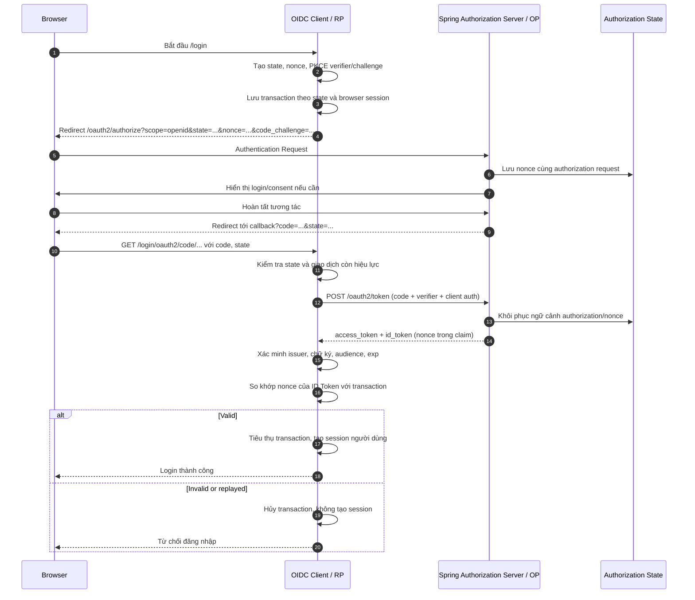

# Nonce và bảo vệ liên kết giữa yêu cầu đăng nhập với ID Token

## 1. Mục tiêu và vấn đề bảo mật cần giải quyết

Trong mô-đun **SPRING_SECURITY_OAUTH2_OIDC_AUTHORIZATION_SERVER**, chúng ta học cách thiết kế, cấu hình, bảo mật, kiểm thử và vận hành **OAuth 2.0/OpenID Connect Authorization Server** bằng **Spring Security**, **Spring Authorization Server** và **Spring Boot**. Ở chương **OIDC Core và ID Token**, bài này giải thích cách dùng tham số **`nonce`** để liên kết một yêu cầu đăng nhập của client (Relying Party, RP) với **ID Token** được OpenID Provider (OP) phát hành cho đúng lần đăng nhập ấy.

ID Token là một JWT đưa ra các thông tin xác thực người dùng như issuer, subject, audience, thời điểm cấp/hết hạn và các claim OIDC khác. Chữ ký số hợp lệ chứng minh token đến từ issuer có khóa tin cậy, nhưng **không tự chứng minh ID Token đó thuộc yêu cầu đăng nhập đang chờ trong trình duyệt hiện tại**. Một ID Token được phát hành hợp lệ trước đây có thể bị kẻ tấn công phát lại hoặc tìm cách đưa vào phiên đăng nhập khác nếu client bỏ qua ràng buộc ngữ cảnh.

`nonce` là một giá trị khó đoán, do **client tạo trước khi chuyển trình duyệt sang Authorization Endpoint**. Nếu client gửi giá trị ấy trong OIDC Authentication Request thì OP phải đưa lại **đúng giá trị nhận được** vào claim `nonce` của ID Token. Sau khi xác minh ID Token, client đối chiếu claim với nonce đã lưu cho giao dịch đăng nhập đang xử lý. Mọi sai khác hoặc thiếu claim khi đã yêu cầu nonce phải dẫn tới **từ chối đăng nhập**, không tạo phiên cho người dùng.

> **Cốt lõi:** nonce không làm cho một JWT có chữ ký mạnh hơn; nó gắn ID Token đã được xác minh với **một lần khởi tạo đăng nhập cụ thể**, hỗ trợ phòng chống replay và token substitution.

### Kết quả học tập

Sau bài này, bạn có thể:

1. Phân biệt mục tiêu của `nonce`, `state`, PKCE và các claim xác minh ID Token.
2. Biết trường hợp nonce được OIDC Core yêu cầu và lý do vẫn nên dùng nonce trong Authorization Code Flow.
3. Sinh nonce bằng CSPRNG, lưu riêng theo giao dịch, gửi qua Authorization Endpoint rồi kiểm tra trong ID Token.
4. Cấu hình Spring Authorization Server phát hành ID Token có nonce, và giải thích vai trò của Spring Security OAuth2 Login ở phía client.
5. Thử các tình huống nonce thiếu, sai, lặp, trộn hai tab hoặc dùng ID Token từ issuer/client khác.
6. Vận hành cơ chế nonce khi có session, trình duyệt, proxy, nhiều node và timeout.

### Phạm vi

Ví dụ chính dùng **Authorization Code Flow + PKCE S256**, OIDC `scope=openid`, client web confidential và Spring Authorization Server. Phần Implicit/Hybrid chỉ dùng để đối chiếu quy định trong OIDC Core; với ứng dụng mới, ưu tiên Authorization Code + PKCE thay vì chọn Implicit/Hybrid chỉ để tận dụng nonce.

## 2. Nonce trong OIDC Core: định nghĩa và các quy tắc bắt buộc

Theo OpenID Connect Core 1.0 (Errata Set 2), `nonce` là một chuỗi client gửi ở **Authentication Request** nhằm liên kết phiên client với ID Token và giảm replay. OP chuyển giá trị nonce **không thay đổi** sang claim `nonce` của ID Token.

| Quy tắc | Ý nghĩa thực tế |
| --- | --- |
| Client phát sinh nonce khó đoán, có đủ entropy | Người ngoài không thể dự đoán nonce để chuẩn bị token giả hoặc thực hiện tráo token |
| Nếu Authentication Request có nonce, OP **MUST** đưa nonce vào ID Token | Không được im lặng bỏ claim hoặc thay nội dung ở OP |
| Nếu request đã gửi nonce, RP **MUST** kiểm tra claim nonce trong ID Token khớp đúng giá trị đã gửi | Thiếu hoặc sai đều là lỗi xác thực |
| Client **SHOULD** xem xét phát hiện reuse nonce/replay | Chặn việc tái sử dụng ID Token cho một giao dịch đã kết thúc |
| `nonce` không thay cho xác minh chữ ký/issuer/audience/expiration | Mọi kiểm tra ID Token khác vẫn bắt buộc |

**Cách hiểu “chuyển nguyên vẹn”:** bên OP sao chép **chuỗi nonce xuất hiện trên đường truyền ở Authorization Request** vào ID Token, không tự băm thêm hay sửa đổi. Một client **có thể chủ động gửi hash của một giá trị bí mật nội bộ** làm nonce trên đường truyền; khi đó ID Token phải chứa hash ấy và client đối chiếu theo thiết kế tương ứng. Phân biệt điều này đặc biệt quan trọng khi làm việc với Spring Security OAuth2 Login.

### 2.1. Khi nào nonce bắt buộc?

| OIDC flow | `response_type` | Quy định nonce trong Authentication Request |
| --- | --- | --- |
| Authorization Code | `code` | **OPTIONAL** theo OIDC Core; **khuyến nghị** cho triển khai mới |
| Implicit | `id_token` | **REQUIRED** |
| Implicit | `id_token token` | **REQUIRED** |
| Hybrid | `code id_token` | **REQUIRED** |
| Hybrid | `code id_token token` | **REQUIRED** |
| Hybrid | `code token` | **OPTIONAL** |

Sự khác biệt đến từ nơi ID Token xuất hiện và cách client liên kết phiên. Trong Code Flow, ID Token được lấy bằng kênh trực tiếp từ Token Endpoint sau khi đổi authorization code; với Implicit hoặc một số Hybrid Flow, ID Token xuất hiện ở Authorization Endpoint qua trình duyệt, nên nonce đặc biệt quan trọng.

Quy tắc “optional” trong Authorization Code Flow **không có nghĩa được phép bỏ qua kiểm tra**: một khi client đã gửi nonce thì OP phải trả nonce và client phải xác minh. Chính sách ứng dụng có thể yêu cầu nonce cho **mọi** lượt đăng nhập dù tiêu chuẩn cho phép bỏ trong Code Flow.

### 2.2. Nonce là của Authentication Request, không phải Token Request

Trong ví dụ Code Flow:

- **Trước login:** client gửi `nonce` ở `GET /oauth2/authorize`, cùng `scope=openid`, `state` và PKCE challenge.
- **Sau login:** browser callback mang `code` và `state`, **không mang nonce như tham số callback bắt buộc**.
- **Đổi code:** client gửi `grant_type=authorization_code`, `code`, `redirect_uri` và `code_verifier` tới `POST /oauth2/token`; không tự thêm nonce vào body token request để bắt OP “trả lại”.
- **Khi nhận ID Token:** claim `nonce` phải khớp nonce client đã gửi ở bước authorize.

OP cần lưu ngữ cảnh authorization request để khi Token Endpoint phát hành ID Token có thể đưa nonce tương ứng vào token. Với Spring Authorization Server, ngữ cảnh này được quản lý bởi pipeline Authorization Code/OIDC và authorization state trong `OAuth2AuthorizationService`.

### 2.3. ID Token không phải Access Token

| Đặc điểm | ID Token | Access Token |
| --- | --- | --- |
| Người đọc chính | OAuth/OIDC **client** (RP) | **Resource Server** |
| Mục đích | Diễn đạt kết quả xác thực người dùng | Cấp quyền gọi tài nguyên/API |
| Audience điển hình | `client_id` của RP | API/resource audience |
| Nonce | Claim OIDC liên kết request khi client đã gửi nonce | Không phải thuộc tính thay thế claim nonce của ID Token |
| Đánh giá | Chữ ký, `iss`, `aud`, `exp`, `nonce` và ngữ cảnh đăng nhập | Chữ ký/trạng thái, issuer, audience, scopes và quyền |

Không dùng Access Token thay ID Token để đăng nhập. Không đưa ID Token vào header `Authorization: Bearer` gửi API như thể đó là Access Token.

## 3. Nonce, state và PKCE khác nhau như thế nào?

Ba cơ chế này thường xuất hiện cùng một OAuth/OIDC Authorization Code Flow nhưng bảo vệ những điểm khác nhau.

| Cơ chế | Do ai tạo? | Gửi ở đâu? | Đối chiếu ở đâu? | Mục tiêu chính |
| --- | --- | --- | --- | --- |
| `state` | RP/client | Authorization Request | Callback Authorization Response | Liên kết phản hồi authorize với phiên/browser đã khởi tạo; chống login CSRF |
| `nonce` | RP/client | OIDC Authentication Request | Claim `nonce` trong ID Token đã xác minh | Liên kết ID Token với một lượt đăng nhập; giảm token replay/substitution |
| `code_verifier` / `code_challenge` (PKCE) | RP/client | Challenge ở authorize, verifier ở token exchange | Authorization Server khi đổi code | Chặn kẻ chiếm authorization code đổi lấy token khi không có verifier |

Không thể thay các cơ chế trên bằng cách kiểm tra chỉ một biến. Một OAuth response có `state` đúng vẫn có thể mang một ID Token không khớp nonce nếu pipeline/token provider bị lỗi hoặc có hành vi token substitution. Một ID Token có nonce đúng không chứng minh authorization code đã được bảo vệ bằng PKCE.

### 3.1. Ví dụ nguy cơ khi bỏ kiểm tra nonce

1. RP bắt đầu yêu cầu đăng nhập mới, tạo phiên giao dịch `login-B`.
2. Kẻ tấn công tìm cách đưa **ID Token hợp lệ của một giao dịch khác** vào bước xử lý callback hoặc hoàn tất đăng nhập.
3. RP chỉ giải mã token, nhìn thấy chữ ký hợp lệ, issuer và audience hợp lệ.
4. Nếu RP bỏ qua nonce và những ràng buộc giao dịch khác, RP có nguy cơ chấp nhận token không thuộc `login-B`.

Khi dùng nonce đúng cách, `login-B` có nonce ngẫu nhiên mới. Token từ `login-A` chứa nonce khác (hoặc không có nonce) nên bị từ chối. Đó là lý do nonce liên quan trực tiếp đến **request-to-token binding**, không chỉ “mã ngẫu nhiên tăng bảo mật”.

### 3.2. Vì sao cùng lúc cần state?

Client phải kiểm tra `state` **trước khi** xử lý code trong callback để bảo đảm response phù hợp với một giao dịch đã khởi tạo ở chính browser/session. Sau khi đổi code và có ID Token, client kiểm tra `nonce`. Đây là hai mốc kiểm tra khác nhau của cùng một login transaction.

Nếu không có giao dịch phù hợp với state trả về, **không tiếp tục đổi code**. Nếu state đúng nhưng nonce trong ID Token sai, **không tạo authenticated session**. Cả hai đều là lỗi bảo mật, không phải trường hợp tự tạo state/nonce mới rồi bỏ qua so sánh.

### 3.3. Nonce không chứng minh độ mới của lần người dùng gõ mật khẩu

Nonce chứng minh ID Token thuộc yêu cầu hiện tại, **không** chứng minh người dùng vừa nhập mật khẩu trong yêu cầu đó. OP có thể dùng lại SSO session hợp lệ và trả ID Token mới với nonce mới.

Nếu nghiệp vụ yêu cầu user **vừa xác thực gần đây**, hãy dùng `max_age` hoặc chính sách `prompt=login` phù hợp rồi xác minh `auth_time` trong ID Token. Một nonce mới có thể tồn tại đồng thời với `auth_time` của SSO session cũ; hai claim giải quyết hai yêu cầu khác nhau.

### 3.4. Replay detection khác với so sánh nonce

Đối chiếu nonce trả lời câu hỏi: **“Token này có thuộc yêu cầu đang xử lý không?”** Replay detection còn trả lời: **“Yêu cầu hoặc token này đã được dùng để hoàn tất đăng nhập trước đó chưa?”**

Vì vậy ngoài so sánh nonce, RP cần tiêu thụ/đánh dấu hoàn tất giao dịch một lần, xóa state/nonce lưu tạm sau khi xử lý và từ chối callback đã dùng. Nếu thiết kế cho retry idempotent, phải cẩn thận bảo đảm không tạo session thứ hai hoặc chấp nhận ID Token cũ theo một giao dịch mới.

## 4. Vòng đời nonce trong Authorization Code + PKCE



### 4.1. Authorization Request: nonce được gửi tại authorize

Giả sử RP là ứng dụng `orders-web`, OP có issuer `https://auth.example.com`, callback đã đăng ký `https://orders.example.com/login/oauth2/code/orders`. Client khởi tạo:

```http
GET /oauth2/authorize?response_type=code
  &client_id=orders-web
  &redirect_uri=https%3A%2F%2Forders.example.com%2Flogin%2Foauth2%2Fcode%2Forders
  &scope=openid%20profile
  &state=STATE_RANDOM_PER_LOGIN
  &nonce=NONCE_RANDOM_PER_LOGIN
  &code_challenge=PKCE_S256_CHALLENGE
  &code_challenge_method=S256 HTTP/1.1
Host: auth.example.com
```

Đây là request mô phỏng đã xuống dòng để dễ đọc, **không phải URL copy-paste hợp lệ**. Khi gửi thực tế, nối đúng và percent-encode query parameters. Giá trị STATE_RANDOM_PER_LOGIN, NONCE_RANDOM_PER_LOGIN, PKCE_S256_CHALLENGE phải được tạo ngẫu nhiên cho từng giao dịch, không dùng literal ở ví dụ.

Tại RP, trước khi redirect cần lưu:

| Trường transaction | Mục đích |
| --- | --- |
| `state` | Khóa tra cứu login transaction ở callback |
| Giá trị nonce đã thực sự gửi trên wire | Để so sánh với claim `nonce` trong ID Token |
| `code_verifier` | Chứng minh quyền đổi authorization code |
| `issuer`, `client_id`, `redirect_uri` | Tránh lẫn issuer, client registration và callback |
| Thời điểm khởi tạo/TTL, trạng thái consumed | Hạn chế replay và xử lý callback cũ |
| Browser/session binding | Đảm bảo state không thể được lấy từ browser của người khác |

Mỗi lần mở tab đăng nhập mới có thể tạo một transaction khác. Không lưu “nonce hiện tại duy nhất” toàn cục cho cả ứng dụng hoặc dùng một trường cố định bị tab thứ hai ghi đè.

### 4.2. Authorization Response chỉ mang code và state

Sau khi user login/consent, browser nhận redirect tương tự:

```http
HTTP/1.1 302 Found
Location: https://orders.example.com/login/oauth2/code/orders?code=AUTH_CODE&state=STATE_RANDOM_PER_LOGIN
```

RP kiểm tra state trả về đã được khởi tạo ở cùng browser/session, khớp transaction còn hạn và chưa consumed. Không cho callback đi tiếp nếu thiếu/sai state. Nonce không lấy từ callback; nonce đến từ transaction đã lưu.

### 4.3. Token Response chứa ID Token có claim nonce

RP gọi Token Endpoint bằng code, code verifier và xác thực client. OP dựa trên authorization state phát hành ID Token:

```http
HTTP/1.1 200 OK
Content-Type: application/json
Cache-Control: no-store

{
  "access_token": "ACCESS_TOKEN_VALUE",
  "token_type": "Bearer",
  "expires_in": 300,
  "id_token": "SIGNED_JWT_WITH_NONCE_CLAIM"
}
```

Header/Payload ví dụ của ID Token sau khi decode:

```json
{
  "iss": "https://auth.example.com",
  "sub": "user-1042",
  "aud": "orders-web",
  "exp": 1800000300,
  "iat": 1800000000,
  "nonce": "NONCE_RANDOM_PER_LOGIN"
}
```

ID Token thực tế được mã hóa/ký thành JWT, không phải JSON thuần. JSON trên chỉ minh họa claims. ID Token phải được **xác minh chữ ký và tiêu chí OIDC** trước khi tin bất kỳ claim nào, kể cả nonce. Không coi việc Base64URL-decode thành công là xác thực token.

### 4.4. Kết thúc transaction và thiết lập session

Một lần đăng nhập chỉ thành công khi **cả hai pha xác minh** đều hoàn tất:

1. Callback có `state` khớp một giao dịch đang chờ, được ràng buộc với browser/session phù hợp, chưa quá TTL/chưa xử lý.
2. ID Token nhận từ đúng issuer có chữ ký, audience và thời gian hợp lệ, đồng thời claim `nonce` khớp giá trị nonce trên đường truyền đã gắn với transaction.

Sau khi xử lý thành công, đánh dấu giao dịch consumed và loại bỏ state/nonce/code verifier khỏi kho tạm. Không sử dụng nonce này làm session ID, CSRF token hoặc password. Nếu user chủ động bắt đầu đăng nhập lại, tạo **một nonce mới**, kể cả khi OP vẫn có SSO cookie.

## 5. Cấu hình OpenID Connect trong Spring Authorization Server

Spring Authorization Server là phía **OP**, chịu trách nhiệm nhận Authentication Request, kiểm tra client/redirect/scope, lưu ngữ cảnh yêu cầu và phát hành ID Token chứa nonce khi request có nonce. RP có trách nhiệm riêng đối với việc sinh, lưu và xác minh nonce.

### 5.1. Bật OIDC protocol support

Với cấu hình Spring Authorization Server 1.5.x dùng `OAuth2AuthorizationServerConfigurer`:

```java
package com.example.authserver;

import org.springframework.context.annotation.Bean;
import org.springframework.context.annotation.Configuration;
import org.springframework.core.annotation.Order;
import org.springframework.security.config.Customizer;
import org.springframework.security.config.annotation.web.builders.HttpSecurity;
import org.springframework.security.oauth2.server.authorization.config.annotation.web.configurers.OAuth2AuthorizationServerConfigurer;
import org.springframework.security.web.SecurityFilterChain;

@Configuration
public class AuthorizationServerSecurityConfig {

    @Bean
    @Order(1)
    SecurityFilterChain authorizationServerSecurityFilterChain(HttpSecurity http)
            throws Exception {

        OAuth2AuthorizationServerConfigurer authorizationServerConfigurer =
                OAuth2AuthorizationServerConfigurer.authorizationServer();

        http
            .securityMatcher(authorizationServerConfigurer.getEndpointsMatcher())
            .with(authorizationServerConfigurer, authorizationServer ->
                    authorizationServer.oidc(Customizer.withDefaults()))
            .authorizeHttpRequests(authorize -> authorize.anyRequest().authenticated());

        return http.build();
    }
}
```

Đây là cấu hình security chain cho protocol endpoints, **không phải toàn bộ ứng dụng chạy độc lập**. Vẫn cần user authentication (login page/second security chain), `RegisteredClientRepository`, `OAuth2AuthorizationService`, `AuthorizationServerSettings`, JWK source/ký JWT và các bean liên quan. Khi bật OIDC, các endpoint liên quan như Provider Configuration, UserInfo và Logout được cấu hình; OIDC dynamic client registration không tự bật mặc định.

**Không tự tạo endpoint “/nonce” riêng**: nonce là tham số Authentication Request và claim ID Token, không phải một endpoint protocol độc lập. Cũng không thêm grant type `nonce` vào RegisteredClient.

### 5.2. Khai báo issuer chuẩn

```java
import org.springframework.context.annotation.Bean;
import org.springframework.security.oauth2.server.authorization.settings.AuthorizationServerSettings;

@Bean
AuthorizationServerSettings authorizationServerSettings() {
    return AuthorizationServerSettings.builder()
            .issuer("https://auth.example.com")
            .build();
}
```

Giá trị `issuer` phải nhất quán giữa discovery metadata, ID Token claim `iss`, JWK Set URI và cấu hình RP. Khi chạy sau reverse proxy, dùng URL công khai có HTTPS; không để ID Token phát `iss=http://auth-service:9000` trong khi RP trust `https://auth.example.com`.

Nếu hệ thống đã có bean `AuthorizationServerSettings`, sửa bean hiện hữu, không tạo bean thứ hai. Nên dùng HTTPS cho mọi giao tiếp thực tế. Ví dụ localhost phục vụ lab phải được tách biệt khỏi production.

### 5.3. Đăng ký client hỗ trợ OIDC

Một RP confidential dùng Authorization Code + PKCE:

```java
import java.util.UUID;

import org.springframework.security.crypto.password.PasswordEncoder;
import org.springframework.security.oauth2.core.AuthorizationGrantType;
import org.springframework.security.oauth2.core.ClientAuthenticationMethod;
import org.springframework.security.oauth2.core.oidc.OidcScopes;
import org.springframework.security.oauth2.server.authorization.client.RegisteredClient;
import org.springframework.security.oauth2.server.authorization.settings.ClientSettings;

RegisteredClient ordersWeb = RegisteredClient.withId(UUID.randomUUID().toString())
        .clientId("orders-web")
        .clientSecret(passwordEncoder.encode("lab-only-change-this-secret"))
        .clientAuthenticationMethod(ClientAuthenticationMethod.CLIENT_SECRET_BASIC)
        .authorizationGrantType(AuthorizationGrantType.AUTHORIZATION_CODE)
        .authorizationGrantType(AuthorizationGrantType.REFRESH_TOKEN)
        .redirectUri("https://orders.example.com/login/oauth2/code/orders")
        .scope(OidcScopes.OPENID)
        .scope(OidcScopes.PROFILE)
        .clientSettings(ClientSettings.builder()
                .requireProofKey(true)
                .requireAuthorizationConsent(true)
                .build())
        .build();
```

Đoạn trên chỉ mô tả registration, cần lưu bằng `RegisteredClientRepository` cùng các client khác của ứng dụng. Secret lab phải thay bằng secret quản lý an toàn ở production; private/public client có cách xác thực khác nhau, không dùng shared client secret trong SPA hoặc native app.

Scope `openid` là dấu hiệu request xác thực OIDC; không có scope này thì không được tự coi OAuth request thuần là yêu cầu cấp ID Token. Cấu hình `requireProofKey(true)` tăng bảo vệ Authorization Code, nhưng không tự sinh/kiểm tra nonce ở phía RP.

### 5.4. Spring Authorization Server xử lý claim nonce

Pipeline mặc định bảo toàn ngữ cảnh OIDC Authorization Request trong authorization state, bao gồm nonce nếu có, để khi Token Endpoint phát hành ID Token đưa claim nonce theo yêu cầu OIDC. Vì vậy, trong cách dùng mặc định, không cần thêm `OAuth2TokenCustomizer` chỉ để copy nonce vào ID Token.

Nếu bạn tùy biến ID Token qua `OAuth2TokenCustomizer<JwtEncodingContext>` hoặc thay token generator:

- Chỉ sửa các claim nghiệp vụ thực sự cần.
- Giữ `iss`, `sub`, `aud`, `exp`, `iat` và `nonce` đúng ngữ cảnh.
- **Không tự tạo nonce mới lúc phát hành ID Token**; như vậy claim sẽ khác với Authentication Request.
- Không ghi đè claim `nonce` bằng giá trị lấy từ query string của Token Endpoint hoặc input không được xác minh.
- Kiểm thử cùng lúc trường hợp có và không có nonce, nhiều login transaction chạy đồng thời và token request retry.

Khi dùng cơ chế lưu trữ tùy chỉnh, bảo đảm Authorization Code, request context và nonce không bị mất trong quá trình chuyển từ Authorization Endpoint sang Token Endpoint, kể cả khi request đi qua các instance khác nhau.

## 6. Sinh nonce, lưu transaction và điều phối nhiều lần đăng nhập

### 6.1. Sinh nonce bằng SecureRandom

OIDC Core không áp đặt một độ dài nonce cố định, nhưng yêu cầu entropy đủ mạnh. Lựa chọn thực tế là **32 byte ngẫu nhiên** (256 bit) từ CSPRNG rồi mã hóa Base64URL không padding. Đây là một chính sách triển khai dễ kiểm thử, không phải giới hạn cứng của giao thức.

Ví dụ Java 17+:

```java
import java.security.SecureRandom;
import java.util.Base64;

public final class LoginNonce {
    private static final SecureRandom RNG = new SecureRandom();

    private LoginNonce() { }

    public static String newValue() {
        byte[] random = new byte[32];
        RNG.nextBytes(random);
        return Base64.getUrlEncoder().withoutPadding().encodeToString(random);
    }
}
```

RP gọi `LoginNonce.newValue()` mỗi khi bắt đầu một login transaction. Không lấy nonce từ `System.currentTimeMillis()`, UUID có ít entropy theo cách dựng lỗi, username, session ID, địa chỉ IP hoặc giá trị tuần tự. Không dùng cùng một chuỗi cho state, nonce và code verifier; hãy tạo ba giá trị độc lập.

### 6.2. Lưu nonce ở đâu?

Với server-side web client, lưu transaction ở HTTP session hoặc store bảo mật của RP. Mỗi record gắn với:

```text
state -> {
  nonce_sent_on_wire,
  pkce_code_verifier,
  issuer,
  client_id,
  redirect_uri,
  created_at,
  consumed: false
}
```

Record còn phải ràng buộc với **browser/session đã khởi tạo**. Chỉ một state đoán không được và nằm trong URL callback chưa đủ nếu bất kỳ browser nào cũng tra được record rồi nhận phiên của người khác.

Với nhiều instance, dùng session storage phân tán hoặc sticky-session kết hợp lưu trữ bền vững theo thiết kế. Nếu session storage mất giữa authorize và callback, **không bỏ qua nonce để chữa lỗi login**; hãy kết thúc giao dịch an toàn và yêu cầu user bắt đầu lại.

### 6.3. Bảo vệ nhiều tab

Hai tab có thể khởi tạo đăng nhập gần như đồng thời:

| Tab | State | Nonce | Kết quả |
| --- | --- | --- | --- |
| A | `state-A` | `nonce-A` | ID Token-A chỉ hợp lệ với transaction A |
| B | `state-B` | `nonce-B` | ID Token-B chỉ hợp lệ với transaction B |

Không đặt nonce vào một biến global singleton hoặc một session attribute “currentNonce” duy nhất khiến B ghi đè A. Lưu bản ghi theo state, đánh dấu consumed từng giao dịch và dọn record quá hạn.

### 6.4. Băm nonce trước khi gửi có được không?

Được, nếu client triển khai nhất quán. Ví dụ:

1. Sinh `nonceSecret` bí mật trong session.
2. Tính `wireNonce = BASE64URL(SHA-256(ASCII(nonceSecret)))`.
3. Gửi `wireNonce` trong Authentication Request.
4. OP phải đưa **wireNonce** vào claim ID Token `nonce`.
5. Client giữ nonceSecret cho đến callback, tính lại wireNonce và đối chiếu.

Cách làm này được nêu như một ví dụ triển khai trong OIDC Core và được Spring Security OAuth2 Login sử dụng trong cách xử lý mặc định của các phiên bản được tài liệu hóa: resolver giữ nonce gốc trong request attributes, gửi hash trong additional parameters; provider sau đó hash nonce gốc để so với claim của ID Token.

**Cảnh báo tích hợp:** nếu bạn tự tạo client và gửi nonce thô, chỉ cần đối chiếu claim với chính nonce đã gửi trên wire. Nếu dùng Spring Security OAuth2 Login, không viết thêm bộ so sánh raw nonce với ID Token rồi cho rằng mismatch là lỗi của OP: framework có thể đang dùng **hashed wire nonce**. Đừng double-hash nonce hay ghi đè request attributes vì điều đó phá vỡ cơ chế kiểm tra có sẵn.

## 7. Xác minh ID Token và nonce ở phía client

Nonce chỉ có giá trị bảo mật khi RP kiểm tra nó **trên ID Token đã được xác minh toàn diện**. Tối thiểu, pipeline của RP cần:

1. Nhận authorization response qua callback đã đăng ký; đối chiếu `state` với transaction trong browser session, TTL và trạng thái consumed.
2. Đổi authorization code tại đúng Token Endpoint của issuer đã tin cậy; gửi `code_verifier` và client authentication phù hợp.
3. Nhận ID Token từ token response, giải mã/xác minh JWT theo cấu hình OIDC đã discovery ở issuer tin cậy.
4. Kiểm tra các claim cơ bản và ngữ cảnh (bảng bên dưới).
5. So sánh claim `nonce` với nonce đã gửi cho **transaction này**, không so với giá trị trong callback.
6. Nếu mọi bước PASS, tiêu thụ transaction và tạo authenticated session.

### 7.1. Checklist xác minh ID Token trước khi tin nonce

| Kiểm tra | Nguyên tắc |
| --- | --- |
| Chữ ký/JWS | Xác minh bằng key tin cậy của issuer và thuật toán được phép; không tin tùy ý `alg=none` hoặc `jku`/`kid` từ issuer lạ |
| `iss` | So khớp **chính xác** issuer đã chọn/discovery |
| `aud` | Phải chứa `client_id` của RP; từ chối audience khác không được tin cậy |
| `azp` | Nếu có, kiểm tra authorized party phù hợp; đặc biệt khi có nhiều audiences |
| `exp` | Chưa hết hạn theo thời gian hiện tại (cân nhắc clock skew nhỏ) |
| `iat` | Thời điểm phát hành hợp lý; có thể giới hạn token quá cũ |
| `nonce` | Nếu request gửi nonce, claim phải tồn tại và bằng nonce của request trên wire |
| `auth_time` | Nếu RP yêu cầu xác thực gần đây qua `max_age`/claims, đánh giá thời gian xác thực |
| `at_hash` và `c_hash` | Xác minh trong các flow/trường hợp OIDC yêu cầu; Code Flow ID Token từ Token Endpoint có quy tắc khác Hybrid/Implicit |

Theo OIDC Core, ID Token nhận trực tiếp từ Token Endpoint trong Code Flow có một số quy tắc kiểm tra chữ ký theo TLS và trường hợp cụ thể; **triển khai mới nên xác minh chữ ký ID Token** bằng JWK Set của issuer thay vì dựa vào việc chỉ decode payload. Phải gắn xác minh JWT với issuer/client cố định đã đăng ký, tránh chọn JWK Set tùy ý theo trường trong token chưa tin cậy.

**Không kiểm tra nonce trước khi tin chữ ký:** một attacker có thể tự tạo JWT không ký với nonce đoán được hoặc biết từ trình duyệt. Nếu code chỉ so chuỗi `nonce` từ payload mà không xác minh token, toàn bộ OIDC authentication có thể bị giả mạo.

### 7.2. Ví dụ đối chiếu nonce sau khi token đã được xác minh

Ví dụ một helper Java cho **client tự triển khai** bước kiểm tra nonce. Đầu vào `idToken` được giả định đã hoàn tất kiểm tra chữ ký, issuer, audience và thời hạn bằng OIDC/JWT validator đáng tin; phương thức này **không thay thế** các bước đó.

```java
import java.nio.charset.StandardCharsets;
import java.security.MessageDigest;

import org.springframework.security.oauth2.core.OAuth2AuthenticationException;
import org.springframework.security.oauth2.core.OAuth2Error;
import org.springframework.security.oauth2.core.oidc.OidcIdToken;

public final class OidcNonceVerifier {

    private OidcNonceVerifier() { }

    public static void verify(OidcIdToken validatedIdToken,
                              String expectedNonceSentOnWire) {
        if (validatedIdToken == null || expectedNonceSentOnWire == null
                || expectedNonceSentOnWire.isBlank()) {
            throw new OAuth2AuthenticationException(
                    new OAuth2Error("invalid_nonce"));
        }

        String actual = validatedIdToken.getNonce();
        if (actual == null ||
                !MessageDigest.isEqual(
                        expectedNonceSentOnWire.getBytes(StandardCharsets.UTF_8),
                        actual.getBytes(StandardCharsets.UTF_8))) {
            throw new OAuth2AuthenticationException(
                    new OAuth2Error("invalid_nonce"));
        }
    }
}
```

Giả sử ứng dụng đã gửi nonce `n-ABCD1234` trong Authentication Request; helper nhận **chính** chuỗi ấy làm `expectedNonceSentOnWire`. Nếu ứng dụng gửi SHA-256 hash của nonce gốc, helper phải nhận **hash đã gửi** chứ không phải secret thô.

Lưu ý: hàm trên chỉ kiểm tra nonce của một ID Token đã tin cậy. Giao dịch login còn cần state/session binding, replay prevention và thời hạn. Nếu sử dụng Spring Security OAuth2 Login mặc định, **không nhất thiết phải viết helper này**, vì provider đã có bước kiểm tra nonce tương ứng.

### 7.3. Bảo đảm kiểm tra nonce theo từng giao dịch

Một trình tự sai thường gặp:

```text
RP nhận id_token
RP decode JWT
RP đọc nonce từ id_token
RP gán expectedNonce = nonce vừa đọc
RP so sánh expectedNonce và nonce trong token
=> luôn đúng, không có tác dụng bảo vệ
```

Expected nonce phải lấy từ transaction do RP lưu **trước khi chuyển trình duyệt sang OP**, không thể lấy lại từ token vừa nhận, cookie không ký của attacker, query string callback hoặc một global value có thể bị ghi đè.

### 7.4. Mismatch phải dẫn tới thất bại xác thực

| Trường hợp | Quyết định của RP |
| --- | --- |
| Request có nonce, ID Token không có claim nonce | Từ chối |
| Request có nonce, ID Token có nonce khác | Từ chối |
| Nonce đúng nhưng JWT chữ ký không hợp lệ | Từ chối |
| Nonce đúng nhưng issuer khác | Từ chối |
| Nonce đúng nhưng audience không chứa client hiện tại | Từ chối |
| Nonce đúng nhưng token hết hạn | Từ chối |
| Nonce đúng, mọi claim hợp lệ nhưng state/callback sai | Từ chối |
| Nonce đúng, state đúng nhưng giao dịch đã consumed | Từ chối replay |
| Nonce đúng, state và mọi kiểm tra đều hợp lệ | Có thể tạo phiên sau khi áp dụng chính sách bổ sung |

Không tự động retry bằng một nonce mới khi ID Token có nonce sai rồi tiếp tục sử dụng chính token cũ; cách đó phá vỡ mối liên kết mà nonce cần bảo vệ.

## 8. Spring Security OAuth2 Login: nonce được sinh và kiểm tra ở đâu?

Khi RP là ứng dụng Spring Boot dùng Spring Security OAuth2 Client, con đường ít rủi ro nhất là dùng **OAuth2 Login mặc định** thay vì tự xử lý authorization response, Token Endpoint và ID Token thủ công.

### 8.1. Cấu hình ClientRegistration cho OIDC

Ví dụ `application.yml` cho một RP chạy ở `https://orders.example.com`:

```yaml
spring:
  security:
    oauth2:
      client:
        registration:
          orders:
            provider: orders-idp
            client-id: orders-web
            client-secret: ${ORDERS_CLIENT_SECRET}
            authorization-grant-type: authorization_code
            redirect-uri: "{baseUrl}/login/oauth2/code/{registrationId}"
            scope:
              - openid
              - profile
        provider:
          orders-idp:
            issuer-uri: https://auth.example.com
```

Placeholder `${ORDERS_CLIENT_SECRET}` là cú pháp Spring Boot đọc secret từ biến môi trường; không hard-code secret thực trong Git. Đăng ký callback `https://orders.example.com/login/oauth2/code/orders` bên Authorization Server. Issuer metadata và redirect URI phải dùng đúng URL ngoài proxy/gateway.

Ví dụ security chain client:

```java
package com.example.ordersweb;

import org.springframework.context.annotation.Bean;
import org.springframework.context.annotation.Configuration;
import org.springframework.security.config.Customizer;
import org.springframework.security.config.annotation.web.builders.HttpSecurity;
import org.springframework.security.web.SecurityFilterChain;

@Configuration
public class WebSecurityConfig {

    @Bean
    SecurityFilterChain webSecurityFilterChain(HttpSecurity http)
            throws Exception {
        return http
                .authorizeHttpRequests(authorize -> authorize
                        .requestMatchers("/", "/health").permitAll()
                        .anyRequest().authenticated())
                .oauth2Login(Customizer.withDefaults())
                .build();
    }
}
```

Cấu hình trên chỉ minh họa OIDC client security. Ứng dụng cần dependency `spring-boot-starter-oauth2-client` (hoặc tương đương) và cấu hình cookie/session, TLS, proxy, CSRF theo môi trường triển khai. Không đưa `client-secret` vào bundle JavaScript của browser.

### 8.2. Cách resolver/provider xử lý nonce mặc định

Ở các phiên bản Spring Security OAuth2 Login được đối chiếu với mã nguồn:

1. `DefaultOAuth2AuthorizationRequestResolver` tạo một nonce gốc khó đoán cho request có scope `openid`.
2. Resolver lưu **nonce gốc** trong attributes của `OAuth2AuthorizationRequest`.
3. Resolver tính `BASE64URL(SHA-256(ASCII(nonce-gốc)))` và gửi **nonce hash** trong additional parameters của Authentication Request.
4. Sau khi Token Endpoint trả ID Token, `OidcAuthorizationCodeAuthenticationProvider` đọc nonce gốc từ authorization request đã lưu, tính lại hash và so sánh với `idToken.getNonce()`.
5. Nếu thiếu/sai nonce, provider tạo lỗi `invalid_nonce` và không hoàn tất OIDC Login.

Đây là lựa chọn triển khai của **Spring Security client**. Nó không có nghĩa Spring Authorization Server hoặc OIDC Core tự động băm giá trị nonce. OP chỉ copy **giá trị trên wire** vào ID Token. Hai phía khớp nhau vì resolver của client đã băm trước khi gửi.

Tài liệu nguồn liên quan:

- `DefaultOAuth2AuthorizationRequestResolver.applyNonce(...)`: tạo nonce gốc, lưu attributes và đưa hash vào request parameters.
- `OidcAuthorizationCodeAuthenticationProvider.validateNonce(...)`: khi authorization request có nonce, tính hash và so sánh với claim ID Token.

Nếu tự viết custom `OAuth2AuthorizationRequestResolver` hoặc `OAuth2AuthorizationRequestRepository`, hãy giữ trọn dữ liệu liên quan nonce. Đừng thay bằng một resolver chỉ dựng URL rồi quên attributes của request; khi đó client có thể không còn cơ sở xác minh nonce.

### 8.3. Session/transaction storage

Spring Security lưu `OAuth2AuthorizationRequest` giữa lúc redirect và callback thông qua authorization request repository, mặc định dùng HTTP session trong nhiều cấu hình servlet. Nếu ứng dụng triển khai stateless OAuth2 Login:

- định nghĩa cơ chế lưu/khôi phục transaction an toàn của riêng mình;
- bảo vệ toàn vẹn và tính bí mật của dữ liệu nonce/verifier khi cần;
- buộc transaction gắn với browser và issuer/client;
- hỗ trợ nhiều tab;
- xóa/tiêu thụ một lần sau callback.

Đừng bỏ qua nonce chỉ vì không muốn dùng session. “Stateless” cần một thiết kế khác để giữ dữ liệu transaction, không đồng nghĩa “không cần state/nonce”.

### 8.4. Customization và giới hạn trách nhiệm

Spring Security OAuth2 Login mặc định xử lý nhiều bước khó của OIDC Client như authorize redirect, token exchange, ID Token validation, nonce và session. Nhưng chính sách ứng dụng vẫn cần:

- kiểm tra/giới hạn issuer và registration đã cấu hình;
- authorization ở tầng nghiệp vụ;
- kiểm soát login session cookie và timeout;
- quy trình account linking an toàn (không chỉ dùng email chưa xác minh);
- quy tắc step-up/re-authentication nếu nghiệp vụ có yêu cầu `max_age`.

Không tự viết thêm một “nonce filter” ở Authorization Server để kiểm tra nonce của client RP. **RP mới là bên xác minh nonce trong ID Token**; OP phải phản ánh chính xác giá trị request.

## 9. Tình huống tấn công, lỗi tích hợp và cách xử lý

### 9.1. Replay một ID Token đã dùng

**Kịch bản:** kẻ tấn công có một ID Token hợp lệ cũ và cố gắng đưa nó vào giao dịch mới. Nếu giao dịch mới có nonce ngẫu nhiên riêng và kiểm tra nonce, token cũ bị từ chối. Nếu attacker có thể phát lại toàn bộ callback trước khi client đánh dấu consumed, vẫn cần cơ chế chống replay ở tầng transaction/code/session; nonce không thay thế bước đó.

### 9.2. Token substitution qua hai tab

**Kịch bản:** tab A bắt đầu với nonce-A, tab B với nonce-B. Client dùng biến global `currentNonce` nên B ghi đè A. Khi A callback, client hoặc từ chối nhầm, hoặc lập trình viên cố “sửa” bằng cách bỏ qua nonce.

**Cách xử lý:** transaction được tra bằng `state` và ràng buộc browser session; mỗi record giữ nonce và verifier riêng, TTL và consumed flag. Không dùng singleton.

### 9.3. Login CSRF và sai state

**Kịch bản:** attacker khởi tạo login ở browser riêng rồi đưa callback sang browser của victim. Nếu RP không xác minh state gắn với victim's browser session, RP có nguy cơ tạo session cho sai tài khoản.

**Cách xử lý:** kiểm tra state sớm, trước token exchange, đồng thời xác minh nonce ở ID Token. Không dùng nonce làm lý do loại bỏ state.

### 9.4. OP phát hành ID Token thiếu nonce

**Kịch bản:** request có nonce nhưng token generator/customizer của OP làm mất claim `nonce`. RP phải từ chối dù JWT có chữ ký hợp lệ.

**Cách xử lý:** kiểm tra cấu hình OIDC, authorization state, custom token generator và scope `openid`; không sửa RP theo hướng “nonce optional” vì client đã gửi nonce.

### 9.5. Spring Security client bị double-hash nonce

**Kịch bản:** developer thay `DefaultOAuth2AuthorizationRequestResolver` để băm nonce trước, trong khi provider lại băm nonce gốc trong attributes. Client có thể gửi một chuỗi khác chuỗi provider đang mong đợi, khiến login luôn lỗi `invalid_nonce`.

**Cách xử lý:** hiểu rõ giá trị stored secret và wire nonce, không tự thêm bước hash nếu framework đã làm; test end-to-end bằng chính Spring Security version triển khai.

### 9.6. Sai issuer hoặc ID Token của client khác

Một ID Token có nonce tình cờ đúng nhưng `iss` hoặc `aud` sai vẫn không được chấp nhận. Nếu RP hỗ trợ nhiều issuer, cần ràng buộc issuer đã chọn **ngay từ lúc khởi tạo transaction**, không chọn issuer bằng claim trong token chưa xác minh.

### 9.7. Nonce không nói user “đăng nhập mới”

**Kịch bản:** RP cần xác thực trong 5 phút gần nhất, gửi nonce mới rồi nhận ID Token mới do OP reuse SSO session từ hôm qua. Nonce khớp, nhưng nghiệp vụ vẫn phải đánh giá `auth_time` và `max_age`.

**Cách xử lý:** dùng `max_age=300`, yêu cầu claim auth_time khi giao thức đòi hỏi, so thời điểm xác thực người dùng với giới hạn nghiệp vụ. Đừng coi `iat` (thời điểm ID Token phát hành) là đồng nghĩa `auth_time`.

### 9.8. Sai redirect URI hoặc mất login transaction

Nếu redirect URI không khớp RegisteredClient, OP từ chối trước khi phát authorization code. Nếu RP đánh mất session/transaction giữa redirect và callback, không có expected nonce đáng tin để so sánh. Cả hai trường hợp phải được xử lý bằng error rõ ràng và restart login; không sinh nonce mới ở callback rồi tự cho rằng hợp lệ.

## 10. Thực hành kiểm chứng nonce trong một lượt OIDC login

Phần này dùng một demo với client `orders-web` và issuer `https://auth.example.com`. Đây là **địa chỉ ví dụ**, phải thay bằng Authorization Server/lab của bạn. Mục đích là quan sát nonce xuất hiện trong Authentication Request rồi được bảo toàn đến claim của ID Token.

### 10.1. Chuẩn bị

Điều kiện:

- Spring Authorization Server đã được bật OIDC bằng `.oidc(Customizer.withDefaults())`, có signer/JWK Set và issuer ổn định.
- Client `orders-web` có `authorization_code`, scope `openid` và redirect URI đăng ký chính xác.
- RP lưu transaction (state, nonce, PKCE verifier, issuer, client ID) theo session.
- Có công cụ để quan sát HTTP redirect và ID Token đã được **xác minh** sau token exchange.
- Giao tiếp production dùng HTTPS, không có client secret thực trong bài thực hành.

### 10.2. Sinh state, nonce và PKCE challenge bằng PowerShell

Đoạn PowerShell sau tương thích Windows PowerShell 5.1, chỉ tạo transaction ở máy lab:

```powershell
$rng = [Security.Cryptography.RandomNumberGenerator]::Create()

function New-RandomUrlValue {
    param([int]$ByteLength = 32)
    $bytes = New-Object byte[] $ByteLength
    $rng.GetBytes($bytes)
    return [Convert]::ToBase64String($bytes).TrimEnd('=').Replace('+', '-').Replace('/', '_')
}

$state = New-RandomUrlValue
$nonceSentOnWire = New-RandomUrlValue
$codeVerifier = New-RandomUrlValue

$sha = [Security.Cryptography.SHA256]::Create()
$digest = $sha.ComputeHash(
    [Text.Encoding]::ASCII.GetBytes($codeVerifier))
$codeChallenge = [Convert]::ToBase64String($digest).TrimEnd('=').Replace('+', '-').Replace('/', '_')
$sha.Dispose()
$rng.Dispose()

$issuer = "https://auth.example.com"
$redirectUri = "https://orders.example.com/login/oauth2/code/orders"

$url = $issuer + "/oauth2/authorize?" +
    "response_type=code" +
    "&client_id=orders-web" +
    "&scope=openid%20profile" +
    "&redirect_uri=" + [uri]::EscapeDataString($redirectUri) +
    "&state=" + [uri]::EscapeDataString($state) +
    "&nonce=" + [uri]::EscapeDataString($nonceSentOnWire) +
    "&code_challenge=" + [uri]::EscapeDataString($codeChallenge) +
    "&code_challenge_method=S256"

$url
```

Đây là ví dụ **client tự sinh và gửi nonce trực tiếp**. Nếu RP thực tế dùng Spring Security OAuth2 Login mặc định thì framework tự quản lý nonce/hash và transaction; **không copy nguyên thủ công script này vào quy trình OAuth2 Login mặc định**, tránh tạo hai lớp xử lý nonce không nhất quán.

Trong lab, giữ `$state`, `$nonceSentOnWire` và `$codeVerifier` tạm thời ở client để đối chiếu callback/token exchange. **Không ghi verifier hoặc client secret vào log, shell history, ticket hoặc URL**. URL authorize chỉ nên được mở trong phiên thử nghiệm với issuer đáng tin.

### 10.3. Quan sát callback và ID Token

1. Mở URL authorize, đăng nhập và cấp consent nếu được hỏi.
2. Ghi nhận callback có authorization code và **state** trả về.
3. Kiểm tra state callback đúng với `$state` và transaction chưa hết hạn.
4. Đổi code tại Token Endpoint với `code_verifier` của giao dịch và client authentication (nếu confidential client).
5. Xác minh ID Token bằng OIDC/JWT validator phù hợp issuer, key, audience và thời hạn.
6. Sau khi xác minh, đọc claim `nonce` và đối chiếu với `$nonceSentOnWire`.

Kết quả mong đợi:

```text
client nonce sent at /oauth2/authorize
      = claim "nonce" inside verified id_token
      = expected nonce bound to callback state

JWT signature          PASS
iss = expected issuer   PASS
aud contains client_id  PASS
exp valid               PASS
state matches request   PASS
nonce matches request   PASS
```

### 10.4. Negative tests thủ công

Thực hiện ở test environment có thể chủ động sửa response hoặc dùng stub OIDC Provider. Không thử sửa ID Token đã ký rồi kết luận chỉ nonce thất bại: nếu thay payload mà không ký lại bằng key tin cậy, **chữ ký** sẽ fail trước.

Các thử nghiệm:

1. Tạo hai giao dịch A/B, đổi ID Token-A vào bước xử lý của B: phải bị từ chối vì nonce khác.
2. Cho OP test phát ID Token **không có nonce** dù request có nonce: RP từ chối.
3. Cho OP test phát token có nonce sai nhưng chữ ký hợp lệ bằng test signing key: RP từ chối.
4. Giữ nonce đúng nhưng sai issuer hoặc audience: RP từ chối vì các kiểm tra khác.
5. Gửi callback một lần thành công rồi replay cùng callback: RP không được tạo một login mới.
6. Mất session/transaction trước callback: RP từ chối và yêu cầu bắt đầu lại.
7. Không gửi nonce trong Code Flow: kết quả phụ thuộc chính sách RP; với policy bắt buộc nonce, phải từ chối/không khởi tạo request thiếu nonce.

### 10.5. Quan sát nonce khi Spring Security tự hash

Khi dùng Spring Security OAuth2 Login mặc định, tại authorize URL bạn có thể thấy nonce **trên đường truyền** khác nonce gốc trong authorization request attributes. Để kiểm thử:

1. Bật logging mức phù hợp trong môi trường lab nhưng **không log raw token, session cookies hoặc code verifier**.
2. Thu nonce **trên wire** từ authorize request.
3. Sau token exchange, xác minh ID Token và kiểm tra claim `nonce` bằng chính nonce trên wire.
4. Nếu cần kiểm tra nội bộ framework, xác minh `BASE64URL(SHA-256(ASCII(nonce-gốc))) = nonce-trên-wire`.

Đừng so nonce gốc từ attributes trực tiếp với claim trong trường hợp resolver đã hash. Cũng không suy ra OP “đã băm nonce” — OP chỉ trả giá trị client gửi.

## 11. Ma trận kiểm thử tự động

Nên kiểm thử từ ba góc độ: **RP request generation**, **OP ID Token issuance**, **RP callback/login validation**. Mỗi test cần biết expected nonce được phát sinh ở đâu và transaction nào đang được xử lý.

| ID | Kịch bản | Kết quả cần đạt |
| --- | --- | --- |
| NONCE-01 | RP bắt đầu OIDC Code Flow với scope `openid` | Request chứa nonce theo policy RP |
| NONCE-02 | RP tạo hai yêu cầu login liên tiếp | Nonce khác nhau, đủ entropy |
| NONCE-03 | Nonce có độ dài/encoding theo policy (ví dụ 32 byte Base64URL) | Không rỗng, không tuần tự/dự đoán được |
| NONCE-04 | Authorization Request có nonce, OP cấp ID Token | Claim nonce xuất hiện, khớp giá trị trên wire |
| NONCE-05 | Authorization Request không có nonce trong Code Flow | Hành vi phù hợp OIDC Core và policy của client |
| NONCE-06 | Client yêu cầu Implicit `id_token` nhưng không có nonce | OP có hỗ trợ flow này phải từ chối; OP không hỗ trợ thì từ chối flow |
| NONCE-07 | Hybrid `code id_token` thiếu nonce | OP có hỗ trợ flow này phải từ chối; OP không hỗ trợ thì từ chối flow |
| NONCE-08 | Callback state đúng, ID Token nonce đúng | Đăng nhập thành công nếu tất cả checks còn lại PASS |
| NONCE-09 | Callback state đúng, ID Token không có nonce | Từ chối |
| NONCE-10 | Callback state đúng, ID Token nonce sai | Từ chối |
| NONCE-11 | ID Token nonce đúng nhưng chữ ký giả | Từ chối |
| NONCE-12 | ID Token nonce đúng nhưng issuer không tin cậy | Từ chối |
| NONCE-13 | ID Token nonce đúng nhưng audience không chứa client ID | Từ chối |
| NONCE-14 | ID Token nonce đúng nhưng token hết hạn | Từ chối |
| NONCE-15 | Callback không có state hoặc state sai | Từ chối trước token exchange |
| NONCE-16 | Callback đúng nonce nhưng transaction đã consumed | Từ chối replay |
| NONCE-17 | Mở hai tab A/B với state, nonce riêng | Token-A chỉ khớp transaction-A |
| NONCE-18 | Mất transaction/session giữa redirect và callback | Không tạo authenticated session |
| NONCE-19 | Nonce đúng nhưng code verifier không hợp lệ | OP từ chối token exchange do PKCE |
| NONCE-20 | OIDC custom token generator không sao chép nonce | Test phát hiện RP từ chối ID Token |
| NONCE-21 | RP dùng Spring Security resolver mặc định | Wire nonce là hash từ nonce gốc và provider kiểm tra tương ứng |
| NONCE-22 | RP custom resolver làm mất nonce gốc trong attributes | Test phát hiện flow không còn kiểm tra nonce như mong đợi |
| NONCE-23 | RP gửi nonce thô, custom verifier so khớp wire nonce | Không double-hash |
| NONCE-24 | RP gửi hashed nonce, custom verifier so khớp wire hash | Không so nhầm secret thô |
| NONCE-25 | ID Token có `iat` mới nhưng `auth_time` quá cũ theo `max_age` | Không coi nonce mới là re-authentication |
| NONCE-26 | Issuer metadata đổi hoặc key rotation | Chỉ chấp nhận ID Token ký bởi khóa issuer tin cậy, nonce vẫn khớp |
| NONCE-27 | Nhiều RP instances và callback đến node khác | Transaction được khôi phục an toàn, nonce vẫn khớp |
| NONCE-28 | Callback đến sau TTL | Từ chối, không cấp session |
| NONCE-29 | ID Token nonce đúng nhưng `azp`/multiple audience trái policy | Từ chối |
| NONCE-30 | OP cấp ID Token từ Token Endpoint cho Code Flow | Không yêu cầu nonce xuất hiện trong callback query |

### 11.1. Cách cô lập lỗi nonce trong integration test

Để khẳng định lỗi do nonce, cần dựng test OP/stub **ký ID Token hợp lệ bằng test key** nhưng cố ý đặt nonce sai. Nếu chỉ sửa một byte payload của JWT thật, test chỉ chứng minh signature validation hoạt động, **không kiểm tra được nonce validator**.

Kịch bản:

```text
given:
  trusted test issuer, registered client orders-web
  transaction state = S, expected wire nonce = N
  ID Token signed by trusted test key
  ID Token issuer/audience/time all valid

when:
  callback state = S
  verified ID Token nonce = N_OTHER

then:
  authentication rejected
  no session/cookie issued as authenticated
  transaction invalidated or marked failed
```

Sau đó thay `N_OTHER` bằng `N` và bảo đảm positive test thành công. Đây là cách chứng minh ranh giới nonce, không nhầm với những điều kiện kiểm tra JWT khác.

### 11.2. Test riêng Spring Authorization Server

Phía OP, test `/oauth2/authorize` nhận nonce trong yêu cầu đã đăng ký; sau khi code được đổi tại `/oauth2/token`, ID Token của response phải có claim nonce đúng. Nếu dùng `OAuth2TokenCustomizer` hoặc custom `OAuth2AuthorizationService`, chạy lại test này khi thay đổi code.

Không cần tạo API endpoint chỉ để hỏi nonce ở OP. Thông tin quan sát bằng ID Token phát hành và authorization state nội bộ của test.

### 11.3. Test riêng Spring Security OAuth2 Login

Phía RP, test `DefaultOAuth2AuthorizationRequestResolver` tạo nonce cho OIDC request, lưu nonce gốc trong request attributes và gửi hash trên wire; tiếp theo test `OidcAuthorizationCodeAuthenticationProvider` từ chối `invalid_nonce` khi ID Token thiếu/sai claim. Với custom request repository, test session/transaction restoration và nhiều tab.

Nếu nâng cấp Spring Security, chạy lại kiểm thử vì chi tiết implementation của resolver/provider có thể thay đổi giữa phiên bản, dù quy tắc OIDC Core vẫn giữ nguyên.

## 12. Vận hành, troubleshooting và checklist production

### 12.1. Những lỗi thường gặp

| Hiện tượng | Nguyên nhân có thể | Cách kiểm tra/xử lý |
| --- | --- | --- |
| `invalid_nonce` tại RP | ID Token thiếu/sai claim, authorization request repository mất nonce hoặc custom resolver double-hash | Kiểm tra nonce trên wire và expected nonce của transaction, không log nguyên ID Token |
| Browser login có code nhưng RP báo missing state | Session/cookie bị mất, callback về sai host hoặc giao dịch quá hạn | Kiểm tra SameSite/Secure cookies, proxy và redirect URI; không bỏ qua state |
| Chỉ thất bại khi mở nhiều tab | Lưu `currentNonce`/`currentState` một giá trị duy nhất | Lưu nhiều transaction theo state |
| OP phát ID Token không có nonce | Request không gửi nonce hoặc custom generator mất ngữ cảnh | Kiểm tra authorize request và logic phát hành ID Token |
| Nonce khớp nhưng RP báo invalid ID Token | `iss`, `aud`, `exp`, chữ ký hoặc `azp` sai | Kiểm tra riêng từng bước validation; không tắt validator |
| Nonce khác do custom request resolver | Nonce gốc và nonce trên wire bị nhầm, hash 2 lần | Xác nhận contract của resolver/provider đang dùng |
| Login cũ vẫn được OP chấp nhận không hỏi mật khẩu | OP reuse SSO session; nonce không yêu cầu re-auth | Dùng `max_age`/`auth_time` khi nghiệp vụ cần xác thực mới |
| Callback được gửi lại vẫn tạo session | Transaction không được consumed, thiếu replay protection | Đánh dấu một lần, giới hạn TTL và bảo vệ session |
| Nhiều node: login chỉ thành công ngẫu nhiên | Transaction store không chia sẻ hoặc cookie/session không nhất quán | Shared session store, routing và TLS forwarding |
| Đổi issuer/đường dẫn và bắt đầu lỗi | RP dùng issuer/redirect cũ hoặc ID Token có `iss` sai | Kiểm tra discovery metadata, registration và forwarded headers |

### 12.2. Thời hạn, replay và dữ liệu phiên

- Tạo nonce mới cho **mỗi Authentication Request**, ngay cả khi user đang có SSO session.
- TTL của login transaction nên ngắn và được định nghĩa rõ (chọn theo thời gian người dùng có thể thao tác, không để vô hạn).
- Tiêu thụ hoặc hủy transaction khi callback hoàn tất/thất bại, và xóa giá trị quá hạn.
- Với nhiều node, cần cơ chế bảo đảm một transaction không bị hoàn tất thành công hai lần.
- Nếu lưu transaction trong cookie, bảo vệ integrity/confidentiality phù hợp và gắn cookie với đúng browser; ưu tiên HttpOnly/Secure/SameSite theo thiết kế.
- Không log state, nonce, PKCE verifier, authorization code, ID Token hoặc session cookie đầy đủ.

Nonce không phải bí mật tuyệt đối: nếu xuất hiện trong authorize URL, browser và OP có thể nhìn thấy. Tính an toàn dựa vào **khó đoán, tính duy nhất và ràng buộc với transaction/ID Token đã xác minh**, không dựa vào giả định “không ai từng nhìn thấy nonce”.

### 12.3. Bảo vệ Authorization Server và client trong production

**Ở Authorization Server (OP):**

- Chỉ phát hành ID Token cho request OIDC hợp lệ có `openid`.
- Giữ nonce của request đúng nguyên văn đến khi ID Token được phát hành.
- Không đưa một nonce mới ngẫu nhiên vào ID Token ở Token Endpoint.
- Bảo vệ authorization code, client authentication, PKCE, issuer/JWK signing keys và authorization state.
- Sử dụng `OAuth2AuthorizationService` chia sẻ trạng thái phù hợp khi chạy đa instance.
- Nếu custom `OAuth2TokenCustomizer`, kiểm tra không ghi đè các claim bắt buộc.

**Ở OIDC client (RP):**

- Tạo và lưu nonce/state/verifier độc lập cho từng request.
- Trước token exchange, xác minh state và browser/session binding.
- Sau token exchange, xác minh chữ ký, issuer, audience, time và nonce của ID Token.
- Giữ issuer/client registration cố định theo transaction; không đổi theo token chưa tin cậy.
- Từ chối replay callback hoặc nonce của giao dịch khác.
- Dùng TLS, cookie/session security và secret handling phù hợp.
- Tái kiểm thử khi thay request resolver, token validator hoặc session storage.

### 12.4. Audit và metrics không tiết lộ token

Theo dõi các sự kiện:

- số yêu cầu OIDC authorize có/không có nonce theo client và flow;
- số callback sai state;
- số ID Token thiếu hoặc sai nonce;
- số giao dịch hết hạn/replayed;
- tỷ lệ login thất bại do issuer/audience/signature/time;
- số lần callback đến khi transaction đã consumed;
- lỗi khôi phục request repository/session ở cluster.

Không dùng raw nonce hay raw ID Token làm metric label (nguy cơ cardinality cao và lộ dữ liệu). Có thể dùng correlation ID nội bộ, hashed transaction identifier với giới hạn truy cập và outcome code đã phân loại.

### 12.5. Câu hỏi tự kiểm tra

**Câu 1.** Với OIDC Authorization Code Flow, nonce bắt buộc theo tiêu chuẩn hay không?  
**Đáp án:** `OPTIONAL` theo OIDC Core, nhưng nên triển khai như một chính sách bảo mật cho client mới. Nếu đã gửi, OP phải đưa vào ID Token và RP phải so khớp.

**Câu 2.** Với response type `id_token token` (Implicit Flow), nonce có bắt buộc không?  
**Đáp án:** Có, `REQUIRED` theo OIDC Core. Không nên chọn Implicit cho ứng dụng mới chỉ vì nonce bắt buộc.

**Câu 3.** Nonce khác state như thế nào?  
**Đáp án:** State gắn callback authorization với request/browser; nonce gắn ID Token với Authentication Request. Cần cả hai trong một flow dùng state và nonce.

**Câu 4.** Nonce có bảo vệ authorization code khỏi bị đổi ở máy khác không?  
**Đáp án:** Không. PKCE mới ràng buộc code với code verifier; nonce bảo vệ liên kết ID Token.

**Câu 5.** ID Token được ký hợp lệ nhưng nonce sai thì chấp nhận được không?  
**Đáp án:** Không, nếu Authentication Request có nonce. RP phải từ chối login.

**Câu 6.** Vì sao Spring Security có thể gửi nonce hash thay vì nonce gốc?  
**Đáp án:** Đây là cách client giữ nonce gốc trong request attributes, gửi hash trên wire và đối chiếu ID Token với hash tương ứng. OP vẫn phản ánh nguyên giá trị nhận được trên wire.

**Câu 7.** Nonce mới có chứng minh user vừa nhập mật khẩu không?  
**Đáp án:** Không. Phải dùng chính sách xác thực gần đây, ví dụ `max_age` và kiểm tra `auth_time`.

**Câu 8.** Có thể tái sử dụng một nonce cho nhiều tab không?  
**Đáp án:** Không nên. Mỗi login transaction cần nonce và state riêng; callback cần liên kết đúng transaction.

### 12.6. Checklist trước production

- [ ] RP yêu cầu scope `openid` khi bắt đầu một lượt OIDC login.
- [ ] Client tạo nonce bằng CSPRNG, có entropy đủ mạnh và mới cho từng request.
- [ ] Client tạo state và PKCE verifier độc lập, không dùng lại nonce làm state/verifier.
- [ ] Nonce được lưu theo giao dịch, ràng buộc với browser/session và có TTL.
- [ ] Nhiều tab được hỗ trợ bằng nhiều record theo state; không dùng global currentNonce.
- [ ] OP đưa nonce trên wire vào claim ID Token đúng nguyên văn nếu request đã gửi nonce.
- [ ] RP kiểm tra state của callback trước token exchange.
- [ ] RP xác minh ID Token signature/JWS, issuer, audience, expiration và claims khác theo OIDC.
- [ ] RP từ chối nếu claim nonce thiếu hoặc không khớp expected wire nonce.
- [ ] Transaction bị tiêu thụ sau khi thành công và không thể replay thành login mới.
- [ ] Cấu hình Spring Authorization Server có `.oidc(Customizer.withDefaults())` và issuer/JWK phù hợp.
- [ ] Nếu dùng Spring Security OAuth2 Login, không làm mất nonce attributes hoặc double-hash khi customize resolver.
- [ ] Token generator/customizer không ghi đè nonce và các claim bắt buộc.
- [ ] Chính sách `max_age`/`auth_time` được áp dụng nếu yêu cầu xác thực gần đây.
- [ ] TLS, redirect URI, client registration, cookie và proxy được cấu hình tin cậy.
- [ ] Negative tests bao gồm missing nonce, wrong nonce, replay, wrong state, wrong issuer/aud và nhiều tab.
- [ ] Log và telemetry không chứa code verifier, ID Token, session cookie hay raw token.

### Bản đồ ghi nhớ

```text
OIDC Client / RP:
  Login transaction:
    state = S
    wire nonce = N
    PKCE verifier = V
    issuer + client_id + browser/session binding
         |
         v
GET /oauth2/authorize?scope=openid&state=S&nonce=N&code_challenge=...
         |
         v
Spring Authorization Server / OP:
  authenticate user, store request context, issue authorization code
         |
         v
Callback: code + state=S  ---> RP validates state/session
         |
         v
POST /oauth2/token (code + code_verifier=V)
         |
         v
ID Token signed by OP:
    iss, sub, aud, exp, iat, nonce=N
         |
         v
RP validates signature + iss + aud + exp + nonce==N
         |
         +-- PASS --> consume transaction, establish session
         |
         +-- FAIL --> reject, no authenticated session

Spring Security OAuth2 Login implementation detail:
  original nonce secret -> SHA-256/base64url -> wire nonce N
  OP copies N to ID Token
  RP hashes original nonce secret again and compares to N
```

**Ghi nhớ trọng tâm:** nonce là liên kết giữa **Authentication Request** và **ID Token**, chứ không phải một claim bất kỳ có thể kiểm tra độc lập. Theo OIDC Core, nonce là tùy chọn đối với Authorization Code Flow nhưng nếu RP đã gửi thì ID Token phải mang nonce tương ứng và RP phải đối chiếu. Trong ứng dụng Spring Boot, nên tận dụng Spring Security OAuth2 Login ở phía RP và Spring Authorization Server OIDC pipeline ở phía OP, giữ đầy đủ state, nonce, PKCE và các bước xác minh JWT.

## Tài liệu chuẩn để đối chiếu

- [OpenID Connect Core 1.0, Errata Set 2](https://openid.net/specs/openid-connect-core-1_0.html): mục 3.1.2.1 (nonce trong Code Flow), 3.1.3.7 (ID Token validation), 3.2.2.1 (Implicit Flow), 3.3.2.1 (Hybrid Flow), 15.5.2 (nonce implementation notes).
- [OpenID Connect Discovery 1.0](https://openid.net/specs/openid-connect-discovery-1_0.html): issuer, provider metadata và endpoint discovery.
- [RFC 7636 — Proof Key for Code Exchange](https://www.rfc-editor.org/rfc/rfc7636): code verifier, challenge và ràng buộc authorization code.
- [RFC 9700 — Best Current Practice for OAuth 2.0 Security](https://www.rfc-editor.org/rfc/rfc9700.html): bảo vệ authorization code, redirect và browser-based flows trong triển khai hiện đại.
- [Spring Authorization Server — Configuration Model](https://docs.spring.io/spring-authorization-server/reference/configuration-model.html): cách bật OIDC bằng `.oidc(Customizer.withDefaults())` và cấu hình issuer/JWK.
- [Spring Authorization Server — Core Model Components](https://docs.spring.io/spring-authorization-server/reference/core-model-components.html): token generator và customizer, cách ID Token được phát hành.
- [Spring Security — OAuth 2.0 Login](https://docs.spring.io/spring-security/reference/servlet/oauth2/login/core.html): cấu hình OIDC Relying Party bằng OAuth2 Client.
- [Spring Security source — DefaultOAuth2AuthorizationRequestResolver](https://github.com/spring-projects/spring-security/blob/main/oauth2/oauth2-client/src/main/java/org/springframework/security/oauth2/client/web/DefaultOAuth2AuthorizationRequestResolver.java): mã nguồn `applyNonce(...)` tạo nonce gốc/hash trên wire.
- [Spring Security source — OidcAuthorizationCodeAuthenticationProvider](https://github.com/spring-projects/spring-security/blob/main/oauth2/oauth2-client/src/main/java/org/springframework/security/oauth2/client/oidc/authentication/OidcAuthorizationCodeAuthenticationProvider.java): mã nguồn `validateNonce(...)` so sánh nonce đã hash với claim ID Token.
