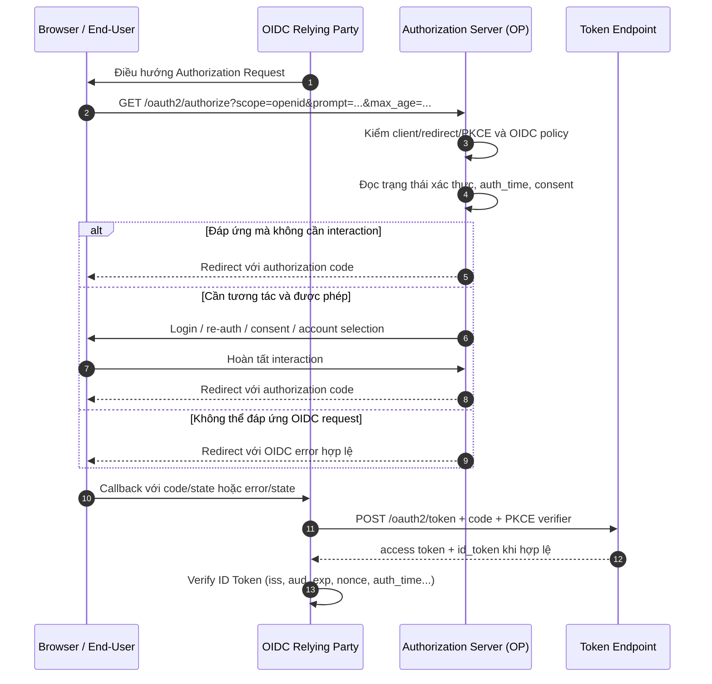

# Xử lý prompt, max_age, login_hint và các tham số theo mức hỗ trợ thực tế

## Mục tiêu bài học

Trong chương **OIDC Core và ID Token** của module **SPRING_SECURITY_OAUTH2_OIDC_AUTHORIZATION_SERVER**, chúng ta học cách hiểu, gửi, xử lý và kiểm thử các tham số tương tác trong **OpenID Connect (OIDC) Authentication Request** khi xây **Authorization Server** bằng **Spring Security**, **Spring Authorization Server** và **Spring Boot**.

Ba tham số thường bị nhầm là `prompt`, `max_age` và `login_hint`:

- `prompt` yêu cầu hoặc hạn chế **tương tác người dùng** (đăng nhập lại, cấp consent, chọn tài khoản, không hiển thị UI).
- `max_age` đặt giới hạn **tuổi của lần xác thực người dùng gần nhất**, không phải hạn của access token hay thời gian sống cookie.
- `login_hint` chỉ **gợi ý định danh cần đăng nhập**; nó không xác thực người dùng và không thay thế bước chọn tài khoản.

OIDC Core quy định ý nghĩa của tham số, nhưng **việc một framework nhận tham số hoặc giữ nó trong request không chứng minh framework đã thi hành đầy đủ**. Với Spring Authorization Server, phải phân biệt API cấu hình đã có, hành vi kiểm được bằng E2E, tính năng ứng dụng cần tự xây và yêu cầu phải chủ động từ chối khi chưa hỗ trợ.

### Kết quả mong đợi

Sau bài học, bạn có thể:

1. Phân biệt OAuth2 Authorization Code request và OIDC Authentication Request có scope `openid`.
2. Mô tả chính xác `prompt=none`, `prompt=login`, `prompt=consent` và `prompt=select_account`, kể cả khi kết hợp các giá trị.
3. Xử lý `max_age` theo thời gian **xác thực thực tế** và đưa `auth_time` vào ID Token khi OIDC yêu cầu.
4. Dùng `login_hint` để cải thiện UX mà không biến nó thành bằng chứng danh tính.
5. Nhận biết ý nghĩa và ranh giới của `id_token_hint`, `ui_locales`, `acr_values`, `claims`, `display`, `nonce` và các tham số request object.
6. Phân loại hỗ trợ thành **có sẵn**, **cần cấu hình**, **cần logic ứng dụng** và **phải thử nghiệm theo phiên bản**.
7. Thêm tham số ở Spring Security OAuth2 Client và kiểm tra/thi hành policy ở Authorization Server mà không phá kiểm tra mặc định.
8. Thiết kế testcase cho session hiện tại, silent authentication, consent, step-up, account switching và lỗi OIDC chuẩn.

> **Tình huống xuyên suốt:** `employee-portal` dùng Authorization Code + PKCE với Spring Security OAuth2 Client để đăng nhập vào `https://auth.example.com`. Người dùng đã có phiên SSO. Khi thực hiện hành động nhạy cảm, portal muốn yêu cầu xác thực gần đây (chẳng hạn tối đa 5 phút); khi kiểm tra SSO ở chế độ không tương tác, portal dùng `prompt=none`; màn hình đăng nhập có thể nhận `login_hint`. Mọi yêu cầu phải giữ đúng OAuth2/OIDC và không cấp quyền vượt session hiện có.

## 1. Đặt tham số vào đúng vị trí của OIDC Authorization Code Flow

OIDC mở rộng OAuth 2.0 để cung cấp thông tin về **xác thực người dùng** thông qua **ID Token**. Với Authorization Code Flow, Relying Party (RP, OAuth2 Client) điều hướng trình duyệt tới Authorization Endpoint của OpenID Provider (OP, Authorization Server), người dùng xác thực/đồng ý nếu cần, sau đó client đổi code tại Token Endpoint.



### 1.1. Ví dụ Authentication Request

Để dễ đọc, dưới đây là URL đã xuống dòng; trong request thực phải **URL encode** các giá trị và không đưa ký tự xuống dòng vào URI.

```http
GET /oauth2/authorize?response_type=code
    &client_id=employee-portal
    &redirect_uri=https%3A%2F%2Fportal.example.com%2Flogin%2Foauth2%2Fcode%2Femployee
    &scope=openid%20profile
    &state=RANDOM_CSRF_VALUE
    &nonce=RANDOM_NONCE_VALUE
    &code_challenge=BASE64URL_SHA256_CODE_VERIFIER
    &code_challenge_method=S256
    &prompt=login
    &max_age=300
    &login_hint=alice%40example.com HTTP/1.1
Host: auth.example.com
```

Nhóm tham số:

| Nhóm | Tham số | Vai trò |
|---|---|---|
| OAuth2 cốt lõi | `response_type`, `client_id`, `redirect_uri`, `scope`, `state` | Xác định client, flow, quyền yêu cầu, callback và liên kết phiên chống CSRF. |
| PKCE | `code_challenge`, `code_challenge_method` | Ràng buộc authorization code với client tạo verifier. |
| OIDC | `openid` trong scope, `nonce` | Kích hoạt OIDC; liên kết ID Token với yêu cầu, giảm replay. |
| OIDC interaction | `prompt`, `max_age`, `login_hint` | Chỉ dẫn về trải nghiệm/độ mới của đăng nhập và gợi ý định danh. |
| OIDC mở rộng | `id_token_hint`, `acr_values`, `ui_locales`, `claims`, `display` | Gợi ý phiên, assurance, ngôn ngữ, claim và giao diện. |

**Điểm cần giữ:** OIDC interaction parameters thuộc **Authorization Request** (thường qua browser redirect), không thuộc Token Endpoint. Không cố thêm `prompt=login` vào POST `/oauth2/token` để ép đăng nhập lại; bước đổi authorization code không có giao diện xác thực người dùng.

### 1.2. Những dữ liệu không được suy diễn từ request

- Có `prompt=login` không chứng minh user **đã** đăng nhập lại.
- Có `max_age=300` không chứng minh user được xác thực trong 300 giây; cần kiểm `auth_time` thực tế.
- Có `login_hint=alice@example.com` không chứng minh user hiện tại là Alice.
- Có `acr_values` không chứng minh MFA đã xảy ra.
- Có `nonce` trong request không có nghĩa client được bỏ bước so sánh nonce trong ID Token.
- Có `scope=openid` không tự động cho phép mọi thông tin PII ở UserInfo.

## 2. `prompt`: bốn giá trị OIDC Core cần biết

Theo OpenID Connect Core 1.0 mục 3.1.2.1, `prompt` là danh sách ASCII case-sensitive, phân cách bằng dấu cách. Các giá trị định nghĩa trong OIDC Core gồm:

| Giá trị | Ý nghĩa chuẩn | Trường hợp thông thường |
|---|---|---|
| `none` | **Không hiển thị UI** xác thực/consent; nếu cần tương tác, trả lỗi. | Silent SSO check, kiểm tra phiên OP đã có. |
| `login` | Yêu cầu người dùng xác thực lại, kể cả khi đã có session. | Xác nhận lại danh tính trước giao dịch nhạy cảm. |
| `consent` | Yêu cầu đưa người dùng tới quyết định đồng ý, nếu có thể. | Làm mới consent cho một client/claim. |
| `select_account` | Yêu cầu người dùng chọn tài khoản. | Thiết bị có nhiều tài khoản đăng nhập. |

Một request có thể mang nhiều giá trị cách nhau dấu cách, ví dụ `prompt=login%20consent`, nhưng **`none` không được kết hợp với bất kỳ giá trị nào khác**.

### 2.1. `prompt=none`: tuyệt đối không hiển thị UI

```http
GET /oauth2/authorize?response_type=code&client_id=employee-portal
    &scope=openid&state=STATE&prompt=none HTTP/1.1
Host: auth.example.com
```

Nếu OP đã có session xác thực thích hợp, consent đủ và các điều kiện khác đều thỏa, OP có thể phát authorization code **không hiển thị màn hình**.

Nếu người dùng chưa đăng nhập, cần re-auth, chưa consent hoặc cần chọn tài khoản/MFA, OP không được hiển thị UI để “giải quyết cho xong”; phải trả lỗi OIDC thích hợp, ví dụ:

```http
HTTP/1.1 302 Found
Location: https://portal.example.com/callback?error=login_required&state=STATE
```

Giả định `redirect_uri` đã được kiểm tra và callback có thể tin cậy. Không redirect tới URI do attacker tự đưa vào mà chưa được xác thực. Các lỗi tùy tình huống có thể là `login_required`, `consent_required`, `interaction_required` hoặc lỗi mở rộng chuẩn hợp lệ.

**Không được:** OP nhận `prompt=none` rồi redirect tới `/login`, mở trang consent, chọn tài khoản hoặc hiển thị captcha cho người dùng. Nếu security filter chain redirect trước khi logic OIDC nhìn thấy request thì triển khai chưa đáp ứng hành vi silent error mong muốn.

#### Tổ hợp sai

```text
prompt=none login
prompt=none consent
prompt=none select_account
```

OIDC Core yêu cầu trả lỗi khi `none` xuất hiện cùng giá trị khác. Đừng âm thầm chọn một trong hai để tiếp tục.

### 2.2. `prompt=login`: re-authentication, không phải “cho qua nhờ SSO”

OP phải bảo đảm yêu cầu reauthentication được thực hiện khi client yêu cầu `prompt=login`. Nếu người dùng đang có cookie SSO, **chỉ đọc cookie rồi phát code** không chứng minh phiên đăng nhập mới. OP cần thực hiện active authentication lại theo phương thức phù hợp với policy.

- Có thể dùng password/passkey/MFA hoặc xác thực từ upstream Identity Provider được OP tin cậy.
- Phải cập nhật thời điểm xác thực sau khi **hoàn tất xác thực thực tế**, không phải khi request được nhận.
- Nếu không thể re-authenticate, trả OIDC error như `login_required` thay vì coi phiên cũ là mới.
- Không mặc định `login_hint` đủ để reauthenticate.
- Một màn hình “Continue” không thực hiện xác thực thực tế có thể không đáp ứng yêu cầu re-auth.

`prompt=login` là chỉ thị về tương tác; **`max_age`** là chỉ thị định lượng cho tuổi của authentication.

### 2.3. `prompt=consent`: khác với consent thường ngày

Spring Authorization Server có `ClientSettings.requireAuthorizationConsent(true)` để yêu cầu consent theo registration và có `OAuth2AuthorizationConsentService` lưu sự đồng ý đã cấp. Nhưng cần phân biệt:

- `requireAuthorizationConsent(true)` là cấu hình thường yêu cầu consent cho client theo logic framework.
- `prompt=consent` là chỉ thị của **request hiện tại** để người dùng được hỏi lại, ngay cả khi trước đó đã đồng ý.

Nếu framework hoặc app đang **tái sử dụng consent đã lưu**, việc hiển thị consent lần nữa là một yêu cầu UX/policy riêng cần thực thi. Chỉ chấp nhận query `prompt=consent` mà không mở màn consent không có nghĩa đã hỗ trợ semantics.

Nếu consent không thể thu thập mà request đòi hỏi, OP phải trả lỗi thích hợp, ví dụ `consent_required`. Trường hợp `prompt=none` và client thiếu consent, phải trả lỗi **mà không hiển thị consent page**.

### 2.4. `prompt=select_account`: phải có account selection thật

Một OP có thể có nhiều phiên hoặc người dùng có thể chuyển account. `select_account` yêu cầu cơ hội chọn danh tính.

- Không tự lấy email của `login_hint` rồi đổi `sub`.
- Không hiển thị danh sách tài khoản cho client không đáng tin hoặc rò rỉ tài khoản đã tồn tại.
- Nếu chỉ có một tài khoản và không triển khai multi-account, cần có chính sách và UI/behavior rõ ràng, kiểm thử theo profile cần hỗ trợ.
- Nếu không thể chọn account khi yêu cầu, OIDC định nghĩa lỗi điển hình `account_selection_required`.
- Sau khi chọn, ID Token `sub` phải phản ánh account thực sự được xác thực.

### 2.5. Danh sách nhiều giá trị và giá trị chưa biết

Ví dụ `prompt=login%20consent` có thể đòi cả xác thực lại và consent. Client/OP phải URL encode dấu cách và xử lý thứ tự tương tác một cách nhất quán.

OIDC Core cho phép OP **bỏ qua hoặc trả lỗi** với một giá trị `prompt` chưa hiểu, tạo điều kiện cho extension tương lai. Nếu hệ thống quyết định strict allowlist thì phải tài liệu hóa và kiểm thử; không biến việc ignore giá trị không hiểu thành cơ chế giảm rủi ro.

## 3. `max_age`: tuổi xác thực và claim `auth_time`

`max_age` là số giây tối đa kể từ lần End-User được **xác thực chủ động** bởi OP. Khi tuổi xác thực vượt giá trị này, OP **phải thử xác thực lại**.

Ví dụ:

```text
Thời điểm hiện tại:        10:05:00
Lần xác thực thật:         09:57:00
max_age:                  300 giây
Tuổi xác thực:            480 giây
Kết luận:                Cần re-authentication trước khi cấp code/ID Token
```

Nếu cùng request có `prompt=none`, **không thể mở màn re-auth**. OP phải trả lỗi vì không đáp ứng được yêu cầu trong chế độ không tương tác.

### 3.1. `max_age=0` và `prompt=login`

OIDC Core quy định `max_age=0` tương đương `prompt=login` về yêu cầu reauthentication. Tuy nhiên `max_age` còn có một hệ quả đối với **ID Token**: khi request chứa `max_age`, ID Token được trả về **bắt buộc phải có claim `auth_time`**.

| Request | Có thể tái sử dụng phiên đang đăng nhập? | `auth_time` trong ID Token |
|---|---|---|
| Không có `max_age` và không có `prompt=login` | Có, nếu policy cho phép. | Thường tùy chọn, trừ khi claim được yêu cầu essential. |
| `max_age=300`, phiên mới đăng nhập 1 phút trước | Có thể. | **Bắt buộc** có `auth_time`. |
| `max_age=300`, lần auth 20 phút trước | Phải thử re-authenticate. | **Bắt buộc** có `auth_time` sau khi hoàn thành. |
| `max_age=0` | Phải active re-authenticate. | **Bắt buộc** có `auth_time`. |
| `prompt=login` nhưng không có `max_age` | Phải re-authenticate. | Không tự biến thành yêu cầu `auth_time` bởi `max_age`; nên có khi profile/app cần. |
| `prompt=none&max_age=0`, không có auth vừa thực hiện | Không được hiển thị login UI. | Trả lỗi nếu không thể đáp ứng; không phát ID Token thiếu auth_time. |

### 3.2. `auth_time` không phải `iat`

Trong ID Token:

- `iat`: thời điểm **ID Token được phát hành**.
- `auth_time`: thời điểm **người dùng thực sự được xác thực**.
- `exp`: thời điểm **ID Token hết hạn**.

Ví dụ ID Token payload minh họa:

```json
{
  "iss": "https://auth.example.com",
  "sub": "user-123",
  "aud": "employee-portal",
  "iat": 1794809400,
  "exp": 1794810300,
  "auth_time": 1794809160,
  "nonce": "RANDOM_NONCE_VALUE"
}
```

`auth_time` có thể sớm hơn `iat` vì OP tái sử dụng phiên SSO còn hợp lệ. **Không đặt `auth_time=Instant.now()` tại lúc Token Endpoint ký ID Token** nếu người dùng không xác thực ở thời điểm đó. Việc này sẽ làm client tưởng phiên cũ là phiên vừa đăng nhập.

OIDC Core yêu cầu `auth_time` là epoch seconds theo UTC, thường là JSON number. Khi ID Token được phát qua refresh token grant, `auth_time` (nếu có) vẫn mô tả lần xác thực ban đầu/tương ứng, không phải thời điểm refresh.

### 3.3. Lấy thời điểm xác thực đáng tin từ đâu?

Spring Security `Authentication` và HTTP session có thể cho biết **người dùng đang authenticated**, nhưng chúng không tự bảo đảm cung cấp timestamp của **lần active authentication cuối cùng** với semantics OIDC.

Cần thiết kế việc lưu thời điểm này:

1. Khi authentication thực sự thành công, ghi timestamp vào một security/session context đáng tin cậy.
2. Phân biệt login mới với session được restore hoặc nhớ phiên.
3. Nếu federation sang upstream IdP, chỉ tin `auth_time` hoặc thông tin tương đương được xác minh từ upstream.
4. Khi đổi tài khoản hoặc step-up thành công, xác định có cập nhật auth timestamp không dựa trên policy.
5. Gắn timestamp với đúng user, session, client/authorization request; tránh race khi login song song.
6. Lưu/khôi phục timestamp qua restart và multi-instance nếu session cần tồn tại.
7. Khi phát ID Token, dùng timestamp **đã được xác minh** từ trạng thái này.
8. Nếu không có dữ liệu để đáp ứng `max_age`, không tự bịa `auth_time` — phải reauthenticate hoặc trả lỗi phù hợp.

**Không dùng:** `HttpSession.getCreationTime()`, thời điểm nhận request `/authorize`, thời điểm tạo access token hoặc lần truy cập API gần nhất làm bằng chứng authentication.

### 3.4. Client phải tự kiểm `auth_time`

OP có trách nhiệm thi hành `max_age`, nhưng RP vẫn phải xác minh ID Token và điều kiện tuổi xác thực nếu yêu cầu độ mới.

Pseudo-code phía RP:

```java
Instant authenticatedAt = idToken.getAuthenticatedAt();
if (authenticatedAt == null) {
    throw new SecurityException("ID Token missing required auth_time");
}

Instant now = clock.instant();
Duration age = Duration.between(authenticatedAt, now);

if (age.isNegative() || age.compareTo(Duration.ofMinutes(5)) > 0) {
    throw new SecurityException("Authentication is not recent enough");
}
```

Ví dụ assume `idToken` là `OidcIdToken` đã **được Spring Security xác minh chữ ký và các claims chuẩn**. Production cần xử lý clock skew theo policy, tránh chấp nhận `auth_time` ở tương lai quá mức. Đừng chỉ decode payload rồi tin `auth_time` khi chưa verify `iss`, `aud`, signature và `nonce`.

## 4. `login_hint`: gợi ý, không phải chứng minh danh tính

`login_hint` cho phép RP gợi ý người dùng muốn đăng nhập, ví dụ email, username, số điện thoại hoặc định danh mà OP hiểu.

```text
login_hint=alice%40example.com
```

OP có thể dùng hint để:
- Điền trước ô username.
- Hiển thị thông điệp “Tiếp tục với tài khoản ...” sau khi có kiểm tra thích hợp.
- Gợi ý tenant/realm hoặc home realm discovery **sau khi xác minh dữ liệu cần thiết**.
- Giảm một bước nhập liệu khi client đã biết username một cách hợp pháp.

OP cũng có thể bỏ qua hint vì lý do bảo mật, privacy hoặc vì không hỗ trợ.

### 4.1. Những điều tuyệt đối không nên làm

- Không auto-login người dùng chỉ dựa vào `login_hint`.
- Không gán `sub` trong ID Token bằng raw login_hint mà chưa xác thực.
- Không vượt qua MFA/step-up vì hint trùng account đã lưu.
- Không dùng hint để bypass `prompt=select_account`.
- Không phản hồi các thông báo giúp phân biệt email/account tồn tại hay không cho người không được ủy quyền.
- Không đưa hint chứa PII vào log, metrics, analytics, reverse proxy access log hoặc referrer ngoài dự kiến.
- Không để client tự gửi `tenant=admin`/email rồi dùng như trust boundary.

**Ví dụ tấn công:** Attacker sửa URL từ `login_hint=alice@example.com` thành `login_hint=admin@example.com`. Nếu OP cho phép chọn tài khoản/mở phiên admin chỉ từ hint, đây là lỗi authentication nghiêm trọng. Đúng cách là dùng hint để hiển thị UX, nhưng identity cuối cùng phải đến từ kết quả authentication/SSO trusted.

### 4.2. Dùng hint với tài khoản đã đăng nhập

Khi OP đã có session của Bob và nhận `login_hint=alice@example.com`:

- Không được âm thầm biến session Bob thành Alice.
- Có thể giữ session Bob nếu policy không ràng buộc hint và request không yêu cầu account khác.
- Có thể đưa ra UI chọn tài khoản hoặc yêu cầu đăng nhập Alice nếu phù hợp.
- Nếu client cần **ràng buộc subject bắt buộc**, cân nhắc `claims.id_token.sub` với `value` theo OIDC Core khi OP hỗ trợ, hoặc cơ chế account selection rõ ràng; không dùng `login_hint` như ràng buộc bắt buộc.

`login_hint` chỉ là hint; việc áp policy về subject/tenant phải được ghi rõ trong contract.

## 5. Các tham số OIDC liên quan và ranh giới hỗ trợ

Ngoài `prompt`, `max_age`, `login_hint`, nhiều tham số OIDC Core khác thường xuất hiện trong Authorization Request:

| Tham số | Ý nghĩa chuẩn | Ranh giới triển khai |
|---|---|---|
| `id_token_hint` | ID Token đã phát, cung cấp hint về phiên/subject. | Cần kiểm tính tin cậy và không dùng như chứng thực mới. |
| `ui_locales` | Danh sách BCP47 language tags theo thứ tự ưu tiên. | UI login/consent phải có khả năng địa phương hóa; có thể bỏ qua locale không hỗ trợ. |
| `acr_values` | Danh sách ACR mong muốn theo ưu tiên. | Chỉ có ý nghĩa khi OP có assurance mapping và có thể thực thi step-up. |
| `claims` | JSON object yêu cầu claims trong ID Token/UserInfo. | Support optional; cần parser, consent, data minimization, quyết định essential claim. |
| `display` | Hint cách hiển thị UI: page, popup, touch, wap. | Không buộc UI nào cũng hỗ trợ mọi display mode. |
| `nonce` | Liên kết RP session với ID Token; chống replay. | Client phải sinh entropy tốt và kiểm nonce trong ID Token khi gửi. |
| `response_mode` | Cách trả authorization response. | Chỉ dùng mode mà OP/flow thực sự hỗ trợ và bảo đảm security. |
| `request` | Request Object JWT chứa authentication parameters. | Hỗ trợ tùy chọn; validation/JOSE/parameter precedence rất quan trọng. |
| `request_uri` | Tham chiếu Request Object hoặc cơ chế request URI tương ứng. | Cần phân biệt OIDC request_uri và OAuth2 PAR; không auto-fetch URL không tin cậy. |

### 5.1. `id_token_hint` và `prompt=none`

OIDC Core khuyến nghị gửi `id_token_hint` khi dùng `prompt=none` nếu có thể, để OP biết phiên mà client muốn tham chiếu. Tuy nhiên:
- Không phải mọi request `prompt=none` đều bắt buộc có hint; OP nên thành công nếu có thể dù thiếu hint.
- OP có thể trả `invalid_request` nếu thiếu hint theo profile tương ứng, nhưng không giả định đây là mặc định mọi OP.
- ID Token hint là thông tin từ một lần phát trước đó; không tự chứng minh người dùng hiện tại đang đăng nhập.
- Cần ràng buộc hint với issuer/client/session/subject đáng tin và chính sách xác thực đang có.

Đừng nhầm `id_token_hint` của **Authentication Request** với `id_token_hint` trong **OIDC RP-Initiated Logout**: cùng tên tham số nhưng ngữ cảnh, mục đích và processing khác nhau.

### 5.2. `ui_locales`, `display`: tùy chọn giao diện

`ui_locales=vi-VN%20en-US` nói client muốn UI tiếng Việt trước, sau đó tiếng Anh. OP có thể sử dụng locale đầu tiên mà app hỗ trợ. Không vì locale không hỗ trợ mà tự động từ chối một yêu cầu đăng nhập hợp lệ.

`display=popup` gợi ý màn popup, nhưng UI cần xử lý browser security restrictions, CSRF/state/redirect một cách đúng chuẩn; không làm yếu clickjacking protection chỉ để hỗ trợ popup.

### 5.3. `acr_values` khác `claims.id_token.acr` essential

`acr_values` là danh sách ACR được RP yêu cầu theo thứ tự ưu tiên; nó **không tự biến yêu cầu thành ràng buộc MFA bắt buộc**.

Nếu ứng dụng có yêu cầu step-up bắt buộc, cần policy assurance:

- Định nghĩa ACR nào tương ứng với password, passkey, MFA hoặc hình thức xác thực.
- Lưu bằng chứng phương thức xác thực (`amr` khi phù hợp).
- Đảm bảo OP thực sự đạt level trước khi phát ID Token chứa `acr` tương ứng.
- Không điền `acr=high` chỉ vì client gửi `acr_values=high`.
- Kiểm `acr` ở RP nếu nó là điều kiện business security.
- Nếu OP hỗ trợ `claims` và RP yêu cầu `acr` essential với `value`/`values` cụ thể, OIDC Core yêu cầu xử lý mức ràng buộc chặt hơn so với `acr_values` thông thường.

Ví dụ claims request khi OP thực sự hỗ trợ:

```json
{
  "id_token": {
    "auth_time": {"essential": true},
    "acr": {"essential": true, "values": ["urn:example:acr:mfa"]}
  },
  "userinfo": {
    "email_verified": {"essential": true}
  }
}
```

JSON trên phải được URL encode khi truyền qua query/form của Authorization Request. `essential` không phải bảo đảm mọi OP luôn trả claim; OIDC Core có xử lý riêng cho claim essential không có sẵn và cho trường hợp essential `acr` với giá trị bắt buộc. Client phải kiểm response, không chỉ nhìn request của mình.

### 5.4. `request` và `request_uri`

OIDC Core định nghĩa Request Object bằng JWT, có thể truyền trong `request` hoặc `request_uri`. Hỗ trợ là tùy chọn; nếu OP không hỗ trợ theo profile, cần xử lý lỗi chuẩn tương ứng, không âm thầm bỏ qua các ràng buộc bảo mật.

OAuth 2.0 **Pushed Authorization Requests (PAR)** cũng có `request_uri` nhưng là flow riêng với endpoint push và request_uri do server cấp. Không suy luận rằng framework có PAR endpoint thì tự động hỗ trợ mọi OIDC Request Object hoặc mọi URI tùy ý.

**Rủi ro phải tránh:** SSRF từ `request_uri` do client cung cấp, bypass validation của `redirect_uri`, precedence sai giữa tham số ngoài query và Request Object, signature không được kiểm, request quá lớn và ghi log Request Object chứa PII.

## 6. Lập ma trận hỗ trợ thực tế, không suy luận từ tên parameter

Tài liệu **Spring Authorization Server 1.5.8** mô tả `OAuth2AuthorizationEndpointConfigurer`, converter, provider, authorization request validator, consent page và các OIDC endpoints. Tài liệu không hứa rằng mọi tham số phụ của OIDC Core đều được thi hành đầy đủ chỉ vì OIDC được bật.

Phải đánh giá theo đúng dependency stack, bao gồm:
- Spring Boot, Spring Security, Spring Authorization Server (nếu dùng dòng độc lập).
- Cấu hình `SecurityFilterChain`, login entry point, consent page, session registry.
- Custom converters/providers/validators/callbacks mà ứng dụng đã cài.
- Upstream Identity Provider nếu app thực hiện federation.
- OIDC client SDK thực sự tạo request/validate ID Token.

### 6.1. Ma trận năng lực để điền bằng E2E test

| Tính năng | Tiêu chuẩn OIDC Core | Trong ứng dụng Spring cần kiểm chứng |
|---|---|---|
| `scope=openid`, Authorization Code, ID Token | Cốt lõi của OIDC Code Flow. | Bật `oidc(...)`, có JWK/JWT và đăng ký client/redirect/PKCE đúng. |
| `prompt=none` | Không tương tác, trả lỗi khi thiếu session/consent. | Kiểm hành vi provider và đặc biệt entry point/security filter chain khi user chưa login. |
| `prompt=login` | Active reauthentication. | Phải chứng minh login thực sự xảy ra, không chỉ tái dùng SSO cookie. |
| `prompt=consent` | Yêu cầu consent. | Phải thử với consent đã lưu; cấu hình `requireAuthorizationConsent` chưa đủ để khẳng định re-consent. |
| `prompt=select_account` | Chọn account. | Cần UX/account manager; không tự xuất hiện chỉ nhờ parameter. |
| `max_age` | Reauthenticate khi vượt tuổi cho phép; ID Token có `auth_time`. | Phải lưu thời gian auth thực, check age, phát/verify claim và test clock. |
| `login_hint` | Hint định danh, optional. | Login UI có thể dùng/ignore; cấm coi là credential. |
| `ui_locales`/`display` | Hint hiển thị. | Kiểm hỗ trợ UI thực tế, locale/resources. |
| `acr_values`/`claims` | Assurance/claim requests; hỗ trợ tùy điều kiện. | Kiểm ID Token actual `acr`, `auth_time`, consent, schema và feature flag. |
| `id_token_hint` | Gợi ý phiên/danh tính trước. | Kiểm xử lý tin cậy và liên kết user/client. |
| `request`/`request_uri` | Tùy chọn, có đặc tả validation riêng. | Kiểm discovery, server capability, JOSE/PAR semantics và lỗi chuẩn. |

**Một bài test chỉ cho thấy request không bị trả 400 chưa đủ.** Cần kiểm phiên, UI, callback và ID Token thực tế. Mỗi hàng trong ma trận phải được đánh dấu `SUPPORTED`, `CUSTOM_IMPLEMENTED`, `REJECTED` hoặc `NOT_TESTED` cho đúng version/profile; không tự quảng cáo hỗ trợ “OIDC Core hoàn chỉnh”.

### 6.2. Lưu ý phiên bản và `prompt=none`

Spring Authorization Server 1.4+ đã có hành vi xử lý `prompt=none` trong các trường hợp cụ thể, nhưng điều đó không miễn trách nhiệm kiểm thử security chain và error redirect. Trong quá trình chuyển từ Spring Authorization Server 1.x sang thành phần Authorization Server trong Spring Security 7.x, có phản ánh công khai rằng thứ tự `AuthorizationFilter` và endpoint filter có thể khiến request chưa xác thực đi vào login entry point trước khi trả OIDC `login_required`. Dù issue được đóng theo phạm vi trách nhiệm cấu hình, **đây vẫn là ca kiểm thử tích hợp quan trọng**.

Không sửa vội thành `permitAll()` cho `/oauth2/authorize` để “cho phép prompt none” mà chưa đánh giá kiến trúc: Authorization Endpoint phải bảo vệ việc phát code, redirect và user session. Hãy đánh giá cấu hình filter/entry point theo version, giữ các bước validation chuẩn và kiểm thử OIDC error semantics ở callback.

## 7. Gửi các tham số từ Spring Security OAuth2 Client

Đây là **phía RP/Client**, không phải cấu hình trong Spring Authorization Server.

Spring Security cung cấp `DefaultOAuth2AuthorizationRequestResolver` và method `setAuthorizationRequestCustomizer(...)` để bổ sung tham số trong Authorization Request.

### 7.1. Ví dụ một client luôn yêu cầu xác thực gần đây

```java
import org.springframework.context.annotation.Bean;
import org.springframework.security.config.annotation.web.builders.HttpSecurity;
import org.springframework.security.oauth2.client.registration.ClientRegistrationRepository;
import org.springframework.security.oauth2.client.web.DefaultOAuth2AuthorizationRequestResolver;
import org.springframework.security.oauth2.client.web.OAuth2AuthorizationRequestResolver;
import org.springframework.security.web.SecurityFilterChain;

@Bean
SecurityFilterChain clientSecurityFilterChain(
        HttpSecurity http,
        ClientRegistrationRepository registrations) throws Exception {

    DefaultOAuth2AuthorizationRequestResolver resolver =
            new DefaultOAuth2AuthorizationRequestResolver(
                    registrations, "/oauth2/authorization");

    resolver.setAuthorizationRequestCustomizer(builder ->
            builder.additionalParameters(params -> {
                params.put("max_age", "300");
                params.put("login_hint", "alice@example.com");
            }));

    http.authorizeHttpRequests(auth -> auth
                .anyRequest().authenticated())
        .oauth2Login(oauth2 -> oauth2
                .authorizationEndpoint(endpoint ->
                        endpoint.authorizationRequestResolver(resolver)));

    return http.build();
}
```

**Chú ý:**
- `alice@example.com` là chuỗi ví dụ, không dùng hard-code vào ứng dụng thực. Với multi-user, lấy hint từ nguồn UI/business tin cậy, sau khi kiểm validation và privacy.
- Ví dụ minh họa việc thêm `max_age`/`login_hint` vào URL, **không bảo đảm OP thực thi** reauthentication hoặc tự xác minh `auth_time`.
- Với app có nhiều ClientRegistration, customizer trên đây có thể ảnh hưởng tất cả registration; cần giới hạn theo provider/client contract hoặc dùng request resolver decorator.
- `DefaultOAuth2AuthorizationRequestResolver` mặc định xây các giá trị chuẩn (redirect, scope, state, PKCE khi cấu hình đúng). Không tự ghép URL thủ công làm mất các bảo vệ đó.
- Chưa có đủ session storage, authorization repository và toàn bộ cấu hình business; đây là một đoạn tích hợp minh họa.

### 7.2. Ví dụ request yêu cầu login và consent

```java
resolver.setAuthorizationRequestCustomizer(builder ->
        builder.additionalParameters(params -> {
            params.put("prompt", "login consent");
            params.put("max_age", "0");
        }));
```

OIDC Core cho phép nhiều prompt values phù hợp. Client nên tránh gửi `prompt=none` với `prompt=login` hoặc `consent`. Không đặt `prompt` từ raw query mà attacker có thể khiến RP bỏ bước step-up được yêu cầu.

### 7.3. Đặt yêu cầu theo từng route nghiệp vụ

Không phải mọi thao tác của RP đều cần reauthentication. Ví dụ:
- Trang dashboard bình thường: không gửi `max_age` ngắn.
- Xem báo cáo nhạy cảm: `max_age=300`.
- Đổi phương thức thanh toán: `max_age=0` hoặc step-up theo ACR policy.
- Kiểm tra SSO không tương tác: `prompt=none`, có fallback về explicit login flow.
- Chuyển account: `prompt=select_account` khi OP thực sự hỗ trợ.

Tham số client gửi là **yêu cầu**; enforcement đòi cả OP, RP và policy. Với luồng silent, browser cookie partitioning/third-party cookie restrictions có thể ngăn OP nhìn thấy session trong iframe. Không lấy hidden iframe silent login làm cơ chế refresh dài hạn đáng tin; cân nhắc Authorization Code với refresh token/BFF theo policy an toàn.

## 8. Cấu hình Spring Authorization Server và điểm mở rộng

### 8.1. Bật OIDC và giữ các bước Authorization Code chuẩn

Spring Authorization Server 1.5.x hỗ trợ cấu hình OIDC qua `OAuth2AuthorizationServerConfigurer.oidc(...)`. Ví dụ khung:

```java
@Bean
@Order(1)
SecurityFilterChain authorizationServerSecurityFilterChain(
        HttpSecurity http) throws Exception {

    var as = OAuth2AuthorizationServerConfigurer.authorizationServer();

    http.securityMatcher(as.getEndpointsMatcher())
        .with(as, configurer -> configurer
                .oidc(Customizer.withDefaults())
                .authorizationEndpoint(endpoint -> endpoint
                        .consentPage("/oauth2/consent")))
        .authorizeHttpRequests(authorize -> authorize
                .anyRequest().authenticated());

    return http.build();
}
```

Imports: `org.springframework.core.annotation.Order`, `org.springframework.context.annotation.Bean`, `org.springframework.security.config.Customizer`, `org.springframework.security.config.annotation.web.builders.HttpSecurity`, `org.springframework.security.web.SecurityFilterChain`, `org.springframework.security.oauth2.server.authorization.config.annotation.web.configurers.OAuth2AuthorizationServerConfigurer`.

Đây là **khung**, chưa phải Authorization Server chạy độc lập. Cần `RegisteredClientRepository`, `OAuth2AuthorizationService`, `OAuth2AuthorizationConsentService`, `JWKSource<SecurityContext>`, `AuthorizationServerSettings`, login filter chain, cookie/session config và view `/oauth2/consent`.

Cấu hình trên không tự tạo login UI reauthentication, account selection hoặc logic `max_age`. Không bật OIDC chỉ để gửi `prompt` nếu không triển khai protocol capability.

### 8.2. Điểm mở rộng được Spring document

`OAuth2AuthorizationEndpointConfigurer` có:
- `authorizationRequestConverter(...)` / `authorizationRequestConverters(...)`: parse request.
- `authenticationProvider(...)` / `authenticationProviders(...)`: logic xác thực request.
- `authorizationResponseHandler(...)` / `errorResponseHandler(...)`: protocol response.
- `consentPage(...)`: UI consent.
  
`OAuth2AuthorizationCodeRequestAuthenticationProvider` có:
- `setAuthenticationValidator(...)` để mở rộng kiểm tra request; phải giữ validator mặc định.
- `setAuthorizationConsentRequired(...)` (ở các phiên bản hỗ trợ) để tùy chỉnh **quyết định yêu cầu consent**, có thể dùng request/consent state làm input.

Spring Security form login/SSO/session cần xử lý:
- Xác thực thật và lưu `auth_time`.
- Nhận biết `prompt=login` và buộc reauthentication.
- Xử lý `prompt=none` mà không hiển thị UI.
- Account selection và login hint UX.
- Error propagation về callback RP đúng OIDC.

**Đừng nhầm request parameter validation với interaction enforcement.** Một `AuthenticationValidator` từ chối chuỗi `max_age=-5`, nhưng nó không chứng minh có reauthentication hoặc ID Token đã có `auth_time`.

### 8.3. Ví dụ validator an toàn cho cú pháp `prompt`/`max_age`

Ví dụ Java sau kiểm các giá trị trong Authorization Request và giữ validator mặc định của Spring. Nó **không tự thực thi** `prompt=login`, `max_age`, consent hay account selection:

```java
package com.example.authserver.oidc;

import java.util.Arrays;
import java.util.LinkedHashSet;
import java.util.Set;
import java.util.function.Consumer;

import org.springframework.security.oauth2.core.OAuth2Error;
import org.springframework.security.oauth2.core.OAuth2ErrorCodes;
import org.springframework.security.oauth2.server.authorization.authentication.OAuth2AuthorizationCodeRequestAuthenticationContext;
import org.springframework.security.oauth2.server.authorization.authentication.OAuth2AuthorizationCodeRequestAuthenticationException;
import org.springframework.security.oauth2.server.authorization.authentication.OAuth2AuthorizationCodeRequestAuthenticationToken;
import org.springframework.security.oauth2.server.authorization.authentication.OAuth2AuthorizationCodeRequestAuthenticationValidator;

public final class OidcInteractionRequestValidator
        implements Consumer<OAuth2AuthorizationCodeRequestAuthenticationContext> {

    private final OAuth2AuthorizationCodeRequestAuthenticationValidator defaults =
            new OAuth2AuthorizationCodeRequestAuthenticationValidator();

    @Override
    public void accept(OAuth2AuthorizationCodeRequestAuthenticationContext context) {
        // KHÔNG bỏ kiểm tra redirect_uri và scope của framework.
        defaults.accept(context);

        OAuth2AuthorizationCodeRequestAuthenticationToken request =
                context.getAuthentication();

        if (!request.getScopes().contains("openid")) {
            return;
        }

        Object rawPrompt = request.getAdditionalParameters().get("prompt");
        if (rawPrompt != null) {
            if (!(rawPrompt instanceof String)) {
                invalidRequest(request);
            }
            String prompt = (String) rawPrompt;
            if (prompt.isBlank()) {
                invalidRequest(request);
            }

            Set<String> values = new LinkedHashSet<>(
                    Arrays.asList(prompt.strip().split("\\s+")));

            if (values.contains("none") && values.size() != 1) {
                invalidRequest(request);
            }

            // Hợp đồng STRICT do ứng dụng chọn; OIDC Core cũng cho phép
            // bỏ qua một giá trị mở rộng chưa hiểu thay vì báo lỗi.
            Set<String> supported = Set.of(
                    "none", "login", "consent", "select_account");
            if (!supported.containsAll(values)) {
                invalidRequest(request);
            }
        }

        Object rawMaxAge = request.getAdditionalParameters().get("max_age");
        if (rawMaxAge != null) {
            if (!(rawMaxAge instanceof String)) {
                invalidRequest(request);
            }
            String seconds = (String) rawMaxAge;
            if (seconds.length() > 10 || !seconds.matches("[0-9]+")) {
                invalidRequest(request);
            }
            try {
                Long.parseLong(seconds);
            } catch (NumberFormatException ex) {
                invalidRequest(request);
            }
        }
    }

    private static void invalidRequest(
            OAuth2AuthorizationCodeRequestAuthenticationToken request) {
        throw new OAuth2AuthorizationCodeRequestAuthenticationException(
                new OAuth2Error(OAuth2ErrorCodes.INVALID_REQUEST),
                request);
    }
}
```

**Độ chính xác của ví dụ:** 
- Đây là **request validation**; lưu giá trị ở `additionalParameters` chỉ là một phần của flow. Trong môi trường PAR hoặc custom converter, phải bảo đảm parameters đã được đưa vào request context và validation đi qua cùng rule.
- Mẫu dùng strict allowlist cho `prompt`. OIDC Core cho phép xử lý giá trị chưa hiểu theo cách khác; chính sách sản phẩm cần quyết định.
- Mẫu không giới hạn business max_age ngoài kiểu số; production nên đặt upper bound phù hợp, tránh `0`/giá trị cực lớn gây abuse.
- Mẫu không giải quyết duplicate parameters ở HTTP request; cần bảo đảm converter/proxy parse có quy tắc rõ và không có parameter pollution.
- Không ghi raw `login_hint` hay request params vào exception/log.
- **Không đăng ký validator này rồi tuyên bố đã hỗ trợ full OIDC interaction.**

Gắn validator vào provider mặc định bằng hook:

```java
authorizationEndpoint.authenticationProviders(providers -> {
    for (var provider : providers) {
        if (provider instanceof OAuth2AuthorizationCodeRequestAuthenticationProvider standard) {
            standard.setAuthenticationValidator(
                    new OidcInteractionRequestValidator());
            return;
        }
    }
    throw new IllegalStateException("Authorization Code provider not found");
});
```

Đoạn code nằm trong lambda `.authorizationEndpoint(authorizationEndpoint -> ...)` của Authorization Server configurer. Nếu có Custom Provider hoặc phiên bản thay đổi API, xác minh order và không bỏ qua validator cũ. Đừng ghi đè toàn bộ provider list chỉ để bổ sung vài kiểm tra.

### 8.4. Vì sao validator chưa giải quyết `prompt=none` khi user chưa đăng nhập?

`OAuth2AuthorizationEndpointFilter` nằm trong một `SecurityFilterChain`. `AuthorizationFilter`, `ExceptionTranslationFilter` và login entry point có thể xử lý request chưa authenticated **trước** hoặc **khác** với provider interaction policy. Kết quả HTTP có thể là redirect tới `/login` thay vì OIDC error tại RP.

Vì vậy, cần kiểm tra đường đi thực tế từ browser đến callback, bao gồm:
- Request chưa có session.
- Request có session stale.
- Request có session nhưng thiếu consent.
- Request được xử lý qua PAR.
- Request bị intercept bởi MFA/captcha gateway.
- Request qua reverse proxy mà URL callback khác.

Nếu yêu cầu `prompt=none` thực sự là critical capability, viết E2E conformance tests trước khi công bố. Không dùng `permitAll()` một cách máy móc trên endpoint đã đăng ký bảo vệ.

## 9. Đảm bảo `auth_time` trong ID Token

### 9.1. Lưu timestamp tại thời điểm xác thực thành công

Về mặt kiến trúc, ứng dụng nên có một component:

```java
import java.time.Instant;

// Ví dụ interface ứng dụng tự định nghĩa, không phải Spring API built-in.
public interface OidcAuthenticationTimeService {

    // Lưu mốc sau một hành vi active authentication THỰC SỰ.
    void recordAuthentication(
            String userId, String authenticationSessionId, Instant when);

    // Trả thời điểm đã được xác minh, không suy ra từ token issue time.
    Instant requireAuthenticationTime(
            String userId, String authenticationSessionId);
}
```

Interface minh họa contract. Implementation thực tế có thể dùng Spring Security `AuthenticationSuccessHandler`/session registry, distributed session store hoặc upstream federation claims đã verify. **Lưu ý:** các phương thức trên không tự tồn tại trong Spring và phải được xây, tích hợp, test theo security policy.

### 9.2. Tùy chỉnh ID Token bằng `JwtEncodingContext`

Spring Authorization Server hỗ trợ `OAuth2TokenCustomizer<JwtEncodingContext>`. Chỉ ghi `auth_time` khi đã có nguồn timestamp tin cậy, lấy đúng authorization/session:

```java
import java.time.Instant;

import org.springframework.context.annotation.Bean;
import org.springframework.security.oauth2.core.oidc.IdTokenClaimNames;
import org.springframework.security.oauth2.core.oidc.endpoint.OidcParameterNames;
import org.springframework.security.oauth2.server.authorization.OAuth2Authorization;
import org.springframework.security.oauth2.server.authorization.token.JwtEncodingContext;
import org.springframework.security.oauth2.server.authorization.token.OAuth2TokenCustomizer;

@Bean
OAuth2TokenCustomizer<JwtEncodingContext> idTokenCustomizer() {
    return context -> {
        if (!OidcParameterNames.ID_TOKEN.equals(
                context.getTokenType().getValue())) {
            return; // Không chèn auth_time vào access_token.
        }

        OAuth2Authorization authorization = context.getAuthorization();
        if (authorization == null) {
            return;
        }

        // Thuộc tính này do ứng dụng lưu sau active authentication,
        // không được tự sinh tại thời điểm ký token.
        Instant authenticatedAt =
                authorization.getAttribute("oidc.authenticated_at");

        if (authenticatedAt != null) {
            context.getClaims().claim(
                    IdTokenClaimNames.AUTH_TIME,
                    authenticatedAt.getEpochSecond());
        }
    };
}
```

**Quan trọng:**
1. Đây chỉ là cách **đưa claim vào ID Token**, không phải implementation hoàn chỉnh của `max_age`. Cần lưu attribute vào đúng `OAuth2Authorization` từ luồng login được kiểm chứng và giữ khi authorization được persist.
2. Nếu request bắt buộc `auth_time` mà attribute không có, **phải từ chối/re-authenticate trước khi phát ID Token**; ví dụ trên không làm bước đó.
3. Không viết `auth_time=Instant.now()` trong customizer.
4. Không thay `iss`, `sub`, `aud`, `exp`, `nonce` hoặc signature của ID Token.
5. Đảm bảo customizer được gắn với `JwtGenerator`; khi tự tạo `OAuth2TokenGenerator` cần wire đúng. 
6. Không giả định `getAuthorization()` lúc mọi grant luôn có cùng trạng thái; kiểm lại Authorization Code/Refresh Token flows của version đang dùng.

### 9.3. Đo thời gian xác thực và ra quyết định từ phía OP

Pseudo-code cho interaction policy:

```text
function evaluate(request, session, now):
    validateOauth2AndOidcRequest(request)

    if request.prompt contains "none" with another value:
        return error("invalid_request")

    if session absent:
        if request.prompt contains "none":
            return error("login_required")
        return interactiveLogin()

    if request.max_age is present:
        if trustedAuthTime absent:
            if request.prompt contains "none":
                return error("login_required")
            return interactiveReauthentication()
        if now - trustedAuthTime > request.max_age:
            if request.prompt contains "none":
                return error("login_required")
            return interactiveReauthentication()

    if request.prompt contains "login":
        return interactiveReauthentication()

    if requiresAccountSelection(request):
        if request.prompt contains "none":
            return error("account_selection_required")
        return accountSelectionUi()

    if requiresConsent(request, storedConsent):
        if request.prompt contains "none":
            return error("consent_required")
        return consentUi()

    return issueAuthorizationCode()
```

Đây là **thuật toán minh họa**, không phải method có sẵn của Spring. Flow thực cần giải quyết đồng thời nhiều điều kiện (ví dụ vừa login lại vừa consent) và đánh dấu interaction nào đã hoàn tất để tránh redirect loop. Mọi error phải đi qua cơ chế redirect/error handler chuẩn sau khi validation `redirect_uri`/client đã đạt.

## 10. Ma trận test bắt buộc theo từng tham số

### 10.1. `prompt` behavior

| Test case | Session / consent | Request | Kết quả mong đợi |
|---|---|---|---|
| Silent success | Session hợp lệ, consent đủ. | `prompt=none` | Code/callback không hiện UI. |
| Silent no session | Chưa đăng nhập. | `prompt=none` | OIDC `login_required`/error phù hợp tại callback, không tới login UI. |
| Silent needs consent | Đã login, thiếu consent. | `prompt=none` | `consent_required` hoặc OIDC error phù hợp; không mở consent page. |
| Silent needs fresh auth | Session cũ. | `prompt=none&max_age=300` | Lỗi, không mở login. |
| Invalid combination | Bất kỳ. | `prompt=none%20login` | Lỗi, không bỏ qua điều kiện. |
| Force login | Session còn hiệu lực. | `prompt=login` | Có active reauthentication, không chỉ reuse cookie. |
| Force consent | Session + consent đã lưu. | `prompt=consent` | Được hỏi lại nếu profile/app cam kết hỗ trợ. |
| Select account | Có nhiều user sessions. | `prompt=select_account` | Chọn tài khoản, ID Token `sub` đúng user được xác thực. |
| Unknown extension | Bất kỳ. | `prompt=custom` | Error/ignore theo chính sách documented và test. |

### 10.2. `max_age`, `auth_time`, `login_hint`

| Test case | Kỳ vọng |
|---|---|
| `max_age=300`, auth trước 60s | Có thể reuse session; ID Token phải có `auth_time` đúng. |
| `max_age=300`, auth trước 600s | OP reauthenticate, ID Token `auth_time` mới theo authentication thật. |
| `max_age=0`, session cũ | Re-auth tương đương `prompt=login`, ID Token có `auth_time`. |
| `max_age=abc` hoặc số âm | Reject theo input validation, không parse sai/ignore một cách im lặng. |
| `max_age` có giá trị cực lớn | Validation/upper-bound chính sách; không overflow. |
| ID Token được phát sau login 5 phút | `auth_time` là login time, **không** bằng `iat` nếu chưa login lại. |
| ID Token được phát qua refresh | Giữ auth_time gốc/tương ứng, không ghi thành refresh time. |
| `login_hint=alice`, user session Bob | Không tự đổi danh tính; áp policy UI/user choice. |
| `login_hint` chứa unknown email | Không leak account enumeration; có thể bỏ qua hint. |
| `login_hint` chứa ký tự đặc biệt | Input escaped, không XSS/HTML injection hoặc log PII. |

### 10.3. Các tham số bổ sung

- `id_token_hint` có issuer/signature/client mismatch phải được xử lý an toàn; không cho phép dùng hint thay credential.
- `ui_locales=vi-VN en-US` chọn locale supported hoặc fallback, không đổi security policy.
- `acr_values` cần ID Token `acr` phản ánh assurance thực, không copy từ query.
- `claims` essential `auth_time`/`acr` được xử lý theo profile; không luôn trả mọi claim PII.
- `display=popup` không phá Content Security Policy và frame protection.
- `nonce` trong request được phản ánh và RP xác minh trong ID Token.
- `request`/`request_uri`/PAR không bypass standard validation; no SSRF.
- Callback với error vẫn giữ `state` đúng, không leak token/code cho redirect chưa xác thực.

## 11. Ví dụ kiểm thử bằng MockMvc và browser E2E

### 11.1. Test validation không thay thế browser test

Với Spring Boot Test + MockMvc có thể kiểm một số case validation khi đã có fixture `RegisteredClient`, redirect URI, session, PKCE và custom validator:

```java
@SpringBootTest
@AutoConfigureMockMvc
class OidcInteractionRequestValidationTest {

    @Autowired
    MockMvc mvc;

    @Test
    void rejectsPromptNoneCombinedWithLogin() throws Exception {
        mvc.perform(get("/oauth2/authorize")
                .param("response_type", "code")
                .param("client_id", "employee-portal")
                .param("redirect_uri",
                        "https://portal.example.com/callback")
                .param("scope", "openid")
                .param("state", "STATE_EXAMPLE")
                .param("code_challenge", "PKCE_CHALLENGE_EXAMPLE")
                .param("code_challenge_method", "S256")
                .param("prompt", "none login"))
            // Assertion phải bám đúng handler/redirect behavior,
            // thường là 302 với error=invalid_request ở callback.
            .andExpect(status().is3xxRedirection());
    }
}
```

**Fixture quan trọng:** mã này là **minh họa**, không chạy độc lập nếu thiếu authenticated session hoặc nếu filter chain redirect sang `/login` trước provider. `PKCE_CHALLENGE_EXAMPLE` không phải một code challenge hợp lệ; cần tạo PKCE verifier/challenge thực tế trong test. Khi làm E2E, assert **Location** trả OIDC `error=invalid_request` và `state`, chứ không chỉ 302.

### 11.2. E2E conformance nên dùng browser thật

MockMvc giỏi kiểm filter/provider và logic request, nhưng không kiểm hết:
- Form login thực sự được hiển thị hay không.
- Session cookie/SSO sau logout và timeout.
- Browser third-party cookie, SameSite, CSRF.
- Account selection UX, consent UI, MFA.
- Redirect sau login/re-auth và preservation của OIDC request state.
- RP validate `nonce`, `auth_time` và ACR.
- Nhiều browser session/user accounts.

Vì vậy, nên có test browser end-to-end, network assertions và test OIDC client SDK thực tế.

### 11.3. Test ID Token theo contract

Sau khi client đã đổi authorization code lấy token:
1. Xác minh JWT signature bằng JWKS tin cậy.
2. Kiểm `iss` là issuer đã cấu hình.
3. Kiểm `aud` chứa client ID; `azp` khi có nhiều audience.
4. Kiểm `exp`, `iat` và `nonce` nếu request đã gửi.
5. Với `max_age`, kiểm `auth_time` có mặt và đúng auth event.
6. Với step-up, kiểm `acr`/`amr` theo profile đã cam kết.
7. Không chấp nhận `auth_time` trong tương lai hoặc mới hơn hoạt động login thật.
8. Kiểm Token Endpoint không cấp ID Token cho OAuth2-only client không yêu cầu `openid`.

Ví dụ JSON asserts (tư duy):

```text
assert(id_token.auth_time != null)
assert(id_token.auth_time <= request_completed_at + allowed_skew)
assert(request_completed_at - id_token.auth_time <= max_age + allowed_skew)
assert(id_token.iss == expected_issuer)
assert(id_token.aud contains registered_client_id)
assert(id_token.nonce == original_nonce)
```

Nếu test chỉ xác nhận có claim `auth_time` nhưng không kiểm nguồn timestamp/tuổi, implementation có thể vẫn sai.

## 12. Bảo mật và vận hành

### 12.1. Không giảm mức xác thực vì request parameter

- RP/client có thể yêu cầu `prompt=login`, nhưng OP phải dùng policy authentication thật.
- `login_hint` là dữ liệu untrusted, không mở khóa tài khoản hoặc chọn `sub` thay cho credential.
- `acr_values` không cho phép client tự nâng ACR.
- `prompt=none` không được bypass consent hoặc MFA còn thiếu.
- `max_age` không thay thế session timeout, idle timeout hay `exp` của token.
- Authorization request phải kiểm client, redirect, PKCE, state, response type và scopes.
- Không cho phép external input điều khiển arbitrary redirect, upstream IdP URL hoặc dynamic login page.

### 12.2. Privacy và logging

Authorization Request thường đi qua browser, history, proxy và observability pipeline. Có thể chứa `login_hint`, `id_token_hint`, `claims` và PII. Nên:

- Tránh đưa email/phone vào URL nếu không cần; dùng PAR/JAR phù hợp khi hệ thống hỗ trợ.
- Redact query parameters nhạy cảm trong access logs và APM/tracing.
- Không ghi raw ID Token, authorization code, nonce, PKCE verifier hoặc request object vào logs.
- Dùng CSP, CSRF protection và security headers cho login/consent UI.
- Không để giá trị hint phản chiếu trực tiếp thành HTML mà chưa escape.
- Bảo vệ session storage, cookie Secure/HttpOnly/SameSite phù hợp và trust proxy headers.

### 12.3. Tránh reauthentication/consent loops

Nếu OP nhận `prompt=login`, hoàn tất login rồi redirect lại cùng request mà không đánh dấu đã hoàn thành interaction, hệ thống có thể yêu cầu login vô hạn. Tương tự `prompt=consent` có thể mở consent liên tục.

Cần lưu trạng thái interaction của từng authorization request (state/authorization session ID) với expiry và chống replay. Không chỉ kiểm chuỗi query ở mỗi bước; phải biết UI đã hoàn tất yêu cầu **cho request hiện tại** chưa.

### 12.4. Đồng bộ đa instance

Khi OP chạy nhiều replica:
- Session, `auth_time`, consent và request context phải được lưu bền vững/chia sẻ theo kiến trúc.
- Node khác không được nghĩ session đã reauthenticate chỉ vì request quay lại nó.
- Custom login/consent state phải chống tampering và CSRF.
- ID Token signer/JWKS ổn định.
- Chính sách prompt/max_age và error handling giống nhau trên mọi instance.
- Đo login-to-code redirect latency và tỷ lệ `login_required`/`consent_required` khi silent auth.

### 12.5. Observability không tiết lộ tài khoản

Log theo dạng:
- `client_id` đã được đăng ký (nếu policy cho phép).
- Tên tham số có/không, không phải giá trị `login_hint`.
- Outcome: silent success, needs login, needs consent, reauth success, error category.
- Authentication age bucket/metrics đã làm tròn nếu phù hợp, tránh ghi timestamp PII chi tiết không cần.
- Latency và version support matrix.

Không log raw `id_token_hint` hoặc `nonce`. Không tạo metric label theo email/login_hint/subject.

## 13. Lỗi thường gặp và hướng chẩn đoán

| Biểu hiện | Nguyên nhân có thể | Cách xử lý |
|---|---|---|
| `prompt=none` vẫn mở login form | Filter chain/entry point chặn trước provider hoặc custom logic chưa có. | Test unauthenticated E2E, kiểm filter order/handler theo version và error redirect. |
| `prompt=login` nhưng không login lại | OP reuse SSO cookie hoặc app chỉ parse parameter. | Bắt buộc active authentication và lưu auth timestamp thật. |
| `max_age=0` vẫn cấp code từ session cũ | Chưa thi hành max_age; chỉ validate số. | Áp authentication age policy trước khi cấp code. |
| ID Token có `auth_time=iat` dù session cũ | Customizer dùng now() lúc phát token. | Lưu thời điểm login thực; không tính lại ở Token Endpoint. |
| `max_age` được nhận nhưng ID Token thiếu `auth_time` | OP không propagate auth state/claim. | Tích hợp ID Token generation; fail/re-auth khi không có timestamp. |
| `prompt=consent` không hiển thị UI | Consent service dùng consent cũ hoặc app chưa xử lý prompt. | Tùy chỉnh consent decision, kiểm test đã consent trước. |
| `prompt=select_account` im lặng dùng account cũ | Chưa có account selection UX. | Chỉ quảng cáo hỗ trợ khi có UI và binding `sub` đúng. |
| `login_hint` thay đổi user hiện hành | Tin raw hint như credential. | Hint chỉ điền UX, xác thực user và kiểm session/account. |
| OIDC error thiếu `state` | Error redirect handler/custom filter không giữ state. | Giữ OAuth2 callback contract, xác minh redirect URI. |
| Custom validator làm OAuth2 request hỏng | Bỏ default redirect/scope validation. | Delegate validator mặc định trước custom checks. |
| Thêm `prompt` ở Token Endpoint | Sai protocol layer. | Đưa vào Authorization Request từ RP. |
| `acr_values` được echo thành `acr` | Không có assurance mapping. | Chỉ phát ACR đã thực sự đạt. |
| Callback bị redirect loop | Request interaction state không được đánh dấu hoàn tất. | Lưu per-request state, expiry, anti-replay. |
| `request_uri` bị dùng để SSRF | Fetch arbitrary URL chưa validate. | Chỉ hỗ trợ request object/PAR với whitelist, giới hạn và xác minh. |
| Silent iframe thường xuyên lỗi | Third-party cookie restrictions và session context. | Thiết kế explicit redirect/refresh token/BFF thay vì dựa vào iframe. |
| Test MockMvc luôn cho 302 nhưng sai | 302 có thể tới login page chứ không phải RP error. | Assert Location + error/state + không có UI. |

## 14. Bài tập thực hành

**Bối cảnh:** `employee-portal` có các yêu cầu:
- SSO thông thường cho trang hồ sơ.
- Trang ký duyệt hợp đồng đòi xác thực trong 5 phút gần nhất.
- Đường kiểm SSO phải không hiển thị UI.
- Đăng nhập từ email invitation có `login_hint`.
- Thỉnh thoảng client muốn người dùng chọn lại tài khoản.

### Yêu cầu triển khai

1. Bật OIDC Authorization Code + PKCE và đăng ký `employee-portal` với redirect URI hợp lệ.
2. Cấu hình Spring Security OAuth2 Client gửi `prompt=none` cho SSO check, `max_age=300` cho ký duyệt và `login_hint` theo trường hợp invitation.
3. Ghi lại capability matrix của phiên bản Spring Authorization Server/Spring Security thực tế.
4. Cài request validator giữ default redirect/scope validation và kiểm `prompt`/`max_age` hợp lệ.
5. Thiết kế authentication time store dựa trên login thành công, không dùng thời gian ký JWT.
6. Thi hành reauthentication khi vượt `max_age`; `max_age=0` bắt buộc active login.
7. Phát ID Token có `auth_time` từ sự kiện authentication thực tế khi request yêu cầu.
8. Với `prompt=none`, trả OIDC error tới RP khi thiếu session/consent; không redirect tới login form.
9. Với `prompt=consent`, xác minh consent đã lưu vẫn được yêu cầu lại nếu app cam kết.
10. Với `prompt=select_account`, triển khai hoặc từ chối rõ nếu chưa hỗ trợ; không chọn user từ login_hint.
11. Thử login_hint sai và dữ liệu XSS/email enumeration; kiểm PII redaction.
12. Kiểm E2E trên hai instance sau load balancer, qua proxy và trong trình duyệt thực tế.
13. Kiểm RP validate nonce, state, PKCE, ID Token signature/issuer/audience/auth_time.
14. Chạy OpenID conformance tests/profiles liên quan và ghi rõ phần chưa hỗ trợ.

**Tiêu chí hoàn thành:** Không phát code/ID Token trái policy tương tác; `max_age` có bằng chứng auth_time và RP kiểm lại; `prompt=none` không hiển thị UI; `login_hint` không làm thay đổi identity không qua authentication; khả năng hỗ trợ được chứng minh bằng test thực tế, không chỉ tên parameter.

## 15. Checklist trước khi bàn giao

- [ ] Xác nhận flow `openid`/Authorization Code/PKCE/nonce và client registration đúng.
- [ ] `prompt` parse danh sách case-sensitive, `none` không kết hợp giá trị khác.
- [ ] `prompt=none` có silent success hoặc OIDC error đúng, không hiển thị login/consent.
- [ ] `prompt=login` tạo active reauthentication, kể cả khi đã có SSO.
- [ ] `prompt=consent` không bị nuốt bởi consent đã lưu nếu app hứa hỗ trợ.
- [ ] `prompt=select_account` có UX thực sự hoặc capability được ghi rõ là chưa hỗ trợ.
- [ ] `max_age` kiểm tuổi xác thực theo trusted authentication timestamp.
- [ ] `max_age=0` được xử lý như reauthentication, không chỉ so `iat`.
- [ ] ID Token có `auth_time` khi `max_age` được gửi hoặc `auth_time` essential.
- [ ] `auth_time` phản ánh login thật và được giữ đúng qua refresh grant.
- [ ] RP kiểm signature, `iss`, `aud`, `exp`, `nonce` và `auth_time` khi yêu cầu.
- [ ] `login_hint` chỉ là hint, không dùng làm credential, `sub` hoặc tenant proof.
- [ ] `id_token_hint` được xử lý theo trust model, không tự xác thực từ hint.
- [ ] `acr_values` không bị copy thẳng thành `acr` mà chưa đạt assurance.
- [ ] `claims`/`ui_locales`/`display` chỉ quảng cáo support khi đã triển khai.
- [ ] Default validation của `redirect_uri` và `scope` được giữ khi custom provider.
- [ ] Cả Authorize Endpoint lẫn login/consent/filter chain tham gia enforcement.
- [ ] Không hard-code kết luận support từ framework version mà chưa có integration tests.
- [ ] Error redirect giữ `state`, dùng redirect URI đã đăng ký, không leak PII.
- [ ] Query containing `login_hint`/`id_token_hint` không bị ghi logs/trace.
- [ ] Multi-instance/session store nhất quán; không có login/consent loops.
- [ ] Có testcase empty/stale session, saved consent, max_age, account switch và MFA.
- [ ] Có báo cáo capability matrix, unsupported behavior và giới hạn của phiên bản đang dùng.

## Tổng kết

OIDC `prompt`, `max_age` và `login_hint` có ba nhiệm vụ khác nhau: **điều khiển tương tác**, **đặt yêu cầu về độ mới của xác thực**, và **gợi ý account**. `prompt=none` đòi kết quả không cần UI hoặc lỗi đúng giao thức. `max_age` liên hệ trực tiếp với **`auth_time` của ID Token**, tuyệt đối không được giả bằng `iat` hay thời điểm nhận request. `login_hint` chỉ làm UX thuận tiện hơn, không xác thực danh tính.

Trong Spring Authorization Server, các hook cho converter, provider, validator, consent và token customizer giúp bạn xây hành vi mong muốn, nhưng **không nên suy luận hỗ trợ OIDC Core đầy đủ chỉ từ việc có hook hoặc parameter được nhận**. Luồng thực còn phụ thuộc security filter chain, login UI, session state, federation và OIDC RP client validation. Hãy định nghĩa capability theo phiên bản, triển khai phần còn thiếu, xử lý unsupported requests an toàn và chỉ công bố hỗ trợ sau khi chạy integration/E2E/conformance tests.

## Tài liệu tham khảo

1. [OpenID Connect Core 1.0 incorporating errata set 2](https://openid.net/specs/openid-connect-core-1_0.html): mục 3.1.2.1 (Authentication Request: `prompt`, `max_age`, `login_hint`, `id_token_hint`, `acr_values`), mục 3.1.2.6 (Authentication Error Response) và mục 2 (ID Token: `auth_time`).
2. [OpenID Connect Discovery 1.0](https://openid.net/specs/openid-connect-discovery-1_0.html): OP metadata và các capability fields như `claims_parameter_supported`, request object, UI locale.
3. [Spring Authorization Server 1.5.8 — Protocol Endpoints](https://docs.spring.io/spring-authorization-server/reference/protocol-endpoints.html): `OAuth2AuthorizationEndpointConfigurer`, validation hooks, consent page và OIDC endpoints.
4. [Spring Authorization Server 1.5.8 — Core Model / Components](https://docs.spring.io/spring-authorization-server/reference/core-model-components.html): `OAuth2TokenCustomizer<JwtEncodingContext>`, ID Token, consent/session model.
5. [Spring Authorization Server 1.5.8 — OAuth2AuthorizationCodeRequestAuthenticationProvider](https://docs.spring.io/spring-authorization-server/reference/api/java/org/springframework/security/oauth2/server/authorization/authentication/OAuth2AuthorizationCodeRequestAuthenticationProvider.html): `setAuthenticationValidator`, `setAuthorizationConsentRequired`.
6. [Spring Authorization Server 1.5.8 — OAuth2AuthorizationCodeRequestAuthenticationValidator](https://docs.spring.io/spring-authorization-server/reference/api/java/org/springframework/security/oauth2/server/authorization/authentication/OAuth2AuthorizationCodeRequestAuthenticationValidator.html): validator mặc định cho `redirect_uri`/`scope`.
7. [Spring Security — OAuth2 Client Authorization Grants](https://docs.spring.io/spring-security/reference/servlet/oauth2/client/authorization-grants.html): `DefaultOAuth2AuthorizationRequestResolver`, `setAuthorizationRequestCustomizer` và `prompt`.
8. [Spring Authorization Server — Getting Started](https://docs.spring.io/spring-authorization-server/reference/getting-started.html): OIDC enable, `SecurityFilterChain`, login entry point và các Bean.
9. [Spring Security — OIDC `prompt=none` discussion, Issue #18647](https://github.com/spring-projects/spring-security/issues/18647): tình huống filter-chain migration cần integration testing, không xem issue là đặc tả giao thức.
10. [OpenID Connect Conformance Profiles](https://openid.net/wordpress-content/uploads/2016/12/OpenID-Connect-Conformance-Profiles.pdf): các trường hợp test prompt, max_age, login_hint, auth_time và ID Token.
11. [RFC 7636 — PKCE](https://www.rfc-editor.org/rfc/rfc7636.html): `code_challenge` và `code_verifier` trong Authorization Code Flow.
12. [RFC 9101 — JWT-Secured Authorization Request (JAR)](https://www.rfc-editor.org/rfc/rfc9101.html): yêu cầu bảo mật cho signed Request Objects theo profile triển khai.
13. [RFC 9126 — Pushed Authorization Requests (PAR)](https://www.rfc-editor.org/rfc/rfc9126.html): đẩy authorization parameters tới OP và truyền request URI do OP tạo.

