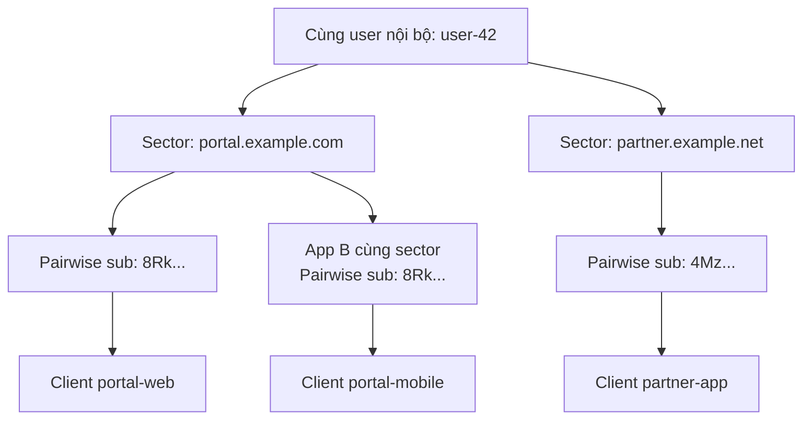
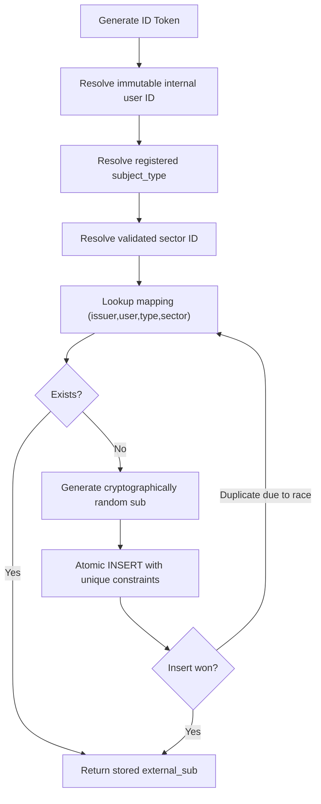
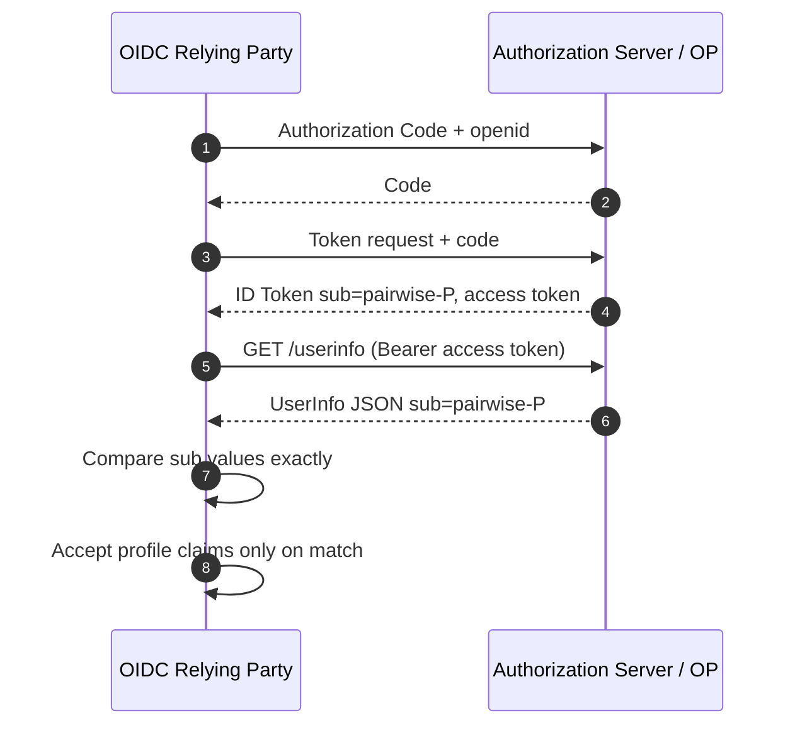
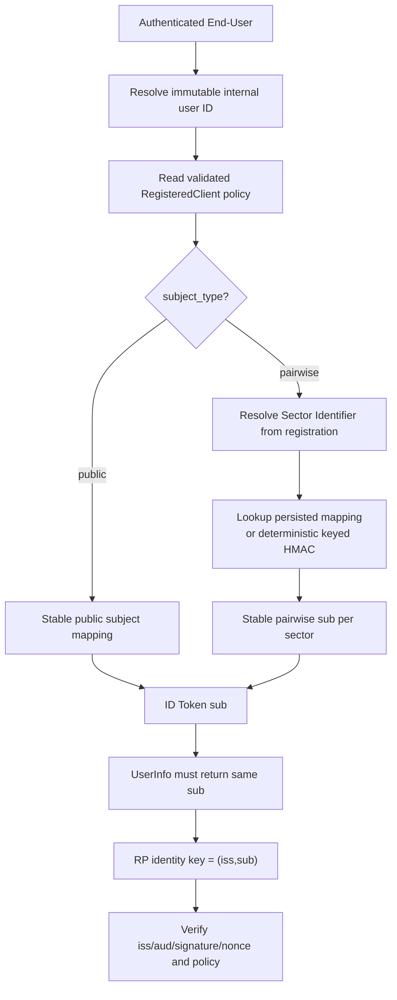

# Định danh subject ổn định và thiết kế pairwise subject khi cần

## 1. Mục tiêu và bối cảnh

Trong chương **OIDC Core và ID Token** của module **SPRING_SECURITY_OAUTH2_OIDC_AUTHORIZATION_SERVER**, định danh người dùng không chỉ là chọn một trường `username` rồi đặt vào JWT. OpenID Connect (OIDC) định nghĩa **Subject Identifier**, được mang trong claim `sub`, như một định danh ổn định của End-User tại OpenID Provider (OP). Khi cùng một người dùng đăng nhập nhiều ứng dụng, việc cung cấp chung một `sub` có thể giúp liên kết tài khoản, nhưng cũng có thể cho phép các ứng dụng không liên quan **theo dõi chéo người dùng**.

Bài học này giải thích hai chế độ theo **OpenID Connect Core 1.0**:

- **Public subject identifier:** cùng người dùng nhận một `sub` chung ở các clients thuộc cùng issuer.
- **Pairwise subject identifier:** OP cấp `sub` khác nhau theo **Sector Identifier** để giảm khả năng liên kết danh tính giữa các nhóm clients.

Trong ứng dụng **Spring Boot**, **Spring Security** và **Spring Authorization Server (SAS)**, cần thiết kế cả **identity model**, **registered client**, **ID Token customization**, **UserInfo**, **metadata/discovery**, **dữ liệu lưu trữ** và **vận hành chuyển đổi**. Chỉ thay một claim bằng chuỗi ngẫu nhiên mỗi lần đăng nhập không đáp ứng yêu cầu ổn định.

Sau bài học, bạn có thể:

1. Phân biệt `iss`, `sub`, `client_id`, username, email và account ID nội bộ.
2. Giải thích nguyên tắc subject ổn định, không bị cấp lại cho người dùng khác và được so khớp theo cặp `(iss, sub)`.
3. Chọn public hoặc pairwise theo mô hình liên kết tài khoản và yêu cầu riêng tư.
4. Xác định sector từ `sector_identifier_uri` hoặc host của redirect URI theo OIDC Core.
5. Thiết kế bảng ánh xạ pairwise hoặc hàm HMAC có quản lý secret lâu dài.
6. Tùy biến ID Token trong SAS mà không vô ý thay `sub` của access token.
7. Bảo đảm `sub` của UserInfo bằng `sub` trong ID Token và metadata công bố đúng subject types.
8. Kiểm thử độ ổn định, tính tách biệt, migration, multi-tenant, concurrency và rủi ro privacy.

**Phạm vi phiên bản:** Ví dụ dựa trên **OIDC Core 1.0**, các API phổ biến của **Spring Authorization Server 1.x / Spring Security 6.x / Spring Boot 3.x**. Quy trình đăng ký `sector_identifier_uri`, chọn `subject_type` và quản lý pairwise subject là **chính sách/logic mà ứng dụng có thể phải tự triển khai**; không mặc định mọi phiên bản SAS cung cấp pairwise subject tự động. Các đoạn code phân biệt rõ API framework với interface nghiệp vụ minh họa.

## 2. Subject trong OIDC là gì?

ID Token là một JWT mang thông tin về kết quả xác thực End-User mà OP gửi cho Relying Party (RP). Các claims cốt lõi bao gồm:

```json
{
  "iss": "https://auth.example.com",
  "sub": "Wb7PpK4yK2w5Kbn_YvpSgZJ0nTMh_4bPhUtR1nFmZVg",
  "aud": "portal-web",
  "iat": 1790000000,
  "exp": 1790000600
}
```

Đây là payload minh họa; JSON này chưa có chữ ký và không phải token sử dụng thật.

| Claim/thuộc tính | Ý nghĩa | Có được dùng làm user identity lâu dài? |
| --- | --- | --- |
| `iss` | Issuer/OP đã phát ID Token | Là một nửa của khóa định danh |
| `sub` | Subject Identifier của End-User tại issuer | Có, **khi đi cùng issuer** |
| `aud` | OIDC client ID là bên nhận ID Token | Không; là audience |
| `client_id` | Định danh của OAuth2/OIDC client | Không; là định danh ứng dụng |
| `email` | Email của người dùng | Không nên; có thể đổi, tái sử dụng hoặc chưa xác minh |
| `preferred_username` | Tên hiển thị/đăng nhập | Không; có thể đổi hoặc tái cấp |
| `name` | Tên hiển thị | Không; không duy nhất |
| Internal user ID | Định danh trong identity database | Dùng nội bộ; cân nhắc không tiết lộ trực tiếp |
| Session ID | Phiên đăng nhập trình duyệt | Không; thay theo phiên |
| `jti` | Định danh token JWT | Không; mỗi token có thể khác |

Theo OIDC Core, `sub` là chuỗi định danh ổn định, phân biệt chữ hoa/chữ thường, duy nhất trong phạm vi issuer cho End-User và **không được cấp lại cho một End-User khác**. Nó là định danh *của subject*, không phải mã phiên hay mã token.

**Quy tắc quan trọng nhất cho Relying Party:** Định danh tài khoản từ OIDC là **cặp `(issuer, subject)`**, không chỉ một chuỗi `sub`.

### 2.1. Vì sao cần cặp `(iss, sub)`?

Hai OP độc lập có thể cùng trả `sub = "12345"`. Điều đó không có nghĩa hai token thuộc cùng người.

```text
OP A:
iss = https://auth-a.example.com
sub = 12345

OP B:
iss = https://auth-b.example.com
sub = 12345

=> Hai định danh OIDC khác nhau.
```

Một RP dùng riêng `sub` làm khóa cơ sở dữ liệu có nguy cơ gộp nhầm tài khoản từ các issuer, đặc biệt khi hỗ trợ social login hoặc enterprise federation.

### 2.2. `sub` phải ổn định đến mức nào?

- Cùng issuer, cùng End-User và cùng sector (với pairwise) phải cho ra cùng `sub` qua các lần đăng nhập.
- Logout, đổi mật khẩu, đổi session, refresh token, đổi user-agent **không được** tự làm `sub` thay đổi.
- Thay email, username, tên hiển thị hay số điện thoại **không được** tự làm `sub` thay đổi.
- Không cấp lại `sub` cũ cho người khác sau khi tài khoản bị xóa.
- Chuyển database, đổi cluster, nâng phiên bản SAS, xoay signing key không được vô tình đổi `sub`.

Một quyết định account merge/split hoặc thay issuer có thể yêu cầu migration danh tính có chủ đích, nhưng không được thay im lặng như một implementation detail.

## 3. Public subject: đơn giản cho liên kết, rộng về khả năng correlation

**Public Subject Identifier** là `sub` mà OP cung cấp nhất quán cho cùng End-User ở các clients của cùng issuer.

Ví dụ:

| Issuer | Người dùng nội bộ | OIDC client | `sub` |
| --- | --- | --- | --- |
| `https://auth.example.com` | user-42 | portal-web | `usr_v1_7a1f` |
| `https://auth.example.com` | user-42 | mobile-app | `usr_v1_7a1f` |
| `https://auth.example.com` | user-42 | analytics-app | `usr_v1_7a1f` |
| `https://auth.example.com` | user-84 | portal-web | `usr_v1_c29e` |

Giá trị trên chỉ mang tính minh họa, không mô tả một thuật toán chuẩn.

### 3.1. Ưu điểm

- Dễ liên kết cùng một user qua nhiều ứng dụng thuộc cùng hệ thống.
- Dễ migrate hoặc chia sẻ account mapping giữa các RP do cùng tổ chức quản lý.
- Không cần bảng ánh xạ theo sector nếu đã có internal immutable identifier phù hợp.
- Đơn giản hơn khi debug federation, support và audit danh tính.

### 3.2. Nhược điểm

- Hai ứng dụng khác nhau nhận cùng `sub` có thể so khớp người dùng mà không cần email.
- Một client bị compromise có thể tiết lộ giá trị dùng để correlate ở các clients khác.
- Nếu `sub` trực tiếp là database ID tuần tự, có thể làm lộ cấu trúc người dùng hoặc hỗ trợ enumeration khi kết hợp nguồn dữ liệu khác.

**Public không có nghĩa public PII.** Có thể dùng một opaque identifier ngẫu nhiên, ổn định, không lộ ID database. Tuy nhiên, cùng opaque string vẫn cho phép các RPs tương quan người dùng nếu cùng issuer.

### 3.3. Khi nào nên dùng public subject?

Public subject phù hợp khi:

- Các ứng dụng do cùng tổ chức quản lý và cần định danh dùng chung.
- Có sự đồng thuận rõ ràng về việc liên kết tài khoản.
- Quyền truy cập claims/metadata được kiểm soát.
- Không có yêu cầu tách định danh theo từng RP group/sector.

Không nhất thiết đổi sang pairwise cho mọi hệ thống; việc chọn cần dựa trên mục đích xử lý dữ liệu, threat model và nhu cầu interoperability.

## 4. Pairwise subject: giảm khả năng liên kết giữa các sector

**Pairwise Subject Identifier** là định danh mà OP tính/lưu theo cặp **End-User + Sector Identifier**, trong phạm vi issuer. Cùng người dùng có thể có các `sub` khác nhau ở các sector khác nhau.



| Issuer | Local user | Client | Sector | Pairwise `sub` |
| --- | --- | --- | --- | --- |
| auth.example.com | user-42 | portal-web | `portal.example.com` | `pairwise-P` |
| auth.example.com | user-42 | portal-mobile | `portal.example.com` | `pairwise-P` |
| auth.example.com | user-42 | partner-app | `partner.example.net` | `pairwise-Q` |
| auth.example.com | user-84 | portal-web | `portal.example.com` | `pairwise-R` |

Ở đây `pairwise-P` khác `pairwise-Q`, dù cùng user nội bộ. Cùng sector có thể chủ ý nhận cùng subject để nhóm client có thể liên kết tài khoản.

### 4.1. Điều pairwise bảo vệ — và không bảo vệ

Pairwise giúp giảm khả năng correlate user qua **giá trị `sub`** giữa các sector khác nhau. Nó **không** tự:

- Ẩn email, phone, picture hoặc username nếu các claim đó vẫn được trả.
- Ngăn client tự correlate user bằng cookie, IP, device fingerprint hay external ID.
- Ngăn OP biết mọi pairwise subjects thuộc cùng internal user.
- Bảo vệ token khỏi đánh cắp hoặc thay việc xác minh chữ ký/issuer/audience.
- Bảo đảm hai clients cùng sector không thể correlate user: chúng nhận cùng pairwise `sub`.

Privacy policy cần xét cả profile claims, UserInfo response, consent, logging và telemetry chứ không chỉ `sub`.

## 5. Sector Identifier trong OIDC Core

**Sector Identifier** xác định nhóm client mà trong đó cùng End-User có thể nhận cùng pairwise `sub`. Sector được xác định từ host của `sector_identifier_uri` nếu client có đăng ký; nếu không, nó được suy từ host của `redirect_uri` đăng ký theo quy tắc OIDC.

Điểm cốt lõi là **sector được ràng buộc lúc đăng ký client**, không tự do chọn bằng request parameter trong từng lần login.

### 5.1. Trường hợp client chỉ có một redirect host

Registered Client:

```text
client_id = portal-web
redirect_uri = https://portal.example.com/login/oauth2/code/portal
sector_identifier_uri = (không đăng ký)
```

Sector mặc định là **host của redirect URI**:

```text
portal.example.com
```

Không dùng toàn bộ URL làm sector, cũng không lấy path `/login/oauth2/code/portal` làm một phần sector. Nếu ứng dụng đổi path callback nhưng giữ host và không thay sector, pairwise `sub` vẫn có thể giữ nguyên.

### 5.2. Nhiều redirect URI khác host

Nếu client đăng ký:

```text
https://portal.example.com/callback
https://mobile.example.net/callback
```

thì theo OIDC Core, client dùng pairwise subject **phải đăng ký `sector_identifier_uri`** khi các redirect URI có nhiều hostname khác nhau. Không được tự ý lấy hostname của một callback ngẫu nhiên tại thời điểm login, vì `sub` sẽ phụ thuộc vào redirect URI được chọn và có thể thay đổi giữa các lần đăng nhập.

### 5.3. `sector_identifier_uri` là gì?

Ví dụ client đăng ký:

```text
sector_identifier_uri =
https://sector.example.org/oidc/sector-identifier.json
```

Địa chỉ này dùng HTTPS và trả **JSON array** gồm các `redirect_uri` mà RP đã đăng ký:

```json
[
  "https://portal.example.com/callback",
  "https://mobile.example.net/callback"
]
```

Khi dùng `sector_identifier_uri`, sector là **host của URI này**:

```text
sector.example.org
```

**Không phải** host của `portal.example.com` hoặc `mobile.example.net`, và **không phải** giá trị `sector_identifier_uri` đầy đủ kèm path. Các redirect URI phải được xác thực/đối chiếu với JSON tại URI đăng ký theo quy tắc OIDC.

### 5.4. Hai client cùng sector

Hai RPs có thể cùng đăng ký sector URI với host `sector.example.org` nếu chính sách đăng ký cho phép. Khi đó, cùng user sẽ có cùng pairwise identifier trong sector đó.

Điều này hữu ích khi hai apps thuộc cùng pháp nhân/cùng nhóm sản phẩm cần liên kết tài khoản, nhưng là **quyết định privacy**: không nên gom các RP không liên quan vào một sector chỉ để tiết kiệm lưu trữ.

### 5.5. Khi redirect host hay sector URI thay đổi

- Đổi redirect callback path nhưng giữ sector: thường không cần đổi `sub`.
- Đổi redirect host mà **không** có sector URI cố định: sector có thể đổi, kéo theo `sub` đổi.
- Đổi host của `sector_identifier_uri`: sector đổi; nếu không có migration plan, có thể tạo subject mới.
- Đổi nội dung JSON redirect URI list nhưng giữ host sector URI: phải revalidate registration/redirect URLs; bản thân sector host vẫn là giá trị cũ.
- Chuyển ứng dụng sang domain mới: cân nhắc giữ sector URI cũ đáng tin cậy và maintain hợp đồng ownership/registration, hoặc chủ động migrate identity.

## 6. Quy tắc đăng ký `sector_identifier_uri` an toàn

Một ứng dụng vận hành OIDC có thể cần **Registration Service** riêng để lưu và xác thực sector settings thay vì dựa vào request authentication thời gian thực.

### 6.1. Quy trình đề xuất

1. Client owner đăng ký `client_id`, `redirect_uris`, `subject_type` và `sector_identifier_uri` nếu áp dụng.
2. AS xác minh redirect URIs hợp lệ và thuộc chính sách client.
3. Nếu dùng `sector_identifier_uri`, kiểm tra scheme HTTPS và host hợp lệ.
4. Truy xuất JSON document an toàn theo network/SSRF policy tại lúc đăng ký hoặc cập nhật.
5. Xác minh JSON là một array các absolute URI strings và bao gồm các redirect URIs cần đăng ký.
6. Tính sector từ host `sector_identifier_uri`, canonicalize theo policy rõ ràng và lưu lại.
7. Phê duyệt quyền liên kết sector giữa các clients/nhóm sản phẩm.
8. Chỉ dùng sector **đã xác thực và lưu trong registration**, không tải URI bên ngoài mỗi lần phát ID Token.
9. Khi client cập nhật redirect URIs/sector, revalidate và đánh giá ảnh hưởng tới subject mapping.

### 6.2. Tránh SSRF

`sector_identifier_uri` là URL do client owner cung cấp. Nếu backend tự fetch URL tùy ý, attacker có thể trỏ tới:

- `http://127.0.0.1` hay private IP.
- Cloud metadata endpoint/link-local.
- Internal admin APIs.
- Redirect tới host nội bộ.
- Domain thay đổi DNS record trong quá trình fetch.

Cần policy egress/allowlist, HTTPS certificate validation, giới hạn redirect, DNS rebinding defense, timeouts, response-size cap, JSON validation và audit. Không coi chỉ dùng HTTPS là đủ chống SSRF.

### 6.3. Bảo vệ tính ổn định

Nếu JSON ở sector URI thay đổi hoặc không truy cập được lúc user login, **không tự đổi sector sang redirect host**. Registration đã được phê duyệt là nguồn sector đáng tin cậy; lỗi revalidation cần được xử lý bằng workflow riêng thay vì cấp `sub` mới im lặng.

Không cho client tự gửi `sector_identifier` hoặc `subject_type=pairwise` trong authorization request rồi ép AS bỏ qua registration policy.

## 7. Thiết kế định danh nội bộ trước khi xuất `sub`

Một mô hình thực tế cần ít nhất ba khái niệm:

| Giá trị | Ví dụ | Vòng đời |
| --- | --- | --- |
| Internal immutable user ID | `user-01J3V...` | Tạo khi tạo tài khoản; không tái sử dụng |
| Public OIDC subject | `pub_N6a...` | Bền vững trong issuer cho user |
| Pairwise OIDC subject | `p_F3...` | Bền vững theo issuer + user + sector |

**Không lấy username/email trực tiếp làm `sub`**. Username có thể rename, email có thể chuyển giao/được tái sử dụng và có thể là PII.

### 7.1. Thiết kế internal user ID

Đề xuất:

- ID nội bộ bất biến, ngẫu nhiên/UUID hoặc chuỗi đủ entropy.
- Cột ID được quản lý bởi identity service, không phụ thuộc login name.
- Khi user bị xóa, dùng tombstone/retention phù hợp để tránh cấp lại ID và subject cho người khác.
- Nếu import/migrate users, giữ mapping user cũ → user mới theo quy trình đã xác minh.
- Không dùng ID của đối tượng nghiệp vụ dễ thay như employee number/email làm identity gốc.

### 7.2. Thiết kế external subject

Một external `sub` nên:

- Opaque, không tiết lộ PII hoặc database sequence.
- Duy nhất trong issuer cho đúng phạm vi sector.
- Được sinh/lưu bền vững và không bị tái cấp.
- Không quá dài; OIDC Core giới hạn subject string không vượt quá 255 ký tự ASCII.
- Có encoding ổn định, không đổi chữ hoa/thường tùy runtime.
- Không được thay khi user đổi mật khẩu hoặc đăng nhập lại.

Không dùng ngẫu nhiên **mỗi request** để tạo subject. Ngẫu nhiên chỉ phù hợp nếu giá trị được sinh **một lần và lưu lại** vào mapping lâu dài.

## 8. Chọn public hay pairwise: quyết định kiến trúc

| Câu hỏi | Gợi ý public subject | Gợi ý pairwise subject |
| --- | --- | --- |
| Nhiều apps có cần chủ đích nhận diện cùng user? | Có | Có thể dùng cùng sector cho nhóm apps |
| Apps thuộc các tổ chức không liên quan? | Có nguy cơ correlation | Tách sector để hạn chế correlation |
| Có yêu cầu riêng tư theo RPs? | Cần xem xét kỹ | Thường phù hợp hơn |
| Chuyển đổi từ hệ thống có public subject đã dùng lâu năm? | Ít rủi ro migration | Cần migration được phối hợp |
| Có thể vận hành sector registration/subject mapping bền vững? | Đơn giản hơn | Phức tạp hơn |
| OP cần giữ subject ngay cả khi client redirect URI đổi? | Có | Cần sector ổn định và policy chuyển đổi |

### 8.1. Không mặc định mỗi `client_id` là một sector

Pairwise theo OIDC dùng **Sector Identifier**, không mặc định theo `client_id`. Hai client cùng sector có thể nhận cùng `sub`. Nếu sản phẩm muốn mỗi client có `sub` riêng ngay cả khi cùng domain, cần thiết kế registration với sector separation tương thích OIDC hoặc một profile/contract đã được phê duyệt; đừng tuyên bố “pairwise chuẩn OIDC = hash(client_id + user_id)”.

### 8.2. Nếu không chắc chọn loại nào?

Hãy xác định các nhóm apps cần liên kết identity trước. Nếu tách hoàn toàn, bảo đảm sector khác nhau; nếu nhóm ứng dụng được phép liên kết, đặt sector theo domain/registration được kiểm soát.

Một khi subject type đã phát hành cho client, thay đổi lựa chọn có thể khiến RP mất liên kết tài khoản; coi đó là **breaking change**.

## 9. Cách 1: Bảng ánh xạ subject bền vững

Một cách dễ kiểm soát rotation/migration là **random pairwise subject được sinh một lần và lưu trong database**.

### 9.1. Lược đồ dữ liệu minh họa

```sql
CREATE TABLE oidc_subject_mapping (
    mapping_id       VARCHAR(64) PRIMARY KEY,
    issuer_id        VARCHAR(255) NOT NULL,
    internal_user_id VARCHAR(100) NOT NULL,
    subject_type     VARCHAR(20) NOT NULL,
    sector_id        VARCHAR(255) NOT NULL,
    external_sub     VARCHAR(255) NOT NULL,
    created_at       TIMESTAMP NOT NULL,
    retired_at       TIMESTAMP NULL,
    CONSTRAINT uq_oidc_subject_by_person_sector
        UNIQUE (issuer_id, internal_user_id, subject_type, sector_id),
    CONSTRAINT uq_oidc_external_subject
        UNIQUE (issuer_id, external_sub)
);
```

Bảng trên là ví dụ SQL trung tính, cần chỉnh kiểu dữ liệu, index và collation theo DB. Với public subject, có thể dùng một sector marker nội bộ cố định (không phải sector OIDC) hoặc bảng mapping riêng; không trộn semantic public và pairwise một cách mơ hồ.

Hai unique constraints bảo vệ:

- Một user trong một issuer+sector chỉ có một subject ổn định.
- Một external subject không bị dùng cho hai mappings khác nhau trong cùng issuer.

### 9.2. Quy trình sinh subject



Có thể sinh `external_sub` bằng random bytes đủ entropy rồi encode Base64URL không padding. Không tái dùng public subject ở pairwise mapping.

Ví dụ helper:

```java
public final class OpaqueSubjectGenerator {

    private final SecureRandom secureRandom = new SecureRandom();

    public String newSubject() {
        byte[] bytes = new byte[32]; // 256 bits
        secureRandom.nextBytes(bytes);

        return Base64.getUrlEncoder()
                .withoutPadding()
                .encodeToString(bytes);
    }
}
```

Đây chỉ là phần **sinh giá trị**. Phải lưu bền vững theo unique key và xử lý race bằng transaction/unique constraints. Nếu insert conflict, lookup mapping đã được tạo thay vì cấp subject mới lần thứ hai.

### 9.3. Ưu và nhược điểm

**Ưu điểm:**

- Không phụ thuộc lâu dài vào một HMAC secret.
- Dễ giữ subject ổn định khi xoay signing keys.
- Có thể migrate/merge/retire mappings theo quy trình có audit.
- Dễ phát hiện và xử lý collision/race qua DB constraints.

**Nhược điểm:**

- Phụ thuộc datastore/backup/HA.
- Bảng mapping nhạy cảm: nó tiết lộ mối liên hệ giữa các pairwise identities.
- Cần transaction isolation và chính sách tombstone/retention.
- Restore DB từ backup cũ có thể làm mất mapping đã phát, dẫn đến `sub` thay đổi nếu tự sinh lại.

**Không trả bảng mapping cho RPs**. Chỉ trả đúng external `sub` của sector được phép.

## 10. Cách 2: Pairwise subject xác định bằng HMAC

Có thể tính subject bằng một hàm keyed pseudorandom như HMAC-SHA-256:

```text
pairwise_sub =
    BASE64URL(
       HMAC-SHA256(
           secret_key,
           encode(issuer, sector_identifier, immutable_user_id)
       )
    )
```

Đây là **một thiết kế ứng dụng phù hợp mục tiêu ổn định/khó đảo ngược**, không phải thuật toán duy nhất mà OIDC Core bắt buộc. OIDC quy định các tính chất của pairwise identifier; OP chọn cách tạo miễn bảo đảm khó đảo ngược/khó đoán và duy trì tính ổn định.

### 10.1. Vì sao không dùng SHA-256 thuần?

Anti-pattern:

```text
sub = SHA256(tenant_id + "|" + email)
```

Email có thể bị đoán, không bất biến, separator có thể bị collision, và hash không khóa có thể bị brute-force bằng dictionary. Ngoài ra, email khiến subject thay đổi khi user đổi email.

HMAC với secret key được bảo vệ giúp chống việc tính ngược chủ động từ giá trị user/sector đoán được, miễn là key không bị lộ và encoding nhất quán.

### 10.2. Ví dụ Java với length-prefixed canonical encoding

```java
public final class HmacPairwiseSubjectService {

    private final SecretKey pairwiseKey;

    public HmacPairwiseSubjectService(SecretKey pairwiseKey) {
        this.pairwiseKey = pairwiseKey;
    }

    public String derive(String issuer,
                         String sector,
                         String immutableUserId) {

        Objects.requireNonNull(issuer);
        Objects.requireNonNull(sector);
        Objects.requireNonNull(immutableUserId);

        byte[] input = encode(
                issuer, sector, immutableUserId);

        try {
            Mac mac = Mac.getInstance("HmacSHA256");
            mac.init(pairwiseKey);

            return Base64.getUrlEncoder()
                    .withoutPadding()
                    .encodeToString(mac.doFinal(input));
        } catch (GeneralSecurityException ex) {
            throw new IllegalStateException(
                    "Could not derive pairwise subject", ex);
        }
    }

    private static byte[] encode(String... parts) {
        try {
            ByteArrayOutputStream output =
                    new ByteArrayOutputStream();
            DataOutputStream stream =
                    new DataOutputStream(output);

            for (String part : parts) {
                byte[] bytes =
                        part.getBytes(StandardCharsets.UTF_8);
                stream.writeInt(bytes.length);
                stream.write(bytes);
            }

            stream.flush();
            return output.toByteArray();
        } catch (IOException ex) {
            throw new UncheckedIOException(ex);
        }
    }
}
```

**Lưu ý về đoạn code:**

- `SecretKey` phải được nạp từ secret manager/KMS/HSM hoặc cơ chế quản lý khóa an toàn, **không tạo ngẫu nhiên lại sau mỗi restart**.
- Độ dài key HMAC phải đủ mạnh theo chính sách; không hard-code key trong source hoặc `application.yml`.
- `issuer`, `sector` và `immutableUserId` phải là chuỗi canonical/định danh ổn định từ nguồn được tin cậy.
- Length prefix tránh nhập nhằng như nối chuỗi không escape.
- Hash/HMAC output có thể dùng Base64URL ASCII opaque và không mang email/PII trực tiếp.
- Điều kiện ổn định phụ thuộc chính xác vào input, secret key và cách canonicalization; thay một trong các yếu tố sẽ thay subject.
- HMAC ở ví dụ được tính trong JVM; nếu key custody yêu cầu non-exportable key, cần triển khai keyed derivation qua HSM/KMS hỗ trợ hoặc dùng mapping database.

### 10.3. Quản lý secret HMAC lâu dài

Không đồng nhất secret HMAC với JWT signing private key:

- JWT signing key có thể xoay thường xuyên cùng `kid`/JWKS.
- HMAC pairwise key là một phần của **identity mapping contract lâu dài**.
- Đổi HMAC key mà không có kế hoạch chuyển đổi sẽ làm **tất cả pairwise subjects đổi**.
- Không dùng chung key giữa môi trường dev/staging/production.
- Tách key theo issuer/security domain khi policy yêu cầu.
- Bảo vệ truy cập key, sao lưu/khôi phục và kiểm soát audit.

Nếu cần thay key do compromise, không chỉ đổi biến môi trường và tiếp tục phát ID Token. Cần migration: giữ mappings đã phát hoặc thiết kế versioned subject strategy có ràng buộc rõ với các RPs. Trong nhiều hệ thống, **random persisted mapping** dễ giữ ổn định hơn dưới yêu cầu rotation gắt gao.

## 11. Quy tắc canonicalization và định danh sector

Một lỗi khó phát hiện là cùng một sector có nhiều biểu diễn chuỗi:

```text
PORTAL.EXAMPLE.COM
portal.example.com
portal.example.com.
xn--... (IDN/punycode)
```

Nên xác định canonicalization **một lần tại client registration** theo quy tắc URL/IDN được phê duyệt và lưu kết quả. Không tự thay cách chuẩn hóa giữa các bản phát hành ứng dụng.

### 11.1. Ví dụ helper lấy hostname từ URI

```java
public final class SectorHost {

    public static String fromValidatedUri(URI uri) {
        Objects.requireNonNull(uri);

        if (!"https".equalsIgnoreCase(uri.getScheme())) {
            throw new IllegalArgumentException(
                    "Sector identifier URI must use HTTPS");
        }

        String host = uri.getHost();
        if (host == null || host.isBlank()) {
            throw new IllegalArgumentException(
                    "Sector identifier URI requires a host");
        }

        return IDN.toASCII(host).toLowerCase(Locale.ROOT);
    }
}
```

Đây là helper minh họa, **không thay thế full URI validation**. Trước khi dùng cần loại userinfo, kiểm tra DNS/SSRF/redirect, port, hostname policy và khả năng bảo vệ ownership. Với sector không có `sector_identifier_uri`, cần suy host từ **registered redirect URI** theo OIDC rules, không phải từ URI do browser tự gửi vào callback.

### 11.2. Không lấy sector ở runtime từ `redirect_uri` tùy ý

Authorization request có thể chứa `redirect_uri` thuộc danh sách hợp lệ. Tuy nhiên việc xác định sector phải dựa trên registration đã được validate, không phải host của từng lần redirect. Nếu một client có nhiều host redirect mà không có sector URI hợp lệ, client registration cần bị từ chối/điều chỉnh, thay vì phát `sub` thay đổi theo route.

### 11.3. Issuer cũng là input quan trọng

Nếu hai issuer cùng dùng internal user ID và sector, không để pairwise subject của issuer A bị coi là định danh mặc nhiên tương đương issuer B. RP luôn dùng `(iss, sub)`, còn hệ thống derivation có thể domain-separate thêm issuer trong HMAC để giảm cross-issuer correlation theo policy.

## 12. Tích hợp trong Spring Authorization Server: điểm phát ID Token

SAS dùng `JwtGenerator`/`JwtEncoder` để tạo JWT. Điểm mở rộng claims là `OAuth2TokenCustomizer<JwtEncodingContext>`, trong đó `context.getTokenType()` cho biết token đang phát là access token hay OIDC ID Token.

**Không ghi đè `sub` của mọi JWT**. Access token có hợp đồng audience/subject riêng dành cho Resource Server; ID Token có `sub` là subject của End-User dành cho OIDC client. Việc dùng cùng một customizer bean không có nghĩa hai loại token phải có cùng giá trị.

### 12.1. Ví dụ customizer chỉ áp dụng cho ID Token

```java
@Configuration(proxyBeanMethods = false)
public class OidcSubjectConfiguration {

    @Bean
    OAuth2TokenCustomizer<JwtEncodingContext> oidcSubjectCustomizer(
            SubjectIdentifierService subjectIdentifierService) {

        return context -> {
            String tokenType = context.getTokenType().getValue();

            if (!OidcParameterNames.ID_TOKEN.equals(tokenType)) {
                return;
            }

            String issuer = context
                    .getAuthorizationServerContext()
                    .getIssuer();

            RegisteredClient client = context.getRegisteredClient();

            // Business service phải tìm user ID thật, bất biến,
            // từ authenticated end-user principal/authorization.
            String immutableUserId =
                    subjectIdentifierService.resolveUserId(context);

            String externalSubject =
                    subjectIdentifierService.subjectFor(
                            issuer, immutableUserId, client);

            context.getClaims().subject(externalSubject);
        };
    }
}
```

`SubjectIdentifierService` là **interface nghiệp vụ do ứng dụng định nghĩa**, không phải bean sẵn có của SAS. Nó phải:

1. Xác nhận `context` đại diện một **end-user authentication** hợp lệ trong OIDC grant, không lấy subject từ request parameter.
2. Giải ra internal immutable user ID; không dùng `principal.getName()` nếu đó là email/username có thể đổi.
3. Đọc `subject_type` và sector **đã đăng ký/được xác thực** của `RegisteredClient`.
4. Với `public`, trả public subject mapping ổn định.
5. Với `pairwise`, lookup/generate subject ổn định theo issuer+user+sector.
6. Không tạo lại subject khi token refresh, user đổi email hoặc AS restart.
7. Fail closed nếu không thể xác định sector, user hoặc policy; không fallback sang tên đăng nhập.

### 12.2. Interface minh họa cho domain layer

```java
public interface SubjectIdentifierService {

    String resolveUserId(JwtEncodingContext context);

    String subjectFor(
            String issuer,
            String immutableUserId,
            RegisteredClient registeredClient);
}
```

Đây là một **contract ví dụ**, không thể tự triển khai đầy đủ privacy chỉ bằng hai phương thức. Logic nên được chia nhỏ:

```text
IdentityResolver          -> immutable user ID
ClientRegistrationPolicy  -> subject_type, validated sector
SubjectMappingRepository  -> stable public/pairwise ID
SubjectIdentifierService  -> external sub
JwtEncodingContext        -> ID Token claims
```

Không thực hiện HTTP fetch `sector_identifier_uri` trên mỗi ID Token. Đó là thao tác có thể bị chậm, bị SSRF và có nguy cơ thay đổi sector theo nội dung remote.

### 12.3. Chú ý authentication principal

Trong OAuth2 flow, principal có thể là user, client hoặc authentication token trung gian tùy grant/stage. Với Authorization Code có user, cần lấy đúng authenticated end-user context được SAS lưu trong authorization. Không nhầm `client_id`, authenticated client principal hoặc access-token subject với ID Token `sub`.

**Không dùng Client Credentials grant để tạo ID Token cho một người dùng không tồn tại.** Pairwise subject áp dụng đến định danh End-User trong OIDC authentication.

### 12.4. Xác minh bằng token thực tế

Sau khi thêm customizer:

- Chạy Authorization Code + OIDC flow.
- Xác minh ID Token chữ ký thật qua JWKS.
- Kiểm tra `sub` của ID Token theo subject policy.
- Bảo đảm `iss`, `aud`, `exp`, `iat`, `nonce` và các điều kiện OIDC vẫn đúng.
- Bảo đảm access token không bị ghi đè `sub` ngoài chủ đích.
- Kiểm tra liên kết với `UserInfo` và session/login RP.

Customizer không thay thế OIDC validation ở RP; đó là hai trách nhiệm riêng.

## 13. OIDC UserInfo phải nhất quán với ID Token

OIDC Core yêu cầu RP khi nhận UserInfo Response phải kiểm tra `sub` của UserInfo **khớp chính xác** `sub` trong ID Token. Nếu không khớp, RP không được sử dụng UserInfo claims như thể chúng thuộc cùng End-User.

### 13.1. Luồng minh họa



Nếu ID Token trả `sub=pairwise-P` nhưng UserInfo trả internal user ID hoặc public subject, RP phải coi đó là lỗi.

### 13.2. Ví dụ dữ liệu hợp lệ

ID Token payload minh họa:

```json
{
  "iss": "https://auth.example.com",
  "sub": "pairwise-P",
  "aud": "portal-web",
  "iat": 1790000000,
  "exp": 1790000600
}
```

UserInfo response:

```json
{
  "sub": "pairwise-P",
  "name": "Nguyen Van A",
  "email": "user@example.com",
  "email_verified": true
}
```

Claims profile tùy theo scope, consent, data availability và policy, không mặc định mọi ID Token/UserInfo đều có email.

### 13.3. SAS UserInfo customization

Tùy phiên bản, SAS có endpoint configurer `oidcUserInfoEndpoint(...)` và các hook xử lý/mapper UserInfo. Nếu custom logic tạo UserInfo không lấy `sub` từ ID Token đã xác minh/authorization, cần **tái sử dụng subject resolver và cùng registration sector**, hoặc lấy chủ thể từ nguồn trusted đã gắn với authorization. Sau đó kiểm thử chính xác `sub` đồng nhất.

Không sửa một chiều chỉ ở `JwtEncodingContext` rồi cho rằng tất cả Resource Server, UserInfo, ID Token hint hay logout references sẽ tự cập nhật. Cần kiểm tra từng nơi dữ liệu subject được xuất ra.

### 13.4. UserInfo và access token subject

Access token có thể chứa `sub` phục vụ Resource Server khác với pairwise ID Token subject, tùy token profile. Điều đó không tự là lỗi OIDC nếu UserInfo được ràng buộc đúng End-User và trả `sub` giống ID Token. Tuy nhiên, implementer phải bảo đảm UserInfo không lấy nhầm access-token `sub` làm user-visible pairwise identifier khi chúng khác nhau.

## 14. OIDC Discovery và đăng ký subject types

OIDC Provider Configuration công bố danh sách `subject_types_supported`, ví dụ:

```json
{
  "issuer": "https://auth.example.com",
  "jwks_uri": "https://auth.example.com/oauth2/jwks",
  "subject_types_supported": ["public", "pairwise"]
}
```

**Đừng quảng bá `pairwise` nếu OP chưa thực sự hỗ trợ chính sách sector registration, stable mapping và UserInfo consistency.**

### 14.1. Public-only deployment

Một deployment chỉ hỗ trợ public subject có thể công bố:

```json
{
  "subject_types_supported": ["public"]
}
```

Đây là lựa chọn hợp lệ nếu phù hợp nhu cầu và chính sách identity. Không mặc định việc một provider có `sub` opaque đồng nghĩa nó đã hỗ trợ pairwise.

### 14.2. Cấu hình trong Spring Authorization Server

SAS có OIDC provider configuration endpoint và các extension points để tùy biến provider metadata theo version. Cần:

1. Bật OIDC trong `OAuth2AuthorizationServerConfigurer`.
2. Kiểm tra response `/.well-known/openid-configuration`.
3. Chỉ công bố `public`/`pairwise` khi đúng khả năng hệ thống.
4. Nếu hỗ trợ cả hai, xác định chính sách chọn subject type tại registration.
5. Kiểm tra registration validation và ID Token/UserInfo behavior thực tế.

Ví dụ bật OIDC bằng DSL:

```java
OAuth2AuthorizationServerConfigurer as =
        OAuth2AuthorizationServerConfigurer.authorizationServer();

http
    .securityMatcher(as.getEndpointsMatcher())
    .with(as, server ->
            server.oidc(Customizer.withDefaults()));
```

Đây là mảnh của `SecurityFilterChain`, chưa phải cấu hình AS hoàn chỉnh. Việc thêm `pairwise` vào metadata phải dựa vào **provider configuration customizer phù hợp version và implementation thực**, không chỉ sửa JSON tĩnh.

## 15. Bảo mật và quyền riêng tư cho subject identifiers

### 15.1. `sub` vẫn là dữ liệu liên kết được

Ngay cả pairwise subject không chứa email, cùng một giá trị ổn định có thể được liên kết giữa các phiên trong **cùng sector**. Tại OP, bảng ánh xạ nối nhiều pairwise subjects với internal user ID là dữ liệu nhạy cảm.

Do đó:

- Tối thiểu hóa ai có thể đọc subject mapping.
- Không để mapping table vào analytics export hoặc log thông thường.
- Không đặt `sub` trong query URL hoặc redirect log nếu không cần.
- Bảo vệ backup, support bundle, DB snapshots và key HMAC.
- Giới hạn retention, có chính sách khi user yêu cầu xóa dữ liệu theo quy định phù hợp.
- Không hiển thị internal ID trong exception/audit export cho RPs.
- Có mục đích và thẩm quyền rõ khi OP cần giải ánh xạ phục vụ support/security.

### 15.2. Không tự gán quyền dựa trên subject string

`sub` là **định danh**, không phải role hoặc permission. Resource Server cần xác minh access token đúng issuer/audience/scope và business authorization, không cho quyền admin vì `sub` mang prefix cụ thể.

### 15.3. Không dùng ID Token làm Bearer token cho API

ID Token được phát cho OIDC client (`aud=client_id`). Access token được sử dụng cho Resource Server. Cả hai có thể cùng là JWT nhưng có audience/validation khác nhau. Pairwise ID Token `sub` không phải lời khuyên cho API bỏ qua token type hoặc chuyển sang dùng ID Token.

### 15.4. Rủi ro correlation qua claims khác

Pairwise `sub` chỉ là một thành phần giảm liên kết. Nếu ID Token luôn phát `email`, `phone_number` hoặc employee ID toàn cục cho mọi client, các RPs vẫn correlate người dùng dễ dàng.

Chính sách tốt hơn:

- Chỉ cấp profile claims theo scope/consent/claim policy.
- Dùng `email_verified` đúng khi email đã thực sự được xác minh.
- Cân nhắc UserInfo khi client cần profile theo ngữ cảnh.
- Không đưa PII không cần vào access token.
- Tài liệu hóa rủi ro correlation của từng sector grouping.

## 16. Ảnh hưởng đến account linking tại Relying Party

Relying Party có thể lưu user mapping:

```sql
CREATE TABLE external_identity (
    identity_id       VARCHAR(64) PRIMARY KEY,
    local_account_id  VARCHAR(64) NOT NULL,
    issuer            VARCHAR(255) NOT NULL,
    subject           VARCHAR(255) NOT NULL,
    CONSTRAINT uq_external_identity UNIQUE (issuer, subject)
);
```

RP nên đối chiếu issuer và subject đã xác minh từ ID Token. Đừng ghép tài khoản tự động chỉ vì hai logins có cùng email.

### 16.1. Ví dụ nguy cơ account takeover qua email

- User A đăng nhập ở OP X với `email=person@example.com`.
- User B sau này sở hữu email tương tự hoặc OP Y cũng trả email đó.
- RP chỉ dùng email làm khóa liên kết, bỏ qua `iss` và `sub`.
- B có thể bị gán vào tài khoản của A nếu chính sách liên kết lỏng.

Dùng cặp `(iss, sub)` làm external identity key giúp tách danh tính OIDC. Nếu cần account linking giữa hai identities, phải yêu cầu proof/consent theo chính sách và audit.

### 16.2. Pairwise và liên kết giữa ứng dụng

Nếu hai RPs ở hai sector khác nhau muốn biết chúng đang phục vụ cùng user, chúng **không nên tự suy ra** từ pairwise `sub`. OP có thể cung cấp workflow liên kết tài khoản có consent, ví dụ một domain identity hub hoặc API có kiểm soát, nhưng phải đánh giá privacy/authorization riêng.

Không “giải” pairwise bằng cách cho clients biết internal ID; làm vậy phá mục tiêu tách định danh.

## 17. Migrations và thay đổi vòng đời

### 17.1. Đổi từ public sang pairwise

Đây là **breaking change** cho những RPs đã lưu `(iss, sub)`. RP có thể coi cùng user là tài khoản mới.

Kế hoạch khả thi:

1. Lập danh sách clients/tenants đang sử dụng public `sub`.
2. Thống nhất sector grouping và chính sách consent/privacy.
3. Tạo pairwise mapping ổn định trước khi phát token mới.
4. Xây secure migration process giúp RP liên kết external identity cũ và mới, chỉ khi đã xác minh quyền sở hữu user.
5. Thử nghiệm ở staging với dữ liệu không nhạy cảm hoặc đã xử lý an toàn.
6. Triển khai theo client/tenant và giám sát account-link failures.
7. Có kế hoạch rollback không cấp lại subject cho người dùng khác.

Không âm thầm đổi tất cả `sub` trong một release chỉ vì bật flag `pairwise=true`.

### 17.2. Đổi issuer

Issuer là phần của identity tuple. Chuyển từ:

```text
https://auth-old.example.com
```

sang:

```text
https://auth-new.example.com
```

sẽ tạo **identity mới ở góc nhìn RP** ngay cả khi `sub` giữ nguyên. Cần migration trust/registration/mapping; không sửa claim `iss` nhưng giữ JWKS khác mà mong client tự đồng nhất hai issuer.

### 17.3. Xoay JWT signing key

Xoay signing key và `kid`/JWKS **không nên làm đổi `sub`**. Pairwise HMAC key, nếu dùng, là secret có trách nhiệm riêng, không xoay cùng signing key trừ khi có migration được chủ đích.

### 17.4. Đổi sector/redirect URI

- Giữ sector qua cùng host và validated registration nếu có thể.
- Nếu đổi sector, đánh giá tác động tới RP account identity.
- Hỗ trợ dual mapping/migration theo policy nếu cần.
- Không dùng public `sub` làm fallback khi không tính được pairwise.
- Không lấy sector mới từ request chưa được phê duyệt.

### 17.5. Merge, split và delete user

Quy tắc chung:

- Không tái dùng external `sub` của người dùng đã xóa cho người khác.
- Merge accounts đòi xác minh quyền sở hữu cả hai và reconciliation rõ ràng.
- Split accounts cần mapping mới/đánh giá consent và không để cũ trỏ nhầm người.
- Preserve immutable subject mapping qua backup/restore.
- Thiết kế retention/tombstones theo security và privacy requirements.

## 18. Kiểm thử subject service và integration

### 18.1. Ma trận trường hợp chuẩn

| Test case | Kết quả mong đợi |
| --- | --- |
| Cùng user + issuer + public mode, client A/B | `sub` giống nhau |
| Cùng user + issuer + pairwise + cùng sector | `sub` giống nhau |
| Cùng user + issuer + pairwise + khác sector | `sub` khác nhau |
| Hai users + cùng issuer/sector | `sub` khác nhau |
| Cùng user đổi username/email | `sub` không đổi |
| Cùng user logout/login nhiều lần | `sub` không đổi |
| AS restart/rolling upgrade | `sub` không đổi |
| Thay JWT signing key | `sub` không đổi |
| Nhiều AS replicas dùng shared mapping | `sub` đồng nhất |
| Đổi redirect path, giữ sector | `sub` không đổi |
| Client có nhiều redirect hostname, không sector URI | Registration bị từ chối theo pairwise policy |
| Client có validated sector URI và các redirects hợp lệ | Sector lấy từ host của sector URI |
| `sector_identifier_uri` chứa SSRF target | Registration fetch bị chặn |
| User không xác định/registration không hợp lệ | Fail closed, không phát ID Token |
| ID Token pairwise `sub` và UserInfo `sub` | Khớp chính xác |
| ID Token `aud` hoặc `iss` sai | RP từ chối |
| Pairwise `sub` bị đưa vào log URL | Bị phát hiện và loại bỏ |
| Đổi từ public sang pairwise không có migration | Release bị chặn theo change policy |

### 18.2. Unit test cho HMAC ổn định và phân tách sector

```java
@Test
void pairwiseSubjectIsStableAndSeparatedBySector() {
    byte[] keyBytes = new byte[32];
    Arrays.fill(keyBytes, (byte) 0x5A);

    SecretKey key = new SecretKeySpec(
            keyBytes, "HmacSHA256");

    HmacPairwiseSubjectService service =
            new HmacPairwiseSubjectService(key);

    String issuer = "https://auth.example.com";
    String user = "immutable-user-42";

    String one = service.derive(
            issuer, "portal.example.com", user);

    String again = service.derive(
            issuer, "portal.example.com", user);

    String otherSector = service.derive(
            issuer, "partner.example.net", user);

    assertEquals(one, again);
    assertNotEquals(one, otherSector);
    assertFalse(one.contains(user));
}
```

**Lưu ý:** Key cố định trong unit test là test fixture, **không được dùng trong production**. Test này kiểm tra tính tất định và khác biệt theo sector, chưa đủ chứng minh secret storage, issuer isolation hay OIDC token lifecycle.

### 18.3. Unit test tách hai user

```java
@Test
void differentUsersCannotSharePairwiseSubject() {
    SecretKey key = new SecretKeySpec(
            new byte[32], "HmacSHA256"); // Test fixture only

    HmacPairwiseSubjectService service =
            new HmacPairwiseSubjectService(key);

    String a = service.derive(
            "https://auth.example.com",
            "portal.example.com",
            "user-A");

    String b = service.derive(
            "https://auth.example.com",
            "portal.example.com",
            "user-B");

    assertNotEquals(a, b);
}
```

Trong hệ thống persisted mapping, phải test unique constraints ở DB và race condition khi hai requests đồng thời tạo mapping cho cùng user/sector. Không chỉ test random generator không tạo trùng trong một vòng lặp nhỏ.

### 18.4. Integration test ID Token + UserInfo

1. Đăng ký OIDC client với `subject_type=pairwise` và sector hợp lệ.
2. Hoàn thành Authorization Code Flow có scope `openid`.
3. Đổi code lấy ID Token và access token.
4. Xác minh chữ ký ID Token bằng public JWKS.
5. Kiểm tra `iss`, `aud`, `exp`, `iat`, `nonce` theo flow.
6. Lưu `sub` trong ID Token.
7. Gọi UserInfo bằng access token hợp lệ.
8. Kiểm tra UserInfo `sub` bằng đúng giá trị đã lưu.
9. Đăng nhập lại cùng user/client; `sub` phải giữ nguyên.
10. Đăng nhập ở client khác cùng sector; `sub` phải khớp.
11. Đăng nhập ở client thuộc sector khác; `sub` phải khác.
12. Thử token của client sai audience hoặc issuer lạ; RP phải từ chối.

Không chỉ decode JWT payload rồi kết luận subject mapping và token validation đúng. Integration test phải kiểm tra chữ ký thực tế cùng các validation bắt buộc.

## 19. Lỗi thường gặp và cách chẩn đoán

| Triệu chứng | Nguyên nhân có thể | Hướng xử lý |
| --- | --- | --- |
| Mỗi login có `sub` khác nhau | Sinh random ID mỗi request, không lưu mapping | Tạo mapping một lần và persist |
| Đổi email làm mất tài khoản RP | Dùng email/username làm `sub` | Dùng immutable internal ID |
| Mobile và web có `sub` khác dù cần liên kết | Khác sector, không có sector URI chung | Thiết kế sector grouping/registration được phê duyệt |
| Hai RPs khác tổ chức nhận cùng `sub` | Public mode hoặc cùng sector | Xem lại privacy policy, tách sector hợp lệ |
| `sub` đổi sau rollout | HMAC secret, canonicalization hoặc mapping store thay đổi | Rollback/migrate có kiểm soát, kiểm tra key/storage |
| UserInfo trả `sub` khác ID Token | UserInfo dùng internal/public sub | Đồng bộ resolver hoặc lấy trusted subject từ authorization |
| `subject_types_supported` có `pairwise` nhưng login vẫn public | Metadata không khớp implementation | Sửa registration/subject customizer/tests |
| Access token `sub` thay ngoài ý muốn | JWT customizer áp dụng mọi token type | Chỉ custom ID Token hoặc policy riêng rõ ràng |
| Client có nhiều redirect hosts và không sector URI | Registration không tuân OIDC pairwise rules | Yêu cầu HTTPS sector URI và validate JSON |
| AS có SSRF khi đăng ký sector URI | Fetch URL không kiểm soát | HTTPS + egress policy/allowlist/redirect/DNS checks |
| Hai AS nodes trả `sub` khác nhau | Secret không đồng bộ hoặc mapping DB local | Shared store hoặc KMS secret thống nhất |
| New tenant trùng `sub` với tenant khác | Thiếu issuer/domain separation | Bảo vệ identity tuple `(iss,sub)` và key namespace |
| RP gộp hai người cùng email | Dùng email làm identity key | Lưu `(iss,sub)`, account linking có proof |
| Đổi issuer khiến RP coi là user mới | Identity tuple thay đổi | Migration federation/trust và mapping |
| Xóa user rồi tạo account mới nhận `sub` cũ | Reuse internal ID/mapping | Không tái cấp, giữ tombstone theo policy |
| Pairwise vẫn bị correlate bằng email | Profile claims chứa định danh chung | Giảm PII/scope/consent và rà soát privacy |

## 20. Checklist triển khai production

- [ ] Đã xác định subject type public/pairwise theo RP groups và privacy requirements.
- [ ] Mọi RP sử dụng `(iss,sub)` làm khóa external identity.
- [ ] Internal user ID bất biến, không phụ thuộc username/email và không bị tái cấp.
- [ ] External subject opaque, case-sensitive, ASCII, tối đa 255 ký tự.
- [ ] Subject ổn định qua login/logout/refresh/đổi email/rolling restart/key rotation.
- [ ] Pairwise subject được định danh theo **issuer + user + sector**, không tự động theo `client_id`.
- [ ] Các clients cùng sector chỉ được phép liên kết khi policy chấp thuận.
- [ ] `sector_identifier_uri` dùng HTTPS và validated JSON array chứa registered redirect URIs.
- [ ] Client có nhiều redirect host phải có sector URI hợp lệ khi dùng pairwise.
- [ ] Sector được canonicalize/lưu lúc registration, không lấy từ request tùy ý.
- [ ] Chặn SSRF khi fetch sector URI; không fetch mỗi login.
- [ ] Pairwise mapping DB có unique constraints, transaction, backup và tombstone policy.
- [ ] Nếu dùng HMAC, key được quản trị bền vững và không xoay làm đổi `sub` không chủ đích.
- [ ] JwtEncodingContext customizer chỉ thay ID Token `sub` đúng policy.
- [ ] UserInfo `sub` luôn khớp ID Token `sub`.
- [ ] OIDC discovery `subject_types_supported` phản ánh khả năng thật.
- [ ] RP xác minh chữ ký, `iss`, `aud`, `exp`, nonce và UserInfo subject equality.
- [ ] Không dùng ID Token làm API access token.
- [ ] Profile claims/consent không làm mất ý nghĩa privacy của pairwise.
- [ ] Không log internal ID mappings, pairwise secrets hoặc PII không cần.
- [ ] Có migration plan khi đổi issuer, subject type, sector, user store hoặc HMAC key.
- [ ] Đã test multi-instance, concurrency, account merge/split, failures và restore.
- [ ] Có audit và kiểm soát quyền truy cập subject mapping.

## 21. Bản đồ ghi nhớ



**`sub` trong OIDC là định danh bền vững của End-User tại issuer; `iss` xác định phạm vi tin cậy của định danh đó.** Public subject hỗ trợ liên kết người dùng trên các clients cùng issuer nhưng tăng khả năng correlation. Pairwise subject dùng sector được đăng ký để tách subject giữa các nhóm RP, với điều kiện OP duy trì cùng subject cho cùng user/sector qua vòng đời hệ thống. Trong Spring Authorization Server, thiết kế đúng đòi hỏi identity model bất biến, sector registration an toàn, mapping/HMAC ổn định, customizer ID Token có phân biệt token type, và UserInfo/discovery nhất quán. Nếu triển khai và kiểm thử đầy đủ các ranh giới này, OAuth 2.0/OpenID Connect Authorization Server có thể hỗ trợ cả liên kết danh tính có chủ đích lẫn giảm theo dõi chéo ứng dụng khi cần.
