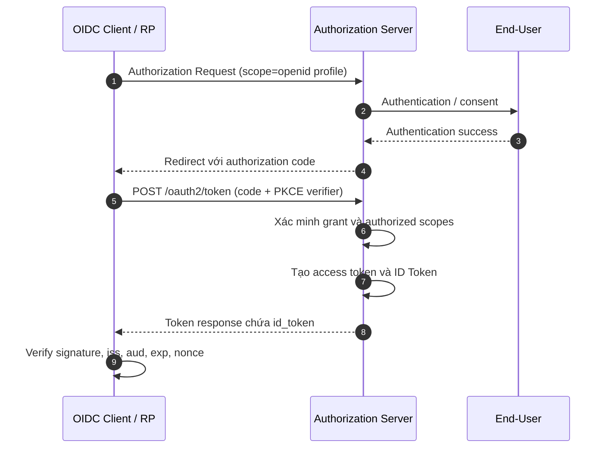

# Tùy chỉnh ID Token bằng OAuth2TokenCustomizer

## 1. ID Token có vai trò gì trong OpenID Connect?

Trong hệ thống **OAuth 2.0/OpenID Connect Authorization Server** sử dụng **Spring Security, Spring Authorization Server và Spring Boot**, OAuth 2.0 giải quyết việc cấp quyền truy cập tài nguyên, còn **OpenID Connect (OIDC)** bổ sung lớp xác thực người dùng trên OAuth 2.0. Sau khi người dùng đăng nhập và client hoàn thành authorization flow, OpenID Provider (OP) có thể phát hành **ID Token** để client biết danh tính và ngữ cảnh xác thực của người dùng.

ID Token thường là JWT đã ký. Nó mang các claims xác thực như:

- Ai là người phát hành token (`iss`).
- Người dùng được xác thực là ai (`sub`).
- Token được phát hành cho client nào (`aud`).
- Token được phát hành và hết hạn lúc nào (`iat`, `exp`).
- Một số thông tin xác thực như thời điểm đăng nhập (`auth_time`), phương thức xác thực (`amr`), mức xác thực (`acr`) hoặc nonce gắn với authentication request.

Ứng dụng có thể cần bổ sung claims như `name`, `email`, `preferred_username`, `locale` hoặc một claim nghiệp vụ có namespace. Spring Authorization Server cung cấp extension point:

```java
OAuth2TokenCustomizer<JwtEncodingContext>
```

Mục tiêu là **tùy chỉnh đúng ID Token**, giữ nguyên semantics OIDC và chỉ đưa vào token những thông tin client được phép nhận. ID Token là thông điệp xác thực dành cho OIDC client; nó không phải access token để gọi API.

Trong module **SPRING_SECURITY_OAUTH2_OIDC_AUTHORIZATION_SERVER**, mục tiêu là học cách thiết kế, cấu hình, bảo mật, kiểm thử và vận hành OAuth 2.0/OpenID Connect Authorization Server bằng Spring Security và Spring Authorization Server. Bài thuộc chương **OIDC Core và ID Token**, tập trung vào cách dùng `OAuth2TokenCustomizer` để thêm claims vào ID Token.

### Kết quả học tập

Sau bài học, bạn có thể:

1. Phân biệt ID Token, access token và UserInfo response.
2. Nhận biết các registered claims OIDC bắt buộc, có điều kiện và tùy chọn.
3. Cấu hình `OAuth2TokenCustomizer<JwtEncodingContext>` chỉ xử lý ID Token.
4. Lấy dữ liệu từ principal và user/claims service đáng tin cậy.
5. Giới hạn claims theo authorized scopes, client policy và consent.
6. Tránh ghi đè `iss`, `sub`, `aud`, `exp`, `iat`, `nonce`, `at_hash` và các claims giao thức.
7. Kiểm thử ID Token ở cả Authorization Server lẫn OIDC Relying Party.

**Phạm vi ví dụ:** Spring Boot 3.x, Spring Security 6.x và Spring Authorization Server 1.5.x trên Servlet stack. Một số API hoặc cách cấu hình có thể thay đổi ở phiên bản mới hơn; hãy kiểm tra Javadoc và tài liệu của đúng dependency đang sử dụng.

## 2. Phân biệt ID Token, access token và UserInfo

Ba loại dữ liệu này có consumer và mục đích khác nhau:

| Thành phần | Consumer chính | Mục đích | Ví dụ dữ liệu |
| --- | --- | --- | --- |
| **ID Token** | OIDC Client / Relying Party (RP) | Xác nhận authentication event và subject cho client | `iss`, `sub`, `aud`, `exp`, `iat`, `auth_time`, `nonce`, profile claims được phép |
| **Access token** | Resource Server / API | Cho phép truy cập protected resource theo scope/audience | `scope`, `aud` API, token binding và claims API cần |
| **UserInfo response** | OIDC Client gọi UserInfo Endpoint bằng access token | Cung cấp claims về End-User theo scope/authorization | `sub`, `name`, `email`, `picture`, claims profile khác |

### 2.1. ID Token là bằng chứng xác thực dành cho client

ID Token được phát hành trong OIDC authentication flow khi request có scope `openid`. Client phải kiểm tra token theo OIDC, bao gồm chữ ký, issuer, audience, thời hạn, nonce nếu request có gửi nonce và các điều kiện liên quan như `azp`.

ID Token không phải giấy phép gọi API. Không gửi ID Token vào header `Authorization: Bearer` để thay access token; API cần access token với audience và scope phù hợp.

### 2.2. Access token mang quyền truy cập tài nguyên

Access token có thể là JWT hoặc opaque/reference token. Resource Server xác minh token và kiểm tra quyền trên API. Không nhét toàn bộ quyền API vào ID Token chỉ để frontend đọc role; việc đó làm sai mục đích token và có thể lộ quyền cho client không cần chúng.

### 2.3. UserInfo phục vụ dữ liệu profile

UserInfo Endpoint trả về claims về người dùng dựa trên access token và quyền đã cấp. Nếu client cần profile data lớn, thay đổi thường xuyên hoặc chỉ cần khi gọi một màn hình cụ thể, UserInfo thường phù hợp hơn việc đưa toàn bộ dữ liệu vào ID Token.

Trong Spring Authorization Server, tùy chỉnh UserInfo được cấu hình qua `OidcUserInfoEndpointConfigurer` và `userInfoMapper(...)`. Đây là extension point riêng; `OAuth2TokenCustomizer<JwtEncodingContext>` dùng để tùy chỉnh JWT, trong đó có ID Token.

## 3. Các claims của ID Token theo OIDC Core

### 3.1. Claims bắt buộc

OIDC Core quy định ID Token phải có các claims sau:

| Claim | Ý nghĩa | Kiểm tra phía client |
| --- | --- | --- |
| `iss` | Issuer Identifier của OpenID Provider | Phải khớp issuer mà client tin cậy và đã cấu hình |
| `sub` | Subject Identifier của End-User | Phải là định danh ổn định theo quy tắc subject của OP |
| `aud` | Audience, chứa Client ID của RP | Phải bao gồm `client_id` của client hiện tại |
| `exp` | Thời điểm token hết hạn | Client không chấp nhận token sau thời điểm hết hạn, có clock tolerance theo policy |
| `iat` | Thời điểm token được phát hành | Client kiểm tra thời điểm phát hành theo policy và ngữ cảnh |

Các claims này là thành phần giao thức. **Không dùng customizer để tự ý thay giá trị hoặc xóa chúng**. Spring Authorization Server chịu trách nhiệm tạo các claims chuẩn từ issuer, client, authorization và token context.

### 3.2. Claims có điều kiện hoặc tùy chọn

| Claim | Khi nào xuất hiện | Ý nghĩa |
| --- | --- | --- |
| `nonce` | Authentication request có gửi `nonce` | Ràng buộc ID Token với request của client, giúp chống replay ID Token |
| `auth_time` | Client yêu cầu `max_age` hoặc yêu cầu claim `auth_time` theo quy tắc OIDC | Thời điểm người dùng thực sự được xác thực |
| `acr` | OP cung cấp Authentication Context Class Reference | Mức/ngữ cảnh xác thực đã đạt |
| `amr` | OP cung cấp Authentication Methods References | Các phương thức xác thực đã dùng |
| `azp` | Có thể xuất hiện khi audience có nhiều giá trị; trong trường hợp cần thiết OIDC yêu cầu hoặc khuyến nghị tùy điều kiện | Authorized Party, thường là Client ID được phép sử dụng token |
| `at_hash` | Một số response type hybrid/implicit trả access token cùng ID Token | Hash của access token theo OIDC |
| `c_hash` | Hybrid flow trả authorization code cùng ID Token | Hash của authorization code theo OIDC |
| `sid` | Khi OP hỗ trợ session identifier | Định danh phiên OIDC trong các tính năng liên quan |

Việc có mặt và cách tính các claim hash/nonce phụ thuộc response type và flow. **Đừng tự tính lại hoặc ghi đè chúng bằng chuỗi tùy ý**; hãy để framework/provider xử lý theo protocol implementation.

### 3.3. Claims profile chuẩn

OIDC định nghĩa các scope profile để client yêu cầu nhóm claims:

| Scope | Một số claims liên quan |
| --- | --- |
| `profile` | `name`, `family_name`, `given_name`, `middle_name`, `nickname`, `preferred_username`, `profile`, `picture`, `website`, `gender`, `birthdate`, `zoneinfo`, `locale`, `updated_at` |
| `email` | `email`, `email_verified` |
| `address` | `address` |
| `phone` | `phone_number`, `phone_number_verified` |

Scope là cơ chế yêu cầu và cấp quyền truy cập nhóm claims. Việc client gửi scope không tự động có nghĩa mọi claim trong nhóm phải được phát hành; OP vẫn phải áp dụng consent, user policy, claim availability và privacy policy.

### 3.4. Subject identifier không nên là email hoặc tên đăng nhập có thể đổi

`sub` là subject identifier của OIDC. Nên sử dụng định danh ổn định, không chứa PII không cần thiết và không đổi theo email/username. Nếu email thay đổi, `sub` của người dùng không nên thay đổi chỉ vì email mới.

OIDC hỗ trợ public và pairwise subject identifiers. Với pairwise subject, cùng một End-User có thể nhận subject khác nhau theo sector/client policy để giảm khả năng liên kết hoạt động giữa các client. Nếu triển khai pairwise subject, việc ánh xạ profile claims phải dùng cùng user identity nội bộ và subject mapping policy; không tự tạo một `sub` khác trong customizer.

## 4. Spring Authorization Server tạo ID Token như thế nào?

### 4.1. Luồng tạo token

Trong authorization code flow có OIDC:

1. Client gửi authorization request có scope `openid` và các scope/claims cần thiết.
2. Người dùng xác thực tại Authorization Server.
3. AS kiểm tra client, redirect URI, consent và authorization request.
4. Client nhận authorization code và gửi tới Token Endpoint.
5. AS xác minh code/client và tạo token theo grant đã cấp.
6. Khi OIDC yêu cầu, AS tạo ID Token JWT và trả về token response.



### 4.2. Vai trò của JwtEncodingContext

Spring Authorization Server cung cấp `JwtEncodingContext` trong quá trình mã hóa JWT. Context cho customizer truy cập các dữ liệu như:

- `getTokenType()`: loại token đang được tạo.
- `getRegisteredClient()`: client registration đã xác thực.
- `getPrincipal()`: Authentication principal của grant context.
- `getAuthorizationGrantType()`: loại grant, ví dụ authorization code hoặc refresh token.
- `getAuthorizedScopes()`: tập scope thực tế đã được cấp cho authorization.
- `getAuthorization()`: authorization state tương ứng nếu có.
- `getClaims()`: builder để thêm/chỉnh JWT claims.
- `getJwsHeader()`: builder cho JOSE/JWS header.

Một customizer có thể được gọi khi tạo nhiều JWT type khác nhau. Vì vậy phải kiểm tra token type trước khi thêm claims:

```java
OidcParameterNames.ID_TOKEN.equals(context.getTokenType().getValue())
```

Đây là cách phân biệt ID Token theo token type trong Spring Authorization Server. Không chỉ kiểm tra scope `openid`, vì scope này cũng có thể xuất hiện trong ngữ cảnh tạo access token.

### 4.3. Phân biệt token type ID Token và access token

| Token đang được tạo | Điều kiện kiểm tra | Claims nên thêm |
| --- | --- | --- |
| ID Token | `OidcParameterNames.ID_TOKEN` | Profile claims, authentication context claims và custom claims được client/consent cho phép |
| Access token JWT | `OAuth2TokenType.ACCESS_TOKEN` | Claims phục vụ Resource Server như audience, scope, roles/tenant nếu policy cho phép |
| JWT khác (nếu có) | Theo token type tương ứng | Chỉ claims phục vụ consumer tương ứng |

Nếu một bean customizer xử lý cả ID Token và access token, cần chia nhánh rõ ràng để không vô tình đưa email/profile vào access token hoặc roles API vào ID Token.

## 5. Cấu hình OAuth2TokenCustomizer để thêm claims

### 5.1. Tạo service lấy claims từ nguồn đáng tin cậy

Không lấy profile data từ request parameter, query string, header hoặc dữ liệu do client tự gửi. Tạo một service đọc từ identity store/user profile service sau khi xác minh subject:

```java
import java.util.Map;
import java.util.Set;

public interface OidcUserClaimsService {

    /**
     * Trả về các claims được phép cấp cho client cụ thể,
     * dựa trên subject và các scope thực tế đã được cấp.
     *
     * Không trả registered claims như iss, sub, aud, exp, iat.
     */
    Map<String, Object> claimsFor(
            String subject,
            String clientId,
            Set<String> authorizedScopes);
}
```

Implementation có trách nhiệm:

- Xác định subject nội bộ tương ứng với principal đã xác thực.
- Kiểm tra user có quyền đọc dữ liệu profile cần phát hành hay không.
- Áp dụng consent, client policy và scope được cấp.
- Chỉ trả claims có kiểu dữ liệu JSON phù hợp.
- Không trả password, secret, private credential hoặc thông tin không cần thiết.

### 5.2. Customizer chỉ áp dụng cho ID Token

Ví dụ cấu hình Spring:

```java
import org.springframework.context.annotation.Bean;
import org.springframework.context.annotation.Configuration;
import org.springframework.security.oauth2.core.oidc.OidcParameterNames;
import org.springframework.security.oauth2.server.authorization.token.JwtEncodingContext;
import org.springframework.security.oauth2.server.authorization.token.OAuth2TokenCustomizer;

@Configuration(proxyBeanMethods = false)
public class OidcIdTokenConfiguration {

    @Bean
    OAuth2TokenCustomizer<JwtEncodingContext> idTokenCustomizer(
            OidcUserClaimsService claimsService) {

        return context -> {
            // Chỉ tùy chỉnh ID Token, không tác động access token JWT.
            if (!OidcParameterNames.ID_TOKEN.equals(
                    context.getTokenType().getValue())) {
                return;
            }

            String subject = context.getPrincipal().getName();
            String clientId = context.getRegisteredClient().getClientId();

            claimsService.claimsFor(
                    subject,
                    clientId,
                    context.getAuthorizedScopes()
            ).forEach((claimName, claimValue) ->
                    context.getClaims().claim(claimName, claimValue));
        };
    }
}
```

Đây là mẫu tối giản. Trước khi sử dụng, cần bảo đảm `context.getPrincipal().getName()` chính là subject identifier ổn định mà ID Token mặc định sử dụng trong ứng dụng. Nếu principal name là email hoặc username có thể thay đổi, hãy sửa subject mapping tại tầng authentication/principal để toàn bộ OIDC flow dùng cùng một định danh; **không tự ghi đè `sub` trong customizer để che vấn đề**.

### 5.3. Thêm claim theo authorized scopes

Ví dụ service chỉ phát profile/email claims nếu scope tương ứng đã được cấp:

```java
import java.util.LinkedHashMap;
import java.util.Map;
import java.util.Set;

import org.springframework.security.oauth2.core.oidc.OidcScopes;
import org.springframework.stereotype.Service;

@Service
public class DefaultOidcUserClaimsService implements OidcUserClaimsService {

    private final UserProfileRepository profiles;

    public DefaultOidcUserClaimsService(UserProfileRepository profiles) {
        this.profiles = profiles;
    }

    @Override
    public Map<String, Object> claimsFor(
            String subject,
            String clientId,
            Set<String> authorizedScopes) {

        Map<String, Object> claims = new LinkedHashMap<>();

        if (authorizedScopes.contains(OidcScopes.PROFILE)) {
            profiles.findProfile(subject).ifPresent(profile -> {
                claims.put("name", profile.displayName());
                claims.put("preferred_username", profile.username());
                claims.put("locale", profile.locale());
            });
        }

        if (authorizedScopes.contains(OidcScopes.EMAIL)) {
            profiles.findEmail(subject).ifPresent(email -> {
                claims.put("email", email.address());
                claims.put("email_verified", email.verified());
            });
        }

        return claims;
    }
}
```

`UserProfileRepository`, `UserProfile` và `EmailProfile` ở đây là kiểu domain minh họa của ứng dụng. Hãy thay bằng repository/service thật. Việc kiểm tra scope là điều kiện cần; service còn phải kiểm tra client policy và consent nếu hệ thống có cơ chế cấp claims riêng theo từng RP.

**Không suy luận email đã xác minh chỉ vì người dùng nhập email.** Claim `email_verified` phải phản ánh trạng thái xác minh thực tế của identity system, không phải một boolean mặc định.

### 5.4. Custom claim theo client policy và custom scope

Nếu client cần một claim nghiệp vụ như department, hãy định nghĩa rõ client nào được phép nhận và cách user consent. Ví dụ dùng custom scope `employee`:

```java
private static final String EMPLOYEE_SCOPE = "employee";
private static final String DEPARTMENT_CLAIM =
        "https://claims.example.com/department";

if (authorizedScopes.contains(EMPLOYEE_SCOPE)
        && oidcClientPolicy.mayReceiveDepartment(clientId)) {
    departmentService.findDepartment(subject).ifPresent(department ->
            claims.put(DEPARTMENT_CLAIM, department));
}
```

Trong `RegisteredClient`, custom scope `employee` phải được đăng ký; authorization flow phải yêu cầu và cấp scope đó theo consent/policy. Không thêm claim department chỉ vì client có scope `openid` hoặc `profile`. Tên claim URI dùng namespace do tổ chức kiểm soát để tránh đụng tên claim chuẩn hoặc custom claim của hệ thống khác.

Ví dụ phần khai báo scopes trong client registration:

```java
RegisteredClient registeredClient = RegisteredClient.withId("orders-oidc-client")
        .clientId("orders-oidc-client")
        // Các thuộc tính client khác: secret/auth method/redirect URI/grant type...
        .scope(OidcScopes.OPENID)
        .scope(OidcScopes.PROFILE)
        .scope(OidcScopes.EMAIL)
        .scope("employee")
        .build();
```

Đoạn code chỉ minh họa scope registration; trong ứng dụng thật, dùng ID duy nhất, authentication method phù hợp, redirect URI đã đăng ký và grant type an toàn. Việc scope có trong client registration chỉ cho biết client có thể yêu cầu scope đó; authorization request, user consent và policy vẫn quyết định scope nào thực sự được cấp cho một authorization.

### 5.5. Chỉ dùng một customizer bean hoặc kết hợp có chủ đích

Một ứng dụng có thể cần nhiều nhóm tùy chỉnh JWT: claims access token, ID Token, header, tenant context. Hãy tổ chức thành một bean customizer có các nhánh rõ ràng hoặc tạo một customizer tổng hợp có thứ tự xác định.

Không khai báo nhiều bean cùng kiểu `OAuth2TokenCustomizer<JwtEncodingContext>` rồi giả định Spring tự động nối tất cả theo thứ tự. Cách wiring phụ thuộc cấu hình token generator; nếu cần nhiều logic, hãy kết hợp chúng rõ ràng và test để bảo đảm mọi customizer đều chạy đúng loại token.

## 6. Claims nào không được tùy tiện ghi đè?

### 6.1. Registered claims và OIDC protocol claims

Không ghi đè các claims mà provider phải tạo theo protocol:

| Claim | Vì sao không tự ghi đè? |
| --- | --- |
| `iss` | Phải là issuer identifier chính xác của OP |
| `sub` | Subject identifier phải ổn định và tuân subject type policy |
| `aud` | Phải bao gồm Client ID đúng; audience sai có thể làm token bị dùng nhầm client |
| `exp`, `iat` | Do token generator và clock policy quản lý |
| `nonce` | Phải khớp nonce từ authentication request khi được yêu cầu |
| `auth_time` | Phản ánh thời điểm xác thực thật, không phải thời điểm phát token |
| `at_hash`, `c_hash` | Có quy tắc tính toán OIDC phụ thuộc response type và signing algorithm |
| `azp` | Gắn với authorized party và audience semantics |
| `acr`, `amr` | Phải phản ánh authentication context/method thực tế |

Việc ghi đè claim có thể làm ID Token sai chuẩn hoặc khiến RP hiểu sai authentication event. Customizer nên tập trung vào **custom claims và profile claims đã được phép**.

### 6.2. Không đưa credential hoặc secret vào ID Token

Tuyệt đối không thêm:

- Password, password hash, recovery code.
- Client secret, signing private key, API key.
- Refresh token, authorization code hoặc access token raw.
- Session cookie hoặc internal bearer credential.
- Private key, symmetric key hoặc dữ liệu dùng để tạo credential.

JWT dạng JWS được ký nhưng payload thường chỉ base64url-encoded, không được mã hóa. Bất kỳ bên nào giữ ID Token đều có thể đọc payload. Chữ ký bảo vệ tính toàn vẹn, không bảo mật nội dung.

### 6.3. Giảm PII và dữ liệu profile

ID Token có thể được lưu trong browser, native app, logs hoặc telemetry tùy kiến trúc client. Chỉ thêm dữ liệu mà RP thực sự cần:

- Email/phone/address chỉ khi client có quyền và mục đích rõ.
- Không thêm ngày sinh, địa chỉ nhà, thông tin tài chính/sức khỏe hoặc dữ liệu nhạy cảm theo mặc định.
- Không phát internal database IDs nếu chúng tiết lộ cấu trúc hệ thống hoặc cho phép liên kết dữ liệu.
- Không đưa toàn bộ user profile object hoặc JSON lồng sâu vào token.

Nếu RP cần profile data sau khi đăng nhập, UserInfo Endpoint có thể phù hợp hơn vì client gọi theo nhu cầu và claims vẫn tuân scope/policy.

## 7. ID Token và UserInfo: nên đặt claims ở đâu?

| Tiêu chí | ID Token | UserInfo |
| --- | --- | --- |
| Thời điểm có dữ liệu | Ngay trong token response của authentication | Client gọi endpoint khi cần |
| Tính chất | Snapshot của authentication event | Profile data được trả tại thời điểm gọi |
| Đối tượng nhận | Client có audience trong ID Token | Client có access token phù hợp |
| Kích thước | Nên nhỏ, ổn định | Có thể lớn hơn nhưng vẫn cần data minimization |
| Thay đổi dữ liệu | Không đổi trong token đã phát | Có thể phản ánh dữ liệu mới hơn |
| Mục đích | Identity/authentication | User claims/profile |

### 7.1. UserInfo Mapper trong Spring Authorization Server

Nếu mục tiêu là tùy chỉnh UserInfo response, dùng `userInfoMapper(...)` trong OIDC UserInfo Endpoint configurer. Ví dụ minh họa:

```java
import org.springframework.context.annotation.Bean;
import org.springframework.context.annotation.Configuration;
import org.springframework.security.oauth2.core.oidc.OidcUserInfo;
import org.springframework.security.oauth2.server.authorization.oidc.authentication.OidcUserInfoAuthenticationContext;

import java.util.function.Function;

@Configuration(proxyBeanMethods = false)
public class OidcUserInfoConfiguration {

    @Bean
    Function<OidcUserInfoAuthenticationContext, OidcUserInfo> userInfoMapper(
            OidcUserClaimsService claimsService) {
        return context -> {
            String subject = context.getAuthorization().getPrincipalName();
            String clientId = context.getAuthorization().getRegisteredClientId();
            return new OidcUserInfo(claimsService.claimsFor(
                    subject,
                    clientId,
                    context.getAuthorization().getAuthorizedScopes()));
        };
    }
}
```

Đoạn mapper là ví dụ về ý tưởng; API type/import và cách đăng ký mapper cần đối chiếu với phiên bản Spring Authorization Server của dự án. Trong security configuration, mapper phải được gắn vào OIDC UserInfo Endpoint. Đừng nhầm mapper này với `OAuth2TokenCustomizer<JwtEncodingContext>`.

Ví dụ đoạn cấu hình gắn mapper vào Authorization Server filter chain:

```java
import java.util.function.Function;

import org.springframework.context.annotation.Bean;
import org.springframework.core.annotation.Order;
import org.springframework.security.config.Customizer;
import org.springframework.security.config.annotation.web.builders.HttpSecurity;
import org.springframework.security.oauth2.core.oidc.OidcUserInfo;
import org.springframework.security.oauth2.server.authorization.config.annotation.web.configurers.OAuth2AuthorizationServerConfigurer;
import org.springframework.security.oauth2.server.authorization.oidc.authentication.OidcUserInfoAuthenticationContext;
import org.springframework.security.web.SecurityFilterChain;

@Bean
@Order(1)
SecurityFilterChain authorizationServerChain(
        HttpSecurity http,
        Function<OidcUserInfoAuthenticationContext, OidcUserInfo> userInfoMapper)
        throws Exception {

    OAuth2AuthorizationServerConfigurer authorizationServer =
            OAuth2AuthorizationServerConfigurer.authorizationServer();

    http
        .securityMatcher(authorizationServer.getEndpointsMatcher())
        .with(authorizationServer, server -> server
            .oidc(oidc -> oidc
                .userInfoEndpoint(userInfo ->
                    userInfo.userInfoMapper(userInfoMapper))))
        .authorizeHttpRequests(authorize ->
            authorize.anyRequest().authenticated());

    return http.build();
}
```

Đây là phần cấu hình OIDC UserInfo Endpoint; ứng dụng còn cần các bean và filter chain cho login, client, authorization persistence, signing key và các endpoint khác. Nếu dự án đã có Authorization Server filter chain, hãy thêm đoạn `oidc(...userInfoEndpoint...)` vào cấu hình hiện tại thay vì tạo một chain thứ hai trùng endpoint matcher.

### 7.2. Không dùng ID Token làm UserInfo cache không giới hạn

ID Token là snapshot tại thời điểm authentication. Nếu email hoặc profile thay đổi, ID Token cũ không tự cập nhật. Nếu RP cần thông tin hiện tại, dùng UserInfo hoặc API profile có authorization phù hợp; không tăng kích thước ID Token để biến nó thành bản sao database người dùng.

## 8. Thiết kế custom claims an toàn và ổn định

### 8.1. Chọn tên claim

Custom claim nên có namespace để tránh va chạm:

```json
{
  "https://claims.example.com/department": "engineering",
  "https://claims.example.com/employee_type": "full_time"
}
```

Đây là tên minh họa; dùng domain/namespace do tổ chức kiểm soát. Tránh dùng tên ngắn như `role`, `tenant`, `department` nếu nhiều hệ thống cùng định nghĩa với semantics khác nhau.

### 8.2. Kiểu dữ liệu và schema

| Dữ liệu | Kiểu JSON nên dùng | Ví dụ |
| --- | --- | --- |
| Boolean | Boolean | `"email_verified": true` |
| Thời điểm | NumberDate theo claim chuẩn hoặc format đã thống nhất cho custom claim | `auth_time: 1794820200` |
| Danh sách | Array string | `"groups": ["sales", "support"]` |
| Số lượng | Number | `"risk_level": 2` nếu có định nghĩa rõ |
| Đối tượng | Object nhỏ, schema version rõ | Chỉ dùng khi thật sự cần |
| Identifier | String ổn định, không chứa secret | `"department": "engineering"` |

Không trả Java object tùy ý hoặc entity JPA trực tiếp vào claim. Hãy map sang DTO/schema rõ ràng; tránh vô tình serialize lazy relation, password hash, internal fields hoặc dữ liệu không mong muốn.

### 8.3. Giữ token nhỏ và có versioning

ID Token lớn làm tăng:

- Băng thông và thời gian xử lý ở client.
- Rủi ro vượt giới hạn cookie/header/storage của browser/proxy nếu token được chuyển qua các tầng đó.
- Nguy cơ lộ PII qua logs, traces, crash reports và analytics.
- Chi phí tương thích khi nhiều client cùng tiêu thụ claims.

Đổi tên hoặc đổi kiểu claim là thay đổi contract. Nếu nhiều RP đang sử dụng, hãy có lộ trình tương thích: phát song song claim mới/cũ trong thời gian chuyển đổi, ghi nhận client version và gỡ claim cũ sau khi migration hoàn tất.

### 8.4. Claim theo từng client

Không phải mọi OIDC client đều cần cùng profile:

- Client web nội bộ có thể cần `name` và `preferred_username`.
- Ứng dụng hỗ trợ khách hàng có thể cần `email` nếu được consent.
- Client HR có thể cần `department` nếu được policy cho phép.
- Một client analytics không nên nhận email/phone nếu chỉ cần subject giả danh.

Dùng client policy và authorized scopes để giới hạn claims. Không chỉ dựa vào client_id được gửi trong request chưa xác thực; hãy lấy client từ `JwtEncodingContext.getRegisteredClient()` đã được provider xác định.

## 9. Kiểm tra ID Token ở phía Relying Party

Việc phát hành ID Token có custom claims chỉ là một nửa của contract. RP phải xác minh ID Token trước khi tạo session hoặc coi người dùng đã đăng nhập.

### 9.1. Các bước xác minh

RP cần:

1. Lấy issuer và JWKS từ discovery metadata đáng tin cậy hoặc cấu hình out-of-band.
2. Xác minh chữ ký bằng thuật toán được chấp nhận và key phù hợp.
3. Kiểm tra `iss` chính xác.
4. Kiểm tra `aud` chứa đúng `client_id`.
5. Nếu `aud` có nhiều audience, xử lý `azp` theo OIDC Core.
6. Kiểm tra `exp`, `iat` và clock tolerance.
7. Nếu authorization request có `nonce`, so sánh với nonce đã lưu cho browser/session request.
8. Kiểm tra các hash claims (`at_hash`, `c_hash`) khi flow/response type yêu cầu.
9. Áp dụng `auth_time`, `acr`, `amr` theo yêu cầu authentication của ứng dụng.
10. Chỉ sau khi validation thành công mới tạo session hoặc dùng claims.

Không chỉ decode JWT payload rồi tin nội dung. Base64url decode không xác minh chữ ký, issuer, audience hoặc nonce.

### 9.2. Custom claims không thay thế protocol validation

RP có thể dùng claim department để hiển thị UI hoặc chọn luồng nghiệp vụ, nhưng vẫn phải xác minh ID Token trước. Custom claim không được dùng để bỏ qua `aud`, `iss`, `exp`, `nonce` hoặc authentication policy.

Nếu claim là căn cứ cấp quyền cho một API, API cần access token có audience/scope đúng và kiểm tra authorization riêng. ID Token có audience là client, không phải Resource Server.

## 10. Kiểm thử customizer và ID Token end-to-end

### 10.1. Unit test cho policy chọn claims

Tách policy chọn claims thành service có thể kiểm thử độc lập:

```java
import java.util.LinkedHashMap;
import java.util.Map;
import java.util.Set;

import org.springframework.security.oauth2.core.oidc.OidcScopes;

public final class OidcClaimPolicy {

    private OidcClaimPolicy() {
    }

    public static Map<String, Object> profileClaims(
            Set<String> scopes,
            String displayName,
            String email,
            boolean emailVerified) {

        Map<String, Object> claims = new LinkedHashMap<>();

        if (scopes.contains(OidcScopes.PROFILE) && displayName != null) {
            claims.put("name", displayName);
        }
        if (scopes.contains(OidcScopes.EMAIL) && email != null) {
            claims.put("email", email);
            claims.put("email_verified", emailVerified);
        }
        return claims;
    }
}
```

Test ví dụ JUnit 5:

```java
import java.util.Map;
import java.util.Set;

import org.junit.jupiter.api.Test;
import org.springframework.security.oauth2.core.oidc.OidcScopes;

import static org.assertj.core.api.Assertions.assertThat;

class OidcClaimPolicyTest {

    @Test
    void profileScopeControlsNameClaim() {
        Map<String, Object> claims = OidcClaimPolicy.profileClaims(
                Set.of(OidcScopes.OPENID, OidcScopes.PROFILE),
                "Lan Nguyen",
                "lan@example.com",
                true);

        assertThat(claims)
                .containsEntry("name", "Lan Nguyen")
                .doesNotContainKey("email");
    }

    @Test
    void emailScopeControlsEmailClaims() {
        Map<String, Object> claims = OidcClaimPolicy.profileClaims(
                Set.of(OidcScopes.OPENID, OidcScopes.EMAIL),
                "Lan Nguyen",
                "lan@example.com",
                false);

        assertThat(claims)
                .containsEntry("email", "lan@example.com")
                .containsEntry("email_verified", false)
                .doesNotContainKey("name");
    }

    @Test
    void openidAloneDoesNotExposeProfileOrEmail() {
        Map<String, Object> claims = OidcClaimPolicy.profileClaims(
                Set.of(OidcScopes.OPENID),
                "Lan Nguyen",
                "lan@example.com",
                true);

        assertThat(claims).isEmpty();
    }
}
```

Các test này kiểm tra policy chọn claims, không chứng minh token generator thực sự chỉ thêm claims vào ID Token. Cần integration test ở cấp Token Endpoint.

### 10.2. Ma trận kiểm thử tích hợp

| ID | Kịch bản | Kết quả mong đợi |
| --- | --- | --- |
| O01 | Authorization request có `openid` | Flow OIDC có thể phát ID Token |
| O02 | Request không có `openid` | Không phát ID Token chỉ vì client yêu cầu OAuth scope khác |
| O03 | Có `openid profile` | Profile claims được thêm theo policy |
| O04 | Có `openid email` | Email claims được thêm nếu dữ liệu tồn tại và consent/policy cho phép |
| O05 | Chỉ có `openid` | Không lộ profile/email claims ngoài policy |
| O06 | Custom scope `employee` được cấp | Custom department claim chỉ xuất hiện cho client đủ policy |
| O07 | Client không được phép nhận department | Claim department vắng mặt dù principal có department |
| O08 | Principal thiếu profile | Không phát giá trị giả hoặc claim rỗng sai schema |
| O09 | Email chưa verify | `email_verified` là false, không tự đặt true |
| O10 | Client khác nhau cùng subject | Claims được lọc theo client policy |
| O11 | Access token JWT được tạo | ID Token-only custom claims không xuất hiện ngoài policy |
| O12 | ID Token được tạo | Customizer nhận diện `OidcParameterNames.ID_TOKEN` |
| O13 | Claims service lỗi | Token generation xử lý theo fail policy, không cấp dữ liệu mặc định rộng |
| O14 | `sub` là email có thể đổi | Test phát hiện subject mapping không đạt yêu cầu ổn định |
| O15 | Authentication request có nonce | ID Token chứa nonce tương ứng theo protocol |
| O16 | Request có `max_age` | `auth_time` phản ánh thời điểm authentication thực tế |
| O17 | Audience có nhiều giá trị | `azp`/audience semantics đúng OIDC |
| O18 | Hybrid/implicit response cần hash claims | `at_hash`/`c_hash` do framework xử lý đúng |
| O19 | Custom claim trùng tên registered claim | Policy ngăn ghi đè claim chuẩn |
| O20 | ID Token được RP nhận | RP xác minh chữ ký, issuer, audience, expiry và nonce |
| O21 | ID Token audience sai client | RP từ chối |
| O22 | Nonce mismatch/replay | RP từ chối ID Token |
| O23 | Claim kiểu dữ liệu sai | Integration test phát hiện schema không tương thích |
| O24 | Token chứa PII ngoài scope/consent | Không xuất hiện trong ID Token |
| O25 | UserInfo cần profile động | UserInfo mapper trả claims theo scope/policy |
| O26 | ID Token được dùng thử làm Bearer token API | Resource Server từ chối do token type/audience/policy |

### 10.3. Kiểm tra token response

Trong test, hoàn thành authorization code + PKCE flow với test user và test client:

- Kiểm tra response có `id_token` khi OIDC flow yêu cầu.
- Xác minh chữ ký và decode bằng decoder test phù hợp.
- Kiểm tra standard claims vẫn có và không bị customizer ghi đè.
- Kiểm tra profile/custom claims đúng scope/client.
- Kiểm tra access token không bị thêm claims chỉ dành cho ID Token.
- Kiểm tra RP validation và tạo session chỉ sau khi xác minh thành công.

Không sử dụng JWT production hoặc PII thật trong fixture, CI logs hoặc snapshot công khai.

## 11. Các lỗi thiết kế thường gặp

| Lỗi | Hậu quả | Cách xử lý |
| --- | --- | --- |
| Thêm claims mà không kiểm tra token type | Profile claims lọt vào access token hoặc ngược lại | So sánh `OidcParameterNames.ID_TOKEN` trước khi thêm |
| Dùng ID Token làm access token | API nhận sai audience/token purpose | Dùng access token cho Resource Server |
| Thêm email cho mọi client | Lộ PII vượt nhu cầu | Authorized scopes, consent và client policy |
| Tin request parameter để tạo claim | Client có thể tự chọn identity/profile | Đọc từ principal và trusted identity store |
| Dùng email làm `sub` | Subject thay đổi khi email thay đổi | Stable/pairwise subject identifier |
| Ghi đè `iss`, `aud`, `exp`, `iat`, `nonce` | ID Token sai chuẩn hoặc xác minh sai | Để token generator quản lý protocol claims |
| Tự tính `at_hash`/`c_hash` sai | RP từ chối hoặc kiểm tra sai response | Để provider xử lý theo flow và signing algorithm |
| Đưa toàn bộ user entity vào JWT | Lộ fields nội bộ, token lớn và schema khó quản lý | Map sang claim DTO allowlist |
| Dùng scope `openid` để cấp mọi profile data | Consent/scope semantics bị mở rộng | Kiểm tra scope profile/email/address/phone hoặc custom claim grant |
| Đưa role API vào ID Token để API dùng | Nhầm identity token với authorization token | Role/API permissions ở access token và policy RS |
| Dùng customizer cho UserInfo | Dữ liệu động không đi đúng endpoint | Dùng UserInfo mapper riêng |
| Khai báo nhiều customizer cùng kiểu nhưng không compose | Một số logic không chạy hoặc wiring không rõ | Một customizer tổng hợp có nhánh rõ ràng |
| Tin payload chỉ vì decode được | Token giả mạo có thể được chấp nhận | RP phải xác minh chữ ký và OIDC claims |
| Không kiểm tra `nonce` ở RP | ID Token có thể bị replay giữa auth sessions | Lưu và đối chiếu nonce theo request |
| Không version hóa claim contract | Client cũ hỏng khi đổi schema | Migration song song và kiểm thử compatibility |

## 12. Checklist production

**OIDC semantics**

- [ ] ID Token chỉ được phát trong OIDC flow có scope `openid`.
- [ ] `iss`, `sub`, `aud`, `exp`, `iat` được provider tạo đúng.
- [ ] `sub` ổn định, không phụ thuộc email/username có thể đổi.
- [ ] `nonce`, `auth_time`, `acr`, `amr`, `azp`, `at_hash`, `c_hash` tuân OIDC khi áp dụng.
- [ ] ID Token audience là OIDC client; API dùng access token riêng.

**Customizer và claims**

- [ ] Customizer kiểm tra `OidcParameterNames.ID_TOKEN`.
- [ ] Claims lấy từ principal/identity store đáng tin cậy.
- [ ] Profile/email/address/phone claims chỉ cấp theo authorized scopes, consent và client policy.
- [ ] Custom claims có namespace và schema/type rõ.
- [ ] Không ghi đè registered claims hoặc thêm secret/credential.
- [ ] ID Token nhỏ, không chứa PII/dữ liệu nhạy cảm không cần thiết.
- [ ] UserInfo được tùy chỉnh bằng mapper riêng khi phù hợp.

**Kiểm thử và vận hành**

- [ ] Có unit test policy claim selection và integration test Token Endpoint.
- [ ] Có RP test xác minh chữ ký, issuer, audience, expiry, nonce.
- [ ] Test riêng access token và ID Token, không dùng chung giả định.
- [ ] Có test scope/consent/client-specific claim và claims service failure.
- [ ] Không ghi raw ID Token hoặc PII vào logs/traces.
- [ ] Có schema versioning/migration cho RP consumers.

## 13. Tài liệu tham khảo

- [OpenID Connect Core 1.0 — ID Token](https://openid.net/specs/openid-connect-core-1_0.html#IDToken): định nghĩa ID Token, claims bắt buộc, claims có điều kiện và validation.
- [OpenID Connect Core 1.0 — Standard Claims](https://openid.net/specs/openid-connect-core-1_0.html#StandardClaims): profile claims và ý nghĩa của chúng.
- [OpenID Connect Core 1.0 — UserInfo Endpoint](https://openid.net/specs/openid-connect-core-1_0.html#UserInfo): UserInfo response và subject consistency.
- [Spring Authorization Server — How-to: Customize JWT Claims](https://docs.spring.io/spring-authorization-server/reference/guides/how-to-custom-claims-authorities.html): sử dụng `OAuth2TokenCustomizer<JwtEncodingContext>`.
- [Spring Authorization Server — Core Model Components](https://docs.spring.io/spring-authorization-server/reference/core-model-components.html): registered client, authorization và token components.
- [Spring Authorization Server — Protocol Endpoints](https://docs.spring.io/spring-authorization-server/reference/protocol-endpoints.html): OIDC endpoints và customization points.
- [Spring Security — OAuth2 Resource Server JWT](https://docs.spring.io/spring-security/reference/servlet/oauth2/resource-server/jwt.html): JWT validation ở Resource Server; không dùng thay RP ID Token validation.
- [RFC 7519 — JSON Web Token](https://www.rfc-editor.org/rfc/rfc7519): registered claims và JWT representation.

**Kết luận:** `OAuth2TokenCustomizer<JwtEncodingContext>` cho phép Spring Authorization Server bổ sung claims vào JWT, nhưng customizer phải kiểm tra đúng token type bằng `OidcParameterNames.ID_TOKEN`. Chỉ cấp profile/custom claims dựa trên principal đã xác thực, authorized scopes, consent và client policy. Hãy để provider quản lý các claims giao thức như `iss`, `sub`, `aud`, `exp`, `iat`, `nonce` và hash claims; dùng UserInfo cho dữ liệu profile động hoặc lớn. ID Token luôn dành cho OIDC client và phải được RP xác minh đầy đủ trước khi dùng để thiết lập phiên đăng nhập.
