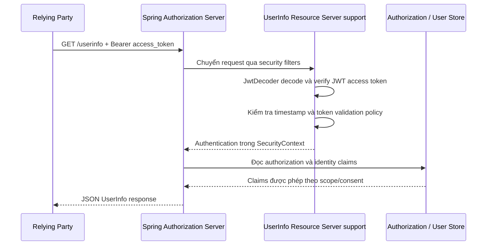

# Cấu hình Resource Server và JwtDecoder phục vụ UserInfo

## 1. Bối cảnh và mục tiêu

Trong hệ thống OAuth 2.0/OpenID Connect (OIDC) sử dụng **Spring Security**, **Spring Authorization Server** và Spring Boot, OIDC Provider (OP) có thể cung cấp UserInfo Endpoint để Relying Party (RP) lấy thêm claims về End-User sau khi đăng nhập.

UserInfo không phải endpoint đọc hồ sơ công khai. Theo OIDC Core, đây là một **OAuth 2.0 protected resource**: RP gửi access token dưới dạng Bearer token; OP xác thực token trước khi trả các claims được phép theo scopes, consent và policy.

Trong Spring Authorization Server, bật OIDC sẽ tự cấu hình resource server support cho UserInfo endpoint. Tuy nhiên, cấu hình này cần một bean **JwtDecoder** để giải mã và xác minh JWT access token. Bean decoder thường được tạo từ cùng **JWKSource<SecurityContext>** mà Authorization Server dùng cho khóa ký.

Bài học thuộc chương **OIDC UserInfo**, tập trung vào cấu hình Resource Server và JwtDecoder phục vụ UserInfo endpoint.

Sau bài này, bạn có thể:

1. Giải thích vì sao UserInfo được xem là protected resource.
2. Phân biệt ID Token với access token trong request UserInfo.
3. Bật OIDC UserInfo endpoint trong Spring Authorization Server.
4. Cấu hình JwtDecoder để xác minh access token JWT.
5. Hiểu mối liên hệ giữa JWKSource, signing key, JWKS và decoder.
6. Tổ chức SecurityFilterChain cho protocol endpoints và user login.
7. Cấu hình RegisteredClient để xin OIDC scopes.
8. Kiểm thử UserInfo bằng HTTP và Spring Security.
9. Tùy biến claims bằng ID Token customizer hoặc UserInfo mapper.
10. Kiểm soát audience, scopes, privacy, key rotation và lỗi xác thực.

## 2. UserInfo Endpoint thực hiện nhiệm vụ gì?

UserInfo Endpoint trả thông tin về End-User đã xác thực theo quyền RP được cấp. Sau OIDC Authorization Code Flow, RP nhận ID Token để xác minh đăng nhập. Nếu cần tên, email hoặc thông tin profile bổ sung, RP gửi access token tới UserInfo Endpoint.

Ví dụ kiến trúc:

- **order-web**: RP, ứng dụng web muốn hiển thị hồ sơ người dùng.
- **auth.example.com**: OIDC Provider được xây dựng bằng Spring Authorization Server.
- **orders-api**: Resource Server nghiệp vụ, bảo vệ dữ liệu đơn hàng.
- **/userinfo**: endpoint trên OP trả identity claims cho RP.

UserInfo không phải nơi RP gửi ID Token. Request sử dụng access token được cấp trong OIDC Authentication Request.

### 2.1. UserInfo là một Resource Server

Dù UserInfo được host cùng Authorization Server, về giao thức nó vẫn là protected resource. Vì vậy, endpoint cần authentication dựa trên access token. Trong Spring Authorization Server, khi bật OIDC, framework tích hợp resource server support để xác thực request UserInfo.

Với cấu hình JWT access token tiêu chuẩn, JwtDecoder đọc compact JWT, xác minh chữ ký và kiểm tra các điều kiện token theo cấu hình. Sau đó endpoint dùng authorization context để xác định claims nào được trả về.

### 2.2. UserInfo không thay thế ID Token

| Thành phần | Vai trò | Nơi sử dụng |
|---|---|---|
| ID Token | Bằng chứng OP đã xác thực End-User cho RP | RP xác minh issuer, audience, chữ ký và thời hạn |
| Access Token | Credential truy cập protected resource | RP gửi tới UserInfo hoặc API theo audience/scope |
| UserInfo Response | Claims bổ sung về End-User | RP sử dụng sau khi xác minh subject |
| Refresh Token | Xin access token mới nếu được cấp | Token Endpoint |

ID Token được phát hành ở Token Endpoint. UserInfo là một HTTP request riêng sau đó, được bảo vệ bằng access token.

## 3. Luồng request UserInfo

Giả sử RP đã hoàn tất OIDC Authorization Code Flow và nhận access token. RP gọi:

```http
GET /userinfo HTTP/1.1
Host: auth.example.com
Authorization: Bearer ACCESS_TOKEN_VALUE
Accept: application/json
```

Luồng xử lý:



Các bước quan trọng:

1. RP gửi **access token**, không gửi ID Token.
2. Resource Server support xác thực token trước khi UserInfo mapper chạy.
3. JwtDecoder xác minh JWT access token theo JWK source và validators.
4. UserInfo provider lấy authorization context gắn với token.
5. Mapper tạo OidcUserInfo.
6. Endpoint trả JSON claims đã được lọc theo policy.

Nếu access token không hợp lệ, hết hạn hoặc chữ ký sai, request phải bị từ chối trước khi trả thông tin người dùng.

## 4. Phân biệt JwtDecoder ở OP với ID Token validation ở RP

Đây là điểm dễ nhầm khi cấu hình OIDC:

- **JwtDecoder của Spring Authorization Server** trong bài này phục vụ resource server support nội bộ của UserInfo endpoint, dùng để xác minh access token được trình tới endpoint.
- **OIDC client/RP** có decoder hoặc OIDC client machinery riêng để xác minh ID Token nhận từ OP.
- **Resource Server nghiệp vụ** như orders-api có thể có decoder riêng để xác minh access token được cấp cho API đó.

Ba vai trò có thể dùng chung issuer/JWKS hoặc key infrastructure, nhưng chúng có trách nhiệm và policy khác nhau.

Không lấy ID Token gửi tới UserInfo rồi dùng decoder để coi nó là access token. UserInfo cần access token theo OIDC Core và RFC 6750.

## 5. Điều kiện trước khi cấu hình

Trước khi bật UserInfo trong Spring Authorization Server, cần có:

| Thành phần | Yêu cầu |
|---|---|
| Spring Authorization Server | Dependency phù hợp phiên bản Spring Security/Spring Boot |
| OIDC configurer | Được bật trên Authorization Server filter chain |
| RegisteredClientRepository | Có client được phép yêu cầu OIDC |
| JWKSource<SecurityContext> | Cung cấp khóa ký JWT và public key tương ứng |
| JwtDecoder | Bean bắt buộc cho UserInfo endpoint |
| AuthorizationServerSettings | Issuer và endpoint URI ổn định |
| User identity source | Cung cấp claims theo subject |
| User authentication | Xác thực End-User ở OP nếu dùng Authorization Code Flow |

OIDC bị tắt trong cấu hình Authorization Server tối thiểu. Chỉ có OAuth 2.0 endpoints chưa đủ để có UserInfo endpoint.

## 6. Dependency và phiên bản

Với Spring Boot và Spring Authorization Server, dùng dependency được quản lý theo BOM tương ứng. Ví dụ Maven dependency:

```xml
<dependency>
    <groupId>org.springframework.boot</groupId>
    <artifactId>spring-boot-starter-oauth2-authorization-server</artifactId>
</dependency>
```

Ứng dụng còn cần web/security và cơ chế xác thực user theo cấu trúc dự án. Không trộn các class/configuration DSL từ Spring Authorization Server 1.x với API tích hợp của dòng Spring Security mới hơn nếu dependency không tương thích.

Các ví dụ tiếp theo dùng API configurer của Spring Authorization Server 1.x (dòng 1.5.x). Với Spring Security Authorization Server tích hợp ở dòng mới hơn, cách khởi tạo DSL có thể khác; hãy đối chiếu tài liệu theo phiên bản đang dùng.

## 7. Bật OIDC và UserInfo trong SecurityFilterChain

OIDC configurer bật các OIDC protocol endpoints, bao gồm Provider Configuration, Logout và UserInfo. Ví dụ:

```java
@Configuration(proxyBeanMethods = false)
@EnableWebSecurity
class AuthorizationServerSecurityConfig {

    @Bean
    @Order(1)
    SecurityFilterChain authorizationServerSecurityFilterChain(
            HttpSecurity http) throws Exception {

        OAuth2AuthorizationServerConfigurer authorizationServerConfigurer =
            OAuth2AuthorizationServerConfigurer.authorizationServer();

        http
            .securityMatcher(authorizationServerConfigurer.getEndpointsMatcher())
            .with(authorizationServerConfigurer, authorizationServer ->
                authorizationServer.oidc(Customizer.withDefaults())
            )
            .authorizeHttpRequests(authorize ->
                authorize.anyRequest().authenticated()
            )
            .exceptionHandling(exceptions ->
                exceptions.defaultAuthenticationEntryPointFor(
                    new LoginUrlAuthenticationEntryPoint("/login"),
                    new MediaTypeRequestMatcher(MediaType.TEXT_HTML)
                )
            );

        return http.build();
    }
}
```

Các điểm cần hiểu:

- getEndpointsMatcher() giới hạn chain cho protocol endpoints của Authorization Server.
- oidc(Customizer.withDefaults()) bật OIDC và UserInfo.
- anyRequest().authenticated() yêu cầu xác thực theo cấu hình endpoint; UserInfo request sẽ được resource server support xác thực bằng access token.
- Entry point login phục vụ điều hướng browser cho các request cần tương tác; machine-to-machine error handling phải theo giao thức.

**Không tự viết controller /userinfo thay endpoint chuẩn** nếu mục tiêu là dùng OIDC protocol endpoint của Spring Authorization Server. Dùng configurer và extension points chính thức để giữ xử lý authentication/error theo framework.

### 7.1. Chain xác thực End-User riêng

Authorization Code Flow cần cơ chế đăng nhập người dùng. Ví dụ tối giản:

```java
@Bean
@Order(2)
SecurityFilterChain applicationSecurityFilterChain(
        HttpSecurity http) throws Exception {

    http
        .authorizeHttpRequests(authorize ->
            authorize.anyRequest().authenticated()
        )
        .formLogin(Customizer.withDefaults());

    return http.build();
}
```

Đây chỉ là ví dụ cấu trúc. Production có thể dùng MFA, passkey, federated login hoặc user authentication provider khác. User login chain không thay thế resource server authentication cho UserInfo.

## 8. Cấu hình JwtDecoder — bean bắt buộc

Spring Authorization Server yêu cầu một bean JwtDecoder cho OIDC UserInfo endpoint. Cách cấu hình thuận tiện được cung cấp bởi framework:

```java
@Bean
JwtDecoder jwtDecoder(JWKSource<SecurityContext> jwkSource) {
    return OAuth2AuthorizationServerConfiguration.jwtDecoder(jwkSource);
}
```

Helper này tạo decoder dựa trên JWK source của Authorization Server. Decoder dùng key material tin cậy để xác minh JWT access token được gửi tới UserInfo.

### 8.1. Vì sao decoder nhận JWKSource?

Authorization Server ký JWT access token bằng private signing key. Để xác minh token, decoder cần public key tương ứng. JWKSource<SecurityContext> là nguồn JWK được Authorization Server dùng trong quá trình ký/phục vụ key set; helper của framework dùng cùng nguồn đó để tạo decoder.

Luồng:

```text
JWKSource<SecurityContext>
       |
       +----> JWT token generator / signing key
       |
       +----> JwtDecoder
                    |
                    v
          Verify access token signature
                    |
                    v
          UserInfo authentication
```

Đây là lý do không nên tạo một decoder với key ngẫu nhiên hoặc key không liên quan đến signer của Authorization Server.

### 8.2. Decoder không phải token generator

JwtDecoder chỉ giải mã và xác minh JWT. Nó không:

- Phát hành ID Token hoặc access token.
- Tạo authorization code.
- Xác thực password của End-User.
- Quyết định consent.
- Tự lấy profile từ database.
- Tạo UserInfo claims response.

Các trách nhiệm này thuộc token generator, authentication providers, authorization service và UserInfo mapper tương ứng.

### 8.3. Không bỏ JwtDecoder vì OIDC đã bật

Việc gọi oidc(Customizer.withDefaults()) bật UserInfo endpoint và resource server support, nhưng không tự cung cấp đầy đủ bean JwtDecoder cho mọi cấu hình. Nếu thiếu bean cần thiết, ứng dụng không thể xác minh access token cho endpoint này.

Hãy khai báo decoder rõ ràng như ví dụ và kiểm tra ApplicationContext khi khởi động.

## 9. JWKSource, JWKS endpoint và khóa ký

Một JWK source phải tồn tại để Authorization Server ký JWT và công bố public key qua JWK Set endpoint. Ví dụ khái niệm với RSA:

```java
@Bean
JWKSource<SecurityContext> jwkSource() {
    RSAKey signingKey = loadRsaSigningKeyFromKeyStoreOrKms();

    JWKSet jwkSet = new JWKSet(signingKey);

    return new ImmutableJWKSet<>(jwkSet);
}
```

loadRsaSigningKeyFromKeyStoreOrKms() là placeholder cho key loading của ứng dụng, không phải API Spring có sẵn. Trong production, private key cần được bảo vệ bằng keystore, KMS hoặc HSM phù hợp.

JWK Set endpoint mặc định của Spring Authorization Server thường là /oauth2/jwks khi JWKSource được cấu hình. RP dùng public key từ endpoint này để xác minh ID Token; UserInfo endpoint nội bộ dùng decoder được tạo từ JWKSource để xác minh access token.

### 9.1. Signing key và verification key

- Private key dùng ký JWT.
- Public key dùng xác minh chữ ký.
- kid định danh key trong JOSE header/JWK Set.
- Decoder chọn key phù hợp và xác minh chữ ký.
- JWK Set không được công bố private key material.

Không đưa private RSA parameters như d, p, q ra JWK Set public.

### 9.2. Key phải ổn định qua restart

Nếu tạo key pair ngẫu nhiên mới mỗi lần ứng dụng khởi động, token cũ có thể không còn xác minh được và RP có thể không xác minh được ID Token còn hiệu lực. Dùng key store bền vững và có quy trình rotation/overlap.

## 10. Issuer và AuthorizationServerSettings

Issuer phải ổn định và phù hợp URL public của OP. Ví dụ:

```java
@Bean
AuthorizationServerSettings authorizationServerSettings() {
    return AuthorizationServerSettings.builder()
        .issuer("https://auth.example.com")
        .build();
}
```

Các endpoint mặc định thường gồm:

| Endpoint | URI mặc định |
|---|---|
| Authorization | /oauth2/authorize |
| Token | /oauth2/token |
| JWK Set | /oauth2/jwks |
| OIDC Provider Configuration | /.well-known/openid-configuration |
| OIDC UserInfo | /userinfo |
| OIDC Logout | /connect/logout |

Có thể thay đổi URI qua AuthorizationServerSettings. Nếu đổi UserInfo path, discovery metadata phải phản ánh đúng endpoint và RP phải gọi URI lấy từ metadata tin cậy.

Không xây dựng issuer từ header Host/Forwarded không đáng tin. Khi chạy sau reverse proxy, cấu hình external issuer rõ ràng và chỉ tin forwarded headers từ proxy được kiểm soát.

## 11. RegisteredClient và scopes OIDC

Client cần được phép yêu cầu scope OIDC. Ví dụ confidential web client:

```java
RegisteredClient orderWeb = RegisteredClient
    .withId(UUID.randomUUID().toString())
    .clientId("order-web")
    .clientSecret(passwordEncoder.encode(secretFromSecretManager))
    .clientAuthenticationMethod(
        ClientAuthenticationMethod.CLIENT_SECRET_BASIC)
    .authorizationGrantType(AuthorizationGrantType.AUTHORIZATION_CODE)
    .authorizationGrantType(AuthorizationGrantType.REFRESH_TOKEN)
    .redirectUri(
        "https://app.example.com/login/oauth2/code/order-oidc")
    .scope(OidcScopes.OPENID)
    .scope(OidcScopes.PROFILE)
    .scope(OidcScopes.EMAIL)
    .scope(OidcScopes.ADDRESS)
    .scope(OidcScopes.PHONE)
    .clientSettings(ClientSettings.builder()
        .requireProofKey(true)
        .requireAuthorizationConsent(true)
        .build())
    .tokenSettings(TokenSettings.builder()
        .accessTokenFormat(OAuth2TokenFormat.SELF_CONTAINED)
        .build())
    .build();
```

Đây là ví dụ registration; TTL, secret storage, consent và redirect URI cần phù hợp ứng dụng. SELF_CONTAINED chọn JWT access token cho ví dụ này, giúp UserInfo resource server support xác minh bằng JwtDecoder.

### 11.1. Ý nghĩa các scope

| Scope | Nhóm claims tiêu chuẩn có thể được trả |
|---|---|
| openid | Bắt buộc để yêu cầu OIDC; UserInfo có subject |
| profile | Tên, nickname, profile, picture, locale và claims profile liên quan |
| email | email và email_verified |
| address | address |
| phone | phone_number và phone_number_verified |

Scope cho phép yêu cầu nhóm claims, không bảo đảm mọi thuộc tính đều có dữ liệu. OP còn phải áp dụng consent và privacy policy.

### 11.2. Scope không phải danh sách claim tùy ý

orders.read là scope API riêng, không tự động là OIDC profile scope. Không trả dữ liệu profile chỉ vì token có một scope nghiệp vụ không liên quan.

## 12. Resource Server support được tự cấu hình khi bật OIDC

Khi bật OIDC trong Spring Authorization Server, framework tự cấu hình resource server support để UserInfo request được xác thực bằng access token. Vì vậy, trong cấu hình chuẩn không cần thêm một chain oauth2ResourceServer().jwt() riêng chỉ để endpoint UserInfo nhận Bearer token.

JwtDecoder bean được dùng trong support này để xác minh access token. Nếu ứng dụng đồng thời bảo vệ API nghiệp vụ trong cùng process, API có thể có SecurityFilterChain riêng và decoder riêng theo audience/issuer của API.

### 12.1. Không tạo xung đột SecurityFilterChain

Một cấu hình có thể có:

1. Chain ưu tiên cao cho Authorization Server protocol endpoints.
2. Chain cho form login hoặc authentication UI.
3. Chain khác cho API nghiệp vụ nếu cùng process.

Đảm bảo matcher và thứ tự rõ ràng. Nếu một chain bắt /userinfo trước chain protocol, UserInfo có thể không đi qua filter do Authorization Server cấu hình.

### 12.2. UserInfo không nhận client secret

RP gọi UserInfo bằng access token trong Authorization header. Client secret được dùng ở Token Endpoint để xác thực confidential client khi đổi authorization code; nó không phải credential của UserInfo request.

Không gửi client_secret tới /userinfo.

## 13. Access token phải là JWT trong cấu hình decoder tiêu chuẩn

JwtDecoder nhận JWT compact serialization. Opaque/reference token không có cấu trúc JWT để decoder xác minh.

Với cấu hình ví dụ, RegisteredClient chọn:

```java
.tokenSettings(TokenSettings.builder()
    .accessTokenFormat(OAuth2TokenFormat.SELF_CONTAINED)
    .build())
```

Điều này chọn access token tự chứa dạng JWT. Decoder cần key phù hợp và validation đúng.

### 13.1. Nếu dùng opaque/reference access token

Không thể đưa opaque token vào JwtDecoder rồi mong decoder giải mã thành công. Spring Authorization Server UserInfo support tiêu chuẩn trong ví dụ này dựa trên JWT Resource Server authentication. Nếu hệ thống bắt buộc dùng reference/opaque token cho UserInfo, cần thiết kế authentication integration phù hợp, ví dụ custom authentication provider/introspection path và kiểm thử theo OIDC contract.

Không bật opaque token ở các API khác rồi mặc định rằng UserInfo endpoint cũng tự chuyển sang introspection.

### 13.2. Token phải có đúng ngữ nghĩa

JWT access token phải được phát hành bởi OP tin cậy và còn hiệu lực. Chỉ kiểm tra rằng chuỗi token có ba đoạn phân tách bằng dấu chấm là chưa đủ. Cần xác minh chữ ký, thời gian, issuer và các policy bổ sung mà deployment yêu cầu.

## 14. JwtDecoder validation: chữ ký, timestamp và issuer

Trong cấu hình tiêu chuẩn, helper của Spring Authorization Server tạo decoder dựa trên JWKSource. Nếu ứng dụng có policy validation riêng, cần giữ nguyên các kiểm tra nền tảng:

- Chữ ký hợp lệ với key được tin cậy.
- Thuật toán nằm trong allowlist.
- exp chưa hết hạn.
- nbf đã tới thời điểm hiệu lực nếu claim được dùng.
- iss khớp issuer được tin cậy nếu token contract yêu cầu.
- Các claim/token type cần thiết phù hợp endpoint.

Không tắt validation timestamp hoặc signature chỉ để làm UserInfo request thành công.

### 14.1. Audience cần theo token contract

Không mặc định audience của access token bằng client ID của RP. Audience của ID Token là RP/client; audience của access token, nếu được phát hành, phải phản ánh resource mà token được dành cho.

Nếu deployment yêu cầu access token có audience riêng cho UserInfo, hãy phát claim theo contract và bổ sung validator tương ứng. Không thêm validator aud=client_id chỉ vì ID Token dùng client ID làm audience.

### 14.2. Custom decoder là thay đổi có trách nhiệm

Nếu thay decoder helper bằng decoder tự tạo, ứng dụng chịu trách nhiệm cấu hình key source, algorithm allowlist, validator, clock skew và issuer/resource policy. Không tạo một JwtDecoder mới chỉ để thay đổi một claim converter mà quên các validator mặc định.

Với phiên bản Spring Security mới, có thể cấu hình Nimbus decoder bằng JWK source và gắn OAuth2TokenValidator<Jwt>; API builder cụ thể phụ thuộc version. Đối chiếu reference của dependency đang dùng trước khi triển khai.

## 15. UserInfo Response mặc định lấy claims từ đâu?

Spring Authorization Server mặc định tạo UserInfo response dựa trên claims của **ID Token** đã được lưu trong authorization, sau đó chỉ trả các standard claims phù hợp với scopes đã yêu cầu trong authorization.

Ví dụ user đã cấp openid profile email; response có thể là:

```json
{
  "sub": "user-42",
  "name": "Nguyen An",
  "given_name": "An",
  "family_name": "Nguyen",
  "preferred_username": "an.nguyen",
  "email": "an@example.com",
  "email_verified": true
}
```

Đây là response minh họa. OP chỉ trả claim khi có dữ liệu, scope được cấp và consent/policy cho phép.

### 15.1. Claim sub là bắt buộc

UserInfo response phải chứa sub. RP cần so khớp giá trị này với sub trong ID Token đã xác minh. Nếu không khớp, RP không được kết hợp claims từ hai subject khác nhau.

### 15.2. Claim không được yêu cầu thì không nên trả

Nếu RP chỉ yêu cầu openid email, OP không nên trả toàn bộ địa chỉ, số điện thoại, profile và custom claims không được cấp. Data minimization là một phần của thiết kế UserInfo.

## 16. Tùy biến ID Token claims để UserInfo sử dụng

Cách thuận tiện khi muốn bổ sung standard claims là đưa các claims cần thiết vào ID Token bằng OAuth2TokenCustomizer<JwtEncodingContext>. Default UserInfo mapper có thể sử dụng các claims này và lọc theo scopes.

Ví dụ:

```java
@Bean
OAuth2TokenCustomizer<JwtEncodingContext> idTokenCustomizer(
        OidcUserInfoService userInfoService) {

    return context -> {
        if (OidcParameterNames.ID_TOKEN.equals(
                context.getTokenType().getValue())) {

            OidcUserInfo userInfo =
                userInfoService.loadUser(context.getPrincipal().getName());

            context.getClaims().claims(claims ->
                claims.putAll(userInfo.getClaims())
            );
        }
    };
}
```

OidcUserInfoService là service ứng dụng đọc identity store. Ví dụ lược bỏ phần repository và kiểm tra quyền.

### 16.1. Chỉ thêm claims đáng tin cậy

Không lấy email, phone, roles hoặc tenant từ request parameter rồi đưa vào ID Token. Claims phải đến từ identity source đã xác thực. Đảm bảo sub do OP kiểm soát và không bị customizer ghi đè tùy tiện.

### 16.2. ID Token và UserInfo có thể có lượng dữ liệu khác nhau

Nếu thêm tất cả profile claims vào ID Token, dữ liệu đó cũng đến RP ngay trong Token Response. Nếu muốn giữ một số claims chỉ ở UserInfo, dùng custom UserInfo mapper đọc dữ liệu theo access token/authorization context thay vì nhúng tất cả vào ID Token.

## 17. Tùy biến UserInfo mapper

Spring Authorization Server cho phép cung cấp userInfoMapper, nhận OidcUserInfoAuthenticationContext và trả OidcUserInfo.

Ví dụ ánh xạ claims từ JWT access token:

```java
Function<OidcUserInfoAuthenticationContext, OidcUserInfo> userInfoMapper =
    context -> {
        OidcUserInfoAuthenticationToken authentication =
            context.getAuthentication();

        JwtAuthenticationToken principal =
            (JwtAuthenticationToken) authentication.getPrincipal();

        return new OidcUserInfo(principal.getToken().getClaims());
    };
```

Đây là cách ngắn để minh họa extension point. Không nên mặc định copy toàn bộ access token claims vào UserInfo response vì token có thể chứa scope, audience, client ID, tenant hoặc dữ liệu kỹ thuật không dành cho RP.

### 17.1. Gắn mapper vào endpoint configurer

```java
@Bean
@Order(1)
SecurityFilterChain authorizationServerSecurityFilterChain(
        HttpSecurity http,
        Function<OidcUserInfoAuthenticationContext, OidcUserInfo>
            userInfoMapper) throws Exception {

    OAuth2AuthorizationServerConfigurer configurer =
        OAuth2AuthorizationServerConfigurer.authorizationServer();

    http
        .securityMatcher(configurer.getEndpointsMatcher())
        .with(configurer, authorizationServer ->
            authorizationServer.oidc(oidc ->
                oidc.userInfoEndpoint(userInfo ->
                    userInfo.userInfoMapper(userInfoMapper)
                )
            )
        )
        .authorizeHttpRequests(authorize ->
            authorize.anyRequest().authenticated()
        );

    return http.build();
}
```

Nếu dùng nhiều bean/configuration class, bảo đảm mapper bean được đăng ký duy nhất và chain không bị khai báo trùng. Cấu hình đầy đủ vẫn cần JwtDecoder bean và các infrastructure bean của Authorization Server.

### 17.2. Mapper dùng authorization context và user service

Trong ứng dụng thực tế, mapper nên đọc subject và scopes được cấp, sau đó lấy claims được phép từ identity service:

```java
Function<OidcUserInfoAuthenticationContext, OidcUserInfo> userInfoMapper(
        UserInfoService userInfoService) {

    return context -> {
        OidcUserInfoAuthenticationToken authentication =
            context.getAuthentication();

        JwtAuthenticationToken jwtAuthentication =
            (JwtAuthenticationToken) authentication.getPrincipal();

        String subject = jwtAuthentication.getToken().getSubject();
        Set<String> authorizedScopes =
            context.getAuthorization().getAuthorizedScopes();

        Map<String, Object> claims = new LinkedHashMap<>(
            userInfoService.loadClaims(subject, authorizedScopes));

        claims.put("sub", subject);

        return new OidcUserInfo(claims);
    };
}
```

Đây là phương thức minh họa để diễn đạt policy; UserInfoService phải tự lọc claims theo scopes và consent. Luôn bảo đảm sub trong response là subject của access token đã xác thực.

## 18. Bảo vệ claims và quyền riêng tư

UserInfo có thể chứa dữ liệu nhận dạng như email, số điện thoại, địa chỉ và thông tin profile. OP phải kiểm soát:

- Scope nào cho phép từng nhóm claims.
- Consent có cần thiết cho client/user hay không.
- Claims nào được trả theo client registration.
- User có quyền chia sẻ dữ liệu với RP đó không.
- Dữ liệu nào đã cũ hoặc cần cập nhật từ nguồn authoritative.
- Custom claims có làm lộ internal ID, role, tenant hoặc thông tin nhạy cảm không.

Không coi profile là quyền đọc mọi cột trong bảng user. Không trả password hash, security answer, private attribute, internal permission hay dữ liệu không liên quan tới mục đích RP.

### 18.1. Scope và consent phải được kiểm tra tại OP

UserInfo mapper cần dùng authorized scopes/consent đã lưu trong authorization context. Không chỉ nhìn vào scope mà RP gửi ban đầu; OP có thể đã giới hạn hoặc user đã từ chối một phần quyền.

### 18.2. Không trả dữ liệu chỉ dựa trên client_id

Client ID xác định RP, nhưng không tự động cho phép đọc mọi profile claims. Kết hợp client policy, scopes, consent và user-specific policy.

## 19. Gọi UserInfo và kiểm tra kết quả ở RP

Request:

```http
GET /userinfo HTTP/1.1
Host: auth.example.com
Authorization: Bearer ACCESS_TOKEN_VALUE
Accept: application/json
```

Response thành công:

```http
HTTP/1.1 200 OK
Content-Type: application/json
Cache-Control: no-store

{
  "sub": "user-42",
  "name": "Nguyen An",
  "email": "an@example.com",
  "email_verified": true
}
```

RP cần:

1. Gọi đúng UserInfo URI lấy từ Provider Configuration đã xác minh.
2. Gửi access token bằng Bearer scheme qua TLS.
3. Kiểm tra HTTP response và JSON schema.
4. Xác minh sub tồn tại.
5. So khớp sub với ID Token đã xác minh.
6. Chỉ dùng claims trong phạm vi được cấp.
7. Không log access token hoặc response chứa PII.

### 19.1. Ví dụ gọi bằng curl

```bash
curl --fail-with-body \
  --header "Authorization: Bearer $ACCESS_TOKEN" \
  --header "Accept: application/json" \
  https://auth.example.com/userinfo
```

Không đưa access token thật vào shell history dùng chung, ticket hoặc tài liệu. Dùng biến môi trường tạm thời hoặc công cụ test có secret masking.

### 19.2. Lỗi thường gặp

| Kết quả | Nguyên nhân có thể | Xử lý |
|---|---|---|
| 401 invalid_token | Token thiếu, hết hạn, sai chữ ký hoặc không được chấp nhận | Kiểm tra token và decoder/JWK |
| 401 do thiếu Bearer | RP gửi sai header/scheme | Gửi access token theo RFC 6750 |
| 403 hoặc access denied | Policy/authorization của endpoint | Kiểm tra scopes và authorization |
| UserInfo chỉ có sub | Chỉ có openid hoặc không có profile claims | Kiểm tra scopes được cấp và mapper |
| Thiếu email | User không có email hoặc scope/consent chưa cấp | Kiểm tra identity source và email scope |
| Sai sub so với ID Token | Mapper hoặc identity mapping sai | Từ chối kết hợp claims và điều tra |

Mã lỗi cuối cùng có thể phụ thuộc authentication entry point và phiên bản framework. Kiểm thử thực tế thay vì giả định mọi lỗi đều trả cùng một status.

## 20. JWKS cache và key rotation

JwtDecoder phải xác minh chữ ký bằng key tin cậy. Khi Authorization Server xoay signing key:

1. Tạo key mới trong KMS/HSM/keystore.
2. Công bố public key mới qua JWKS cùng key cũ.
3. Chờ cache/consumer có cơ hội tải key mới.
4. Chuyển token generator sang key mới.
5. Theo dõi lỗi xác minh token và kid không tìm thấy.
6. Giữ key cũ đủ lâu cho token còn hiệu lực và cache policy.
7. Chỉ loại public key cũ khi không còn token hợp lệ cần xác minh.

Vì UserInfo dùng decoder nội bộ dựa trên JWKSource, key source phải phản ánh đúng rotation state. Nếu key cũ bị xóa sớm, access token còn hiệu lực có thể bị từ chối.

### 20.1. Không sinh key mới ở mỗi lần khởi động

Key pair dùng cho production phải bền vững qua restart. Ví dụ tạo RSA key pair ngẫu nhiên trong bean chỉ phù hợp demo/test có kiểm soát; không dùng làm chiến lược signing key production.

## 21. Kiểm thử JwtDecoder và UserInfo endpoint

### 21.1. Unit test decoder

Kiểm tra:

- JWT có chữ ký hợp lệ từ key tin cậy.
- JWT bị sửa payload/chữ ký.
- kid không tồn tại.
- Thuật toán ngoài allowlist.
- Token hết hạn hoặc chưa tới nbf.
- Issuer sai nếu validator yêu cầu.
- Token sai profile/claim theo policy.
- Key rotation và cache refresh.

Không mock JwtDecoder luôn trả principal rồi kết luận chữ ký được xác minh.

### 21.2. Integration test UserInfo

Gửi request thật qua SecurityFilterChain:

| Test case | Kết quả mong đợi |
|---|---|
| Access token JWT hợp lệ | UserInfo trả JSON |
| Không có Bearer token | Bị từ chối |
| ID Token được gửi thay access token | Bị từ chối |
| Access token hết hạn | Bị từ chối |
| Chữ ký sai | Bị từ chối |
| Key ID không tồn tại | Bị từ chối |
| Token bị revoke/authorization không còn hợp lệ theo state | Bị từ chối theo cơ chế triển khai |
| Chỉ scope openid | Chỉ trả subject và claims được phép tối thiểu |
| Có profile | Trả standard profile claims có dữ liệu |
| Có email | Có thể trả email claims nếu được cấp và có dữ liệu |
| Mapper trả sub khác | RP integration test phải từ chối |
| Mapper cố trả claim không được cấp | Policy test xác minh claim bị lọc |

### 21.3. Test với MockMvc

Ví dụ cấu trúc test endpoint:

```java
mockMvc.perform(get("/userinfo")
        .header(
            HttpHeaders.AUTHORIZATION,
            "Bearer " + validAccessToken))
    .andExpect(status().isOk())
    .andExpect(jsonPath("$.sub").value("user-42"));
```

Để kiểm tra decoder thực, dùng JWT ký bằng test key tương ứng với JWKSource trong test context. Không dùng token giả chỉ có chuỗi ba đoạn hoặc mock filter chain bỏ qua signature validation.

### 21.4. Test RP subject binding

Tạo ID Token hợp lệ với sub=user-42, sau đó giả lập UserInfo response có sub=user-99. RP phải từ chối response và không cập nhật profile cho user hiện tại. Đây là test quan trọng vì chữ ký access token hợp lệ không thay thế subject binding của OIDC.

## 22. Những lỗi triển khai thường gặp

| Lỗi | Hệ quả | Cách xử lý |
|---|---|---|
| Bật OIDC nhưng không khai báo JwtDecoder | UserInfo không thể xác minh access token | Đăng ký decoder từ JWKSource |
| Dùng ID Token gọi UserInfo | Sai loại credential | Gửi access token Bearer |
| Dùng client secret ở UserInfo | Lộ credential, sai giao thức | Chỉ gửi access token |
| Decoder dùng key khác signer | JWT hợp lệ bị từ chối | Dùng JWKSource phù hợp |
| JWKSource không bền vững | Token cũ lỗi sau restart | Lưu signing key an toàn |
| Bỏ signature validation | Chấp nhận access token giả | Luôn xác minh JWS |
| Không kiểm tra thời gian | Chấp nhận token hết hạn/chưa hiệu lực | Giữ timestamp validation |
| Nhầm aud ID Token với access token | Policy sai và từ chối/cho phép nhầm | Xác định audience theo từng loại token |
| Chọn opaque token nhưng vẫn dùng JwtDecoder | Decoder không đọc được reference token | Dùng JWT hoặc custom introspection integration |
| Trả toàn bộ access token claims | Rò rỉ metadata nội bộ | Mapper allowlist claims |
| Trả email khi chưa được cấp scope | Vi phạm privacy/consent | Lọc theo authorized scopes |
| Không kiểm tra sub ở RP | Có thể trộn identity claims | So khớp UserInfo sub với ID Token sub |
| Mapper tự nhận subject từ request | UserInfo có thể trả hồ sơ user khác | Dùng principal đã xác thực |
| SecurityFilterChain matcher sai | UserInfo không đi qua đúng filter | Kiểm tra endpoint matcher và order |
| Tạo key pair mỗi lần restart | JWKS thay đổi ngoài dự kiến | Dùng key lifecycle bền vững |
| Log Bearer token/UserInfo body | Lộ token và PII | Redact token, giới hạn audit |

## 23. Vận hành và observability

Theo dõi các chỉ số:

- Số lượng UserInfo requests theo client/endpoint đã chuẩn hóa.
- Tỷ lệ request thành công và invalid_token.
- JwtDecoder signature failure, timestamp failure và kid lookup failure.
- Latency của UserInfo mapper và identity store.
- Tỷ lệ response chỉ có sub so với response có profile/email claims.
- Lỗi identity lookup và mapper exceptions.
- JWKS rotation, key cache refresh và token verification failures.
- Tỷ lệ request thiếu scope/consent theo client.
- Số response bị từ chối vì privacy policy.

Không đưa raw access token, email, phone, subject hoặc toàn bộ UserInfo JSON vào metric labels. Audit có thể lưu client ID, outcome, error code, correlation ID và subject pseudonymized nếu cần.

### 23.1. Runbook khi UserInfo trả 401 hàng loạt

1. Kiểm tra OIDC configurer còn được bật không.
2. Kiểm tra bean JwtDecoder có được tạo trong application context không.
3. Kiểm tra JWKSource có key tương ứng với kid của access token không.
4. Kiểm tra token format có phải JWT self-contained không.
5. Kiểm tra access token còn hạn và chữ ký có hợp lệ không.
6. Kiểm tra chain matcher/order có route /userinfo qua Authorization Server chain không.
7. Kiểm tra issuer, clock và validator tùy biến.
8. Kiểm tra key rotation/cache và rollout deployment.

Không chữa lỗi bằng cách cho phép mọi request tới /userinfo hoặc bỏ kiểm tra chữ ký.

## 24. Checklist triển khai production

- [ ] OIDC được bật bằng configurer đúng phiên bản.
- [ ] UserInfo endpoint được công bố qua discovery metadata.
- [ ] RP gọi UserInfo bằng access token Bearer qua TLS.
- [ ] Không gửi ID Token hoặc client secret tới UserInfo.
- [ ] JwtDecoder bean được đăng ký.
- [ ] Decoder dùng JWKSource phù hợp với signing key của access token.
- [ ] JWT signature và timestamp validation được giữ nguyên.
- [ ] Issuer/algorithm/token policy được xác định rõ.
- [ ] Access token format phù hợp decoder; opaque token có integration riêng.
- [ ] RegisteredClient được phép yêu cầu openid và các OIDC scopes cần thiết.
- [ ] UserInfo mapper chỉ trả claims được cấp theo scope/consent.
- [ ] UserInfo response luôn có sub đúng subject đã xác thực.
- [ ] RP so khớp UserInfo sub với ID Token sub.
- [ ] Không trả PII hoặc internal claims không cần thiết.
- [ ] JWK signing key được bảo vệ và rotation có overlap.
- [ ] SecurityFilterChain matcher/order được kiểm thử.
- [ ] Có test token hợp lệ, hết hạn, chữ ký sai, sai key và thiếu scope.
- [ ] Có test privacy, mapper và subject binding.
- [ ] Logs/metrics không chứa token hoặc PII thô.
- [ ] Có runbook xử lý JwtDecoder, JWKS và UserInfo failures.

### Kiến thức cốt lõi

OIDC UserInfo là một protected resource, nhận **access token Bearer** để trả identity claims cho RP. Trong Spring Authorization Server, bật **oidc(Customizer.withDefaults())** sẽ cấu hình UserInfo endpoint và resource server support; ứng dụng vẫn phải khai báo **JwtDecoder bean** để xác minh JWT access token. Cách tiêu chuẩn là tạo decoder bằng **OAuth2AuthorizationServerConfiguration.jwtDecoder(jwkSource)** để dùng chung JWK source với Authorization Server.

Mặc định, Spring Authorization Server tạo UserInfo response từ claims của ID Token và lọc standard claims theo scopes đã được cấp. Khi cần dữ liệu động hoặc custom claims, dùng **OAuth2TokenCustomizer** hoặc **userInfoMapper** để đọc identity source đáng tin và chỉ trả claims được phép. RP luôn phải kiểm tra **sub** trong UserInfo trùng với **sub** của ID Token đã xác minh.

Không dùng ID Token thay access token, không bỏ chữ ký/timestamp validation và không trả toàn bộ claims chỉ vì token active. **JwtDecoder xác thực access token; UserInfo mapper quyết định dữ liệu danh tính được công bố.**

## 25. Tài liệu tham khảo

- [OpenID Connect Core 1.0 — UserInfo Endpoint](https://openid.net/specs/openid-connect-core-1_0.html#UserInfo)
- [OpenID Connect Core 1.0 — Standard Claims](https://openid.net/specs/openid-connect-core-1_0.html#StandardClaims)
- [RFC 6750 — OAuth 2.0 Bearer Token Usage](https://www.rfc-editor.org/rfc/rfc6750)
- [RFC 7515 — JSON Web Signature (JWS)](https://www.rfc-editor.org/rfc/rfc7515)
- [RFC 7517 — JSON Web Key (JWK)](https://www.rfc-editor.org/rfc/rfc7517)
- [RFC 7519 — JSON Web Token (JWT)](https://www.rfc-editor.org/rfc/rfc7519)
- [Spring Authorization Server 1.5.8 — How-to: Customize the OpenID Connect 1.0 UserInfo response](https://docs.spring.io/spring-authorization-server/reference/guides/how-to-userinfo.html)
- [Spring Authorization Server 1.5.8 — Configuration Model](https://docs.spring.io/spring-authorization-server/reference/configuration-model.html)
- [Spring Authorization Server 1.5.8 — Protocol Endpoints](https://docs.spring.io/spring-authorization-server/reference/protocol-endpoints.html)
- [Spring Security — OAuth 2.0 Resource Server JWT](https://docs.spring.io/spring-security/reference/servlet/oauth2/resource-server/jwt.html)
- [Spring Security — Servlet Architecture](https://docs.spring.io/spring-security/reference/servlet/architecture.html)
