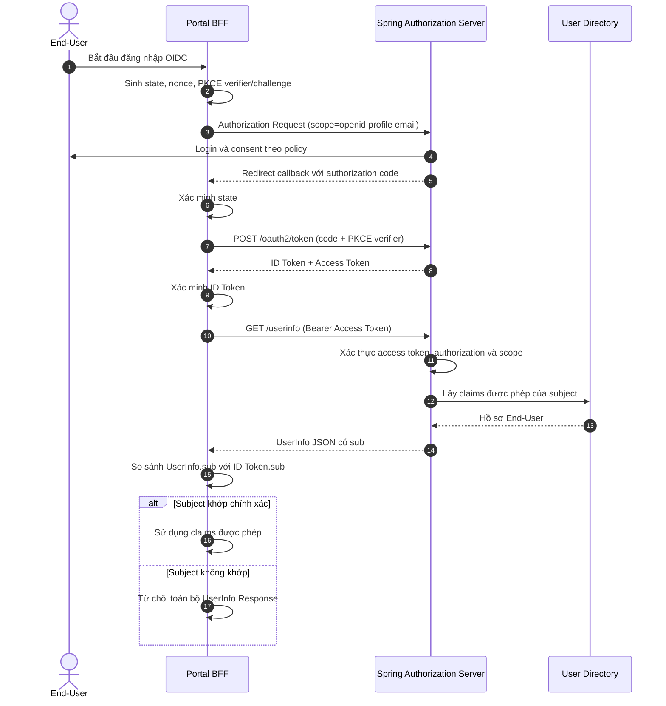

# Lấy thông tin người dùng và kiểm tra subject của phản hồi

**OpenID Connect UserInfo Endpoint** là một OAuth 2.0 Protected Resource cho phép Relying Party (RP) lấy thêm claims về End-User sau khi đã hoàn tất xác thực OIDC. RP gửi **access token** nhận được từ OIDC authorization flow tới UserInfo Endpoint; OpenID Provider (OP) kiểm tra token và trả về JSON object chứa các claims mà client được phép nhận.

Điểm bảo mật quan trọng nhất của phản hồi là claim **`sub`**. Theo OpenID Connect Core, `sub` **phải luôn có mặt** trong UserInfo Response và RP **phải xác minh chính xác** giá trị này khớp với `sub` trong ID Token đã được xác minh trước đó. Nếu hai giá trị khác nhau, RP **không được sử dụng bất kỳ claims nào** trong UserInfo Response. Quy tắc này ngăn token substitution: một access token có thể dẫn đến thông tin của End-User khác với người được nhận diện trong ID Token.

Trong Spring Boot dùng **Spring Authorization Server**, UserInfo Endpoint thuộc OIDC configuration. Framework cung cấp cơ chế xác thực access token và mapper mặc định; ứng dụng có thể tùy chỉnh việc lấy claims từ ID Token, access token hoặc kho hồ sơ riêng. Ở phía RP, **Spring Security `OidcUserService`** hỗ trợ gọi UserInfo Endpoint và kiểm tra subject của phản hồi trước khi tổng hợp `OidcUser`.

Bài thuộc chương **OIDC UserInfo** của mô-đun **SPRING_SECURITY_OAUTH2_OIDC_AUTHORIZATION_SERVER**, phục vụ lộ trình thiết kế, cấu hình, bảo mật, kiểm thử và vận hành OAuth 2.0/OpenID Connect Authorization Server bằng Spring Security và Spring Authorization Server trong Spring Boot. Trọng tâm là **lấy thông tin người dùng, giới hạn claims theo scope và xác minh `sub` của phản hồi**.

> **Nguyên tắc bắt buộc:** ID Token xác định người dùng mà OP đã xác thực cho RP. UserInfo Response phải nói về **đúng subject đó**. Chữ ký access token hợp lệ hoặc HTTP 200 từ UserInfo Endpoint không thay thế bước so sánh `sub`.

**Phạm vi phiên bản:** Ví dụ cấu hình dựa trên Spring Authorization Server 1.5.x và Spring Security 6.x. API ở Spring Security 7.x có thể thay đổi theo cách tích hợp Authorization Server mới; hãy đối chiếu dependency và tài liệu của phiên bản dự án đang sử dụng.

## 1. UserInfo Endpoint giải quyết việc gì?

### 1.1. ID Token và UserInfo có mục đích khác nhau

Trong OIDC, ID Token là bằng chứng về sự kiện xác thực. Nó có thể chứa các claims cốt lõi như `iss`, `sub`, `aud`, `exp`, `iat`, `auth_time`, `nonce`. UserInfo Endpoint cho phép RP lấy thêm thông tin hồ sơ mà người dùng đã cho phép chia sẻ.

Ví dụ Portal cần hiển thị tên và ảnh đại diện của nhân viên. Thay vì đưa toàn bộ hồ sơ vào ID Token, OP có thể phát ID Token gọn, rồi cung cấp claims hồ sơ qua UserInfo Endpoint khi RP được cấp các scope thích hợp.

| Thành phần | Mục đích | Credential sử dụng |
|---|---|---|
| **ID Token** | Chứng minh sự kiện xác thực cho OIDC client | JWT được OP ký |
| **UserInfo Endpoint** | Trả thêm claims về End-User | OAuth access token dạng Bearer |
| **Access Token** | Cho phép gọi UserInfo/API theo scope và policy | Do Token Endpoint phát |
| **Refresh Token** | Xin access token mới theo authorization đã cấp | Chỉ gửi đến Token Endpoint |
| **UserInfo Response** | Hồ sơ/claims gắn với một subject | JSON theo mặc định |

**Không gửi ID Token đến UserInfo Endpoint thay cho access token.** ID Token được phát cho RP để xác minh đăng nhập; UserInfo Endpoint là protected resource được bảo vệ bằng access token.

### 1.2. Các tác nhân

| Vai trò | Ví dụ | Trách nhiệm |
|---|---|---|
| End-User | Nhân viên truy cập Portal | Đăng nhập và quyết định chia sẻ thông tin |
| OpenID Provider (OP) | `https://login.example.com` | Xác thực, phát ID Token/access token, phục vụ UserInfo |
| Relying Party (RP) | `portal-bff` | Xác minh ID Token, gọi UserInfo và tạo phiên ứng dụng |
| Resource Server | Orders API | Xác minh access token và quyền API; không dùng ID Token làm Bearer |
| User Directory | Hồ sơ nhân sự | Nguồn dữ liệu hồ sơ được OP tin cậy |

### 1.3. Luồng Authorization Code



RP chỉ được sử dụng UserInfo sau khi đã xác minh ID Token và ràng buộc nó với authorization transaction. Không tạo phiên đăng nhập chỉ vì UserInfo Endpoint trả về một JSON có `sub`.

## 2. Endpoint và request theo OpenID Connect Core

### 2.1. UserInfo Endpoint là protected resource

UserInfo Endpoint yêu cầu access token được gửi dưới dạng **Bearer Token** theo RFC 6750. RP thường lấy URI endpoint từ OpenID Provider Discovery metadata, thông qua trường `userinfo_endpoint`.

Ví dụ metadata rút gọn:

```json
{
  "issuer": "https://login.example.com",
  "authorization_endpoint": "https://login.example.com/oauth2/authorize",
  "token_endpoint": "https://login.example.com/oauth2/token",
  "jwks_uri": "https://login.example.com/oauth2/jwks",
  "userinfo_endpoint": "https://login.example.com/userinfo"
}
```

Đây là ví dụ minh họa, không phải metadata đầy đủ. Không hard-code endpoint khác issuer hoặc tự tạo URL dựa trên dữ liệu từ một token chưa được xác minh.

Trong cấu hình mặc định của Spring Authorization Server, UserInfo Endpoint thường được công bố ở `/userinfo`. Client nên đọc `userinfo_endpoint` từ discovery thay vì giả định path. Nếu thay path, phải đồng bộ Authorization Server settings, discovery metadata, reverse proxy và client registration.

### 2.2. Gửi access token trong Authorization header

Request GET minh họa:

```http
GET /userinfo HTTP/1.1
Host: login.example.com
Authorization: Bearer <ACCESS_TOKEN>
Accept: application/json
```

OIDC cũng cho phép UserInfo Request dùng HTTP POST theo quy tắc giao thức. Với bearer token, dùng Authorization header qua HTTPS là lựa chọn thông dụng và an toàn hơn.

**Không đặt access token trong URL query string.** URL có thể bị ghi vào access log, browser history, telemetry hoặc Referer. Không gửi token qua HTTP không mã hóa.

### 2.3. Response JSON

Ví dụ phản hồi thành công:

```http
HTTP/1.1 200 OK
Content-Type: application/json
Cache-Control: no-store

{
  "sub": "user-8b3a",
  "name": "Nguyen An",
  "given_name": "An",
  "family_name": "Nguyen",
  "preferred_username": "an.nguyen",
  "email": "an.nguyen@example.com",
  "email_verified": true,
  "picture": "https://cdn.example.com/profiles/user-8b3a.jpg"
}
```

`sub` luôn phải có. Các claims khác có thể được trả tùy theo scope, yêu cầu claims cụ thể, consent và policy riêng tư của OP. Nếu OP không cung cấp một claim được yêu cầu, claim đó nên được **bỏ khỏi JSON**, không trả `null` hoặc chuỗi rỗng như một cách giả lập có dữ liệu.

Nếu client registration yêu cầu UserInfo Response được ký và/hoặc mã hóa, định dạng phản hồi có thể là JWT với `Content-Type: application/jwt`. Ví dụ Spring Authorization Server trong bài sử dụng JSON response mặc định; không mặc định rằng custom mapper tự bật ký/mã hóa response.

### 2.4. UserInfo error response

| Tình huống | Kết quả điển hình | Hành động của RP |
|---|---|---|
| Không có Bearer token | `401 Unauthorized` | Kiểm tra client request/token |
| Access token không hợp lệ hoặc hết hạn | `401` với `invalid_token` theo RFC 6750 | Xin token mới nếu refresh policy cho phép |
| Token thiếu quyền cần thiết | `403` với `insufficient_scope` khi áp dụng | Yêu cầu scope/consent phù hợp |
| UserInfo service lỗi tạm thời | `5xx` | Retry có giới hạn và backoff |
| Response thiếu `sub` | Response vi phạm OIDC Core | Từ chối response |
| `sub` khác ID Token | Response không thuộc đúng subject | Từ chối toàn bộ UserInfo claims |

Không biến lỗi UserInfo thành một hồ sơ người dùng rỗng rồi tiếp tục cấp quyền. Nếu endpoint lỗi, RP có thể xử lý đăng nhập thất bại hoặc tiếp tục bằng những claims tối thiểu đã được xác minh trong ID Token **chỉ khi chính sách ứng dụng cho phép**; phải phân biệt rõ việc UserInfo không khả dụng với việc xác thực thất bại.

## 3. Claim sub là ràng buộc danh tính bắt buộc

### 3.1. sub luôn phải xuất hiện

OIDC Core quy định UserInfo Response **MUST** chứa claim `sub`. Giá trị này là Subject Identifier của End-User tại issuer. Nó phải là chuỗi ổn định theo chính sách subject của OP, không nên được thay bằng email hoặc tên hiển thị có thể đổi.

```json
{
  "sub": "user-8b3a",
  "email": "an.nguyen@example.com"
}
```

Nếu response không có `sub`, RP không thể chứng minh hồ sơ trả về thuộc đúng End-User đã xác thực. RP phải từ chối response đó.

### 3.2. UserInfo.sub phải khớp chính xác ID Token.sub

Giả sử ID Token đã được xác minh có:

```json
{
  "iss": "https://login.example.com",
  "sub": "user-8b3a",
  "aud": "portal-bff"
}
```

UserInfo Response hợp lệ về subject phải có:

```json
{
  "sub": "user-8b3a",
  "name": "Nguyen An"
}
```

Nếu UserInfo Response lại trả:

```json
{
  "sub": "user-91f2",
  "name": "Another User",
  "email": "another@example.com"
}
```

thì RP **không được sử dụng bất kỳ claims nào** của response thứ hai. Không chỉ bỏ trường `sub` rồi giữ `name`/`email`: toàn bộ response có thể thuộc một người khác do token substitution.

So sánh phải chính xác, phân biệt chữ hoa/thường và không trim, lowercase, chuẩn hóa hay ánh xạ hai subject thành cùng một giá trị để “cho qua”.

### 3.3. Vì sao xảy ra token substitution?

Access token và ID Token là hai credential khác nhau. Nếu RP lấy UserInfo bằng access token không được ràng buộc đúng với authorization/subject của ID Token, endpoint có thể trả thông tin của một End-User khác. Khi RP gộp response đó vào phiên người dùng hiện tại mà không so sánh `sub`, ứng dụng có thể hiển thị hoặc liên kết dữ liệu nhầm người.

Một số nguyên nhân có thể gặp:

- Client lưu access token của một phiên nhưng ghép với ID Token của phiên khác;
- Cache UserInfo dùng key không chứa issuer/subject hoặc bị dùng chung giữa người dùng;
- Một custom UserInfo mapper đọc subject từ request parameter hoặc header do client kiểm soát;
- RP chỉ kiểm tra chữ ký ID Token mà không kiểm tra `sub` trong UserInfo;
- Nhiều issuer dùng cùng chuỗi `sub` nhưng RP không gắn danh tính với issuer.

### 3.4. Không gộp người dùng chỉ bằng sub

Định danh user ở RP nên dựa trên **cặp `(iss, sub)`**. Cùng một chuỗi `sub` tại hai issuer khác nhau không mặc nhiên chỉ cùng một người.

| ID Token issuer | ID Token sub | UserInfo sub | Kết luận |
|---|---|---|---|
| `https://login.example.com` | `user-8b3a` | `user-8b3a` | Khớp |
| `https://login.example.com` | `user-8b3a` | `user-91f2` | Từ chối response |
| `https://partner.example.net` | `user-8b3a` | `user-8b3a` | Khớp trong issuer partner; không tự gộp với issuer nội bộ |

UserInfo Endpoint thuộc OP mà RP đã discovery/trust. Không lấy `iss` từ response JSON mặc định để thay thế việc xác minh issuer của ID Token.

## 4. Scope quyết định nhóm claims được yêu cầu

### 4.1. Các scope OIDC tiêu chuẩn

OIDC định nghĩa các scope tiêu chuẩn để yêu cầu những nhóm claims về End-User:

| Scope | Các claims tiêu chuẩn được yêu cầu |
|---|---|
| `openid` | Kích hoạt OIDC; yêu cầu ID Token và subject |
| `profile` | `name`, `family_name`, `given_name`, `middle_name`, `nickname`, `preferred_username`, `profile`, `picture`, `website`, `gender`, `birthdate`, `zoneinfo`, `locale`, `updated_at` |
| `email` | `email`, `email_verified` |
| `address` | `address` |
| `phone` | `phone_number`, `phone_number_verified` |

Các scope `profile`, `email`, `address`, `phone` yêu cầu nhóm claims tương ứng. OP có thể không trả một số claims vì lý do riêng tư hoặc vì dữ liệu không có; việc thiếu một voluntary claim không nhất thiết là lỗi giao thức.

### 4.2. Scope không bảo đảm mọi claim đều có giá trị

Ví dụ RP gửi:

```text
scope=openid profile email
```

thì OP có thể trả `sub`, `name`, `preferred_username`, `email` và các claims khác mà policy cho phép. Nhưng nếu người dùng chưa cung cấp ảnh đại diện, `picture` có thể bị bỏ qua. Nếu OP không có email đã xác minh, nó không được tự đặt `email_verified=true`.

Scope thể hiện quyền/trường thông tin được yêu cầu và có thể được chấp thuận; nó không tạo ra dữ liệu không tồn tại, không chứng minh dữ liệu còn mới và không buộc OP tiết lộ mọi trường.

### 4.3. Consent và claim release

Authorization Server có thể yêu cầu End-User consent trước khi chia sẻ một số nhóm thông tin. Ví dụ:

- `profile` có thể được chấp thuận;
- `email` có thể bị từ chối;
- `phone` có thể không được yêu cầu;
- Một claim nhạy cảm riêng của tổ chức chỉ được trả cho client đã được policy cho phép.

Không suy ra rằng client đã có scope `email` là có quyền lấy email của mọi subject trong hệ thống. Authorization phải gắn với **đúng client, đúng authorization, đúng user và đúng thời điểm**.

### 4.4. Claims Request Parameter

OIDC hỗ trợ tham số `claims` để RP yêu cầu những claims cụ thể ngoài các nhóm scope. Ví dụ request muốn lấy `given_name` và `email` ở UserInfo:

```json
{
  "userinfo": {
    "given_name": {
      "essential": true
    },
    "email": {
      "essential": true
    },
    "email_verified": null
  }
}
```

Tham số này được gửi như JSON đã encode trong authorization request. `essential` thể hiện mức quan trọng của claim đối với RP; nó không buộc OP tiết lộ dữ liệu nếu policy hoặc quyền riêng tư không cho phép. Khi triển khai custom mapper, phải kiểm tra khả năng hỗ trợ claims parameter của phiên bản và profile đang dùng; không tuyên bố custom mapper tự động xử lý mọi yêu cầu claim riêng lẻ nếu chưa triển khai.

### 4.5. Không mở rộng claims vượt scope

Một custom mapper không nên trả toàn bộ entity người dùng chỉ vì access token hợp lệ. Hãy lọc claims theo scope được cấp và policy client. Ví dụ client chỉ có `openid profile` thì không trả `email`, `phone_number`, `address` hoặc các trường nội bộ nhạy cảm chỉ vì dữ liệu đó có trong database.

## 5. Phân biệt dữ liệu UserInfo với dữ liệu authorization

UserInfo chủ yếu cung cấp thông tin định danh/hồ sơ của End-User. Các dữ liệu như role quản trị, quyền sở hữu đơn hàng, trạng thái tenant, giới hạn thanh toán hoặc quyền phê duyệt thường thuộc **authorization policy** riêng.

| Dữ liệu | Ví dụ | Cách xử lý |
|---|---|---|
| Hồ sơ cơ bản | `name`, `given_name`, `picture` | Có thể trả theo `profile` |
| Liên hệ | `email`, `phone_number` | Trả theo scope và consent tương ứng |
| Địa chỉ | `address` | Chỉ trả khi được phép |
| Định danh | `sub` | Bắt buộc, ổn định theo issuer |
| Quyền nghiệp vụ | `orders.approve`, `payments.admin` | Không suy ra từ profile; cần policy riêng |
| Membership tenant | `tenant_id`, tenant roles | Chỉ trả nếu có contract/policy rõ ràng |
| Secrets nội bộ | Password hash, reset token, MFA secret | Tuyệt đối không đưa vào UserInfo |

Nếu API cần quyền `orders.read`, hãy kiểm tra access token và policy ở Resource Server. Không cho phép một client tự suy ra quyền chỉ từ `preferred_username`, `email_verified` hoặc một claim profile.

## 6. Bật OIDC UserInfo Endpoint trong Spring Authorization Server

### 6.1. Bật OIDC trong protocol SecurityFilterChain

Trong Spring Authorization Server 1.5.x, UserInfo Endpoint được bật cùng OIDC bằng `.oidc(Customizer.withDefaults())`.

```java
package example.authserver.config;

import org.springframework.context.annotation.Bean;
import org.springframework.context.annotation.Configuration;
import org.springframework.core.annotation.Order;
import org.springframework.http.MediaType;
import org.springframework.security.config.Customizer;
import org.springframework.security.config.annotation.web.builders.HttpSecurity;
import org.springframework.security.oauth2.server.authorization.config.annotation.web.configurers.OAuth2AuthorizationServerConfigurer;
import org.springframework.security.web.SecurityFilterChain;
import org.springframework.security.web.authentication.LoginUrlAuthenticationEntryPoint;
import org.springframework.security.web.util.matcher.MediaTypeRequestMatcher;

@Configuration(proxyBeanMethods = false)
public class AuthorizationServerSecurityConfig {

    @Bean
    @Order(1)
    SecurityFilterChain authorizationServerSecurityFilterChain(
            HttpSecurity http) throws Exception {

        OAuth2AuthorizationServerConfigurer as =
                OAuth2AuthorizationServerConfigurer.authorizationServer();

        http
            .securityMatcher(as.getEndpointsMatcher())
            .with(as, server -> server
                .oidc(Customizer.withDefaults()))
            .authorizeHttpRequests(authorize -> authorize
                .anyRequest().authenticated())
            .exceptionHandling(exceptions -> exceptions
                .defaultAuthenticationEntryPointFor(
                    new LoginUrlAuthenticationEntryPoint("/login"),
                    new MediaTypeRequestMatcher(MediaType.TEXT_HTML)));

        return http.build();
    }

    @Bean
    @Order(2)
    SecurityFilterChain applicationSecurityFilterChain(
            HttpSecurity http) throws Exception {

        http
            .authorizeHttpRequests(authorize -> authorize
                .anyRequest().authenticated())
            .formLogin(Customizer.withDefaults());

        return http.build();
    }
}
```

Đây là cấu hình khung. Ứng dụng thực tế còn cần `RegisteredClientRepository`, `OAuth2AuthorizationService`, `OAuth2AuthorizationConsentService`, issuer, login, JWK source/signing key và các bean phù hợp với grant đang sử dụng.

Bật OIDC sẽ cấu hình các endpoint OIDC như Provider Configuration, JWK Set, UserInfo và các endpoint khác theo phiên bản. Chỉ bật `.oidc(...)` chưa đủ để endpoint UserInfo xác minh access token; cần cấu hình `JwtDecoder` đúng như phần tiếp theo.

### 6.2. JwtDecoder là thành phần bắt buộc cho UserInfo Endpoint

Tài liệu Spring Authorization Server 1.5.x nêu rõ OAuth2 Resource Server support được cấu hình cho UserInfo request, nhưng **một `JwtDecoder` bean là bắt buộc** để UserInfo Endpoint xác thực access token JWT.

Ví dụ khi Authorization Server có `JWKSource<SecurityContext>`:

```java
import com.nimbusds.jose.proc.SecurityContext;
import com.nimbusds.jose.jwk.source.JWKSource;

import org.springframework.context.annotation.Bean;
import org.springframework.security.oauth2.jwt.JwtDecoder;
import org.springframework.security.oauth2.server.authorization.config.annotation.web.configuration.OAuth2AuthorizationServerConfiguration;

@Bean
JwtDecoder jwtDecoder(JWKSource<SecurityContext> jwkSource) {
    return OAuth2AuthorizationServerConfiguration.jwtDecoder(jwkSource);
}
```

`JWKSource` phải được cấu hình bằng signing key bền vững và public key tương ứng. Ví dụ decoder này phù hợp cấu hình Spring Authorization Server chuẩn; nếu dùng issuer/keys nhiều tenant hoặc custom JWT validation, cần bảo đảm decoder và trust policy phù hợp.

Không dùng một decoder chấp nhận mọi issuer/algorithm chỉ để UserInfo request chạy được. Access token phải được xác minh chữ ký, thời hạn, issuer và các điều kiện mà hệ thống yêu cầu trước khi mapper trả hồ sơ.

### 6.3. Đường dẫn endpoint

Trong cấu hình mặc định, UserInfo Endpoint thường là `/userinfo`. Client nên đọc `userinfo_endpoint` từ discovery thay vì hard-code. Nếu thay path, phải đồng bộ Authorization Server settings, discovery metadata, reverse proxy và client registration.

Không tạo một controller public riêng trả hồ sơ người dùng rồi gọi nó là OIDC UserInfo nếu nó không thực hiện bearer-token validation, authorization lookup và response subject binding.

## 7. Default UserInfo Mapper trong Spring Authorization Server

### 7.1. Hành vi mặc định

Theo tài liệu Spring Authorization Server 1.5.x:

- UserInfo request được xác thực bằng access token Bearer;
- `OidcUserInfoAuthenticationProvider` xử lý `OidcUserInfoAuthenticationToken`;
- Mapper mặc định lấy các standard claims từ ID Token;
- Các claims được trả dựa trên những scope đã yêu cầu trong authorization;
- Success/error handlers chuyển kết quả thành UserInfo Response hoặc OAuth error response.

Vì vậy, trong cấu hình cơ bản, ứng dụng có thể bật `.oidc(Customizer.withDefaults())`, cấu hình JWK/`JwtDecoder` và đưa các standard claims cần thiết vào ID Token. Không phải lúc nào cũng cần tự viết UserInfo mapper.

### 7.2. Khi nào nên dùng default mapper?

Giữ mapper mặc định khi:

- Các standard claims đã có trong ID Token;
- Chính sách phát claims theo scope của ứng dụng phù hợp;
- Không cần truy vấn dữ liệu động ở UserInfo request;
- Không cần hợp nhất từ nhiều nguồn dữ liệu;
- Không cần quy tắc riêng theo client/tenant ngoài các policy đã có.

Mặc định giúp giảm code tùy chỉnh và tránh tạo thêm một nơi có thể làm sai `sub`, scope hoặc claim release.

### 7.3. Khi nào cần custom mapper?

Cân nhắc custom mapper khi:

- Hồ sơ người dùng nằm trong database/LDAP/dịch vụ khác;
- Cần cập nhật thông tin profile mà không muốn đưa toàn bộ dữ liệu vào ID Token;
- Mỗi client chỉ được nhận một tập claims khác nhau;
- Cần lọc theo tenant, consent, scope hoặc policy nghiệp vụ;
- Muốn chuẩn hóa claim từ nhiều nguồn.

Dù tùy chỉnh, mapper phải giữ `sub` đúng với ID Token liên quan đến authorization và chỉ trả claims được phép.

## 8. Tùy chỉnh UserInfo bằng userInfoMapper

### 8.1. Extension point

Spring Authorization Server cung cấp:

```java
.oidc(oidc -> oidc
    .userInfoEndpoint(userInfo -> userInfo
        .userInfoMapper(userInfoMapper)
    )
)
```

`userInfoMapper` có kiểu:

```java
Function<OidcUserInfoAuthenticationContext, OidcUserInfo>
```

`OidcUserInfoAuthenticationContext` cho mapper truy cập:

- `getAuthentication()` — `OidcUserInfoAuthenticationToken` của request;
- `getAccessToken()` — access token Bearer đã được sử dụng;
- `getAuthorization()` — `OAuth2Authorization` liên quan, bao gồm ID Token và access token.

Không cần tự parse raw HTTP Authorization header trong mapper. Hãy dùng context đã được framework xác thực.

### 8.2. Lấy subject từ authorization gắn với access token

Ví dụ dưới đây dùng ID Token đã được lưu trong `OAuth2Authorization` làm nguồn subject tin cậy:

```java
OAuth2Authorization authorization = context.getAuthorization();

OAuth2Authorization.Token<OidcIdToken> idTokenHolder =
        authorization.getToken(OidcIdToken.class);

if (idTokenHolder == null) {
    throw new OAuth2AuthenticationException(
            new OAuth2Error("invalid_token"));
}

String subject = idTokenHolder.getToken().getSubject();
```

Không lấy subject từ query parameter, `X-User-Id`, email hoặc một claim không được xác minh. Nếu authorization không có ID Token tương ứng, mapper cần từ chối hoặc áp dụng một mô hình subject được thiết kế rõ ràng cho flow đó; không tự đoán subject từ principal name.

### 8.3. Mapper theo scope và hồ sơ từ database

Ví dụ sau minh họa một mapper có allowlist claims theo scope. `UserProfileService` là interface thuộc ứng dụng, không phải class có sẵn trong Spring.

```java
package example.authserver.oidc;

import java.util.LinkedHashMap;
import java.util.Map;
import java.util.Set;
import java.util.function.Function;

import org.springframework.context.annotation.Bean;
import org.springframework.context.annotation.Configuration;
import org.springframework.security.oauth2.core.OAuth2Error;
import org.springframework.security.oauth2.core.OAuth2AuthenticationException;
import org.springframework.security.oauth2.core.oidc.OidcScopes;
import org.springframework.security.oauth2.core.oidc.OidcUserInfo;
import org.springframework.security.oauth2.core.oidc.OidcIdToken;
import org.springframework.security.oauth2.server.authorization.OAuth2Authorization;
import org.springframework.security.oauth2.server.authorization.oidc.authentication.OidcUserInfoAuthenticationContext;

@Configuration(proxyBeanMethods = false)
public class UserInfoMapperConfiguration {

    public interface UserProfileService {
        Map<String, Object> findClaimsBySubject(String subject);
    }

    @Bean
    Function<OidcUserInfoAuthenticationContext, OidcUserInfo>
            userInfoMapper(UserProfileService profiles) {

        return context -> {
            OAuth2Authorization authorization =
                    context.getAuthorization();

            OAuth2Authorization.Token<OidcIdToken> idTokenHolder =
                    authorization.getToken(OidcIdToken.class);

            if (idTokenHolder == null) {
                throw new OAuth2AuthenticationException(
                        new OAuth2Error("invalid_token"));
            }

            String subject = idTokenHolder.getToken().getSubject();
            if (subject == null || subject.isBlank()) {
                throw new OAuth2AuthenticationException(
                        new OAuth2Error("invalid_token"));
            }

            Set<String> scopes = context.getAccessToken().getScopes();
            Map<String, Object> source =
                    profiles.findClaimsBySubject(subject);

            Map<String, Object> claims = new LinkedHashMap<>();
            claims.put("sub", subject);

            if (source == null) {
                return new OidcUserInfo(claims);
            }

            if (scopes.contains(OidcScopes.PROFILE)) {
                copyAllowed(source, claims,
                        "name", "given_name", "family_name",
                        "middle_name", "nickname", "preferred_username",
                        "profile", "picture", "website", "gender",
                        "birthdate", "zoneinfo", "locale", "updated_at");
            }

            if (scopes.contains(OidcScopes.EMAIL)) {
                copyAllowed(source, claims, "email", "email_verified");
            }

            if (scopes.contains(OidcScopes.PHONE)) {
                copyAllowed(source, claims,
                        "phone_number", "phone_number_verified");
            }

            if (scopes.contains(OidcScopes.ADDRESS)
                    && source.containsKey("address")
                    && source.get("address") != null) {
                claims.put("address", source.get("address"));
            }

            return new OidcUserInfo(claims);
        };
    }

    private static void copyAllowed(
            Map<String, Object> source,
            Map<String, Object> target,
            String... names) {

        for (String name : names) {
            Object value = source.get(name);
            if (value != null
                    && (!(value instanceof String text) || !text.isBlank())) {
                target.put(name, value);
            }
        }
    }
}
```

**Giải thích mẫu:**

1. `sub` được lấy từ ID Token gắn với authorization, không lấy từ request của client.
2. Scope được đọc từ access token đã xác thực qua `context.getAccessToken()`.
3. Chỉ claims nằm trong allowlist của scope tương ứng mới được đưa vào response.
4. Giá trị thiếu/null/chuỗi rỗng được bỏ qua.
5. `OidcUserInfo` được tạo từ map claims cuối cùng.

Đây là ví dụ kiến trúc để minh họa mapping; khi đưa vào dự án, cần bổ sung service implementation, consent, client-specific policy, tenant binding và kiểm thử nguồn dữ liệu trước khi trả claims nhạy cảm.

### 8.4. Gắn mapper vào OIDC configuration

Ví dụ kết nối mapper với protocol chain:

```java
@Bean
@Order(1)
SecurityFilterChain authorizationServerSecurityFilterChain(
        HttpSecurity http,
        Function<OidcUserInfoAuthenticationContext, OidcUserInfo>
                userInfoMapper) throws Exception {

    OAuth2AuthorizationServerConfigurer as =
            OAuth2AuthorizationServerConfigurer.authorizationServer();

    http
        .securityMatcher(as.getEndpointsMatcher())
        .with(as, server -> server
            .oidc(oidc -> oidc
                .userInfoEndpoint(userInfo -> userInfo
                    .userInfoMapper(userInfoMapper))))
        .authorizeHttpRequests(authorize -> authorize
            .anyRequest().authenticated());

    return http.build();
}
```

Đây là phần cấu hình minh họa; ứng dụng vẫn cần `JwtDecoder`, JWK source, authorization service, client repository và login chain. Không khai báo hai `SecurityFilterChain` cùng matcher/order gây xung đột chỉ để gắn mapper.

### 8.5. Không trả claims từ token nguồn một cách mù quáng

Một cách triển khai đơn giản là lấy toàn bộ claims từ JWT access token và trả lại:

```java
return new OidcUserInfo(jwtAuthentication.getToken().getClaims());
```

Cách này có thể phù hợp khi access token đã được thiết kế chỉ chứa các claims được phép cho UserInfo. Nhưng nó cũng có thể đưa ra `roles`, `tenant_ids`, internal flags hoặc dữ liệu nhạy cảm không thuộc contract UserInfo.

Nếu dùng cách này, phải kiểm tra token generator đã lọc claims theo client, scope, subject và policy. Không trả toàn bộ payload access token chỉ vì nó là JWT hợp lệ.

## 9. Tùy chỉnh claims trong ID Token hay UserInfo?

### 9.1. Hai chiến lược

Spring Authorization Server hỗ trợ hai cách phổ biến:

| Chiến lược | Cách hoạt động | Phù hợp khi |
|---|---|---|
| Thêm claims vào ID Token | Dùng `OAuth2TokenCustomizer<JwtEncodingContext>` khi tạo ID Token; default UserInfo mapper có thể lấy claims từ đó theo scope | Claims cần có sẵn trong ID Token hoặc dùng mapper mặc định |
| Custom UserInfo mapper | Truy vấn directory/database hoặc nguồn khác khi có request UserInfo | Claims động, cần lọc riêng hoặc không muốn nhúng hết vào ID Token |

ID Token được phát trong token response; UserInfo được lấy qua access token ở request riêng. Đưa tất cả profile vào ID Token có thể làm token lớn và phát tán dữ liệu nhiều hơn cần thiết. Chỉ thêm claims thật sự cần cho RP.

### 9.2. Thêm standard claims vào ID Token

Ví dụ customizer. Đoạn mã giả định `UserProfileService` có contract như phần mapper trước và ứng dụng cung cấp `SubjectResolver` để lấy subject identifier ổn định từ principal đã xác thực:

```java
import org.springframework.security.core.Authentication;

public interface SubjectResolver {
    String resolve(Authentication principal);
}
```

`copyAllowed` là helper allowlist dùng chung; khi triển khai, đặt helper trong cùng class hoặc một component dùng chung thay vì sao chép logic lọc claims.

```java
@Bean
OAuth2TokenCustomizer<JwtEncodingContext> idTokenCustomizer(
        UserProfileService profiles,
        SubjectResolver subjectResolver) {

    return context -> {
        if (!OidcParameterNames.ID_TOKEN.equals(
                context.getTokenType().getValue())) {
            return;
        }

        String subject = subjectResolver.resolve(context.getPrincipal());
        Map<String, Object> profile =
                profiles.findClaimsBySubject(subject);

        if (profile != null) {
            context.getClaims().claims(claims -> {
                if (context.getAuthorizedScopes()
                        .contains(OidcScopes.PROFILE)) {
                    copyAllowed(profile, claims,
                            "name", "given_name", "family_name",
                            "preferred_username", "picture");
                }

                if (context.getAuthorizedScopes()
                        .contains(OidcScopes.EMAIL)) {
                    copyAllowed(profile, claims,
                            "email", "email_verified");
                }
            });
        }
    };
}
```

`SubjectResolver` là thành phần do ứng dụng định nghĩa để ánh xạ principal sang subject identifier. Trong hệ thống có pairwise subject hoặc multi-tenant, không mặc định principal name bằng `sub`; cần dùng một subject resolver thống nhất.

### 9.3. Không tự ghi đè sub

Dù claims được thêm vào ID Token hay UserInfo, `sub` phải được tạo từ subject identifier policy của OP. Không dùng email, username có thể đổi hoặc ID từ request client gửi lên. Nếu mapper tùy chỉnh UserInfo lấy subject từ ID Token, hãy giữ nguyên subject đó trong response.

### 9.4. Tránh xung đột giữa ID Token và UserInfo

Spring Security có thể tổng hợp claims của `OidcUser` từ ID Token và UserInfo. Nếu hai nguồn cùng trả một claim nhưng giá trị khác nhau, ứng dụng có thể hiểu sai hồ sơ hoặc ghi đè thuộc tính theo thứ tự merge. Thiết kế claim ownership rõ ràng: claims xác thực nằm trong ID Token; profile mở rộng nằm trong UserInfo; không trả các giá trị mâu thuẫn.

## 10. Client đăng ký scope để lấy UserInfo

### 10.1. RegisteredClient cho OIDC

Ví dụ confidential client `portal-bff`:

```java
RegisteredClient portal = RegisteredClient
        .withId("portal-bff-registration")
        .clientId("portal-bff")
        .clientSecret(passwordEncoder.encode(portalSecret))
        .clientAuthenticationMethod(
                ClientAuthenticationMethod.CLIENT_SECRET_BASIC)
        .authorizationGrantType(AuthorizationGrantType.AUTHORIZATION_CODE)
        .authorizationGrantType(AuthorizationGrantType.REFRESH_TOKEN)
        .redirectUri(
                "https://portal.example.com/login/oauth2/code/central")
        .scope(OidcScopes.OPENID)
        .scope(OidcScopes.PROFILE)
        .scope(OidcScopes.EMAIL)
        .clientSettings(ClientSettings.builder()
                .requireProofKey(true)
                .requireAuthorizationConsent(true)
                .build())
        .build();
```

`openid` làm request trở thành OIDC. `profile` và `email` là các scope yêu cầu nhóm claims tương ứng. `requireAuthorizationConsent(true)` yêu cầu consent theo policy. Đây là builder minh họa; secret phải đến từ secret manager và registration cần được lưu trong repository bền vững ở production.

### 10.2. Authorization request

RP có thể yêu cầu:

```http
GET /oauth2/authorize?response_type=code&client_id=portal-bff&redirect_uri=https%3A%2F%2Fportal.example.com%2Flogin%2Foauth2%2Fcode%2Fcentral&scope=openid%20profile%20email&state=RANDOM_STATE&nonce=RANDOM_NONCE&code_challenge=PKCE_CHALLENGE&code_challenge_method=S256 HTTP/1.1
Host: login.example.com
```

RP phải tạo `state`, `nonce` và PKCE verifier/challenge an toàn cho từng giao dịch. Scope được yêu cầu chưa có nghĩa chắc chắn được cấp; consent và client policy quyết định phạm vi được phép.

### 10.3. Scope đã cấp mới là cơ sở trả claims

UserInfo mapper nên dùng scope gắn với **access token đã được cấp**, không dùng raw `scope` query parameter của authorization request. Nếu người dùng từ chối `email` hoặc server loại scope đó, response không được trả email chỉ vì client từng yêu cầu.

### 10.4. Không nhầm client scope với quyền nghiệp vụ

Scope OIDC `profile` hoặc `email` quyết định nhóm claims hồ sơ. Nó không phải role của ứng dụng. Ví dụ `email` không có nghĩa người dùng được phép truy cập `/admin`; `profile` không có nghĩa client được đọc toàn bộ hồ sơ nhân sự.

## 11. Gọi UserInfo bằng curl

### 11.1. GET với access token

```bash
curl --request GET "https://login.example.com/userinfo" \
  --header "Authorization: Bearer $ACCESS_TOKEN" \
  --header "Accept: application/json"
```

Chỉ sử dụng token test trong môi trường kiểm thử. Không ghi token vào shell history, CI output hoặc log công khai. Nếu endpoint path được công bố qua discovery khác `/userinfo`, sử dụng đúng URL metadata.

### 11.2. Không gửi ID Token thay access token

```bash
# Sai mục đích: ID Token không phải Bearer credential của UserInfo Endpoint.
curl --request GET "https://login.example.com/userinfo" \
  --header "Authorization: Bearer $ID_TOKEN"
```

Request này không thể được coi là UserInfo request hợp lệ chỉ vì ID Token là JWT có chữ ký. Endpoint cần access token phù hợp và được xác thực theo policy.

### 11.3. Đối chiếu subject trong response

Giả sử RP đã xác minh ID Token và lưu `ID_TOKEN_SUBJECT` trong transaction state:

```bash
# Sau khi nhận JSON UserInfo trong USERINFO_JSON:
jq -e --arg expected "$ID_TOKEN_SUBJECT" \
  '.sub != null and .sub == $expected' \
  <<< "$USERINFO_JSON"
```

Đây chỉ là minh họa kiểm tra subject bằng công cụ dòng lệnh. Trong ứng dụng thật, parse JSON bằng thư viện phù hợp và thực hiện so sánh chính xác trong code trước khi dùng bất kỳ claim nào. Không dùng shell/JQ để thay thế toàn bộ OIDC validation hoặc lưu access token vào biến/log thiếu bảo vệ.

## 12. Spring Security OIDC Client gọi UserInfo

### 12.1. Cấu hình issuer discovery

Một RP Spring Boot có thể cấu hình:

```yaml
spring:
  security:
    oauth2:
      client:
        registration:
          central:
            provider: central
            client-id: portal-bff
            client-secret: PORTAL_BFF_CLIENT_SECRET_FROM_SECRET_MANAGER
            client-authentication-method: client_secret_basic
            authorization-grant-type: authorization_code
            redirect-uri: "{baseUrl}/login/oauth2/code/{registrationId}"
            scope:
              - openid
              - profile
              - email
        provider:
          central:
            issuer-uri: https://login.example.com
```

`issuer-uri` cho phép Spring Security discovery provider metadata, bao gồm `userinfo_endpoint` khi OP công bố. Secret phải được inject từ secret manager hoặc cấu hình runtime an toàn, không commit vào Git. Giá trị secret trong snippet chỉ là tên placeholder, không phải credential.

### 12.2. Bật oauth2Login

```java
@Configuration(proxyBeanMethods = false)
public class PortalSecurityConfig {

    @Bean
    SecurityFilterChain portalSecurityFilterChain(HttpSecurity http)
            throws Exception {

        http
            .authorizeHttpRequests(authorize -> authorize
                .requestMatchers("/", "/assets/**").permitAll()
                .anyRequest().authenticated())
            .oauth2Login(Customizer.withDefaults());

        return http.build();
    }
}
```

Với OIDC scope `openid` và provider metadata có UserInfo endpoint, Spring Security sử dụng `OidcUserService` mặc định. Trong Spring Security 6.3+, service mặc định gọi UserInfo khi endpoint được khai báo, client dùng Authorization Code Flow và access token có scope phù hợp như `profile`, `email`, `address`, `phone` (hoặc scopes rỗng theo điều kiện mặc định).

Do đó, nếu RP chỉ yêu cầu `openid` và không có scope UserInfo, Spring Security có thể không gọi endpoint UserInfo theo mặc định. Điều này không phải lỗi nếu ID Token đã đủ claims cho use case.

### 12.3. OidcUserService xác minh subject

`OidcUserService` sử dụng access token để gọi UserInfo Endpoint, chuyển response thành `OidcUserInfo`, sau đó kiểm tra:

- UserInfo Response có `sub`;
- `UserInfo.sub` khớp chính xác `ID Token.sub`.

Nếu thiếu `sub` hoặc mismatch, Spring Security ném `OAuth2AuthenticationException` với lỗi `invalid_user_info_response`; RP không nên bỏ qua lỗi này để tạo phiên đăng nhập.

### 12.4. Tùy chỉnh OidcUserService

Nếu cần điều chỉnh việc gọi hoặc ánh xạ người dùng sau khi lấy UserInfo, có thể cấu hình `OidcUserService`:

```java
@Bean
OAuth2UserService<OidcUserRequest, OidcUser> oidcUserService() {
    OidcUserService delegate = new OidcUserService();

    return userRequest -> {
        // Delegate thực hiện gọi UserInfo và kiểm tra subject.
        OidcUser oidcUser = delegate.loadUser(userRequest);

        // Có thể bổ sung mapping nghiệp vụ sau khi response đã được kiểm tra.
        // Không bỏ qua hoặc thay thế subject bằng claim không đáng tin.
        return oidcUser;
    };
}

@Bean
SecurityFilterChain portalSecurityFilterChain(
        HttpSecurity http,
        OAuth2UserService<OidcUserRequest, OidcUser> oidcUserService)
        throws Exception {

    http
        .authorizeHttpRequests(authorize -> authorize
            .anyRequest().authenticated())
        .oauth2Login(oauth2 -> oauth2
            .userInfoEndpoint(userInfo -> userInfo
                .oidcUserService(oidcUserService)));

    return http.build();
}
```

Ví dụ trên giữ nguyên validation của delegate. Nếu custom `OAuth2UserService` tự thực hiện HTTP request, phải tự bảo đảm việc kiểm tra `sub` trước khi tạo `OidcUser`. Không dùng mapping authorities để vô tình bỏ qua việc xác minh UserInfo response.

### 12.5. Claim type conversion

Spring Security có các converter mặc định để chuyển kiểu một số standard claims như `email_verified`, `phone_number_verified`, `updated_at`. Nếu viết custom `OAuth2UserService`, cần giữ kiểu JSON đúng:

- Boolean phải là boolean, không phải chuỗi `"true"`;
- `updated_at` phải được chuyển thành kiểu thời gian phù hợp;
- `address` là object có các thành phần theo OIDC;
- `sub` phải là string.

Không tự ép mọi claim thành string; việc đó làm hỏng schema và gây lỗi ở các typed accessor.

## 13. UserInfo và subject consistency trong Spring Security

### 13.1. OidcUser chứa hai nguồn claims

`OidcUser` của Spring Security giữ:

- `getIdToken()` — ID Token đã được xác minh;
- `getUserInfo()` — UserInfo Response đã được tải và xác minh subject;
- `getClaims()` — claims tổng hợp từ ID Token và UserInfo (nếu có).

Điều này giúp ứng dụng dùng một principal OIDC thống nhất, nhưng cũng đòi hỏi quy tắc xử lý xung đột claims rõ ràng. Không nên để `email`, `name` hoặc custom claim trong UserInfo ghi đè thuộc tính có ý nghĩa bảo mật mà ứng dụng đang tin từ ID Token nếu chưa có policy.

### 13.2. Tách identity key khỏi display attributes

Định danh user trong RP nên dựa trên cặp `(issuer, subject)` đã xác minh. Các trường `name`, `preferred_username`, `email`, `picture` chỉ phục vụ hiển thị/liên hệ theo policy. Khi người dùng đổi email hoặc tên, RP không được tạo một tài khoản mới chỉ vì display claim thay đổi.

### 13.3. UserInfo không phải nguồn phân quyền cuối cùng

Không map `roles` từ UserInfo trực tiếp thành quyền admin nếu OP chưa định nghĩa contract, audience, nguồn claim và quy trình cập nhật. UserInfo là thông tin về End-User; Resource Server cần authorization policy riêng và phải kiểm tra access token được cấp cho API.

### 13.4. Nếu UserInfo endpoint không khả dụng

Có thể có hai policy sản phẩm:

- **Fail closed:** không hoàn tất login nếu ứng dụng bắt buộc một số claims từ UserInfo;
- **Fallback có kiểm soát:** tiếp tục chỉ với claims ID Token đã xác minh nếu use case cho phép, nhưng không giả lập các claims còn thiếu.

Không tiếp tục với một UserInfo response có subject mismatch. Đây là lỗi bảo mật, không phải lỗi mạng có thể retry rồi bỏ qua.

## 14. Bảo vệ dữ liệu hồ sơ và privacy

### 14.1. Data minimization

Chỉ trả claims mà client thực sự cần. Ví dụ:

- Ứng dụng lịch nội bộ có thể chỉ cần `sub`, `name`, `email`;
- Hệ thống liên hệ cần `phone_number` chỉ khi có scope `phone`;
- Ứng dụng không cần ngày sinh không nên yêu cầu hoặc lưu `birthdate`;
- Ảnh đại diện có thể được cung cấp qua URL có kiểm soát thay vì dữ liệu nhúng lớn.

Không trả toàn bộ entity JPA, LDAP attributes hoặc hồ sơ HR vào UserInfo Response.

### 14.2. Scope và consent phải được kiểm tra tại server

Không chỉ dựa vào UI consent. Mapper/service phải kiểm tra scope thực tế của access token và policy client. Nếu access token đã được cấp nhưng người dùng thu hồi consent hoặc authorization bị invalidated, endpoint phải áp dụng trạng thái/token validation phù hợp trước khi trả hồ sơ.

### 14.3. Tránh lộ dữ liệu qua log

Không log:

- Bearer access token;
- Toàn bộ UserInfo response nếu có dữ liệu cá nhân;
- Authorization header;
- Email, số điện thoại, địa chỉ hoặc ngày sinh đầy đủ khi không cần;
- Database query chứa hồ sơ người dùng.

Có thể log client ID đã xác thực, scope được cấp, subject dưới dạng mã nội bộ đã bảo vệ, request ID, latency và loại lỗi. Khi cần audit claim release, ghi tên nhóm claims/scope và kết quả policy, không ghi giá trị nhạy cảm.

### 14.4. Cache phải gắn với đúng subject và authorization

Nếu RP cache UserInfo, cache key phải gắn với issuer, subject và các yếu tố cần thiết của authorization/client. Không cache một response chỉ theo email hoặc `preferred_username`. Cần TTL phù hợp, xử lý thay đổi profile và tránh trả dữ liệu cũ sau khi quyền chia sẻ bị thu hồi.

### 14.5. Không xem URL picture là nội dung đáng tin

Claim `picture` thường là URL. RP không nên tự động fetch mọi URL từ UserInfo rồi nhúng trực tiếp mà không có kiểm soát; cần bảo vệ khỏi SSRF, URL nội bộ, content-type bất thường và nội dung độc hại. Khi hiển thị trong browser, áp dụng CSP và chính sách tải ảnh phù hợp.

## 15. Kiểm thử UserInfo Endpoint và RP

### 15.1. Ma trận kiểm thử phía Authorization Server

| Test case | Điều kiện | Kỳ vọng |
|---|---|---|
| OIDC bật | `.oidc(Customizer.withDefaults())` | UserInfo Endpoint được công bố/cấu hình |
| Thiếu JwtDecoder | Không có decoder phù hợp | Phát hiện ở test startup/cấu hình |
| Access token hợp lệ | Bearer token còn hiệu lực | Trả UserInfo |
| Không có Bearer token | Request không có Authorization | Từ chối |
| Token hết hạn/invalid | JWT không hợp lệ hoặc token inactive | Từ chối |
| Token thiếu scope hồ sơ | Chỉ có `openid` | Chỉ trả claims được phép, thường ít nhất `sub` |
| Có `profile` | Access token có scope profile | Có thể trả claims profile được phép |
| Có `email` | Access token có scope email | Có thể trả email/email_verified nếu có và policy cho phép |
| Không có email | Scope email nhưng directory thiếu email | Bỏ claim email, không trả chuỗi rỗng giả |
| UserInfo mapper custom | Nguồn profile có dữ liệu | Chỉ trả allowlist claims |
| Subject thiếu | Mapper không thể xác định subject | Từ chối |
| Subject sai | Mapper trả sub khác ID Token subject | RP phải từ chối toàn bộ response |
| Tenant khác | Token subject thuộc tenant A nhưng mapper lấy profile tenant B | Từ chối hoặc không trả dữ liệu theo tenant policy |
| Claim nhạy cảm ngoài scope | Nguồn có phone/address nhưng token không có scope | Không trả claims đó |
| Authorization revoked | Access token không còn active | Từ chối |
| Nhiều node | Request tới node khác node phát token | State/token validation nhất quán |
| Log redaction | Request có bearer token | Không log token raw |

### 15.2. Ma trận kiểm thử phía RP

| Test case | UserInfo Response | Kỳ vọng |
|---|---|---|
| Subject đúng | `sub` khớp ID Token | Chấp nhận nếu các validation khác đạt |
| Thiếu subject | Không có `sub` | Từ chối |
| Subject mismatch | `sub` khác ID Token | Từ chối toàn bộ response |
| Subject sai kiểu | `sub` không phải string | Từ chối |
| Issuer khác | Endpoint/discovery không thuộc OP tin cậy | Không gọi hoặc từ chối |
| HTTP 401 | Access token invalid/expired | Xử lý token error; không tạo user từ response rỗng |
| HTTP 403 | Insufficient scope | Không sử dụng claims ngoài quyền |
| HTTP 500/timeout | UserInfo service lỗi | Retry có giới hạn hoặc fail theo policy |
| Response thiếu claim tùy chọn | Không có picture/email | Không coi là protocol failure nếu sub hợp lệ |
| Response có claim xung đột | email/name khác ID Token | Áp dụng claim precedence đã định nghĩa |
| Response replay từ phiên khác | sub không khớp transaction | Từ chối |
| Claim injection | JSON có field quyền nội bộ không được định nghĩa | Không tự biến thành quyền quản trị |

### 15.3. MockMvc test cho endpoint server

Ví dụ test integration cần có Spring context thực, `JwtDecoder`, client/authorization fixture và OIDC config:

```java
@SpringBootTest
@AutoConfigureMockMvc
class UserInfoEndpointTests {

    @Autowired
    MockMvc mvc;

    @Test
    void userInfoRequiresBearerAccessToken() throws Exception {
        mvc.perform(get("/userinfo")
                .accept(MediaType.APPLICATION_JSON))
            .andExpect(status().isUnauthorized());
    }
}
```

Test trên chỉ xác minh request không có Bearer token bị từ chối. Happy path cần lấy access token hợp lệ qua grant OIDC trong fixture, gửi token đó tới `/userinfo`, rồi kiểm tra JSON và subject. Không dùng `@WithMockUser` để kết luận Bearer access token validation đã hoạt động; `@WithMockUser` tạo authentication trong test context, không thay thế OAuth resource-server pipeline.

### 15.4. Test subject mismatch phía RP

Pseudocode JUnit cho logic validation độc lập:

```java
static void assertMatchingSubject(
        OidcIdToken idToken,
        OidcUserInfo userInfo) {

    String expected = idToken.getSubject();
    String actual = userInfo.getSubject();

    if (actual == null || !actual.equals(expected)) {
        throw new OAuth2AuthenticationException(
                new OAuth2Error("invalid_user_info_response"));
    }
}
```

Đây là ví dụ logic để hiểu yêu cầu; Spring Security `OidcUserService` đã có bước kiểm tra subject. Nếu viết custom service, giữ kiểm tra tương đương và chạy test cho trường hợp thiếu/mismatch. Khi mismatch, không dùng bất kỳ claim nào từ response.

### 15.5. Test default mapper và custom mapper riêng biệt

Cần hai bộ test:

- **Default mapper:** Xác minh standard claims từ ID Token được lọc theo scopes đã cấp;
- **Custom mapper:** Xác minh nguồn dữ liệu, subject binding, scope allowlist, tenant policy và omission của claims thiếu.

Nếu chỉ test custom mapper, có thể bỏ sót cấu hình mặc định bị thay thế. Nếu chỉ test default mapper, có thể bỏ sót việc custom code trả quá nhiều dữ liệu.

## 16. Lỗi triển khai thường gặp

| Triệu chứng | Nguyên nhân khả dĩ | Cách xử lý |
|---|---|---|
| `/userinfo` trả 404 | OIDC chưa bật hoặc endpoint path khác | Kiểm tra `.oidc(...)`, discovery và settings |
| UserInfo request trả 401 | Thiếu/sai/expired Bearer access token | Kiểm tra access token và Authorization header |
| UserInfo request dùng ID Token | Nhầm token purpose | Dùng access token |
| Không có UserInfo call từ Spring RP | Scope không có profile/email/address/phone, endpoint thiếu hoặc grant không phù hợp | Kiểm tra `OidcUserService` retrieval conditions |
| UserInfo chỉ có sub | Access token không có scope profile/email hoặc policy không cấp | Kiểm tra scopes/consent và claims source |
| `sub` mismatch | Ghép token/authorization khác phiên hoặc mapper sai subject | Từ chối response, kiểm tra correlation |
| `sub` bị đổi theo email | Dùng email làm subject | Dùng subject identifier ổn định |
| Custom mapper trả dư claims | Không lọc scope/allowlist | Áp dụng data minimization |
| Custom mapper trả sub từ header | Tin dữ liệu caller tự khai | Lấy từ authorization/ID Token gắn với access token |
| UserInfo thiếu dữ liệu sau consent | Consent/scope không được cấp hoặc directory không có dữ liệu | Kiểm tra authorization và data source |
| `email_verified` sai kiểu | Mapper trả chuỗi "true" thay boolean | Trả boolean đúng JSON type |
| Address claim sai cấu trúc | Trả chuỗi thay object theo schema | Dùng object/map đúng chuẩn |
| JwtDecoder bean thiếu | OIDC UserInfo cần decoder xác minh access token JWT | Cấu hình decoder từ JWKSource |
| Token hợp lệ nhưng endpoint lỗi | Issuer/JWKS/algorithm hoặc decoder không khớp | Kiểm tra issuer, key và validators |
| UserInfo claims ghi đè ID Token | Merge claims không có precedence | Xác định nguồn claim authoritative |
| Cache trả hồ sơ người khác | Cache key không có issuer/subject | Key theo (iss, sub) và authorization context |
| Profile service lỗi | DB/LDAP downstream không khả dụng | Timeout, circuit breaker, fail policy rõ |
| Log lộ bearer token | HTTP logging/APM ghi Authorization header | Redact header và body |

### 16.1. Không bỏ qua subject mismatch để “login không bị lỗi”

Một lỗi thường gặp là catch `OAuth2AuthenticationException` rồi tiếp tục tạo `DefaultOidcUser` chỉ từ ID Token hoặc UserInfo claims tùy tiện. Nếu lỗi là `invalid_user_info_response` do subject mismatch, ứng dụng phải từ chối response và điều tra nguyên nhân. Không biến một lỗi chống token substitution thành fallback im lặng.

### 16.2. Không trả email làm sub

Email có thể thay đổi, chưa xác minh hoặc được tái sử dụng. Thay `sub` bằng email để khớp hai nguồn dữ liệu là sai semantics OIDC và có thể dẫn đến account linking sai. Dùng subject identifier policy ổn định; email chỉ là claim hồ sơ.

## 17. Vận hành và quan sát

### 17.1. Metrics nên theo dõi

- Số UserInfo requests theo client, issuer và môi trường;
- Tỷ lệ HTTP 200/401/403/5xx;
- Tỷ lệ lỗi access token invalid/expired;
- Tỷ lệ `invalid_user_info_response` phía RP;
- Tỷ lệ request theo scope `profile`, `email`, `address`, `phone`;
- Latency của mapper và downstream user directory;
- Tỷ lệ claims bị bỏ do policy hoặc thiếu dữ liệu;
- Tỷ lệ cache hit/miss nếu có cache;
- Số request từ client/issuer không hợp lệ.

Không log raw access token hoặc toàn bộ UserInfo Response để có metrics. Hãy dùng aggregate counters, client ID đã xác minh, request ID và mã lỗi.

### 17.2. User Directory là dependency quan trọng

Nếu custom mapper gọi database/LDAP/dịch vụ hồ sơ, endpoint UserInfo phụ thuộc vào độ sẵn sàng của nguồn đó. Cần timeout, connection pool, circuit breaker hoặc cache có TTL phù hợp. Không để một lookup không giới hạn làm treo thread của protocol endpoint.

Nếu dùng cache, phải có chiến lược invalidation khi profile thay đổi hoặc consent bị thu hồi. Cache không được làm rò rỉ dữ liệu giữa tenant/issuer/client.

### 17.3. Multi-node và authorization consistency

Các node Authorization Server phải cùng xác định:

- Issuer và UserInfo endpoint URL;
- Signing/JWKS và access token validation;
- Registered client và scope policy;
- Authorization store và trạng thái access token;
- Subject identifier mapping;
- User directory và tenant policy.

Một access token được phát ở node A phải được xác thực đúng ở node B. Mapper chạy ở node B phải truy vấn đúng subject từ authorization context, không dựa vào local session hoặc in-memory profile map chỉ có ở node A.

### 17.4. Incident response

Nếu phát hiện UserInfo Response trả `sub` khác ID Token:

1. Từ chối toàn bộ response ở RP;
2. Không tạo/tiếp tục session dựa trên claims đó;
3. Ghi audit event với request ID, issuer, client ID và subject fingerprint an toàn;
4. Kiểm tra access token có thuộc authorization/subject mong đợi không;
5. Kiểm tra mapper, cache key, tenant mapping và token storage;
6. Đánh giá phạm vi các phiên/claims đã được sử dụng sai;
7. Thu hồi authorization/token liên quan theo policy nếu có dấu hiệu compromise.

Không ghi token raw hoặc hồ sơ người dùng vào incident log.

## 18. Bài tập thực hành

**Bối cảnh:** Công ty có Central Login tại `https://login.example.com` và Portal BFF với client ID `portal-bff`. Portal cần `name`, `preferred_username`, `email` và ảnh đại diện. User Directory lưu hồ sơ theo subject ổn định. Access token được phát qua Authorization Code + PKCE.

**Yêu cầu:**

1. Bật OIDC trong Spring Authorization Server bằng `.oidc(Customizer.withDefaults())`.
2. Cấu hình `JWKSource` và `JwtDecoder` phù hợp cho UserInfo access-token validation.
3. Đăng ký `portal-bff` với `openid`, `profile`, `email`, redirect URI chính xác và PKCE.
4. Yêu cầu client lấy `userinfo_endpoint` qua discovery metadata.
5. Gửi access token bằng `Authorization: Bearer`, không dùng ID Token.
6. Viết custom `userInfoMapper` lấy `sub` từ ID Token gắn với `OAuth2Authorization`.
7. Chỉ trả `profile` claims khi access token có scope `profile`; chỉ trả `email`/`email_verified` khi có scope `email`.
8. Luôn trả `sub`, không trả null/empty claims và không đưa password/roles nội bộ vào response.
9. Ở RP, dùng Spring Security `OidcUserService` hoặc custom service giữ subject validation.
10. Viết test response có `sub` đúng, thiếu `sub`, sai `sub`, thiếu scope và token hết hạn.
11. Chứng minh khi `sub` mismatch, RP không sử dụng bất kỳ claim nào từ UserInfo.
12. Kiểm tra log/metrics không chứa Bearer token hoặc dữ liệu hồ sơ đầy đủ.

**Tiêu chí nghiệm thu:** UserInfo Endpoint chỉ phục vụ request có access token hợp lệ; response claims được lọc theo scope/policy; `sub` luôn hiện diện và lấy từ subject đáng tin; RP xác minh `UserInfo.sub` khớp chính xác `ID Token.sub`; mismatch làm thất bại toàn bộ response.

## 19. Câu hỏi tự đánh giá

1. UserInfo Endpoint là protected resource hay một phần của Token Endpoint?
2. Vì sao UserInfo Request phải dùng access token thay vì ID Token?
3. `userinfo_endpoint` được RP lấy từ đâu?
4. Claim nào bắt buộc luôn có trong UserInfo Response?
5. Vì sao `UserInfo.sub` phải khớp chính xác `ID Token.sub`?
6. Nếu `sub` mismatch, RP có thể giữ lại `email` và `name` rồi bỏ `sub` không?
7. Scope `profile`, `email`, `address`, `phone` yêu cầu những nhóm claims nào?
8. Scope đã yêu cầu có bảo đảm OP phải trả mọi claim không?
9. Vì sao custom mapper phải dùng scope của access token đã được cấp thay vì raw query parameter?
10. `OidcUserInfoAuthenticationContext` cung cấp những dữ liệu nào?
11. Vì sao Spring Authorization Server UserInfo Endpoint cần `JwtDecoder` bean?
12. Khi nào nên giữ default UserInfo mapper, khi nào nên custom?
13. Làm thế nào để lấy `sub` ổn định từ authorization thay vì email/username?
14. Spring Security `OidcUserService` xử lý subject mismatch như thế nào?
15. Vì sao `openid` một mình có thể không dẫn đến một request UserInfo tự động trong Spring Security?
16. Vì sao UserInfo không nên chứa quyền admin hoặc toàn bộ entity người dùng?
17. `OidcUser.getClaims()` tổng hợp những nguồn claims nào?
18. Nếu UserInfo endpoint lỗi mạng, RP có thể tiếp tục bằng ID Token trong trường hợp nào?
19. Những trường nào cần redact trong log?
20. Làm thế nào để kiểm thử chống token substitution end-to-end?

## 20. Tài liệu tham khảo chính thức

- [OpenID Connect Core 1.0 — UserInfo Endpoint](https://openid.net/specs/openid-connect-core-1_0.html#UserInfo): access token, UserInfo Request/Response, claims chuẩn, `sub` bắt buộc và quy tắc so khớp subject với ID Token.
- [OpenID Connect Core 1.0 — Standard Claims](https://openid.net/specs/openid-connect-core-1_0.html#StandardClaims): định nghĩa các claims như `name`, `email`, `address`, `phone_number` và các nhóm scope.
- [OpenID Connect Discovery 1.0](https://openid.net/specs/openid-connect-discovery-1_0.html): metadata `userinfo_endpoint` và issuer discovery.
- [RFC 6750 — OAuth 2.0 Bearer Token Usage](https://www.rfc-editor.org/rfc/rfc6750): gửi access token trong Authorization header và xử lý lỗi Bearer token.
- [Spring Authorization Server — How-to: Customize the OIDC UserInfo response](https://docs.spring.io/spring-authorization-server/reference/guides/how-to-userinfo.html): bật UserInfo Endpoint, default mapper, custom mapper và cách lấy claims.
- [Spring Authorization Server — Protocol Endpoints](https://docs.spring.io/spring-authorization-server/reference/protocol-endpoints.html): `OidcUserInfoEndpointConfigurer`, converters, providers, response handlers và `userInfoMapper`.
- [Spring Authorization Server — OidcUserInfoEndpointConfigurer API](https://docs.spring.io/spring-authorization-server/reference/api/java/org/springframework/security/oauth2/server/authorization/config/annotation/web/configurers/OidcUserInfoEndpointConfigurer.html): API cấu hình UserInfo mapper.
- [Spring Authorization Server — OidcUserInfoAuthenticationProvider API](https://docs.spring.io/spring-authorization-server/reference/api/java/org/springframework/security/oauth2/server/authorization/oidc/authentication/OidcUserInfoAuthenticationProvider.html): provider và `setUserInfoMapper`.
- [Spring Security — OAuth2 Login Advanced Configuration](https://docs.spring.io/spring-security/reference/servlet/oauth2/login/advanced.html): cấu hình `OidcUserService`, `oauth2Login` và mapping user.
- [Spring Security — OidcUserService API](https://docs.spring.io/spring-security/reference/api/java/org/springframework/security/oauth2/client/oidc/userinfo/OidcUserService.html): tải UserInfo, retrieval policy và custom mapper.
- [Spring Security — OidcUser API](https://docs.spring.io/spring-security/reference/api/java/org/springframework/security/oauth2/core/oidc/user/OidcUser.html): ID Token, UserInfo và claims tổng hợp.

**Ghi nhớ:** UserInfo Endpoint trả thêm claims về End-User bằng **access token Bearer**. `sub` là claim bắt buộc và RP phải so sánh chính xác nó với `ID Token.sub`; mismatch đồng nghĩa từ chối toàn bộ response để chống token substitution. Các scope `profile`, `email`, `address`, `phone` xác định nhóm claims được yêu cầu, nhưng OP vẫn có thể bỏ claims không có hoặc không được phép chia sẻ. Trong Spring Authorization Server, bật OIDC, cấu hình `JwtDecoder`, giữ default mapper khi đủ dùng hoặc tùy chỉnh `userInfoMapper` với scope allowlist và subject lấy từ authorization. Trong Spring Security, `OidcUserService` hỗ trợ gọi UserInfo và kiểm tra subject; không bỏ bước này khi tự viết client service.
