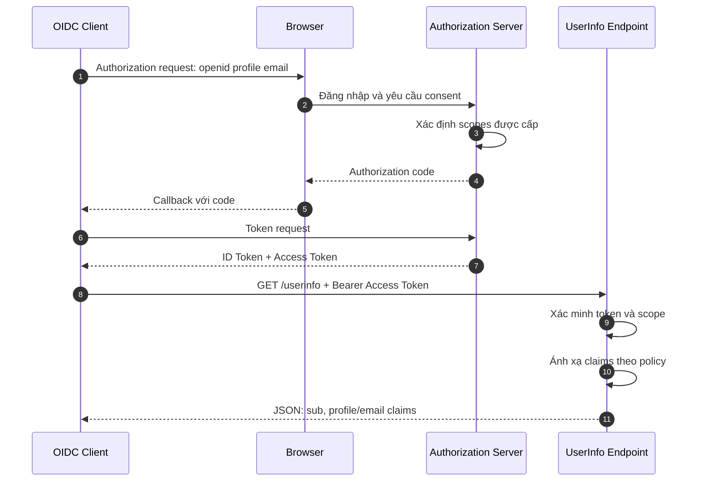
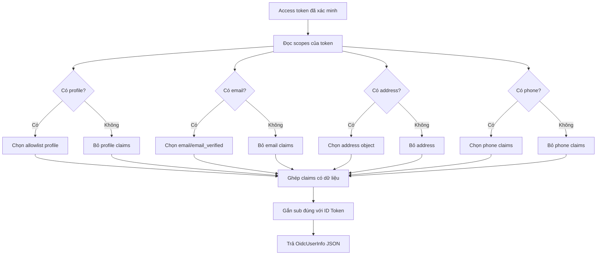

# Ánh xạ claims theo scope được cấp

OpenID Connect (OIDC) dùng các giá trị `scope` để client yêu cầu những nhóm thông tin chuẩn về End-User. Khi client yêu cầu `openid profile email`, Authorization Server có thể trả các claims hồ sơ như `name`, `preferred_username`, `email` và `email_verified` qua UserInfo Endpoint, tùy dữ liệu sẵn có, consent và chính sách riêng tư.

**Ánh xạ claims theo scope được cấp** là quy tắc quyết định claim nào được phép xuất hiện trong UserInfo response dựa trên quyền đã được cấp cho access token hiện tại. Nó bảo đảm client chỉ nhận nhóm thông tin mà token cho phép, thay vì nhận toàn bộ hồ sơ người dùng chỉ vì backend có dữ liệu đó.

Trong Spring Authorization Server, UserInfo Endpoint có mapper mặc định lấy các standard claims từ ID Token và lọc theo scope của authorization request. Khi cần lấy hồ sơ từ database, LDAP hoặc dịch vụ nội bộ, ứng dụng có thể cấu hình `userInfoMapper` để tạo `OidcUserInfo` theo policy của mình.

Bài học thuộc chương **OIDC UserInfo** của module **SPRING_SECURITY_OAUTH2_OIDC_AUTHORIZATION_SERVER**, nhằm học cách thiết kế, cấu hình, bảo mật, kiểm thử và vận hành OAuth 2.0/OpenID Connect Authorization Server bằng Spring Security và Spring Authorization Server trong ứng dụng Spring Boot.

Sau bài học, bạn có thể:

- Giải thích vai trò của `openid`, `profile`, `email`, `address` và `phone`.
- Phân biệt scope được client yêu cầu, scope client được đăng ký và scope thực sự được cấp.
- Ánh xạ claims theo scope trên access token hiện tại.
- Sử dụng mặc định UserInfo mapper hoặc tùy biến `OidcUserInfoEndpointConfigurer.userInfoMapper`.
- Giữ claim `sub` nhất quán với ID Token và xử lý claims không có dữ liệu.
- Kiểm soát custom claims, consent, dữ liệu nhạy cảm và quyền riêng tư.
- Kiểm thử UserInfo với các tổ hợp scope, token, subject, claim thiếu và dữ liệu thay đổi.

## 1. UserInfo trả lời câu hỏi nào?

OIDC bổ sung lớp định danh lên OAuth 2.0. Sau khi End-User đăng nhập và client nhận ID Token cùng access token, client có thể gọi UserInfo Endpoint bằng access token để lấy thêm thông tin về người dùng.

Ví dụ một ứng dụng portal cần tên hiển thị và email:

- Client gửi authorization request với `scope=openid profile email`.
- Authorization Server xác thực người dùng và lấy consent theo chính sách.
- Server cấp access token với các scope đã được chấp thuận.
- Client gửi access token tới UserInfo Endpoint.
- UserInfo trả `sub` cùng những profile/email claims được phép công bố.



UserInfo là một OAuth 2.0 protected resource. Client phải gửi access token qua HTTP Authorization header theo dạng Bearer trên HTTPS. Không gửi ID Token thay cho access token và không đặt access token trong URL query string.

Ví dụ request:

```http
GET /userinfo HTTP/1.1
Host: login.example.com
Authorization: Bearer <ACCESS_TOKEN>
Accept: application/json
```

Ví dụ response khi access token được cấp `openid profile email`:

```json
{
  "sub": "user-7f31",
  "name": "Nguyen An",
  "given_name": "An",
  "family_name": "Nguyen",
  "preferred_username": "an.nguyen",
  "email": "an@example.com",
  "email_verified": true
}
```

Response trên chỉ là ví dụ. Server có thể không có một số giá trị hoặc người dùng chưa đồng ý chia sẻ; claim không có dữ liệu nên được bỏ khỏi JSON thay vì trả `null` hoặc chuỗi rỗng.

## 2. Ba khái niệm scope cần phân biệt

Một lỗi thường gặp là dùng nhầm tập scope khi tạo UserInfo response. OAuth có ít nhất ba tập khác nhau:

| Tập scope | Ý nghĩa | Có đủ để trả claims không? |
| --- | --- | --- |
| Scope client được đăng ký | Những scope client được phép yêu cầu, ví dụ `openid`, `profile`, `email`. | Không. Đây là giới hạn tối đa của registration. |
| Scope client yêu cầu | Giá trị `scope` trong authorization request. | Không. Người dùng hoặc policy có thể từ chối một phần. |
| Scope được cấp | Những scope thực sự được authorization/token chấp thuận. | Là cơ sở để quyết định quyền của token. |

Ví dụ client được đăng ký `openid profile email address` nhưng chỉ yêu cầu `openid email`. Người dùng chấp thuận yêu cầu đó. Access token chỉ nên mang `openid` và `email`; UserInfo không được trả `name` hay `address` chỉ vì hai scope đó nằm trong registration.

Nếu client yêu cầu `openid profile email` nhưng consent chỉ chấp thuận `openid profile`, mapper phải bỏ `email` và `email_verified`. Không suy ra consent từ màn hình hiển thị, từ danh sách scope client hỗ trợ hoặc từ một request parameter chưa được server xác minh.

Trong Spring Authorization Server:

- `RegisteredClient.getScopes()` biểu diễn các scope được phép đăng ký cho client.
- `OAuth2Authorization.getAuthorizedScopes()` biểu diễn các scope được cấp cho authorization.
- `context.getAccessToken().getScopes()` trong UserInfo mapper biểu diễn scope gắn với access token đang được trình.

Khi tạo response cho một request cụ thể, hãy dùng scope của **access token hiện tại**. Đây là cách tránh việc một authorization có nhiều quyền hơn nhưng access token cụ thể đã bị thu hẹp scope vẫn nhận toàn bộ claims.

## 3. Các OIDC standard scopes và claims tương ứng

OIDC định nghĩa bốn scope tùy chọn để yêu cầu các nhóm standard claims. Chúng là các giá trị scope phân biệt chữ hoa/chữ thường.

| Scope | Claims được yêu cầu |
| --- | --- |
| `profile` | `name`, `family_name`, `given_name`, `middle_name`, `nickname`, `preferred_username`, `profile`, `picture`, `website`, `gender`, `birthdate`, `zoneinfo`, `locale`, `updated_at` |
| `email` | `email`, `email_verified` |
| `address` | `address` |
| `phone` | `phone_number`, `phone_number_verified` |

### 3.1. openid

`openid` là scope bắt buộc để authorization request được hiểu là OIDC request. Nó kích hoạt luồng định danh và việc phát hành ID Token theo OIDC.

`openid` không đồng nghĩa với quyền đọc toàn bộ hồ sơ. Nếu client chỉ yêu cầu `openid`, UserInfo tối thiểu vẫn phải có `sub`, nhưng không được tự động thêm email, địa chỉ, số điện thoại hoặc profile claims chỉ vì backend có các trường đó.

### 3.2. profile

`profile` yêu cầu nhóm thông tin hồ sơ mặc định:

| Claim | Mô tả |
| --- | --- |
| `name` | Tên đầy đủ hiển thị. |
| `given_name` | Tên gọi. |
| `family_name` | Họ. |
| `middle_name` | Tên đệm. |
| `nickname` | Tên thân mật/biệt danh. |
| `preferred_username` | Tên người dùng ưu tiên. |
| `profile` | URL trang hồ sơ. |
| `picture` | URL ảnh đại diện. |
| `website` | Website cá nhân. |
| `gender` | Giới tính theo giá trị do người dùng cung cấp. |
| `birthdate` | Ngày sinh theo định dạng OIDC. |
| `zoneinfo` | Múi giờ theo tên vùng IANA, ví dụ `Asia/Ho_Chi_Minh`. |
| `locale` | Ngôn ngữ/vùng, ví dụ `vi-VN`. |
| `updated_at` | Thời điểm cập nhật thông tin, biểu diễn theo NumericDate (số giây Unix). |

Không phải mọi người dùng đều có đủ các trường này. `profile` cho phép trả những giá trị thực sự có và được phép chia sẻ.

### 3.3. email

`email` yêu cầu:

- `email`: địa chỉ email của End-User.
- `email_verified`: boolean cho biết địa chỉ email đã được xác minh theo quy trình của OP hay chưa.

Không đặt `email_verified=true` chỉ vì email có định dạng hợp lệ hoặc người dùng nhập nó vào biểu mẫu. Giá trị phải dựa trên trạng thái xác minh thực tế. Nếu server không biết email đã xác minh hay chưa, có thể bỏ claim theo policy; không tự suy luận.

### 3.4. address

`address` là một JSON object, không phải chuỗi ghép tùy ý:

```json
{
  "address": {
    "formatted": "12 Nguyen Hue, District 1, Ho Chi Minh City",
    "street_address": "12 Nguyen Hue",
    "locality": "Ho Chi Minh City",
    "region": "Ho Chi Minh City",
    "postal_code": "700000",
    "country": "VN"
  }
}
```

Các thành phần chuẩn gồm `formatted`, `street_address`, `locality`, `region`, `postal_code` và `country`. Không trả địa chỉ khi client chỉ có `profile` hoặc `email`.

Địa chỉ là dữ liệu cá nhân có thể nhạy cảm. Chỉ trả khi scope `address` thực sự được cấp và consent/policy cho phép.

### 3.5. phone

`phone` yêu cầu:

- `phone_number`: số điện thoại của End-User.
- `phone_number_verified`: boolean cho biết số điện thoại đã được xác minh theo quy trình của OP hay chưa.

Không suy ra `phone_number_verified=true` từ việc số điện thoại tồn tại trong database. Cần có trạng thái xác minh có thể kiểm chứng, ví dụ hoàn thành challenge OTP theo policy.

### 3.6. offline_access không phải profile scope

`offline_access` được dùng để yêu cầu quyền truy cập khi End-User không hiện diện và thường liên quan đến việc cấp refresh token theo OIDC. Nó **không** yêu cầu thêm claims hồ sơ UserInfo.

Tương tự, scope nghiệp vụ như `orders.read`, `billing.read` hoặc `admin` không tự động tương ứng với OIDC profile claims. Nếu cần custom claims, phải thiết kế mapping riêng, có allowlist và policy quyền rõ ràng.

## 4. Quy tắc quan trọng của UserInfo response

### 4.1. sub luôn phải có

OIDC Core yêu cầu `sub` luôn xuất hiện trong UserInfo response. Giá trị `sub` trong UserInfo **MUST khớp chính xác** với `sub` trong ID Token đã được client xác minh.

Đây là điều kiện an toàn chống token substitution. Client không được sử dụng UserInfo claims nếu subject trong response khác subject trong ID Token.

Ví dụ không hợp lệ:

```json
{
  "sub": "another-user",
  "email": "an@example.com"
}
```

Nếu ID Token có `sub=user-7f31` nhưng UserInfo trả `sub=another-user`, client phải loại bỏ toàn bộ UserInfo response. Không được chỉ bỏ claim `sub` rồi tiếp tục tin các trường còn lại.

### 4.2. Claim không có dữ liệu nên được bỏ qua

OIDC cho phép OP không trả một số claim được yêu cầu vì lý do riêng tư hoặc dữ liệu không sẵn có. Việc thiếu một claim không phải lỗi protocol.

Nên:

```json
{
  "sub": "user-7f31",
  "name": "Nguyen An"
}
```

Tránh:

```json
{
  "sub": "user-7f31",
  "name": "Nguyen An",
  "email": null,
  "phone_number": ""
}
```

Đối với boolean, `false` là một giá trị hợp lệ và khác với việc thiếu claim. Ví dụ `email_verified=false` phải được giữ lại nếu đây là trạng thái xác minh thực tế.

### 4.3. Scope là giới hạn quyền, không phải bảo đảm dữ liệu có mặt

Nếu access token có `email`, client được phép yêu cầu email theo policy; điều đó không đảm bảo mọi tài khoản đều có email hoặc OP buộc phải trả email.

Có thể diễn đạt:

```text
UserInfo claims
    = claims có dữ liệu
    ∩ claims được scope cho phép
    ∩ claims được consent/policy cho phép
```

Đây là nguyên tắc lọc theo quyền. Mọi lớp phải cùng được thỏa mãn trước khi trả claim.

## 5. Luồng ánh xạ claims theo scope được cấp

Giả sử người dùng có hồ sơ:

```json
{
  "sub": "user-7f31",
  "name": "Nguyen An",
  "email": "an@example.com",
  "email_verified": true,
  "phone_number": "+84901234567",
  "phone_number_verified": true,
  "address": {
    "locality": "Ho Chi Minh City",
    "country": "VN"
  }
}
```

Client yêu cầu `openid profile email phone`. Sau consent, access token thực tế chỉ được cấp `openid profile email`.

Mapper phải trả:

```json
{
  "sub": "user-7f31",
  "name": "Nguyen An",
  "email": "an@example.com",
  "email_verified": true
}
```

Mapper không trả `phone_number` hoặc `phone_number_verified` vì scope `phone` không có trên access token, dù dữ liệu có sẵn.



Các bước:

1. Xác minh access token ở UserInfo Endpoint.
2. Lấy authorization gắn với token và scope của chính token đó.
3. Lấy subject ổn định từ ID Token/authorization.
4. Tải dữ liệu hồ sơ từ nguồn tin cậy.
5. Ánh xạ từng nhóm claim theo scope tương ứng.
6. Bỏ giá trị không có dữ liệu hoặc không được phép chia sẻ.
7. Luôn đặt `sub` đúng với ID Token.
8. Trả response JSON.

Không tải toàn bộ dữ liệu hồ sơ rồi trả thẳng cho client. Việc có dữ liệu trong database không phải là quyền công bố dữ liệu đó.

## 6. Spring Authorization Server: hành vi mặc định

Khi bật OpenID Connect trong Spring Authorization Server, UserInfo Endpoint được đăng ký trong Authorization Server filter chain. Endpoint này là protected resource và yêu cầu access token trong Authorization header.

Cấu hình tối thiểu phần OIDC:

```java
@Bean
@Order(1)
SecurityFilterChain authorizationServerSecurityFilterChain(
        HttpSecurity http) throws Exception {

    OAuth2AuthorizationServerConfigurer authorizationServer =
        OAuth2AuthorizationServerConfigurer.authorizationServer();

    http
        .securityMatcher(authorizationServer.getEndpointsMatcher())
        .with(authorizationServer, server ->
            server.oidc(Customizer.withDefaults()));

    return http.build();
}
```

Ứng dụng thực tế còn cần các beans của Authorization Server, các filter chain bảo vệ login/ứng dụng và cấu hình signing keys. Với UserInfo Endpoint theo cấu hình Spring Authorization Server hiện hành, cần có `JwtDecoder` để xác minh access token.

Spring Authorization Server mặc định:

- Xác thực access token gửi đến UserInfo.
- Tìm `OAuth2Authorization` tương ứng với token.
- Dùng ID Token đã lưu trong authorization làm nguồn standard claims.
- Lọc standard claims dựa trên scopes được yêu cầu trong authorization.
- Tạo `OidcUserInfo` và trả JSON response.

Do đó, nếu ID Token đã có standard claims đúng và không cần mapping từ nguồn dữ liệu khác, có thể giữ mapper mặc định.

### 6.1. Client registration cho OIDC scopes

Ví dụ registration:

```java
RegisteredClient portal = RegisteredClient.withId("portal-internal-id")
    .clientId("customer-portal")
    .clientAuthenticationMethod(
        ClientAuthenticationMethod.CLIENT_SECRET_BASIC)
    .authorizationGrantType(
        AuthorizationGrantType.AUTHORIZATION_CODE)
    .authorizationGrantType(
        AuthorizationGrantType.REFRESH_TOKEN)
    .redirectUri(
        "https://portal.example.com/login/oauth2/code/portal")
    .scope(OidcScopes.OPENID)
    .scope(OidcScopes.PROFILE)
    .scope(OidcScopes.EMAIL)
    .scope(OidcScopes.ADDRESS)
    .scope(OidcScopes.PHONE)
    .clientSettings(ClientSettings.builder()
        .requireAuthorizationConsent(true)
        .requireProofKey(true)
        .build())
    .build();
```

Registration cho phép client yêu cầu các scope đó. Consent UI và authorization policy vẫn quyết định scope nào được cấp trong một authorization cụ thể.

Không đưa tất cả scope vào mọi client theo thói quen. Client chỉ cần tên hiển thị và email thì chỉ nên được cấp các scope cần thiết.

### 6.2. Lưu ý về token format

Spring Authorization Server UserInfo Endpoint trong cấu hình tài liệu chuẩn sử dụng Resource Server support và `JwtDecoder`. Nếu hệ thống chọn opaque/reference access token hoặc thay đổi token authentication, phải kiểm tra khả năng xác thực UserInfo theo đúng phiên bản và custom filter chain; không giả định cấu hình JWT decoder mặc định tự đọc được opaque token.

## 7. Cách 1: thêm standard claims vào ID Token và dùng mapper mặc định

Tài liệu Spring khuyến nghị cách đơn giản là đưa standard claims vào ID Token khi phát hành. UserInfo mapper mặc định sau đó chỉ trả những standard claims được yêu cầu theo scopes.

Định nghĩa service chỉ trả các **profile claims** đã được xác minh, không chứa protocol claims như `iss`, `sub`, `aud`, `exp` hoặc `nonce`:

```java
public interface UserProfileService {

Map<String, Object> loadStandardProfileClaims(String principalName);
}
```

Customizer cho ID Token:

```java
@Configuration(proxyBeanMethods = false)
public class IdTokenProfileClaimsConfig {

    @Bean
    OAuth2TokenCustomizer<JwtEncodingContext> idTokenCustomizer(
            UserProfileService userProfileService) {

        return context -> {
            if (!OidcParameterNames.ID_TOKEN.equals(
                    context.getTokenType().getValue())) {
                return;
            }

            Map<String, Object> source =
                userProfileService.loadStandardProfileClaims(
                    context.getPrincipal().getName());

            Set<String> authorizedScopes = context.getAuthorizedScopes();
            Map<String, Object> source =
                userProfileService.loadStandardProfileClaims(
                    context.getPrincipal().getName());
            if (source == null) {
                source = Map.of();
            }

            Set<String> authorizedScopes = context.getAuthorizedScopes();

            Map<String, Object> allowed = new HashMap<>();

            copyScopeClaims(source, allowed, authorizedScopes,
                OidcScopes.PROFILE,
                Set.of(
                    "name", "family_name", "given_name", "middle_name",
                    "nickname", "preferred_username", "profile", "picture",
                    "website", "gender", "birthdate", "zoneinfo",
                    "locale", "updated_at"));

            copyScopeClaims(source, allowed, authorizedScopes,
                OidcScopes.EMAIL,
                Set.of("email", "email_verified"));

            copyScopeClaims(source, allowed, authorizedScopes,
                OidcScopes.ADDRESS,
                Set.of("address"));

            copyScopeClaims(source, allowed, authorizedScopes,
                OidcScopes.PHONE,
                Set.of("phone_number", "phone_number_verified"));

            context.getClaims().claims(claims ->
                claims.putAll(allowed));
        };
    }

    private static void copyScopeClaims(
            Map<String, Object> source,
            Map<String, Object> target,
            Set<String> scopes,
            String requiredScope,
            Set<String> claimNames) {

        if (!scopes.contains(requiredScope)) {
            return;
        }

        for (String claimName : claimNames) {
            Object value = source.get(claimName);
            if (value != null
                    && (!(value instanceof String text) || !text.isBlank())) {
                target.put(claimName, value);
            }
        }
    }
}
```

Các import cần có:

```java
import java.util.HashMap;
import java.util.Map;
import java.util.Set;

import org.springframework.context.annotation.Bean;
import org.springframework.context.annotation.Configuration;
import org.springframework.security.oauth2.core.oidc.OidcScopes;
import org.springframework.security.oauth2.core.oidc.endpoint.OidcParameterNames;
import org.springframework.security.oauth2.server.authorization.token.JwtEncodingContext;
import org.springframework.security.oauth2.server.authorization.token.OAuth2TokenCustomizer;
```

Đây là ví dụ minh họa phần customizer; ứng dụng cần cung cấp `UserProfileService` và các beans còn lại. Service chỉ nên trả các claim trong allowlist đã được xác minh, không trả protocol claims hoặc toàn bộ entity database.

**Vì sao kiểm tra token type?** `JwtGenerator` có thể tạo ID Token và JWT access token. Nếu không lọc `ID_TOKEN`, dữ liệu profile có thể bị đưa nhầm vào access token hoặc một loại JWT khác.

**Vì sao lọc theo authorized scopes ở thời điểm phát ID Token?** Điều này giảm nguy cơ nhúng claims ngoài phạm vi được chấp thuận. Mapper mặc định của UserInfo vẫn lọc standard claims theo scope; customizer không nên dùng để mở rộng quyền của client.

Không ghi đè `sub` bằng username. Subject do OIDC subject policy quyết định và có thể là pairwise identifier. Service cần được gọi bằng định danh người dùng đáng tin cậy, còn subject của ID Token vẫn do Authorization Server quản lý.

## 8. Cách 2: tùy biến userInfoMapper để ánh xạ trực tiếp từ nguồn hồ sơ

Khi profile claims nằm trong database, LDAP hoặc một profile service và không muốn nhúng toàn bộ dữ liệu vào ID Token, có thể cấu hình `OidcUserInfoEndpointConfigurer.userInfoMapper`.

Mapper nhận `OidcUserInfoAuthenticationContext`, cung cấp:

- `getAuthorization()`: authorization liên quan đến access token.
- `getAccessToken()`: bearer access token được dùng cho UserInfo request.
- `getAuthentication()`: `OidcUserInfoAuthenticationToken` đại diện request đã xác thực.

Từ authorization, ứng dụng có thể lấy ID Token để xác định `sub`. Từ access token hiện tại, mapper lấy scope để lọc claims.

### 8.1. Service hồ sơ theo subject

```java
public interface UserInfoProfileService {

    Map<String, Object> loadClaimsBySubject(String subject);
}
```

Service phải ánh xạ subject đã phát hành tới đúng hồ sơ người dùng. Với pairwise subject, không giả định `sub` luôn là username hoặc primary key nội bộ; dùng bảng ánh xạ/subject resolver của ứng dụng.

### 8.2. Mapper lọc theo scope của access token

```java
@Configuration(proxyBeanMethods = false)
public class UserInfoMapperConfig {

    private static final Set<String> PROFILE_CLAIMS = Set.of(
        "name",
        "family_name",
        "given_name",
        "middle_name",
        "nickname",
        "preferred_username",
        "profile",
        "picture",
        "website",
        "gender",
        "birthdate",
        "zoneinfo",
        "locale",
        "updated_at"
    );

    @Bean
    @Order(1)
    SecurityFilterChain authorizationServerSecurityFilterChain(
            HttpSecurity http,
            UserInfoProfileService profileService) throws Exception {

        Function<OidcUserInfoAuthenticationContext, OidcUserInfo> mapper =
            context -> {
                OAuth2Authorization authorization =
                    context.getAuthorization();

                if (authorization == null) {
                    throw new OAuth2AuthenticationException(
                        new OAuth2Error(OAuth2ErrorCodes.INVALID_TOKEN));
                }

                OAuth2Authorization.Token<OidcIdToken> idTokenHolder =
                    authorization.getToken(OidcIdToken.class);

                if (idTokenHolder == null) {
                    throw new OAuth2AuthenticationException(
                        new OAuth2Error(OAuth2ErrorCodes.INVALID_TOKEN));
                }

                String subject = idTokenHolder.getToken().getSubject();
                Set<String> scopes = context.getAccessToken().getScopes();

                Map<String, Object> source =
                    profileService.loadClaimsBySubject(subject);
                if (source == null) {
                    source = Map.of();
                }

                Map<String, Object> response = new HashMap<>();
                response.put("sub", subject);

                copyScopeClaims(source, response, scopes,
                    OidcScopes.PROFILE, PROFILE_CLAIMS);

                copyScopeClaims(source, response, scopes,
                    OidcScopes.EMAIL,
                    Set.of("email", "email_verified"));

                copyScopeClaims(source, response, scopes,
                    OidcScopes.ADDRESS, Set.of("address"));

                copyScopeClaims(source, response, scopes,
                    OidcScopes.PHONE,
                    Set.of("phone_number", "phone_number_verified"));

                // Custom scopes chỉ được ánh xạ khi policy ứng dụng định nghĩa rõ.
                copyScopeClaims(source, response, scopes,
                    "employee.read",
                    Set.of("employee_id", "department"));

                return new OidcUserInfo(response);
            };

        OAuth2AuthorizationServerConfigurer authorizationServer =
            OAuth2AuthorizationServerConfigurer.authorizationServer();

        http
            .securityMatcher(authorizationServer.getEndpointsMatcher())
            .with(authorizationServer, server ->
                server.oidc(oidc ->
                    oidc.userInfoEndpoint(userInfo ->
                        userInfo.userInfoMapper(mapper))));

        http.authorizeHttpRequests(authorize ->
            authorize.anyRequest().authenticated());

        return http.build();
    }

    private static void copyScopeClaims(
            Map<String, Object> source,
            Map<String, Object> target,
            Set<String> scopes,
            String requiredScope,
            Set<String> claimNames) {

        if (!scopes.contains(requiredScope)) {
            return;
        }

        for (String claimName : claimNames) {
            Object value = source.get(claimName);
            if (value != null
                    && (!(value instanceof String text) || !text.isBlank())) {
                target.put(claimName, value);
            }
        }
    }
}
```

Các import chính:

```java
import java.util.HashMap;
import java.util.Map;
import java.util.Set;
import java.util.function.Function;

import org.springframework.context.annotation.Bean;
import org.springframework.context.annotation.Configuration;
import org.springframework.core.annotation.Order;
import org.springframework.security.config.annotation.web.builders.HttpSecurity;
import org.springframework.security.oauth2.core.OAuth2Error;
import org.springframework.security.oauth2.core.OAuth2AuthenticationException;
import org.springframework.security.oauth2.core.OAuth2ErrorCodes;
import org.springframework.security.oauth2.core.oidc.OidcScopes;
import org.springframework.security.oauth2.core.oidc.OidcIdToken;
import org.springframework.security.oauth2.core.oidc.OidcUserInfo;
import org.springframework.security.oauth2.server.authorization.OAuth2Authorization;
import org.springframework.security.oauth2.server.authorization.config.annotation.web.configurers.OAuth2AuthorizationServerConfigurer;
import org.springframework.security.oauth2.server.authorization.oidc.authentication.OidcUserInfoAuthenticationContext;
import org.springframework.security.web.SecurityFilterChain;
```

Ví dụ này tập trung vào mapper; filter chain thực tế phải tích hợp đúng cấu hình Authorization Server hiện có, login chain, exception handling, `JwtDecoder` và các beans cần thiết. Nếu dự án đã có `SecurityFilterChain` cho Authorization Server, hãy thêm `userInfoEndpoint(...)` vào configurer hiện hữu thay vì tạo một chain thứ hai trùng matcher.

### 8.3. Vì sao dùng scope trên access token?

Một authorization có thể lưu các scope đã được chấp thuận, nhưng request UserInfo luôn trình một access token cụ thể. Dùng `context.getAccessToken().getScopes()` gắn response với đúng credential hiện tại. Nếu hệ thống thu hẹp scope khi phát token, mapper không vô tình dùng scope rộng hơn từ registration hoặc authorization request ban đầu.

### 8.4. Giữ sub đồng nhất

Mapper lấy `sub` từ ID Token đã lưu trong authorization, rồi đặt chính giá trị đó vào response. Không lấy subject từ query parameter, request header, username do client gửi hoặc một claim chưa được xác minh.

Client cũng phải kiểm tra `sub` trong UserInfo khớp chính xác `sub` trong ID Token trước khi dùng các claims khác.

## 9. Ánh xạ custom claims theo custom scopes

Ứng dụng có thể định nghĩa scope riêng, ví dụ:

| Custom scope | Claims có thể được phép |
| --- | --- |
| `employee.read` | `employee_id`, `department` |
| `organization.read` | `organization_id`, `organization_name` |
| `support.contact.read` | `support_contact` |

Đây là quy ước riêng của ứng dụng, không phải standard OIDC scope. Cần đăng ký scope trong `RegisteredClient`, định nghĩa consent/policy và kiểm tra mapper thực sự giới hạn claim.

Ví dụ:

```java
copyScopeClaims(
    source,
    response,
    scopes,
    "organization.read",
    Set.of("organization_id", "organization_name")
);
```

Không ánh xạ scope `admin` thành toàn bộ object user hoặc toàn bộ database row. Mỗi scope nên có allowlist claim cụ thể và mục đích nghiệp vụ rõ ràng. Khi scope không có trong access token, custom claims tương ứng phải bị bỏ qua dù người dùng có dữ liệu.

Custom claims không được ghi đè OIDC protocol claims như `sub`. Tránh dùng các tên chuẩn cho ý nghĩa riêng; nếu cần namespace, chọn tên rõ ràng và thống nhất với client contract.

## 10. Scope, consent và quyền riêng tư

Scope là một phần của authorization contract, không phải sự đồng ý vô hạn cho mọi cách sử dụng dữ liệu.

### 10.1. Scope được cấp không bảo đảm claim luôn được trả

OIDC cho phép OP từ chối trả một số claim đã yêu cầu vì lý do riêng tư. Ví dụ người dùng có thể chấp thuận `email` nhưng không có email đã xác minh; server có thể trả `email` cùng `email_verified=false`, hoặc bỏ claim theo policy nếu không có dữ liệu hợp lệ.

Tương tự, `address` được cấp không có nghĩa mọi thành phần địa chỉ đều có giá trị. Mapper có thể trả một object chỉ chứa các trường có dữ liệu, miễn đúng schema và policy.

### 10.2. Không trả PII vượt scope

Không trả những dữ liệu sau chỉ vì chúng có trong profile database:

- Mật khẩu, password hash, recovery code hoặc MFA secret.
- Client secret, private key, session token hoặc refresh token.
- Số giấy tờ, thông tin thanh toán, dữ liệu sức khỏe hoặc dữ liệu nội bộ nếu không có scope/purpose hợp lệ.
- Internal database ID nếu không được thiết kế làm public subject.
- Roles/authorities nội bộ chỉ vì access token có một scope API chung.

Đối với claims nhạy cảm, cần xem xét consent riêng, mục đích sử dụng, retention và quy định bảo vệ dữ liệu. Một scope rộng như `profile` không nên được hiểu là cho phép xuất mọi trường trong hồ sơ nội bộ.

### 10.3. Không đưa dữ liệu thay đổi liên tục vào ID Token nếu không cần

ID Token là snapshot tại thời điểm authentication/token issuance. Nếu profile thay đổi sau đó, ID Token cũ vẫn chứa giá trị cũ đến khi hết hạn. UserInfo có thể truy vấn nguồn dữ liệu mới hơn mỗi request, nhưng cần kiểm soát cache, latency và availability.

Chọn nguồn dữ liệu theo yêu cầu:

| Cách làm | Ưu điểm | Đánh đổi |
| --- | --- | --- |
| Claims trong ID Token, default mapper | Đơn giản, response nhất quán với dữ liệu đã phát hành. | Profile có thể cũ đến khi token được cấp lại. |
| Custom UserInfo mapper truy vấn database/service | Có thể phản ánh dữ liệu mới nhất và policy theo request. | Thêm latency, phụ thuộc dịch vụ và cần xử lý lỗi. |
| Cache profile có TTL ngắn | Giảm tải cho nguồn dữ liệu. | Có độ trễ cập nhật và cần invalidation policy. |

Không gọi nhiều dịch vụ profile đồng bộ cho mọi request nếu một snapshot được cấp trong token đáp ứng yêu cầu. Ngược lại, không nhúng thông tin cần cập nhật ngay vào ID Token rồi giả định UserInfo sẽ tự thay đổi.

## 11. UserInfo và ID Token có vai trò khác nhau

| Tiêu chí | ID Token | UserInfo |
| --- | --- | --- |
| Mục đích | Thông điệp xác nhận authentication cho client. | Endpoint trả claims về End-User theo access token. |
| Thời điểm | Được phát trong token response/authorization response theo flow. | Client gọi riêng sau khi có access token. |
| Định dạng | JWT được ký (và có thể mã hóa theo cấu hình). | Thường JSON; có thể ký/mã hóa theo registration và implementation. |
| Subject | Có `sub`. | Phải có `sub` và phải khớp ID Token. |
| Tính cập nhật | Snapshot tại thời điểm phát hành. | Có thể lấy dữ liệu mới hơn tùy mapper/source. |
| Quyền truy cập | Client xác minh ID Token theo OIDC. | UserInfo Endpoint yêu cầu access token hợp lệ. |

Không dùng access token làm bằng chứng authentication thay cho ID Token ở OIDC client. Cũng không gửi ID Token tới UserInfo Endpoint thay cho access token.

Client cần xác minh ID Token theo OIDC, gọi UserInfo bằng access token và so sánh `sub`. Chỉ khi subject khớp, client mới sử dụng các claims còn lại từ UserInfo.

## 12. Lỗi thường gặp và cách xử lý

### 12.1. Client yêu cầu email nhưng UserInfo không trả email

Kiểm tra `email` có thực sự nằm trong scope của access token không, consent có chấp thuận không, profile service có email không và mapper có allowlist `email`. Đừng kiểm tra chỉ danh sách scope trong RegisteredClient.

### 12.2. Client nhận claims profile dù chỉ yêu cầu openid

Kiểm tra custom mapper có trả toàn bộ profile map mà không lọc scope hay không. Kiểm tra ID Token customizer có nhúng claims không cần thiết và default mapper có được thay thế bằng mapper tùy biến bỏ lọc hay không.

### 12.3. UserInfo trả sub khác ID Token

Kiểm tra subject resolver, pairwise subject policy, tenant/sector mapping và việc mapper lấy đúng ID Token của authorization gắn với access token. Client phải loại bỏ toàn bộ response khi mismatch.

### 12.4. email_verified luôn true

Kiểm tra mapping có gán literal true hoặc mặc định true khi field database null hay không. Chỉ dùng trạng thái xác minh được lưu từ quy trình xác minh email đáng tin cậy.

### 12.5. Claim address bị trả thành chuỗi

OIDC `address` là JSON object. Kiểm tra DTO/serializer không stringify object hoặc đổi thành một chuỗi địa chỉ tự do. Nếu chỉ có một phần địa chỉ, trả object chứa đúng các thành phần có dữ liệu.

### 12.6. Custom mapper làm mất claims chuẩn

Mapper tùy biến chịu trách nhiệm tạo toàn bộ `OidcUserInfo` response. Nếu chỉ trả custom claims mà quên `sub` hoặc không ánh xạ standard scopes, response có thể không còn tương thích OIDC. Dùng allowlist rõ và luôn thêm subject.

### 12.7. Custom scope làm lộ claim ngoài ý muốn

Kiểm tra mapping scope-to-claim, scope trên token thực tế và dữ liệu nguồn. Không dùng điều kiện substring kiểu `scope.contains("read")`; so sánh phần tử scope chính xác.

### 12.8. UserInfo trả dữ liệu cũ

Nếu mapper lấy claims từ ID Token, dữ liệu là snapshot tại thời điểm phát hành. Nếu yêu cầu dữ liệu mới, truy vấn profile service trong mapper hoặc giảm TTL/cache theo SLA. Không cập nhật claims trong ID Token đã phát hành.

### 12.9. UserInfo trả 401 invalid_token

Kiểm tra access token hết hạn/revoked, chữ ký/issuer/audience và `JwtDecoder`. Kiểm tra client gửi đúng access token trong Bearer header, không dùng ID Token hoặc refresh token.

### 12.10. UserInfo endpoint không hoạt động sau khi bật OIDC

Kiểm tra `.oidc(...)` đã được bật trong Authorization Server filter chain, endpoint matcher, `JwtDecoder` bean và Resource Server support. Kiểm tra request đi qua đúng chain và endpoint path được cấu hình.

## 13. Ma trận kiểm thử ánh xạ claims

| Tình huống | Kết quả mong đợi |
| --- | --- |
| Token có `openid` | UserInfo có `sub` đúng với ID Token. |
| Token có `openid profile` | Chỉ profile claims có dữ liệu được trả. |
| Token có `openid email` | Có thể trả `email`/`email_verified` nếu dữ liệu và policy cho phép. |
| Token có `openid address` | Có thể trả object `address`. |
| Token có `openid phone` | Có thể trả phone claims. |
| Token có `openid` nhưng không có profile/email/address/phone | Không trả các nhóm claims này. |
| Client registration cho phép email nhưng access token không có email | Không trả email. |
| Request yêu cầu email nhưng consent không cấp email | Không trả email. |
| Token có `email` nhưng profile service không có email | Bỏ claim email; không trả null/rỗng. |
| `email_verified=false` | Giữ boolean false nếu đây là trạng thái thực tế. |
| Token có `profile` nhưng không có `phone` | Không trả phone claims. |
| Token có custom scope `employee.read` | Chỉ trả custom claims nằm trong allowlist scope đó. |
| Token không có `employee.read` | Không trả employee claims. |
| Nguồn hồ sơ có claim ngoài allowlist | Claim ngoài allowlist không xuất hiện. |
| Mapper không tìm thấy ID Token/subject | Từ chối token/request theo policy; không trả profile không định danh. |
| UserInfo `sub` khác ID Token `sub` | Client loại bỏ toàn bộ response. |
| Access token hết hạn/revoked | UserInfo trả lỗi xác thực token, thường là 401 invalid_token. |
| ID Token cũ và UserInfo từ profile service mới | Subject vẫn khớp; các claims có thể mới hơn theo policy. |
| Hai client có pairwise subject khác nhau | Mỗi client nhận subject đúng theo sector/subject policy. |
| Access token scope bị thu hẹp | Mapper chỉ dùng scope của token đang được trình. |
| UserInfo mapper tùy biến | Vẫn có `sub` và scope filtering đầy đủ. |
| Profile service tạm thời không khả dụng | Xử lý lỗi có kiểm soát; không trả dữ liệu cũ/không xác minh như thể mới. |

### 13.1. Integration test với các scope khác nhau

Chuẩn bị cùng một user profile có đủ claims. Tạo các authorization riêng:

- Authorization A: `openid profile`.
- Authorization B: `openid email`.
- Authorization C: `openid address phone`.
- Authorization D: `openid`.

Gọi UserInfo bằng access token tương ứng và xác nhận:

1. Tất cả response có `sub` và khớp ID Token.
2. Response A không có email/address/phone.
3. Response B chỉ có email group trong các profile claims tùy chọn.
4. Response C có address/phone nhưng không có profile/email.
5. Response D chỉ có `sub` và các claims OIDC bắt buộc khác nếu policy có.
6. Không response nào có claim nằm ngoài allowlist của scope.
7. Claim không có dữ liệu bị bỏ qua thay vì serialize thành null/empty.

### 13.2. Test subject consistency

Tạo ID Token có `sub=user-7f31` và giả lập mapper trả `sub=user-other`. Test phía client phải xác nhận response không được sử dụng. Ở phía server, test mapper phải luôn lấy subject từ ID Token của chính authorization, không từ input request.

### 13.3. Test boolean và object claims

- `email_verified=false` vẫn được trả dưới dạng JSON boolean.
- `phone_number_verified=false` vẫn được trả dưới dạng JSON boolean.
- `address` là JSON object, không phải chuỗi.
- `updated_at` là NumericDate theo schema OIDC.
- Claim vắng dữ liệu không xuất hiện trong response.

## 14. Bài thực hành: portal chỉ được nhận claims đã cấp

Một portal được đăng ký với các scope `openid`, `profile`, `email`, `address` và `phone`. User profile trong database có đầy đủ các trường.

Các tình huống:

- Lần A: người dùng chấp thuận `openid profile email`.
- Lần B: người dùng chỉ chấp thuận `openid profile`.
- Lần C: người dùng chấp thuận `openid address phone`.
- Lần D: access token bị thu hẹp còn `openid`.
- Lần E: người dùng đổi email sau khi ID Token đã phát hành.

Hãy trả lời:

1. Vì sao registration có `email` không đủ để UserInfo trả email ở lần B?
2. Mapper nên dùng scope từ RegisteredClient, authorization request hay access token hiện tại?
3. Vì sao `sub` vẫn phải có ở cả bốn lần?
4. Nếu `email_verified=false` thì có nên bỏ claim không?
5. `address` cần có kiểu JSON nào?
6. Nếu profile service có thêm `national_id` nhưng không nằm trong allowlist, mapper có được trả không?
7. Với custom scope `employee.read`, làm sao giới hạn claims cụ thể?
8. Nếu email thay đổi ở lần E, UserInfo mặc định lấy claims từ ID Token có phản ánh ngay không?
9. Client phải làm gì nếu UserInfo `sub` khác ID Token `sub`?
10. Khi profile service lỗi, nên trả dữ liệu chưa được xác minh như thế nào?

**Gợi ý:** scope của access token hiện tại là giới hạn quyền cho request đó. `sub` lấy từ ID Token tương ứng; các nhóm claim còn lại được lọc theo scope và policy. Nếu cần dữ liệu mới hơn snapshot ID Token, dùng custom mapper truy vấn nguồn dữ liệu và vẫn giữ subject consistency.

## 15. Checklist triển khai

- [ ] UserInfo Endpoint được bật bằng OIDC configurer và bảo vệ như OAuth2 protected resource.
- [ ] Client gửi access token qua Bearer Authorization header trên HTTPS.
- [ ] UserInfo không chấp nhận ID Token hoặc refresh token thay access token.
- [ ] Mapper dùng scope của access token hiện tại để quyết định claims.
- [ ] Phân biệt RegisteredClient scopes, requested scopes và authorized/token scopes.
- [ ] `openid` được yêu cầu cho OIDC; không coi nó là quyền đọc toàn bộ profile.
- [ ] `profile` chỉ ánh xạ profile standard claims.
- [ ] `email` chỉ ánh xạ `email` và `email_verified`.
- [ ] `address` chỉ ánh xạ address object theo schema OIDC.
- [ ] `phone` chỉ ánh xạ phone claims.
- [ ] `offline_access` không bị hiểu nhầm là profile scope.
- [ ] Custom scopes có allowlist claim cụ thể và policy riêng.
- [ ] `sub` luôn có và lấy từ ID Token của authorization tương ứng.
- [ ] Client xác minh UserInfo `sub` khớp chính xác ID Token `sub`.
- [ ] Claims không có dữ liệu được bỏ qua, không trả null/empty string.
- [ ] Boolean false được giữ nguyên khi là giá trị thực.
- [ ] Không công bố secret, internal attributes hoặc PII ngoài scope/purpose.
- [ ] Custom mapper không làm mất standard claims và không bỏ lọc scope.
- [ ] Đã quyết định dùng ID Token snapshot hay truy vấn profile service trực tiếp.
- [ ] Có policy cache/latency/error khi profile service không khả dụng.
- [ ] Có integration test cho từng scope, scope bị từ chối, missing claim, subject mismatch và token invalid.
- [ ] Log không chứa access token, refresh token hoặc toàn bộ profile claims nhạy cảm.

**Ghi nhớ:** UserInfo claims phải được lọc theo **scope của access token đang được trình**, sau đó tiếp tục giới hạn bởi dữ liệu thực có, consent và policy riêng tư. Các scope chuẩn `profile`, `email`, `address` và `phone` tương ứng với các nhóm claims khác nhau. Trong mọi response, `sub` là bắt buộc và phải khớp chính xác `sub` trong ID Token; custom mapper phải giữ nguyên quy tắc này.

## 16. Tài liệu tham khảo

- [OpenID Connect Core 1.0 — Section 5.3 UserInfo Endpoint](https://openid.net/specs/openid-connect-core-1_0.html#UserInfo): UserInfo request/response, claim `sub` và response validation.
- [OpenID Connect Core 1.0 — Section 5.4 Requesting Claims using Scope Values](https://openid.net/specs/openid-connect-core-1_0.html#ScopeClaims): standard scopes `profile`, `email`, `address` và `phone`.
- [OpenID Connect Core 1.0 — Section 5.1 Standard Claims](https://openid.net/specs/openid-connect-core-1_0.html#StandardClaims): tên, kiểu và ý nghĩa standard claims.
- [RFC 6750 — OAuth 2.0 Bearer Token Usage](https://www.rfc-editor.org/rfc/rfc6750.html): gửi access token trong Authorization header.
- [Spring Authorization Server — How-to: Customize the OpenID Connect 1.0 UserInfo response](https://docs.spring.io/spring-authorization-server/reference/guides/how-to-userinfo.html): bật UserInfo Endpoint, ID Token customizer và UserInfo mapper.
- [Spring Authorization Server — Protocol Endpoints](https://docs.spring.io/spring-authorization-server/reference/protocol-endpoints.html): `OidcUserInfoEndpointConfigurer` và `userInfoMapper`.
- [OidcUserInfoEndpointConfigurer API](https://docs.spring.io/spring-authorization-server/reference/api/java/org/springframework/security/oauth2/server/authorization/config/annotation/web/configurers/OidcUserInfoEndpointConfigurer.html): cấu hình mapper và các extension points.
- [OidcUserInfoAuthenticationContext API](https://docs.spring.io/spring-authorization-server/reference/api/java/org/springframework/security/oauth2/server/authorization/oidc/authentication/OidcUserInfoAuthenticationContext.html): access token, authorization và authentication context.
- [OAuth2Authorization API](https://docs.spring.io/spring-authorization-server/reference/api/java/org/springframework/security/oauth2/server/authorization/OAuth2Authorization.html): authorized scopes, token và authorization attributes.

