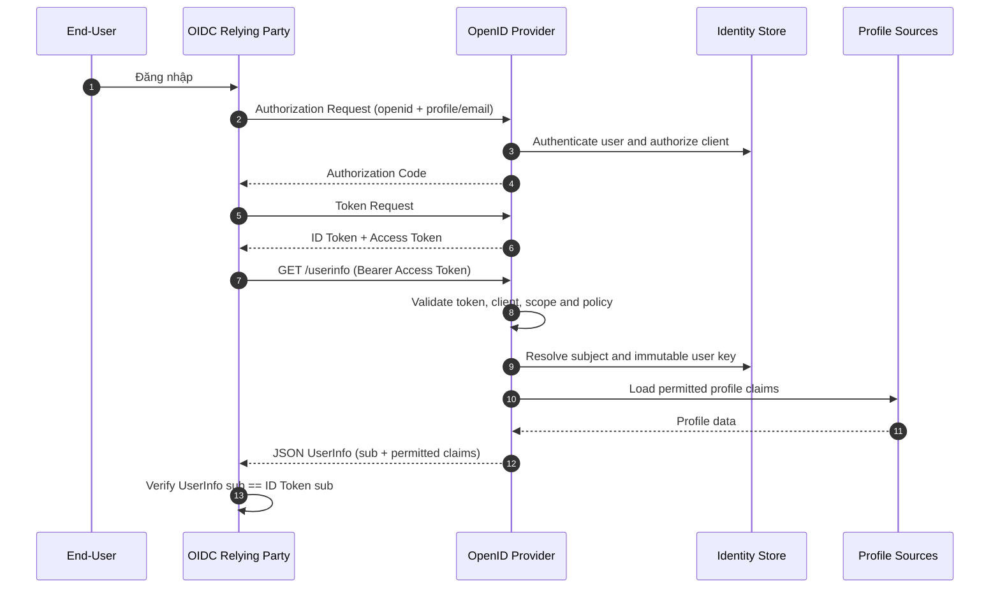
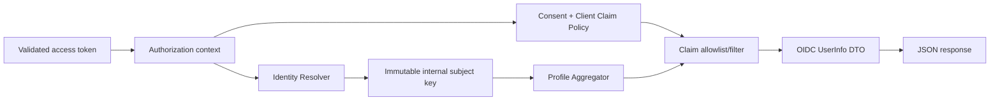
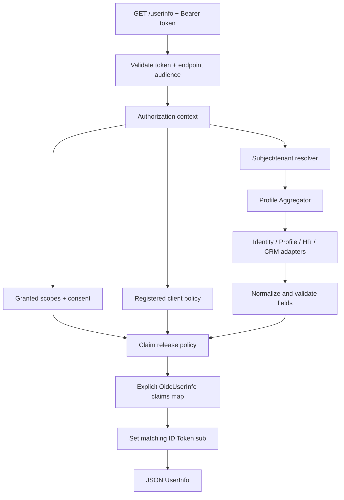
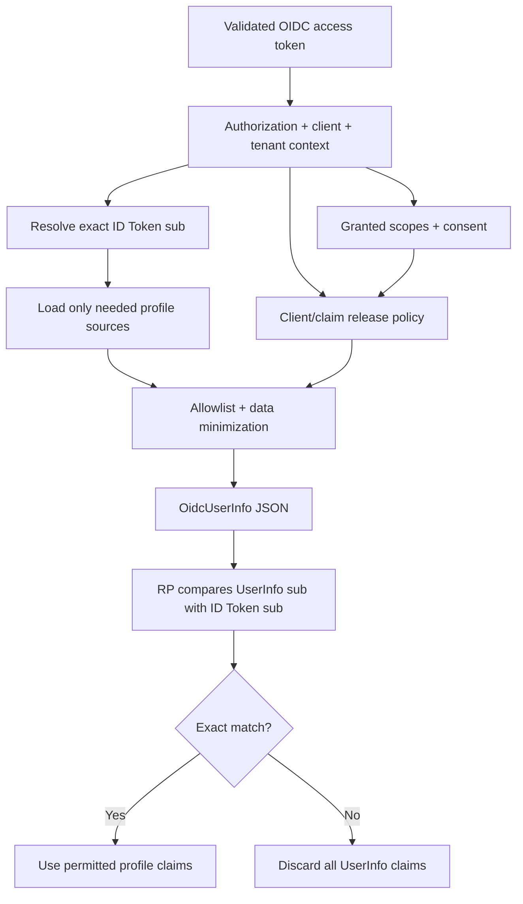

# Kết nối nguồn hồ sơ người dùng và kiểm soát dữ liệu cá nhân

## 1. Mục tiêu và bối cảnh

Trong chương **OIDC UserInfo** của module **SPRING_SECURITY_OAUTH2_OIDC_AUTHORIZATION_SERVER**, UserInfo Endpoint cho phép OpenID Provider (OP) cung cấp claims về End-User cho OpenID Connect Relying Party (RP) sau khi người dùng đã xác thực và client có access token phù hợp. Trong hệ thống thực tế, những thông tin này thường nằm ở identity database, profile service, HR, CRM, preference store hoặc hệ thống quản lý liên hệ.

Với **Spring Security**, **Spring Authorization Server (SAS)** và **Spring Boot**, việc kết nối nguồn hồ sơ không chỉ là truy vấn một bảng rồi trả toàn bộ object. OP phải xác định đúng subject, xác minh token, tôn trọng scope/consent/claims request, giới hạn dữ liệu theo client và bảo đảm UserInfo `sub` khớp `sub` trong ID Token.

Bài học tập trung vào cách xây dựng một **profile aggregation boundary** an toàn và kiểm soát dữ liệu cá nhân trong suốt vòng đời UserInfo.

Sau bài học, bạn có thể:

- Phân biệt ID Token, Access Token và UserInfo Response; hiểu dữ liệu nào thuộc từng loại.
- Xây kiến trúc kết nối UserInfo với identity store, profile database và các dịch vụ dữ liệu bên ngoài.
- Ánh xạ dữ liệu nguồn sang OIDC standard claims mà không làm lộ internal model.
- Chỉ trả claims được phép theo scope, consent, client policy và claims request.
- Bảo đảm `sub` trong UserInfo trùng chính xác `sub` của ID Token.
- Tách dữ liệu định danh, profile, liên hệ và dữ liệu nhạy cảm.
- Thiết kế cache, timeout, fallback, audit, retention và xóa dữ liệu.
- Tùy biến UserInfo Endpoint trong SAS bằng mapper/provider phù hợp phiên bản.
- Kiểm thử tenant isolation, data minimization, stale profile, revoked token và lỗi nguồn dữ liệu.

**Phạm vi:** Nội dung dựa trên **OpenID Connect Core 1.0**, **Spring Authorization Server 1.x**, **Spring Security 6.x** và **Spring Boot 3.x**. API cụ thể có thể thay đổi theo version. Các interface như `UserProfileService`, `ProfilePolicy` và `UserInfoClaimsPolicy` trong ví dụ là thành phần nghiệp vụ do ứng dụng định nghĩa, không phải API có sẵn của SAS.

## 2. UserInfo Endpoint cung cấp dữ liệu gì?

UserInfo Endpoint là protected resource của OpenID Provider. RP gọi endpoint bằng access token đã nhận từ Token Endpoint. OP xác minh access token và trả JSON claims về End-User được đại diện bởi token.



UserInfo giúp RP lấy thêm thông tin người dùng mà không cần nhồi toàn bộ profile vào ID Token. Dữ liệu có thể thay đổi thường xuyên hơn token, ví dụ display name, locale hoặc ảnh đại diện.

### 2.1. Phân biệt ba loại dữ liệu

| Thành phần | Mục đích | Nội dung điển hình | Bên tiêu thụ |
| --- | --- | --- | --- |
| ID Token | Chứng minh kết quả xác thực OIDC và định danh subject | `iss`, `sub`, `aud`, `exp`, `iat`, `nonce`, authentication context | OIDC Client/RP |
| Access Token | Credential truy cập protected resource | Scope, audience, expiry, subject/resource context tùy profile | UserInfo, API/Resource Server |
| UserInfo Response | Trả claims profile của End-User | `sub`, `name`, `email`, `picture`, `locale`, `address`... | OIDC Client/RP |

ID Token không phải profile API tổng quát. Access Token không phải dữ liệu hồ sơ. UserInfo Response không phải bản sao toàn bộ user database.

### 2.2. UserInfo cần access token có ngữ cảnh OIDC

Trong OIDC Core, UserInfo được gọi bằng access token gắn với End-User authentication và scope `openid`. Token phải được phát hành cho resource/endpoint phù hợp. OP không nên chấp nhận một access token bất kỳ chỉ vì chữ ký hợp lệ.

Tùy implementation, token có thể là JWT hoặc opaque. Với opaque token, SAS có authorization state để xác minh. Với JWT, endpoint phải xác minh token theo issuer, signature, expiry, audience/resource và policy. Không tự decode JWT rồi tin claims chưa xác minh.

### 2.3. `sub` là claim bắt buộc

UserInfo Response **phải** chứa `sub`. Giá trị này phải khớp chính xác `sub` trong ID Token của cùng authentication. Nếu không khớp, RP phải bỏ UserInfo claims vì không thể chứng minh chúng thuộc cùng End-User.

Không tự tạo `sub` mới từ email, username hoặc database row mỗi lần gọi UserInfo. UserInfo cần dùng cùng subject mapping đã dùng khi phát ID Token.

## 3. Nguồn hồ sơ người dùng trong hệ thống thực tế

Một OP có thể cần kết hợp nhiều nguồn dữ liệu:

| Nguồn | Dữ liệu thường sở hữu | Mức độ tin cậy và lưu ý |
| --- | --- | --- |
| Identity/User Directory | Immutable user ID, trạng thái tài khoản, tên đăng nhập, MFA/security state | Nguồn có thẩm quyền cho định danh và trạng thái |
| Profile Database | Tên hiển thị, ngôn ngữ, múi giờ, ảnh đại diện | Nguồn có thẩm quyền cho profile user quản lý |
| HR/Workforce System | Mã nhân viên, phòng ban, chức danh, địa điểm làm việc | Chỉ chia sẻ nếu mục đích và policy cho phép |
| CRM/Customer System | Customer tier, contact preferences, relationship data | Không tự động công bố cho mọi RP |
| Contact Verification Service | Email/phone và trạng thái verified | Giữ provenance và thời điểm xác minh |
| Consent/Preference Store | Consent, privacy choices, claim release preferences | Là nguồn policy; không thay thế OAuth scopes |
| External Profile Provider | Ảnh/claims được liên kết từ bên ngoài | Cần kiểm tra freshness, trust và nguồn gốc |

**Không có một nguồn nào mặc nhiên có thẩm quyền cho mọi claim.** Ví dụ, HR là nguồn chuẩn cho department nhưng không nên quyết định email cá nhân; Profile Database có thể cho phép đổi display name nhưng không quyết định tài khoản còn active.

### 3.1. Tách identity khỏi profile

Identity service trả lời: “Đây là subject nào, có đang được phép sử dụng không?”

Profile service trả lời: “Những thuộc tính profile nào hiện có và nguồn nào xác nhận?”

Consent/policy service trả lời: “Với client, scope và request hiện tại, claims nào được phép chia sẻ?”

Sự tách biệt này giúp OP không biến UserInfo thành endpoint trả toàn bộ object nội bộ.



### 3.2. Dùng adapter cho từng nguồn

Không để UserInfo mapper gọi trực tiếp nhiều repository/HTTP client khác nhau. Nên đặt một service boundary:

```java
public interface UserProfileService {

    Optional<UserProfile> loadProfile(
            String immutableUserId,
            String tenantId);
}
```

`UserProfile` là domain DTO do ứng dụng định nghĩa. Adapter phía sau có thể đọc SQL, gọi HR API, CRM hoặc cache. Mapper chỉ biết contract profile, không biết cấu trúc bảng hoặc response vendor.

### 3.3. DTO tách biệt với entity

Không trả JPA entity trực tiếp. Entity có thể chứa:

- Password hash, recovery codes hoặc security flags.
- Internal IDs, foreign keys và admin notes.
- Billing/HR attributes không liên quan tới OIDC.
- Lazy associations gây query không kiểm soát.
- Fields mới được thêm trong tương lai mà vô tình lộ ra response.

Dùng DTO explicit allowlist. Khi domain model thay đổi, UserInfo contract chỉ thay đổi qua quyết định có review.

## 4. OIDC standard claims và nguồn dữ liệu

OIDC Core định nghĩa các nhóm claims thường được yêu cầu qua scopes. Đây là quy ước chuẩn để RP hiểu ý nghĩa dữ liệu.

| Scope | Ví dụ claims | Nguồn phù hợp |
| --- | --- | --- |
| `openid` | `sub` | Identity/subject mapping service |
| `profile` | `name`, `given_name`, `family_name`, `middle_name`, `nickname`, `preferred_username`, `profile`, `picture`, `website`, `gender`, `birthdate`, `zoneinfo`, `locale`, `updated_at` | Profile service |
| `email` | `email`, `email_verified` | Verified contact source |
| `address` | `address` (object) | User-managed/verified postal address source |
| `phone` | `phone_number`, `phone_number_verified` | Verified contact source |

Không phải mọi claim trong scope đều bắt buộc phải có trong mọi response. Nếu dữ liệu không tồn tại, không được bịa giá trị hoặc trả mặc định gây hiểu nhầm.

### 4.1. Ví dụ UserInfo response

```json
{
  "sub": "pairwise-subject-opaque",
  "name": "Nguyen Van A",
  "given_name": "Van A",
  "preferred_username": "nguyenvana",
  "locale": "vi-VN",
  "email": "user@example.com",
  "email_verified": true
}
```

Response này chỉ hợp lệ nếu token và client được phép nhận các claims, email đã được xác minh tại nguồn có thẩm quyền, consent/policy cho phép và `sub` khớp ID Token.

### 4.2. Claim `address` là object

```json
{
  "sub": "pairwise-subject-opaque",
  "address": {
    "formatted": "123 Example Street, Ho Chi Minh City",
    "street_address": "123 Example Street",
    "locality": "Ho Chi Minh City",
    "region": "Ho Chi Minh City",
    "postal_code": "700000",
    "country": "VN"
  }
}
```

Chỉ trả các thành phần địa chỉ cần thiết. Địa chỉ nhà là dữ liệu cá nhân; đừng phát hành chỉ vì Profile DTO có field này.

### 4.3. Không nhầm verified với tồn tại

- Có `email` không có nghĩa `email_verified=true`.
- Có `phone_number` không có nghĩa số đã xác minh.
- User tự nhập address không có nghĩa địa chỉ đã được kiểm chứng.
- `updated_at` phải phản ánh nguồn/ý nghĩa đã tài liệu hóa, không phải thời điểm mapper chạy.

Nếu verification status không rõ, bỏ claim verified hoặc trả false theo contract chính xác; tuyệt đối không tự đánh dấu true.

## 5. Scope, consent và claim release policy

OAuth scope là cơ sở để giới hạn dữ liệu UserInfo. Nhưng scope và consent là hai lớp liên quan mà không đồng nhất:

- **Scope được yêu cầu:** client muốn truy cập loại dữ liệu nào.
- **Scope được cấp:** AS đã cấp quyền nào cho token.
- **Consent:** người dùng đã chấp thuận chia sẻ dữ liệu nào theo chính sách/UX.
- **Client policy:** client đó có được phép nhận loại claim này không.
- **Claims request:** OIDC request có thể chỉ định claims cụ thể hoặc essential.

Claim chỉ được phát hành khi tất cả điều kiện liên quan đều cho phép. Client có scope `email` không có nghĩa được xem email nếu consent/policy nội bộ từ chối.

### 5.1. Ma trận kiểm soát ví dụ

| Claim | Scope | Consent/policy bổ sung | Client restriction |
| --- | --- | --- | --- |
| `sub` | `openid` | Subject mapping hợp lệ | Gắn với issuer/client context |
| `name` | `profile` | Profile sharing được phép | Có thể giới hạn first-party clients |
| `email` | `email` | Contact disclosure được phép | Không cấp cho client không cần email |
| `email_verified` | `email` | Chỉ từ verified source | Không suy từ việc có email |
| `address` | `address` | Consent rõ ràng, mục đích cần thiết | Có thể chỉ cấp cho shipping service |
| `phone_number` | `phone` | Consent/verification phù hợp | Chỉ client có use case liên hệ |
| `department` | Custom scope/policy | HR disclosure được duyệt | Chỉ enterprise RP được phép |

Custom claims như `department` không nên tự ý gắn vào scope `profile` nếu chưa có contract và privacy review. Có thể dùng scope/custom authorization policy riêng.

### 5.2. Consent phải có thể thu hồi

Nếu user rút consent, UserInfo request sau đó phải ngừng trả claim liên quan theo chính sách. Điều này cần được kiểm tra tại thời điểm phát response hoặc thông qua cache invalidation đủ nhanh.

Không chỉ lưu consent trong browser UI. OP phải có consent record/decision có thể kiểm tra từ backend và gắn với client, user, scopes/claims, thời điểm, version và trạng thái.

### 5.3. Claims parameter và essential claims

OIDC cho phép RP gửi `claims` parameter để yêu cầu claims cụ thể, có thể đánh dấu `essential`. Essential không tự vượt qua quyền riêng tư hoặc luật dữ liệu.

Nếu implementation chưa hỗ trợ đầy đủ claims parameter, cần tài liệu hóa giới hạn và không quảng bá khả năng không có. Không âm thầm trả tất cả profile fields chỉ vì client gửi claims request rộng.

## 6. Data minimization: chỉ trả điều RP cần

**Data minimization** là nguyên tắc cốt lõi: chỉ cung cấp claims cần cho mục đích đã khai báo. Việc OP có dữ liệu không có nghĩa RP được nhận.

Ví dụ:

- Portal hiển thị tên có thể chỉ cần `name` và `picture`.
- Newsletter service có thể cần `email` và trạng thái verified, không cần ngày sinh/địa chỉ.
- Shipping service có thể cần `address`, nhưng không cần HR department.
- Workforce application có thể cần `department`/`employee_number` theo policy riêng, không cần email cá nhân.

### 6.1. Allowlist theo client

Một policy service có thể quyết định claim nào client được nhận:

```java
public interface UserInfoClaimsPolicy {

    Set<String> allowedClaims(
            String clientId,
            Set<String> grantedScopes,
            Set<String> consentedClaims,
            Set<String> requestedClaims);
}
```

Đây là interface do ứng dụng định nghĩa. Policy nên trả **allowlist**, không phải danh sách field bị cấm. Allowlist giúp field mới trong profile service không tự động xuất hiện trong UserInfo.

Hai adapter sau cũng là contract của ứng dụng; chúng đọc consent và claims request từ authorization/consent store đã được xác thực:

```java
public interface UserConsentService {

    Set<String> consentedClaims(OAuth2Authorization authorization);
}

public interface RequestedClaimsResolver {

    Set<String> requestedClaims(OAuth2Authorization authorization);
}
```

Khi request không có OIDC claims parameter, resolver cần trả trạng thái “không có danh sách yêu cầu tường minh” theo contract của ứng dụng; policy khi đó áp dụng tập claims mặc định được scope/consent/client cho phép. Không diễn giải tập requested claims rỗng thành quyền phát hành mọi claim.

### 6.2. Giao của các quyền

```text
released_claims =
    available_claims
    ∩ claims_allowed_by_granted_scopes
    ∩ claims_allowed_by_consent
    ∩ claims_allowed_for_client
    ∩ claims_requested_or_permitted_by_claims_parameter
```

Nếu hệ thống có policy pháp lý/contract riêng, thêm lớp điều kiện đó. Một điều kiện không được thỏa thì claim không được phát hành.

### 6.3. Không trả null/default để lấp response

Nếu user không có số điện thoại, bỏ `phone_number` thay vì trả `"unknown"`. Nếu không có avatar, không tự tạo URL nội bộ. Nếu user chưa xác minh email, không gắn `email_verified=true`. Dữ liệu thiếu phải theo semantics OIDC và product contract.

## 7. Kiến trúc Profile Aggregator

Một thiết kế thực tế tách các bước:

1. Xác minh access token và lấy authorization context.
2. Xác định issuer, registered client và subject mapping.
3. Xác định user/tenant nội bộ từ authorization đã được xác thực.
4. Lấy granted scopes và consent state.
5. Đánh giá client claim policy.
6. Gọi các nguồn profile cần thiết.
7. Chuẩn hóa/validate dữ liệu.
8. Lọc claims được phép.
9. Gắn đúng `sub`.
10. Trả response và ghi audit metadata không nhạy cảm.



### 7.1. Không tải mọi nguồn theo mọi request

Nếu client chỉ có `profile`, không cần gọi CRM để lấy billing details hoặc HR để lấy department. Hãy quyết định trước claim set, sau đó chỉ truy vấn nguồn cần thiết.

Có thể chia source fetch theo nhóm:

- Identity source: luôn cần để resolve subject và trạng thái.
- Profile source: chỉ khi có claims profile được phép.
- Contact source: chỉ khi `email`/`phone` được phép.
- Address source: chỉ khi `address` được phép.
- Enterprise source: chỉ khi custom claim và client policy cho phép.

### 7.2. Parallel calls và dependency budget

Nếu các nguồn độc lập, có thể gọi song song trong giới hạn concurrency và timeout. Đặt latency budget cho toàn UserInfo request. Không để một HR service chậm khiến mọi request giữ thread vô hạn.

### 7.3. Read model cho UserInfo

Với nhiều nguồn dữ liệu, read model được cập nhật theo event có thể giảm số remote calls. Nhưng cần tài liệu hóa độ trễ đồng bộ: UserInfo có thể trả profile cũ trong một khoảng thời gian. Claims liên quan security/verification cần freshness policy nghiêm ngặt hơn display name.

## 8. Kết nối nguồn dữ liệu bằng Spring Boot

### 8.1. Domain DTO

```java
public record UserProfile(
        String immutableUserId,
        String displayName,
        String givenName,
        String familyName,
        String preferredUsername,
        String email,
        Boolean emailVerified,
        String locale,
        URI picture,
        Instant updatedAt) {
}
```

DTO này là ví dụ. Chỉ thêm field thực sự cần cho OIDC contract. Không chứa password hash, MFA secrets, recovery data hoặc internal admin notes.

### 8.2. Service boundary

```java
public interface UserProfileService {

    Optional<UserProfile> loadProfile(
            String immutableUserId,
            String tenantId);
}
```

Implementation có thể sử dụng Spring Data repository:

```java
@Service
public class DatabaseUserProfileService
        implements UserProfileService {

    private final UserProfileRepository repository;

    public DatabaseUserProfileService(
            UserProfileRepository repository) {
        this.repository = repository;
    }

    @Override
    @Transactional(readOnly = true)
    public Optional<UserProfile> loadProfile(
            String immutableUserId,
            String tenantId) {

        return repository
                .findByImmutableUserIdAndTenantId(
                        immutableUserId, tenantId)
                .map(UserProfileEntity::toProfile);
    }
}
```

Tên repository/entity là ví dụ thuộc ứng dụng. Query phải ràng buộc cả tenant trong hệ thống multi-tenant. Không truy vấn theo email/username lấy từ request.

### 8.3. External profile service

Khi nguồn nằm ở service khác, dùng adapter với timeout và contract rõ:

```java
public interface WorkforceProfileClient {

    Optional<WorkforceProfile> findBySubject(
            String immutableUserId);
}
```

Adapter HTTP cần TLS certificate validation, workload identity/service authentication, connect/read timeout, response size limit, schema validation, retry có giới hạn, circuit breaker/bulkhead nếu cần và không log response body chứa PII.

Không truyền access token của RP sang HR/CRM. Dùng service credential riêng với quyền tối thiểu.

### 8.4. Cấu hình endpoint/service credentials

```yaml
profile:
  sources:
    workforce:
      base-url: https://workforce.internal.example
      connect-timeout: 500ms
      read-timeout: 1500ms
      enabled: true
    crm:
      base-url: https://crm.internal.example
      enabled: false

security:
  userinfo:
    cache-ttl: 30s
    max-response-claims: 30
```

Đây là cấu hình minh họa cho properties do ứng dụng bind. Không đặt API key/password trực tiếp trong YAML được commit. `max-response-claims` cũng không thay thế allowlist/consent policy.

## 9. Tùy biến UserInfo Endpoint trong Spring Authorization Server

SAS hỗ trợ OIDC UserInfo Endpoint thông qua `oidc.userInfoEndpoint` DSL (tên method cụ thể phụ thuộc version). Trong các bản SAS 1.x, điểm tùy biến thường dùng là `userInfoMapper` để chuyển authentication/authorization context thành `OidcUserInfo`.

Ví dụ DSL:

```java
OAuth2AuthorizationServerConfigurer authorizationServer =
        OAuth2AuthorizationServerConfigurer.authorizationServer();

http
    .securityMatcher(authorizationServer.getEndpointsMatcher())
    .with(authorizationServer, server ->
            server.oidc(oidc ->
                    oidc.userInfoEndpoint(userInfo ->
                            userInfo.userInfoMapper(userInfoMapper))));
```

Đây là mảnh cấu hình cho Authorization Server `SecurityFilterChain`, không phải toàn bộ ứng dụng. Cần bật OIDC và cấu hình các bean SAS khác theo version.

### 9.1. Ý nghĩa của UserInfo mapper

Mapper nhận context sau khi endpoint đã xác thực access token, rồi tạo object `OidcUserInfo`. Mapper nên:

- Lấy authorization và access token đã được xác thực.
- Xác định principal/immutable user ID từ authorization state tin cậy.
- Lấy subject đúng với ID Token đã phát hành.
- Lấy granted scopes/consent/client context.
- Gọi profile service có giới hạn.
- Áp dụng claim allowlist.
- Tạo `OidcUserInfo` với `sub` khớp ID Token.

Không triển khai lại bearer token validation bên trong mapper nếu SAS đã thực hiện. Không đọc `user_id` từ query/header để quyết định profile.

### 9.2. Ví dụ mapper chỉ trả claims được phép

Đoạn code sau là khung tích hợp theo API SAS 1.x phổ biến. Hãy kiểm tra import và method signature đúng với dependency đang dùng:

```java
@Bean
Function<OidcUserInfoAuthenticationContext, OidcUserInfo>
        userInfoMapper(
                UserProfileService profileService,
                UserInfoClaimsPolicy claimsPolicy,
                SubjectIdentityResolver identityResolver,
                UserConsentService consentService,
                RequestedClaimsResolver requestedClaimsResolver,
                RegisteredClientRepository registeredClientRepository) {

    return context -> {
        OAuth2Authorization authorization =
                context.getAuthorization();

        OAuth2Authorization.Token<OidcIdToken> idTokenHolder =
                authorization.getToken(OidcIdToken.class);

        if (idTokenHolder == null) {
            throw new OAuth2AuthenticationException(
                    new OAuth2Error(OAuth2ErrorCodes.INVALID_TOKEN));
        }

        // Dùng đúng subject đã được phát trong ID Token.
        String subject =
                idTokenHolder.getToken().getSubject();

        // Resolve internal ID từ authorization đã xác thực.
        // Không dùng email/username từ HTTP request.
        String immutableUserId =
                identityResolver.resolveImmutableUserId(authorization);

        String tenantId =
                identityResolver.resolveTenantId(authorization);

        Set<String> grantedScopes =
                context.getAccessToken().getScopes();

        Set<String> consentedClaims =
                consentService.consentedClaims(authorization);

        Set<String> requestedClaims =
                requestedClaimsResolver.requestedClaims(authorization);

        RegisteredClient registeredClient =
                registeredClientRepository.findById(
                        authorization.getRegisteredClientId());

        if (registeredClient == null) {
            throw new OAuth2AuthenticationException(
                    new OAuth2Error(OAuth2ErrorCodes.INVALID_TOKEN));
        }

        Set<String> allowedClaims =
                claimsPolicy.allowedClaims(
                        registeredClient.getClientId(),
                        grantedScopes,
                        consentedClaims,
                        requestedClaims);

        Set<String> profileClaims = Set.of(
                "name", "given_name", "family_name",
                "preferred_username", "locale", "picture", "email",
                "email_verified");

        Optional<UserProfile> profile =
                allowedClaims.stream().anyMatch(profileClaims::contains)
                        ? profileService.loadProfile(
                                immutableUserId, tenantId)
                        : Optional.empty();

        Map<String, Object> claims = new LinkedHashMap<>();
        claims.put("sub", subject);

        if (profile.isPresent()) {
            UserProfile user = profile.get();

            if (allowedClaims.contains("name")
                    && grantedScopes.contains(OidcScopes.PROFILE)
                    && user.displayName() != null) {
                claims.put("name", user.displayName());
            }

            if (allowedClaims.contains("given_name")
                    && grantedScopes.contains(OidcScopes.PROFILE)
                    && user.givenName() != null) {
                claims.put("given_name", user.givenName());
            }

            if (allowedClaims.contains("family_name")
                    && grantedScopes.contains(OidcScopes.PROFILE)
                    && user.familyName() != null) {
                claims.put("family_name", user.familyName());
            }

            if (allowedClaims.contains("preferred_username")
                    && grantedScopes.contains(OidcScopes.PROFILE)
                    && user.preferredUsername() != null) {
                claims.put(
                        "preferred_username",
                        user.preferredUsername());
            }

            if (allowedClaims.contains("locale")
                    && grantedScopes.contains(OidcScopes.PROFILE)
                    && user.locale() != null) {
                claims.put("locale", user.locale());
            }

            if (allowedClaims.contains("picture")
                    && grantedScopes.contains(OidcScopes.PROFILE)
                    && user.picture() != null) {
                claims.put("picture", user.picture().toString());
            }

            if (allowedClaims.contains("email")
                    && grantedScopes.contains(OidcScopes.EMAIL)
                    && user.email() != null) {
                claims.put("email", user.email());
                if (allowedClaims.contains("email_verified")
                        && user.emailVerified() != null) {
                    claims.put("email_verified", user.emailVerified());
                }
            }
        }

        return new OidcUserInfo(claims);
    };
}
```

`UserInfoClaimsPolicy` và `SubjectIdentityResolver` là interface ứng dụng tự định nghĩa. Đoạn code cố ý thể hiện allowlist tường minh; production cần bổ sung claim groups `address`/`phone` và claims parameter/consent policy tương ứng.

**Lưu ý về SAS version và storage:** Ví dụ giả định authorization lưu `OidcIdToken` trong `OAuth2Authorization`. Nếu implementation/version không lưu ID Token ở dạng đó, phải lấy cùng subject mapping từ trusted authorization context/subject service và bảo đảm kết quả đúng bằng ID Token đã phát. Không dùng `authorization.getPrincipalName()` làm public `sub` một cách mặc định.

### 9.3. Nếu UserInfo dùng profile hiện tại

UserInfo thường được dùng để lấy profile mới nhất tại thời điểm gọi, trong khi ID Token là snapshot tại thời điểm authentication. Ví dụ user đổi display name sau khi đăng nhập: UserInfo có thể trả tên mới nếu policy cho phép, nhưng `sub` phải giữ nguyên.

Claims mang ý nghĩa security hoặc verification (ví dụ `email_verified`, `phone_number_verified`, account status) cần source of truth và freshness policy chặt hơn display name. Không cache các claim này lâu chỉ để giảm latency.

### 9.4. Khi nào cần custom authentication provider?

Nếu cần thay đổi token validation, principal resolution hoặc authentication semantics của endpoint, hãy xem xét provider extension point tương ứng version. Nhưng nếu chỉ cần kết nối profile service và lọc claims, mapper thường là ranh giới phù hợp hơn.

Không viết custom provider để bỏ qua access-token validation hoặc cho phép token bất kỳ gọi UserInfo. Không thay response handler nếu chỉ cần thay nội dung claims; hãy dùng mapper.

## 10. Lấy đúng subject và bảo đảm UserInfo nhất quán

### 10.1. Nguồn subject tin cậy

Có thể có nhiều định danh trong hệ thống:

- Internal immutable user ID.
- Username/email.
- Public OIDC subject.
- Pairwise OIDC subject.
- HR employee ID.
- Customer ID.

UserInfo phải trả **OIDC subject** đã dùng trong ID Token, không phải tùy chọn nào thuận tiện nhất.

Nếu OP hỗ trợ public và pairwise subject, subject resolver phải nhận đúng registered client/sector policy. Cùng một user có thể có pairwise `sub` khác nhau giữa các sectors.

### 10.2. Kiểm tra bằng ID Token

Trong SAS, authorization có thể lưu OIDC ID Token. Khi lấy được token object, có thể đọc subject đã phát hành:

```java
OAuth2Authorization.Token<OidcIdToken> idTokenHolder =
        authorization.getToken(OidcIdToken.class);

String userInfoSubject =
        idTokenHolder.getToken().getSubject();
```

Đây là ví dụ API; kiểm tra null và trạng thái token theo phiên bản. Nếu token không có ID Token nhưng request đến UserInfo, hãy xác minh đây có phải flow OIDC hợp lệ và access token có scope `openid`. Không tự fallback sang username.

### 10.3. RP phải kiểm tra equality

RP cần thực hiện logic tương đương:

```text
verified_id_token.iss == expected_issuer
verified_id_token.aud includes this_client_id
userinfo.sub == verified_id_token.sub
```

Nếu `sub` không khớp, bỏ toàn bộ UserInfo claims. Không chỉ bỏ riêng field `sub` rồi giữ name/email; các claims còn lại chưa được chứng minh thuộc subject của ID Token.

## 11. Kiểm soát dữ liệu cá nhân theo phân loại

Không phải mọi profile attribute đều có cùng mức rủi ro. Nên lập data classification trước khi triển khai UserInfo.

| Nhóm | Ví dụ | Kiểm soát đề xuất |
| --- | --- | --- |
| Public/basic profile | Display name, avatar công khai | Scope profile, client allowlist |
| Contact data | Email, phone | Verified source, consent, scope riêng |
| Location/address | Home address, postal address | Mục đích cụ thể, consent rõ, client restriction |
| Employment | Department, employee ID, title | Enterprise contract, tenant/client restriction |
| Sensitive attributes | Health, financial, government identifiers | Không đưa vào UserInfo mặc định; đánh giá pháp lý và authorization riêng |
| Security data | MFA methods, recovery status, risk score | Không phát hành như profile claim thông thường |
| Internal operational data | Database ID, admin notes, flags | Không công bố |

Một số dữ liệu nhạy cảm có thể thuộc nhóm đặc biệt theo pháp luật áp dụng. Cần đánh giá theo quốc gia, mục đích xử lý, cơ sở pháp lý và chính sách tổ chức; không suy rằng user đã đăng nhập đồng nghĩa có consent chia sẻ mọi dữ liệu.

### 11.1. PII trong claims và logs

Không ghi toàn bộ UserInfo JSON vào application logs, API gateway logs, distributed tracing, metrics labels, exception messages, analytics events hoặc support tickets không kiểm soát.

Có thể ghi metadata an toàn như client ID đã xác thực, claim names được phát hành, latency, source status và correlation ID. Không ghi claim values nếu không có mục đích và quyền truy cập rõ.

### 11.2. Audit có kiểm soát

Audit record có thể chứa:

- Client ID đã xác thực.
- Subject reference dạng pseudonymous hoặc keyed hash.
- Claims names đã release, không phải values.
- Scope/consent decision.
- Timestamp, request correlation ID.
- Profile source nào được gọi và kết quả.
- Policy version.

Giới hạn quyền đọc audit và retention. Subject hash vẫn có thể là dữ liệu cá nhân có thể liên kết; không coi pseudonymization là anonymization.

## 12. Consent, quyền truy cập và thu hồi

### 12.1. Consent gắn với client và mục đích

Consent nên được mô hình hóa theo user, client, scope/claims và trạng thái. Nếu user cấp `profile` cho portal A, điều đó không tự cho phép partner B nhận cùng dữ liệu.

Cần phân biệt OAuth authorized scopes, OIDC claim release consent, client contract/allowlist, organization/tenant policy và user preference/legal basis. Một lớp có thể giới hạn lớp còn lại, nhưng không tự động mở rộng quyền.

### 12.2. Rút consent

Khi user rút consent:

1. Cập nhật consent state có hiệu lực.
2. UserInfo request tiếp theo phải đánh giá state mới.
3. Invalidate cache claims liên quan.
4. Đánh giá access token đang còn quyền gọi UserInfo hay phải revoke.
5. Ghi audit sự kiện mà không lưu profile values.
6. Thông báo RP chỉ theo contract và legal policy.

Nếu token vẫn active nhưng consent profile đã bị rút, OP có thể trả tối thiểu `sub` hoặc từ chối claims/endpoint theo policy. Quyết định phải nhất quán và không lộ lý do nhạy cảm.

### 12.3. Account disabled hoặc deleted

Identity state có thể thay đổi sau khi ID Token đã phát. OP cần xác định khi nào disable account làm access token không còn active, khi nào UserInfo trả lỗi, và khi nào chỉ ngừng trả claims. Không dùng profile service fallback để trả dữ liệu cũ của tài khoản đã xóa.

## 13. Multi-tenant và phân quyền nguồn dữ liệu

Trong SaaS/multi-tenant OP, cùng internal user key có thể xuất hiện trong nhiều tenant hoặc cùng email có thể thuộc các tổ chức khác nhau.

### 13.1. Luôn ràng buộc tenant

Truy vấn profile phải gắn với tenant đã được xác định từ authorization context đã xác thực:

```java
profileRepository.findByImmutableUserIdAndTenantId(
        immutableUserId,
        trustedTenantId);
```

Không lấy `tenant_id` từ query parameter, header do caller tự gửi hoặc claim chưa xác minh. Nếu access token có tenant claim, chỉ sử dụng sau khi token được xác minh và tenant được kiểm tra với client/resource policy.

### 13.2. Client-to-tenant authorization

Một client thuộc tenant Acme không được lấy profile tenant Contoso chỉ bằng cách đổi user ID. Cần kiểm tra đồng thời client registration thuộc tenant nào, authorization/token được cấp trong tenant context nào, subject mapping thuộc issuer/tenant nào, profile query có tenant predicate và cache key có chứa tenant/issuer/client disclosure context.

### 13.3. Cache không được cross-tenant

Cache theo mỗi internal user ID là chưa đủ nếu cùng ID có thể xuất hiện ở nhiều tenant. Cache key cần ràng buộc issuer, tenant và disclosure context phù hợp. Không dùng cùng response đã lọc cho client A để trả cho client B nếu scope/consent/claim policy khác nhau.

## 14. Cache và freshness của profile

Cache giảm độ trễ và tải lên nguồn dữ liệu, nhưng có thể giữ PII sau khi user sửa/xóa hoặc rút consent.

| Loại dữ liệu | TTL gợi ý để bắt đầu thiết kế | Lưu ý |
| --- | --- | --- |
| Display name/avatar | Có thể dài hơn nếu chấp nhận stale | Có invalidation khi profile update |
| Email/phone verified | Ngắn hơn, theo verification state | Không cache qua thay đổi verification/revoke |
| Address | Theo use case và consent | Xóa/invalidate khi user thay đổi hoặc rút consent |
| Employment/department | Theo source sync SLA | Có thể stale khi HR cập nhật |
| Account status/security state | Rất ngắn hoặc kiểm tra trực tiếp | Không dùng stale positive để bỏ qua disable |
| Consent/claim policy | Invalidate khi policy thay đổi | Không dùng cache cũ để tiếp tục release |

Các khoảng TTL cần được quyết định theo SLA, rủi ro và source update behavior; bảng không phải giá trị bắt buộc của OIDC.

### 14.1. Cache theo dữ liệu đã lọc

Có hai chiến lược:

- Cache raw internal profile với quyền truy cập cực hẹp, rồi lọc lại mỗi request.
- Cache UserInfo projection theo client/scope/consent/tenant và policy version.

Nếu cache projection, key phải bao gồm các yếu tố làm thay đổi disclosure. Nếu cache raw profile, không được trả trực tiếp cho client; phải chạy claim policy lại mỗi lần.

### 14.2. Invalidation

Có thể dùng event khi user đổi profile, email/phone verification thay đổi, consent bị rút, client policy đổi, user bị disable/delete hoặc tenant membership thay đổi.

Event-driven invalidation cần retry, ordering và fallback TTL. Nếu event bị mất, stale data vẫn có thể được phát hành; TTL là giới hạn an toàn quan trọng.

## 15. Xử lý lỗi nguồn dữ liệu

UserInfo có thể phụ thuộc nhiều backend. Cần phân biệt lỗi token với lỗi profile source.

| Tình huống | Hành vi thiết kế |
| --- | --- |
| Access token invalid/expired/revoked | Từ chối request theo UserInfo/token contract |
| Client không có quyền gọi endpoint | Từ chối authentication/authorization |
| User không có optional profile field | Bỏ claim đó |
| Profile source tạm thời unavailable | Theo policy: fail request hoặc trả subset an toàn đã có |
| Identity/subject source unavailable | Không thể xác định đúng subject; fail closed |
| Consent/policy source unavailable | Không release claims nếu không xác minh được quyền |
| Account disabled/deleted | Áp dụng account policy; không fallback dữ liệu cũ tùy tiện |
| Một nguồn HR optional lỗi nhưng chỉ trả profile cơ bản | Có thể trả subset không phụ thuộc HR nếu policy cho phép |

**Không biến lỗi policy thành quyền truy cập.** Nếu không đọc được consent state, không mặc định mọi claims được phép. Nếu không xác định được tenant/subject, không fallback sang tìm user theo email.

### 15.1. Timeout và bounded retry

- Đặt timeout tổng cho UserInfo request.
- Mỗi external source có connect/read timeout.
- Retry chỉ với lỗi transient và số lần giới hạn.
- Không retry 4xx/authorization failure như thể lỗi mạng.
- Circuit breaker/bulkhead ngăn một nguồn lỗi làm cạn tài nguyên OP.
- Có response budget để tránh một RP gọi liên tục tạo tải lên nguồn dữ liệu.

### 15.2. Fallback an toàn

Nếu Profile service lỗi, có thể trả subset claims đã cache gần đây **chỉ khi** cache entry còn trong freshness window và disclosure policy vẫn được đánh giá lại. Không trả profile snapshot cũ sau khi consent đã bị rút hoặc account bị disabled.

## 16. UserInfo Response: HTTP, TLS và bảo vệ dữ liệu

UserInfo là protected resource. Một request thường có dạng:

```http
GET /userinfo HTTP/1.1
Host: auth.example.com
Authorization: Bearer <REDACTED_ACCESS_TOKEN>
Accept: application/json
```

Response minh họa:

```http
HTTP/1.1 200 OK
Content-Type: application/json
Cache-Control: no-store
Pragma: no-cache

{
  "sub": "pairwise-subject-opaque",
  "name": "Nguyen Van A"
}
```

Dùng HTTPS/TLS. Với PII, thường nên có cache headers hạn chế lưu ở browser/proxy; chính sách chính xác cần phù hợp client contract. Không để gateway cache response UserInfo công khai theo URL chung.

### 16.1. Signed/encrypted UserInfo

OIDC Core cho phép UserInfo Response được ký và/hoặc mã hóa theo metadata/client configuration phù hợp. Tuy nhiên, không mặc định SAS hỗ trợ đầy đủ mọi response signing/encryption mode chỉ vì nó hỗ trợ signed ID Token.

Nếu cần response ký/mã hóa, xác minh SAS version và extension point thực tế, đàm phán thuật toán qua client metadata, chỉ dùng key/certificate đúng mục đích, kiểm tra ở RP và kiểm thử key rotation/failure behavior. Không tự serialize hoặc ký JSON bằng thuật toán tùy ý.

## 17. UserInfo trong Spring Security OIDC Client

RP thường dùng OIDC client integration để gọi UserInfo khi cần profile. Với Spring Security, `OidcUserService` có thể lấy UserInfo từ endpoint được provider metadata công bố và hợp nhất claims theo quy tắc framework.

### 17.1. Cấu hình issuer cho client

```yaml
spring:
  security:
    oauth2:
      client:
        registration:
          portal:
            provider: corporate
            client-id: portal-web
            client-secret: ${PORTAL_CLIENT_SECRET}
            authorization-grant-type: authorization_code
            redirect-uri: "{baseUrl}/login/oauth2/code/{registrationId}"
            scope: openid,profile,email
        provider:
          corporate:
            issuer-uri: https://auth.example.com
```

Đây là cấu hình RP, không phải OP. Client cần được đăng ký tại AS với redirect URI, grant, authentication method và scopes tương ứng. Secret được inject từ secret manager/environment.

### 17.2. Kiểm tra UserInfo subject tại RP

Khi dùng custom `OidcUserService` hoặc custom UserInfo client, phải giữ bước kiểm tra `sub`. Không hợp nhất UserInfo claims vào local principal nếu subject không khớp ID Token.

### 17.3. Không nhầm UserInfo với API profile riêng

UserInfo là OIDC contract chuẩn, có semantics subject và scopes. API profile riêng có thể có pagination, fields nghiệp vụ, roles hoặc quyền quản trị. Đừng nhồi những chức năng đó vào UserInfo chỉ vì client đã có access token.

## 18. Kiểm thử UserInfo và claim policy

### 18.1. Unit tests cho claim release

Test các tổ hợp:

- Scope `profile` có, consent có, client được phép → trả profile claims đã allowlist.
- Scope `email` không có → không trả `email`/`email_verified`.
- Scope có nhưng consent rút → không trả claims bị rút.
- Client không được phép nhận `address` → không trả địa chỉ dù nguồn có dữ liệu.
- Email chưa verified → không trả `email_verified=true`.
- Field null/blank/invalid URI → bỏ hoặc reject theo contract.
- Claim mới được thêm vào DTO → không tự xuất hiện nếu chưa allowlist.
- Claims parameter yêu cầu field ngoài policy → không vượt policy.

### 18.2. Integration tests với SAS

Một integration test nên:

1. Khởi động Authorization Server với OIDC UserInfo endpoint.
2. Tạo registered client và user test.
3. Thực hiện Authorization Code Flow với scope `openid` và scopes profile phù hợp.
4. Lấy ID Token và access token.
5. Gọi UserInfo bằng access token.
6. Kiểm tra HTTP status/content type và `sub`.
7. Xác minh `sub` UserInfo trùng ID Token.
8. Thử bỏ scope `email`; email phải vắng.
9. Rút consent và gọi lại; claim bị rút phải vắng hoặc endpoint từ chối theo policy.
10. Revoke/expire token; UserInfo phải từ chối.
11. Thử token sai issuer/audience hoặc tenant; không trả profile.
12. Mô phỏng profile service lỗi và kiểm tra fallback/fail policy.

### 18.3. Ví dụ MockMvc test cho subject equality

```java
@Test
void userInfoSubjectMatchesIssuedIdToken() throws Exception {
    String idToken = tokenFixture.issuedIdToken();
    String accessToken = tokenFixture.accessTokenForUserInfo();

    String idTokenSubject =
            jwtTestDecoder.decode(idToken)
                    .getClaimAsString("sub");

    mockMvc.perform(get("/userinfo")
            .header(
                    HttpHeaders.AUTHORIZATION,
                    "Bearer " + accessToken))
        .andExpect(status().isOk())
        .andExpect(jsonPath("$.sub").value(idTokenSubject));
}
```

Đây là skeleton; `jwtTestDecoder` và token fixture là thành phần test do ứng dụng xây dựng. Trong test thật, phải xác minh chữ ký ID Token, không chỉ decode payload. Có thể kiểm tra cả UserInfo endpoint path được công bố trong OIDC metadata.

### 18.4. Security/privacy tests

| Test case | Kỳ vọng |
| --- | --- |
| Không có bearer token | 401 |
| Token hết hạn/revoke | 401 hoặc lỗi token tương ứng |
| Token không có `openid`/không đúng profile | Từ chối theo contract |
| `sub` không tìm được mapping | Fail closed |
| UserInfo `sub` khác ID Token | RP bỏ toàn bộ UserInfo claims |
| Scope thiếu | Claim tương ứng không xuất hiện |
| Consent bị rút | Claim không còn được release |
| Client khác tenant | Không lấy được profile |
| Profile entity có internal fields | Không field nội bộ nào xuất hiện |
| Profile source trả extra field | Không tự động đưa vào response |
| External service timeout | Theo bounded fail/fallback policy |
| Cache response client A dùng cho B | Không leak claim giữa clients |
| Raw PII trong logs | Test/log review phát hiện và loại bỏ |
| Account deleted | Không trả dữ liệu stale không được phép |

## 19. Vận hành, metrics và audit

### 19.1. Metrics nên có

- UserInfo request count và latency P50/P95/P99.
- Token authentication failure.
- Profile source latency/error/timeout.
- Claim count theo nhóm, không dùng claim values làm labels.
- Cache hit/miss/invalidation.
- Consent/policy denial count.
- Tenant/client policy mismatch.
- Tỷ lệ UserInfo response thiếu optional profile fields.
- Circuit breaker open/close và retry count.

Không dùng `sub`, email, username hoặc access token làm metric label; cardinality và privacy đều có rủi ro.

### 19.2. Audit release decision

Audit cần trả lời client nào đã được xác thực, policy/consent version nào quyết định claim release, những nhóm claim nào được trả, nguồn dữ liệu nào được truy cập, request có bị từ chối không và khi nào consent/profile thay đổi.

Không ghi toàn bộ JSON UserInfo vào audit. Nếu cần điều tra một subject, dùng reference pseudonymous có kiểm soát và quyền truy cập riêng.

### 19.3. Retention và deletion

- Xác định thời gian giữ profile cache.
- Xóa cache khi user yêu cầu xóa hoặc consent bị rút theo policy.
- Không giữ bản sao PII vô thời hạn trong distributed cache/backup.
- Xử lý data deletion tại source of truth và downstream read models.
- Có retention cho audit logs phù hợp mục đích và quy định.
- Phân biệt dữ liệu kiểm toán và dữ liệu profile khi xử lý deletion.

## 20. Troubleshooting các lỗi thường gặp

| Triệu chứng | Nguyên nhân có thể | Hướng xử lý |
| --- | --- | --- |
| UserInfo trả 401 | Access token invalid/expired, thiếu client/resource binding | Kiểm tra issuer, token, scopes và authentication |
| UserInfo trả 403 | Token hợp lệ nhưng policy/permission không cho phép | Kiểm tra client policy, tenant và claim release |
| UserInfo không có `email` | Thiếu scope/consent, source không có email hoặc claim filter | Kiểm tra grant, consent và verified source |
| UserInfo trả email chưa verified là true | Mapping sai hoặc tin boolean từ source không chuẩn | Dùng verification source có thẩm quyền |
| `sub` khác ID Token | UserInfo tạo subject riêng hoặc access-token subject bị dùng nhầm | Dùng subject đã phát trong ID Token |
| UserInfo trả toàn bộ entity fields | Serialize entity trực tiếp | Tạo explicit claims map/DTO |
| Client A thấy profile tenant B | Query/cache không ràng buộc tenant | Tenant-aware resolver, repository predicate và cache key |
| Consent đã rút nhưng claim còn | Consent cache stale hoặc mapper không kiểm tra consent | Invalidation và policy evaluation |
| User đổi tên nhưng UserInfo cũ | Cache/source sync delay | Kiểm tra TTL, event invalidation và source of truth |
| User bị disable vẫn lấy được profile | Account state không kiểm tra/revoke không lan truyền | Identity policy, token status và UserInfo access policy |
| HR outage làm endpoint treo | Không có timeout/bulkhead | Bounded timeout, fallback subset hoặc fail |
| Claim mới tự xuất hiện | Mapper trả profile map toàn bộ | Allowlist claims tường minh |
| Email client A lộ cho client B | Cache không phân tách disclosure context | Cache key theo issuer/tenant/client/policy |
| Profile URL trỏ internal host | Không validate picture/website URI | Scheme/host allowlist, tránh SSRF khi server fetch |
| UserInfo response bị cache ở proxy | Cache headers/edge config sai | no-store, kiểm tra gateway/CDN |
| Logs chứa PII/token | Log body/header mặc định | Redaction, log policy và retention |
| SAS không gọi custom mapper | DSL/version/wiring sai hoặc OIDC chưa bật | Kiểm tra dependency, filter chain và integration test |

## 21. Checklist nghiệm thu production

- [ ] UserInfo chỉ nhận access token đã được xác minh và dành cho endpoint.
- [ ] Access token thuộc OIDC flow có `openid` theo contract.
- [ ] UserInfo Response luôn có `sub`.
- [ ] `sub` khớp chính xác `sub` trong ID Token.
- [ ] RP kiểm tra equality và bỏ toàn bộ UserInfo claims nếu mismatch.
- [ ] Internal user ID không bị nhầm với OIDC subject.
- [ ] Nguồn dữ liệu có owner/source of truth rõ cho từng claim.
- [ ] Dùng DTO/allowlist, không serialize entity.
- [ ] Scope, consent, client policy và claims request được kết hợp trước khi release.
- [ ] Không phát email/phone verified nếu source không xác nhận.
- [ ] Claims nhạy cảm có mục đích, consent/authorization và client restriction.
- [ ] Tenant được resolve từ trusted authorization context và ràng buộc trong mọi query.
- [ ] Cache key tách issuer/tenant/client/disclosure context.
- [ ] Cache TTL phù hợp freshness và consent revocation.
- [ ] External calls có TLS, service identity, timeout, bounded retry và circuit breaker.
- [ ] Identity/policy failure không fallback thành release toàn bộ claims.
- [ ] Profile source failure chỉ trả subset khi policy cho phép.
- [ ] Không log raw token, email, address hoặc UserInfo JSON.
- [ ] Audit ghi claim names/policy metadata thay vì claim values.
- [ ] Retention/deletion bao gồm profile cache và read models.
- [ ] OIDC metadata chỉ quảng bá UserInfo endpoint thực sự hoạt động.
- [ ] Có integration test subject equality, scopes, consent, tenant, revoke và source outage.
- [ ] Có load test, cache invalidation và incident response.

## 22. Bản đồ ghi nhớ



**UserInfo là một ranh giới chia sẻ dữ liệu cá nhân có kiểm soát giữa OpenID Provider và Relying Party.** OP phải xác minh access token, xác định đúng End-User, kết nối các nguồn hồ sơ có thẩm quyền và chỉ phát hành claims được phép theo scope, consent, client policy và mục đích. Trong Spring Authorization Server, mapper nên tạo `OidcUserInfo` từ DTO/allowlist, dùng đúng subject đã phát trong ID Token và giữ truy vấn profile trong service boundary có timeout, tenant isolation và audit. Khi data minimization, freshness, cache và quyền riêng tư được thiết kế ngay từ đầu, UserInfo có thể cung cấp profile hữu ích mà không biến Authorization Server thành API xuất toàn bộ dữ liệu người dùng.
