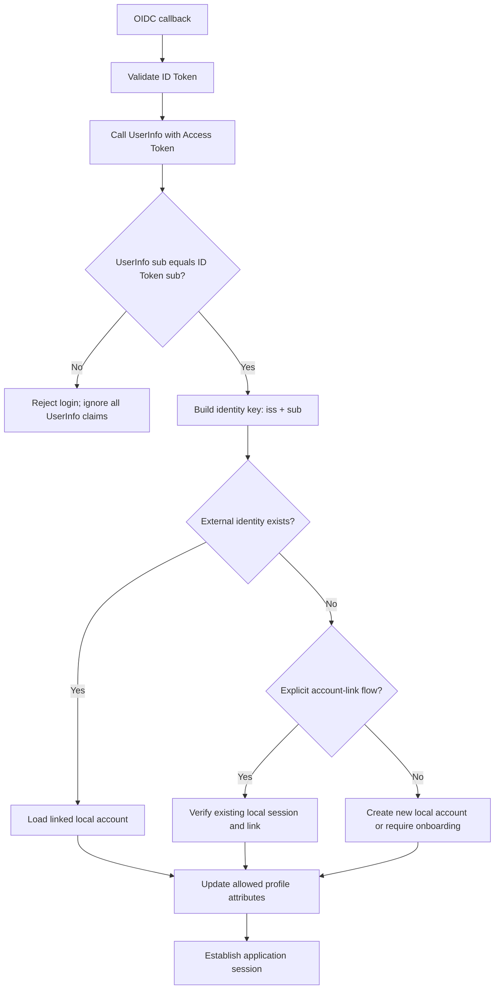

# Tính nhất quán giữa UserInfo, ID Token và định danh tài khoản

## 1. Vì sao phải đối chiếu UserInfo với ID Token?

Trong mô-đun **SPRING_SECURITY_OAUTH2_OIDC_AUTHORIZATION_SERVER**, chúng ta học cách thiết kế, cấu hình, bảo mật, kiểm thử và vận hành OAuth 2.0/OpenID Connect Authorization Server bằng **Spring Security**, **Spring Authorization Server** và **Spring Boot**. Bài này tập trung vào quan hệ giữa **UserInfo Response**, **ID Token** và **định danh tài khoản** trong OpenID Connect (OIDC).

Sau khi người dùng đăng nhập, OpenID Provider (OP) có thể phát hành ID Token để client biết kết quả xác thực và Access Token để client gọi UserInfo Endpoint lấy thêm claims về người dùng. Hai phản hồi có thể chứa một số thông tin trùng nhau như `sub`, `name`, `email` hoặc `picture`, nhưng chúng phục vụ các mục đích khác nhau:

- **ID Token** là bằng chứng OIDC về sự kiện xác thực và danh tính subject tại issuer.
- **UserInfo Response** là tập claims về End-User được trả qua một OAuth 2.0 Protected Resource bằng Access Token.
- **Định danh tài khoản** ở ứng dụng RP cần dựa trên định danh ổn định do issuer cấp, không dựa vào tên hiển thị hoặc email có thể đổi.

Một lỗi nghiêm trọng là client xác minh chữ ký ID Token nhưng không đối chiếu `sub` trong UserInfo. Khi đó, client có thể ghép ID Token của người dùng A với profile UserInfo của người dùng B. Đây là dạng **token substitution attack** mà OIDC Core yêu cầu RP phải ngăn chặn.

<badge color="success">Quy tắc bắt buộc</badge> `sub` trong UserInfo Response **MUST** tồn tại và **MUST** khớp chính xác với `sub` trong ID Token. Nếu không khớp, RP **MUST NOT** sử dụng bất kỳ giá trị nào trong UserInfo Response.

### Kết quả học tập

Sau bài này, bạn có thể:

1. Phân biệt ID Token và UserInfo Response, hiểu nguồn gốc và thời điểm phát hành claims.
2. Giải thích vì sao `sub` phải khớp chính xác giữa hai phản hồi.
3. Phân biệt claim định danh ổn định với claim hồ sơ có thể thay đổi.
4. Thiết kế định danh tài khoản bằng cặp `iss` + `sub`, kể cả khi OP dùng pairwise subject.
5. Bật và tùy biến UserInfo Endpoint trong Spring Authorization Server.
6. Kiểm tra `sub` tại RP và xử lý UserInfo Response an toàn với Spring Security OAuth2 Login.
7. Thiết kế account linking, cập nhật hồ sơ, cache và kiểm thử token substitution.

## 2. Vai trò của ID Token và UserInfo Response

### 2.1. ID Token mô tả danh tính và sự kiện xác thực

ID Token là JWT do OP phát hành trong một OIDC Authentication Flow. Các claim cốt lõi gồm:

| Claim | Ý nghĩa |
| --- | --- |
| `iss` | Issuer Identifier của OP phát hành token |
| `sub` | Subject Identifier của End-User tại issuer |
| `aud` | Client ID hoặc các audience được phép nhận ID Token |
| `exp` | Thời điểm ID Token hết hạn |
| `iat` | Thời điểm ID Token được phát hành |
| `auth_time` | Thời điểm OP xác thực End-User, khi được yêu cầu hoặc cung cấp |
| `nonce` | Giá trị liên kết ID Token với Authentication Request nếu request đã gửi nonce |
| `acr`, `amr` | Thông tin về mức độ/phương thức xác thực khi được cung cấp |

RP xác minh ID Token theo OIDC Core: issuer chính xác, audience, chữ ký theo issuer key, thời hạn và các kiểm tra khác phù hợp flow. `sub` là subject mà OP khẳng định đã xác thực.

### 2.2. UserInfo Response cung cấp claims về End-User

UserInfo Endpoint là OAuth 2.0 Protected Resource. RP gọi endpoint bằng Access Token nhận được từ OIDC Authentication Flow. Theo OIDC Core, request có thể dùng HTTP GET hoặc POST; GET được khuyến nghị, và Access Token phải được gửi dưới dạng Bearer Token. Giao tiếp phải dùng TLS.

Ví dụ:

```http
GET /userinfo HTTP/1.1
Host: auth.example.com
Authorization: Bearer ACCESS_TOKEN_VALUE
Accept: application/json
```

Response JSON minh họa:

```json
{
  "sub": "user-1042",
  "name": "Nguyen An",
  "given_name": "An",
  "family_name": "Nguyen",
  "email": "an@example.com",
  "email_verified": true,
  "picture": "https://cdn.example.com/profiles/user-1042.jpg",
  "updated_at": 1800000000
}
```

`sub` luôn bắt buộc. Các claim hồ sơ khác có thể bị OP lược bỏ vì quyền riêng tư, consent, scope, chính sách dữ liệu hoặc vì OP không có dữ liệu. Việc không trả một claim đã yêu cầu không tự động là lỗi giao thức; nếu claim không có giá trị, OP nên bỏ hẳn member thay vì trả `null` hoặc chuỗi rỗng.

### 2.3. Cùng một người dùng, hai tập claims

Ví dụ ID Token được phát hành lúc 09:00:

```json
{
  "iss": "https://auth.example.com",
  "sub": "user-1042",
  "aud": "orders-web",
  "exp": 1800000300,
  "iat": 1800000000,
  "name": "Nguyen An",
  "email": "old-address@example.com"
}
```

Đến 09:05, người dùng đổi email và RP gọi UserInfo:

```json
{
  "sub": "user-1042",
  "name": "Nguyen An",
  "email": "new-address@example.com",
  "email_verified": false,
  "updated_at": 1800000300
}
```

Hai response vẫn nhất quán về **subject**, dù email đã thay đổi. OIDC không yêu cầu tất cả profile claims trong ID Token và UserInfo phải có cùng giá trị tại mọi thời điểm. UserInfo có thể phản ánh thông tin mới hơn vì được truy vấn sau khi token đã phát hành.

Do đó, “tính nhất quán” trong bài này có hai lớp:

1. **Tính nhất quán định danh:** `sub` trong UserInfo phải bằng `sub` trong ID Token. Đây là yêu cầu chuẩn bắt buộc.
2. **Tính nhất quán hồ sơ:** các claim như email, tên và số điện thoại có thể thay đổi; ứng dụng cần quy định nguồn dữ liệu, thời điểm cập nhật và cách hợp nhất claims.

Không được dùng việc hai email giống nhau để thay thế kiểm tra `sub`. Cũng không được từ chối một UserInfo Response hợp lệ chỉ vì tên/email mới hơn ID Token, trừ khi ứng dụng có quy tắc nghiệp vụ riêng về snapshot dữ liệu.

## 3. Quy tắc OIDC Core về sub và xác minh UserInfo

### 3.1. UserInfo phải luôn trả sub

OIDC Core 1.0 incorporating Errata Set 2 quy định:

- `sub` **MUST** luôn xuất hiện trong UserInfo Response.
- RP **MUST** xác minh `sub` UserInfo khớp chính xác với `sub` trong ID Token.
- Nếu không khớp, RP **MUST NOT** sử dụng các giá trị trong UserInfo Response.

Đây là yêu cầu bắt buộc nhằm chống token substitution.

So sánh phải là so sánh chuỗi chính xác, có phân biệt chữ hoa/chữ thường. Không trim, lowercase, Unicode-normalize, giải mã hoặc biến đổi `sub` trước khi so sánh. `sub` là identifier opaque do issuer định nghĩa; RP không được tự diễn giải cấu trúc bên trong.

### 3.2. Ví dụ token substitution

Giả sử hai người dùng có ID Token hợp lệ:

```text
ID Token A:
  iss = https://auth.example.com
  sub = subject-A
  aud = orders-web

ID Token B:
  iss = https://auth.example.com
  sub = subject-B
  aud = orders-web
```

Một lỗi tích hợp khiến client dùng Access Token của B để gọi UserInfo nhưng lại gắn kết response với ID Token A:

```text
ID Token đã xác minh:        subject-A
UserInfo trả về:             subject-B
RP không kiểm tra sub
RP tạo session cho subject-A với profile của subject-B
```

Chữ ký ID Token A vẫn hợp lệ. Access Token B cũng có thể hợp lệ. Vấn đề nằm ở việc RP ghép hai phản hồi không thuộc cùng một subject. OIDC yêu cầu dừng tại bước đối chiếu `sub`, trước khi dùng bất kỳ profile claim nào.

### 3.3. Quy trình xác minh ở RP

Thứ tự an toàn:

1. Hoàn tất OIDC Authentication Flow và xác minh ID Token theo issuer/client.
2. Gửi Access Token đến UserInfo Endpoint đã discovery từ đúng issuer.
3. Xác minh TLS server certificate và định dạng response theo registration.
4. Đọc `sub` trong ID Token đã xác minh và `sub` trong UserInfo Response.
5. Nếu một trong hai thiếu hoặc khác nhau, từ chối sử dụng toàn bộ UserInfo Response.
6. Chỉ sau khi `sub` khớp mới dùng các claim hồ sơ hoặc thực hiện account linking.

Không tạo account, cập nhật email, cấp quyền, ghi audit profile hoặc đưa claims vào session trước bước 5. Việc chỉ so sánh `sub` sau khi đã lưu UserInfo vào database vẫn có thể gây ghi dữ liệu sai hoặc tạo side effect không thể đảo ngược.

### 3.4. Signed/encrypted UserInfo Response

Mặc định, UserInfo Response là JSON object. Nếu Client Registration yêu cầu signed hoặc encrypted UserInfo Response, claims được trả trong JWT và Content-Type là `application/jwt`. Khi response được ký, nó phải chứa `iss` là issuer URL của OP và `aud` là Client ID của RP; RP phải xác minh chữ ký theo cấu hình. Nếu vừa ký vừa mã hóa, OP ký trước rồi mã hóa.

Việc response được ký/mã hóa **không loại bỏ** yêu cầu đối chiếu `sub` với ID Token. Sau khi giải mã/xác minh response theo registration, RP vẫn phải so khớp subject trước khi sử dụng claims.

## 4. Định danh ổn định: cặp iss và sub

### 4.1. Vì sao không dùng email làm khóa tài khoản?

OIDC Core quy định `sub` là identifier cục bộ, duy nhất trong issuer và không được tái gán cho End-User khác. Khi kết hợp với `iss`, cặp này là định danh ổn định duy nhất mà RP có thể dựa vào giữa các lần đăng nhập. Các claim khác không có bảo đảm ổn định/duy nhất tương tự. Ví dụ email có thể thay đổi hoặc được dùng lại ở thời điểm khác; `email`, `phone_number`, `preferred_username` và `name` **MUST NOT** được dùng làm định danh duy nhất của End-User.

Ví dụ:

| Issuer | Subject | Email hiện tại | Định danh RP |
| --- | --- | --- | --- |
| `https://auth.example.com` | `user-1042` | `an@example.com` | (`https://auth.example.com`, `user-1042`) |
| `https://partner.example.net` | `user-1042` | `an@example.com` | (`https://partner.example.net`, `user-1042`) |

Hai issuer khác nhau có thể phát cùng chuỗi `sub`; chúng vẫn là hai danh tính khác nhau. RP phải dùng **cặp** `iss` + `sub`, không chỉ `sub`.

### 4.2. Public subject và pairwise subject

OIDC định nghĩa hai loại Subject Identifier:

| Loại | Hành vi |
| --- | --- |
| `public` | OP trả cùng một `sub` cho mọi client |
| `pairwise` | OP trả `sub` khác nhau cho từng sector identifier, giúp ngăn các client tự liên kết hoạt động của người dùng nếu không được phép |

OP công bố các loại hỗ trợ trong metadata `subject_types_supported`. Với pairwise subject, cùng một End-User có thể có `sub` khác nhau ở hai client hoặc hai sector identifier.

Ví dụ:

```text
End-User nội bộ: account 90017

Issuer: https://auth.example.com
  orders-web:
    sub = pairwise-7f...
  billing-web:
    sub = pairwise-b2...
```

RP `orders-web` chỉ được dùng subject đã nhận cho registration/sector của mình. Không cố suy ra rằng `pairwise-7f...` và `pairwise-b2...` thuộc cùng một người bằng cách giải mã, so sánh prefix hoặc gọi một API nội bộ không được phép.

Khi xây dựng OP bằng Spring Authorization Server, cần kiểm tra rõ chiến lược tạo subject và metadata mà phiên bản/ứng dụng triển khai công bố. Không mặc định rằng chỉ bật OIDC là đã có pairwise subject. Nếu dùng custom subject strategy, ID Token và UserInfo phải dùng **cùng một subject đã được tính cho client/sector hiện tại**.

### 4.3. Schema lưu external identity

Một mô hình quan hệ điển hình:

```sql
CREATE TABLE external_identity (
    id              BIGINT PRIMARY KEY,
    local_user_id   BIGINT NOT NULL,
    issuer          VARCHAR(512) NOT NULL,
    subject         VARCHAR(512) NOT NULL,
    created_at      TIMESTAMP NOT NULL,
    last_seen_at    TIMESTAMP,
    CONSTRAINT uq_external_identity_issuer_subject
        UNIQUE (issuer, subject)
);
```

Đây là schema minh họa. Nếu hệ thống dùng pairwise subject, mỗi RP/sector chỉ nhìn thấy subject dành cho mình; việc liên kết danh tính từ nhiều client cần quy trình có thẩm quyền tại OP hoặc account-linking flow được người dùng xác nhận.

Không dùng email làm khóa duy nhất cho bảng external identity. Có thể lưu email như profile/contact attribute riêng, cùng cờ xác minh và thời điểm cập nhật.

### 4.4. Account linking không dựa trên email trùng

Giả sử tài khoản nội bộ đã có email `an@example.com`; người dùng đăng nhập qua OP và UserInfo cũng trả email đó. RP không được tự động ghép tài khoản chỉ vì hai email trùng nhau. Email có thể thay đổi, được chia sẻ trong một số mô hình tổ chức hoặc được issuer tái sử dụng theo chính sách riêng.

Quy trình liên kết an toàn hơn:

1. Người dùng đang đăng nhập vào tài khoản nội bộ hiện hữu.
2. Người dùng chủ động bắt đầu thao tác liên kết identity provider.
3. RP thực hiện OIDC login và xác minh ID Token/UserInfo, gồm `iss` + `sub`.
4. RP yêu cầu xác nhận bổ sung/step-up nếu rủi ro hoặc chính sách yêu cầu.
5. RP tạo external identity với unique constraint (`issuer`, `subject`) và gắn vào local user hiện tại.
6. Nếu identity đã gắn với local user khác, từ chối và yêu cầu quy trình khôi phục/hỗ trợ riêng; không tự chuyển liên kết.

Nếu account linking khởi tạo từ một phiên chưa xác thực, không cho phép người dùng chiếm tài khoản hiện có bằng email match.

## 5. Tính nhất quán của claims hồ sơ

### 5.1. Claim nào phải giống nhau?

Trong hai phản hồi, yêu cầu OIDC Core có tính bắt buộc trực tiếp là `sub` trong UserInfo phải khớp `sub` của ID Token. Những claim hồ sơ khác không có cùng cam kết đồng nhất theo thời gian.

| Claim | Yêu cầu nhất quán | Cách xử lý ở RP |
| --- | --- | --- |
| `sub` | **MUST** khớp chính xác | Dùng làm subject; mismatch thì loại bỏ toàn bộ UserInfo |
| `iss` | ID Token phải khớp issuer đã tin cậy; UserInfo JSON thông thường không bắt buộc có `iss` | Gắn UserInfo với issuer/endpoint đã discovery; nếu response ký thì kiểm tra `iss` và `aud` |
| `aud` | Thuộc ID Token; UserInfo JSON thông thường không bắt buộc có `aud` | Xác minh audience của ID Token; nếu UserInfo JWT thì kiểm tra `aud` theo registration |
| `email` | Có thể thay đổi hoặc bị lược bỏ | Cập nhật như thuộc tính hồ sơ; không dùng làm khóa tài khoản |
| `email_verified` | Có thể đổi từ `true` sang `false` khi email thay đổi | Chỉ tin trạng thái xác minh do issuer cung cấp theo trust policy |
| `name`, `picture`, `preferred_username` | Có thể thay đổi hoặc không được trả | Coi là dữ liệu hiển thị, không phải định danh |
| `phone_number`, `address` | Có thể thay đổi hoặc bị ẩn vì privacy/consent | Chỉ lưu khi cần nghiệp vụ và có quyền phù hợp |
| `updated_at` | Có thể phản ánh thời điểm cập nhật profile | Dùng để hiểu độ mới của profile, không phải account key |

`iss` và `aud` không phải claim bắt buộc phải xuất hiện trong JSON UserInfo thông thường. Nếu UserInfo Response được ký, OIDC Core yêu cầu `iss` và `aud` trong JWT đó. Dù response không có `iss`, RP vẫn phải biết endpoint thuộc issuer nào thông qua discovery/trust configuration và TLS.

### 5.2. Scope quyết định phạm vi claims

Các scope chuẩn có ý nghĩa:

| Scope | Nhóm claims thường được yêu cầu |
| --- | --- |
| `openid` | OIDC Authentication và ID Token |
| `profile` | `name`, `family_name`, `given_name`, `picture`, `preferred_username`, `locale` và profile claims khác |
| `email` | `email`, `email_verified` |
| `address` | `address` |
| `phone` | `phone_number`, `phone_number_verified` |

RP chỉ nên yêu cầu những nhóm claims thực sự cần. OP có thể không trả một số claim vì privacy hoặc vì không có dữ liệu. Khi dùng `claims` request parameter, client có thể yêu cầu từng claim và có thể chỉ định mức thiết yếu theo cú pháp OIDC.

### 5.3. Chọn snapshot hay profile hiện thời

Có hai cách tổ chức dữ liệu:

**Snapshot theo lần đăng nhập:** ID Token và UserInfo được tạo từ cùng một nguồn dữ liệu hoặc cùng một thời điểm. Cách này giúp dữ liệu trùng nhau nhất quán trong một login transaction, nhưng UserInfo có thể không phản ánh thay đổi xảy ra sau khi token được phát hành.

**UserInfo theo dữ liệu hiện thời:** OP lấy profile từ kho dữ liệu khi nhận từng UserInfo request. Khi đó email/tên/địa chỉ có thể mới hơn ID Token. Đây là cách hợp lệ nếu `sub` vẫn giữ nguyên và các claims được trả theo scope/consent.

Nếu nghiệp vụ cần biết dữ liệu đã được đọc ở thời điểm nào, OP có thể cung cấp `updated_at` hoặc một claim phiên bản profile riêng. RP có thể lưu thời điểm nhận UserInfo và nguồn issuer để truy vết. Không nên tự suy ra rằng mọi claim đã được cập nhật cùng lúc.

### 5.4. Không gộp claims mù quáng

Một số thư viện client tạo một đối tượng OIDC user tổng hợp từ ID Token và UserInfo. Điều này tiện cho code ứng dụng, nhưng nếu cùng tên claim xuất hiện ở cả hai nguồn, logic ứng dụng cần biết nó đang đọc dữ liệu từ đâu.

Spring Security `OidcUser` cung cấp riêng `getIdToken()` và `getUserInfo()`, đồng thời `getClaims()` là tập claims tổng hợp từ hai đối tượng. Khi cần quyết định định danh, hãy đọc `getIdToken().getSubject()` và `getUserInfo().getSubject()` riêng, so khớp trước, sau đó mới dùng claims tổng hợp. Không dùng một map đã merge làm cách kiểm tra subject vì có thể mất thông tin về nguồn gốc từng giá trị.

## 6. Bật UserInfo Endpoint trong Spring Authorization Server

Spring Authorization Server cung cấp UserInfo Endpoint qua cấu hình OIDC. Endpoint này là OAuth 2.0 Protected Resource và yêu cầu Access Token trong Bearer Authorization header. Khi bật OIDC, framework cấu hình resource server support để xác thực Access Token trên UserInfo request.

### 6.1. Bật OIDC protocol endpoints

Ví dụ cấu hình filter chain theo API Spring Authorization Server 1.5.x:

```java
package com.example.authserver;

import org.springframework.context.annotation.Bean;
import org.springframework.context.annotation.Configuration;
import org.springframework.core.annotation.Order;
import org.springframework.http.MediaType;
import org.springframework.security.config.Customizer;
import org.springframework.security.config.annotation.web.builders.HttpSecurity;
import org.springframework.security.oauth2.server.authorization.config.annotation.web.configurers.OAuth2AuthorizationServerConfigurer;
import org.springframework.security.web.SecurityFilterChain;
import org.springframework.security.web.authentication.LoginUrlAuthenticationEntryPoint;
import org.springframework.security.web.util.matcher.MediaTypeRequestMatcher;

@Configuration
public class AuthorizationServerSecurityConfig {

    @Bean
    @Order(1)
    SecurityFilterChain authorizationServerSecurityFilterChain(HttpSecurity http)
            throws Exception {

        OAuth2AuthorizationServerConfigurer authorizationServerConfigurer =
                OAuth2AuthorizationServerConfigurer.authorizationServer();

        http
            .securityMatcher(authorizationServerConfigurer.getEndpointsMatcher())
            .with(authorizationServerConfigurer, authorizationServer ->
                authorizationServer.oidc(Customizer.withDefaults())
            )
            .authorizeHttpRequests(authorize -> authorize
                .anyRequest().authenticated()
            )
            .exceptionHandling(exceptions -> exceptions
                .defaultAuthenticationEntryPointFor(
                    new LoginUrlAuthenticationEntryPoint("/login"),
                    new MediaTypeRequestMatcher(MediaType.TEXT_HTML)
                )
            );

        return http.build();
    }
}
```

Đây là filter chain cho protocol endpoints. Ứng dụng vẫn cần một filter chain cho login form và các bean nền tảng như `RegisteredClientRepository`, `OAuth2AuthorizationService`, `AuthorizationServerSettings`, `JWKSource` và user authentication. Đừng tạo controller riêng thay thế `/userinfo`; endpoint filter mặc định đã xử lý access token authentication và OIDC response.

### 6.2. Cung cấp JwtDecoder

Tài liệu Spring Authorization Server yêu cầu một `JwtDecoder` bean cho OIDC UserInfo Endpoint khi dùng Access Token dạng JWT:

```java
import org.springframework.context.annotation.Bean;
import org.springframework.security.oauth2.jwt.JwtDecoder;
import org.springframework.security.oauth2.server.authorization.config.annotation.web.configuration.OAuth2AuthorizationServerConfiguration;
import com.nimbusds.jose.proc.SecurityContext;
import com.nimbusds.jose.jwk.source.JWKSource;

@Bean
JwtDecoder jwtDecoder(JWKSource<SecurityContext> jwkSource) {
    return OAuth2AuthorizationServerConfiguration.jwtDecoder(jwkSource);
}
```

Ví dụ trên giả định server có `JWKSource<SecurityContext>` để ký JWT. Trong production, key phải được quản lý bền vững và có quy trình rotation; không sinh lại key ngẫu nhiên mỗi lần ứng dụng restart.

### 6.3. Đường dẫn và discovery

Đường dẫn mặc định thường dùng của Spring Authorization Server là:

```text
/userinfo
```

RP nên lấy `userinfo_endpoint` từ OpenID Provider Configuration/Discovery của issuer tin cậy, không tự ghép URL hoặc lấy endpoint từ input của người dùng. Nếu đổi path hoặc đặt server sau reverse proxy, discovery metadata phải trả URL công khai, HTTPS và đúng issuer.

## 7. Default UserInfo mapper và tùy biến Spring Authorization Server

### 7.1. Hành vi mặc định

Theo tài liệu Spring Authorization Server 1.5.8, UserInfo response mặc định được tạo từ claims của ID Token đã phát hành. Các standard claims được trả theo những scope đã được yêu cầu và cấp trong authorization request. Đây là lựa chọn hữu ích khi muốn ID Token và UserInfo chia sẻ cùng một snapshot dữ liệu.

Pipeline mặc định gồm:

| Thành phần | Trách nhiệm |
| --- | --- |
| `OidcUserInfoEndpointFilter` | Nhận request UserInfo và trả response |
| Authentication converter nội bộ | Lấy authentication/principal đã được xác thực từ Security Context |
| `OidcUserInfoAuthenticationProvider` | Xử lý UserInfo authentication và gọi mapper |
| UserInfo mapper mặc định | Lấy standard claims từ ID Token theo scope đã cấp |
| Success/error handler | Trả `OidcUserInfo` hoặc OAuth error response |

Không cần viết mapper mới nếu dữ liệu từ ID Token đáp ứng nhu cầu. Ưu tiên dùng default pipeline để tránh vô tình bỏ `sub`, trả claims vượt scope hoặc phá kiểm tra Access Token.

### 7.2. Khi nào cần custom UserInfo mapper?

Tùy biến mapper khi cần:

- lấy profile mới nhất từ database hoặc LDAP thay vì snapshot trong ID Token;
- lọc claims theo scope/consent;
- chuẩn hóa một số thuộc tính hồ sơ theo hợp đồng API;
- lấy claims từ domain service hoặc nguồn phân tán;
- giữ `sub` lấy từ ID Token của authorization hiện tại trong khi tải thêm profile data.

Spring Authorization Server cung cấp `OidcUserInfoEndpointConfigurer.userInfoMapper(...)`. Mapper nhận `OidcUserInfoAuthenticationContext`, có thể truy cập authentication, Access Token và `OAuth2Authorization` chứa ID Token/Access Token liên quan đến Bearer Token được dùng gọi endpoint.

### 7.3. Cấu hình mapper an toàn

Ví dụ sau lấy subject từ ID Token trong authorization record, sau đó truy vấn profile theo subject và chỉ đưa ra claims được cấp:

```java
package com.example.authserver;

import java.util.LinkedHashMap;
import java.util.Map;
import java.util.Set;
import java.util.function.Function;

import org.springframework.context.annotation.Bean;
import org.springframework.context.annotation.Configuration;
import org.springframework.core.annotation.Order;
import org.springframework.security.config.Customizer;
import org.springframework.security.config.annotation.web.builders.HttpSecurity;
import org.springframework.security.oauth2.core.oidc.OidcScopes;
import org.springframework.security.oauth2.core.oidc.OidcIdToken;
import org.springframework.security.oauth2.core.oidc.OidcUserInfo;
import org.springframework.security.oauth2.server.authorization.config.annotation.web.configurers.OAuth2AuthorizationServerConfigurer;
import org.springframework.security.oauth2.server.authorization.oidc.authentication.OidcUserInfoAuthenticationContext;
import org.springframework.security.web.SecurityFilterChain;

@Configuration
public class UserInfoEndpointConfig {

    @Bean
    @Order(1)
    SecurityFilterChain authorizationServerSecurityFilterChain(
            HttpSecurity http,
            UserProfileService userProfileService) throws Exception {

        Function<OidcUserInfoAuthenticationContext, OidcUserInfo> userInfoMapper =
                context -> {
                    OidcIdToken idToken = context.getAuthorization()
                            .getToken(OidcIdToken.class)
                            .getToken();
                    String subject = idToken.getSubject();
                    Set<String> scopes = context.getAccessToken().getScopes();

                    Map<String, Object> claims = new LinkedHashMap<>();
                    claims.put("sub", subject);

                    if (scopes.contains(OidcScopes.PROFILE)) {
                        claims.putAll(userProfileService.loadProfileClaims(subject));
                    }
                    if (scopes.contains(OidcScopes.EMAIL)) {
                        claims.putAll(userProfileService.loadEmailClaims(subject));
                    }
                    if (scopes.contains(OidcScopes.PHONE)) {
                        claims.putAll(userProfileService.loadPhoneClaims(subject));
                    }
                    if (scopes.contains(OidcScopes.ADDRESS)) {
                        claims.putAll(userProfileService.loadAddressClaims(subject));
                    }

                    // Đảm bảo dữ liệu từ service không ghi đè subject.
                    claims.put("sub", subject);
                    return new OidcUserInfo(claims);
                };

        OAuth2AuthorizationServerConfigurer authorizationServerConfigurer =
                OAuth2AuthorizationServerConfigurer.authorizationServer();

        http
            .securityMatcher(authorizationServerConfigurer.getEndpointsMatcher())
            .with(authorizationServerConfigurer, authorizationServer ->
                authorizationServer.oidc(oidc ->
                    oidc.userInfoEndpoint(userInfo ->
                        userInfo.userInfoMapper(userInfoMapper)
                    )
                )
            )
            .authorizeHttpRequests(authorize -> authorize.anyRequest().authenticated());

        return http.build();
    }
}
```

`UserProfileService` là service của ứng dụng, có các phương thức trả về map claims đã được allowlist. Ví dụ hợp đồng:

```java
import java.util.Map;

public interface UserProfileService {
    Map<String, Object> loadProfileClaims(String subject);
    Map<String, Object> loadEmailClaims(String subject);
    Map<String, Object> loadPhoneClaims(String subject);
    Map<String, Object> loadAddressClaims(String subject);
}
```

Class cấu hình ở ví dụ này là một **biến thể hoàn chỉnh** của filter chain tại mục 6.1 để minh họa mapper được nối vào OIDC configurer. Nếu đã dùng bean filter chain ở mục 6.1, hãy chuyển phần khai báo mapper và cấu hình `userInfoMapper(...)` vào bean đó, rồi chỉ giữ một filter chain cho protocol endpoints. `UserProfileService` là dependency của ứng dụng; các method trả claims chỉ nên trả đúng trường được cho phép, không trả password hash, recovery code, dữ liệu nội bộ hoặc thuộc tính nhạy cảm ngoài consent.

**Điểm quyết định:** `sub` được lấy từ ID Token gắn với authorization đang được Access Token sử dụng. Không lấy subject từ query parameter, username do client gửi hoặc một profile record tùy ý. Nếu kho profile dùng internal user ID, cần có ánh xạ tin cậy từ OIDC subject đến user record.

### 7.4. Tùy biến ID Token và UserInfo cùng một subject

Spring Authorization Server cho phép tùy biến ID Token bằng `OAuth2TokenCustomizer<JwtEncodingContext>`. Nếu ứng dụng thay đổi cách tạo subject, phải bảo đảm:

- subject được tạo theo issuer/client/sector policy đã công bố;
- ID Token chứa subject cuối cùng được chọn;
- UserInfo mapper lấy subject từ ID Token/authorization hiện tại;
- không tạo subject thứ hai bằng cách lookup theo email hoặc username ở UserInfo;
- token generator/customizer không ghi đè `sub` sau khi mapper đã xác định.

Tài liệu Spring Authorization Server khuyến nghị có thể thêm standard claims vào ID Token để UserInfo mặc định sử dụng cùng nguồn claims. Khi cần profile live hoặc logic domain riêng, custom mapper có thể lấy dữ liệu trực tiếp từ service/database nhưng vẫn phải giữ nguyên subject.

### 7.5. Không trả claim ngoài quyền đã cấp

Không trả tất cả profile claims chỉ vì Access Token hợp lệ. Kiểm tra scopes đã được cấp trong authorization (`context.getAccessToken().getScopes()`), consent và policy của client. Nếu RP chỉ được cấp `openid profile`, không tự đưa email, phone, address hoặc dữ liệu nội bộ vào response.

Nếu claim không tồn tại hoặc OP quyết định không tiết lộ, bỏ member khỏi JSON thay vì trả `null` hoặc chuỗi rỗng. Trường `sub` vẫn luôn phải có.

## 8. Kiểm tra UserInfo ở phía RP bằng Spring Security

### 8.1. Cấu hình OIDC client

Ví dụ cấu hình Spring Boot cho client web `orders-web`:

```yaml
spring:
  security:
    oauth2:
      client:
        registration:
          orders:
            provider: orders-idp
            client-id: orders-web
            client-secret: ORDERS_WEB_SECRET_FROM_SECRET_MANAGER
            authorization-grant-type: authorization_code
            redirect-uri: "{baseUrl}/login/oauth2/code/{registrationId}"
            scope:
              - openid
              - profile
              - email
        provider:
          orders-idp:
            issuer-uri: https://auth.example.com
```

`ORDERS_WEB_SECRET_FROM_SECRET_MANAGER` là placeholder. Production phải lấy secret từ secret manager hoặc cơ chế quản lý secret tương đương, không commit credential thật vào Git. Client registration cần callback chính xác đã đăng ký tại OP và issuer phải là URL tin cậy.

### 8.2. Bật OAuth2 Login

```java
package com.example.ordersweb;

import org.springframework.context.annotation.Bean;
import org.springframework.context.annotation.Configuration;
import org.springframework.security.config.Customizer;
import org.springframework.security.config.annotation.web.builders.HttpSecurity;
import org.springframework.security.web.SecurityFilterChain;

@Configuration
public class WebSecurityConfig {

    @Bean
    SecurityFilterChain webSecurityFilterChain(HttpSecurity http)
            throws Exception {
        return http
                .authorizeHttpRequests(authorize -> authorize
                        .requestMatchers("/", "/health").permitAll()
                        .anyRequest().authenticated())
                .oauth2Login(Customizer.withDefaults())
                .build();
    }
}
```

Khi provider metadata có `userinfo_endpoint`, Spring Security OIDC client có thể dùng Access Token để gọi endpoint và tạo `OidcUser`. Nếu cần kiểm soát hậu xử lý UserInfo, cấu hình `oidcUserService(...)` trên OAuth2 Login.

### 8.3. Đối chiếu sub trong custom OidcUserService

RP tự triển khai hoặc thay thế `OidcUserService` phải giữ yêu cầu `sub` match. Ví dụ sau ủy quyền việc tải và xử lý cơ bản cho `OidcUserService` mặc định, rồi thêm guard rõ ràng trước khi trả principal cho ứng dụng:

```java
package com.example.ordersweb;

import org.springframework.context.annotation.Bean;
import org.springframework.context.annotation.Configuration;
import org.springframework.security.config.annotation.web.builders.HttpSecurity;
import org.springframework.security.oauth2.client.oidc.userinfo.OidcUserService;
import org.springframework.security.oauth2.client.oidc.userinfo.OAuth2UserService;
import org.springframework.security.oauth2.client.oidc.userinfo.OidcUserRequest;
import org.springframework.security.oauth2.core.OAuth2AuthenticationException;
import org.springframework.security.oauth2.core.OAuth2Error;
import org.springframework.security.oauth2.core.oidc.OidcUserInfo;
import org.springframework.security.oauth2.core.oidc.user.OidcUser;
import org.springframework.security.web.SecurityFilterChain;

@Configuration
public class OidcLoginSecurityConfig {

    @Bean
    SecurityFilterChain filterChain(HttpSecurity http) throws Exception {
        http
            .authorizeHttpRequests(authorize -> authorize
                .anyRequest().authenticated()
            )
            .oauth2Login(oauth2 -> oauth2
                .userInfoEndpoint(userInfo ->
                    userInfo.oidcUserService(oidcUserService())
                )
            );
        return http.build();
    }

    private OAuth2UserService<OidcUserRequest, OidcUser> oidcUserService() {
        OidcUserService delegate = new OidcUserService();
        return userRequest -> {
            OidcUser user = delegate.loadUser(userRequest);
            OidcUserInfo userInfo = user.getUserInfo();

            if (userInfo != null) {
                String idTokenSubject = user.getIdToken().getSubject();
                String userInfoSubject = userInfo.getSubject();

                if (idTokenSubject == null
                        || !idTokenSubject.equals(userInfoSubject)) {
                    OAuth2Error error = new OAuth2Error(
                            "invalid_user_info_response",
                            "UserInfo sub does not match ID Token sub",
                            null
                    );
                    throw new OAuth2AuthenticationException(error);
                }
            }

            return user;
        };
    }
}
```

Đoạn code là guard bổ sung cho RP; nếu `delegate.loadUser(...)` đã từ chối response không hợp lệ ở phiên bản Spring Security đang dùng, exception sẽ được giữ nguyên. Nếu viết custom service hoàn toàn mới, phải tự bảo đảm phép so sánh này và kiểm tra response theo OIDC Core. Không bắt `OAuth2AuthenticationException` rồi vẫn trả principal để “login cho chạy”.

### 8.4. Đọc ID Token và UserInfo riêng biệt

Trong controller/service, dùng các accessor tách nguồn:

```java
import org.springframework.security.core.annotation.AuthenticationPrincipal;
import org.springframework.security.oauth2.core.oidc.user.OidcUser;
import org.springframework.web.bind.annotation.GetMapping;
import org.springframework.web.bind.annotation.RestController;

@RestController
public class AccountController {

    @GetMapping("/account")
    public AccountView account(@AuthenticationPrincipal OidcUser oidcUser) {
        String issuer = oidcUser.getIdToken().getIssuer().toString();
        String subject = oidcUser.getIdToken().getSubject();

        return new AccountView(
                issuer,
                subject,
                oidcUser.getUserInfo() != null
                        ? oidcUser.getUserInfo().getEmail()
                        : null
        );
    }
}
```

`AccountView` là DTO của ứng dụng. Ví dụ chỉ đọc email từ UserInfo sau khi `OidcUserService` hoàn tất validation. Nếu cần email từ ID Token, đọc riêng claim trên `getIdToken()` và quy định rõ nguồn nào được ưu tiên cho mục đích hiển thị/cập nhật.

`OidcUser.getClaims()` là tập claims tổng hợp từ ID Token và UserInfo. Nó tiện cho hiển thị nhưng không nên là nguồn duy nhất để xác định subject hoặc quyết định account linking. Giữ riêng ID Token và UserInfo để audit và áp dụng quy tắc nguồn dữ liệu.

### 8.5. Không dùng OAuth2 UserService thay cho OIDC UserService

`DefaultOAuth2UserService` phục vụ OAuth 2.0 UserInfo tổng quát và trả `OAuth2User`. Khi client thực hiện OpenID Connect login, hãy dùng `OidcUserService`/`OAuth2UserService<OidcUserRequest, OidcUser>` để giữ cả ID Token và UserInfo. Nếu chỉ dùng OAuth2 UserService rồi lấy `email`/`name` làm identity, ứng dụng đã bỏ mất ngữ cảnh ID Token cần cho đối chiếu `sub`.

## 9. Ánh xạ danh tính OIDC vào tài khoản nội bộ

### 9.1. Tạo khóa identity từ issuer và subject

Sau khi ID Token và UserInfo đã được xác minh, RP có thể tạo identity key:

```java
public record OidcIdentityKey(String issuer, String subject) {
    public OidcIdentityKey {
        if (issuer == null || issuer.isBlank()) {
            throw new IllegalArgumentException("issuer is required");
        }
        if (subject == null || subject.isBlank()) {
            throw new IllegalArgumentException("subject is required");
        }
    }
}
```

Tạo key từ **ID Token đã xác minh**:

```java
OidcIdentityKey key = new OidcIdentityKey(
        oidcUser.getIdToken().getIssuer().toString(),
        oidcUser.getIdToken().getSubject()
);
```

Nếu UserInfo được dùng để cập nhật profile, trước đó đã phải kiểm tra UserInfo subject khớp ID Token subject. Không tạo key từ email hoặc username.

### 9.2. Luồng tìm hoặc tạo tài khoản



### 9.3. Phân tách identity record và profile record

Nên lưu identity liên kết và profile claims theo mục đích riêng:

| Dữ liệu | Nơi lưu | Tính chất |
| --- | --- | --- |
| `issuer`, `subject` | External identity | Khóa định danh từ OP |
| `local_user_id` | External identity | Tài khoản nội bộ được liên kết |
| `email`, `email_verified` | Profile/contact | Có thể thay đổi; không phải primary key |
| `name`, `picture`, `locale` | Profile/display | Dữ liệu hiển thị, có thể refresh |
| `updated_at`, `last_synced_at` | Profile metadata | Hỗ trợ freshness và audit |
| `source_scope`, `source_issuer` | Profile provenance | Ghi nguồn và phạm vi claims được phép |

Nếu email đổi, cập nhật profile/contact theo chính sách xác minh. Không tạo identity mới và không chuyển `local_user_id` chỉ vì email khác.

### 9.4. Xử lý pairwise subject khi tích hợp nhiều client

Nếu OP sử dụng pairwise subject, `orders-web` và `billing-web` có thể nhìn thấy hai `sub` khác nhau cho cùng End-User. RP không thể tự kết luận hai subject thuộc cùng một người. Nếu tổ chức cần dùng chung tài khoản nội bộ giữa nhiều RP, hãy thiết kế account-linking hoặc federation ở một thành phần có thẩm quyền, với xác nhận và quyền phù hợp. Không phá vỡ tính riêng tư của pairwise subject bằng cách suy luận từ email.

### 9.5. Cập nhật profile idempotent

Khi nhận UserInfo hợp lệ nhiều lần:

- chỉ cập nhật các claim được cấp và được ứng dụng cho phép;
- không ghi đè giá trị nội bộ do người dùng tự quản lý nếu chính sách không cho OP làm nguồn chuẩn;
- lưu `last_synced_at` và `updated_at` nếu có;
- xử lý email change bằng quy trình xác minh contact riêng;
- tránh tạo profile mới mỗi lần `sub`/email thay đổi;
- dùng transaction và unique constraint để tránh hai callback đồng thời tạo hai external identity giống nhau.

## 10. Lỗi tích hợp và cách chẩn đoán

| Hiện tượng | Nguyên nhân có thể | Cách xử lý |
| --- | --- | --- |
| UserInfo không có `sub` | OP mapper tùy biến quên thêm subject hoặc mapper bỏ claim | Sửa mapper để luôn lấy `sub` từ ID Token/authorization context |
| UserInfo `sub` khác ID Token | Access Token và ID Token thuộc giao dịch/subject khác nhau; mapper tra nhầm user; token substitution | Từ chối response, kiểm tra authorization record và token mapping |
| UserInfo `401 invalid_token` | Access Token hết hạn, sai issuer/audience hoặc không được chấp nhận | Kiểm tra Access Token, không thử dùng ID Token thay thế |
| UserInfo `403` | Token hợp lệ nhưng thiếu quyền/scope theo policy endpoint | Kiểm tra authorized scopes, consent và endpoint policy |
| UserInfo thiếu email/profile | Scope không được cấp, consent/privacy policy hoặc OP không có claim | Không coi là lỗi nếu claim không bắt buộc; xử lý profile thiếu |
| UserInfo trả email cũ | Mapper lấy snapshot từ ID Token hoặc cache cũ | Xác định rõ snapshot/live profile; kiểm tra cache và `updated_at` |
| Email đổi nhưng app tạo tài khoản mới | RP dùng email làm khóa identity | Dùng `(iss, sub)` làm khóa; migrate liên kết có kiểm soát |
| Cùng người dùng có `sub` khác giữa hai client | OP sử dụng pairwise subject | Đây có thể là hành vi đúng; không tự merge hai subject |
| `OidcUser.getClaims()` có giá trị khó hiểu | Claims từ ID Token và UserInfo được tổng hợp | Đọc `getIdToken()` và `getUserInfo()` riêng |
| UserInfo Endpoint 404 | OIDC chưa bật hoặc path/discovery sai | Kiểm tra `.oidc(...)`, endpoint settings và metadata |
| UserInfo Endpoint không xác thực JWT | Thiếu `JwtDecoder` hoặc cấu hình resource server | Cấu hình decoder phù hợp JWK/issuer |
| Custom mapper trả quá nhiều dữ liệu | Không lọc theo scopes/consent hoặc map cả entity | Dùng allowlist claims và scope gate |
| Callback login thành công dù UserInfo mismatch | Custom OIDC user service bỏ qua lỗi | Ném `OAuth2AuthenticationException`, không tạo session |
| Nhiều node trả profile khác nhau | Profile store/cache không đồng bộ | Dùng shared store, cache invalidation và versioning |

### 10.1. Phân biệt lỗi token và lỗi identity

- **Access Token không hợp lệ:** UserInfo Endpoint từ chối request, thường `401` với `invalid_token`.
- **UserInfo hợp lệ về HTTP nhưng sai subject:** response có thể là `200`, nhưng RP phải từ chối nội dung vì `sub` không khớp.
- **UserInfo hợp lệ và subject khớp nhưng profile claim thiếu:** có thể là kết quả bình thường theo privacy/scope.

Không biến mọi lỗi UserInfo thành đăng nhập thành công bằng cách chỉ dùng ID Token. Nếu chính sách ứng dụng yêu cầu UserInfo, khi endpoint lỗi thì xử lý như lỗi đăng nhập/đồng bộ, hoặc chỉ fallback theo một chính sách đã thiết kế và kiểm thử rõ ràng.

### 10.2. Những cách sửa lỗi không an toàn

- Không bỏ kiểm tra `sub` để “cho login chạy”.
- Không dùng email hoặc `preferred_username` thay cho `iss` + `sub`.
- Không nhận Access Token từ client rồi gọi UserInfo endpoint tùy ý do client chỉ định.
- Không cho phép UserInfo mapper lấy `sub` từ query parameter.
- Không trả mọi field trong database entity thành UserInfo claims.
- Không tự động account-link khi email trùng.
- Không ghi raw Access Token, ID Token hoặc toàn bộ UserInfo Response vào log.

## 11. Ma trận kiểm thử tính nhất quán

Kiểm thử cần bao phủ cả OP, RP và lớp lưu trữ account identity. Đặc biệt, negative test phải chứng minh rằng **không có side effect** khi `sub` sai.

| ID | Tình huống | Kết quả mong đợi |
| --- | --- | --- |
| UINFO-01 | ID Token và UserInfo cùng `sub` | RP chấp nhận UserInfo nếu các kiểm tra khác thành công |
| UINFO-02 | UserInfo thiếu `sub` | RP từ chối toàn bộ UserInfo |
| UINFO-03 | UserInfo `sub` khác ID Token | RP từ chối; không dùng claim nào trong response |
| UINFO-04 | `sub` chỉ khác chữ hoa/chữ thường | RP từ chối; so sánh chính xác |
| UINFO-05 | `sub` có thêm khoảng trắng | RP từ chối; không tự trim |
| UINFO-06 | ID Token issuer khác issuer đã cấu hình | Từ chối ID Token |
| UINFO-07 | UserInfo endpoint URL đến issuer khác | Không gửi token; discovery/trust validation phải ngăn |
| UINFO-08 | Access Token hết hạn | UserInfo request bị từ chối, thường `401 invalid_token` |
| UINFO-09 | Gửi ID Token thay cho Access Token | Endpoint từ chối |
| UINFO-10 | UserInfo thiếu `email` nhưng `sub` đúng | Chấp nhận response nếu email không bắt buộc theo policy |
| UINFO-11 | `email` đổi giữa ID Token và UserInfo, `sub` vẫn đúng | Chấp nhận; xử lý profile theo freshness policy |
| UINFO-12 | `email_verified=false` sau khi email đổi | Không coi email mới là đã xác minh |
| UINFO-13 | Scope chỉ có `openid profile` | Mapper không trả email/phone/address ngoài policy |
| UINFO-14 | Scope có `email` và consent phù hợp | Mapper có thể trả email claims được phép |
| UINFO-15 | Custom mapper quên thêm `sub` | Test thất bại; mapper phải được sửa |
| UINFO-16 | Profile service trả `sub` khác subject từ ID Token | Mapper khóa subject theo authorization context; không trả subject sai |
| UINFO-17 | Token substitution: Access Token B gọi UserInfo B nhưng RP ghép ID Token A | RP từ chối trước account linking |
| UINFO-18 | Cùng `sub`, issuer khác nhau | Tạo identity khác nhau theo cặp `(iss, sub)` |
| UINFO-19 | Email giống nhau ở hai issuer | Không tự động gộp local accounts |
| UINFO-20 | Pairwise subject khác nhau giữa hai client | Mỗi RP giữ identity riêng; không suy luận người dùng chung |
| UINFO-21 | Callback lặp đồng thời hai request | Unique constraint ngăn external identity trùng |
| UINFO-22 | UserInfo response JWT đã ký nhưng `sub` mismatch | Vẫn từ chối sau khi xác minh chữ ký |
| UINFO-23 | UserInfo response JWT có `iss` hoặc `aud` sai | Từ chối response theo registration |
| UINFO-24 | Profile claim có giá trị null/rỗng | OP bỏ claim theo policy; RP xử lý dữ liệu thiếu |
| UINFO-25 | UserInfo cache trả profile cũ nhưng `sub` đúng | Chấp nhận identity; áp dụng TTL/freshness policy |
| UINFO-26 | Account linking với email trùng nhưng user chưa xác thực tài khoản hiện tại | Từ chối liên kết tự động |
| UINFO-27 | Identity `(iss, sub)` đã gắn với tài khoản nội bộ khác | Từ chối và yêu cầu quy trình hỗ trợ/khôi phục |
| UINFO-28 | Mapper truy vấn profile theo username do request truyền vào | Test bảo mật thất bại; chỉ truy vấn theo subject đã xác thực |
| UINFO-29 | UserInfo endpoint không bật OIDC hoặc thiếu JwtDecoder | Startup/integration test phát hiện endpoint không hoạt động |
| UINFO-30 | RP tùy biến `OidcUserService` | Custom service vẫn xác minh `sub` trước khi tạo principal |

### 11.1. Integration test cho token substitution

Tạo OP test với hai người dùng A và B, hai Access Token hợp lệ và hai ID Token có chữ ký hợp lệ. Cho RP nhận ID Token A nhưng stub UserInfo trả `sub` của B. Kiểm tra:

1. RP xác minh ID Token A thành công.
2. RP gọi UserInfo bằng Access Token test.
3. UserInfo trả response có subject B.
4. RP ném lỗi authentication/identity validation.
5. Không có session authenticated mới.
6. Không có external identity hoặc profile update nào được ghi cho A hay B.

Nếu chỉ sửa payload JWT đã ký mà không ký lại bằng test key, test sẽ dừng ở lỗi chữ ký và không chứng minh được `sub` validator hoạt động. Hãy dùng test OP/stub ký response hợp lệ nhưng cố ý đặt subject khác.

### 11.2. Test pairwise và issuer

Chuẩn bị hai client registration hoặc hai issuer test:

```text
issuer A + client orders-web  -> sub = pairwise-A
issuer A + client billing-web -> sub = pairwise-B
issuer B + client orders-web  -> sub = pairwise-A
```

RP phải tạo các external identity theo đúng cặp `(iss, sub)`. Không gộp hai identity chỉ vì chuỗi `sub` trùng hoặc vì email giống nhau.

### 11.3. Test Spring Authorization Server mapper

- Khi không custom mapper, kiểm tra UserInfo trả standard claims theo scopes đã cấp và luôn có `sub`.
- Khi custom mapper, kiểm tra `sub` lấy từ ID Token của authorization hiện tại.
- Thử Access Token thiếu scope `email`; mapper không trả `email`.
- Thử profile service trả `sub` giả; mapper không được ghi đè subject.
- Thử nhiều authorization cùng người dùng ở hai client; mapper không dùng một subject global hoặc cache key chỉ theo username.

## 12. Vận hành và checklist production

### 12.1. Bảo vệ UserInfo Endpoint

- Bắt buộc TLS và xác minh chứng thư server.
- Chỉ chấp nhận Access Token hợp lệ theo issuer/audience/resource policy.
- Không nhận ID Token làm credential UserInfo.
- Không đưa Access Token vào query string, log hoặc telemetry.
- Rate limit theo client/token context và giới hạn request body phù hợp.
- Trả claims theo scope/consent và privacy policy.
- Nếu hỗ trợ signed/encrypted UserInfo response, quản lý thuật toán, key và registration nhất quán.

### 12.2. Quản lý subject và profile lifecycle

- `sub` phải duy nhất và không được tái gán trong phạm vi issuer theo OIDC.
- RP dùng cặp `(iss, sub)` làm external identity key.
- Nếu dùng pairwise subject, không cố liên kết giữa các client bằng suy luận từ subject.
- Email/phone/name là profile claims, có thể thay đổi hoặc không được trả.
- `email_verified` và `phone_number_verified` là trạng thái xác minh tại issuer, không thay thế quy trình xác minh contact riêng của ứng dụng nếu nghiệp vụ yêu cầu.
- Account linking phải có bằng chứng kiểm soát tài khoản nội bộ hiện hữu.
- Dùng transaction/unique constraint để chống race condition khi tạo identity.

### 12.3. Cache và đồng bộ claims

UserInfo thường được gọi sau đăng nhập, nhưng ứng dụng có thể gọi lại để refresh profile. Nếu cache:

- cache key phải gắn với issuer, subject và ngữ cảnh client/audience khi response khác nhau theo client;
- TTL phải phù hợp độ mới profile mà nghiệp vụ yêu cầu;
- không cache response chứa claim nhạy cảm lâu hơn chính sách cho phép;
- khi nhận email change hoặc `updated_at` mới, áp dụng policy update rõ ràng;
- cache không được dùng để bỏ qua kiểm tra `sub` ở response mới;
- nếu profile service và authorization service nằm ở nhiều node, đồng bộ cache invalidation hoặc versioning.

### 12.4. Audit và observability

Theo dõi:

- số UserInfo request thành công/lỗi theo client;
- tỷ lệ lỗi Access Token/401;
- số response thiếu `sub` hoặc `sub` mismatch;
- latency của UserInfo mapper và profile service;
- tỷ lệ claim bị lược bỏ theo scope/policy;
- số account-linking conflict;
- độ trễ từ khi profile thay đổi đến khi RP nhận dữ liệu mới.

Không ghi raw ID Token, Access Token, refresh token hoặc toàn bộ UserInfo Response vào log. Khi `sub` mismatch, ghi correlation ID, issuer đã cấu hình, client registration và outcome code; không ghi profile nhạy cảm không cần thiết.

### 12.5. Câu hỏi tự kiểm tra

**Câu 1.** Claim nào bắt buộc phải có trong UserInfo Response?  
**Đáp án:** `sub`.

**Câu 2.** UserInfo `sub` khác ID Token `sub` nhưng cả hai JWT/token đều hợp lệ thì RP có thể dùng profile không?  
**Đáp án:** Không. RP MUST NOT sử dụng bất kỳ giá trị nào trong UserInfo Response khi subject mismatch.

**Câu 3.** Email có thể dùng làm khóa duy nhất của tài khoản OIDC không?  
**Đáp án:** Không. Email có thể thay đổi hoặc được tái sử dụng; định danh ổn định là cặp `iss` + `sub`.

**Câu 4.** UserInfo email mới hơn email trong ID Token có phải lỗi không?  
**Đáp án:** Không nhất thiết. Profile claims có thể thay đổi; điều kiện bắt buộc là `sub` phải khớp.

**Câu 5.** Vì sao phải gửi Access Token đến UserInfo Endpoint thay vì ID Token?  
**Đáp án:** UserInfo là OAuth 2.0 Protected Resource và nhận Access Token dưới dạng Bearer Token.

**Câu 6.** Pairwise subject khác nhau giữa hai client có phải lỗi?  
**Đáp án:** Không. Đây là cơ chế riêng tư được OIDC định nghĩa; RP không được tự suy luận hai subject là một.

**Câu 7.** Có nên tự động liên kết tài khoản nội bộ khi email UserInfo trùng email hiện có?  
**Đáp án:** Không. Phải có quy trình account linking được xác thực và người dùng xác nhận.

**Câu 8.** Custom UserInfo mapper nên lấy `sub` từ đâu?  
**Đáp án:** Từ ID Token/authorization context gắn với Access Token đang gọi UserInfo, không lấy từ input do client tùy ý gửi.

### 12.6. Checklist trước production

- [ ] OIDC được bật trên Spring Authorization Server và UserInfo Endpoint được công bố trong discovery metadata.
- [ ] UserInfo Endpoint chỉ nhận Access Token hợp lệ qua Bearer Authorization header.
- [ ] TLS được bật và issuer/endpoint dùng URL công khai đáng tin.
- [ ] `JwtDecoder` và JWK source được cấu hình nếu Access Token là JWT.
- [ ] UserInfo Response luôn có `sub`.
- [ ] RP đối chiếu chính xác UserInfo `sub` với ID Token `sub` trước mọi side effect.
- [ ] Nếu mismatch hoặc thiếu `sub`, RP loại bỏ toàn bộ UserInfo Response.
- [ ] Identity key nội bộ là `(iss, sub)`, có unique constraint.
- [ ] Email, username, phone và name không được dùng làm identity key duy nhất.
- [ ] Pairwise subject được xử lý theo client/sector; không tự liên kết giữa các RP.
- [ ] Claims được lọc theo scope, consent và privacy policy.
- [ ] Custom mapper giữ `sub` từ authorization context và không cho profile service ghi đè.
- [ ] Account linking yêu cầu phiên đã xác thực hoặc bước xác nhận bổ sung.
- [ ] Profile update có freshness policy, audit và cache TTL phù hợp.
- [ ] Có test positive/negative cho sub mismatch, issuer khác, token substitution và pairwise subject.
- [ ] Log không chứa raw tokens hoặc toàn bộ profile claims nhạy cảm.

### Bản đồ ghi nhớ

```text
OIDC Authentication
      |
      +--> ID Token (signed JWT)
      |       iss = OP
      |       sub = stable subject for this issuer/client context
      |       aud = RP client_id
      |
      +--> Access Token
              |
              v
       GET /userinfo
       Authorization: Bearer <access-token>
              |
              v
       UserInfo Response
       sub = same subject
       profile claims may be newer / omitted
              |
              v
       RP validates:
         1. trusted issuer + ID Token validation
         2. UserInfo TLS/response validation
         3. UserInfo.sub == IDToken.sub
              |
        +-----+------+
        |            |
      MATCH       MISMATCH
        |            |
        v            v
   Use allowed   Reject all UserInfo
   profile data  claims; no account update
        |
        v
   Identity key = (iss, sub)
   email/name/phone = mutable profile attributes
```

**Điểm cần nhớ:** ID Token xác nhận subject tại issuer; UserInfo bổ sung claims về cùng End-User bằng Access Token. OIDC Core bắt buộc `sub` trong UserInfo phải khớp chính xác với `sub` của ID Token. Định danh bền vững ở RP là cặp `iss` + `sub`; email, tên và các thuộc tính hồ sơ chỉ là dữ liệu có thể thay đổi. Trong Spring Authorization Server, default UserInfo mapper phù hợp với claims snapshot từ ID Token; custom mapper có thể lấy profile live nhưng phải giữ subject từ authorization context và lọc claims theo scope/consent.

## Tài liệu chuẩn để đối chiếu

- [OpenID Connect Core 1.0 incorporating Errata Set 2](https://openid.net/specs/openid-connect-core-1_0.html): mục 5.3.1–5.3.4 (UserInfo request, successful response, validation), 5.7 (Claim Stability and Uniqueness), 8 (Subject Identifier Types), 16.11 (Token Substitution).
- [Spring Authorization Server — How-to: Customize the OpenID Connect 1.0 UserInfo response](https://docs.spring.io/spring-authorization-server/reference/guides/how-to-userinfo.html): bật UserInfo Endpoint, default mapper, custom mapper và ID Token customizer.
- [Spring Authorization Server — Protocol Endpoints](https://docs.spring.io/spring-authorization-server/reference/protocol-endpoints.html): `OidcUserInfoEndpointConfigurer`, converter, provider, mapper, success/error handler.
- [Spring Authorization Server — OidcUserInfoAuthenticationProvider API](https://docs.spring.io/spring-authorization-server/reference/api/java/org/springframework/security/oauth2/server/authorization/oidc/authentication/OidcUserInfoAuthenticationProvider.html): provider và `OidcUserInfoAuthenticationContext`.
- [Spring Security — OAuth2 Login Advanced Configuration](https://docs.spring.io/spring-security/reference/servlet/oauth2/login/advanced.html): `OidcUserService`, UserInfo endpoint và `OidcUser`.
- [Spring Security — OidcUser API](https://docs.spring.io/spring-security/reference/api/java/org/springframework/security/oauth2/core/oidc/user/OidcUser.html): `getIdToken()`, `getUserInfo()` và claims tổng hợp.
- [RFC 6750 — OAuth 2.0 Bearer Token Usage](https://www.rfc-editor.org/rfc/rfc6750): gửi Access Token trong Authorization header tới protected resource.
