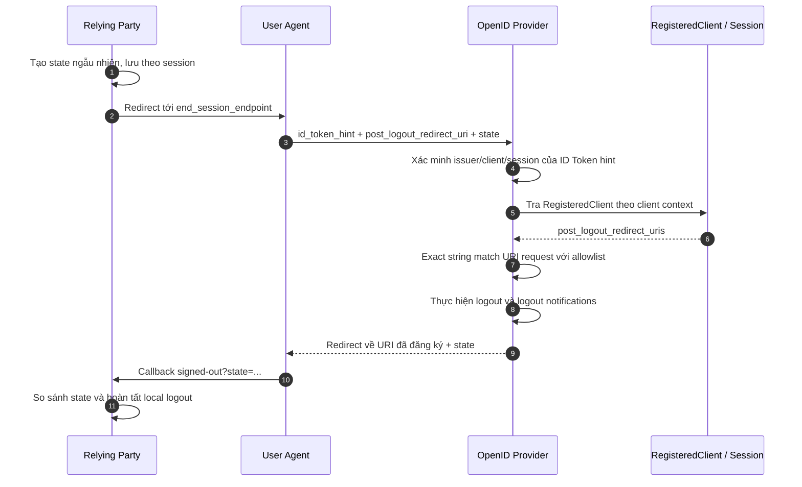

# Kiểm tra post-logout redirect URI theo đăng ký client

## 1. Vì sao phải kiểm tra địa chỉ chuyển hướng sau logout?

Trong một hệ thống **OAuth 2.0/OpenID Connect Authorization Server** sử dụng **Spring Security, Spring Authorization Server và Spring Boot**, OpenID Provider (OP) có thể nhận yêu cầu logout do Relying Party (RP) khởi tạo. Sau khi xử lý phiên đăng nhập tại OP, trình duyệt có thể được chuyển về ứng dụng RP để hiển thị trang đã đăng xuất.

Địa chỉ đích được truyền qua tham số `post_logout_redirect_uri`. Nếu OP chuyển hướng tới bất kỳ URL nào do request cung cấp mà không kiểm tra, kẻ tấn công có thể lợi dụng endpoint logout như một **open redirect**:

- Người dùng tin tưởng domain đăng nhập của OP.
- Kẻ tấn công tạo URL logout trông có vẻ hợp lệ nhưng gắn đích chuyển hướng tới website do chúng kiểm soát.
- Sau khi người dùng đi qua OP, trình duyệt rời domain tin cậy và tới trang giả mạo.
- Trang đích có thể tiếp tục lừa người dùng nhập thông tin, tải nội dung độc hại hoặc tạo một luồng phishing có vẻ xuất phát từ OP.

OpenID Connect RP-Initiated Logout 1.0 giải quyết vấn đề này bằng metadata đăng ký `post_logout_redirect_uris`. OP chỉ được chuyển hướng khi `post_logout_redirect_uri` trong logout request **khớp chính xác** một URI đã đăng ký của đúng client. Việc kiểm tra này gắn đích chuyển hướng với danh tính client và cấu hình đã được OP tin cậy.

Trong module **SPRING_SECURITY_OAUTH2_OIDC_AUTHORIZATION_SERVER**, mục tiêu là học cách thiết kế, cấu hình, bảo mật, kiểm thử và vận hành OAuth 2.0/OpenID Connect Authorization Server bằng Spring Security và Spring Authorization Server. Bài thuộc chương **OIDC Logout**, tập trung vào việc đăng ký và xác minh post-logout redirect URI ở Logout Endpoint.

### Kết quả học tập

Sau bài học, bạn có thể:

1. Giải thích vai trò của `post_logout_redirect_uri`, `post_logout_redirect_uris`, `id_token_hint`, `client_id` và `state`.
2. Phân biệt post-logout redirect URI với OAuth authorization `redirect_uri`.
3. Đăng ký các post-logout URI trên `RegisteredClient` trong Spring Authorization Server.
4. Hiểu yêu cầu **exact string match** của OIDC và lý do không dùng wildcard, prefix hoặc host suffix matching.
5. Dùng `OidcLogoutAuthenticationValidator` và `OidcLogoutAuthenticationProvider` để tùy chỉnh validation.
6. Giữ nguyên kiểm tra ID Token, client association và session khi thêm validator riêng.
7. Kiểm thử trường hợp hợp lệ, URI chưa đăng ký, thiếu client context, ID Token hint sai và logout request không có redirect.

**Phạm vi ví dụ:** Spring Boot 3.x, Spring Security 6.x và Spring Authorization Server 1.5.x trên Servlet stack. `OidcLogoutAuthenticationValidator` và extension point tương ứng có từ Spring Authorization Server 1.4.0. Nếu dùng phiên bản khác, đối chiếu API/Javadoc của dependency đang chạy.

## 2. RP-Initiated Logout hoạt động như thế nào?

### 2.1. Vai trò của OP và RP

- **OpenID Provider (OP):** Authorization Server thực hiện xác thực người dùng và quản lý phiên đăng nhập OIDC.
- **Relying Party (RP):** Ứng dụng dựa vào OP để đăng nhập người dùng.
- **Logout Endpoint / End Session Endpoint:** Endpoint của OP nhận yêu cầu logout từ RP.
- **Post-logout redirect URI:** Địa chỉ RP đề nghị OP chuyển trình duyệt tới sau khi logout được xử lý.

RP thường lấy URL Logout Endpoint từ discovery metadata `end_session_endpoint` của OP. Nếu OP hỗ trợ RP-Initiated Logout và Discovery, metadata này phải được công bố; endpoint phải dùng HTTPS.

### 2.2. Các tham số logout request

| Tham số | Yêu cầu | Mục đích |
| --- | --- | --- |
| `id_token_hint` | RECOMMENDED | ID Token trước đó do OP phát cho RP, giúp OP xác định user/client/session đang logout |
| `logout_hint` | OPTIONAL | Gợi ý về End-User; ý nghĩa do OP quy định |
| `client_id` | OPTIONAL | Client Identifier; thường dùng để xác định client khi gửi post-logout URI mà không có `id_token_hint` |
| `post_logout_redirect_uri` | OPTIONAL | URI mà RP muốn trình duyệt quay về sau logout |
| `state` | OPTIONAL | Giá trị opaque để RP tương quan logout request với callback |
| `ui_locales` | OPTIONAL | Ngôn ngữ giao diện OP nên ưu tiên |

Nếu cả `client_id` và `id_token_hint` được gửi, OP **MUST** xác minh `client_id` khớp client đã dùng khi phát hành ID Token. Khi có `id_token_hint`, OP phải xác minh chính OP là issuer của ID Token. Nếu session ID trong hint không khớp session hiện tại hoặc gần đây, OP nên coi request là đáng ngờ và có thể từ chối xử lý.

OIDC khuyến nghị `id_token_hint` khi RP yêu cầu post-logout redirect. Nếu không có hint, OP **MUST NOT** thực hiện chuyển hướng sau logout trừ khi có phương tiện khác để xác nhận tính hợp lệ của đích chuyển hướng. `client_id` kết hợp với danh sách URI đã đăng ký là cách phổ biến để OP xác định client trong trường hợp này.

### 2.3. GET và POST

OP phải hỗ trợ cả HTTP GET và POST tại Logout Endpoint. RP có thể sử dụng một trong hai:

```http
GET /connect/logout?id_token_hint=ID_TOKEN_PLACEHOLDER&post_logout_redirect_uri=https%3A%2F%2Fapp.example.com%2Fsigned-out&state=OPAQUE_STATE HTTP/1.1
Host: auth.example.com
```

Hoặc gửi các tham số bằng form serialization:

```http
POST /connect/logout HTTP/1.1
Host: auth.example.com
Content-Type: application/x-www-form-urlencoded

id_token_hint=ID_TOKEN_PLACEHOLDER&post_logout_redirect_uri=https%3A%2F%2Fapp.example.com%2Fsigned-out&state=OPAQUE_STATE
```

Ví dụ chỉ dùng placeholder. ID Token có thể xuất hiện trong query string của GET; cần tránh ghi query string đầy đủ vào access log, proxy log, tracing và analytics. POST có thể giảm việc đưa token vào URL, nhưng vẫn phải bảo vệ request bằng HTTPS và redaction.

## 3. Quy tắc khớp chính xác post-logout redirect URI

### 3.1. Exact string match

Theo OIDC RP-Initiated Logout 1.0, OP **MUST NOT** thực hiện post-logout redirection nếu giá trị `post_logout_redirect_uri` được gửi không khớp chính xác một giá trị trong danh sách `post_logout_redirect_uris` đã đăng ký trước đó của client.

Ví dụ client đã đăng ký:

```text
https://app.example.com/signed-out
```

Các giá trị sau không khớp:

| URI trong request | Kết quả | Lý do |
| --- | --- | --- |
| `https://app.example.com/signed-out` | Chấp nhận | Chuỗi giống URI đã đăng ký |
| `https://app.example.com/signed-out/` | Từ chối | Có dấu `/` cuối khác |
| `https://app.example.com/Signed-Out` | Từ chối | Path khác chữ hoa/thường |
| `https://app.example.com/signed-out?next=/home` | Từ chối | Query khác và chưa đăng ký |
| `https://app.example.com/other` | Từ chối | Path chưa đăng ký |
| `http://app.example.com/signed-out` | Từ chối | Scheme khác |
| `https://evil.example/signed-out` | Từ chối | Host khác |
| `https://app.example.com.evil.test/signed-out` | Từ chối | Host không phải host đã đăng ký |

So sánh exact string trên giá trị URI sau khi HTTP query/form parameter được giải mã. Không tự ý canonicalize hai chuỗi thành một URI tương đương rồi chấp nhận nếu chúng không trùng giá trị đã đăng ký. Việc percent-encode toàn bộ URI khi đưa vào query parameter là thao tác serialization; sau khi giải mã tham số, giá trị phải khớp chuỗi đã đăng ký.

### 3.2. Vì sao prefix matching nguy hiểm?

Các cách kiểm tra sau không an toàn:

```java
requestedUri.startsWith("https://app.example.com")
requestedUri.contains("app.example.com")
requestedUri.endsWith("/signed-out")
```

Ví dụ `https://app.example.com.evil.test/signed-out` có thể vượt qua một phép kiểm tra chuỗi thiếu chặt chẽ. Một URL có query, path hoặc host do attacker điều khiển cũng có thể lọt qua nếu chỉ kiểm tra một phần chuỗi.

Không dùng:

- Wildcard host như `https://*.example.com/logout`.
- Prefix/suffix matching.
- Regex chỉ kiểm tra domain nhưng bỏ qua path, port hoặc query.
- So sánh `getHost()` rồi chấp nhận mọi path.
- Dùng `redirect_uri` của Authorization Code flow thay cho danh sách post-logout URI.
- Chuyển hướng tới tham số `returnUrl`, `next` hoặc `continue` do người dùng tự gửi.

### 3.3. Không tự chuẩn hóa URI để nới lỏng allowlist

Không gọi `normalize()`, bỏ dấu `/` cuối, hạ chữ hoa/thường toàn chuỗi, xóa query hoặc thay port mặc định trước khi so sánh với allowlist. OIDC yêu cầu so khớp chính xác giá trị đã đăng ký.

Nếu muốn chấp nhận nhiều biến thể URI hợp lệ, đăng ký từng URI một cách tường minh. Ví dụ nếu hai callback có và không có dấu `/` cuối đều thực sự cần dùng, đăng ký cả hai dưới cùng client sau khi đánh giá.

### 3.4. Scheme HTTPS và native application

Các URI đăng ký nên dùng HTTPS. OIDC cho phép `http` trong một số trường hợp client confidential nếu OP cho phép; native application cũng có thể dùng custom URI scheme dành cho callback ứng dụng. Những trường hợp này vẫn phải được đăng ký trước và exact-match.

Với web client production, ưu tiên HTTPS. Với native client, dùng redirect scheme đã được ràng buộc với ứng dụng theo nền tảng và quy tắc đăng ký của OP. Không mở wildcard scheme để thuận tiện phát triển.

## 4. Phân biệt authorization redirect URI và post-logout redirect URI

Hai tham số có tên gần giống nhau nhưng phục vụ hai endpoint và hai thời điểm khác nhau:

| Thuộc tính | `redirect_uri` | `post_logout_redirect_uri` |
| --- | --- | --- |
| Giao thức | OAuth 2.0 Authorization Code / các flow redirect-based | OIDC RP-Initiated Logout |
| Endpoint | Authorization Endpoint | Logout / End Session Endpoint |
| Thời điểm | Sau khi authorization thành công hoặc trả authorization response | Sau khi OP xử lý logout và các notification liên quan |
| Metadata đăng ký | `redirect_uris` | `post_logout_redirect_uris` |
| Builder Spring | `RegisteredClient.Builder.redirectUri(...)` | `RegisteredClient.Builder.postLogoutRedirectUri(...)` |
| Consumer | OAuth client nhận authorization response | Trình duyệt quay lại RP sau logout |

Không tự động sao chép toàn bộ `redirect_uris` sang `post_logout_redirect_uris`. Mỗi URI cần được đăng ký theo đúng mục đích. Một client có thể có authorization callback nhưng không cần post-logout callback.

## 5. Đăng ký post-logout URI trong Spring Authorization Server

### 5.1. Dùng RegisteredClient.Builder

Spring Authorization Server lưu danh sách post-logout redirect URI trong `RegisteredClient.getPostLogoutRedirectUris()`. Có thể đăng ký URI bằng `postLogoutRedirectUri(...)`:

```java
import java.util.UUID;

import org.springframework.security.oauth2.core.AuthorizationGrantType;
import org.springframework.security.oauth2.core.ClientAuthenticationMethod;
import org.springframework.security.oauth2.core.oidc.OidcScopes;
import org.springframework.security.oauth2.server.authorization.client.RegisteredClient;

RegisteredClient webClient = RegisteredClient.withId(UUID.randomUUID().toString())
        .clientId("portal-web")
        .clientSecret("{noop}development-only-secret")
        .clientAuthenticationMethod(ClientAuthenticationMethod.CLIENT_SECRET_BASIC)
        .authorizationGrantType(AuthorizationGrantType.AUTHORIZATION_CODE)
        .authorizationGrantType(AuthorizationGrantType.REFRESH_TOKEN)
        .redirectUri("https://app.example.com/login/oauth2/code/portal")
        .postLogoutRedirectUri("https://app.example.com/signed-out")
        .postLogoutRedirectUri("https://app.example.com/logout/complete")
        .scope(OidcScopes.OPENID)
        .scope(OidcScopes.PROFILE)
        .build();
```

Đây là ví dụ đăng ký client cho môi trường học tập. Không dùng `{noop}` hoặc secret mẫu trong production; dùng `PasswordEncoder` phù hợp, secret manager và client authentication policy đúng loại ứng dụng. Public client native/SPA cần cấu hình client authentication và PKCE theo mô hình tương ứng.

### 5.2. Nhiều post-logout URI

Một client có thể đăng ký nhiều URI:

```java
import org.springframework.security.oauth2.core.AuthorizationGrantType;
import org.springframework.security.oauth2.core.ClientAuthenticationMethod;
import org.springframework.security.oauth2.core.oidc.OidcScopes;
import org.springframework.security.oauth2.server.authorization.client.RegisteredClient;

RegisteredClient client = RegisteredClient.withId("portal-client-registration")
        .clientId("portal")
        .clientSecret("{noop}development-only-secret")
        .clientAuthenticationMethod(ClientAuthenticationMethod.CLIENT_SECRET_BASIC)
        .authorizationGrantType(AuthorizationGrantType.AUTHORIZATION_CODE)
        .redirectUri("https://app.example.com/login/oauth2/code/portal")
        .postLogoutRedirectUri("https://app.example.com/signed-out")
        .postLogoutRedirectUri("https://app.example.com/session-ended")
        .scope(OidcScopes.OPENID)
        .build();
```

Đây là một client confidential mẫu; trong production, thay secret mẫu bằng secret được mã hóa và quản lý an toàn.

Mỗi URI là một chuỗi allowlist riêng. Nếu request chọn URI thứ ba chưa đăng ký, OP phải từ chối sử dụng URI đó để redirect, dù hai URI còn lại hợp lệ.

### 5.3. Lưu registration bền vững

Trong production, `RegisteredClientRepository` thường lưu client vào database hoặc một nguồn cấu hình có kiểm soát. Cần bảo đảm:

- `post_logout_redirect_uris` được lưu và đọc lại đầy đủ.
- Tất cả AS instances sử dụng cùng client registration state.
- Thay đổi allowlist có audit trail và quy trình phê duyệt.
- Cache client registration được invalidated khi URI bị gỡ hoặc thay đổi.
- Dynamic client registration không cho phép client tự ý mở rộng allowlist mà thiếu authentication/authorization và policy review.

Không chỉ cập nhật một node hoặc một cache cục bộ rồi kỳ vọng mọi AS instance lập tức dùng allowlist mới.

### 5.4. Dynamic Client Registration

Nếu OP hỗ trợ OIDC Dynamic Client Registration, client metadata có thể chứa:

```json
{
  "client_name": "Portal Web",
  "redirect_uris": [
    "https://app.example.com/login/oauth2/code/portal"
  ],
  "post_logout_redirect_uris": [
    "https://app.example.com/signed-out"
  ]
}
```

`post_logout_redirect_uris` là metadata tùy chọn. Spring Authorization Server có OIDC Client Registration Endpoint nhưng endpoint này bị tắt theo mặc định. Chỉ bật nếu deployment cần dynamic registration và đã có chính sách bảo vệ endpoint, kiểm duyệt redirect URI, client metadata và vòng đời registration.

## 6. Logout Endpoint trong Spring Authorization Server

### 6.1. OIDC support và endpoint

Spring Authorization Server cung cấp `OidcLogoutEndpointConfigurer` để xử lý RP-Initiated Logout. Endpoint được đăng ký trong Authorization Server `SecurityFilterChain` khi bật OIDC:

```java
import org.springframework.context.annotation.Bean;
import org.springframework.core.annotation.Order;
import org.springframework.security.config.Customizer;
import org.springframework.security.config.annotation.web.builders.HttpSecurity;
import org.springframework.security.oauth2.server.authorization.config.annotation.web.configurers.OAuth2AuthorizationServerConfigurer;
import org.springframework.security.web.SecurityFilterChain;

@Bean
@Order(1)
SecurityFilterChain authorizationServerSecurityFilterChain(HttpSecurity http)
        throws Exception {

    OAuth2AuthorizationServerConfigurer authorizationServerConfigurer =
            OAuth2AuthorizationServerConfigurer.authorizationServer();

    http
        .securityMatcher(authorizationServerConfigurer.getEndpointsMatcher())
        .with(authorizationServerConfigurer, authorizationServer ->
            authorizationServer.oidc(Customizer.withDefaults())
        );

    return http.build();
}
```

Đây là đoạn minh họa phần Authorization Server endpoints. Ứng dụng thật còn cần cấu hình issuer, signing JWK, client repository, authorization service, login/session và filter chain cho ứng dụng. Khi OIDC logout được bật, OP công bố `end_session_endpoint` trong OIDC Provider Configuration/Discovery metadata.

### 6.2. Các thành phần xử lý logout

| Thành phần | Vai trò |
| --- | --- |
| `OidcLogoutEndpointConfigurer` | Cấu hình extension points của Logout Endpoint |
| `OidcLogoutEndpointFilter` | Nhận RP-Initiated Logout HTTP request |
| `OidcLogoutAuthenticationConverter` | Chuyển request thành `OidcLogoutAuthenticationToken` |
| `OidcLogoutAuthenticationProvider` | Xác minh logout request, client, ID Token/session và thực hiện authentication processing |
| `OidcLogoutAuthenticationValidator` | Validator mặc định cho các tham số logout, trong đó có `post_logout_redirect_uri` |
| `OidcLogoutAuthenticationContext` | Cung cấp logout authentication token và `RegisteredClient` cho validator |
| `OidcLogoutAuthenticationSuccessHandler` | Xử lý logout thành công và response/redirect |

Spring Authorization Server có validator mặc định cho `post_logout_redirect_uri`. Nếu validation thất bại, validator ném `OAuth2AuthenticationException`. Có thể tùy chỉnh bằng `OidcLogoutAuthenticationProvider.setAuthenticationValidator(...)`.

### 6.3. Dữ liệu trong OidcLogoutAuthenticationToken

`OidcLogoutAuthenticationToken` cung cấp:

- `getIdTokenHint()`: ID Token hint dạng chuỗi.
- `getIdToken()`: ID Token đã được chuyển thành `OidcIdToken` nếu có.
- `getClientId()`: client identifier gắn với ID Token.
- `getPostLogoutRedirectUri()`: URI request muốn chuyển trình duyệt tới.
- `getState()`: opaque state cần echo về RP.
- `getSessionId()`: session identifier nếu có.
- `getPrincipal()`: principal của End-User.

`OidcLogoutAuthenticationContext.getRegisteredClient()` trả về registration tương ứng được provider xác định. Validator nên dùng registration này để tra allowlist; không lấy client từ một query parameter tùy ý rồi tự tin cậy.

## 7. Cấu hình validator và giữ nguyên kiểm tra mặc định

### 7.1. Validator mặc định

Spring Authorization Server 1.5.x cung cấp `OidcLogoutAuthenticationValidator`. Validator này kiểm tra `OidcLogoutAuthenticationToken.getPostLogoutRedirectUri()` dựa trên thông tin client đã đăng ký.

API có sẵn:

```java
OidcLogoutAuthenticationValidator.DEFAULT_POST_LOGOUT_REDIRECT_URI_VALIDATOR
```

Đây là `Consumer<OidcLogoutAuthenticationContext>` có thể được sử dụng độc lập hoặc kết hợp với một validator bổ sung bằng `andThen(...)`.

### 7.2. Bổ sung kiểm tra exact membership

Ví dụ sau giữ validator mặc định và thêm một lớp xác nhận URI nằm trong đúng allowlist của `RegisteredClient`:

```java
import java.util.function.Consumer;

import org.springframework.security.oauth2.core.OAuth2AuthenticationException;
import org.springframework.security.oauth2.core.OAuth2Error;
import org.springframework.security.oauth2.core.OAuth2ErrorCodes;
import org.springframework.security.oauth2.server.authorization.client.RegisteredClient;
import org.springframework.security.oauth2.server.authorization.oidc.authentication.OidcLogoutAuthenticationContext;
import org.springframework.security.oauth2.server.authorization.oidc.authentication.OidcLogoutAuthenticationToken;
import org.springframework.security.oauth2.server.authorization.oidc.authentication.OidcLogoutAuthenticationValidator;

Consumer<OidcLogoutAuthenticationContext> postLogoutRedirectValidator =
        OidcLogoutAuthenticationValidator.DEFAULT_POST_LOGOUT_REDIRECT_URI_VALIDATOR
            .andThen(context -> {
                OidcLogoutAuthenticationToken logout =
                        context.getAuthentication();
                String requestedUri = logout.getPostLogoutRedirectUri();

                // Không yêu cầu redirect là một request hợp lệ.
                if (requestedUri == null) {
                    return;
                }

                RegisteredClient registeredClient =
                        context.getRegisteredClient();

                if (registeredClient == null
                        || !registeredClient.getPostLogoutRedirectUris()
                                .contains(requestedUri)) {
                    OAuth2Error error =
                            new OAuth2Error(OAuth2ErrorCodes.INVALID_REQUEST);
                    throw new OAuth2AuthenticationException(error);
                }
            });
```

`Set.contains(...)` thực hiện so sánh chuỗi chính xác. Không chuyển URI sang dạng normalized trước khi gọi `contains`. Kiểm tra bổ sung này có tính chất phòng vệ rõ ràng; validator mặc định vẫn là lớp validation chính của Spring.

### 7.3. Gắn validator vào OidcLogoutAuthenticationProvider

Spring Authorization Server cho phép tùy chỉnh provider thông qua `authenticationProviders(...)`:

```java
import java.util.List;
import java.util.function.Consumer;

import org.springframework.security.authentication.AuthenticationProvider;
import org.springframework.security.oauth2.core.OAuth2AuthenticationException;
import org.springframework.security.oauth2.core.OAuth2Error;
import org.springframework.security.oauth2.core.OAuth2ErrorCodes;
import org.springframework.security.oauth2.server.authorization.client.RegisteredClient;
import org.springframework.security.oauth2.server.authorization.oidc.authentication.OidcLogoutAuthenticationContext;
import org.springframework.security.oauth2.server.authorization.oidc.authentication.OidcLogoutAuthenticationProvider;
import org.springframework.security.oauth2.server.authorization.oidc.authentication.OidcLogoutAuthenticationToken;
import org.springframework.security.oauth2.server.authorization.oidc.authentication.OidcLogoutAuthenticationValidator;

private Consumer<List<AuthenticationProvider>> configureLogoutValidator() {
    return providers -> providers.forEach(provider -> {
        if (provider instanceof OidcLogoutAuthenticationProvider logoutProvider) {
            logoutProvider.setAuthenticationValidator(
                    postLogoutRedirectValidator());
        }
    });
}

private Consumer<OidcLogoutAuthenticationContext> postLogoutRedirectValidator() {
    return OidcLogoutAuthenticationValidator
            .DEFAULT_POST_LOGOUT_REDIRECT_URI_VALIDATOR
            .andThen(context -> {
                OidcLogoutAuthenticationToken logout =
                        context.getAuthentication();
                String requestedUri = logout.getPostLogoutRedirectUri();

                if (requestedUri == null) {
                    return;
                }

                RegisteredClient registeredClient =
                        context.getRegisteredClient();
                if (registeredClient == null
                        || !registeredClient.getPostLogoutRedirectUris()
                                .contains(requestedUri)) {
                    throw new OAuth2AuthenticationException(
                            new OAuth2Error(OAuth2ErrorCodes.INVALID_REQUEST));
                }
            });
}
```

Sau đó thêm vào Authorization Server filter chain hiện có:

```java
@Bean
@Order(1)
SecurityFilterChain authorizationServerSecurityFilterChain(HttpSecurity http)
        throws Exception {

    OAuth2AuthorizationServerConfigurer authorizationServerConfigurer =
            OAuth2AuthorizationServerConfigurer.authorizationServer();

    http
        .securityMatcher(authorizationServerConfigurer.getEndpointsMatcher())
        .with(authorizationServerConfigurer, authorizationServer ->
            authorizationServer.oidc(oidc ->
                oidc.logoutEndpoint(logoutEndpoint ->
                    logoutEndpoint.authenticationProviders(
                            configureLogoutValidator())
                )
            )
        );

    return http.build();
}
```

Các đoạn trên là các phần của một cấu hình, cần đặt trong cùng `@Configuration` class và điều chỉnh theo filter chain đang có. Không khai báo hai `SecurityFilterChain` cùng matcher chỉ để thêm validator; hãy gắn cấu hình logout vào chain Authorization Server hiện tại.

### 7.4. Vì sao phải gọi validator mặc định trước?

`setAuthenticationValidator(...)` thay validator tham số logout mà provider sử dụng. Nếu thay bằng một lambda chỉ kiểm tra điều kiện riêng, bạn có thể vô tình bỏ mất validation mặc định cho `post_logout_redirect_uri`.

Kết hợp:

```java
OidcLogoutAuthenticationValidator.DEFAULT_POST_LOGOUT_REDIRECT_URI_VALIDATOR
        .andThen(customPolicy)
```

giữ hành vi mặc định trước khi thực hiện policy bổ sung. Các bước xác minh ID Token, client/session association và xử lý logout của provider vẫn là trách nhiệm của provider; custom validator không nên thay thế hoặc bỏ qua chúng.

### 7.5. Khi nào cần custom validator?

Nếu policy ứng dụng chỉ yêu cầu đúng allowlist `RegisteredClient`, validator mặc định của Spring Authorization Server đã phục vụ mục tiêu này. Chỉ thêm custom validator khi có yêu cầu cụ thể như:

- Chặn một URI đã đăng ký nhưng đang bị vô hiệu khẩn cấp.
- Chỉ cho phép callback thuộc môi trường/tenant đang hoạt động.
- Áp dụng policy scheme bổ sung cho client web.
- Ghi audit event an toàn về quyết định validation mà không ghi raw ID Token.

Không custom validator chỉ để thay exact matching bằng quy tắc nới lỏng. Nếu cần hỗ trợ nhiều callback, đăng ký từng callback.

## 8. Xử lý logout request không có ID Token hint

### 8.1. Client ID giúp xác định registration

OIDC cho phép gửi `client_id` khi request có `post_logout_redirect_uri` nhưng không có `id_token_hint`. OP có thể dùng client identifier để xác định `RegisteredClient` và kiểm tra URI theo allowlist của client.

Ví dụ:

```http
GET /connect/logout?client_id=portal-web&post_logout_redirect_uri=https%3A%2F%2Fapp.example.com%2Fsigned-out&state=OPAQUE_STATE HTTP/1.1
Host: auth.example.com
```

`client_id` là identifier, không phải client secret và không tự chứng minh người gửi đang sở hữu phiên đăng nhập của client. Việc cho phép chuyển hướng vẫn cần registration allowlist và một phương tiện xác nhận tính hợp lệ của đích theo OIDC.

### 8.2. Xác nhận logout ở OP là một vấn đề riêng

Theo OIDC RP-Initiated Logout:

- OP nên hỏi End-User có muốn logout khỏi OP hay không.
- OP **MUST** hỏi nếu không có `id_token_hint`.
- OP cũng phải hỏi nếu ID Token hint không thuộc session hiện tại của OP với RP và/hoặc End-User hiện đang đăng nhập.

Vì vậy, xác minh `post_logout_redirect_uri` hợp lệ không có nghĩa request đã đủ quyền để âm thầm kết thúc session OP. Redirect allowlist xác nhận **đích callback**, còn ID Token hint/session validation và user confirmation xử lý **ngữ cảnh logout**.

### 8.3. ID Token hint hết hạn

ID Token hint là bằng chứng gợi ý về session hiện tại/gần đây, không phải access token được dùng để gọi API. OIDC nói OP nên chấp nhận ID Token hint khi RP được xác định bởi `aud` và/hoặc `sid` có session hiện tại hoặc gần đây, ngay cả khi claim `exp` đã qua.

Không áp dụng máy móc quy tắc “ID Token hết hạn thì logout request luôn bị từ chối”. Provider cần kiểm tra issuer, client/audience, session và thời điểm gần đây theo OIDC; nếu session ID không tương ứng, request nên được coi là đáng ngờ và có thể bị từ chối.

### 8.4. Cấu hình RP gửi đúng callback đã đăng ký

Ở phía RP, Spring Security cung cấp `OidcClientInitiatedLogoutSuccessHandler` để điều hướng tới end-session endpoint lấy từ OIDC Client Registration/Provider metadata:

```java
import org.springframework.context.annotation.Bean;
import org.springframework.security.oauth2.client.registration.ClientRegistrationRepository;
import org.springframework.security.oauth2.client.oidc.web.logout.OidcClientInitiatedLogoutSuccessHandler;
import org.springframework.security.web.authentication.logout.LogoutSuccessHandler;

@Bean
LogoutSuccessHandler oidcLogoutSuccessHandler(
        ClientRegistrationRepository clientRegistrationRepository) {

    OidcClientInitiatedLogoutSuccessHandler handler =
            new OidcClientInitiatedLogoutSuccessHandler(
                    clientRegistrationRepository);

    handler.setPostLogoutRedirectUri("{baseUrl}/signed-out");
    return handler;
}
```

Gắn handler vào logout configuration của RP:

```java
http.logout(logout -> logout
        .logoutSuccessHandler(oidcLogoutSuccessHandler));
```

Template `{baseUrl}/signed-out` được Spring Security mở rộng dựa trên URL ứng dụng. Giá trị thực tế gửi tới OP phải trùng một URI đã đăng ký cho client. Ví dụ nếu RP chạy với base URL `https://app.example.com` thì OP phải đăng ký chính xác `https://app.example.com/signed-out`.

Không dùng request host tùy ý để tạo callback nếu ứng dụng chạy sau reverse proxy mà chưa cấu hình forwarded headers/trusted proxy đúng cách. Base URL sai có thể tạo post-logout URI không khớp allowlist hoặc tạo đích chuyển hướng không mong muốn.

## 9. State và callback sau logout

### 9.1. State dùng để tương quan request

RP có thể tạo một giá trị `state` ngẫu nhiên, khó đoán và gắn với phiên trình duyệt trước khi chuyển người dùng tới OP. Nếu request chứa `state`, OP phải trả lại đúng giá trị đó khi chuyển trình duyệt về `post_logout_redirect_uri`.

Ví dụ callback:

```http
HTTP/1.1 302 Found
Location: https://app.example.com/signed-out?state=OPAQUE_STATE
```

RP nên:

- Lưu state theo browser session hoặc giao dịch logout.
- So sánh callback state với giá trị đã tạo.
- Xóa state sau khi dùng hoặc khi hết hạn.
- Không coi state là URL đích hoặc nội dung HTML.
- Không đưa raw session identifier, token hoặc PII vào state.

### 9.2. Không dùng state để thay allowlist

Một số ứng dụng nhét URL đích tùy ý vào state, ví dụ `state=https://evil.example`. Điều đó không biến URL thành post-logout redirect hợp lệ. OP chỉ chuyển hướng tới `post_logout_redirect_uri` đã đăng ký; RP cũng không được tự chuyển tiếp sang một URL không tin cậy chỉ vì URL xuất hiện trong state.

Nếu RP cần nhiều trang đích sau logout, hãy đăng ký từng callback hợp lệ hoặc dùng một callback cố định rồi xử lý navigation nội bộ dựa trên route allowlist của RP.

## 10. Luồng xử lý và failure behavior

### 10.1. Luồng hợp lệ



### 10.2. URI không được đăng ký

Nếu URI không khớp:

1. Validator ném `OAuth2AuthenticationException`.
2. OP không sử dụng URI sai để chuyển hướng.
3. OP có thể hiển thị trang lỗi hoặc trang logout theo error handling policy.
4. OP **MUST NOT** thực hiện post-logout redirection tới RP khi phát hiện validation error.

OIDC quy định các thao tác cần thông tin validation sai phải bị hủy và thông tin đó không được sử dụng. Với logout request, việc request lặp lại không có session hiện tại không tự nó là lỗi; RP-Initiated Logout được thiết kế idempotent. Tuy nhiên, URI không hợp lệ tuyệt đối không được dùng làm đích callback.

### 10.3. Không có post-logout redirect URI

Nếu request không cung cấp `post_logout_redirect_uri`, OP có thể hoàn thành logout và hiển thị trang kết quả tại OP. Không tự động suy ra URI từ `Origin`, `Referer`, `Host`, cookie hoặc tham số `returnUrl`.

### 10.4. Không có client context

Nếu có `post_logout_redirect_uri` nhưng OP không thể xác định `RegisteredClient` từ ID Token hint, `client_id` hoặc cơ chế tin cậy khác, OP không có allowlist tương ứng để kiểm tra. Không chuyển hướng trong trường hợp này.

## 11. Kiểm thử post-logout redirect URI

### 11.1. Ma trận kiểm thử

| ID | Kịch bản | Kết quả mong đợi |
| --- | --- | --- |
| L01 | URI request khớp chính xác một URI đã đăng ký | Validation thành công |
| L02 | URI chưa đăng ký | Ném `OAuth2AuthenticationException`, không redirect |
| L03 | URI khác path | Không redirect |
| L04 | URI khác chữ hoa/thường ở path | Không redirect |
| L05 | URI có dấu gạch chéo cuối khác | Không redirect |
| L06 | URI khác query string | Không redirect nếu query không nằm trong URI đã đăng ký |
| L07 | URI khác port | Không redirect |
| L08 | URI đổi từ HTTPS sang HTTP | Không redirect |
| L09 | URI có host suffix độc hại | Không redirect |
| L10 | URI có user-info độc hại | Không redirect |
| L11 | URI chỉ khớp prefix của URI đăng ký | Không redirect |
| L12 | URI chỉ khớp suffix hoặc substring | Không redirect |
| L13 | Client đăng ký hai URI, request dùng URI thứ hai | Validation thành công |
| L14 | Client không có `post_logout_redirect_uris` | Không redirect khi có request URI |
| L15 | Request không có post-logout URI | Không thực hiện post-logout redirect |
| L16 | Request có URI nhưng không xác định được RegisteredClient | Không redirect |
| L17 | Có `id_token_hint` hợp lệ và URI đã đăng ký | Xử lý theo session và redirect policy |
| L18 | `id_token_hint` sai issuer | Không chấp nhận logout context đó |
| L19 | Có cả `client_id` và hint nhưng client không khớp | Từ chối request |
| L20 | Không có hint nhưng có `client_id` và URI đăng ký | Xác minh legitimacy/confirmation theo OIDC |
| L21 | Không có hint, không có client context | Không redirect |
| L22 | ID Token hint hết hạn nhưng session hiện tại/gần đây hợp lệ | Xử lý theo quy tắc OIDC logout, không từ chối chỉ vì exp |
| L23 | `sid` không khớp session hiện tại/gần đây | Coi request đáng ngờ, có thể từ chối |
| L24 | Có `state` | Echo đúng giá trị về RP khi redirect hợp lệ |
| L25 | State callback khác state lưu ở RP | RP không coi callback là giao dịch logout hợp lệ |
| L26 | State bị thiếu trong callback dù RP đã gửi | RP phát hiện lỗi tương quan theo policy |
| L27 | Request dùng HTTP POST form serialization | Endpoint xử lý theo OIDC |
| L28 | Request dùng HTTP GET query serialization | Endpoint xử lý theo OIDC |
| L29 | Validation fail | Không sử dụng URI không hợp lệ để redirect |
| L30 | Logout request lặp lại khi session không còn | Hành vi idempotent theo OIDC, không tự coi là lỗi |
| L31 | RegisteredClient cập nhật URI trên AS node A | Node B dùng registration state mới theo consistency policy |
| L32 | Dynamic client registration gửi post_logout_redirect_uris | URI được lưu và đọc lại đúng theo policy |
| L33 | URI native custom scheme đã đăng ký | Chấp nhận khi OP hỗ trợ scheme và exact match |
| L34 | URI native scheme chưa đăng ký | Từ chối |
| L35 | Validator custom được cấu hình | Default validator vẫn chạy trước custom policy |

### 11.2. Unit test cho exact matching

Có thể kiểm thử chính sách membership riêng:

```java
import java.util.Set;

import org.junit.jupiter.api.Test;

import static org.assertj.core.api.Assertions.assertThat;

class PostLogoutRedirectPolicyTest {

    private final Set<String> registered = Set.of(
            "https://app.example.com/signed-out",
            "https://app.example.com/logout/complete");

    @Test
    void acceptsExactRegisteredValue() {
        assertThat(registered.contains(
                "https://app.example.com/signed-out")).isTrue();
    }

    @Test
    void rejectsTrailingSlashVariant() {
        assertThat(registered.contains(
                "https://app.example.com/signed-out/")).isFalse();
    }

    @Test
    void rejectsUntrustedHostSuffix() {
        assertThat(registered.contains(
                "https://app.example.com.evil.test/signed-out")).isFalse();
    }

    @Test
    void rejectsUnregisteredQueryVariant() {
        assertThat(registered.contains(
                "https://app.example.com/signed-out?next=/home")).isFalse();
    }
}
```

Test này xác minh nguyên tắc exact membership. Cần thêm integration test để chứng minh `OidcLogoutAuthenticationProvider` thực sự gọi validator, trả lỗi đúng và không tạo redirect response khi URI không hợp lệ.

### 11.3. Integration test qua Logout Endpoint

Với test Authorization Server:

1. Đăng ký client với hai post-logout URI cố định.
2. Tạo phiên đăng nhập và ID Token test do OP ký.
3. Gửi logout request với `id_token_hint`, URI hợp lệ và state.
4. Xác minh logout flow và callback đúng URI/state.
5. Gửi lại request với URI sai path/host/query.
6. Xác minh không có `Location` header trỏ tới URI sai.
7. Kiểm tra trang lỗi/response theo error handler.
8. Lặp lại với request không có hint nhưng có `client_id`; kiểm tra confirmation/legitimacy policy.

Không chỉ unit test `Set.contains(...)` rồi kết luận toàn bộ Logout Endpoint đã an toàn. Cần kiểm tra filter chain, provider, client repository, session registry và success/error handler trong cùng flow.

## 12. Các lỗi triển khai thường gặp

| Lỗi | Hậu quả | Cách sửa |
| --- | --- | --- |
| Chấp nhận URL do request tự cung cấp | Open redirect/phishing | So khớp chính xác với `post_logout_redirect_uris` |
| Dùng `startsWith()` | Host/path độc hại có thể vượt qua | Dùng exact string match |
| Dùng wildcard domain | Mở rộng đích redirect ngoài kiểm soát | Đăng ký từng URI |
| Dùng `redirect_uris` thay `post_logout_redirect_uris` | Nhầm hai endpoint và mục đích | Cấu hình field riêng trên RegisteredClient |
| Dùng `Origin`/`Referer` để suy URI | Header có thể thiếu hoặc không đáng tin | Dùng client registration |
| Chỉ kiểm tra host | Bỏ qua path, port, query và scheme | So sánh toàn bộ URI |
| Normalize URI rồi mới so khớp | Chấp nhận biến thể chưa đăng ký | Không nới lỏng exact match |
| Bỏ validator mặc định khi custom | Mất validation của Spring | Compose với default validator |
| Cho redirect khi thiếu client context | Không biết allowlist nào áp dụng | Không redirect nếu không xác định được registration |
| Tin `client_id` là bằng chứng user session | Logout CSRF/DoS hoặc xử lý session sai | Kiểm tra hint/session và yêu cầu confirmation theo OIDC |
| Không kiểm tra `client_id` với `id_token_hint` | Nhầm client context | Provider xác minh hai giá trị phải khớp |
| Từ chối ID Token hint chỉ vì exp | Có thể làm hỏng logout của session gần đây | Áp dụng quy tắc OIDC cho current/recent session |
| Đưa URL đích vào `state` | Có thể tạo open redirect ở RP | State chỉ là opaque correlation value |
| Ghi ID Token hint trong access log | Rò rỉ token/PII | Redact query/form fields và bảo vệ logs |
| Dùng HTTP cho web callback production | Tăng nguy cơ interception | Ưu tiên HTTPS |
| Chỉ cập nhật allowlist trên một node | Các node có policy khác nhau | Shared registration state/cache invalidation |
| Test chỉ validator unit | Không kiểm tra filter/provider/handler | Thêm endpoint integration tests |

## 13. Checklist production

**Client registration**

- [ ] Mỗi client có danh sách `post_logout_redirect_uris` riêng.
- [ ] URI được đăng ký rõ ràng, không wildcard.
- [ ] Production web callback dùng HTTPS.
- [ ] Native custom scheme chỉ được cho phép theo policy riêng.
- [ ] Không tự động sao chép `redirect_uris` sang post-logout list.
- [ ] Client registration state nhất quán giữa các AS instances.

**Logout validation**

- [ ] `post_logout_redirect_uri` được exact-match với registration của đúng client.
- [ ] Không dùng prefix, suffix, substring hoặc URI normalization.
- [ ] Không redirect khi URI không hợp lệ hoặc không có client context đáng tin cậy.
- [ ] Nếu có cả `client_id` và `id_token_hint`, xác minh chúng thuộc cùng client.
- [ ] ID Token hint được xác minh issuer và session theo OIDC.
- [ ] Không có hint thì xử lý user confirmation và legitimacy policy đúng chuẩn.
- [ ] Custom validator giữ default validator của Spring Authorization Server.

**Callback và vận hành**

- [ ] `state` là opaque, khó đoán và được RP kiểm tra khi callback.
- [ ] RP không dùng state như URL đích tùy ý.
- [ ] Logout Endpoint hỗ trợ GET và POST.
- [ ] Log redaction cho `id_token_hint`, query string và token-bearing form body.
- [ ] Có integration test kiểm tra `Location` header không trỏ tới URI không đăng ký.
- [ ] Có audit thay đổi client redirect URI và cache invalidation.

## 14. Tài liệu tham khảo

- [OpenID Connect RP-Initiated Logout 1.0 — §2](https://openid.net/specs/openid-connect-rpinitiated-1_0-final.html#RPLogout): tham số logout request, `id_token_hint`, `client_id`, `post_logout_redirect_uri` và `state`.
- [OpenID Connect RP-Initiated Logout 1.0 — §3](https://openid.net/specs/openid-connect-rpinitiated-1_0-final.html#RedirectionAfterLogout): yêu cầu exact match và `post_logout_redirect_uris`.
- [OpenID Connect RP-Initiated Logout 1.0 — §4](https://openid.net/specs/openid-connect-rpinitiated-1_0-final.html#Validation): validation failure và error handling.
- [Spring Authorization Server — Protocol Endpoints](https://docs.spring.io/spring-authorization-server/reference/protocol-endpoints.html): `OidcLogoutEndpointConfigurer`, `OidcLogoutAuthenticationProvider` và custom logout validator.
- [Spring Authorization Server API — OidcLogoutAuthenticationValidator](https://docs.spring.io/spring-authorization-server/reference/api/java/org/springframework/security/oauth2/server/authorization/oidc/authentication/OidcLogoutAuthenticationValidator.html): default post-logout redirect URI validator.
- [Spring Authorization Server API — OidcLogoutAuthenticationContext](https://docs.spring.io/spring-authorization-server/reference/api/java/org/springframework/security/oauth2/server/authorization/oidc/authentication/OidcLogoutAuthenticationContext.html): access tới authentication context và RegisteredClient.
- [Spring Authorization Server API — OidcLogoutAuthenticationToken](https://docs.spring.io/spring-authorization-server/reference/api/java/org/springframework/security/oauth2/server/authorization/oidc/authentication/OidcLogoutAuthenticationToken.html): request parameters, client, session và state.
- [Spring Authorization Server API — RegisteredClient.Builder](https://docs.spring.io/spring-authorization-server/reference/api/java/org/springframework/security/oauth2/server/authorization/client/RegisteredClient.Builder.html): `postLogoutRedirectUri(...)` và `postLogoutRedirectUris(...)`.
- [Spring Authorization Server — Core Model Components](https://docs.spring.io/spring-authorization-server/reference/core-model-components.html): `RegisteredClient` và client metadata.

**Kết luận:** `post_logout_redirect_uri` là đích callback do RP đề nghị, không phải URL tùy ý mà OP có thể tin cậy. OpenID Connect yêu cầu OP chỉ redirect khi URI khớp **chính xác** một giá trị `post_logout_redirect_uris` đã đăng ký cho đúng client. Trong Spring Authorization Server, cấu hình allowlist bằng `RegisteredClient.Builder.postLogoutRedirectUri(...)`; `OidcLogoutAuthenticationValidator` cung cấp validation mặc định và có thể được mở rộng qua `OidcLogoutAuthenticationProvider.setAuthenticationValidator(...)`. Khi tùy chỉnh, giữ validator mặc định, xác minh client/ID Token/session theo OIDC và không sử dụng URI sai làm redirect target.
