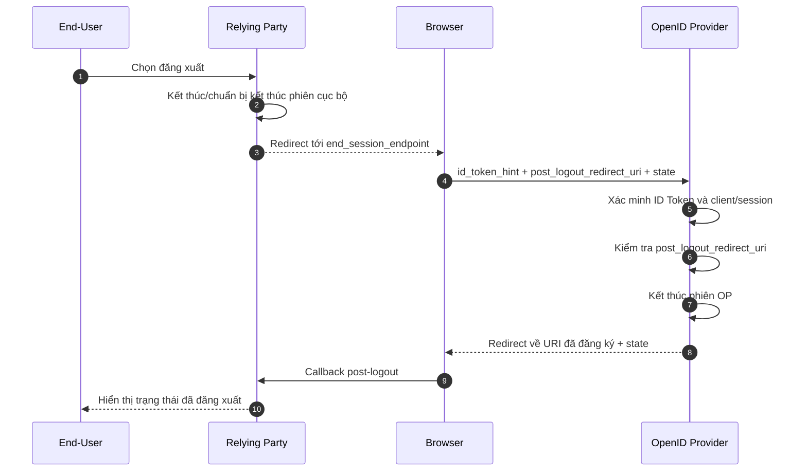
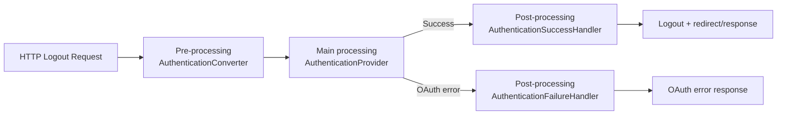

# OidcLogoutEndpointConfigurer và các điểm tùy chỉnh

OpenID Connect RP-Initiated Logout cho phép một Relying Party (RP) yêu cầu OpenID Provider (OP) kết thúc phiên đăng nhập của End-User tại OP. Khi người dùng chọn đăng xuất khỏi ứng dụng, RP điều hướng trình duyệt tới Logout Endpoint của OP; OP xác minh yêu cầu, tìm phiên tương ứng và thực hiện logout theo chính sách.

**`OidcLogoutEndpointConfigurer` là điểm cấu hình các extension points của RP-Initiated Logout Endpoint trong Spring Authorization Server.** Nó cho phép tùy biến cách đọc request, cách xác thực/xử lý yêu cầu và cách tạo response thành công hoặc lỗi. Cấu hình đúng giúp ứng dụng thêm quy tắc nghiệp vụ mà vẫn giữ các kiểm tra quan trọng như xác minh ID Token hint, xác thực `post_logout_redirect_uri` và quản lý phiên.

Bài học thuộc chương **OIDC Logout** của module **SPRING_SECURITY_OAUTH2_OIDC_AUTHORIZATION_SERVER**, tập trung vào thiết kế, cấu hình, bảo mật, kiểm thử và vận hành OAuth 2.0/OpenID Connect Authorization Server bằng Spring Security và Spring Authorization Server trong Spring Boot.

Sau bài học, bạn có thể:

- Giải thích RP-Initiated Logout và vai trò của `end_session_endpoint`.
- Hiểu request parameters `id_token_hint`, `client_id`, `post_logout_redirect_uri` và `state`.
- Bật và định tuyến OIDC Logout Endpoint bằng `OidcConfigurer.logoutEndpoint`.
- Phân biệt request converter, authentication provider, success handler và error handler.
- Tùy biến `OidcLogoutAuthenticationProvider` và validator mà vẫn giữ validation mặc định.
- Đăng ký post-logout redirect URI bằng `RegisteredClient.Builder.postLogoutRedirectUri`.
- Cấu hình `SessionRegistry`, `SessionRegistryImpl` và `HttpSessionEventPublisher`.
- Kiểm thử redirect allowlist, ID Token hint, session logout, error handling và các trường hợp tấn công.
- Phân biệt logout phiên OP với revocation access token/refresh token và logout ở các RP khác.

## 1. RP-Initiated Logout là gì?

OIDC RP-Initiated Logout 1.0 định nghĩa cách RP thông báo với OP rằng End-User đã đăng xuất khỏi RP và yêu cầu OP kết thúc phiên đăng nhập tương ứng. RP thường lấy Logout Endpoint từ metadata discovery ở trường `end_session_endpoint`.

Một luồng cơ bản:

1. Người dùng chọn Logout tại ứng dụng.
2. RP kết thúc phiên cục bộ hoặc chuẩn bị trạng thái logout theo thiết kế ứng dụng.
3. RP điều hướng User Agent tới `end_session_endpoint` của OP, thường kèm `id_token_hint`.
4. OP xác minh ID Token hint và xác định client/phiên liên quan.
5. OP kiểm tra `post_logout_redirect_uri` nếu có.
6. OP kết thúc phiên đăng nhập của End-User tại OP theo chính sách.
7. OP chuyển trình duyệt về post-logout URI đã đăng ký và trả lại `state` nếu request có gửi.



RP-Initiated Logout là một giao thức trình duyệt. Request được gửi qua User Agent; nó không phải API server-to-server để RP tự ý xóa phiên người dùng mà không có ngữ cảnh trình duyệt.

### 1.1. Logout endpoint và discovery

Khi OP hỗ trợ RP-Initiated Logout và Discovery, metadata OIDC công bố:

```json
{
  "issuer": "https://login.example.com",
  "authorization_endpoint": "https://login.example.com/oauth2/authorize",
  "token_endpoint": "https://login.example.com/oauth2/token",
  "end_session_endpoint": "https://login.example.com/connect/logout"
}
```

`end_session_endpoint` là URL mà RP điều hướng trình duyệt tới để yêu cầu OP logout. URL production phải dùng HTTPS. Client nên lấy URL từ metadata của issuer đã được cấu hình tin cậy, không tự dựng URL từ hostname nhận trong request hoặc ID Token chưa xác minh.

Trong Spring Authorization Server, endpoint path có thể được cấu hình qua `AuthorizationServerSettings.oidcLogoutEndpoint(...)`:

```java
@Bean
AuthorizationServerSettings authorizationServerSettings() {
    return AuthorizationServerSettings.builder()
        .issuer("https://login.example.com")
        .oidcLogoutEndpoint("/connect/logout")
        .build();
}
```

Path trong ví dụ là cấu hình của ứng dụng. Hãy kiểm tra OIDC Provider Configuration trả đúng `end_session_endpoint` sau khi deploy, đặc biệt khi server chạy sau reverse proxy hoặc có context path.

## 2. Các tham số của RP-Initiated Logout Request

OIDC RP-Initiated Logout định nghĩa một số request parameters. Không phải tất cả đều bắt buộc.

| Parameter | Mức độ | Vai trò |
| --- | --- | --- |
| `id_token_hint` | RECOMMENDED | ID Token OP đã phát trước đó cho RP, giúp OP nhận diện người dùng, client và phiên cần logout. |
| `logout_hint` | OPTIONAL | Hint riêng để OP nhận diện End-User; ý nghĩa do OP quyết định. |
| `client_id` | OPTIONAL | Client identifier; hữu ích khi không có ID Token hint hoặc khi cần xác định client. Nếu gửi cùng ID Token hint, OP phải kiểm tra client ID khớp client đã dùng khi phát hành token. |
| `post_logout_redirect_uri` | OPTIONAL | URI mà User Agent sẽ được chuyển tới sau logout. URI phải được đăng ký trước và khớp chính xác. |
| `state` | OPTIONAL | Giá trị opaque RP dùng tương quan request và callback sau logout; OP trả lại nguyên giá trị khi redirect. |
| `ui_locales` | OPTIONAL | Ngôn ngữ UI ưu tiên theo BCP 47. |

`id_token_hint` được khuyến nghị vì OP có thể xác định RP khởi tạo logout và phiên người dùng liên quan. ID Token hint không phải access token và không được gửi tới Token Revocation Endpoint.

OIDC RP-Initiated Logout còn quy định OP **SHOULD** hỏi End-User có muốn đăng xuất khỏi OP hay không. OP **MUST** hỏi khi request không có `id_token_hint` hoặc ID Token hint không thuộc phiên OP hiện tại với RP và/hoặc người dùng hiện đang đăng nhập. Nếu End-User đồng ý, OP **MUST** thực hiện logout. Đây là lớp bảo vệ quan trọng với request thiếu bằng chứng liên kết tới phiên, vì logout request không có hint có thể bị lợi dụng để gây denial of service.

Một request GET minh họa:

```http
GET /connect/logout?id_token_hint=<ID_TOKEN>&post_logout_redirect_uri=https%3A%2F%2Fportal.example.com%2Fsigned-out&state=<OPAQUE_STATE> HTTP/1.1
Host: login.example.com
```

OIDC RP-Initiated Logout yêu cầu OP hỗ trợ cả HTTP GET và POST tại Logout Endpoint. Với POST, tham số được gửi theo form serialization:

```http
POST /connect/logout HTTP/1.1
Host: login.example.com
Content-Type: application/x-www-form-urlencoded

id_token_hint=<ID_TOKEN>&post_logout_redirect_uri=https%3A%2F%2Fportal.example.com%2Fsigned-out&state=<OPAQUE_STATE>
```

GET thuận tiện cho redirect điều hướng trình duyệt, nhưng ID Token hint nằm trong query string có thể xuất hiện trong access logs, browser history, proxy logs hoặc telemetry. Hãy cấu hình che query parameters nhạy cảm và cân nhắc POST khi client hỗ trợ. Không ghi ID Token hint hoặc toàn bộ logout request vào log.

### 2.1. id_token_hint và kiểm tra danh tính

Khi `id_token_hint` có mặt, OP phải xác minh chính OP đã phát hành ID Token đó. OP nên chấp nhận ID Token khi RP được xác định qua `aud` và/hoặc `sid` có phiên hiện tại hoặc phiên gần đây, kể cả khi thời điểm `exp` đã qua, theo quy tắc RP-Initiated Logout.

Nếu `sid` không tương ứng phiên hiện tại hoặc gần đây của RP tại OP, OP nên xem request là đáng ngờ và có thể từ chối thực hiện. Điều này giúp ngăn kẻ tấn công sử dụng ID Token cũ hoặc token của người dùng khác để ép logout một phiên không liên quan.

Không coi việc client gửi một chuỗi có hình dạng JWT là bằng chứng hợp lệ. OP phải xác minh chữ ký, issuer, client/audience và quan hệ phiên theo implementation.

### 2.2. client_id và ID Token hint

Nếu request có cả `client_id` và `id_token_hint`, OP phải xác minh client identifier khớp client đã dùng khi phát hành ID Token.

`client_id` không thay thế việc xác minh ID Token. Nếu request chỉ có `client_id` mà không có ID Token hint, OP cần có cách khác đáng tin để xác nhận request và post-logout redirect target trước khi chuyển trình duyệt.

### 2.3. post_logout_redirect_uri và state

`post_logout_redirect_uri` chỉ được dùng sau khi logout hoàn tất và phải khớp chính xác một URI đã đăng ký cho RP. Không chấp nhận wildcard, prefix match, hostname suffix match hoặc URI do người dùng tự nhập.

Nếu có `post_logout_redirect_uri` nhưng không có `id_token_hint`, OP không được redirect về RP trừ khi có cơ chế khác xác nhận tính hợp lệ của đích redirect. Để đơn giản hóa chính sách, một deployment có thể yêu cầu ID Token hint mỗi khi có post-logout redirect.

`state` là dữ liệu opaque do RP tạo để tương quan callback. Nó không phải bằng chứng xác thực client và không thể thay thế redirect URI allowlist. RP nên tạo state ngẫu nhiên, dùng một lần, gắn với browser session và kiểm tra chính xác khi nhận callback.

Lưu ý về phiên bản: OIDC specification định nghĩa cả `logout_hint` và `ui_locales`, nhưng `OidcLogoutAuthenticationToken` trong Spring Authorization Server 1.5.8 không cung cấp getter cho hai tham số này. Không giả định converter mặc định giữ chúng trong authentication object; nếu ứng dụng cần sử dụng, hãy kiểm tra implementation phiên bản đang dùng và bổ sung converter/context có kiểm soát.

## 3. Bật OIDC Logout Endpoint trong Spring Authorization Server

OIDC bị tắt trong cấu hình OAuth Authorization Server tối thiểu. Để bật OIDC endpoints, ứng dụng gọi `oidc(...)` trên `OAuth2AuthorizationServerConfigurer`. Khi bật OIDC, Spring Authorization Server đăng ký thêm Provider Configuration, Logout và UserInfo endpoints.

Cấu hình rút gọn theo Spring Authorization Server 1.5.x:

```java
@Bean
@Order(1)
SecurityFilterChain authorizationServerSecurityFilterChain(
        HttpSecurity http) throws Exception {

    OAuth2AuthorizationServerConfigurer authorizationServerConfigurer =
        OAuth2AuthorizationServerConfigurer.authorizationServer();

    http
        .securityMatcher(authorizationServerConfigurer.getEndpointsMatcher())
        .with(authorizationServerConfigurer, authorizationServer ->
            authorizationServer
                .oidc(oidc -> oidc
                    .logoutEndpoint(Customizer.withDefaults())
                )
        );

    return http.build();
}
```

Đây là phần bật OIDC Logout Endpoint. Ứng dụng thực tế vẫn cần các bean nền tảng của Authorization Server, login filter chain, `RegisteredClientRepository`, `OAuth2AuthorizationService`, signing keys và các cấu hình OIDC khác. Nếu đã có Authorization Server filter chain, hãy thêm `logoutEndpoint(...)` vào configurer hiện hữu thay vì tạo chain thứ hai có matcher trùng.


### 3.1. Khác biệt package theo phiên bản

Các ví dụ Java trong bài dùng package của **Spring Authorization Server 1.5.x**. Từ **Spring Security 7.0**, Authorization Server APIs được tích hợp và package configurer được chuyển sang namespace Spring Security. Ví dụ:

```java
// Spring Authorization Server 1.5.x
import org.springframework.security.oauth2.server.authorization.config.annotation.web.configurers.OAuth2AuthorizationServerConfigurer;

// Spring Security 7.x
import org.springframework.security.config.annotation.web.configurers.oauth2.server.authorization.OAuth2AuthorizationServerConfigurer;
```

Các extension points vẫn theo cùng mô hình converter/provider/handler, nhưng hãy dùng import và DSL tương ứng với BOM/dependency thực tế. Không trộn class từ hai package hoặc copy ví dụ giữa hai major version mà không kiểm tra API docs.


`OidcLogoutEndpointConfigurer` cấu hình `OidcLogoutEndpointFilter` và đăng ký filter đó vào Authorization Server `SecurityFilterChain`. Filter mặc định có:

- `OidcLogoutAuthenticationConverter` để chuyển HTTP request thành `OidcLogoutAuthenticationToken`.
- `AuthenticationManager` chứa `OidcLogoutAuthenticationProvider`.
- `OidcLogoutAuthenticationSuccessHandler` để xử lý logout thành công.
- Failure handler nội bộ trả OAuth error response khi xử lý phát sinh `OAuth2AuthenticationException`.

Khi chỉ cần hành vi chuẩn, giữ các converter, provider và handlers mặc định. Chỉ thêm customizer khi có một yêu cầu cụ thể cần thay đổi.

## 4. Bản đồ các extension points của OidcLogoutEndpointConfigurer

`OidcLogoutEndpointConfigurer` cung cấp các extension points theo ba giai đoạn xử lý:



| API | Vai trò | Khi nào tùy biến |
| --- | --- | --- |
| `logoutRequestConverter(...)` | Thêm converter xử lý request trước khi xác thực. | Khi cần hỗ trợ một định dạng request mở rộng. |
| `logoutRequestConverters(...)` | Truy cập danh sách converter mặc định và converter bổ sung để thêm/xóa/sắp xếp. | Khi cần điều chỉnh thứ tự hoặc thay một converter cụ thể. |
| `authenticationProvider(...)` | Thêm provider xử lý `OidcLogoutAuthenticationToken`. | Khi có logic authentication/logout riêng. |
| `authenticationProviders(...)` | Truy cập danh sách provider mặc định để thêm/xóa/tùy chỉnh. | Khi cần đặt validator cho provider mặc định hoặc thay provider theo policy. |
| `logoutResponseHandler(...)` | Xử lý authentication thành công và thực hiện logout/response. | Khi cần audit, response page hoặc redirect flow tùy chỉnh. |
| `errorResponseHandler(...)` | Xử lý `OAuth2AuthenticationException` và tạo error response. | Khi cần trang lỗi/telemetry theo chuẩn response của ứng dụng. |

**Điểm cần nhớ:** converter, provider và handler không thay thế nhau.

- Converter chỉ đọc và chuyển đổi request.
- Provider kiểm tra request và tạo kết quả authentication.
- Success handler thực hiện hành động sau khi provider xác thực thành công.
- Error handler định dạng lỗi sau khi xử lý thất bại.

Thay success handler không tự thêm kiểm tra ID Token. Thay converter không tự xác minh redirect URI. Mọi lớp đều phải giữ hợp đồng protocol và không bỏ các kiểm tra bảo mật.

## 5. logoutRequestConverter và logoutRequestConverters

### 5.1. Converter mặc định

`OidcLogoutAuthenticationConverter` đọc các tham số Logout Request và tạo `OidcLogoutAuthenticationToken` chứa thông tin như:

- ID Token hint;
- principal/End-User context;
- session identifier nếu có;
- client ID;
- post-logout redirect URI;
- state.

Token này được đưa tới AuthenticationManager để provider xử lý. Không nên tự tạo một `OidcLogoutAuthenticationToken` đã authenticated từ dữ liệu HTTP thô.

### 5.2. Thêm converter

Có thể thêm converter qua `logoutRequestConverter(...)`:

```java
http.with(authorizationServerConfigurer, authorizationServer ->
    authorizationServer.oidc(oidc ->
        oidc.logoutEndpoint(logout ->
            logout.logoutRequestConverter(customLogoutRequestConverter)
        )
    )
);
```

Hoặc truy cập danh sách mặc định:

```java
.logoutRequestConverters(converters -> {
    // Giữ OidcLogoutAuthenticationConverter mặc định.
    // Chỉ thêm converter khi có một extension request đã định nghĩa.
    converters.add(0, customLogoutRequestConverter);
})
```

Converter tùy chỉnh nên trả `null` nếu request không thuộc định dạng mà nó xử lý, để converter mặc định tiếp tục xử lý. Nếu converter nhận diện request mở rộng, nó phải kiểm tra cấu trúc và chuyển đổi thành authentication request đúng contract.

Không xóa converter mặc định chỉ để thêm một query parameter. Khi thay converter, phải tự bảo đảm các tham số OIDC chuẩn vẫn được parse và không thể bypass validation.

### 5.3. Những lỗi khi viết converter

- Tạo token authenticated trước khi provider xác minh.
- Bỏ qua duplicate parameters hoặc nhận nhiều giá trị cho một tham số đơn.
- Chấp nhận `post_logout_redirect_uri` tùy ý từ query string.
- Lấy client ID từ một header do browser gửi nhưng không liên kết với ID Token hint.
- Đọc ID Token hint và tự coi payload đã decode là đáng tin mà không xác minh chữ ký.
- Thay đổi `state` trước khi trả lại cho RP.

Converter là điểm parse request; nó không phải nơi quyết định một redirect URI có được phép hay không.

## 6. authenticationProvider và authenticationProviders

### 6.1. Provider mặc định

`OidcLogoutAuthenticationProvider` xử lý `OidcLogoutAuthenticationToken`. Constructor của provider nhận các thành phần:

- `RegisteredClientRepository` để truy vấn client registration.
- `OAuth2AuthorizationService` để tìm authorization/ID Token đã phát hành.
- `SessionRegistry` để tra session information của End-User.

Provider mặc định xử lý authentication và validation của RP-Initiated Logout. Khi request hợp lệ, kết quả authentication được chuyển cho success handler để thực hiện logout.

Không thay provider mặc định chỉ để thêm audit. Audit thường phù hợp hơn ở success/error handler hoặc một event listener sau khi xác thực thành công.

### 6.2. Thêm provider

`authenticationProvider(...)` thêm provider vào AuthenticationManager. `authenticationProviders(...)` cho phép thao tác trên danh sách provider mặc định:

```java
.authenticationProviders(providers -> {
    // Có thể thêm provider mở rộng hoặc cấu hình provider mặc định.
    // Giữ OidcLogoutAuthenticationProvider nếu vẫn dùng xử lý chuẩn.
})
```

Nếu thêm provider, phải xác định rõ provider nào hỗ trợ loại `Authentication` nào, thứ tự provider và cách fallback khi provider trả `null`. Hai provider cùng nhận một authentication type có thể tạo ra hành vi khó dự đoán nếu không kiểm soát thứ tự.

### 6.3. Khi nào cần custom provider?

Custom provider phù hợp khi ứng dụng có quy trình logout riêng, chẳng hạn:

- Logout cần kiểm tra trạng thái tenant hoặc account trước khi kết thúc session.
- Có hệ thống session store bên ngoài.
- Cần tích hợp policy step-up hoặc xác nhận người dùng.
- Có logic bổ sung cho ID Token/session binding ngoài default validation.

Tuy nhiên, provider tùy chỉnh phải tiếp tục kiểm tra ID Token hint, client/audience, session association và redirect URI. Không chấp nhận logout chỉ vì request có `client_id` hợp lệ hoặc biết username của người dùng.

## 7. Tùy biến OidcLogoutAuthenticationProvider validator

Spring Authorization Server cung cấp `OidcLogoutAuthenticationProvider.setAuthenticationValidator(...)` để thay đổi validation của các request parameters. API này có từ Spring Authorization Server 1.4.

Validator nhận `OidcLogoutAuthenticationContext`, trong đó có:

- `getAuthentication()` trả `OidcLogoutAuthenticationToken`.
- `getRegisteredClient()` trả client registration đã xác định.
- Các context attributes khác tùy quá trình xử lý.

Validator phải ném `OAuth2AuthenticationException` nếu validation thất bại.

### 7.1. Validator mặc định kiểm tra điều gì?

`OidcLogoutAuthenticationValidator` là validator mặc định. Nó xác minh `post_logout_redirect_uri` của request theo danh sách URI đã đăng ký cho client. Nếu không hợp lệ, validator ném `OAuth2AuthenticationException`.

Điều này rất quan trọng vì redirect URI là đầu vào do browser/client cung cấp. Nếu server redirect tới URI tùy ý, attacker có thể lợi dụng endpoint để tạo open redirect, đưa người dùng tới trang giả mạo hoặc chuyển tiếp thông tin trong callback.

### 7.2. Mở rộng validator nhưng giữ validation mặc định

Khi thay validator, không nên vô tình bỏ kiểm tra mặc định. Có thể gọi `OidcLogoutAuthenticationValidator` trước rồi áp dụng quy tắc bổ sung:

```java
private Consumer<List<AuthenticationProvider>> configureLogoutValidator() {
    return providers -> providers.forEach(provider -> {
        if (provider instanceof OidcLogoutAuthenticationProvider logoutProvider) {
            logoutProvider.setAuthenticationValidator(context -> {
                // Chạy kiểm tra post_logout_redirect_uri mặc định trước.
                new OidcLogoutAuthenticationValidator().accept(context);

                OidcLogoutAuthenticationToken request =
                    context.getAuthentication();

                // Policy triển khai này yêu cầu ID Token hint
                // nếu client muốn redirect sau logout.
                if (request.getPostLogoutRedirectUri() != null
                        && request.getIdTokenHint() == null) {
                    throw new OAuth2AuthenticationException(
                        new OAuth2Error(
                            OAuth2ErrorCodes.INVALID_REQUEST,
                            "id_token_hint is required for post-logout redirect",
                            null
                        )
                    );
                }
            });
        }
    });
}
```

Cấu hình validator:

```java
@Bean
@Order(1)
SecurityFilterChain authorizationServerSecurityFilterChain(
        HttpSecurity http) throws Exception {

    OAuth2AuthorizationServerConfigurer authorizationServerConfigurer =
        OAuth2AuthorizationServerConfigurer.authorizationServer();

    http
        .securityMatcher(authorizationServerConfigurer.getEndpointsMatcher())
        .with(authorizationServerConfigurer, authorizationServer ->
            authorizationServer.oidc(oidc ->
                oidc.logoutEndpoint(logout ->
                    logout.authenticationProviders(configureLogoutValidator())
                )
            )
        );

    return http.build();
}
```

Ví dụ là policy nghiêm ngặt của deployment: nếu muốn redirect về RP thì bắt buộc phải có ID Token hint. Đây là một lựa chọn chặt hơn khả năng giao thức cho phép; OP có thể dùng cơ chế khác để xác nhận tính hợp lệ của post-logout redirect target khi không có hint.

Nếu custom validator thay thế validator mặc định mà không gọi lại nó, ứng dụng phải tự triển khai đầy đủ kiểm tra redirect URI và các quy tắc cần thiết khác. Không để một validator tùy chỉnh làm mất allowlist đã có.

### 7.3. RegisteredClient và post_logout_redirect_uri

Đăng ký post-logout redirect URI trên client:

```java
RegisteredClient portal = RegisteredClient.withId("portal-internal-id")
    .clientId("customer-portal")
    .clientSecret("{bcrypt}...")
    .clientAuthenticationMethod(
        ClientAuthenticationMethod.CLIENT_SECRET_BASIC)
    .authorizationGrantType(AuthorizationGrantType.AUTHORIZATION_CODE)
    .redirectUri(
        "https://portal.example.com/login/oauth2/code/portal")
    .postLogoutRedirectUri(
        "https://portal.example.com/signed-out")
    .scope("openid")
    .build();
```

`postLogoutRedirectUri(...)` thêm URI vào danh sách `RegisteredClient.getPostLogoutRedirectUris()`. Một client có thể đăng ký nhiều post-logout redirect URIs.

Quy tắc so khớp phải chính xác. Các URI sau không được xem là tương đương nếu chỉ một URI đã đăng ký:

- `https://portal.example.com/signed-out`
- `https://portal.example.com/signed-out/`
- `https://portal.example.com/signed-out?next=/home`
- `https://portal.example.com.attacker.example/signed-out`

Không dùng prefix hoặc wildcard matching. Nếu có nhiều môi trường, đăng ký từng URI rõ ràng cho từng client/environment.

### 7.4. Validation lỗi

Nếu validation thất bại, validator phải ném `OAuth2AuthenticationException` với `OAuth2Error` phù hợp. Không chỉ log cảnh báo rồi tiếp tục logout/redirect. Nếu request không hợp lệ, OP không được thực hiện post-logout redirect tới URI đó.

Không đưa thông tin nội bộ như danh sách redirect URI đầy đủ, session ID hoặc nội dung ID Token vào error response.

## 8. logoutResponseHandler — xử lý logout thành công

`logoutResponseHandler(...)` nhận một `AuthenticationSuccessHandler`. Handler này xử lý `OidcLogoutAuthenticationToken` đã được xác thực và thực hiện logout/response cho RP-Initiated Logout.

Mặc định Spring Authorization Server sử dụng `OidcLogoutAuthenticationSuccessHandler`. Khi không cần hành vi riêng, nên giữ handler mặc định để tiếp tục thực hiện luồng logout chuẩn.

Các lý do hợp lý để tùy biến:

- Ghi audit event đã logout.
- Tạo trang logout hoàn tất theo giao diện OP.
- Bổ sung correlation ID hoặc telemetry.
- Điều phối một bước hậu xử lý nội bộ sau khi session đã được xác thực.

### 8.1. Bọc success handler mặc định để ghi audit

Nếu chỉ cần audit, có thể bọc handler mặc định và delegate việc logout cho nó:

```java
@Bean
AuthenticationSuccessHandler auditedOidcLogoutSuccessHandler(
        LogoutAuditService auditService) {

    AuthenticationSuccessHandler delegate =
        new OidcLogoutAuthenticationSuccessHandler();

    return (request, response, authentication) -> {
        OidcLogoutAuthenticationToken logout =
            (OidcLogoutAuthenticationToken) authentication;

        // Delegate logout và response trước; chỉ audit khi handler thành công.
        delegate.onAuthenticationSuccess(
            request, response, authentication
        );

        // Không ghi ID Token hint hoặc credential vào audit log.
        auditService.recordLogout(
            logout.getClientId(),
            logout.getSessionId()
        );
    };
}
```

Sau đó gắn handler vào configurer:

```java
.logoutEndpoint(logout ->
    logout.logoutResponseHandler(auditedOidcLogoutSuccessHandler)
)
```

Đây là ví dụ cấu trúc. `LogoutAuditService` là service do ứng dụng định nghĩa. Cần tránh ghi ID Token hint, access token, refresh token hoặc dữ liệu nhận diện nhạy cảm vào audit log. Nếu session ID được lưu, hãy áp dụng retention và access control phù hợp.

Ví dụ gọi delegate trước để chỉ ghi nhận khi handler mặc định hoàn tất. Nếu audit bắt buộc phải bền vững và đồng bộ với thay đổi session, cần thiết kế transaction/outbox ở lớp quản lý session; một success-handler wrapper không tự tạo ra transaction nguyên tử giữa session store và audit store.

### 8.2. Khi thay hoàn toàn success handler

Nếu thay handler mặc định, ứng dụng chịu trách nhiệm giữ các hành vi cần thiết:

- Kết thúc đúng OP session đã xác định.
- Không kết thúc phiên của End-User khác.
- Chỉ redirect tới URI đã được xác minh.
- Trả lại `state` nguyên vẹn nếu request có state và redirect hợp lệ.
- Xử lý trường hợp không có post-logout redirect.
- Không để lỗi ở trang đích biến thành open redirect hoặc bỏ qua logout đã hoàn tất.

Không tự dựng redirect bằng cách nối chuỗi query parameter từ request. Dùng URI đã được provider xác minh và encode đúng cách.

## 9. errorResponseHandler — xử lý lỗi

`errorResponseHandler(...)` nhận `AuthenticationFailureHandler` và xử lý `OAuth2AuthenticationException`. Mặc định filter trả OAuth error response dựa trên `OAuth2Error` của exception.

Có thể tùy biến để:

- Ghi metrics theo error code.
- Gắn correlation ID.
- Trả trang lỗi thân thiện khi request là browser navigation.
- Chuẩn hóa error handling giữa các OIDC endpoints.

Không trả stack trace, token, session ID, client secret hoặc chi tiết nội bộ về ID Token validation. Không redirect về `post_logout_redirect_uri` nếu validation của request thất bại.

Nếu chỉ cần ghi audit, nên bọc failure handler mặc định để giữ response contract. API constructor của failure handler có thể khác giữa các phiên bản; nếu không cần thay đổi response, giữ handler mặc định bằng cách không gọi `errorResponseHandler(...)`.

## 10. SessionRegistry và quản lý phiên OP

OIDC Logout không chỉ kiểm tra request parameters; OP còn phải xác định phiên người dùng cần kết thúc. Spring Authorization Server sử dụng `SessionRegistry` để theo dõi các phiên đã xác thực.

Khi OIDC được bật:

- `SessionRegistry` được dùng bởi `SessionAuthenticationStrategy` mặc định của Authorization Endpoint để đăng ký phiên người dùng.
- `OidcLogoutAuthenticationProvider` dùng `SessionRegistry` để tìm `SessionInformation` liên quan đến End-User yêu cầu logout.
- Nếu ứng dụng không khai báo `SessionRegistry` bean, implementation mặc định `SessionRegistryImpl` được sử dụng.

Điều này có nghĩa SessionRegistry được dùng khi login và logout cần nhất quán. Nếu ứng dụng thay SessionRegistry hoặc dùng concurrent session control, hãy bảo đảm các thành phần cùng chia sẻ registry thích hợp.

### 10.1. Đăng ký SessionRegistryImpl và HttpSessionEventPublisher

Ví dụ:

```java
@Bean
SessionRegistry sessionRegistry() {
    return new SessionRegistryImpl();
}

@Bean
HttpSessionEventPublisher httpSessionEventPublisher() {
    return new HttpSessionEventPublisher();
}
```

`HttpSessionEventPublisher` chuyển các sự kiện vòng đời HTTP session, ví dụ session destroyed, tới `SessionRegistryImpl` để loại bỏ session information đã hết vòng đời. Khi đăng ký `SessionRegistryImpl` bean, Spring khuyến nghị đăng ký `HttpSessionEventPublisher`.

Các import:

```java
import org.springframework.context.annotation.Bean;
import org.springframework.security.core.session.SessionRegistry;
import org.springframework.security.core.session.SessionRegistryImpl;
import org.springframework.security.web.session.HttpSessionEventPublisher;
```

Nếu dùng Spring Security Concurrent Session Control, nên dùng chung một `SessionRegistry` cho tính năng đó và OIDC Logout.

### 10.2. SessionRegistry trong môi trường nhiều instance

`SessionRegistryImpl` lưu trạng thái trong bộ nhớ của một instance. Với hệ thống nhiều node:

- Người dùng có thể đăng nhập ở node A nhưng logout request tới node B.
- Node B không tìm thấy session information nếu registry chỉ tồn tại cục bộ.
- Logout có thể không tác động tới phiên ở node khác hoặc kết quả không nhất quán.

Các lựa chọn:

1. Dùng sticky session để giảm khả năng request đi sang node khác; đây chỉ là giải pháp định tuyến, không thay thế shared session state nếu cần failover.
2. Triển khai `SessionRegistry` dùng kho dữ liệu dùng chung.
3. Kết hợp Spring Session/distributed HTTP session với một registry có thể truy vấn session nhất quán.
4. Đảm bảo session creation, refresh, expiration và removal được đồng bộ giữa các instance.

Không giả định việc chuyển HTTP session sang Redis tự động làm `SessionRegistryImpl` trở thành distributed. Registry cũng phải được chia sẻ hoặc được triển khai phù hợp.

### 10.3. Principal equality và session identity

`SessionRegistry` liên kết principal với session ID. Principal cần có `equals`/`hashCode` ổn định nếu registry dùng object identity/equality để tra cứu. Nếu mỗi request tạo một principal object khác nhau mà equality không ổn định, session lookup có thể sai.

Không dùng email hoặc username không duy nhất làm khóa phiên nếu ứng dụng hỗ trợ nhiều tenant/realm. Cần xác định principal identity theo đúng subject/realm của OP.

## 11. Phân biệt logout OP, logout RP và token revocation

Các hành động thường bị gọi chung là “logout” nhưng có tác động khác nhau:

| Hành động | Thành phần bị tác động | Tự động thu hồi access token? |
| --- | --- | --- |
| RP local logout | Session/cookie của một ứng dụng RP. | Không. |
| OP RP-Initiated Logout | Phiên đăng nhập của End-User tại OP. | Không mặc định. |
| RP-Initiated Logout ở OP | Yêu cầu OP kết thúc phiên tương ứng với RP. | Không mặc định thu hồi mọi access/refresh token. |
| OAuth Token Revocation | Token được gửi tới Revocation Endpoint và token liên quan theo policy. | Có, theo semantics revocation của AS. |
| OIDC Back-Channel Logout | OP gửi Logout Token trực tiếp tới RP để RP kết thúc session liên quan. | Không tự thu hồi token tại AS. |
| OIDC Front-Channel Logout | OP điều hướng/nhúng browser tới logout URI của RP theo cơ chế front-channel. | Không tự thu hồi token tại AS. |

RP-Initiated Logout kết thúc session đăng nhập tại OP. Một JWT access token đã phát hành có thể tiếp tục được Resource Server chấp nhận đến `exp` nếu Resource Server chỉ xác minh chữ ký và claims offline.

Nếu sản phẩm yêu cầu logout phải làm access token mất hiệu lực gần như ngay lập tức, cần thêm chính sách:

- Thu hồi refresh token và token liên quan qua Revocation Endpoint.
- Dùng opaque token và introspection hoặc kiểm tra trạng thái tập trung.
- Dùng denylist/authorization version hoặc event-driven invalidation cho JWT.
- Giới hạn TTL access token.
- Đồng bộ session/token state theo SLA.

Không tuyên bố “đã logout khỏi OP” đồng nghĩa “mọi token của user trên mọi API đã bị thu hồi”.

## 12. Kết hợp RP-Initiated Logout ở client với OP

Ở phía RP dùng Spring Security OAuth2 Client, `OidcClientInitiatedLogoutSuccessHandler` là success handler tương ứng để khởi tạo RP-Initiated Logout.

Một cấu hình khái niệm:

```java
@Bean
SecurityFilterChain clientSecurityFilterChain(
        HttpSecurity http,
        ClientRegistrationRepository clientRegistrationRepository)
        throws Exception {

    OidcClientInitiatedLogoutSuccessHandler logoutSuccessHandler =
        new OidcClientInitiatedLogoutSuccessHandler(
            clientRegistrationRepository);

    logoutSuccessHandler.setPostLogoutRedirectUri(
        "{baseUrl}/");

    http
        .authorizeHttpRequests(authorize ->
            authorize.anyRequest().authenticated())
        .oauth2Login(Customizer.withDefaults())
        .logout(logout ->
            logout.logoutSuccessHandler(logoutSuccessHandler));

    return http.build();
}
```

Đây là cấu hình ở **RP/client application**, không phải Authorization Server. Nó minh họa cách client chuyển User Agent tới OP sau khi local logout được kích hoạt.

Client cần giữ ID Token đã nhận trong OIDC authentication để handler có thể gửi `id_token_hint`. URI callback sau logout phải nằm trong danh sách `postLogoutRedirectUris` đã đăng ký tại OP.

Nếu RP dùng custom logout endpoint, phải bảo đảm local session được kết thúc và callback state được kiểm tra. Không chỉ xóa cookie trình duyệt mà bỏ qua server-side session store.

## 13. Lỗi thường gặp và cách xử lý

### 13.1. Không tìm thấy end_session_endpoint

Kiểm tra OIDC đã bật qua `.oidc(...)`, Provider Configuration endpoint có được phục vụ, issuer/metadata URL đúng và `AuthorizationServerSettings.oidcLogoutEndpoint` đã cấu hình đúng chưa.

### 13.2. post_logout_redirect_uri không được chấp nhận

Kiểm tra URI có được đăng ký bằng `RegisteredClient.postLogoutRedirectUri(...)` không. So sánh chính xác scheme, host, port, path, query và trailing slash. Không dùng redirect URI của Authorization Code flow thay cho post-logout redirect URI.

### 13.3. Logout thành công nhưng không redirect về RP

Có thể request không gửi `post_logout_redirect_uri`, ID Token hint không được xác minh, URI không được đăng ký, validator từ chối hoặc custom success handler không delegate tới handler mặc định.

Không tự redirect bằng giá trị raw trong request để khắc phục lỗi.

### 13.4. Logout request không có id_token_hint

OIDC cho phép một số trường hợp không gửi hint, nhưng OP phải có cách khác xác nhận request/redirect target và cần xem xét yêu cầu xác nhận người dùng. Deployment có thể đặt policy nghiêm ngặt yêu cầu ID Token hint khi có post-logout redirect.

### 13.5. ID Token hint hết hạn

OIDC RP-Initiated Logout cho phép OP nên chấp nhận ID Token khi RP/session còn hiện tại hoặc gần đây, kể cả `exp` đã qua. Không áp dụng một quy tắc “token hết hạn là luôn từ chối” máy móc cho logout hint. Hãy kiểm tra hành vi của phiên bản SAS, authorization/session store và policy gần đây của OP.

### 13.6. SessionRegistry không tìm thấy session

Kiểm tra Authorization Endpoint có đăng ký session hay không, logout provider có dùng cùng registry bean, session ID còn tồn tại và principal equality có ổn định không. Với cluster, kiểm tra registry có dùng chung state hay không.

### 13.7. Logout trên một node nhưng node khác vẫn xem user đăng nhập

Kiểm tra sticky session, distributed session store, shared SessionRegistry, session event publishing và cache. Một SessionRegistry in-memory riêng mỗi node không đủ cho logout nhất quán trong cluster.

### 13.8. Custom validator vô tình bỏ redirect validation mặc định

Nếu gọi `setAuthenticationValidator` bằng validator mới mà không delegate tới `OidcLogoutAuthenticationValidator`, logic mặc định có thể bị thay thế. Hãy gọi default validator trước hoặc tự triển khai đầy đủ exact-match allowlist.

### 13.9. Thay success handler khiến logout không thực sự xảy ra

Custom handler chỉ trả redirect có thể bỏ qua logout logic mặc định. Hãy delegate tới `OidcLogoutAuthenticationSuccessHandler` hoặc tự triển khai đầy đủ việc kết thúc phiên, kiểm soát redirect và state.

### 13.10. OP logout nhưng API vẫn chấp nhận JWT access token

Đây là hành vi có thể xảy ra nếu Resource Server xác minh JWT offline. Logout session và revocation token là hai cơ chế riêng. Cần introspection, denylist, token version hoặc TTL ngắn nếu yêu cầu thu hồi nhanh.

### 13.11. Browser bị chuyển tới website giả mạo

Đây là dấu hiệu open redirect. Kiểm tra post-logout URI validation, wildcard/prefix matching, proxy rewriting và custom success handler. Chỉ redirect tới URI đã đăng ký chính xác.

## 14. Ma trận kiểm thử OIDC Logout

| Kịch bản | Kết quả mong đợi |
| --- | --- |
| GET logout với ID Token hint hợp lệ và redirect URI đã đăng ký | OP xác minh request, kết thúc phiên và redirect đúng URI. |
| POST logout với form parameters hợp lệ | Xử lý tương đương GET theo giao thức. |
| ID Token hint do OP khác phát hành | Từ chối hoặc không thực hiện logout theo policy; không redirect. |
| ID Token hint có audience/client không khớp request | Request bị xem là không hợp lệ. |
| client_id khớp ID Token hint | Có thể tiếp tục validation. |
| client_id khác client trong ID Token hint | Từ chối request. |
| post_logout_redirect_uri khớp chính xác allowlist | Được phép redirect sau logout. |
| post_logout_redirect_uri khác một ký tự | Bị từ chối; không redirect. |
| URI có hostname suffix attacker | Bị từ chối. |
| URI dùng HTTP khi policy chỉ cho HTTPS | Bị từ chối theo policy. |
| post_logout_redirect_uri có nhưng không có id_token_hint và không có cơ chế xác minh khác | Không redirect. |
| state được gửi | OP trả lại nguyên giá trị khi redirect hợp lệ. |
| state bị thiếu | Logout vẫn xử lý theo policy; không tự tạo state giả. |
| ID Token hint hết hạn nhưng session gần đây còn được xác nhận | Xử lý theo RP-Initiated Logout policy; không từ chối máy móc chỉ vì exp. |
| sid không thuộc session hiện tại/gần đây | Request bị xem là đáng ngờ; không logout nhầm session. |
| Không có post_logout_redirect_uri | OP hoàn tất logout và hiển thị trang phù hợp. |
| SessionRegistry có session tương ứng | Provider tìm thấy session và thực hiện logout. |
| SessionRegistry không có session | Không logout nhầm một session khác; xử lý theo protocol/policy. |
| Hai node chia sẻ SessionRegistry | Logout được phản ánh trên node nhận request. |
| SessionRegistryImpl có HttpSessionEventPublisher | Session lifecycle được dọn khỏi registry. |
| Custom validator chạy | Default redirect validation vẫn được thực thi trước policy bổ sung. |
| Custom success handler | Logout logic mặc định vẫn chạy nếu handler delegate. |
| Custom error handler | Error response không lộ token/session/stack trace. |
| User logout OP nhưng access JWT còn hạn | Resource Server offline có thể tiếp tục chấp nhận theo TTL; test xác nhận token policy. |
| Client dùng ID Token thay access token tại revocation endpoint | Không coi đó là thao tác revocation hợp lệ. |

### 14.1. Integration test với MockMvc

Có thể kiểm tra endpoint và validation qua filter chain thật:

```java
@SpringBootTest
@AutoConfigureMockMvc
class OidcLogoutEndpointTests {

    @Autowired
    MockMvc mockMvc;

    @Test
    void rejectsUnregisteredPostLogoutRedirectUri() throws Exception {
        mockMvc.perform(get("/connect/logout")
                .param("id_token_hint", "<VALID_TEST_ID_TOKEN>")
                .param(
                    "post_logout_redirect_uri",
                    "https://attacker.example/return"))
            .andExpect(status().is4xxClientError());
    }
}
```

Đây là skeleton minh họa. Test thực tế cần fixture ID Token hợp lệ được ký bởi test issuer, session registry và registered client có post-logout URI đã biết. Response status/error cụ thể phụ thuộc handler và cách filter chain xử lý; ngoài status, hãy assert rằng response không redirect tới attacker URI và session không bị logout ngoài ý muốn.

### 14.2. Test session registry

- Đăng nhập End-User qua Authorization Endpoint.
- Xác nhận session được đăng ký trong đúng `SessionRegistry`.
- Gửi RP-Initiated Logout với ID Token hint tương ứng.
- Xác nhận session information được đánh dấu/kết thúc theo hành vi logout.
- Gửi request tiếp theo dùng session cũ và xác nhận không còn được xem là authenticated.
- Lặp lại trên node khác trong cluster để xác nhận shared registry hoạt động.

### 14.3. Test không revoke token ngoài ý muốn

Sau logout, gọi Resource Server bằng access token còn hạn. Kết quả phải khớp token policy của hệ thống:

- Nếu API xác minh JWT offline, token có thể còn hiệu lực đến `exp`.
- Nếu hệ thống có revocation/introspection hoặc denylist, token bị từ chối sau khi trạng thái đã lan truyền.
- Refresh token cần được xử lý theo chính sách revocation riêng.

Test này giúp phân biệt logout session với token revocation.

## 15. Vận hành và quan sát

Một hệ thống logout production cần quan sát cả protocol flow lẫn session store.

| Metric/event | Mục đích |
| --- | --- |
| Logout request count | Theo dõi số request logout theo thời gian. |
| Logout success/failure | Phát hiện lỗi validation hoặc session store. |
| Invalid post-logout URI | Phát hiện client configuration drift hoặc open-redirect probing. |
| Invalid ID Token hint | Phát hiện issuer/client mismatch hoặc request đáng ngờ. |
| SessionRegistry lookup miss | Phát hiện session registration/cluster consistency issues. |
| Redirect completion | Theo dõi client có nhận callback sau logout hay không. |
| Session cleanup delay | Phát hiện session event publisher hoặc distributed store lỗi. |
| Token still active after logout | Kiểm tra kỳ vọng về token revocation và Resource Server cache. |

Không log raw ID Token hint, access token, refresh token hoặc toàn bộ query string của logout request. Nếu cần correlation, dùng request ID và metadata đã được chuẩn hóa, chẳng hạn client ID và kết quả validation; session ID cần được xử lý như dữ liệu nhạy cảm.

### 15.1. Reverse proxy và issuer

Nếu Authorization Server chạy sau reverse proxy:

- Discovery metadata phải công bố đúng HTTPS `end_session_endpoint`.
- Backend phải tin forwarded headers chỉ từ proxy được kiểm soát.
- Không cho client tự đặt `Host` hoặc `X-Forwarded-Host` để thay đổi URL redirect.
- Cookie OP session cần `Secure`, `HttpOnly` và SameSite phù hợp với OIDC browser flow.
- Kiểm tra GET/POST logout không bị proxy cache hoặc WAF thay đổi query/form parameters.

### 15.2. Cache và session lifecycle

Session logout có thể không được mọi node quan sát ngay nếu registry hoặc session store bị phân mảnh. Xác định SLA cho logout propagation, event delivery, cache invalidation và xử lý khi session store không khả dụng.

Không xem một response redirect thành công là bằng chứng tất cả RP khác hoặc tất cả Resource Server đã kết thúc session/token. Đó là các luồng logout/revocation riêng.

## 16. Checklist triển khai

- [ ] OIDC được bật trong Authorization Server configurer.
- [ ] Discovery metadata công bố `end_session_endpoint` chính xác và dùng HTTPS.
- [ ] `AuthorizationServerSettings.oidcLogoutEndpoint(...)` khớp endpoint thực tế.
- [ ] RP gửi `id_token_hint` phù hợp với phiên đăng nhập và client.
- [ ] OP xác minh ID Token hint do chính OP phát hành và client/session association.
- [ ] Nếu có cả `client_id` và `id_token_hint`, hai giá trị được đối chiếu.
- [ ] `post_logout_redirect_uri` được đăng ký trong `RegisteredClient.postLogoutRedirectUri(...)`.
- [ ] Redirect URI được so khớp chính xác; không dùng wildcard/prefix matching.
- [ ] Không redirect nếu target chưa được xác minh theo OIDC policy.
- [ ] `state` opaque được trả lại nguyên vẹn và RP xác minh khi nhận callback.
- [ ] Default `OidcLogoutAuthenticationValidator` được giữ lại hoặc được thay thế bằng logic tương đương.
- [ ] Custom validator ném `OAuth2AuthenticationException` khi validation thất bại.
- [ ] Converter tùy biến không xóa/bypass converter OIDC mặc định nếu không cần.
- [ ] Provider tùy biến vẫn xác minh ID Token, client, session và redirect URI.
- [ ] Success handler giữ hành vi logout mặc định hoặc triển khai đầy đủ semantics.
- [ ] Error handler không lộ token, session ID, stack trace hoặc redirect target chưa xác minh.
- [ ] SessionRegistry được chia sẻ giữa login, logout và concurrent session control khi cần.
- [ ] `HttpSessionEventPublisher` được đăng ký khi dùng `SessionRegistryImpl` bean.
- [ ] Cluster có shared session registry/session store; không chỉ dựa vào in-memory registry riêng từng node.
- [ ] RP local logout và OP logout được phối hợp đúng.
- [ ] Token revocation có policy riêng; không giả định OP logout tự thu hồi mọi access token.
- [ ] Integration tests bao gồm ID Token hint sai, redirect URI sai, state, session lookup, custom handlers và cluster behavior.
- [ ] Logs không lưu ID Token hint, access token, refresh token hoặc query string nhạy cảm.

**Ghi nhớ:** `OidcLogoutEndpointConfigurer` điều khiển request converter, authentication provider, success handler và error handler của RP-Initiated Logout Endpoint. Hãy giữ validation mặc định cho `post_logout_redirect_uri`, chỉ redirect tới URI đăng ký chính xác, và dùng `SessionRegistry` nhất quán để xác định phiên OP cần kết thúc. Logout phiên đăng nhập không tự động đồng nghĩa với thu hồi mọi access token hoặc kết thúc phiên ở tất cả RP.

## 17. Tài liệu tham khảo

- [OpenID Connect RP-Initiated Logout 1.0](https://openid.net/specs/openid-connect-rpinitiated-1_0-final.html): logout request parameters, `id_token_hint`, `post_logout_redirect_uri`, state, discovery metadata và security considerations.
- [Spring Authorization Server 1.5.8 — Protocol Endpoints](https://docs.spring.io/spring-authorization-server/reference/protocol-endpoints.html): `OidcLogoutEndpointConfigurer`, defaults và custom authentication validator.
- [OidcLogoutEndpointConfigurer API](https://docs.spring.io/spring-authorization-server/reference/api/java/org/springframework/security/oauth2/server/authorization/config/annotation/web/configurers/OidcLogoutEndpointConfigurer.html): các phương thức cấu hình converter, provider và handlers.
- [OidcLogoutAuthenticationProvider API](https://docs.spring.io/spring-authorization-server/reference/api/java/org/springframework/security/oauth2/server/authorization/oidc/authentication/OidcLogoutAuthenticationProvider.html): provider và `setAuthenticationValidator`.
- [OidcLogoutAuthenticationContext API](https://docs.spring.io/spring-authorization-server/reference/api/java/org/springframework/security/oauth2/server/authorization/oidc/authentication/OidcLogoutAuthenticationContext.html): authentication context và RegisteredClient.
- [OidcLogoutAuthenticationToken API](https://docs.spring.io/spring-authorization-server/reference/api/java/org/springframework/security/oauth2/server/authorization/oidc/authentication/OidcLogoutAuthenticationToken.html): ID Token hint, client ID, session ID, post-logout URI và state.
- [OidcLogoutAuthenticationValidator API](https://docs.spring.io/spring-authorization-server/reference/api/java/org/springframework/security/oauth2/server/authorization/oidc/authentication/OidcLogoutAuthenticationValidator.html): validator mặc định cho post-logout redirect URI.
- [RegisteredClient.Builder API](https://docs.spring.io/spring-authorization-server/reference/api/java/org/springframework/security/oauth2/server/authorization/client/RegisteredClient.Builder.html): `postLogoutRedirectUri(...)`.
- [Spring Authorization Server — Core Model / Components](https://docs.spring.io/spring-authorization-server/reference/core-model-components.html): `SessionRegistry`, `SessionRegistryImpl` và `HttpSessionEventPublisher`.
- [Spring Authorization Server — Configuration Model](https://docs.spring.io/spring-authorization-server/reference/configuration-model.html): bật OIDC endpoints và cấu hình `AuthorizationServerSettings`.
- [Spring Security — OIDC Client Initiated Logout](https://docs.spring.io/spring-security/reference/servlet/oauth2/login/logout.html): `OidcClientInitiatedLogoutSuccessHandler` ở phía RP/client.

