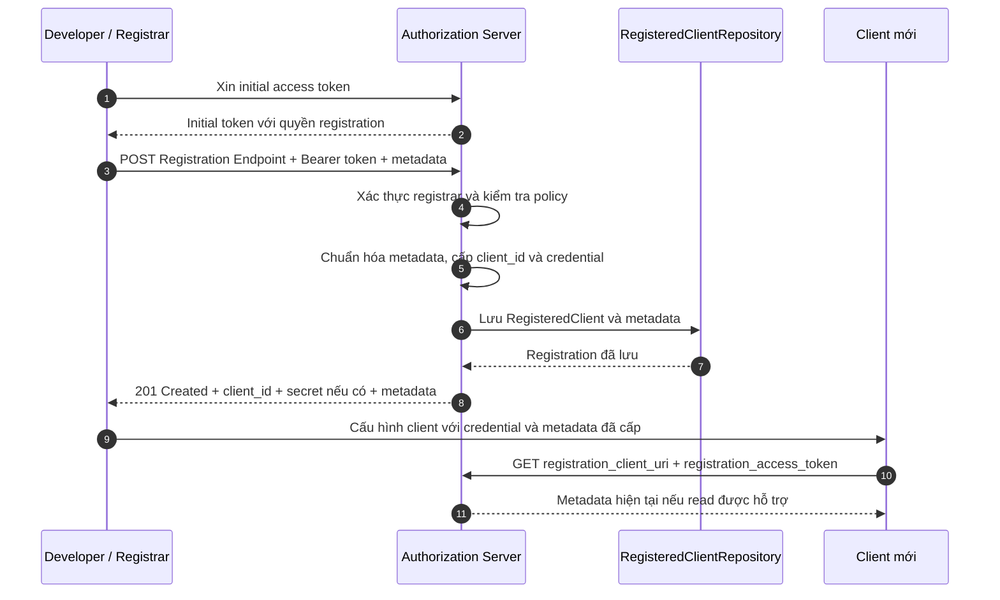

# Cấp client_id, client_secret và metadata đăng ký

## 1. Đăng ký client động giải quyết vấn đề gì?

Trong chương **Đăng ký client động** của module **SPRING_SECURITY_OAUTH2_OIDC_AUTHORIZATION_SERVER**, chúng ta học cách thiết kế, cấu hình, bảo mật, kiểm thử và vận hành OAuth 2.0/OpenID Connect Authorization Server bằng Spring Security và Spring Authorization Server trong ứng dụng Spring Boot.

Trong hệ thống có nhiều ứng dụng, việc yêu cầu quản trị viên tạo từng OAuth Client thủ công sẽ làm chậm quá trình onboarding và dễ phát sinh sai cấu hình. **Dynamic Client Registration (DCR)** cho phép client hoặc bên phát triển gửi metadata đăng ký tới Authorization Server; server kiểm tra policy, cấp định danh client, có thể cấp secret, lưu cấu hình và trả lại metadata đã được chấp nhận.

Ví dụ, một ứng dụng quản lý kho muốn dùng Authorization Code Flow. Ứng dụng gửi tên client, redirect URI, grant type, response type, scope và phương thức xác thực Token Endpoint. Authorization Server kiểm tra các giá trị này, quyết định client có được đăng ký hay không, rồi cấp thông tin định danh và credential phù hợp.

Điểm quan trọng: **đăng ký thành công không đồng nghĩa client được quyền yêu cầu mọi scope hoặc dùng mọi grant type**. Metadata do client gửi là đề nghị. Authorization Server phải xác thực quyền đăng ký, kiểm tra dữ liệu, áp dụng giới hạn của hệ thống và trả về cấu hình thực tế.

Sau bài này, bạn có thể phân biệt các loại credential, cấp client ID/secret, kiểm tra metadata, bật Client Registration Endpoint trong Spring Authorization Server và kiểm thử vòng đời đăng ký.

## 2. Phân biệt ba giao thức và phạm vi hỗ trợ

### 2.1. OAuth 2.0 Dynamic Client Registration — RFC 7591

RFC 7591 định nghĩa cách đăng ký OAuth 2.0 client động. Client gửi HTTP POST với JSON metadata tới Client Registration Endpoint. Nếu thành công, Authorization Server trả HTTP 201 Created, một client ID, metadata đã đăng ký và client secret nếu client là confidential client.

Initial Access Token trong RFC 7591 là **tùy chọn theo policy của Authorization Server**. Một server có thể cho open registration hoặc yêu cầu token được cấp trước để chỉ bên đã được phê duyệt mới có quyền đăng ký.

### 2.2. OAuth 2.0 Dynamic Client Registration Management — RFC 7592

RFC 7592 mở rộng DCR với Client Configuration Endpoint để client quản lý registration sau khi tạo:

| HTTP method | Thao tác | Ý nghĩa |
| --- | --- | --- |
| GET | Read | Đọc metadata hiện tại. |
| PUT | Update | Thay metadata đăng ký bằng bản cấu hình mới. |
| DELETE | Deprovision | Hủy đăng ký client. |

Các thao tác dùng registration access token dưới dạng Bearer Token. RFC 7592 là tài liệu **Experimental**, và không phải Authorization Server nào hỗ trợ DCR cũng hỗ trợ đầy đủ các thao tác management.

### 2.3. OpenID Connect Dynamic Client Registration 1.0

OpenID Connect định nghĩa Client Registration để đăng ký OIDC Relying Party. Metadata OIDC mở rộng các thuộc tính OAuth client, ví dụ post-logout redirect URI, thuật toán ký ID Token và thông tin OIDC khác.

Spring Authorization Server 1.5.8 có hướng dẫn chính thức về **OpenID Connect Dynamic Client Registration 1.0**. Endpoint này hỗ trợ đăng ký và đọc thông tin client; nó **không đồng nghĩa toàn bộ thao tác PUT/DELETE của RFC 7592 đã được cung cấp sẵn**.

### 2.4. So sánh phạm vi

| Đặc điểm | RFC 7591 | RFC 7592 | Spring Authorization Server 1.5.8 |
| --- | --- | --- | --- |
| Đăng ký client | Có | Dựa trên RFC 7591 | Có, theo OIDC Client Registration 1.0. |
| Cấp client ID | Có | Giữ nguyên ID hiện tại | Có. |
| Cấp client secret | Nếu client cần secret | Có thể thay đổi khi read/update | Có thể cấp cho confidential client theo cấu hình. |
| Initial access token | Tùy policy | Không phải credential quản lý từng client | Hướng dẫn Spring yêu cầu token có scope client.create. |
| Registration access token | Không phải thành phần bắt buộc của RFC 7591 | Credential quản lý registration | Được trả trong registration response của hướng dẫn Spring. |
| Read client | Không định nghĩa management endpoint | GET | Có. |
| Update client | Ngoài phạm vi | PUT | Không có sẵn trong endpoint được hướng dẫn. |
| Delete client | Ngoài phạm vi | DELETE | Không có sẵn trong endpoint được hướng dẫn. |

Khi thiết kế, hãy ghi rõ giao thức và thao tác mà hệ thống hỗ trợ. Nếu sản phẩm cần cập nhật hoặc xóa registration theo RFC 7592, cần bổ sung phần quản lý đó và kiểm thử semantics của RFC 7592.

## 3. Phân biệt bốn loại thông tin xác thực

Một trong những lỗi thiết kế phổ biến nhất là dùng lẫn client_secret và registration_access_token. Chúng có mục đích và endpoint sử dụng khác nhau.

| Thành phần | Ai sử dụng? | Dùng ở đâu? | Quyền/nhiệm vụ |
| --- | --- | --- | --- |
| **client_id** | Client và Authorization Server | Authorization Endpoint, Token Endpoint và protocol request | Định danh client; không phải secret. |
| **client_secret** | Confidential OAuth Client | Chủ yếu tại Token Endpoint | Xác thực client khi dùng client_secret_basic, client_secret_post hoặc client_secret_jwt. |
| **Initial Access Token** | Developer/registrar đã được cấp quyền đăng ký | Client Registration Endpoint | Cho phép tạo registration mới theo policy. |
| **registration_access_token** | Client/developer quản lý một registration | Client Configuration/Read Endpoint | Đọc, cập nhật hoặc xóa registration nếu server hỗ trợ các thao tác đó. |

### 3.1. client_id là định danh công khai

client_id là chuỗi định danh do Authorization Server cấp. Client gửi giá trị này trong các request OAuth để server biết registration nào đang được sử dụng.

client_id:

- Không phải mật khẩu và không cần giữ bí mật.
- Nên duy nhất trong phạm vi Authorization Server theo chính sách cấp phát.
- Không nên chứa email, tên người dùng, client secret hoặc thông tin nội bộ nhạy cảm.
- Có thể là UUID, chuỗi ngẫu nhiên hoặc ID có cấu trúc do server quản lý.
- Có thể được dùng trong log/audit như một định danh, nhưng không thay thế kiểm tra quyền.

RFC 7591 cho phép Authorization Server cấp cùng một client_id cho nhiều instance trong một số trường hợp. Việc dùng chung ID hay cấp ID riêng cho từng instance là quyết định về mô hình client, credential và vòng đời.

### 3.2. client_secret là credential của confidential client

client_secret được dùng để xác thực confidential client tại Token Endpoint. Secret chỉ được cấp khi loại client và phương thức xác thực yêu cầu nó.

Các trường hợp điển hình:

- Backend service có thể giữ secret trong secret manager.
- Web application chạy phía server có thể giữ secret trong môi trường server.
- SPA chạy trong trình duyệt và native app không thể bảo vệ một shared secret tĩnh; chúng thường là public client và dùng token_endpoint_auth_method là none cùng PKCE khi phù hợp.
- Client dùng private_key_jwt hoặc mutual TLS có thể xác thực bằng khóa/chứng thư thay vì shared secret.

**Không nhúng client_secret vào JavaScript, mobile binary, source repository, image container công khai hoặc log.** Nếu mọi người dùng có thể tải ứng dụng, họ có thể trích xuất secret được nhúng trong đó.

### 3.3. Initial Access Token chỉ cấp quyền đăng ký

Initial Access Token là credential bootstrap. Nó cho phép bên được phê duyệt gọi Registration Endpoint. Token này không phải client_secret của client mới và không dùng thay cho credential khi client mới xin Access Token.

Một initial token có thể giới hạn theo người phát hành/developer, số registration được phép tạo, loại client, redirect URI domain, grant type, scope, thời hạn và số lần sử dụng.

### 3.4. Registration Access Token quản lý một registration

registration_access_token là Bearer Token có quyền quản lý registration tương ứng. RFC 7592 yêu cầu token này có entropy đủ cao, gắn với client_id, được bảo vệ như credential và không chia sẻ giữa những instance client độc lập.

Token này **không dùng để gọi Token Endpoint thay cho client_secret**. Nếu kẻ khác lấy được token quản lý, họ có thể đọc hoặc thay đổi metadata và có thể xóa client nếu server hỗ trợ thao tác đó.

## 4. Luồng cấp client_id, client_secret và metadata

### 4.1. Luồng tổng quát



### 4.2. Các bước xử lý ở Authorization Server

1. Xác thực initial token hoặc cơ chế đăng ký được policy cho phép.
2. Xác định bên đăng ký và quota của bên đó.
3. Parse JSON metadata và từ chối dữ liệu sai cấu trúc.
4. Kiểm tra redirect URI, grant type, response type, token endpoint auth method, scopes và các trường liên quan.
5. Áp dụng policy server-side; bỏ hoặc thay các giá trị không được chấp nhận.
6. Cấp client_id; tạo client_secret nếu client cần.
7. Lưu RegisteredClient cùng metadata bổ sung.
8. Tạo registration_access_token và URL quản lý registration nếu giao thức hỗ trợ.
9. Trả response chứa cấu hình thực tế đã được server chấp nhận.
10. Ghi audit event mà không ghi credential.

Client phải đọc response và dùng metadata server trả về. Không được giả định các giá trị request đều được giữ nguyên.

## 5. Cấp phát client_id

### 5.1. Chiến lược tạo ID

| Chiến lược | Ví dụ | Nhận xét |
| --- | --- | --- |
| UUID | f47ac10b-58cc-4372-a567-0e02b2c3d479 | Dễ tạo phân tán; không cần tiết lộ thông tin nghiệp vụ. |
| Random opaque ID | cli_8wV2... | Có thể tùy chỉnh định dạng; cần entropy và kiểm tra collision. |
| Sequence/database ID | client-1042 | Dễ quản lý nhưng dễ suy đoán số lượng và thứ tự đăng ký. |
| Tenant-scoped ID | tenant-a:app-123 | Có thể hữu ích nội bộ nhưng làm lộ cấu trúc/tenant nếu công khai. |

client_id không cần bí mật, nhưng vẫn nên tránh ID quá dễ đoán nếu nó xuất hiện trong URL quản lý registration hoặc log public. Việc đoán được ID không được tạo quyền truy cập; authorization phải dựa trên token và policy.

### 5.2. Phân biệt ID nội bộ và client_id

Trong Spring Authorization Server, RegisteredClient có hai định danh:

- id: khóa nội bộ dùng để nhận diện record trong repository.
- clientId: định danh OAuth client mà client gửi trong protocol request.

Không nhầm id nội bộ với client_id công khai. Có thể dùng UUID cho cả hai nhưng chúng có mục đích riêng.

### 5.3. Thời điểm cấp và metadata thời gian

RFC 7591 định nghĩa:

- client_id_issued_at: thời điểm cấp client_id, tính bằng Unix epoch seconds UTC.
- client_secret_expires_at: thời điểm secret hết hạn, cũng tính bằng Unix epoch seconds UTC; nếu secret không hết hạn, giá trị là 0.

Nếu Authorization Server cấp client_secret, client_secret_expires_at là trường cần có trong response theo RFC 7591.

## 6. Cấp client_secret an toàn

### 6.1. Chỉ cấp secret khi phương thức xác thực cần secret

token_endpoint_auth_method cho biết client sẽ xác thực tại Token Endpoint bằng cách nào.

| Giá trị | Loại client | Có shared client_secret? |
| --- | --- | --- |
| none | Public client | Không. |
| client_secret_basic | Confidential client | Có. |
| client_secret_post | Confidential client | Có; secret được gửi trong form body. |
| client_secret_jwt | Confidential client | Có; dùng secret để ký client assertion JWT. |
| private_key_jwt | Confidential client | Không cần shared secret; dùng private key của client. |
| tls_client_auth | Confidential client | Xác thực bằng chứng thư TLS theo cấu hình. |

Authorization Server chỉ nên chấp nhận các phương thức mà hệ thống đã triển khai và vận hành. Nếu client gửi none nhưng server tự động cấp secret rồi vẫn xem đó là public client, cấu hình sẽ khó hiểu và có thể tạo cảm giác an toàn giả.

### 6.2. Secret phải có entropy đủ cao

Secret do server tạo nên sử dụng cryptographically secure random generator. Ví dụ 32 byte ngẫu nhiên tương đương 256 bit entropy trước khi encode:

```java
import java.security.SecureRandom;
import java.util.Base64;

public final class ClientSecretGenerator {

    private static final SecureRandom SECURE_RANDOM = new SecureRandom();

    private ClientSecretGenerator() {
    }

    public static String generate() {
        byte[] random = new byte[32];
        SECURE_RANDOM.nextBytes(random);
        return Base64.getUrlEncoder()
                .withoutPadding()
                .encodeToString(random);
    }
}
```

Đây là ví dụ policy tạo secret có entropy cao, không phải độ dài bắt buộc được RFC 7591 quy định. Không tạo secret từ client_id, tên ứng dụng, timestamp, UUID có thể đoán theo thời gian hoặc một giá trị cố định dùng chung.

### 6.3. Mỗi client cần secret riêng

RFC 7591 yêu cầu client_secret nếu được cấp phải duy nhất cho từng client_id; secret cũng nên khác nhau giữa các instance nếu cùng một client ID được chia sẻ.

Không dùng một secret chung cho tất cả client. Khi một client bị lộ credential, server cần có thể rotate hoặc disable riêng client đó.

### 6.4. Lưu secret dưới dạng hash

Nếu server chỉ cần so sánh secret khi client xác thực, nên lưu giá trị đã được PasswordEncoder encode thay vì plaintext:

```java
import org.springframework.security.crypto.password.PasswordEncoder;
import org.springframework.security.crypto.factory.PasswordEncoderFactories;

PasswordEncoder passwordEncoder =
        PasswordEncoderFactories.createDelegatingPasswordEncoder();

String rawSecret = ClientSecretGenerator.generate();
String storedSecret = passwordEncoder.encode(rawSecret);
```

Khi xây RegisteredClient, lưu storedSecret:

```java
RegisteredClient registeredClient = RegisteredClient.withId(internalId)
        .clientId(clientId)
        .clientSecret(storedSecret)
        .clientAuthenticationMethod(ClientAuthenticationMethod.CLIENT_SECRET_BASIC)
        .authorizationGrantType(AuthorizationGrantType.AUTHORIZATION_CODE)
        .redirectUri("https://inventory.example.com/login/oauth2/code/issuer")
        .scope("inventory.read")
        .build();
```

Trong Spring Authorization Server, RegisteredClient.clientSecret nên chứa giá trị được encode bằng Spring Security PasswordEncoder. OidcClientRegistrationAuthenticationProvider cũng có setPasswordEncoder(...); nếu không cấu hình, API hiện hành dùng PasswordEncoderFactories.createDelegatingPasswordEncoder().

Không dùng {noop} hoặc plaintext secret trong production. {noop} chỉ xuất hiện trong ví dụ đơn giản của tài liệu để minh họa, không phải cấu hình bảo mật.

### 6.5. Không thể khôi phục plaintext từ hash

Hash một chiều không thể được giải ngược thành secret ban đầu. Vì vậy:

- Khi tạo client, response registration phải chuyển secret hợp lệ tới nơi lưu trữ được bảo vệ của client.
- Nếu secret bị mất, quy trình đúng là rotate/reissue secret theo policy.
- Nếu một triển khai cần hiển thị lại secret cũ, nó phải lưu bản mã hóa có kiểm soát thay vì chỉ lưu hash; điều này tăng rủi ro và cần bảo vệ khóa mã hóa.
- Không nhầm encoded hash trong database với raw client_secret mà client dùng để xác thực.

Tài liệu Spring Authorization Server có ví dụ Client Read response kiểm tra trường client_secret không null. Khi triển khai thực tế, hãy kiểm tra chính xác giá trị response của phiên bản và converter đang dùng; không coi giá trị hash lưu trong RegisteredClient là secret plaintext có thể dùng tại Token Endpoint.

## 7. Initial Access Token và Registration Access Token

### 7.1. Initial Access Token

Initial Access Token được cấp cho registrar hoặc developer trước khi đăng ký. Nó có thể giới hạn số lần tạo client, phạm vi tenant, software publisher, domain redirect và thời hạn.

RFC 7591 cho phép server không yêu cầu initial token. Tuy nhiên, **open registration** có thể khiến bất kỳ ai tạo client, tự khai tên/logo và tạo ra nhiều registration rác. Trong môi trường production, thường nên yêu cầu registrar được xác thực và có quyền rõ ràng.

### 7.2. Registration Access Token

Khi hỗ trợ registration management, server trả registration_access_token cùng registration_client_uri. Token này:

- Là Bearer Token có entropy cao.
- Được ràng buộc với một registration cụ thể.
- Chỉ dùng cho Client Configuration Endpoint.
- Không nên chia sẻ giữa các instance client độc lập.
- Phải bị vô hiệu hóa khi registration bị deprovision.

RFC 7592 cho phép server rotate registration access token khi client read hoặc update registration. Nếu response chứa token mới, client phải bỏ token cũ ngay.

### 7.3. Ba token không thể thay thế nhau

```text
Initial Access Token
    -> quyền tạo registration mới
    -> gửi tới Client Registration Endpoint

registration_access_token
    -> quyền quản lý một registration cụ thể
    -> gửi tới registration_client_uri

client_secret
    -> xác thực confidential OAuth client
    -> gửi tới Token Endpoint theo auth method đã đăng ký
```

Không ghi ba loại credential này vào cùng một trường, không dùng chung scope hoặc cùng secret store key nếu không có phân loại rõ ràng.

## 8. Metadata đăng ký client

### 8.1. Metadata mô tả điều gì?

Client metadata gồm thông tin định danh hiển thị và các tham số protocol mà client được đăng ký sử dụng. Authorization Server dùng metadata để xác định redirect URI hợp lệ, giới hạn grant type và response type, chọn phương thức xác thực client tại Token Endpoint, xác định scopes client được phép xin, hiển thị tên/logo, xác minh public keys và cấu hình OIDC.

### 8.2. Những metadata thường gặp

| Metadata | Ý nghĩa | Lưu ý bảo mật |
| --- | --- | --- |
| redirect_uris | Danh sách URI nhận authorization response. | Phải kiểm tra từng URI, không chấp nhận wildcard tùy tiện. |
| grant_types | Các OAuth grant type client được phép dùng. | Chỉ cấp loại grant server cho phép. |
| response_types | Các response type ở Authorization Endpoint. | Phải tương thích với grant type. |
| token_endpoint_auth_method | Phương thức xác thực ở Token Endpoint. | Không cấp secret cho public client. |
| scope | Các scope client dự kiến sử dụng. | Server phải giới hạn theo policy và resource. |
| client_name | Tên hiển thị của ứng dụng. | Đây là dữ liệu client tự khai, cần xử lý như untrusted input. |
| client_uri | Website giới thiệu client. | Kiểm tra URL và cách hiển thị. |
| logo_uri | URL logo. | Tránh SSRF khi server fetch ảnh; sanitize khi hiển thị. |
| contacts | Thông tin liên hệ. | Không dùng làm bằng chứng danh tính. |
| jwks_uri | URL JWKS của client. | Cần chống SSRF và kiểm tra key phù hợp. |
| jwks | Public JWK Set gửi trực tiếp. | Không chấp nhận private key material. |
| software_id | Định danh phần mềm do publisher cấp. | Có thể dùng nhóm nhiều instance cùng sản phẩm. |
| software_version | Phiên bản phần mềm. | Không tự xem là bằng chứng phiên bản đáng tin. |
| software_statement | JWT có chữ ký chứa metadata do bên phát hành xác nhận. | Phải xác minh issuer và trust chain. |
| post_logout_redirect_uris | URI nhận redirect sau logout OIDC. | Cần kiểm tra tương tự redirect URI. |
| id_token_signed_response_alg | Thuật toán ký ID Token. | Chỉ chấp nhận thuật toán server hỗ trợ và policy cho phép. |

### 8.3. Redirect URI là metadata nhạy cảm

Đối với redirect-based flow, client phải đăng ký redirect URI. Authorization Server phải xác minh redirect URI của authorization request khớp với URI đã đăng ký theo quy tắc của protocol.

Không chấp nhận wildcard domain/path tùy tiện, redirect URI do client gửi tùy ý ở mỗi authorization request hoặc open redirector có thể chuyển authorization response sang domain khác. Với remote web site, yêu cầu HTTPS; các ngoại lệ như localhost loopback hoặc custom scheme phải tuân theo profile native app phù hợp.

Với public client dùng Authorization Code Flow, yêu cầu PKCE theo OAuth Security Best Current Practice và policy tương ứng. Không bật implicit hoặc password grant chỉ vì client yêu cầu.

### 8.4. Grant type và response type phải nhất quán

| grant_types | response_types thường tương ứng |
| --- | --- |
| authorization_code | code |
| client_credentials | Không cần response type ở Authorization Endpoint. |
| refresh_token | Dùng cùng grant context được phép; không tự tạo flow độc lập. |

Nếu request kết hợp authorization_code nhưng không khai báo response type tương thích, server phải từ chối hoặc chuẩn hóa theo quy tắc rõ ràng. Không cho client tự đăng ký mọi grant type chỉ bằng cách thêm chuỗi vào JSON.

## 9. Metadata là input chưa tin cậy

### 9.1. Self-asserted metadata

Trừ khi được xác nhận bằng một cơ chế trust như Software Statement được issuer tin cậy phát hành, metadata client gửi phải được xem là **self-asserted**.

Một client có thể khai tên “Official Banking App”, logo và website của một tổ chức khác. Tên/logo/website không chứng minh client thuộc về tổ chức được nêu. Authorization Server cần policy để xác minh publisher, domain, software statement, initial token và toàn bộ request.

### 9.2. Rủi ro SSRF từ URI metadata

Metadata như jwks_uri, logo_uri, client_uri hoặc URI mở rộng có thể khiến server hoặc giao diện truy cập URL do client kiểm soát.

Nếu server tải tài nguyên từ URL:

- Chặn loopback, link-local, private network và địa chỉ metadata cloud.
- Kiểm tra DNS resolution và chống DNS rebinding.
- Hạn chế redirect và kiểm tra lại đích sau redirect.
- Giới hạn scheme, port, kích thước, timeout và content type.
- Dùng egress firewall/proxy allowlist.
- Không fetch URL chỉ để hiển thị tên/logo nếu không có nhu cầu.

Nếu metadata chỉ được lưu và gửi cho client, vẫn cần encode/escape đúng khi hiển thị trong UI để ngăn XSS hoặc nội dung giả mạo.

### 9.3. Software Statement không tự động chứng minh danh tính

Software Statement là JWT có chữ ký chứa metadata về client software. Chữ ký giúp xác minh token được ký bởi issuer của statement, nhưng server vẫn cần:

1. Tin cậy issuer của Software Statement.
2. Kiểm tra chữ ký và thuật toán.
3. Kiểm tra iss, aud, exp và các claim theo profile.
4. Kiểm tra software identifier/version có được phê duyệt.
5. Áp dụng policy cho metadata trong statement.

Khi metadata trong Software Statement và JSON request mâu thuẫn, RFC 7591 quy định metadata từ Software Statement được ưu tiên nếu server hỗ trợ tính năng này. Dù vậy, server vẫn phải đánh giá cả initial access token và toàn bộ registration request.

## 10. Spring Authorization Server 1.5.8: bật Client Registration Endpoint

### 10.1. Endpoint bị tắt mặc định

Spring Authorization Server 1.5.8 tắt OpenID Connect Client Registration Endpoint mặc định. Tài liệu chính thức hướng dẫn bật endpoint qua OAuth2AuthorizationServerConfigurer.oidc(...).clientRegistrationEndpoint(...).

Ví dụ cấu hình:

```java
import org.springframework.context.annotation.Bean;
import org.springframework.context.annotation.Configuration;
import org.springframework.security.config.Customizer;
import org.springframework.security.config.annotation.web.builders.HttpSecurity;
import org.springframework.security.oauth2.server.authorization.config.annotation.web.configurers.OAuth2AuthorizationServerConfigurer;
import org.springframework.security.web.SecurityFilterChain;

@Configuration
public class AuthorizationServerRegistrationConfig {

    @Bean
    SecurityFilterChain authorizationServerSecurityFilterChain(
            HttpSecurity http) throws Exception {

        OAuth2AuthorizationServerConfigurer authorizationServerConfigurer =
                OAuth2AuthorizationServerConfigurer.authorizationServer();

        http
            .securityMatcher(authorizationServerConfigurer.getEndpointsMatcher())
            .with(authorizationServerConfigurer, authorizationServer ->
                authorizationServer
                    .oidc(oidc -> oidc
                        .clientRegistrationEndpoint(Customizer.withDefaults())
                    )
            )
            .authorizeHttpRequests(authorize ->
                authorize.anyRequest().authenticated()
            );

        return http.build();
    }
}
```

Đây là phần bật endpoint. Ứng dụng còn cần các bean và cấu hình Authorization Server bình thường như RegisteredClientRepository, OAuth2AuthorizationService, token generator, issuer/JWK, filter chain và JwtDecoder.

### 10.2. JwtDecoder là yêu cầu của endpoint

Client Registration Endpoint là OAuth2 protected resource. Tài liệu Spring yêu cầu có JwtDecoder bean để xác minh Access Token được gửi trong Bearer header.

Ví dụ khi server đã có JWKSource phù hợp:

```java
import com.nimbusds.jose.proc.SecurityContext;
import com.nimbusds.jose.jwk.source.JWKSource;
import org.springframework.context.annotation.Bean;
import org.springframework.security.oauth2.jwt.JwtDecoder;
import org.springframework.security.oauth2.server.authorization.config.annotation.web.configuration.OAuth2AuthorizationServerConfiguration;

@Bean
JwtDecoder jwtDecoder(JWKSource<SecurityContext> jwkSource) {
    return OAuth2AuthorizationServerConfiguration.jwtDecoder(jwkSource);
}
```

Nếu ứng dụng đã có JwtDecoder, hãy bảo đảm decoder xác minh đúng issuer, signature và thời hạn của initial access token. Không tạo decoder tin mọi JWT hoặc bỏ qua kiểm tra chữ ký chỉ để registration endpoint hoạt động.

### 10.3. Registrar client

Spring guide dùng một client đã đăng ký để xin initial access token. Client này cần grant type client_credentials, scope client.create để tạo registration và scope client.read nếu cần đọc registration.

Ví dụ:

```java
import java.util.UUID;

import org.springframework.context.annotation.Bean;
import org.springframework.context.annotation.Configuration;
import org.springframework.security.crypto.password.PasswordEncoder;
import org.springframework.security.oauth2.core.AuthorizationGrantType;
import org.springframework.security.oauth2.core.ClientAuthenticationMethod;
import org.springframework.security.oauth2.server.authorization.client.RegisteredClient;
import org.springframework.security.oauth2.server.authorization.client.RegisteredClientRepository;
import org.springframework.security.oauth2.server.authorization.client.InMemoryRegisteredClientRepository;

@Configuration
public class RegistrarClientConfig {

    @Bean
    RegisteredClientRepository registeredClientRepository(
            PasswordEncoder passwordEncoder,
            RegistrarSecretSource secretSource) {

        RegisteredClient registrar = RegisteredClient
                .withId(UUID.randomUUID().toString())
                .clientId("client-registrar")
                .clientSecret(passwordEncoder.encode(secretSource.secret()))
                .clientAuthenticationMethod(
                        ClientAuthenticationMethod.CLIENT_SECRET_BASIC)
                .authorizationGrantType(AuthorizationGrantType.CLIENT_CREDENTIALS)
                .scope("client.create")
                .scope("client.read")
                .build();

        // InMemory chỉ phù hợp ví dụ hoặc môi trường thử nghiệm.
        return new InMemoryRegisteredClientRepository(registrar);
    }
}
```

RegistrarSecretSource là abstraction của ứng dụng để lấy secret từ secret manager hoặc cấu hình an toàn; không hardcode secret thật trong source. Trong production, dùng repository bền vững như JDBC hoặc implementation có khả năng lưu registration động, cập nhật và tra cứu nhất quán giữa các node.

### 10.4. Initial access token chỉ có scope client.create

Spring guide yêu cầu request lấy initial token phải có đúng một scope client.create:

```http
POST /oauth2/token HTTP/1.1
Host: auth.example.com
Authorization: Basic <base64(client-registrar:registrar-secret)>
Content-Type: application/x-www-form-urlencoded

grant_type=client_credentials&scope=client.create
```

Nếu token có thêm scope khác, registration request bị từ chối theo hướng dẫn Spring. Initial token chỉ được dùng một lần; sau khi registration thành công, token bị vô hiệu hóa.

Đây là điểm cần phân biệt với RFC 7591: RFC cho phép server chọn policy open registration hoặc initial token, trong khi Spring guide triển khai luồng registrar có initial token dùng một lần.

## 11. Gửi registration request và nhận response

### 11.1. Ví dụ request

Sau khi lấy initial access token, registrar gửi metadata:

```http
POST /connect/register HTTP/1.1
Host: auth.example.com
Authorization: Bearer <initial-access-token>
Content-Type: application/json
Accept: application/json

{
  "client_name": "inventory-server",
  "application_type": "web",
  "grant_types": [
    "authorization_code",
    "refresh_token"
  ],
  "response_types": [
    "code"
  ],
  "redirect_uris": [
    "https://inventory.example.com/login/oauth2/code/auth-server"
  ],
  "token_endpoint_auth_method": "client_secret_basic",
  "scope": "openid profile inventory.read"
}
```

Đây là request minh họa. Scope inventory.read phải được Authorization Server hỗ trợ và cho phép; việc client gửi scope không tự tạo ra quyền mới. Endpoint path trong Spring guide là /connect/register; khi tích hợp, nên đọc endpoint/metadata thực tế của server thay vì giả định mọi triển khai dùng cùng path.

### 11.2. Ví dụ response

Một registration response có thể gồm:

```json
{
  "client_id": "client-a8f3...",
  "client_id_issued_at": 1790000000,
  "client_secret": "<generated-secret>",
  "client_secret_expires_at": 1792592000,
  "registration_access_token": "<registration-management-token>",
  "registration_client_uri": "https://auth.example.com/connect/register/client-a8f3...",
  "client_name": "inventory-server",
  "application_type": "web",
  "grant_types": [
    "authorization_code",
    "refresh_token"
  ],
  "response_types": [
    "code"
  ],
  "redirect_uris": [
    "https://inventory.example.com/login/oauth2/code/auth-server"
  ],
  "token_endpoint_auth_method": "client_secret_basic",
  "scope": "openid profile inventory.read"
}
```

Các giá trị là ví dụ, không phải secret có thể sử dụng. Nếu client là public client hoặc dùng phương thức xác thực không cần shared secret, client_secret có thể không được cấp. Nếu server cấp secret, client_secret_expires_at phải phản ánh thời hạn hoặc 0 theo RFC 7591.

Response thành công theo RFC 7591 dùng HTTP 201 Created, JSON và các header chống cache như Cache-Control: no-store và Pragma: no-cache.

### 11.3. Luôn dùng metadata server trả về

Authorization Server có thể từ chối một metadata field, thay một giá trị bằng default an toàn, chuẩn hóa danh sách scopes/grants hoặc cấp redirect URI/token endpoint auth method khác với đề nghị nếu policy cho phép.

Client phải kiểm tra response trước khi lưu cấu hình. Không tiếp tục hoạt động nếu server trả token_endpoint_auth_method mà client không hỗ trợ hoặc không có redirect URI mong đợi.

## 12. Đọc registration và bảo vệ registration_access_token

### 12.1. Đọc bằng registration_client_uri

Spring guide lấy registration_access_token và registration_client_uri từ response rồi gọi GET:

```http
GET /connect/register/client-a8f3... HTTP/1.1
Host: auth.example.com
Authorization: Bearer <registration-access-token>
Accept: application/json
```

Trong ứng dụng, hãy dùng chính xác URL trong registration_client_uri; không tự ghép URL từ client_id hoặc suy đoán path.

### 12.2. Scope client.read

Theo tài liệu Spring Authorization Server, Client Read request yêu cầu Access Token có scope client.read. Registration Access Token trong flow của Spring được dùng để gọi Client Read Endpoint. Cấu hình registrar phải cho phép quyền read khi use case cần đọc registration.

### 12.3. Bảo vệ token quản lý

Registration Access Token là credential mạnh. Nên lưu trong secret manager hoặc kho credential có kiểm soát; không đưa vào source code, browser storage công khai, log hoặc ticket hỗ trợ; không chia sẻ giữa các ứng dụng/instance không cùng quyền quản lý; giới hạn quyền token đúng registration; vô hiệu hóa token khi client bị deprovision.

RFC 7592 quy định nếu server trả registration access token mới trong response read/update, client phải bỏ token cũ ngay. Client ID không được thay đổi trong quá trình read/update.

### 12.4. Spring hỗ trợ tới đâu?

Trong Spring Authorization Server 1.5.8, tài liệu Protocol Endpoints mô tả Client Registration Endpoint xử lý Client Registration request và Client Read request.

Tài liệu không mô tả sẵn thao tác Client Update (PUT) và Client Delete (DELETE) của RFC 7592 trong endpoint này. Nếu cần management đầy đủ, phải xây dựng phần mở rộng có kiểm soát hoặc dùng giải pháp hỗ trợ các thao tác đó; không giả định chỉ cần bật clientRegistrationEndpoint() là có đủ CRUD.

## 13. Custom metadata trong Spring Authorization Server

### 13.1. Vì sao cần converter?

RegisteredClient có các trường chuẩn như client ID, secret, grant type, redirect URI, scope, client settings và token settings. Metadata mở rộng như logo_uri, contacts, software_id hoặc thông tin tenant không phải lúc nào cũng được ánh xạ trực tiếp vào trường chuẩn.

Spring guide minh họa cách tùy biến hai converter:

- OidcClientRegistrationRegisteredClientConverter: chuyển OIDC registration request sang RegisteredClient.
- RegisteredClientOidcClientRegistrationConverter: chuyển RegisteredClient về OIDC registration response.

Có thể lưu metadata bổ sung trong ClientSettings hoặc kho metadata riêng theo schema của ứng dụng.

### 13.2. Allowlist metadata mở rộng

Ví dụ policy chỉ hỗ trợ logo_uri và contacts:

```java
List<String> allowedCustomMetadata =
        List.of("logo_uri", "contacts");
```

Converter cần:

1. Chỉ đọc các claim nằm trong allowlist.
2. Kiểm tra kiểu dữ liệu và kích thước.
3. Chuẩn hóa/validate URL, email hoặc danh sách theo schema.
4. Lưu vào ClientSettings hoặc metadata store.
5. Đưa metadata đã được chấp nhận trở lại response.

Không tự động lưu mọi JSON field lạ vào database. Nếu không có schema, dữ liệu có thể trở thành nơi chứa object quá lớn, dữ liệu nhạy cảm hoặc cấu hình không được kiểm soát.

### 13.3. Tích hợp với AuthenticationProvider mặc định

Spring guide dùng authenticationProviders(...) để lấy danh sách provider mặc định rồi cấu hình converter cho OidcClientRegistrationAuthenticationProvider và OidcClientConfigurationAuthenticationProvider.

Mẫu cấu hình:

```java
private static Consumer<List<AuthenticationProvider>>
configureRegistrationConverters() {

    return providers -> {
        CustomRegisteredClientConverter toRegisteredClient =
                new CustomRegisteredClientConverter(
                        List.of("logo_uri", "contacts"));

        CustomClientRegistrationConverter toRegistration =
                new CustomClientRegistrationConverter(
                        List.of("logo_uri", "contacts"));

        providers.forEach(provider -> {
            if (provider instanceof OidcClientRegistrationAuthenticationProvider registration) {
                registration.setRegisteredClientConverter(toRegisteredClient);
                registration.setClientRegistrationConverter(toRegistration);
            }
            if (provider instanceof OidcClientConfigurationAuthenticationProvider configuration) {
                configuration.setClientRegistrationConverter(toRegistration);
            }
        });
    };
}
```

Đây là khung tích hợp theo extension point của Spring. Hai converter phải được cài đặt theo kiểu dữ liệu và schema thực tế của ứng dụng; không dùng nguyên class placeholder trong production.

### 13.4. Giữ validation mặc định

Khi thay AuthenticationProvider hoặc AuthenticationValidator, hãy bảo toàn các kiểm tra redirect URI, post-logout redirect URI, JWK Set URI và scope phù hợp. Một custom validator chỉ kiểm tra client_name nhưng vô tình thay toàn bộ validator mặc định có thể mở ra redirect URI hoặc metadata nguy hiểm.

Tài liệu Spring có ví dụ nối các validator có sẵn bằng andThen(...). Nếu cần thêm rule riêng, nối rule mới sau các kiểm tra mặc định và kiểm tra negative cases bằng integration test.

## 14. Lưu trữ RegisteredClient và metadata

### 14.1. RegisteredClient là model trung tâm

Trong Spring Authorization Server, RegisteredClient biểu diễn client đã đăng ký. Một record thường gồm:

| Thuộc tính | Mục đích |
| --- | --- |
| id | ID nội bộ của record. |
| clientId | OAuth client identifier. |
| clientIdIssuedAt | Thời điểm cấp ID. |
| clientSecret | Secret đã encode nếu client có secret. |
| clientSecretExpiresAt | Thời hạn secret. |
| clientName | Tên hiển thị. |
| clientAuthenticationMethods | Phương thức xác thực client. |
| authorizationGrantTypes | Grant type được phép. |
| redirectUris | Redirect URI đã đăng ký. |
| postLogoutRedirectUris | Post-logout redirect URI. |
| scopes | Scope client được phép yêu cầu. |
| clientSettings | PKCE, consent và metadata/settings bổ sung. |
| tokenSettings | TTL và định dạng token. |

### 14.2. Repository production

InMemoryRegisteredClientRepository phù hợp demo hoặc test. Với production cần repository bền vững:

- Lưu client registration qua restart.
- Có unique constraint cho client_id.
- Hỗ trợ cập nhật trạng thái client và credential.
- Đồng bộ giữa nhiều Authorization Server node.
- Có transaction khi cấp ID, tạo secret, lưu registration và initial management token.
- Có audit lịch sử thay đổi metadata.

Spring Authorization Server cung cấp JdbcRegisteredClientRepository để lưu RegisteredClient trong database. Metadata mở rộng cần được ánh xạ vào ClientSettings hoặc bảng riêng có schema rõ ràng.

### 14.3. Tính nhất quán khi đăng ký

```text
RegisteredClient
    ├── client_id
    ├── encoded client_secret (nếu có)
    ├── grants / scopes / redirect_uris
    ├── client_settings / custom metadata
    └── token_settings

Registration management state
    ├── registration_access_token hash/state
    ├── registration_client_uri
    └── owner / tenant / registrar reference
```

Nếu ghi RegisteredClient thành công nhưng không lưu được registration token, client có thể không quản lý được registration. Nếu trả response trước khi transaction commit, client có thể nhận ID chưa tồn tại. Dùng transaction hoặc cơ chế saga/idempotency phù hợp.

## 15. Bảo vệ registration endpoint

### 15.1. Bắt buộc TLS

RFC 7591 yêu cầu registration endpoint dùng TLS; server phải hỗ trợ TLS 1.2 theo văn bản RFC. Trong triển khai mới, hãy dùng cấu hình TLS hiện hành theo security baseline của tổ chức, xác minh certificate và không gửi initial token/secret qua HTTP.

### 15.2. Giới hạn ai được đăng ký

Các biện pháp:

- Tắt open registration nếu không có nhu cầu rõ ràng.
- Cấp initial token cho registrar đã được xác thực.
- Giới hạn số registration theo tenant/developer/software publisher.
- Giới hạn grant type, auth method, scope, redirect domain và client lifetime.
- Rate limit theo registrar, IP và tenant.
- Chống replay hoặc sử dụng lại initial token; trong Spring guide, initial token bị vô hiệu hóa sau registration.
- Có quy trình phê duyệt cho client có quyền cao hoặc scope nhạy cảm.

### 15.3. Không tin metadata để tự cấp quyền

Client gửi scope admin không có nghĩa được cấp scope admin. Client gửi danh sách grant_types cũng không có nghĩa server phải chấp nhận tất cả.

Server cần xác thực registrar, kiểm tra cú pháp, áp dụng policy server-side, sau đó mới tạo RegisteredClient và trả metadata đã chấp nhận.

### 15.4. Chống giả mạo tên và logo

Tên client và logo thường xuất hiện trên màn hình consent. Nếu cho bất kỳ ai khai tên/logo của thương hiệu khác, người dùng có thể bị lừa cấp quyền cho ứng dụng giả mạo.

Có thể áp dụng publisher verification, domain validation, Software Statement từ issuer tin cậy, moderation cho logo/name chưa xác minh và nhãn unverified trong giao diện.

Không xem client_name, logo_uri hoặc software_id tự khai là bằng chứng danh tính.

### 15.5. Audit và log an toàn

Nên ghi registration ID/client ID, registrar/tenant đã xác thực, thời điểm/kết quả/correlation ID, grant types/auth method/scope được chấp nhận, metadata bị thay thế/từ chối và phiên bản policy.

Không ghi client_secret, Initial Access Token, registration_access_token, Authorization header, private key hoặc toàn bộ Software Statement nếu chứa dữ liệu nhạy cảm.

## 16. Cập nhật, xoay credential và deprovision theo RFC 7592

### 16.1. PUT là thay toàn bộ metadata

Theo RFC 7592, Client Update dùng HTTP PUT và request phải chứa các metadata field đã trả về trong registration/read/update response. Các giá trị hợp lệ thay thế giá trị trước; trường bị bỏ có thể được xem là null/empty theo semantics của RFC.

Client phải gửi client_id hiện tại. Nếu gửi client_secret, giá trị phải khớp secret đang được cấp; client không được tự chọn một secret mới rồi ghi đè lên server.

### 16.2. Secret rotation

RFC 7592 cho phép Authorization Server trả client_secret mới và/hoặc registration_access_token mới trong response read/update. Khi nhận giá trị mới, client phải bỏ credential cũ ngay.

Một quy trình rotation an toàn cần xác thực request bằng registration access token hiện tại, tạo secret mới bằng CSPRNG, lưu secret mới đã encode, trả secret mới đúng thời điểm và không cache response, sau đó client cập nhật secret trong secret manager và bỏ secret cũ theo cutover plan.

Nếu hệ thống cần overlap giữa secret cũ và mới, đó là policy triển khai riêng; không giả định RFC tự định nghĩa mọi chi tiết grace period.

### 16.3. DELETE và deprovision

RFC 7592 định nghĩa DELETE để hủy registration. Khi thành công, server vô hiệu hóa client_id, client_secret và registration_access_token. Server nên vô hiệu hóa các authorization grant, access token, refresh token và token liên quan nếu có thể.

Khi deprovision:

- Đánh dấu client disabled hoặc xóa theo retention policy.
- Thu hồi registration access token.
- Vô hiệu hóa client authentication.
- Xử lý authorization/refresh/access tokens còn hiệu lực.
- Ghi audit event và lý do.
- Trả HTTP 204 No Content nếu delete thành công theo RFC 7592.

## 17. Kiểm thử Dynamic Client Registration

| Nhóm | Dữ liệu thử | Kết quả mong đợi |
| --- | --- | --- |
| Happy path | Registrar hợp lệ, metadata hợp lệ. | Registration thành công, có client_id. |
| Confidential client | client_secret_basic được policy cho phép. | Server cấp secret và expiry metadata. |
| Public client | token_endpoint_auth_method=none. | Không cấp shared secret; PKCE và redirect policy được áp dụng. |
| Initial token thiếu | Không có Bearer token khi policy yêu cầu. | Registration bị từ chối. |
| Initial token sai | Token hết hạn/chữ ký sai/issuer sai. | Registration bị từ chối. |
| Initial token dùng lại | Dùng lại token đã registration thành công trong Spring guide flow. | Token đã bị vô hiệu hóa; request thất bại. |
| Scope registrar sai | Token không có client.create. | Không được tạo client. |
| Read scope sai | Token read không có client.read. | Không đọc được registration. |
| Redirect URI xấu | URI không nằm trong allowlist hoặc dùng wildcard không được phép. | Bị từ chối. |
| Grant không cho phép | Xin implicit hoặc grant bị policy cấm. | Bị từ chối hoặc loại khỏi metadata đã cấp. |
| Response type mâu thuẫn | Grant/response type không nhất quán. | Bị từ chối. |
| Scope vượt quyền | Client xin scope không được phép. | Server không cấp quyền vượt policy. |
| Metadata lạ | Gửi custom field không có converter/schema. | Bỏ qua hoặc từ chối theo policy; không lưu tùy tiện. |
| Metadata SSRF | jwks_uri trỏ vào localhost/private network. | Bị từ chối hoặc không fetch; không truy cập mạng nội bộ. |
| Logo giả mạo | Tên/logo bắt chước thương hiệu. | Bị moderation/đánh dấu unverified theo policy. |
| Duplicate client ID | Collision khi đăng ký đồng thời. | Unique constraint bảo vệ; không ghi đè client khác. |
| Secret lưu trữ | Kiểm tra database. | Không có raw secret nếu policy lưu hash. |
| Response cache | Đăng ký và đọc credential response. | Có Cache-Control no-store và không bị proxy cache. |
| Registration token sai | Token quản lý của client A dùng đọc client B. | Bị từ chối. |
| Deprovision | Xóa registration và thử token cũ. | Client/token quản lý bị vô hiệu hóa theo policy. |
| Multi-node | Đăng ký qua node A, xác thực qua node B. | Repository và key/token state nhất quán. |

### 17.1. Kiểm thử vòng đời credential

1. Đăng ký confidential client và nhận secret.
2. Gọi Token Endpoint bằng secret vừa cấp.
3. Thử secret sai và xác nhận invalid_client.
4. Đọc registration bằng registration access token.
5. Kiểm tra client ID không đổi.
6. Nếu có management rotation, xác nhận token/secret mới hoạt động và credential cũ bị loại bỏ theo policy.
7. Deprovision và xác nhận client không còn lấy token mới được.

### 17.2. Kiểm thử dữ liệu lưu trữ

- client_id unique.
- Secret được encode bằng PasswordEncoder.
- Registrar token và registration access token có trạng thái/revocation riêng.
- Custom metadata được lưu đúng kiểu và trả đúng response.
- Redirect URI và grant types trong repository là giá trị đã được chấp nhận.
- Không có secret/token trong audit/log.

## 18. Bài tập thực hành và checklist

### Bài tập 1 — Đăng ký confidential client

Tạo registrar có client.create và client.read. Xin initial access token, đăng ký một backend client dùng client_secret_basic, nhận client_id/client_secret và kiểm tra Token Endpoint xác thực được client mới.

### Bài tập 2 — Đăng ký public client

Đăng ký một SPA hoặc native client với token_endpoint_auth_method=none. Giải thích vì sao không cấp secret cho client chạy trong trình duyệt và cấu hình PKCE/redirect URI phù hợp.

### Bài tập 3 — Metadata validation

Thử redirect URI wildcard, URI HTTP từ xa, grant type bị cấm, scope không được phép và response type mâu thuẫn. Ghi lại lỗi và response metadata thực tế.

### Bài tập 4 — Registration Access Token

Dùng registration_client_uri và registration_access_token để đọc client registration. Thử dùng token của client A để đọc client B và xác nhận bị từ chối.

### Bài tập 5 — Custom metadata

Thêm logo_uri và contacts qua converter. Lưu metadata vào ClientSettings, đọc lại và xác nhận response giữ đúng giá trị đã được validate.

### Bài tập 6 — Secret rotation

Thiết kế thao tác management riêng hoặc theo RFC 7592 để rotate secret. Kiểm tra client ID giữ nguyên, secret mới xác thực được và secret cũ bị vô hiệu hóa theo kế hoạch.

### Checklist hoàn thành

- [ ] Phân biệt RFC 7591, RFC 7592 và OIDC Dynamic Client Registration.
- [ ] Phân biệt client_id, client_secret, initial access token và registration_access_token.
- [ ] Biết client_secret chỉ cần cho confidential client dùng shared-secret auth.
- [ ] Sinh secret bằng CSPRNG, có entropy cao và duy nhất cho client.
- [ ] Lưu secret bằng PasswordEncoder, không dùng {noop} trong production.
- [ ] Hiểu client_secret_expires_at và client_id_issued_at.
- [ ] Kiểm tra redirect URI, grant type, response type, auth method và scope.
- [ ] Xem metadata là input chưa tin cậy; kiểm soát logo/URI/software statement.
- [ ] Dùng initial token/registrar có quyền giới hạn và quota.
- [ ] Bảo vệ registration access token như credential quản lý.
- [ ] Biết Spring Authorization Server 1.5.8 mặc định tắt Client Registration Endpoint.
- [ ] Biết Spring guide dùng scope client.create duy nhất cho initial token và token này chỉ dùng một lần.
- [ ] Biết Spring 1.5.8 hỗ trợ registration/read theo hướng dẫn; không mặc định có PUT/DELETE RFC 7592.
- [ ] Lưu RegisteredClient và metadata trong repository bền vững.
- [ ] Kiểm thử secret, token quản lý, metadata, read, revoke và multi-node.

## 19. Tài liệu tham khảo

- [RFC 7591 — OAuth 2.0 Dynamic Client Registration Protocol](https://www.rfc-editor.org/rfc/rfc7591) — đăng ký client, metadata, client ID, client secret, initial access token và response.
- [RFC 7592 — OAuth 2.0 Dynamic Client Registration Management Protocol](https://www.rfc-editor.org/rfc/rfc7592) — read/update/delete registration và registration access token; tài liệu Experimental.
- [OpenID Connect Dynamic Client Registration 1.0](https://openid.net/specs/openid-connect-registration-1_0.html) — đăng ký OIDC Relying Party.
- [RFC 6749 — OAuth 2.0 Authorization Framework](https://www.rfc-editor.org/rfc/rfc6749) — client types, client authentication và grant types.
- [RFC 9700 — OAuth 2.0 Security Best Current Practice](https://www.rfc-editor.org/rfc/rfc9700) — thực hành bảo mật OAuth hiện hành.
- [RFC 8252 — OAuth 2.0 for Native Apps](https://www.rfc-editor.org/rfc/rfc8252) — redirect URI và bảo mật native public clients.
- [Spring Authorization Server — How-to: Register a client dynamically](https://docs.spring.io/spring-authorization-server/reference/guides/how-to-dynamic-client-registration.html) — bật endpoint, registrar, initial access token, register và read.
- [Spring Authorization Server — Protocol Endpoints](https://docs.spring.io/spring-authorization-server/reference/protocol-endpoints.html) — OidcClientRegistrationEndpointConfigurer, provider, converters và yêu cầu JwtDecoder.
- [Spring Authorization Server — Core Model Components](https://docs.spring.io/spring-authorization-server/reference/core-model-components.html) — RegisteredClient, RegisteredClientRepository, ClientSettings và TokenSettings.
- [Spring API — OidcClientRegistrationAuthenticationProvider](https://docs.spring.io/spring-authorization-server/reference/api/java/org/springframework/security/oauth2/server/authorization/oidc/authentication/OidcClientRegistrationAuthenticationProvider.html) — provider, converter và PasswordEncoder.

**Kết luận:** Dynamic Client Registration cấp cho mỗi OAuth client một **định danh client_id**, một **credential client_secret nếu loại client cần**, và một bộ **metadata đã được Authorization Server xác minh và chấp nhận**. Initial Access Token cho phép tạo registration; registration_access_token quản lý registration; hai token này không thay thế client credential. Trong Spring Authorization Server, cần bật Client Registration Endpoint có chủ đích, giới hạn registrar bằng scope, kiểm tra metadata và lưu RegisteredClient bền vững. Khi hệ thống cần update/delete, hãy triển khai rõ các thao tác management theo RFC 7592 thay vì giả định endpoint đăng ký mặc định đã cung cấp toàn bộ vòng đời.
