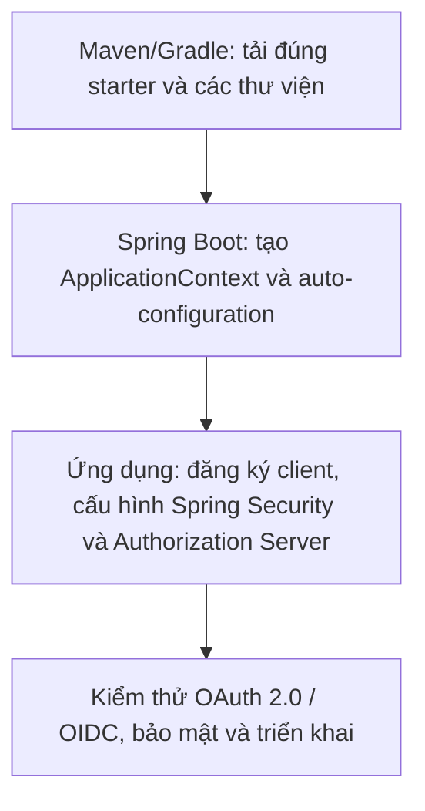

# Khai báo dependency Authorization Server bằng Maven hoặc Gradle

## 1. Mục tiêu và bối cảnh

Trong chương **Khởi tạo dự án** của module `SPRING_SECURITY_OAUTH2_OIDC_AUTHORIZATION_SERVER`, nhiệm vụ đầu tiên là đưa đúng thư viện vào ứng dụng Spring Boot. Đây là bước chuẩn bị để học cách **thiết kế, cấu hình, bảo mật, kiểm thử và vận hành OAuth 2.0/OpenID Connect Authorization Server bằng Spring Security và Spring Authorization Server**.

**Spring Authorization Server** cung cấp các thành phần triển khai OAuth 2.0 Authorization Server và các khả năng OpenID Connect (OIDC). Ứng dụng Authorization Server phát hành authorization code/token, quản lý client và xử lý các luồng ủy quyền. Nó có vai trò khác với một ứng dụng chỉ **đăng nhập qua nhà cung cấp OIDC** (OAuth2 Client) hay một API chỉ **xác minh access token** (Resource Server).

Sau bài này, bạn có thể:

1. Chọn đúng dependency cho Authorization Server trong dự án Spring Boot.
2. Khai báo thư viện bằng **Maven (`pom.xml`)** hoặc **Gradle (`build.gradle`/`build.gradle.kts`)**.
3. Hiểu vì sao nên dùng quản lý phiên bản của Spring Boot thay vì tự gán phiên bản cho từng thư viện Spring Security.
4. Kiểm tra dependency đã được giải quyết đúng và phân biệt lỗi build với lỗi cấu hình runtime.
5. Biết những cấu hình bảo mật, lưu trữ và kiểm thử vẫn phải thực hiện sau khi thêm dependency.

> **Phạm vi phiên bản của ví dụ:** các cấu hình đầy đủ dưới đây dùng **Spring Boot 3.5.0**, Java **17+** và Gradle plugin tương ứng để minh họa một tổ hợp cụ thể, dễ đọc. Khi làm dự án thật, ưu tiên bản vá bảo trì mới nhất của nhánh Spring Boot mà nhóm đang dùng, đồng thời xem ghi chú tương thích trước khi thay đổi major version. Không suy ra rằng cùng cấu hình áp dụng nguyên trạng cho mọi phiên bản Spring Boot/Spring Security.

## 2. Chọn đúng artifact

Với Spring Boot, cách đơn giản nhất để bắt đầu là **starter**:

```text
org.springframework.boot:spring-boot-starter-oauth2-authorization-server
```

Spring Boot starter khai báo những dependency cần thiết và kết nối với cơ chế auto-configuration phù hợp. Thư viện cốt lõi của Spring Authorization Server có tọa độ:

```text
org.springframework.security:spring-security-oauth2-authorization-server
```

Trong dự án Spring Boot thông thường, **ưu tiên starter**; chỉ khai báo artifact cốt lõi trực tiếp khi bạn chủ động quản lý cấu hình và các thư viện liên quan. Không cần khai báo cả hai chỉ để “cho chắc”: starter đã kéo các dependency cần thiết theo quan hệ phụ thuộc.

| Artifact | Vai trò | Khi nào cần? |
| --- | --- | --- |
| `spring-boot-starter-oauth2-authorization-server` | Tạo nền tảng Authorization Server trong Spring Boot | **Bắt buộc theo lựa chọn starter** của bài này |
| `spring-boot-starter-web` | Xây dựng ứng dụng Servlet/HTTP, MVC nếu cần endpoint web và trang đăng nhập | Thường dùng trong ứng dụng Authorization Server Servlet; khai báo rõ để thể hiện kiến trúc web |
| `spring-boot-starter-security` | Bộ lọc và các cơ chế bảo mật của Spring Security | Starter Authorization Server thường đã có dependency bảo mật liên quan; thêm trực tiếp nếu ứng dụng dùng rõ các API đó, tránh tự quản lý phiên bản |
| `spring-boot-starter-test` | JUnit, AssertJ và hạ tầng kiểm thử Spring Boot | Nên dùng ở scope `test` |
| `spring-security-test` | `MockMvc`, mock user, công cụ kiểm thử Spring Security | Nên dùng ở scope `test` khi kiểm thử security |
| `spring-boot-starter-actuator` | Health, metrics và thông tin quan sát vận hành | Tùy chọn; phải bảo vệ các endpoint quản trị |
| `spring-boot-starter-oauth2-client` | Ứng dụng **đóng vai OAuth2/OIDC Client** | Chỉ thêm nếu cùng ứng dụng thực sự có vai trò client |
| `spring-boot-starter-oauth2-resource-server` | Ứng dụng/API **kiểm tra Access Token** | Chỉ thêm nếu cùng ứng dụng cần bảo vệ tài nguyên bằng bearer token |

Tên thư viện gần giống nhau không có nghĩa là cùng vai trò. Việc dùng starter Authorization Server **không tự động biến mọi API thành Resource Server**, cũng không có nghĩa OIDC đã được bật hoặc server đã đủ an toàn cho production.

## 3. Khai báo bằng Maven

### 3.1. Ví dụ `pom.xml` với Spring Boot parent

Nếu tạo ứng dụng Spring Boot mới bằng Maven, có thể dùng `spring-boot-starter-parent` để quản lý phiên bản dependency và plugin:

```xml
<?xml version="1.0" encoding="UTF-8"?>
<project xmlns="http://maven.apache.org/POM/4.0.0"
         xmlns:xsi="http://www.w3.org/2001/XMLSchema-instance"
         xsi:schemaLocation="http://maven.apache.org/POM/4.0.0
                             https://maven.apache.org/xsd/maven-4.0.0.xsd">
    <modelVersion>4.0.0</modelVersion>

    <parent>
        <groupId>org.springframework.boot</groupId>
        <artifactId>spring-boot-starter-parent</artifactId>
        <version>3.5.0</version>
        <relativePath/>
    </parent>

    <groupId>com.example</groupId>
    <artifactId>authorization-server</artifactId>
    <version>0.0.1-SNAPSHOT</version>
    <name>authorization-server</name>

    <properties>
        <java.version>17</java.version>
    </properties>

    <dependencies>
        <!-- Starter cung cấp nền tảng Spring Authorization Server -->
        <dependency>
            <groupId>org.springframework.boot</groupId>
            <artifactId>spring-boot-starter-oauth2-authorization-server</artifactId>
        </dependency>

        <!-- Tầng Servlet/MVC cho ứng dụng web -->
        <dependency>
            <groupId>org.springframework.boot</groupId>
            <artifactId>spring-boot-starter-web</artifactId>
        </dependency>

        <!-- Kiểm thử -->
        <dependency>
            <groupId>org.springframework.boot</groupId>
            <artifactId>spring-boot-starter-test</artifactId>
            <scope>test</scope>
        </dependency>
        <dependency>
            <groupId>org.springframework.security</groupId>
            <artifactId>spring-security-test</artifactId>
            <scope>test</scope>
        </dependency>
    </dependencies>

    <build>
        <plugins>
            <plugin>
                <groupId>org.springframework.boot</groupId>
                <artifactId>spring-boot-maven-plugin</artifactId>
            </plugin>
        </plugins>
    </build>
</project>
```

Giải thích các phần chính:

- **`<parent>`** cung cấp thiết lập và dependency management của Spring Boot. Nhờ vậy, các starter và thư viện Spring Security có thể bỏ thẻ `<version>` riêng.
- **`java.version`** xác định mức Java mục tiêu của ví dụ. Spring Boot 3.x cần Java 17 trở lên; hãy xác minh JDK thực tế của máy build và runtime.
- **`spring-boot-starter-oauth2-authorization-server`** là dependency quan trọng nhất đối với đề bài.
- **`scope=test`** giữ thư viện phục vụ test ngoài dependency runtime của ứng dụng.
- **`spring-boot-maven-plugin`** hỗ trợ đóng gói và chạy ứng dụng Boot qua Maven; plugin không thay thế bước cấu hình Authorization Server.

**Không tự thêm `<version>` cho từng thư viện Spring Security** nếu đang dựa trên Spring Boot parent/BOM. Chẳng hạn, chèn một phiên bản `spring-security-core` khác với phiên bản mà Boot quản lý có thể gây lỗi liên kết lớp ở runtime.

### 3.2. Dự án Maven không dùng Spring Boot parent

Nếu dự án đã có parent POM của tổ chức, vẫn có thể dùng **Spring Boot BOM** trong `dependencyManagement`:

```xml
<properties>
    <spring-boot.version>3.5.0</spring-boot.version>
</properties>

<dependencyManagement>
    <dependencies>
        <dependency>
            <groupId>org.springframework.boot</groupId>
            <artifactId>spring-boot-dependencies</artifactId>
            <version>${spring-boot.version}</version>
            <type>pom</type>
            <scope>import</scope>
        </dependency>
    </dependencies>
</dependencyManagement>
```

Sau đó khai báo dependencies như mục 3.1, không cần đặt lại version cho các artifact được BOM quản lý. **Lưu ý:** import BOM chỉ quản lý **dependency versions**, không sao chép toàn bộ **plugin management** và các thiết lập build của `spring-boot-starter-parent`; trong cấu hình này cần quản lý phiên bản/plugin Maven riêng theo chuẩn dự án.

## 4. Khai báo bằng Gradle

Spring Boot có thể dùng Gradle **Groovy DSL** (`build.gradle`) hoặc **Kotlin DSL** (`build.gradle.kts`). Cả hai dùng cùng tọa độ artifact; cú pháp khai báo khác nhau.

### 4.1. Groovy DSL: `build.gradle`

```groovy
plugins {
    id 'java'
    id 'org.springframework.boot' version '3.5.0'
    id 'io.spring.dependency-management' version '1.1.7'
}

group = 'com.example'
version = '0.0.1-SNAPSHOT'

java {
    toolchain {
        languageVersion = JavaLanguageVersion.of(17)
    }
}

repositories {
    mavenCentral()
}

dependencies {
    implementation 'org.springframework.boot:spring-boot-starter-oauth2-authorization-server'
    implementation 'org.springframework.boot:spring-boot-starter-web'

    testImplementation 'org.springframework.boot:spring-boot-starter-test'
    testImplementation 'org.springframework.security:spring-security-test'
    testRuntimeOnly 'org.junit.platform:junit-platform-launcher'
}

tasks.named('test') {
    useJUnitPlatform()
}
```

Ở ví dụ này:

- Plugin `org.springframework.boot` cung cấp tác vụ build và đóng gói ứng dụng Spring Boot.
- Plugin `io.spring.dependency-management` phối hợp với Spring Boot plugin để dùng BOM tương ứng; vì vậy các dòng `implementation` không cần `version`.
- `java.toolchain` yêu cầu Gradle chọn JDK theo phiên bản Java khai báo, thay vì hoàn toàn phụ thuộc biến `JAVA_HOME`; máy build vẫn phải có hoặc cung cấp được toolchain phù hợp.
- `mavenCentral()` là repository chứa các artifact công khai. Tại doanh nghiệp có thể cần thêm mirror/artifact repository nội bộ theo chính sách tổ chức.

### 4.2. Kotlin DSL: `build.gradle.kts`

```kotlin
plugins {
    java
    id("org.springframework.boot") version "3.5.0"
    id("io.spring.dependency-management") version "1.1.7"
}

group = "com.example"
version = "0.0.1-SNAPSHOT"

java {
    toolchain {
        languageVersion = JavaLanguageVersion.of(17)
    }
}

repositories {
    mavenCentral()
}

dependencies {
    implementation("org.springframework.boot:spring-boot-starter-oauth2-authorization-server")
    implementation("org.springframework.boot:spring-boot-starter-web")

    testImplementation("org.springframework.boot:spring-boot-starter-test")
    testImplementation("org.springframework.security:spring-security-test")
    testRuntimeOnly("org.junit.platform:junit-platform-launcher")
}

tasks.named<Test>("test") {
    useJUnitPlatform()
}
```

Kotlin DSL ở đây chỉ thay **ngôn ngữ mô tả build**; ứng dụng vẫn có thể viết bằng Java. Nếu muốn viết mã nguồn ứng dụng bằng Kotlin, hãy cấu hình thêm Kotlin JVM plugin, Kotlin/Spring plugin và các dependency Kotlin tương ứng theo phiên bản Spring Boot đang dùng.

### 4.3. Có thể dùng Gradle BOM trực tiếp không?

Có. Nếu dự án không dùng plugin `io.spring.dependency-management`, Gradle có cơ chế native `platform` để nhập BOM:

```groovy
dependencies {
    implementation platform('org.springframework.boot:spring-boot-dependencies:3.5.0')
    implementation 'org.springframework.boot:spring-boot-starter-oauth2-authorization-server'
}
```

Đây là **cách thay thế** cơ chế dependency-management trong ví dụ, không phải dependency bắt buộc thêm vào khi đã dùng plugin ở mục 4.1. Với dự án nhiều module hoặc nhiều configuration (`testImplementation`, `annotationProcessor`...), cần bảo đảm BOM áp dụng đúng các configuration liên quan và giải quyết xung đột phiên bản nhất quán. Nên chọn **một chiến lược quản lý phiên bản rõ ràng** cho toàn dự án.

## 5. Maven và Gradle: đối chiếu nhanh

| Mục đích | Maven | Gradle |
| --- | --- | --- |
| File cấu hình | `pom.xml` | `build.gradle` hoặc `build.gradle.kts` |
| Thêm starter | `<dependency>` với groupId/artifactId | `implementation("group:artifact")` hoặc cú pháp Groovy |
| Quản lý phiên bản | Boot parent hoặc Boot BOM | Boot plugin kết hợp dependency management plugin, hoặc Gradle `platform` |
| Phụ thuộc kiểm thử | `<scope>test</scope>` | `testImplementation` |
| Kiểm tra dependency | `dependency:tree` | `dependencies` hoặc `dependencyInsight` |
| Build và test | `mvn verify` | `gradle build` |

Không nên vừa tự chỉ định phiên bản cho starter, vừa để BOM quyết định các thư viện Spring Security khác. Spring Boot, Spring Security và Spring Authorization Server có quan hệ tương thích; đồng bộ chúng qua BOM giúp tránh trộn những phiên bản không được kiểm thử cùng nhau.

## 6. Làm sao biết đã khai báo đúng?

Sau khi lưu cấu hình, hãy chạy bằng **Maven Wrapper** hoặc **Gradle Wrapper** của dự án. Wrapper cố định phiên bản công cụ build và giúp môi trường phát triển/CI dùng cấu hình thống nhất hơn.

### Maven

```bash
./mvnw -DskipTests=false verify
./mvnw dependency:tree -Dincludes=org.springframework.boot:spring-boot-starter-oauth2-authorization-server
./mvnw dependency:tree -Dincludes=org.springframework.security:spring-security-oauth2-authorization-server
```

### Gradle

```bash
./gradlew clean build
./gradlew dependencies --configuration runtimeClasspath
./gradlew dependencyInsight --configuration runtimeClasspath --dependency spring-security-oauth2-authorization-server
```

Trên Windows, thường dùng `mvnw.cmd` hoặc `gradlew.bat` thay cho `./mvnw` và `./gradlew`. Nếu dự án chưa có wrapper, có thể dùng Maven/Gradle cài sẵn đúng phiên bản được hỗ trợ.

Một kết quả phù hợp có thể biểu thị cây phụ thuộc theo dạng khái niệm:

```text
spring-boot-starter-oauth2-authorization-server
  +-- các Spring Boot / Spring Security modules cần thiết
  +-- spring-security-oauth2-authorization-server
  \-- các thư viện phụ thuộc khác
```

Thứ tự và cấu trúc nhánh thực tế tùy phiên bản. **Tiêu chí cần kiểm tra** là starter được resolve, thư viện Authorization Server cốt lõi có trong runtime classpath và build không có xung đột dependency. Không cần yêu cầu cây phụ thuộc khớp từng dòng với ví dụ khái niệm trên.

### Kiểm tra cấp ứng dụng

Một class khởi động Spring Boot tối thiểu:

```java
package com.example.authorizationserver;

import org.springframework.boot.SpringApplication;
import org.springframework.boot.autoconfigure.SpringBootApplication;

@SpringBootApplication
public class AuthorizationServerApplication {
    public static void main(String[] args) {
        SpringApplication.run(AuthorizationServerApplication.class, args);
    }
}
```

Từ đây, ứng dụng có thể khởi động để triển khai tiếp cấu hình Authorization Server. **Biên dịch thành công chỉ xác nhận dependency và mã nguồn hợp lệ**; nó chưa chứng minh được luồng ủy quyền vận hành đúng. Cần thêm cấu hình client, authentication, security filter chain, issuer, khóa ký/JWK, lưu trữ authorization/consent và các endpoint OIDC tùy mục tiêu.

## 7. Starter mang lại gì và không mang lại gì?

Hình dung quy trình cấu hình dự án thành ba lớp:



**Lớp dependency** là điều kiện cần để có các class như `RegisteredClient`, `RegisteredClientRepository`, `OAuth2AuthorizationServerConfigurer` và các token generator. Tuy nhiên, với một Authorization Server dùng trong thực tế, cần quyết định tối thiểu:

- **Registered clients:** client ID, cách xác thực client, redirect URI, grant type, scope, consent.
- **Người dùng:** cách xác thực, mật khẩu đã mã hóa, MFA nếu phù hợp, cấu hình trang đăng nhập/phiên.
- **Security filter chain:** quy tắc bảo vệ Authorization Endpoint, Token Endpoint, login, endpoint quản trị, CSRF và exception handling.
- **Ký token/JWK:** thiết lập khóa ký, công bố khóa công khai, vòng đời/rotation của key, issuer ổn định.
- **Lưu trữ:** `RegisteredClientRepository`, `OAuth2AuthorizationService`, `OAuth2AuthorizationConsentService` dùng lưu trữ bền vững khi hệ thống cần duy trì trạng thái sau khi restart.
- **OIDC:** bật và cấu hình các endpoint/protocol OIDC theo yêu cầu; chỉ có starter trên classpath không đồng nghĩa discovery, UserInfo và mọi tính năng OIDC đều sẵn sàng.

Ở môi trường production, ưu tiên HTTPS, không hard-code client secret hoặc khóa riêng tư, không đưa token vào log, bảo vệ endpoint quản trị và thiết lập quan sát vận hành phù hợp.

## 8. Lỗi phổ biến khi khai báo dependency

### 8.1. Không tìm thấy starter hoặc không tải được artifact

**Biểu hiện:** Maven báo `Could not find artifact`; Gradle báo `Could not find ...`.

**Cách kiểm tra:** kiểm tra chính tả artifact:

```text
org.springframework.boot:spring-boot-starter-oauth2-authorization-server
```

Sau đó kiểm tra repository (Maven Central hoặc mirror nội bộ), quyền truy cập mạng/proxy, phiên bản Boot và trạng thái cache. Không đổi sang một artifact có tên giống chỉ để làm lỗi biến mất; một OAuth2 Client/Resource Server starter không thay thế Authorization Server starter.

### 8.2. Thiếu version hoặc nhiều phiên bản Spring Security xung đột

**Biểu hiện:** Maven yêu cầu version dependency; hoặc runtime có lỗi như `NoSuchMethodError`, `ClassNotFoundException` sau khi tự nâng một số module.

**Cách xử lý:** xác nhận Boot parent/BOM hoặc Gradle dependency management đang có hiệu lực, sau đó xem dependency tree/insight để tìm dependency đã override version. Nếu bắt buộc nâng một thư viện vì lỗi bảo mật, hãy kiểm tra cả ma trận tương thích, release notes và cách quản lý phiên bản được nhà cung cấp hỗ trợ.

### 8.3. Java hoặc Gradle không tương thích

**Biểu hiện:** `UnsupportedClassVersionError`, `invalid source release`, lỗi plugin Gradle khi load.

**Cách xử lý:** kiểm tra `java -version`, `./mvnw -version`, `./gradlew --version` và yêu cầu JDK/Gradle của phiên bản Spring Boot đã chọn. Ví dụ Boot 3.x yêu cầu **Java 17+**. Cập nhật wrapper/toolchain đúng cách thay vì vô hiệu hóa bước kiểm tra.

### 8.4. Build thành công nhưng endpoint OAuth2/OIDC chưa hoạt động

**Biểu hiện:** request tới `/oauth2/authorize`, `/oauth2/token` hoặc endpoint OIDC trả `404`, `401`, `403` hoặc lỗi cấu hình.

**Nguyên nhân có thể:** ứng dụng chưa đăng ký client, chưa khởi tạo Authorization Server SecurityFilterChain, chưa có các bean cần thiết, chưa bật OIDC, hoặc gọi endpoint sai phương thức/thiếu tham số. Tùy request, `401`/`403` có thể là **hành vi bảo vệ hợp lệ**, không phải bằng chứng dependency hỏng.

**Cách xử lý:** kiểm tra cấu hình Authorization Server, tên endpoint, filter-chain matching, issuer và client trước khi kết luận là lỗi dependency. Không tự mở `permitAll()` cho các endpoint nhạy cảm chỉ để biến lỗi thành HTTP 200.

### 8.5. Nhầm Authorization Server với OAuth2 Client/Resource Server

**Ví dụ:** ứng dụng đã thêm `spring-boot-starter-oauth2-resource-server` nhưng không có class như `RegisteredClient`. Resource Server starter phục vụ **kiểm tra Bearer Access Token**; nó không có nhiệm vụ phát hành token. Hãy khai báo đúng Authorization Server starter khi xây dựng bên phát hành.

### 8.6. Khai báo trùng starter và thư viện core

Nếu thêm cả starter và thư viện core với version riêng, dependency tree có thể chọn phiên bản không đúng như mong muốn. Hãy bắt đầu bằng **starter duy nhất cho vai trò Authorization Server** và chỉ thêm dependency trực tiếp khác khi có lý do về API, build hoặc kiến trúc.

## 9. Lựa chọn dependency cho môi trường phát triển và production

| Môi trường / nhu cầu | Gợi ý | Điều cần lưu ý |
| --- | --- | --- |
| Bài học hoặc proof of concept | Starter Authorization Server, Web, Test, Security Test | Dùng cấu hình demo cục bộ và dữ liệu không nhạy cảm |
| Ứng dụng cần lưu client/authorization lâu dài | Thêm dependency truy cập dữ liệu phù hợp (JDBC/JPA, driver database) | Không chỉ thêm JDBC là đủ; phải cấu hình repository/service và migration schema |
| Máy chủ cần metrics/health | Bổ sung Actuator | Giới hạn endpoint quản trị, phân quyền, cấu hình probe và metrics |
| Cần chính sách bảo mật/kiểm thử nâng cao | Security Test và integration test phù hợp | Kiểm thử code/PKCE, token, consent, revoke, refresh, JWKS, issuer và OIDC theo chức năng bật |
| CI/CD và vận hành | Dùng wrapper, khóa phiên bản theo BOM, quét lỗ hổng dependency | Quản lý cập nhật phiên bản, key/secret qua cơ chế an toàn và tuân thủ baseline của tổ chức |

Khi chọn database driver hay cache, hãy xuất phát từ thiết kế trạng thái của Authorization Server. Ví dụ: nhiều instance cần chiến lược dùng chung trạng thái authorization/consent và quản lý key thống nhất; thêm thư viện lưu trữ mà chưa cấu hình service tương ứng **không giải quyết được** vấn đề này.

## 10. Bài thực hành tự kiểm tra

**Yêu cầu:** tạo hai bản cấu hình tương đương cho một Authorization Server Servlet cơ bản, một bản Maven và một bản Gradle. Chưa cần triển khai đầy đủ luồng OAuth2/OIDC.

1. Chọn một nhánh Spring Boot được hỗ trợ; thiết lập JDK phù hợp và cấu hình wrapper.
2. Khai báo `spring-boot-starter-oauth2-authorization-server`, `spring-boot-starter-web` và hai dependency kiểm thử ở đúng scope.
3. Dùng Boot parent/BOM hoặc cơ chế Gradle tương đương; không gán version riêng cho từng Spring Security module.
4. Chạy build và kiểm tra cây dependency có artifact `spring-security-oauth2-authorization-server` qua starter.
5. Viết class `@SpringBootApplication`, khởi động ứng dụng để xác nhận classpath/application context, rồi ghi lại phần cấu hình Authorization Server còn thiếu trước khi test flow.
6. Thử xóa cấu hình quản lý phiên bản ở một bản sao tạm của dự án và quan sát lỗi resolve dependency; khôi phục ngay sau khi học xong. Không thực hiện thử nghiệm này trên nhánh production.

**Câu hỏi tự đánh giá:**

- Vì sao dùng `spring-boot-starter-oauth2-authorization-server` thay vì `spring-boot-starter-oauth2-client` khi xây dựng bên phát hành token?
- Maven parent khác Maven BOM ở điểm nào ngoài việc quản lý phiên bản thư viện?
- Gradle `implementation` khác `testImplementation` như thế nào?
- Build thành công đã đủ để khẳng định Token Endpoint vận hành an toàn chưa? Vì sao?
- Nếu ứng dụng báo `NoSuchMethodError` sau khi nâng `spring-security-core` bằng tay, bạn kiểm tra gì đầu tiên?

## 11. Ghi nhớ và tài liệu tham khảo

**Quy tắc cốt lõi:** với ứng dụng Spring Boot đóng vai **Authorization Server**, hãy bắt đầu bằng **`org.springframework.boot:spring-boot-starter-oauth2-authorization-server`**. Khai báo bằng Maven hoặc Gradle đều có thể đạt cùng kết quả nếu dùng dependency management nhất quán. Việc có thư viện trong classpath là **bước khởi tạo**, còn khả năng phát hành token đúng chuẩn và an toàn phụ thuộc cấu hình Spring Security, OIDC, khóa ký, kho trạng thái và kiểm thử ở các bài tiếp theo.

Các nguồn chính thức nên đối chiếu theo phiên bản đang sử dụng:

- [Spring Authorization Server Reference](https://docs.spring.io/spring-authorization-server/reference/)
- [Spring Authorization Server — Getting Started](https://docs.spring.io/spring-authorization-server/reference/getting-started.html)
- [Spring Boot Reference Documentation](https://docs.spring.io/spring-boot/reference/)
- [Spring Boot Dependency Versions](https://docs.spring.io/spring-boot/appendix/dependency-versions/)
- [Gradle Dependency Management](https://docs.gradle.org/current/userguide/dependency_management.html)
- [Maven Introduction to Dependency Mechanism](https://maven.apache.org/guides/introduction/introduction-to-dependency-mechanism.html)
