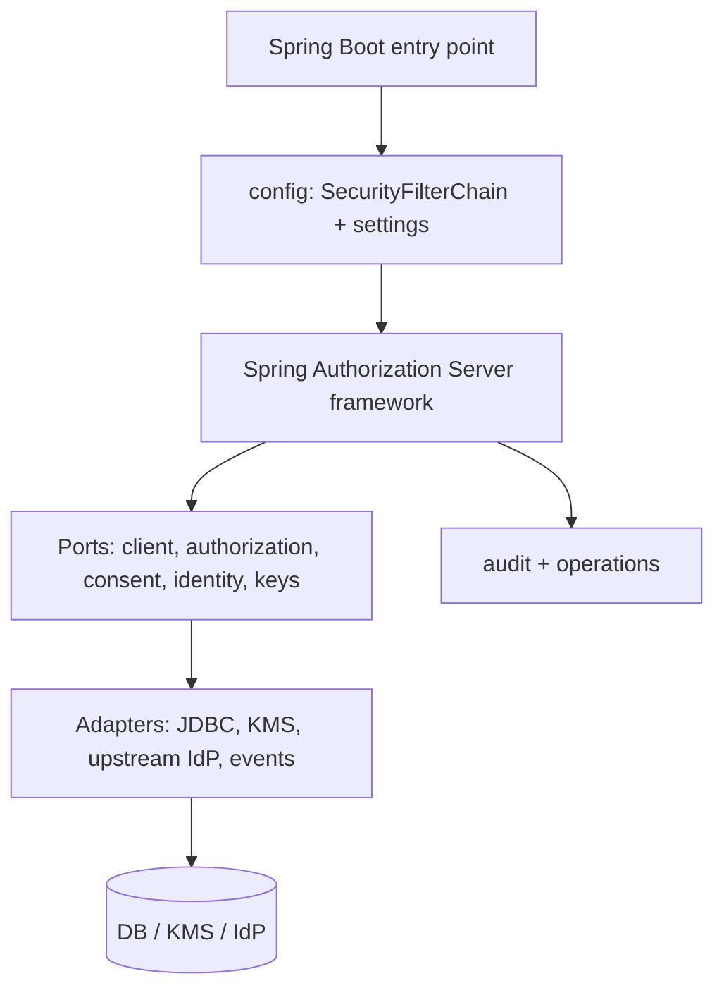
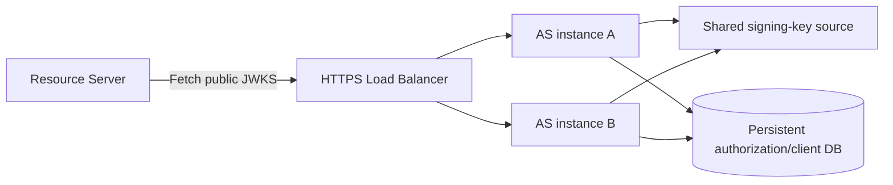
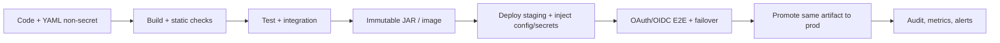

# Tổ chức cấu trúc ứng dụng và các profile môi trường

## Mục tiêu bài học

Trong chương **Khởi tạo dự án**, một bước quan trọng trước khi triển khai các endpoint OAuth 2.0/OpenID Connect (OIDC) là thiết kế cấu trúc mã nguồn và phân tách cấu hình theo môi trường. Với module **SPRING_SECURITY_OAUTH2_OIDC_AUTHORIZATION_SERVER**, chúng ta xây dựng ứng dụng Spring Boot sử dụng Spring Security và Spring Authorization Server để cấp token, quản lý client, xác thực người dùng, bảo vệ khóa ký và vận hành ổn định từ máy phát triển đến production.

Sau bài này, bạn có thể:

- Đề xuất cấu trúc package/module dễ mở rộng cho một Authorization Server, phân biệt phần giao thức, danh tính, lưu trữ, khóa ký và vận hành.
- Tổ chức cấu hình Spring Boot theo `application.yml`, `application-{profile}.yml` và nguồn cấu hình bên ngoài.
- Hiểu thứ tự ghi đè thuộc tính, cách kích hoạt `local`, `test`, `staging`, `prod` và các lỗi thường gặp với `spring.profiles.active`.
- Quản lý `issuer`, database, signing keys, client credentials và log theo môi trường mà không để lộ bí mật.
- Kiểm chứng cấu hình bằng kiểm thử và checklist trước khi đưa Authorization Server lên production.

> **Nguyên tắc cốt lõi:** Cùng một bản build nên chạy được ở mọi môi trường; chỉ dữ liệu cấu hình và những adapter thực sự dành cho môi trường thay đổi. Các quy tắc an toàn của giao thức OAuth 2.0/OIDC, xác thực client và kiểm tra quyền không được tùy tiện tắt vì đang ở môi trường phát triển.

## 1. Vì sao cấu trúc và profile quan trọng với Authorization Server?

Một API CRUD thông thường có thể chủ yếu làm việc với dữ liệu nghiệp vụ. Authorization Server vừa là thành phần hạ tầng danh tính vừa là **nguồn tin cậy phát hành token** cho nhiều ứng dụng khác. Lỗi cấu hình có thể ảnh hưởng tới toàn bộ hệ sinh thái:

- Nếu `issuer` trong ID Token/access token khác metadata OIDC hoặc không trùng cấu hình Resource Server, nhiều client sẽ không thể xác thực token.
- Nếu mỗi instance tạo một khóa ký khác nhau hoặc tạo khóa mới sau mỗi lần khởi động, token đang còn hạn có thể không được xác minh sau chuyển tải hoặc restart.
- Nếu `RegisteredClientRepository` và `OAuth2AuthorizationService` chỉ lưu trong bộ nhớ, client và trạng thái authorization/token có thể mất khi triển khai lại.
- Nếu staging dùng chung database, khóa, tài khoản hoặc client secrets với production, hoạt động thử nghiệm có thể tác động tới môi trường thật.
- Nếu profile `local` vô tình tắt kiểm tra `redirect_uri`, CSRF hoặc xác thực client, kết quả thử nghiệm không phản ánh hành vi production và tạo nguy cơ mang cấu hình yếu lên môi trường thật.

Do vậy, mục đích của phân tách môi trường không chỉ là thay `server.port` hoặc mức log. Ta cần thiết kế **ranh giới trách nhiệm và quy trình kiểm soát cấu hình** từ đầu.

### 1.1. Các thành phần logic cần nhận diện

| Thành phần | Vai trò | Những thay đổi thường phụ thuộc môi trường |
|---|---|---|
| Giao thức Authorization Server | Authorization endpoint, token endpoint, revocation, introspection, metadata, OIDC endpoints. | `issuer`, public base URL, proxy/routing, giới hạn tốc độ. |
| Đăng nhập và danh tính | Xác thực người dùng, MFA, liên kết upstream IdP, vòng đời tài khoản. | Upstream IdP sandbox/production, chính sách thử nghiệm, tài khoản mẫu. |
| Client registry và authorization state | Lưu client đã đăng ký, authorization, token, consent. | Kết nối database, dữ liệu seed phù hợp, chính sách backup. |
| Token và khóa ký | Sinh token, ký JWT, cung cấp JWKS, rotation. | Khóa tách biệt; có thể tạo khóa ngắn hạn cho test, KMS/HSM/keystore cho production. |
| Chính sách quyền | Scope, audience, consent, authority và nghiệp vụ của từng tenant. | Client và scope theo môi trường, nhưng nguyên tắc kiểm tra không giảm mức an toàn. |
| Quan sát và vận hành | Health, metrics, audit, tracing, cảnh báo và khôi phục. | Endpoint được phép truy cập, đích nhận logs/metrics, mức lưu trữ. |

## 2. Chọn cách tổ chức mã nguồn: một ứng dụng, nhiều thành phần rõ ràng

Cho giai đoạn khởi tạo, thường nên bắt đầu bằng **một Spring Boot application được tổ chức theo trách nhiệm**, dùng một quy trình build và deploy. Chỉ tách thành nhiều deployment độc lập khi có yêu cầu thật sự về ownership, khả năng mở rộng hoặc ranh giới vận hành. Tránh tạo microservice riêng cho từng repository hoặc endpoint OAuth 2.0.

Một cấu trúc minh họa (tên package và thư mục có thể điều chỉnh theo quy ước đội):

```text
authorization-server/
├── build.gradle / pom.xml
├── src/
│   ├── main/
│   │   ├── java/com/example/authserver/
│   │   │   ├── AuthorizationServerApplication.java
│   │   │   ├── config/
│   │   │   │   ├── AuthorizationServerSecurityConfig.java
│   │   │   │   ├── ApplicationSecurityConfig.java
│   │   │   │   ├── AuthorizationServerProperties.java
│   │   │   │   └── AuthorizationServerSettingsConfig.java
│   │   │   ├── identity/
│   │   │   │   ├── application/
│   │   │   │   ├── domain/
│   │   │   │   └── infrastructure/
│   │   │   ├── client/
│   │   │   │   ├── application/
│   │   │   │   ├── domain/
│   │   │   │   └── infrastructure/
│   │   │   ├── authorization/
│   │   │   │   ├── application/
│   │   │   │   └── infrastructure/
│   │   │   ├── consent/
│   │   │   ├── keys/
│   │   │   ├── audit/
│   │   │   └── operations/
│   │   └── resources/
│   │       ├── application.yml
│   │       ├── application-local.yml
│   │       ├── application-test.yml
│   │       ├── application-staging.yml
│   │       ├── application-prod.yml
│   │       └── db/migration/
│   │           ├── V1__authorization_server_schema.sql
│   │           └── V2__identity_tables.sql
│   └── test/
│       ├── java/com/example/authserver/
│       │   ├── config/
│       │   ├── integration/
│       │   └── security/
│       └── resources/
│           └── fixtures/
└── docs/
    └── adr/
```

Đây là **cấu trúc đề xuất**, không phải danh sách file phải tạo hết trước khi viết chức năng. Chỉ thêm package khi có trách nhiệm và mã nguồn cụ thể; một ứng dụng nhỏ có thể có ít package hơn.

### 2.1. Vai trò từng package

| Package | Sở hữu trách nhiệm | Tránh đặt vào đây |
|---|---|---|
| `config` | Wiring Spring Beans; cấu hình filter chain, issuer, property binding, cấu hình adapter. | Truy vấn SQL nghiệp vụ, logic đăng ký tài khoản dài. |
| `identity` | Người dùng, thông tin xác thực, liên kết danh tính, chính sách tài khoản, password/MFA integration. | Tự xây API token thay cho framework. |
| `client` | Quy trình đăng ký/phê duyệt/revoke client, policy liên quan client, adapter `RegisteredClientRepository`. | Hard-code client secret production trong Java. |
| `authorization` | Adapter `OAuth2AuthorizationService`, quản lý trạng thái ủy quyền và token theo nghiệp vụ. | Logic UI độc lập với token, hoặc tự kiểm tra JWT sai chuẩn. |
| `consent` | Quản lý consent và adapter `OAuth2AuthorizationConsentService`. | Ghi dữ liệu consent không có chủ sở hữu. |
| `keys` | Nguồn khóa ký, JWKS, luân chuyển, tương tác KMS/HSM/keystore, chính sách `kid`. | Khóa riêng dạng literal, commit file chứa private key. |
| `audit` | Audit event về đăng nhập, token, client, thay đổi quyền và khóa. | In nguyên access/refresh token hoặc mật khẩu. |
| `operations` | Health, metrics, các hook vận hành và xử lý sự cố. | Public endpoint tiết lộ trạng thái nội bộ. |

Không nên đồng nhất `client` trong `client/` với OAuth2 Client của ứng dụng tiêu thụ token: package này quản lý **Registered Client của Authorization Server**. Nếu hệ thống cũng làm OAuth2 Client để đăng nhập qua upstream IdP, nên đặt adapter federation trong `identity/infrastructure` hoặc một package riêng được đặt tên rõ.

### 2.2. Luồng phụ thuộc cần rõ ràng



Framework phụ trách xử lý giao thức; tầng ứng dụng/domain giải quyết quy tắc riêng của tổ chức; tầng infrastructure cung cấp persistence và kết nối ngoài. Có thể triển khai một phần qua các interface do Spring Authorization Server cung cấp, không nhất thiết tạo thêm interface wrapper nếu không mang lại giá trị.

Ví dụ: triển khai `RegisteredClientRepository` bằng JDBC, dùng `OAuth2AuthorizationService` có lưu trữ bền vững, còn quy trình phê duyệt client nằm ở service riêng. Bộ xử lý authorization code vẫn do framework bảo đảm. Thay đổi database không được làm thay đổi chi tiết giao thức.

### 2.3. Tách filter chain của giao thức và ứng dụng

Authorization Server thường có hai nhóm URL khác nhau:

1. **Protocol endpoints**: `/oauth2/authorize`, `/oauth2/token`, `/oauth2/jwks`, OIDC discovery/UserInfo/Logout nếu bật; Spring Authorization Server có bộ configurer chuyên xử lý.
2. **Ứng dụng và quản trị**: login page, user settings, client admin, health/metrics (nếu dùng), chức năng nghiệp vụ.

Nên cấu hình các `SecurityFilterChain` với matcher và thứ tự rõ ràng, tránh để rule cho `/admin/**` chồng lên token endpoint. Đoạn dưới là **khung minh họa cho API cấu hình kiểu Spring Authorization Server 1.x / Spring Security 6.x**; dự án dùng phiên bản khác phải đối chiếu tài liệu chính thức và hoàn thiện các Bean cần thiết:

```java
@Configuration(proxyBeanMethods = false)
class AuthorizationServerSecurityConfig {

    @Bean
    @Order(1)
    SecurityFilterChain authorizationServerFilterChain(HttpSecurity http)
            throws Exception {

        var authorizationServer =
                OAuth2AuthorizationServerConfigurer.authorizationServer();

        http.securityMatcher(authorizationServer.getEndpointsMatcher())
            .with(authorizationServer, configurer ->
                    configurer.oidc(Customizer.withDefaults()))
            .exceptionHandling(exceptions -> exceptions
                .defaultAuthenticationEntryPointFor(
                    new LoginUrlAuthenticationEntryPoint("/login"),
                    new MediaTypeRequestMatcher(MediaType.TEXT_HTML)
                ));

        return http.build();
    }
}

@Configuration(proxyBeanMethods = false)
class ApplicationSecurityConfig {

    @Bean
    @Order(2)
    SecurityFilterChain applicationFilterChain(HttpSecurity http)
            throws Exception {
        http.authorizeHttpRequests(authorize -> authorize
                .requestMatchers("/actuator/health").permitAll()
                .requestMatchers("/admin/**").hasAuthority("AUTH_SERVER_ADMIN")
                .anyRequest().authenticated())
            .formLogin(Customizer.withDefaults());
        return http.build();
    }
}
```

Đoạn mã rút gọn cố ý lược bỏ imports, `UserDetailsService`/authentication provider, `JWKSource`, `RegisteredClientRepository` và các Bean cần thiết khác; **chưa phải Authorization Server chạy production**. Với endpoint actuator, cần thiết kế security matcher và mạng truy cập riêng theo hạ tầng thực tế. Không bao giờ mặc định công khai toàn bộ `/actuator/**`.

**Lưu ý phiên bản:** Spring Authorization Server có lịch sử phát triển và tích hợp với các dòng Spring Security khác nhau; những đường dẫn package, phương thức configurer và điều kiện tự cấu hình có thể thay đổi. Chọn cặp phiên bản Spring Boot/Spring Security/Authorization Server được tài liệu hỗ trợ, dùng đúng tài liệu version của dự án.

## 3. Spring Profiles: công cụ chọn cấu hình và Bean

Spring Boot hỗ trợ nhiều nguồn cấu hình: YAML/properties trong jar, tệp ngoài jar, biến môi trường, system properties, command-line arguments và config data import. Profile là nhãn dùng để chọn **tài liệu cấu hình** và **Bean** theo môi trường hoặc mục đích.

Ví dụ:

| Profile | Mục đích | Cấu hình điển hình |
|---|---|---|
| `local` | Phát triển trên máy cá nhân. | Database riêng, issuer localhost, khóa thử nghiệm không dùng lại production. |
| `test` | Integration/security tests và CI. | Database kiểm thử riêng/Testcontainers, fixture kiểm thử, khóa thử nghiệm. |
| `staging` | Xác nhận bản phát hành, tích hợp E2E, thử failover. | Public HTTPS issuer của staging, nguồn identity sandbox, database và khóa staging. |
| `prod` | Dịch vụ thật. | Public HTTPS issuer ổn định, lưu trữ bền vững, khóa từ kho bí mật, metrics/audit và HA. |

Các profile **không nhất thiết phải tương ứng bốn file khác nhau**. Khi staging và prod chỉ khác hostname, credential và KMS key, có thể dùng chung `application.yml` và giá trị biến môi trường; chỉ tạo `application-{profile}.yml` nếu thực sự có khác biệt cần mô tả.

### 3.1. Profile được kích hoạt thế nào?

`spring.profiles.active` có thể nhận nhiều tên, phân cách bởi dấu phẩy:

```bash
# Ví dụ chạy cùng một file JAR bằng profile local
java -jar authorization-server.jar --spring.profiles.active=local

# Cùng artifact, profile staging được chỉ định bởi môi trường chạy
java -jar authorization-server.jar --spring.profiles.active=staging
```

Có thể đặt biến môi trường `SPRING_PROFILES_ACTIVE=prod` tại hệ thống triển khai. **Không hard-code `prod` trong mã nguồn, cũng không để profile mặc định rơi vào môi trường production**. Nếu không đặt profile, Spring dùng `default`; nên thiết kế fail-fast khi thiếu các thuộc tính bắt buộc như issuer/khóa/database, thay vì tự chọn cấu hình production.

Spring cho phép nhiều profile cùng hoạt động nhưng cần quy tắc vận hành rõ: `local,prod` là một cấu hình nguy hiểm vì thuộc tính có thể ghi đè lẫn nhau. Thường chọn **một profile môi trường** và chỉ thêm profile bổ trợ khi đã xác định tính tương thích. Các nhóm profile (`spring.profiles.group`) chỉ nên dùng khi nhu cầu thực sự rõ.

### 3.2. Thứ tự ghi đè và các giới hạn quan trọng

- `application.yml` cung cấp cấu hình chung; `application-prod.yml` cung cấp giá trị ghi đè khi bật `prod`.
- Cấu hình được đóng gói trong jar có thể bị ghi đè bởi file bên ngoài; environment variables và command-line properties cũng có thể ghi đè file theo thứ tự PropertySource của Spring Boot.
- Khi kích hoạt nhiều profile, profile sau có thể ghi đè profile trước trong cùng nhóm vị trí cấu hình.
- `spring.profiles.active`, `spring.profiles.default`, `spring.profiles.include` và `spring.profiles.group` **phải nằm ở tài liệu không đặc thù profile**; không đặt chúng trong `application-prod.yml` hoặc khối YAML đã gắn `spring.config.activate.on-profile`.
- `spring.config.location` **thay thế** các vị trí cấu hình mặc định; `spring.config.additional-location` **bổ sung** vị trí. Thêm `optional:` chỉ khi vắng file là hành vi được phép.
- Với nhiều tài liệu trong một YAML, dùng `---` và `spring.config.activate.on-profile` để chọn tài liệu. Với dự án dài hạn, thường dễ kiểm soát hơn khi giữ một file chung và các file theo profile nếu sự khác biệt đủ lớn.

Ví dụ multi-document YAML hợp lệ:

```yaml
spring:
  application:
    name: authorization-server

---
spring:
  config:
    activate:
      on-profile: local
logging:
  level:
    com.example.authserver: DEBUG
```

Không thêm `spring.profiles.active: local` vào tài liệu sau dấu `---` ở trên. Việc kích hoạt profile thuộc về **cấu hình môi trường chạy**, không thuộc về tài liệu đang yêu cầu profile đó.

## 4. Thiết kế bộ cấu hình cho Authorization Server

Một cấu hình đủ tốt cần bảo đảm: giá trị chung tối thiểu, không lưu bí mật trong repository, có validation khi khởi động và không thay đổi cách diễn giải thuộc tính giữa các môi trường.

### 4.1. Cấu hình chung: `application.yml`

```yaml
spring:
  application:
    name: authorization-server
  datasource:
    url: ${DB_URL}
    username: ${DB_USERNAME}
    password: ${DB_PASSWORD}
  flyway:
    enabled: true

server:
  port: ${SERVER_PORT:9000}

app:
  authorization:
    issuer: ${AUTH_ISSUER}
    signing-key-ref: ${AUTH_SIGNING_KEY_REF}

management:
  endpoints:
    web:
      exposure:
        include: health,info
```

Giải thích:

- `DB_URL`, `DB_USERNAME`, `DB_PASSWORD` là dữ liệu runtime của Spring DataSource, thay theo môi trường.
- `AUTH_ISSUER` là **issuer công khai**, không phải JDBC hostname hay URL nội bộ giữa các container. Client và Resource Server phải biết, kiểm chứng được giá trị này.
- `AUTH_SIGNING_KEY_REF` là **thuộc tính custom của ví dụ**, tham chiếu tới khóa ký do adapter `keys/` quản lý. Spring Boot/Spring Authorization Server **không tự hiểu và đọc khóa** chỉ vì có thuộc tính này; ứng dụng phải viết Bean `JWKSource`/key provider tương ứng.
- `${SERVER_PORT:9000}` dùng giá trị 9000 nếu thiếu `SERVER_PORT`. Các giá trị nhạy cảm và bắt buộc **không nên có default im lặng**.
- Bật migration giúp giữ schema có phiên bản; tài khoản DB ứng dụng không mặc nhiên có quyền DDL ở production. Có thể chạy Flyway theo release job với quyền riêng, nếu quy trình triển khai yêu cầu.

Đây là ví dụ để học cấu trúc cấu hình; database, ký token, OIDC endpoints, logout và kiểm soát truy cập vẫn cần được triển khai đầy đủ.

### 4.2. Local: `application-local.yml`

```yaml
spring:
  datasource:
    url: ${DB_URL:jdbc:postgresql://localhost:5432/auth_local}
    username: ${DB_USERNAME:auth_local}
    password: ${DB_PASSWORD}

app:
  authorization:
    issuer: ${AUTH_ISSUER:http://localhost:9000}
    signing-key-ref: ${AUTH_SIGNING_KEY_REF:local-ephemeral}

logging:
  level:
    com.example.authserver: DEBUG
```

Ví dụ chọn **PostgreSQL local** để tránh khác biệt hành vi SQL/JDBC so với môi trường chạy chính. Nếu dùng H2 để tăng tốc thao tác phát triển, phải chấp nhận rằng migration, transaction, kiểu dữ liệu và khóa có thể khác PostgreSQL và cần integration tests riêng trên đúng database đích.

`local-ephemeral` ở đây là ký hiệu quy ước của ứng dụng để adapter local **tạo khóa thử nghiệm trong bộ nhớ**; không phải giá trị cấu hình có sẵn của framework. Sau restart, khóa có thể đổi và token đã cấp có thể không xác minh được — chỉ chấp nhận ở local. Không cho phép cấu hình khóa tạm này được dùng trong staging/prod.

Đối với public redirect URI, `http://localhost` có thể dùng cho phát triển theo các giới hạn áp dụng; khi lên staging/prod phải dùng HTTPS và kiểm tra chính xác URI đã đăng ký. Không dùng wildcard redirect để “tiện test”.

### 4.3. Test: `application-test.yml`

```yaml
spring:
  datasource:
    url: ${TEST_DB_URL}
    username: ${TEST_DB_USERNAME}
    password: ${TEST_DB_PASSWORD}

app:
  authorization:
    issuer: https://issuer.test.invalid
    signing-key-ref: test-ephemeral
```

Môi trường kiểm thử có thể nhận `TEST_DB_*` từ CI hoặc dùng Testcontainers với `@DynamicPropertySource` để cung cấp `spring.datasource.*` trực tiếp. Database test phải được tạo/xóa độc lập; không cho phép test kết nối đến production chỉ vì thiếu biến môi trường.

Các test cần dùng **client, account và key fixture** riêng, không mượn client secret thật. `.invalid` là tên miền được dành cho mục đích minh họa/kiểm thử; nó không dùng làm endpoint public trong E2E thực tế. Nếu test chạy đầy đủ discovery hoặc authorization redirect, sử dụng issuer phù hợp với máy chủ test hoặc môi trường test có thể truy cập.

### 4.4. Staging: `application-staging.yml`

```yaml
logging:
  level:
    root: INFO
    com.example.authserver: INFO

management:
  endpoint:
    health:
      probes:
        enabled: true
```

Staging nên nhận `AUTH_ISSUER=https://auth.staging.example.com` (ví dụ) và kết nối tới database, upstream IdP, KMS/keystore **riêng của staging**. Không cần lặp giá trị `issuer` trong file vì đã đọc từ biến môi trường ở `application.yml`.

Staging nên gần production về topology, TLS, proxy, cơ sở dữ liệu, cách lưu khóa và số replica để thử được các vấn đề production; nhưng tài khoản và danh tính được dùng phải là dữ liệu phù hợp để thử nghiệm.

### 4.5. Production: `application-prod.yml`

```yaml
spring:
  config:
    import: "configtree:/run/secrets/auth-server/"

logging:
  level:
    root: INFO

management:
  endpoint:
    health:
      probes:
        enabled: true
```

Ví dụ trên giả định nền tảng triển khai **mount thư mục secret** `/run/secrets/auth-server/`. Tùy cách mount, mỗi file trong config tree cung cấp một property, chẳng hạn `DB_PASSWORD` hoặc `AUTH_SIGNING_KEY_REF`. Nếu hệ thống dùng Vault, KMS, Kubernetes Secrets hoặc secret provider riêng thì thay cơ chế import cho phù hợp; không bắt buộc dùng `configtree`.

Không có tiền tố `optional:` ở đây để ứng dụng **khởi động thất bại khi volume bắt buộc vắng mặt**. Cần xác minh tên file secret và độ ưu tiên của property đúng với deployment thực tế.

Với production, cấu hình issuer phải là HTTPS public endpoint ổn định, ví dụ `https://auth.example.com`. Không đặt issuer theo host của pod, hostname database, random port hoặc URL phụ thuộc instance. Nếu có reverse proxy, xử lý forwarded headers chỉ từ proxy tin cậy; cân nhắc `server.forward-headers-strategy=framework` hoặc cấu hình tương đương theo hạ tầng. Không tin tưởng các header `Forwarded`/`X-Forwarded-*` do client Internet có thể tự gửi.

### 4.6. Bảng giá trị cần kiểm soát

| Thuộc tính | Local | Test | Staging | Production |
|---|---|---|---|---|
| `app.authorization.issuer` | `http://localhost:9000` | Issuer test riêng | HTTPS staging | HTTPS public ổn định |
| Database | Local container | Testcontainers/test DB | DB staging | DB production có backup/HA |
| Signing key | Ephemeral thử nghiệm | Ephemeral fixture | Khóa staging quản lý tập trung | Khóa bền vững, bảo vệ bằng secret manager/KMS/HSM khi phù hợp |
| Registered clients | Client demo hạn chế | Client fixtures | Client E2E staging | Client thật, quy trình cấp phát/thu hồi |
| Upstream IdP | Mock/sandbox | Stub/test issuer | Sandbox enterprise IdP | Enterprise IdP thật |
| Logging | Debug có kiểm soát | Thu logs khi test fail | INFO, audit tập trung | INFO, audit/metrics/alerting |
| Health/readiness | Local | Theo test | Có probe bảo vệ | Có probe, SLO/alerting |
| Dữ liệu người dùng | Giả lập | Fixtures | Dữ liệu thử nghiệm/hợp lệ | Dữ liệu thật với kiểm soát truy cập |

Bất kể môi trường nào, không log nguyên token, mã authorization code, private key, session cookie, mật khẩu hoặc client secret. Mức `DEBUG` cho package ứng dụng cũng phải tránh ghi các dữ liệu này.

## 5. Bind và kiểm tra cấu hình bằng `@ConfigurationProperties`

Khi dùng nhiều biến như issuer, vị trí khóa, thời hạn token và chính sách client, không nên rải `@Value("${...}")` trong hàng chục class. Gom thuộc tính có liên quan thành lớp typed configuration để phát hiện lỗi sớm và dễ kiểm thử.

### 5.1. Bean cấu hình có validation

```java
package com.example.authserver.config;

import jakarta.validation.constraints.NotBlank;
import org.springframework.boot.context.properties.ConfigurationProperties;
import org.springframework.validation.annotation.Validated;

@Validated
@ConfigurationProperties(prefix = "app.authorization")
public record AuthorizationServerProperties(
        @NotBlank String issuer,
        @NotBlank String signingKeyRef
) {}
```

Đăng ký scan tại ứng dụng:

```java
package com.example.authserver;

import org.springframework.boot.SpringApplication;
import org.springframework.boot.autoconfigure.SpringBootApplication;
import org.springframework.boot.context.properties.ConfigurationPropertiesScan;

@SpringBootApplication
@ConfigurationPropertiesScan
public class AuthorizationServerApplication {

    public static void main(String[] args) {
        SpringApplication.run(AuthorizationServerApplication.class, args);
    }
}
```

Mẫu `record` trên giả định runtime hỗ trợ Java records và dự án đã khai báo Bean Validation provider/`spring-boot-starter-validation` tương ứng. Nếu chưa có provider kiểm tra, đừng mặc định `@NotBlank` sẽ được thi hành.

### 5.2. Cấu hình issuer tường minh

```java
package com.example.authserver.config;

import org.springframework.context.annotation.Bean;
import org.springframework.context.annotation.Configuration;
import org.springframework.security.oauth2.server.authorization.settings.AuthorizationServerSettings;

@Configuration(proxyBeanMethods = false)
class AuthorizationServerSettingsConfig {

    @Bean
    AuthorizationServerSettings authorizationServerSettings(
            AuthorizationServerProperties properties) {

        return AuthorizationServerSettings.builder()
                .issuer(properties.issuer())
                .build();
    }
}
```

Đây là ví dụ theo API `AuthorizationServerSettings` của Spring Authorization Server 1.x. **Không có yêu cầu phải đặt mọi endpoint trong class này** nếu sử dụng mặc định phù hợp. Việc cấu hình issuer tường minh giúp tránh suy đoán issuer từ request nội bộ, đặc biệt khi chạy sau proxy hoặc nhiều replica.

`signingKeyRef` phải được adapter trong `keys/` sử dụng để xây `JWKSource` và thiết kế rotation; nếu không cung cấp Bean thực tế, ứng dụng chưa hoàn thiện chức năng ký/JWKS. Các thành phần khác như `RegisteredClientRepository`, `OAuth2AuthorizationService`, `OAuth2AuthorizationConsentService` và cấu hình xác thực người dùng cũng cần được nối bằng Bean đầy đủ.

### 5.3. Kiểm tra giá trị ngoài `@NotBlank`

Giá trị không rỗng chưa đủ an toàn. Khi khởi động, cần xác nhận:

- `issuer` là URI tuyệt đối; staging/prod dùng HTTPS; không có fragment/query không phù hợp; chuẩn hóa dấu slash theo hợp đồng issuer của hệ thống.
- Signing key reference trỏ tới nguồn hợp lệ, tài khoản dịch vụ có quyền lấy/đọc khóa, chứng minh được thuật toán và `kid` được hệ thống hỗ trợ.
- Trong staging/prod, không chấp nhận `local-ephemeral`, `test-ephemeral`, issuer `localhost` hoặc endpoint thử nghiệm.
- Database/kho authorization tồn tại, migration ở phiên bản tương thích và storage có thể ghi/đọc theo yêu cầu.
- `issuer` khớp với discovery metadata, ID Token, access token khi token có claim tương ứng, và cấu hình tin cậy của Resource Server.

Có thể triển khai validator theo profile/runtime policy, **nhưng không dùng profile để bỏ qua kiểm tra chữ ký hoặc kiểm tra giao thức**. Việc startup fail-fast với thông báo rõ tên property giúp giảm nguy cơ khởi động nhầm môi trường.

## 6. Quản lý khóa ký, secret và trạng thái bền vững

### 6.1. Tách cấu hình công khai, bí mật và tài sản quan trọng

Ba nhóm dữ liệu cần cách xử lý khác nhau:

| Nhóm | Ví dụ | Cách quản lý |
|---|---|---|
| Public configuration | Issuer URL, endpoint path, tên ứng dụng, nonsecret feature toggles. | YAML chuẩn hoặc cấu hình ngoài; kiểm soát version và review. |
| Secret | DB password, client secret, private signing key, credential kết nối IdP. | Secret manager/KMS/HSM/keystore/volume bí mật; hạn chế người và process truy cập; audit rotation. |
| State cần bền vững | Registered clients, authorizations/consents, user identity, key metadata, audit trail. | Database/storage có migration, backup, phân quyền, retention và kiểm thử khôi phục. |

**Không commit** khóa riêng, plaintext password hoặc secret thật vào `application-prod.yml`, Java source, SQL seed, Dockerfile, log hay fixture. Public key có thể được công bố qua JWKS; **private signing key tuyệt đối không được công bố**.

### 6.2. Tính nhất quán khóa giữa nhiều replica



Ở staging/prod, hai instance phải cùng tham chiếu bộ khóa hợp lệ cho issuer hiện hành, hoặc có chiến lược rotation phân phối khóa bảo đảm cả hai công bố được các public keys cần thiết. Không tạo cặp khóa RSA mới trong constructor của mỗi instance rồi phát token production; token ký bởi A có thể không xác minh được khi JWKS được phục vụ từ B.

Luân chuyển khóa cần có vòng đời: tạo khóa mới, công bố public JWK, bắt đầu ký bằng `kid` mới, giữ public key cũ đủ lâu cho token còn hiệu lực, cuối cùng mới ngừng công bố và hủy khóa theo chính sách. Tất cả phải được diễn tập trước khi xảy ra sự cố lộ khóa.

### 6.3. Không dùng in-memory store trong production

Các triển khai in-memory phù hợp cho demo/kiểm thử, nhưng nhiều luồng cấp quyền phụ thuộc trạng thái:

- Authorization code thường dùng một lần, cần nhất quán giữa các request có thể tới hai replica.
- Refresh token và authorization state cần cập nhật/thu hồi theo vòng đời được định nghĩa.
- Consent đã lưu và client registration phải tồn tại sau restart.
- Khi có logout/session hoặc kết nối upstream IdP, session persistence và shared state có thể cần kiến trúc riêng.

Spring Authorization Server có các abstraction và implementation JDBC cho những loại lưu trữ nhất định. Cần thiết kế schema, migration, index, transaction và backup theo phiên bản/driver đang dùng; không xem bản SQL mẫu hoặc Bean JDBC mặc định là hoàn chỉnh cho mọi lưu lượng.

## 7. Khi nào dùng `@Profile` trên Bean?

Có hai nhu cầu khác nhau:

1. **Thay giá trị runtime** (issuer, hostname, pool size, log level): ưu tiên `application.yml`, profile-specific config và externalized configuration.
2. **Thay implementation phục vụ môi trường** (key source local vs KMS production, fake gateway test vs real provider): có thể dùng `@Profile`, `@ConditionalOnProperty`, hoặc DI theo interface.

Ví dụ hướng tổ chức:

```text
keys/
├── SigningKeySourceConfiguration.java
├── LocalEphemeralSigningKeyConfiguration.java   # Chỉ local/test
├── ManagedSigningKeyConfiguration.java          # Staging/prod
└── SigningKeyRotationService.java
```

Với triển khai thật, cấu hình local/test sinh khóa thử nghiệm hoặc dùng fixture; staging/prod lấy khóa từ nguồn đã quản lý. Hai implementation **không được cùng tạo `JWKSource`** trong một context; việc thiếu implementation thích hợp phải khiến startup fail.

Một ví dụ gắn nhãn Bean theo profile:

```java
@Configuration(proxyBeanMethods = false)
@Profile({"local", "test"})
class EphemeralSigningKeyConfiguration {
    // @Bean JWKSource<SecurityContext> ... dùng khóa thử nghiệm
}

@Configuration(proxyBeanMethods = false)
@Profile({"staging", "prod"})
class ManagedSigningKeyConfiguration {
    // @Bean JWKSource<SecurityContext> ... kết nối KMS/keystore
}
```

Đây là mô tả hướng wiring; comment cố ý bỏ qua nội dung tạo khóa vì việc đó phải được triển khai và kiểm chứng độc lập. Không dùng `@Profile("prod")` làm điều kiện **duy nhất** để bật kiểm tra CSRF, bắt buộc HTTPS, chính sách OAuth client hay xác thực token — những kiểm soát này cần được thiết kế nhất quán. Các khác biệt rủi ro cao nên được xét duyệt như thay đổi bảo mật.

## 8. Kiểm thử profile và triển khai bằng cùng artifact

### 8.1. Kiểm thử cấu hình đã được áp dụng

Có ít nhất ba tầng kiểm tra:

- **Cấu hình tĩnh:** parse YAML, kiểm tra khóa thuộc tính hợp lệ, không commit secret, không có profile kích hoạt ở tài liệu profile-specific.
- **Khởi tạo context:** chạy `@SpringBootTest` với profile test, xác minh issuer, Bean được inject, nguồn ký và DB test.
- **Integration / E2E:** xác thực discovery document, JWKS, authorization code + PKCE, token endpoint, client authentication, database state và failover.

Ví dụ kiểm tra Bean issuer sau khi context đã khởi tạo thành công:

```java
@SpringBootTest
@ActiveProfiles("test")
class AuthorizationServerProfileTest {

    @Autowired
    AuthorizationServerSettings settings;

    @Test
    void usesTestIssuer() {
        assertThat(settings.getIssuer())
                .isEqualTo("https://issuer.test.invalid");
    }
}
```

Đoạn test trên là rút gọn, chưa có imports; nó giả định môi trường test có database, source ký, registry và các Bean tối thiểu được cấu hình hợp lệ. Đừng chỉ test tên profile đã kích hoạt: mục tiêu là bảo đảm các **giá trị và implementation quan trọng thực sự** thuộc môi trường đó.

### 8.2. Tối thiểu nên kiểm chứng gì ở staging?

| Kiểm tra | Kết quả mong đợi |
|---|---|
| Truy cập discovery metadata và JWKS qua HTTPS public URL. | `issuer` và endpoint trả về đúng public URL; JWKS không lộ private key. |
| Authorization Code + PKCE với redirect URI đã đăng ký. | Code đổi token đúng một lần; request không có/PKCE sai bị từ chối theo policy. |
| API kiểm JWT. | Resource Server từ chối sai chữ ký, `iss`, `aud`, token hết hạn hoặc thiếu quyền. |
| Cân bằng tải sang replica khác. | Token và authorization state tiếp tục hợp lệ; không có khóa ký riêng lẻ. |
| Restart / rolling deployment. | Client, consent, authorization state và public JWK cần thiết vẫn tồn tại. |
| Mất DB hoặc lỗi KMS/secret provider. | Ứng dụng hiển thị readiness/sự cố phù hợp, không bí mật dùng fallback yếu. |
| Thay khóa ký. | Token còn hạn của khóa cũ tiếp tục được xác minh trong giai đoạn chồng lấp đã định. |
| Truy cập actuator/admin. | Các endpoint nhạy cảm bị chặn khỏi mạng/role không được phép. |

### 8.3. Trình tự phát hành và môi trường



Mô hình này giúp giảm tình trạng “build staging khác build production” và tạo bằng chứng rõ ràng về artifact được kiểm thử. Pipeline có thể dùng artifact digest và release manifest; việc chuyển môi trường chỉ thay tham số, secrets, quyền truy cập và đích kết nối. Đừng đưa production secret vào pipeline logs, lệnh command-line hoặc artifact.

Nếu cần database migration, kiểm soát việc nhiều replica cùng thực hiện migration khi rollout. Có thể chạy migration bằng job có quyền phù hợp trước khi tăng số replica, đồng thời thiết kế schema tương thích với rolling deployment.

## 9. Các lỗi cấu hình dễ gặp và cách xử lý

| Triệu chứng | Nguyên nhân thường gặp | Cách kiểm tra/sửa |
|---|---|---|
| `invalid issuer` hoặc Resource Server từ chối JWT. | `issuer` trong token/discovery khác cấu hình API hoặc bị suy luận từ hostname nội bộ. | Đặt issuer cố định theo môi trường, kiểm tra metadata/token/Resource Server trên public URL. |
| Token chỉ xác minh được trên một số request. | Replica A và B có cặp khóa khác nhau hoặc cache JWKS sai. | Dùng nguồn khóa được quản lý chung; kiểm thử rotation và cache. |
| Boot báo cấu hình profile không hợp lệ. | `spring.profiles.active` đặt trong `application-prod.yml` hoặc document có `on-profile`. | Đưa activation về biến môi trường/CLI hoặc tài liệu không đặc thù profile. |
| Test vô tình truy cập DB thật. | Test lấy `DB_URL` thừa hưởng từ môi trường/CI hoặc thiếu isolation. | Cấp database thử nghiệm duy nhất, kiểm tra host/credential khi startup, dùng Testcontainers. |
| App chạy local nhưng fail sau reverse proxy. | Forwarded headers, issuer public, TLS termination và cookie/redirect chưa khớp. | Kiểm tra request thực qua ingress, thiết lập proxy tin cậy và issuer HTTPS. |
| Restart khiến client mất hoặc refresh token hỏng. | In-memory repository, ephemeral signing key hoặc session không bền vững. | Dùng persistence chung cho staging/prod, quản lý khóa và chiến lược session. |
| Một secret không được inject nhưng ứng dụng vẫn chạy. | Placeholder có default không an toàn hoặc optional config import. | Bỏ default nhạy cảm; fail-fast và kiểm thử startup khi thiếu secret. |
| Không truy cập được login page sau tách filter chain. | Matcher/order/entry point không đúng hoặc chain thứ hai chặn URL. | Kiểm tra matcher theo request, login entry point và cấu hình authorize requests. |
| Profile `prod` không mở được Actuator health. | Health endpoint nằm sau security chain hoặc ingress route chưa cấu hình. | Thiết kế endpoint/port vận hành riêng, chỉ cho probe qua mạng tin cậy. |
| Mở `DEBUG` làm lộ token/secret. | Filter, HTTP wire logs hoặc custom audit ghi nguyên request/response. | Tắt logging nhạy cảm, redact dữ liệu và kiểm tra chính sách lưu log. |

## 10. Ví dụ ra quyết định cấu trúc theo quy mô

**Trường hợp A — Dự án học tập/PoC:** một Spring Boot module, PostgreSQL local, hai filter chain, `RegisteredClientRepository` test, key local thử nghiệm, `application-local.yml`. Mục tiêu là hiểu các endpoint và chuỗi xác thực; không coi profile local như cấu hình production.

**Trường hợp B — Hệ thống nội bộ nhiều API:** vẫn có thể giữ một Authorization Server module riêng, tích hợp user directory/SSO, database bền vững, quản lý client có approval và quyền admin, môi trường staging/prod riêng, khóa tập trung, metrics và on-call. API nghiệp vụ chạy như Resource Server độc lập.

**Trường hợp C — Nền tảng nhiều tenant:** thêm ranh giới cho tenant onboarding, mapping external identity, chính sách client/consent theo tenant, audit và truy cập quản trị. Cần đánh giá issuer model, domain, audience, key strategy và khả năng cách ly tenant trước khi quyết định một issuer cho mọi tenant hay nhiều issuer/instance. Đây là quyết định kiến trúc cần kiểm thử liên thông; không giải quyết bằng cách chỉ thêm profile `tenant-a`, `tenant-b`.

Một sai lầm phổ biến là đồng nhất profile môi trường với tenant hoặc khách hàng: **profile giải quyết cách ứng dụng chạy ở môi trường nào; tenant là ranh giới dữ liệu và quyền của các đối tượng đang dùng dịch vụ**. Không nên tạo một Spring profile cho mỗi khách hàng khi số tenant có thể tăng lớn hoặc thay đổi động.

## 11. Checklist trước khi hoàn thành bước khởi tạo

- [ ] Cấu trúc package phân rõ giao thức, identity, client/authorization/consent, khóa ký và vận hành.
- [ ] Có một entry point Spring Boot; hai nhóm security chain có matcher và quyền truy cập rõ ràng.
- [ ] Cấu hình chung không chứa mật khẩu, private key hoặc client secret thật.
- [ ] Đã chọn cách kích hoạt profile từ runtime; không đặt `spring.profiles.active` trong profile-specific document.
- [ ] Đã xác định issuer theo từng môi trường, đặc biệt HTTPS public issuer ở staging/prod.
- [ ] Đã có source ký token cho từng môi trường và kế hoạch chia sẻ/luân chuyển khóa production.
- [ ] Staging/prod dùng persistent storage, migration, backup và quy trình khôi phục.
- [ ] Test và staging không dùng chung database, khóa ký, client secret hoặc dữ liệu thật của prod.
- [ ] Cấu hình bắt buộc được kiểm tra lúc startup và không có default bí mật nguy hiểm.
- [ ] Đã kiểm tra metadata, JWKS, PKCE, token validation, restart/rolling deploy và endpoint vận hành.
- [ ] Cùng một artifact được promotion qua staging/prod, secrets được inject ở thời điểm deploy.
- [ ] Có tài liệu sở hữu cấu hình, thay đổi cấu hình, rotation keys, audit và rollback.

## Tổng kết

Tổ chức tốt một Authorization Server bắt đầu từ việc **giữ phần xử lý giao thức có ranh giới rõ ràng**, **đưa cấu hình môi trường ra ngoài mã nguồn** và **coi issuer, private keys, authorization state là tài sản quan trọng của nền tảng**. Spring Profiles giúp chọn cấu hình và adapter phù hợp, nhưng không thay thế mô hình bảo mật, kiểm thử tích hợp hay quy trình vận hành.

Khi những nguyên tắc này được đặt ngay từ bước khởi tạo dự án, các bài tiếp theo về đăng ký client, cấp token, OIDC, revoke/introspection, MFA, kiểm thử và triển khai production sẽ có nền tảng ít phải sửa lại hơn.

## Tài liệu tham khảo

1. [Spring Boot — Profiles](https://docs.spring.io/spring-boot/reference/features/profiles.html): kích hoạt profile, profile group và giới hạn đối với `spring.profiles.active`.
2. [Spring Boot — Externalized Configuration](https://docs.spring.io/spring-boot/reference/features/external-config.html): nguồn cấu hình, thứ tự ghi đè, file theo profile, config import và config tree.
3. [Spring Boot — Properties and Configuration](https://docs.spring.io/spring-boot/how-to/properties-and-configuration.html): cấu hình nhiều tài liệu và `spring.config.activate.on-profile`.
4. [Spring Authorization Server — Configuration Model (1.x)](https://docs.spring.io/spring-authorization-server/reference/configuration-model.html): security filter chain, `AuthorizationServerSettings`, endpoint và issuer.
5. [Spring Security — Authorization Server Configuration](https://docs.spring.io/spring-security/reference/servlet/oauth2/authorization-server/configuration-model.html): tài liệu đối chiếu cho dòng Spring Security tích hợp Authorization Server.
6. [Spring Security — OAuth 2.0 Resource Server JWT](https://docs.spring.io/spring-security/reference/servlet/oauth2/resource-server/jwt.html): kiểm chứng issuer/JWT và cách cấu hình Resource Server.

