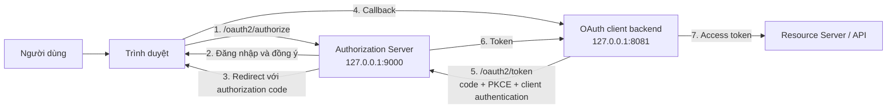

# Cấu hình tối thiểu để khởi chạy Authorization Server

Trong chương **Khởi tạo dự án**, mục tiêu là dựng được một **OAuth 2.0/OpenID Connect Authorization Server** bằng **Spring Boot, Spring Security và Spring Authorization Server** ở môi trường phát triển. Máy chủ phải có thể khởi động, công bố metadata OIDC/JWKS, nhận yêu cầu ủy quyền, xác thực người dùng và có đủ thành phần để phát hành token cho một OAuth client đã đăng ký.

Bài này cung cấp cấu hình Java có thể sử dụng làm điểm khởi đầu, chỉ ra chức năng của từng bean, hướng dẫn chạy và kiểm tra các endpoint. Các tài khoản, khóa ký và kho dữ liệu trong ví dụ chỉ phục vụ **phát triển trên máy cá nhân**; phần cuối giải thích những gì cần thay trước khi vận hành thật.

## 1. Mô hình chạy thử và kết quả mong đợi

Một Authorization Server không chỉ là màn hình đăng nhập. Nó giữ thông tin client đăng ký, xác thực người dùng, kiểm tra các điều kiện cấp quyền và phát hành mã ủy quyền/token.



Ta sẽ cấu hình các giá trị cụ thể sau:

| Thành phần | Giá trị demo | Vai trò |
| --- | --- | --- |
| Authorization Server | `http://127.0.0.1:9000` | Endpoint đăng nhập, cấp quyền, cấp token và metadata. |
| Issuer | `http://127.0.0.1:9000` | Định danh của bên phát hành; phải trùng với `issuer` trong metadata/token. |
| OAuth client | `demo-client` | Confidential web client, giả định có backend giữ secret. |
| Callback đã đăng ký | `http://127.0.0.1:8081/login/oauth2/code/demo-client` | Đích nhận authorization code; cần ứng dụng client thực sự ở cổng 8081 để hoàn tất luồng. |
| Tài khoản demo | `alice` | Người dùng thử đăng nhập qua form login của Authorization Server. |
| Scopes | `openid`, `profile`, `message.read` | Hai scope OIDC và một quyền API ví dụ. |
| Grant type | `authorization_code`, `refresh_token` | Cấp token qua Authorization Code; refresh token chỉ cấp nếu các điều kiện liên quan thỏa mãn. |
| PKCE | Bắt buộc, `S256` | Bảo vệ liên kết giữa yêu cầu cấp code và yêu cầu đổi token. |

**Lưu ý:** máy chủ ở cổng 9000 có thể chạy độc lập, nhưng để thực hiện **toàn bộ** Authorization Code Flow cần một OAuth client ở cổng 8081 (hoặc đổi callback đã đăng ký thành callback thật của công cụ kiểm thử). Không cần xây API/Resource Server chỉ để kiểm tra metadata và khả năng khởi động AS.

## 2. Chuẩn bị dự án Spring Boot

Ví dụ dùng **Java 17 trở lên, Spring Boot 3.x tương thích với Spring Authorization Server 1.x** và API cấu hình SecurityFilterChain hiện đại (`HttpSecurity.with(...)`). Khi tạo dự án thực tế, chọn một bản vá còn được hỗ trợ trong cùng dòng phiên bản và để **Spring Boot BOM** quản lý phiên bản của starter; đừng tự trộn phiên bản Spring Security và Authorization Server.

Tạo dự án Maven từ Spring Initializr với:

- Group: `com.example`, Artifact: `auth-server`, package: `com.example.authserver`.
- Dependencies: **Spring Web**, **Spring Security**, **OAuth2 Authorization Server**.
- Packaging: Jar; Java 17+.

Phần `dependencies` của `pom.xml` (đặt bên trong dự án được Spring Initializr tạo) gồm:

```xml
<dependencies>
    <dependency>
        <groupId>org.springframework.boot</groupId>
        <artifactId>spring-boot-starter-web</artifactId>
    </dependency>
    <dependency>
        <groupId>org.springframework.boot</groupId>
        <artifactId>spring-boot-starter-security</artifactId>
    </dependency>
    <dependency>
        <groupId>org.springframework.boot</groupId>
        <artifactId>spring-boot-starter-oauth2-authorization-server</artifactId>
    </dependency>
</dependencies>
```

Starter của Authorization Server kéo các thành phần giao thức cần thiết. **Không** thêm `spring-boot-starter-oauth2-client` chỉ vì dự án phát hành token: OAuth2 Client là vai trò riêng, dành cho ứng dụng đăng nhập/ủy quyền qua AS. Tương tự, trong ví dụ này chưa cần cơ sở dữ liệu hoặc Redis.

Cấu trúc file minh họa:

```text
auth-server/
├── pom.xml
└── src/main/
    ├── java/com/example/authserver/
    │   ├── AuthServerApplication.java
    │   └── SecurityConfig.java
    └── resources/
        └── application.yml
```

Nếu dùng một dòng Spring Boot/Spring Security mới hơn có API cấu hình khác, đối chiếu tài liệu của **đúng dòng phiên bản**. Mẫu Java dưới đây được trình bày cho dòng Boot 3.x/Spring Authorization Server 1.x hỗ trợ `OAuth2AuthorizationServerConfigurer.authorizationServer()` và `HttpSecurity.with(...)`.

## 3. Cấu hình cổng và bí mật môi trường

Tạo `src/main/resources/application.yml`:

```yaml
spring:
  application:
    name: auth-server

server:
  port: 9000

demo:
  client-secret: ${DEMO_CLIENT_SECRET}
  user-password: ${DEMO_USER_PASSWORD}
```

Hai biến môi trường bắt buộc sẽ được đặt trước lúc chạy. Điều này giúp tránh đưa mật khẩu và client secret trực tiếp vào source code. Các giá trị trong bản demo chỉ nên dùng trên máy cá nhân.

**Windows PowerShell:**

```powershell
$env:DEMO_CLIENT_SECRET = "local-dev-client-secret-change-me"
$env:DEMO_USER_PASSWORD = "local-dev-user-password-change-me"
.\mvnw.cmd spring-boot:run
```

**macOS/Linux:**

```bash
export DEMO_CLIENT_SECRET='local-dev-client-secret-change-me'
export DEMO_USER_PASSWORD='local-dev-user-password-change-me'
./mvnw spring-boot:run
```

Nếu chưa có `mvnw`/`mvnw.cmd`, sử dụng Maven đã cài (`mvn spring-boot:run`). Mặc định chỉ kiểm thử trên loopback. Cấu hình issuer HTTP trong bài **không dành cho môi trường công khai**.

## 4. Điểm vào Spring Boot

Tạo `AuthServerApplication.java`:

```java
package com.example.authserver;

import org.springframework.boot.SpringApplication;
import org.springframework.boot.autoconfigure.SpringBootApplication;

@SpringBootApplication
public class AuthServerApplication {

    public static void main(String[] args) {
        SpringApplication.run(AuthServerApplication.class, args);
    }
}
```

`@SpringBootApplication` quét `@Configuration` và các bean cùng package/subpackage. Ví dụ đặt `SecurityConfig` trong cùng package để được nạp tự động.

## 5. Cấu hình Authorization Server hoàn chỉnh ở mức tối thiểu

Tạo `SecurityConfig.java` với các bean: hai SecurityFilterChain, RegisteredClientRepository, UserDetailsService, PasswordEncoder, JWKSource, JwtDecoder và AuthorizationServerSettings.

```java
package com.example.authserver;

import java.security.KeyPair;
import java.security.KeyPairGenerator;
import java.security.NoSuchAlgorithmException;
import java.security.interfaces.RSAPrivateKey;
import java.security.interfaces.RSAPublicKey;
import java.util.UUID;

import com.nimbusds.jose.jwk.JWKSet;
import com.nimbusds.jose.jwk.RSAKey;
import com.nimbusds.jose.jwk.source.JWKSource;
import com.nimbusds.jose.proc.SecurityContext;

import org.springframework.beans.factory.annotation.Value;
import org.springframework.context.annotation.Bean;
import org.springframework.context.annotation.Configuration;
import org.springframework.core.annotation.Order;
import org.springframework.http.MediaType;
import org.springframework.security.config.Customizer;
import org.springframework.security.config.annotation.web.builders.HttpSecurity;
import org.springframework.security.core.userdetails.User;
import org.springframework.security.core.userdetails.UserDetails;
import org.springframework.security.core.userdetails.UserDetailsService;
import org.springframework.security.crypto.factory.PasswordEncoderFactories;
import org.springframework.security.crypto.password.PasswordEncoder;
import org.springframework.security.oauth2.core.AuthorizationGrantType;
import org.springframework.security.oauth2.core.ClientAuthenticationMethod;
import org.springframework.security.oauth2.core.oidc.OidcScopes;
import org.springframework.security.oauth2.jwt.JwtDecoder;
import org.springframework.security.oauth2.server.authorization.client.InMemoryRegisteredClientRepository;
import org.springframework.security.oauth2.server.authorization.client.RegisteredClient;
import org.springframework.security.oauth2.server.authorization.client.RegisteredClientRepository;
import org.springframework.security.oauth2.server.authorization.config.annotation.web.configurers.OAuth2AuthorizationServerConfigurer;
import org.springframework.security.oauth2.server.authorization.config.annotation.web.configuration.OAuth2AuthorizationServerConfiguration;
import org.springframework.security.oauth2.server.authorization.settings.AuthorizationServerSettings;
import org.springframework.security.oauth2.server.authorization.settings.ClientSettings;
import org.springframework.security.provisioning.InMemoryUserDetailsManager;
import org.springframework.security.web.SecurityFilterChain;
import org.springframework.security.web.authentication.LoginUrlAuthenticationEntryPoint;
import org.springframework.security.web.util.matcher.MediaTypeRequestMatcher;

@Configuration(proxyBeanMethods = false)
public class SecurityConfig {

    // Filter chain số 1 chỉ xử lý các endpoint thuộc Authorization Server.
    @Bean
    @Order(1)
    SecurityFilterChain authorizationServerSecurityFilterChain(
            HttpSecurity http) throws Exception {

        OAuth2AuthorizationServerConfigurer authorizationServerConfigurer =
                OAuth2AuthorizationServerConfigurer.authorizationServer();

        http
            .securityMatcher(authorizationServerConfigurer.getEndpointsMatcher())
            .with(authorizationServerConfigurer, authorizationServer ->
                authorizationServer.oidc(Customizer.withDefaults())
            )
            .authorizeHttpRequests(authorize ->
                authorize.anyRequest().authenticated()
            )
            .exceptionHandling(exceptions ->
                exceptions.defaultAuthenticationEntryPointFor(
                    new LoginUrlAuthenticationEntryPoint("/login"),
                    new MediaTypeRequestMatcher(MediaType.TEXT_HTML)
                )
            )
            // Hỗ trợ xác minh Bearer JWT tại OIDC UserInfo endpoint.
            .oauth2ResourceServer(resourceServer ->
                resourceServer.jwt(Customizer.withDefaults())
            );

        return http.build();
    }

    // Filter chain số 2 xử lý giao diện đăng nhập và request còn lại.
    @Bean
    @Order(2)
    SecurityFilterChain applicationSecurityFilterChain(
            HttpSecurity http) throws Exception {

        http
            .authorizeHttpRequests(authorize ->
                authorize.anyRequest().authenticated()
            )
            .formLogin(Customizer.withDefaults());

        return http.build();
    }

    // Đăng ký OAuth client chạy ở một backend riêng trên cổng 8081.
    @Bean
    RegisteredClientRepository registeredClientRepository(
            PasswordEncoder passwordEncoder,
            @Value("${demo.client-secret}") String clientSecret) {

        RegisteredClient client = RegisteredClient
            .withId(UUID.randomUUID().toString())
            .clientId("demo-client")
            .clientSecret(passwordEncoder.encode(clientSecret))
            .clientAuthenticationMethod(
                ClientAuthenticationMethod.CLIENT_SECRET_BASIC
            )
            .authorizationGrantType(
                AuthorizationGrantType.AUTHORIZATION_CODE
            )
            .authorizationGrantType(
                AuthorizationGrantType.REFRESH_TOKEN
            )
            .redirectUri(
                "http://127.0.0.1:8081/login/oauth2/code/demo-client"
            )
            .scope(OidcScopes.OPENID)
            .scope(OidcScopes.PROFILE)
            .scope("message.read")
            .clientSettings(ClientSettings.builder()
                .requireProofKey(true)
                .requireAuthorizationConsent(true)
                .build())
            .build();

        return new InMemoryRegisteredClientRepository(client);
    }

    // Tài khoản dùng để thử form login trên máy phát triển.
    @Bean
    UserDetailsService userDetailsService(
            PasswordEncoder passwordEncoder,
            @Value("${demo.user-password}") String userPassword) {

        UserDetails alice = User.withUsername("alice")
            .password(passwordEncoder.encode(userPassword))
            .roles("USER")
            .build();

        return new InMemoryUserDetailsManager(alice);
    }

    @Bean
    PasswordEncoder passwordEncoder() {
        // Mặc định mã hóa bằng bcrypt, kèm tiền tố {bcrypt}
        // để lớp DelegatingPasswordEncoder nhận biết thuật toán.
        return PasswordEncoderFactories.createDelegatingPasswordEncoder();
    }

    // Tạo RSA JWK cho việc ký JWT; mỗi lần khởi động sinh một khóa mới.
    @Bean
    JWKSource<SecurityContext> jwkSource() {
        KeyPair keyPair = generateRsaKey();

        RSAKey rsaKey = new RSAKey.Builder(
                (RSAPublicKey) keyPair.getPublic())
            .privateKey((RSAPrivateKey) keyPair.getPrivate())
            .keyID(UUID.randomUUID().toString())
            .build();

        JWKSet jwkSet = new JWKSet(rsaKey);
        return (jwkSelector, securityContext) ->
            jwkSelector.select(jwkSet);
    }

    @Bean
    JwtDecoder jwtDecoder(JWKSource<SecurityContext> jwkSource) {
        return OAuth2AuthorizationServerConfiguration.jwtDecoder(jwkSource);
    }

    @Bean
    AuthorizationServerSettings authorizationServerSettings() {
        return AuthorizationServerSettings.builder()
            .issuer("http://127.0.0.1:9000")
            .build();
    }

    private static KeyPair generateRsaKey() {
        try {
            KeyPairGenerator generator = KeyPairGenerator.getInstance("RSA");
            generator.initialize(2048);
            return generator.generateKeyPair();
        } catch (NoSuchAlgorithmException ex) {
            throw new IllegalStateException("Cannot generate RSA key", ex);
        }
    }
}
```

**Phạm vi của mẫu:** cấu hình trên dùng API và import của Spring Authorization Server 1.x tương ứng với Spring Security 6.x. Dự án ở dòng phiên bản khác có thể cần điều chỉnh API. Không copy các cấu hình `SecurityFilterChain` từ nhiều phiên bản Spring Security khác nhau vào cùng một lớp.

### 5.1. Vì sao cần hai SecurityFilterChain?

- `@Order(1)` và `securityMatcher(authorizationServerConfigurer.getEndpointsMatcher())` khiến chain đầu tiên áp dụng cho các endpoint Authorization Server (authorize, token, JWK, metadata/OIDC liên quan). Chain này bật hỗ trợ OIDC và trả hướng đăng nhập cho yêu cầu trình duyệt chưa có phiên.
- `@Order(2)` đảm nhiệm các request không khớp chain thứ nhất, đặc biệt `GET /login` và `POST /login`. `formLogin()` tạo giao diện đăng nhập mặc định và xử lý xác thực từ `UserDetailsService`.
- `authorizeHttpRequests(...authenticated())` là chính sách mặc định trong mỗi chain. Những endpoint giao thức được phép truy cập công khai khi cần (như metadata/JWKS) được Authorization Server configurer thiết lập theo cơ chế của nó.
- `oauth2ResourceServer(...jwt())` trong chain AS hỗ trợ endpoint OIDC cần xử lý Bearer token, chẳng hạn UserInfo. Nó **không** tự biến ứng dụng này thành API nghiệp vụ.
- Không tắt CSRF toàn cục bằng `csrf.disable()`. Spring Authorization Server xử lý yêu cầu giao thức thích hợp; form login và các request browser cần giữ bảo vệ CSRF theo mặc định.

Nếu xóa chain thứ hai hoặc không cấu hình đường vào `/login`, người dùng có thể bị chuyển đến trang đăng nhập không có bộ lọc xử lý. Nếu để mọi endpoint trong một chain chung mà không xét endpoint matcher, thứ tự và cơ chế bảo mật có thể sai.

### 5.2. RegisteredClientRepository chịu trách nhiệm gì?

`RegisteredClient` là **bản ghi do Authorization Server tin cậy** về client. Nó chứa phương thức xác thực client, grant được cấp, callback, scopes và thiết lập PKCE/consent.

Trong mẫu:

- `CLIENT_SECRET_BASIC` là cách backend client xác thực khi gọi `/oauth2/token`; `demo-client` chỉ là định danh, không phải secret.
- `passwordEncoder.encode(clientSecret)` tạo chuỗi có tiền tố dạng `{bcrypt}...` để Spring Security kiểm tra secret phù hợp. Không lưu plaintext trong kho cấu hình client.
- `requireProofKey(true)` yêu cầu code challenge/verifier khi dùng Authorization Code. Backend client phải tạo challenge từ verifier và giữ verifier đúng giao dịch.
- `requireAuthorizationConsent(true)` có thể khiến người dùng thấy màn hình đồng ý scope. Đây là bước cấp quyền cho client, khác với xác thực người dùng.
- URI callback phải khớp URI đã đăng ký; không nhận redirect tùy ý từ URL do trình duyệt gửi.
- `InMemoryRegisteredClientRepository` mất trạng thái sau restart; ID nội bộ được sinh mới mỗi lần khởi động. Nó chỉ phù hợp cho demo/kiểm thử.

Nếu mục tiêu là **SPA/native app**, cần đăng ký một **public client** riêng (ví dụ `ClientAuthenticationMethod.NONE`) cùng Authorization Code + PKCE; tuyệt đối không nhúng secret dùng cho confidential client vào JavaScript hoặc binary phát hành cho người dùng.

### 5.3. UserDetailsService khác RegisteredClientRepository như thế nào?

`UserDetailsService` lưu và tra **người dùng đăng nhập** (ở đây là `alice`). `RegisteredClientRepository` lưu **ứng dụng OAuth** (ở đây là `demo-client`). Xác thực người dùng và xác thực client là hai hành động độc lập:

| Thao tác | Danh tính được kiểm tra | Thành phần |
| --- | --- | --- |
| Đăng nhập trên `/login` | Người dùng `alice` và mật khẩu | Spring Security form login + `UserDetailsService` |
| Đổi authorization code tại `/oauth2/token` | `demo-client` và client secret | Spring Authorization Server client authentication |
| Kiểm tra mã ủy quyền | Code còn hiệu lực, thuộc đúng client, PKCE và redirect hợp lệ | Spring Authorization Server |
| Sử dụng access token để đọc API | Token, issuer, audience, scope và quyền dữ liệu | Resource Server riêng |

Trong hệ thống thật, người dùng có thể nằm trong CSDL, LDAP, AD hoặc một upstream Identity Provider. Client registry cũng thường được lưu bền vững trong CSDL và vận hành qua quy trình đăng ký client có kiểm soát.

### 5.4. Vì sao cần JWKSource và JwtDecoder?

`JWKSource<SecurityContext>` đưa bộ khóa cho phần ký/phát hành JWT. Với RSA, chỉ khóa công khai được công bố qua JWKS; khóa riêng được dùng nội bộ để ký. `JwtDecoder` cung cấp khả năng xác minh JWT cần cho các chức năng OIDC của AS như UserInfo.

Mẫu tạo khóa RSA 2048-bit **mới mỗi lần khởi động** để loại bỏ nhu cầu tạo keystore trước. Hệ quả: token đã ký trước khi restart có thể không còn xác minh được với bộ khóa mới. Trong triển khai thật phải dùng khóa được lưu và quản lý bền vững (KMS/HSM/keystore), cấu hình phân phối JWKS và vòng đời xoay khóa an toàn.

**Tách hai khái niệm:** `JwtDecoder` xác minh JWT; `JWKSource` cung cấp khóa. Việc công bố JWKS không cho phép client lấy được RSA private key nếu hệ thống chỉ trả phần khóa công khai đúng chuẩn.

### 5.5. Vì sao issuer phải khai báo tường minh?

`AuthorizationServerSettings.builder().issuer(...)` xác định danh tính nhà phát hành. Cùng một issuer phải nhất quán giữa discovery metadata, claim `iss` trong token và cấu hình phía client/Resource Server.

`http://127.0.0.1:9000` và `http://localhost:9000` là **hai chuỗi issuer khác nhau** đối với kiểm tra chính xác. Vì vậy ví dụ luôn dùng `127.0.0.1`. Khi triển khai sau reverse proxy, khai báo issuer là địa chỉ HTTPS **công khai** thật, không phải địa chỉ nội bộ của container hay cổng bind nội bộ. Chỉ xử lý forwarded headers từ proxy đáng tin cậy.

## 6. Khởi chạy và kiểm tra smoke test

Sau khi đặt hai biến môi trường và chạy Maven, kiểm tra log để xác nhận ứng dụng khởi động trên cổng 9000. Có thể truy cập bằng trình duyệt hoặc `curl`.

### 6.1. Kiểm tra OIDC discovery

```bash
curl -i http://127.0.0.1:9000/.well-known/openid-configuration
```

Kết quả mong đợi: HTTP `200` và JSON chứa các trường tương tự:

```json
{
  "issuer": "http://127.0.0.1:9000",
  "authorization_endpoint": "http://127.0.0.1:9000/oauth2/authorize",
  "token_endpoint": "http://127.0.0.1:9000/oauth2/token",
  "jwks_uri": "http://127.0.0.1:9000/oauth2/jwks"
}
```

Đây là **ví dụ rút gọn** các trường trọng tâm, không phải toàn bộ phản hồi discovery thực tế.

Trong thực tế client nên sử dụng discovery metadata để xác định endpoint và khả năng được công bố, thay vì giả định mọi Authorization Server đều dùng các đường dẫn giống nhau.

### 6.2. Kiểm tra bộ khóa công khai

```bash
curl -i http://127.0.0.1:9000/oauth2/jwks
```

Kết quả mong đợi: HTTP `200` và JSON `keys` chứa khóa có `kty` là `RSA`, `kid` và các tham số công khai như `n`, `e`. Không được xuất hiện `d` hoặc các thành phần khóa riêng trong JWKS công khai.

### 6.3. Kiểm tra trang đăng nhập

Mở `http://127.0.0.1:9000/login`. Ứng dụng cần hiển thị form login mặc định. Khi được yêu cầu xác thực trong luồng authorize, dùng:

- Username: `alice`.
- Password: giá trị đã đặt trong `DEMO_USER_PASSWORD`.

Vào trực tiếp `/login` rồi đăng nhập chỉ kiểm tra cơ chế form authentication; **chưa chứng minh** client đã nhận được access token. Việc cấp code/token đòi hỏi một OAuth authorization request hợp lệ.

### 6.4. Thử toàn bộ Authorization Code + PKCE khi có OAuth client

Khi đã có ứng dụng client thực sự chạy ở callback đã đăng ký, client tạo một `code_verifier` ngẫu nhiên và `code_challenge = BASE64URL(SHA256(ASCII(code_verifier)))`, đồng thời tạo `state` khó đoán. Client khởi động luồng bằng cách điều hướng trình duyệt tới URL tương đương:

```text
http://127.0.0.1:9000/oauth2/authorize
  ?response_type=code
  &client_id=demo-client
  &redirect_uri=http%3A%2F%2F127.0.0.1%3A8081%2Flogin%2Foauth2%2Fcode%2Fdemo-client
  &scope=openid%20profile%20message.read
  &state=<STATE_NGAU_NHIEN>
  &code_challenge=<S256_CHALLENGE_THUC>
  &code_challenge_method=S256
  &nonce=<NONCE_NGAU_NHIEN>
```

Đây là URL **minh họa đã ngắt dòng**. Khi dùng thật, ghép thành một URL hợp lệ và thay toàn bộ placeholder bằng giá trị ngẫu nhiên do client tạo; không gõ nguyên văn dấu `<...>`.

Sau khi người dùng xác thực và consent, AS chuyển hướng tới callback với `code` và `state`. Client phải xác minh `state` khớp transaction đã khởi tạo, rồi backend gửi yêu cầu đổi code:

```http
POST /oauth2/token HTTP/1.1
Host: 127.0.0.1:9000
Authorization: Basic <BASE64_OF_DEMO_CLIENT_COLON_CLIENT_SECRET>
Content-Type: application/x-www-form-urlencoded

grant_type=authorization_code
&code=<AUTHORIZATION_CODE_FROM_CALLBACK>
&redirect_uri=http%3A%2F%2F127.0.0.1%3A8081%2Flogin%2Foauth2%2Fcode%2Fdemo-client
&code_verifier=<VERIFIER_CORRESPONDING_TO_CHALLENGE>
```

Các dòng biểu diễn request để học giao thức; Basic Auth chỉ được dùng qua TLS khi triển khai thật. Nếu cấp quyền và yêu cầu hợp lệ, token response chứa access token; khi có scope `openid`, OIDC còn cấp ID token theo giao thức. Không dùng ID token như access token cho API.

**Nếu chưa chạy OAuth client ở 8081**, chuyển hướng đến callback có thể dẫn tới lỗi kết nối ở trình duyệt. Điều đó không đồng nghĩa AS bị lỗi; nó cho thấy thiếu thành phần nhận callback. Trong trường hợp này dừng ở các smoke test metadata/JWKS/login, rồi bổ sung client để chạy end-to-end.

## 7. Tự kiểm tra những hành vi từ chối

Một cấu hình khởi chạy thành công vẫn cần kiểm tra các nhánh lỗi tối thiểu. Với demo client đã đăng ký, mong đợi:

| Tình huống | Kết quả cần thấy |
| --- | --- |
| `client_id` không tồn tại | Không cấp authorization code/token. |
| Thay `redirect_uri` sang miền hoặc cổng chưa đăng ký | AS từ chối yêu cầu, không redirect code về địa chỉ lạ. |
| Thiếu `code_challenge` khi client yêu cầu PKCE | Không cấp quyền theo request không hợp lệ. |
| Đổi code bằng `code_verifier` sai | Token endpoint trả lỗi, không cấp token. |
| Gửi client secret sai tại token endpoint | Xác thực client thất bại, không cấp token. |
| Dùng lại authorization code đã đổi token | Code bị từ chối vì chỉ sử dụng một lần. |
| Truy cập API chỉ bằng ID token | API phải từ chối nếu yêu cầu access token. |
| Khởi động lại demo rồi dùng token ký bằng khóa trước đó | Token cũ có thể không còn xác minh được vì khóa ký in-memory đã đổi. |

Phần kiểm tra `state` thuộc trách nhiệm của **OAuth client** khi xử lý callback; kiểm tra scope/audience/quyền đối tượng ở API thuộc **Resource Server**. Không gán mọi kiểm tra cho Authorization Server.

## 8. Lỗi thường gặp khi cài đặt

### Khởi động lỗi vì thiếu biến môi trường

Nếu Spring báo không giải quyết được `demo.client-secret` hoặc `demo.user-password`, hãy đặt `DEMO_CLIENT_SECRET` và `DEMO_USER_PASSWORD` **trong chính terminal chạy Maven**, sau đó chạy lại. Đừng thay bằng secret cố định đưa vào Git chỉ để vượt qua lỗi.

### `/login` trả 404 hoặc bị chuyển hướng liên tục

Kiểm tra `applicationSecurityFilterChain` đã có `formLogin(Customizer.withDefaults())` và là chain `@Order(2)`; chain đầu tiên chỉ match các endpoint AS. Nếu có một filter chain tùy biến khác trong ứng dụng, thứ tự và matcher có thể làm `/login` bị xử lý nhầm.

### `invalid_client` khi đổi code

Kiểm tra `client_id` là `demo-client`, secret đúng giá trị môi trường, client authentication method là HTTP Basic và cấu hình secret đã mã hóa có prefix thuật toán. Đừng nhầm mật khẩu của `alice` với mật khẩu OAuth client.

### `invalid_grant` hoặc từ chối callback

Kiểm tra code chưa hết hạn/chưa được dùng, `redirect_uri` khớp đúng URI khi cấp code và `code_verifier` tương ứng với challenge ban đầu. Mã ủy quyền không thể đổi nhiều lần hoặc đổi bằng verifier của phiên giao dịch khác.

### Client/Resource Server báo issuer mismatch

Kiểm tra issuer chính xác tại `/.well-known/openid-configuration` và khai báo của bên xác minh token. Không trộn `localhost` với `127.0.0.1` hoặc HTTP với HTTPS, kể cả khi hai URL cùng trỏ về một máy.

### JWKS thay đổi sau restart

Đây là hành vi được dự đoán của `generateRsaKey()`. Không dùng mô hình này trong môi trường cần duy trì token sau khi khởi động lại hoặc chạy nhiều replica.

### Gọi token endpoint trực tiếp và chỉ thấy lỗi HTTP

`/oauth2/token` không phải endpoint để người dùng “đăng nhập bằng username/password” trong bài này. Nó yêu cầu grant hợp lệ, thông tin xác thực client (với confidential client), authorization code và PKCE verifier. Mở endpoint bằng GET hoặc gửi body không hợp lệ sẽ bị từ chối; đây là hành vi đúng của giao thức.

## 9. Những thay đổi bắt buộc khi đi xa hơn bản demo

| Khía cạnh | Trong ví dụ local | Hướng triển khai vận hành |
| --- | --- | --- |
| Giao thức và issuer | HTTP loopback, issuer cố định | HTTPS/TLS và issuer public canonical; proxy/header forwarding đáng tin. |
| Người dùng | `InMemoryUserDetailsManager` | Cơ sở dữ liệu/IdP phù hợp, MFA khi cần, khóa tài khoản và chính sách bảo mật. |
| Client registration | `InMemoryRegisteredClientRepository` | Lưu bền vững, bảo vệ và quản lý vòng đời client/secret, redirect URI. |
| Authorization/consent | Mặc định bộ nhớ, đủ cho demo | `OAuth2AuthorizationService` / `OAuth2AuthorizationConsentService` bền vững, transaction và chiến lược hết hạn/dọn dẹp. |
| Khóa JWT | RSA tạo ngẫu nhiên khi boot | KMS/HSM/keystore, lưu trữ riêng tư, JWKS public, kế hoạch xoay khóa có chồng lấn. |
| Token | Luồng cơ bản | Thiết lập TTL, refresh token rotation/thu hồi khi phù hợp, audience đúng từng API, chính sách scope. |
| Client | Một confidential web client | Đăng ký riêng từng client, đúng public/confidential, PKCE, nguyên tắc tối thiểu quyền. |
| Khả năng vận hành | Một JVM phát triển | Quan sát log/metric/audit, rate limit, backup, HA, bảo vệ bí mật và kiểm thử an toàn. |

Với triển khai production, không sử dụng mật khẩu mẫu trong tài liệu, không công khai client secret hoặc RSA private key, không ghi token/code vào log và không cho phép callback tùy ý. HTTP và callback loopback ở đây chỉ phục vụ thử nghiệm nội bộ; ứng dụng public phải dùng HTTPS và chính sách bảo mật phù hợp.

## 10. Tóm tắt những thứ phải chạy được

Một Authorization Server tối thiểu cần **starter giao thức**, **bộ lọc bảo mật đúng endpoint**, **cơ chế đăng nhập người dùng**, **đăng ký OAuth client**, **kho trạng thái cấp quyền**, **khóa ký JWT**, **JwtDecoder cho phần OIDC cần xác minh JWT** và **issuer chính xác**. Một số phần hạ tầng mặc định có thể do Spring Authorization Server khởi tạo trong demo; khi vận hành thật cần cấu hình lưu trữ và quản trị rõ ràng.

Sau khi hoàn tất bài, bạn phải trả lời được:

1. Tại sao cần cả `RegisteredClientRepository` và `UserDetailsService`?
2. Vì sao `/oauth2/authorize` cần trình duyệt và phiên người dùng, còn `/oauth2/token` cần chứng cứ của client/authorization code?
3. Hai filter chain được match thế nào và tại sao form login không nằm trong phần xử lý endpoint AS?
4. Khóa riêng JWT được giữ ở đâu, AS công bố dữ liệu gì qua JWKS và điều gì xảy ra sau restart?
5. Smoke test metadata, JWKS, login xác nhận những gì; kiểm thử nào mới chứng minh được luồng Authorization Code + PKCE hoàn chỉnh?

**Tài liệu tham khảo:** Spring Authorization Server Reference (Getting Started, Configuration Model, Core Model and Components), Spring Security Reference (OAuth2 Client, Resource Server và Form Login), OAuth 2.0 RFC 6749, PKCE RFC 7636, OAuth 2.0 Security Best Current Practice RFC 9700 và OpenID Connect Core/Discovery 1.0.
