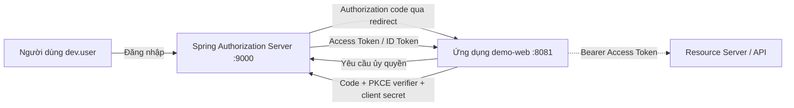

# Tạo tài khoản phát triển và client mẫu

## 1. Mục tiêu của bài học

Trong chương **Khởi tạo dự án** của module **SPRING_SECURITY_OAUTH2_OIDC_AUTHORIZATION_SERVER**, chúng ta chuẩn bị hai đối tượng để thử nghiệm luồng OAuth 2.0/OpenID Connect (OIDC) bằng **Spring Security**, **Spring Authorization Server** và **Spring Boot**:

1. **Tài khoản người dùng thử nghiệm**: đại diện người đăng nhập vào Authorization Server để xác thực và đồng ý cấp quyền.
2. **OAuth client mẫu**: đại diện ứng dụng được đăng ký với Authorization Server và có thể yêu cầu authorization code, đổi code lấy token rồi dùng token theo phạm vi đã cấp.

Sau bài này, người học có thể tạo hai đối tượng trên, giải thích cấu hình quan trọng của `RegisteredClient`, chạy thử **Authorization Code Flow với PKCE**, đọc kết quả trả về và nhận diện những sai sót thường gặp. Đây cũng là nền tảng cho các bài tiếp theo về thiết kế, cấu hình, bảo mật, kiểm thử và vận hành Authorization Server.

**Phạm vi ví dụ:** chạy cục bộ ở profile `dev`, sử dụng bộ nhớ trong và tài khoản giả lập. Các mật khẩu và client secret xuất hiện trong bài **chỉ là dữ liệu học tập**, tuyệt đối không dùng lại trong môi trường triển khai thực tế. Bài này không yêu cầu đăng ký tài khoản tại Google, GitHub hay một dịch vụ OAuth bên ngoài: chúng ta **tự xây dựng Authorization Server**, nên tự quản lý người dùng và client mẫu của mình.

### 1.1. Phân biệt đúng hai loại danh tính

| Thuộc tính | Tài khoản người dùng phát triển | OAuth client mẫu |
| --- | --- | --- |
| Đại diện cho | Người dùng đăng nhập bằng trình duyệt | Ứng dụng yêu cầu quyền truy cập |
| Ví dụ định danh | `dev.user` | `demo-web` (`client_id`) |
| Bằng chứng xác thực | Mật khẩu, phiên đăng nhập hoặc phương thức xác thực người dùng khác | Client secret hoặc phương thức client authentication phù hợp |
| Được lưu ở đâu trong ví dụ | `InMemoryUserDetailsManager` | `InMemoryRegisteredClientRepository` |
| Tham gia ở giai đoạn nào | Đăng nhập, chấp thuận scope, gắn danh tính vào OIDC | Bắt đầu yêu cầu ủy quyền và đổi code tại token endpoint |

`UserDetailsService` không phải `RegisteredClientRepository`. Tạo tài khoản `dev.user` **không tự tạo** OAuth client; ngược lại, đăng ký client `demo-web` **không tự đăng nhập** người dùng. Cũng cần phân biệt **client developer account** (tài khoản quản trị để đăng ký client nếu hệ thống có cổng quản trị) với **user account**: trong ví dụ tối thiểu này, việc đăng ký client do mã khởi tạo Spring thực hiện, chưa xây dựng portal quản trị dành cho developer.

## 2. Sơ đồ và thông số cho môi trường thực hành



Trong sơ đồ, Resource Server là thành phần sẽ được tích hợp ở các bước tiếp theo; để tạo tài khoản và kiểm tra token endpoint ở bài này, **chưa cần** triển khai một API riêng.

| Giá trị | Thiết lập dùng trong bài |
| --- | --- |
| URL Authorization Server/issuer | `http://localhost:9000` |
| Profile Spring Boot | `dev` |
| Tên đăng nhập thử nghiệm | `dev.user` |
| Mật khẩu người dùng thử nghiệm | `dev-pass-only-123` |
| `client_id` | `demo-web` |
| Client secret mẫu | `demo-web-secret-only-123` |
| Loại client | *Confidential client* (ứng dụng backend có thể giữ secret) |
| Phương thức xác thực client | `client_secret_basic` |
| Grant types | `authorization_code`, `refresh_token` |
| Redirect URI | `http://127.0.0.1:8081/login/oauth2/code/demo-web` |
| Scopes | `openid`, `profile`, `api.read` |
| PKCE | Bắt buộc, dùng `S256` |
| Consent | Bật cho client mẫu |

Lưu ý: `localhost:9000` là địa chỉ cục bộ dùng riêng cho thực hành. Authorization Server triển khai ngoài môi trường local phải có issuer ổn định qua **HTTPS**, chứng chỉ phù hợp và redirect URI được kiểm soát. Đường dẫn redirect phía client ở port `8081` có thể chưa tồn tại ở thời điểm chạy thử thủ công; khi đó trình duyệt có thể báo không kết nối được sau khi chuyển hướng, nhưng ta vẫn có thể kiểm tra URL callback trong môi trường học tập.

## 3. Chuẩn bị ứng dụng Spring Boot

Ví dụ giả định đã có dự án Spring Boot chạy trên **Servlet stack**, sử dụng một bộ phiên bản Spring Boot/Spring Security/Spring Authorization Server tương thích. Với hệ sinh thái Spring Boot 3.x và Spring Authorization Server 1.x có hỗ trợ các API trong ví dụ, dependency Maven thường gồm:

```xml
<dependencies>
    <dependency>
        <groupId>org.springframework.boot</groupId>
        <artifactId>spring-boot-starter-web</artifactId>
    </dependency>
    <dependency>
        <groupId>org.springframework.boot</groupId>
        <artifactId>spring-boot-starter-security</artifactId>
    </dependency>
    <dependency>
        <groupId>org.springframework.boot</groupId>
        <artifactId>spring-boot-starter-oauth2-authorization-server</artifactId>
    </dependency>
</dependencies>
```

Ví dụ giả định dự án đã có `spring-boot-starter-parent` hoặc dependency management của Spring Boot tương thích, vì vậy không khai báo version riêng trong từng dependency. Nếu sử dụng Spring Boot/Spring Security phiên bản khác, hãy kiểm tra tài liệu của **phiên bản thực tế** trước khi sao chép API cấu hình; một số API thay đổi giữa các dòng phiên bản.

Tạo cấu hình phát triển trong `src/main/resources/application-dev.yml`:

```yaml
server:
  port: 9000

logging:
  level:
    org.springframework.security: INFO
```

Sau đó chạy ứng dụng với profile `dev`, chẳng hạn trên Windows PowerShell:

```powershell
$env:SPRING_PROFILES_ACTIVE = "dev"
.\mvnw.cmd spring-boot:run
```

Trên Linux/macOS, có thể dùng:

```bash
SPRING_PROFILES_ACTIVE=dev ./mvnw spring-boot:run
```

Chỉ chạy các lệnh sau khi đã thêm cấu hình Java ở phần kế tiếp. Việc giới hạn bean mẫu bằng `@Profile("dev")` tránh để tài khoản thử nghiệm và client secret giả lập tự động xuất hiện trong profile production.

## 4. Tạo tài khoản người dùng và client bằng cấu hình Java

### 4.1. Cấu hình hoàn chỉnh để thực hành cục bộ

Tạo class Java, ví dụ `com.example.authorizationserver.config.DevAuthorizationServerConfig`. Đoạn code dưới đây dùng **một confidential client**, tài khoản người dùng trong bộ nhớ, một cặp khóa RSA tạo mới khi chạy ứng dụng và hai `SecurityFilterChain` cho giao thức/đăng nhập.

```java
package com.example.authorizationserver.config;

import com.nimbusds.jose.jwk.JWKSet;
import com.nimbusds.jose.jwk.RSAKey;
import com.nimbusds.jose.jwk.source.JWKSource;
import com.nimbusds.jose.proc.SecurityContext;
import org.springframework.context.annotation.Bean;
import org.springframework.context.annotation.Configuration;
import org.springframework.context.annotation.Profile;
import org.springframework.core.annotation.Order;
import org.springframework.http.MediaType;
import org.springframework.security.config.Customizer;
import org.springframework.security.config.annotation.web.builders.HttpSecurity;
import org.springframework.security.config.annotation.web.configuration.EnableWebSecurity;
import org.springframework.security.core.userdetails.User;
import org.springframework.security.core.userdetails.UserDetailsService;
import org.springframework.security.crypto.factory.PasswordEncoderFactories;
import org.springframework.security.crypto.password.PasswordEncoder;
import org.springframework.security.oauth2.core.AuthorizationGrantType;
import org.springframework.security.oauth2.core.ClientAuthenticationMethod;
import org.springframework.security.oauth2.core.oidc.OidcScopes;
import org.springframework.security.oauth2.jwt.JwtDecoder;
import org.springframework.security.oauth2.server.authorization.client.InMemoryRegisteredClientRepository;
import org.springframework.security.oauth2.server.authorization.client.RegisteredClient;
import org.springframework.security.oauth2.server.authorization.client.RegisteredClientRepository;
import org.springframework.security.oauth2.server.authorization.config.annotation.web.configuration.OAuth2AuthorizationServerConfiguration;
import org.springframework.security.oauth2.server.authorization.config.annotation.web.configurers.OAuth2AuthorizationServerConfigurer;
import org.springframework.security.oauth2.server.authorization.settings.AuthorizationServerSettings;
import org.springframework.security.oauth2.server.authorization.settings.ClientSettings;
import org.springframework.security.oauth2.server.authorization.settings.TokenSettings;
import org.springframework.security.provisioning.InMemoryUserDetailsManager;
import org.springframework.security.web.SecurityFilterChain;
import org.springframework.security.web.authentication.LoginUrlAuthenticationEntryPoint;
import org.springframework.security.web.util.matcher.MediaTypeRequestMatcher;

import java.security.KeyPair;
import java.security.KeyPairGenerator;
import java.security.interfaces.RSAPrivateKey;
import java.security.interfaces.RSAPublicKey;
import java.time.Duration;
import java.util.UUID;

@Configuration(proxyBeanMethods = false)
@EnableWebSecurity
@Profile("dev")
public class DevAuthorizationServerConfig {

    @Bean
    @Order(1)
    SecurityFilterChain authorizationServerSecurityFilterChain(HttpSecurity http)
            throws Exception {
        OAuth2AuthorizationServerConfigurer authorizationServerConfigurer =
                OAuth2AuthorizationServerConfigurer.authorizationServer();

        http.securityMatcher(authorizationServerConfigurer.getEndpointsMatcher())
                .with(authorizationServerConfigurer,
                        authorizationServer -> authorizationServer.oidc(Customizer.withDefaults()))
                .authorizeHttpRequests(authorize -> authorize.anyRequest().authenticated())
                .exceptionHandling(exceptions -> exceptions.defaultAuthenticationEntryPointFor(
                        new LoginUrlAuthenticationEntryPoint("/login"),
                        new MediaTypeRequestMatcher(MediaType.TEXT_HTML)));

        return http.build();
    }

    @Bean
    @Order(2)
    SecurityFilterChain applicationSecurityFilterChain(HttpSecurity http)
            throws Exception {
        http.authorizeHttpRequests(authorize -> authorize.anyRequest().authenticated())
                .formLogin(Customizer.withDefaults());
        return http.build();
    }

    @Bean
    PasswordEncoder passwordEncoder() {
        return PasswordEncoderFactories.createDelegatingPasswordEncoder();
    }

    @Bean
    UserDetailsService userDetailsService(PasswordEncoder encoder) {
        return new InMemoryUserDetailsManager(
                User.withUsername("dev.user")
                        .password(encoder.encode("dev-pass-only-123"))
                        .roles("USER")
                        .build());
    }

    @Bean
    RegisteredClientRepository registeredClientRepository(PasswordEncoder encoder) {
        RegisteredClient demoWeb = RegisteredClient.withId(UUID.randomUUID().toString())
                .clientId("demo-web")
                .clientSecret(encoder.encode("demo-web-secret-only-123"))
                .clientAuthenticationMethod(ClientAuthenticationMethod.CLIENT_SECRET_BASIC)
                .authorizationGrantType(AuthorizationGrantType.AUTHORIZATION_CODE)
                .authorizationGrantType(AuthorizationGrantType.REFRESH_TOKEN)
                .redirectUri("http://127.0.0.1:8081/login/oauth2/code/demo-web")
                .scope(OidcScopes.OPENID)
                .scope(OidcScopes.PROFILE)
                .scope("api.read")
                .clientSettings(ClientSettings.builder()
                        .requireProofKey(true)
                        .requireAuthorizationConsent(true)
                        .build())
                .tokenSettings(TokenSettings.builder()
                        .accessTokenTimeToLive(Duration.ofMinutes(15))
                        .refreshTokenTimeToLive(Duration.ofHours(2))
                        .reuseRefreshTokens(false)
                        .build())
                .build();

        return new InMemoryRegisteredClientRepository(demoWeb);
    }

    @Bean
    JWKSource<SecurityContext> jwkSource() {
        RSAKey rsaKey = newRsaKey();
        JWKSet jwkSet = new JWKSet(rsaKey);
        return (selector, context) -> selector.select(jwkSet);
    }

    @Bean
    JwtDecoder jwtDecoder(JWKSource<SecurityContext> jwkSource) {
        return OAuth2AuthorizationServerConfiguration.jwtDecoder(jwkSource);
    }

    @Bean
    AuthorizationServerSettings authorizationServerSettings() {
        return AuthorizationServerSettings.builder()
                .issuer("http://localhost:9000")
                .build();
    }

    private static RSAKey newRsaKey() {
        try {
            KeyPairGenerator generator = KeyPairGenerator.getInstance("RSA");
            generator.initialize(2048);
            KeyPair keyPair = generator.generateKeyPair();
            return new RSAKey.Builder((RSAPublicKey) keyPair.getPublic())
                    .privateKey((RSAPrivateKey) keyPair.getPrivate())
                    .keyID(UUID.randomUUID().toString())
                    .build();
        } catch (Exception ex) {
            throw new IllegalStateException("Unable to create local RSA signing key", ex);
        }
    }
}
```

Đoạn code minh họa cách cấu hình với API hỗ trợ `OAuth2AuthorizationServerConfigurer.authorizationServer()` và `HttpSecurity.with(...)`. Nếu dự án dùng Spring Security mới hơn hoặc dòng sản phẩm khác, cần đối chiếu API và cách khai báo bean theo tài liệu phiên bản đó. Không nên trộn ví dụ cấu hình của nhiều phiên bản rồi tự giả định chúng tương đương.

### 4.2. Những điểm quan trọng trong code

**`UserDetailsService` tạo tài khoản phát triển.** Khi trình duyệt tới trang `/login`, Spring Security xác thực `dev.user` bằng bộ user store trong bộ nhớ. Lời gọi `encoder.encode(...)` lưu **giá trị băm thích hợp** thay vì plaintext password trong `UserDetails`; mật khẩu giả lập vẫn nằm trong mã ví dụ, vì vậy chỉ dùng ở profile phát triển.

**`RegisteredClientRepository` tạo client mẫu.** Mỗi `RegisteredClient` có một `id` nội bộ và một `clientId` mà ứng dụng bên ngoài dùng. Trường `.withId(UUID.randomUUID().toString())` phục vụ nhận dạng trong kho đăng ký; không được nhầm UUID nội bộ với `client_id=demo-web`. Repository in-memory sẽ mất dữ liệu khi tiến trình khởi động lại.

**`.clientAuthenticationMethod(CLIENT_SECRET_BASIC)` yêu cầu client gửi credential** dưới dạng HTTP Basic khi gọi endpoint `/oauth2/token`. Server so khớp với client secret đã được băm ở repository. Client này phải là ứng dụng backend giữ bí mật được; frontend JavaScript công khai không thể đảm bảo bảo mật client secret.

**`.authorizationGrantType(...)` giới hạn grant được phép.** `AUTHORIZATION_CODE` dùng cho lần cấp token đầu tiên sau redirect; `REFRESH_TOKEN` cho phép đổi refresh token nếu token được phát hành và còn hợp lệ. Client không mặc nhiên được phép dùng `client_credentials` hoặc password grant.

**`.redirectUri(...)` khai báo đích callback hợp lệ.** Đây là một URL cụ thể được đăng ký trước. Khi gửi request ủy quyền và đổi code, client phải dùng redirect URI khớp với cấu hình; thay `127.0.0.1` bằng `localhost`, đổi port hoặc đổi path có thể khiến giao thức từ chối. Không dùng ký tự đại diện rộng hoặc callback do người dùng tùy ý nhập.

**Scopes** định nghĩa các quyền/nhóm dữ liệu được client yêu cầu:

- `openid`: bật phần OpenID Connect; khi luồng OIDC thành công, client có thể nhận ID Token.
- `profile`: yêu cầu các thông tin hồ sơ theo chính sách OIDC và những claims đã được cung cấp.
- `api.read`: scope ví dụ do ứng dụng tự định nghĩa; nó **không tự cấp quyền** ở Resource Server. API vẫn cần kiểm tra scope và các điều kiện truy cập của mình.

**`ClientSettings`** bật PKCE và yêu cầu consent. Với `requireProofKey(true)`, client phải tạo `code_challenge` trước khi nhận authorization code và gửi `code_verifier` khi đổi code. Với `requireAuthorizationConsent(true)`, người dùng phải được hỏi về các scope yêu cầu theo trạng thái consent hiện hành. Không phải chỉ cần đăng nhập thành công là client được toàn quyền lấy token.

**`TokenSettings`** giới hạn vòng đời token. Ví dụ đặt Access Token 15 phút, Refresh Token 2 giờ và không tái sử dụng refresh token khi thực hiện rotation. Thời hạn ngắn chỉ là một lớp kiểm soát; client còn phải lưu token an toàn, xử lý hết hạn và từ chối token không phù hợp với mục đích sử dụng.

**Hai security chain** phân biệt endpoint giao thức với trang đăng nhập. Chain `@Order(1)` áp dụng cho endpoint Authorization Server/OIDC, còn chain `@Order(2)` xử lý yêu cầu ứng dụng và cung cấp form login mặc định. Cấu hình login sai, matcher sai hoặc thứ tự chain sai có thể khiến `/oauth2/authorize` và `/login` hoạt động không như dự kiến.

**`JWKSource`, `JwtDecoder` và `issuer`** hoàn thiện phần nền tảng ký token và endpoint OIDC. Cặp RSA được tạo mới **mỗi lần khởi động** chỉ phù hợp cho demo: token ký trước khi khởi động lại có thể không được xác minh nữa. Hệ thống thực tế cần khóa ổn định, bảo vệ private key, rotation có kế hoạch và URL issuer HTTPS nhất quán cho mọi client và Resource Server.

## 5. Mô hình đăng ký client và lựa chọn loại ứng dụng

Không phải OAuth client nào cũng dùng client secret. Hãy quyết định cách đăng ký dựa trên khả năng giữ bí mật credential và cách tiếp nhận redirect:

| Kiểu ứng dụng | Có thể giữ client secret? | Cách đăng ký thường gặp | PKCE |
| --- | --- | --- | --- |
| Backend web app / BFF | Có, khi secret chỉ tồn tại ở server | `client_secret_basic` hoặc phương thức client authentication phù hợp | Nên bật, như ví dụ `demo-web`. |
| SPA chạy thuần trong browser | Không | Public client với `ClientAuthenticationMethod.NONE` và Authorization Code Flow | Bắt buộc coi PKCE là yêu cầu bảo vệ chính. |
| Mobile/desktop app phân phối cho người dùng | Không thể đảm bảo giữ secret nhúng trong app | Public client, redirect URI thích hợp với nền tảng | Dùng PKCE `S256`. |
| Machine-to-machine service | Có thể, nếu có kho giữ secret hoặc khóa riêng an toàn | Confidential client, grant `client_credentials` nếu có nhu cầu | PKCE không tham gia vì không có Authorization Code Flow. |

Trong bài này, `demo-web` là **confidential client** được dự kiến chạy một backend ở port `8081`. Không mang `demo-web-secret-only-123` vào React/Vue/Angular bundle hoặc ứng dụng mobile. Nếu muốn dựng SPA thuần browser, cần đăng ký **một client riêng** với `ClientAuthenticationMethod.NONE`, `requireProofKey(true)` và redirect URI dành cho SPA; không nên “lách” bằng cách bỏ header Basic ở client đã đăng ký `CLIENT_SECRET_BASIC`.

### 5.1. Thuộc tính nào được phép thay đổi khi đưa vào dự án thật?

Trong cấu hình phát triển, có thể đổi username, port, scopes, redirect URI và thời hạn token theo bài tập. Khi chuyển sang staging/production, các giá trị phải trở thành **chính sách cấu hình có kiểm soát**: người phát triển đăng ký client qua quy trình quản trị; client secret được cấp phát qua kênh bí mật; redirect URI có danh sách cho phép; scopes được phê duyệt và gắn với chính sách API; Authorization Server ghi nhận sự kiện đăng ký và thay đổi quan trọng.

## 6. Chạy thử Authorization Code Flow với PKCE

### 6.1. Kiểm tra endpoint và public metadata

Khởi động ứng dụng với profile `dev`, sau đó gọi:

```powershell
curl.exe -i http://localhost:9000/.well-known/openid-configuration
curl.exe -i http://localhost:9000/oauth2/jwks
```

Endpoint discovery phải trả metadata OIDC có `issuer` là `http://localhost:9000` và thông tin các endpoint được hỗ trợ. JWKS phải công bố **public key** dùng xác minh chữ ký token. Không công bố phần private key qua JWKS hoặc sao chép private key từ cấu hình chạy thực tế ra log.

Nếu chưa bật tính năng OIDC, thiếu `JwtDecoder` hoặc cấu hình các endpoint chưa đúng, một số URL trên có thể trả lỗi; cần kiểm tra log khởi động và `SecurityFilterChain` trước khi tiếp tục.

### 6.2. Chuẩn bị `state` và PKCE

Để dễ kiểm tra thủ công, có thể dùng **bộ giá trị thử nghiệm công khai từ RFC 7636**:

```text
code_verifier:
dBjftJeZ4CVP-mB92K27uhbUJU1p1r_wW1gFWFOEjXk

code_challenge (S256):
E9Melhoa2OwvFrEMTJguCHaoeK1t8URWbuGJSstw-cM
```

Bộ giá trị này cố định, **chỉ dùng để học cách gửi request**. Client thật phải tạo verifier mới bằng bộ sinh số ngẫu nhiên bảo mật cho từng giao dịch, thường có 43–128 ký tự, rồi tính:

```text
code_challenge = BASE64URL_NO_PADDING(SHA256(ASCII(code_verifier)))
```

Đồng thời, client phải tạo một `state` ngẫu nhiên, lưu liên kết với phiên yêu cầu và so khớp khi trình duyệt trả về callback. Trong phiên kiểm tra bằng PowerShell, tạo URL như sau:

```powershell
$verifier = 'dBjftJeZ4CVP-mB92K27uhbUJU1p1r_wW1gFWFOEjXk'
$challenge = 'E9Melhoa2OwvFrEMTJguCHaoeK1t8URWbuGJSstw-cM'
$state = [guid]::NewGuid().ToString('N')
$redirectUri = [uri]::EscapeDataString('http://127.0.0.1:8081/login/oauth2/code/demo-web')

$authorizeUrl = "http://localhost:9000/oauth2/authorize" +
    "?response_type=code&client_id=demo-web" +
    "&redirect_uri=$redirectUri" +
    "&scope=openid%20profile%20api.read" +
    "&state=$state" +
    "&code_challenge=$challenge&code_challenge_method=S256"

Start-Process $authorizeUrl
```

Trong trình duyệt, đăng nhập bằng tài khoản `dev.user` và mật khẩu `dev-pass-only-123`, sau đó chấp thuận quyền nếu có màn hình consent. Authorization Server chuyển trình duyệt tới redirect URI đã đăng ký, kèm `code` và `state` trong query parameter.

```http
HTTP/1.1 302 Found
Location: http://127.0.0.1:8081/login/oauth2/code/demo-web?code=<authorization-code>&state=<same-state>
```

Trước khi dùng code, **phải xác nhận `state` trả về đúng với `$state` ban đầu**. Authorization code ngắn hạn và chỉ dùng một lần. Nếu ứng dụng `demo-web` thật đang chạy ở port `8081`, ứng dụng đó sẽ nhận và thường tự đổi code; không lấy lại code đã được sử dụng để thử bằng curl.

Nếu đang kiểm tra thủ công mà không có ứng dụng lắng nghe tại `127.0.0.1:8081`, trình duyệt có thể báo không mở được trang callback. Trong **môi trường local dùng dữ liệu giả lập**, có thể đọc URL điều hướng trong thanh địa chỉ/devtools và lấy giá trị `code` để kiểm tra token endpoint. Không sử dụng phương pháp sao chép code từ URL như quy trình vận hành thực tế và không chia sẻ URL chứa code.

### 6.3. Đổi authorization code lấy token

Sau khi lấy code chưa được sử dụng, gán vào `$code` và gửi request token. Ví dụ Windows PowerShell dùng `curl.exe` (tránh nhầm với alias `curl` của một số phiên bản PowerShell):

```powershell
$code = '<authorization-code-from-callback>'

curl.exe -sS -X POST 'http://localhost:9000/oauth2/token' `
  -u 'demo-web:demo-web-secret-only-123' `
  -H 'Content-Type: application/x-www-form-urlencoded' `
  --data-urlencode 'grant_type=authorization_code' `
  --data-urlencode "code=$code" `
  --data-urlencode 'redirect_uri=http://127.0.0.1:8081/login/oauth2/code/demo-web' `
  --data-urlencode "code_verifier=$verifier"
```

Lệnh `-u` gửi client ID và client secret bằng **HTTP Basic authentication**. Base64 bên trong Basic không phải thuật toán mã hóa dữ liệu: trong sản phẩm thật, token endpoint phải dùng HTTPS.

Response thành công có cấu trúc gần như sau (giá trị token minh họa, không phải token thực):

```json
{
  "access_token": "<access-token>",
  "token_type": "Bearer",
  "expires_in": 900,
  "refresh_token": "<refresh-token>",
  "scope": "openid profile api.read",
  "id_token": "<id-token>"
}
```

`access_token` dùng để gọi API theo scope/audience được cấp; `id_token` được phát hành trong luồng OIDC để client kiểm tra danh tính người dùng; `refresh_token` giúp xin token mới theo chính sách. **Không dùng ID Token như Access Token** và không cho rằng nội dung JWT có chữ ký được mã hóa bí mật. Resource Server cần xác minh chữ ký, issuer, audience, thời hạn và quyền trước khi chấp nhận Access Token.

### 6.4. Thử refresh token (nếu được trả về)

```powershell
$refreshToken = '<refresh-token-from-response>'

curl.exe -sS -X POST 'http://localhost:9000/oauth2/token' `
  -u 'demo-web:demo-web-secret-only-123' `
  -H 'Content-Type: application/x-www-form-urlencoded' `
  --data-urlencode 'grant_type=refresh_token' `
  --data-urlencode "refresh_token=$refreshToken"
```

Vì ví dụ cấu hình `reuseRefreshTokens(false)`, khi refresh thành công, server có thể phát hành refresh token mới theo chính sách rotation; client cần thay thế giá trị cũ một cách an toàn. Đừng dùng lại refresh token cũ sau khi đã luân chuyển và đừng ghi refresh token vào log, source code hay địa chỉ URL.

## 7. Xác minh các tình huống thất bại có chủ đích

Một bài thực hành OAuth hoàn chỉnh cần chứng minh rằng **request hợp lệ được chấp nhận và request nguy hiểm bị từ chối**. Dưới đây là các kiểm tra cốt lõi:

| Thử nghiệm | Kết quả mong đợi và điều cần rút ra |
| --- | --- |
| Đăng nhập sai password của `dev.user` | Form login từ chối; không có phiên người dùng xác thực hợp lệ. |
| Gửi `client_id` không được đăng ký | Authorization Server từ chối yêu cầu ủy quyền hoặc xác thực client tương ứng. |
| Gửi sai client secret ở `/oauth2/token` | Phản hồi lỗi OAuth, thường `invalid_client`. |
| Bỏ `code_challenge` khi xin authorization code | Bị từ chối vì client yêu cầu PKCE. |
| Gửi `code_verifier` sai khi đổi code | Bị từ chối, thường trả `invalid_grant` do không khớp chứng minh PKCE. |
| Đổi lại authorization code đã dùng | Bị từ chối: authorization code chỉ dùng một lần. |
| Đổi port/path/hostname của `redirect_uri` | Bị từ chối do không khớp redirect URI đã đăng ký hoặc không khớp giao dịch. |
| Xin scope chưa đăng ký, ví dụ `admin` | Không được cấp scope vượt quá những gì client đã được đăng ký. |
| Gọi `/oauth2/token` với `grant_type=client_credentials` | Không được phép vì client chỉ đăng ký `authorization_code` và `refresh_token`. |
| Khởi động lại server rồi xác minh token cũ | Có thể thất bại vì khóa ký và trạng thái in-memory đã được tạo lại. |

Mã HTTP và tên lỗi cụ thể có thể khác theo endpoint, phiên bản hoặc nguyên nhân từ chối. Khi kiểm thử, đọc cả status, response body dạng OAuth error và log server; không kết luận lỗi qua mỗi status `400` hay `401`.

### 7.1. Nếu gặp lỗi, kiểm tra theo thứ tự nào?

1. **Không vào được `/login`:** kiểm tra ứng dụng có chạy profile `dev`, có chain ứng dụng `@Order(2)` và `formLogin()` hay không.
2. **Trang authorize không chuyển tới login/consent:** kiểm tra endpoint matcher, `@Order`, đăng ký client và `redirect_uri`.
3. **`invalid_client`:** kiểm tra `client_id`, client secret, phương thức `client_secret_basic`; đừng gửi secret thô trong URL.
4. **`invalid_grant`:** kiểm tra code hết hạn/đã dùng, `code_verifier`, `redirect_uri` và client có đúng với phiên cấp code hay không.
5. **Không có `id_token`:** kiểm tra yêu cầu có `scope=openid`, đã bật OIDC và có bean JWT/JWK phù hợp.
6. **Token có issuer/URL không đúng:** kiểm tra `AuthorizationServerSettings.issuer`, hostname, port, reverse proxy và URL mà client đang dùng.
7. **Token mất hiệu lực sau restart:** nhớ rằng khóa RSA, authorization và client repository trong ví dụ đều phục vụ thử nghiệm cục bộ và không được lưu bền vững.

## 8. Khi nào chuyển từ cấu hình demo sang cấu hình thật?

`InMemoryUserDetailsManager` và `InMemoryRegisteredClientRepository` rất thuận tiện cho bài học vì không yêu cầu database hoặc hệ thống đăng ký riêng. Tuy nhiên, chúng chưa đáp ứng đầy đủ yêu cầu vận hành lâu dài, quản trị người dùng, kiểm toán hoặc chia sẻ dữ liệu giữa nhiều instance.

| Hạng mục | Ở bài thực hành | Khi đưa vào staging/production |
| --- | --- | --- |
| Tài khoản người dùng | Một user hardcode `dev.user` | User store/identity provider thật, chính sách mật khẩu/MFA phù hợp và quản lý vòng đời tài khoản. |
| Registered client | Đăng ký khi khởi động, in-memory | Repository bền vững, cơ chế cấp phát/thu hồi client và quy trình xét duyệt redirect/scopes. |
| Client secret | Chuỗi giả lập trong mã nguồn | Phát hành và lưu trữ trong secret manager hoặc cơ chế quản lý bí mật thích hợp; rotate và giới hạn truy cập. |
| Khóa ký token | RSA tạo ngẫu nhiên mỗi restart | Keystore/KMS/HSM theo yêu cầu, rotation có kiểm soát và JWKS công bố public key phù hợp. |
| OAuth authorization/consent | Lưu trong bộ nhớ theo mặc định | Lưu trữ bền vững, xử lý đồng thời và chiến lược dọn dữ liệu/hết hạn thích hợp. |
| Issuer và kết nối | `http://localhost:9000` | Hostname công khai ổn định qua HTTPS; reverse proxy/forwarded header được kiểm soát. |
| Ghi log/quan sát | Log phát triển hạn chế | Audit có chọn lọc, metrics và trace được lọc secret/token/authorization code. |
| Kiểm thử | Thủ công bằng browser và `curl.exe` | Tự động hóa happy path, consent, PKCE, redirect, token validation và các trường hợp từ chối. |

Một hệ thống thật cần tách **quản lý người dùng**, **quản lý client**, **quản lý khóa/token** và **vận hành hạ tầng** thành những phần có trách nhiệm rõ ràng. Không biến controller công khai thành endpoint “tự đăng ký client” nếu chưa có cơ chế xác thực quản trị, phê duyệt quyền và giới hạn client thích hợp. Dynamic Client Registration của OIDC là một tính năng riêng, cần cân nhắc chính sách và không phải điều kiện để thực hiện bài này.

## 9. Bài tập tự kiểm tra

### Bài tập 1: Thêm người dùng phát triển thứ hai

Mở rộng `InMemoryUserDetailsManager` với một user mới và quyền `USER` (hoặc quyền thích hợp). Đăng nhập thử bằng hai user, sau đó so sánh claim `sub` của ID Token. Giải thích vì sao `client_id` của `demo-web` **không đổi** khi người dùng đổi.

### Bài tập 2: Thay đổi redirect URI

Sửa redirect URI của `demo-web` sang một port khác trong cấu hình, khởi động lại ứng dụng và thử authorize với URL cũ. Giải thích lý do server từ chối và sự khác biệt giữa **redirect URI được đăng ký** với URL được client tự truyền trong một request.

### Bài tập 3: Thử PKCE và scope

Chạy một yêu cầu hợp lệ rồi thử đổi code bằng verifier sai. Sau đó khởi tạo yêu cầu mới, thêm scope chưa đăng ký và quan sát kết quả. Viết lại vai trò độc lập của `code_challenge`, `code_verifier`, `state` và scope.

### Bài tập 4: Lập kế hoạch triển khai nhiều instance

Giả định chạy hai instance Authorization Server phía sau load balancer. Hãy chỉ ra vì sao tạo cặp RSA ngẫu nhiên độc lập và sử dụng repository in-memory ở mỗi instance gây lỗi xác minh token, trạng thái authorization code hoặc consent. Đề xuất dùng kho dữ liệu và dịch vụ quản lý khóa dùng chung theo mô hình tin cậy phù hợp.

### Checklist hoàn thành

- [ ] Có thể đăng nhập bằng `dev.user` qua form login của Authorization Server.
- [ ] Phân biệt được user account với OAuth `RegisteredClient`.
- [ ] Hiểu `client_id`, `client_secret`, `redirect_uri`, grant types, scopes, PKCE và consent.
- [ ] Truy cập được discovery metadata và public JWKS khi bật OIDC.
- [ ] Thực hiện được luồng authorize → login → consent → callback → token với code và verifier hợp lệ.
- [ ] Giải thích được Access Token, ID Token và Refresh Token có mục đích khác nhau.
- [ ] Xác minh server từ chối code tái sử dụng, verifier sai, secret sai hoặc callback không đăng ký.
- [ ] Biết vì sao tài khoản, secret, khóa RSA và repository của ví dụ chỉ phù hợp cho môi trường phát triển.

## 10. Tài liệu tham khảo

- [Spring Authorization Server Reference](https://docs.spring.io/spring-authorization-server/reference/) — core model, `RegisteredClient`, các endpoint, client settings, token settings và OIDC.
- [Spring Security Reference](https://docs.spring.io/spring-security/reference/) — `UserDetailsService`, `PasswordEncoder`, servlet security và cấu hình `SecurityFilterChain`.
- [Spring Boot Reference](https://docs.spring.io/spring-boot/reference/) — dependency management, application configuration và Spring profiles.
- [RFC 6749 — The OAuth 2.0 Authorization Framework](https://www.rfc-editor.org/rfc/rfc6749) — client registration, authorization code, token endpoint và refresh token.
- [RFC 7636 — Proof Key for Code Exchange](https://www.rfc-editor.org/rfc/rfc7636) — PKCE, định dạng verifier và phép biến đổi `S256`.
- [RFC 9700 — Best Current Practice for OAuth 2.0 Security](https://www.rfc-editor.org/rfc/rfc9700) — khuyến nghị bảo vệ flow OAuth hiện đại.
- [OpenID Connect Core 1.0](https://openid.net/specs/openid-connect-core-1_0.html) — `openid`, ID Token, claims và yêu cầu xác minh từ phía client.

**Điểm chuyển tiếp:** khi đã tự tạo được một user phát triển và một OAuth client mẫu, người học có thể tiếp tục cấu hình client thực, cơ chế lưu trữ bền vững, chính sách token, quản lý khóa và các phép kiểm thử bảo mật cho Authorization Server.
