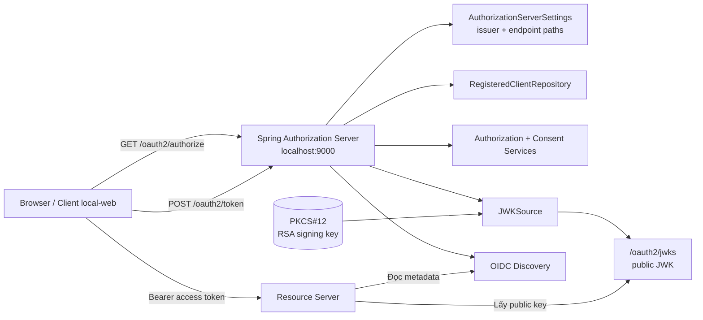
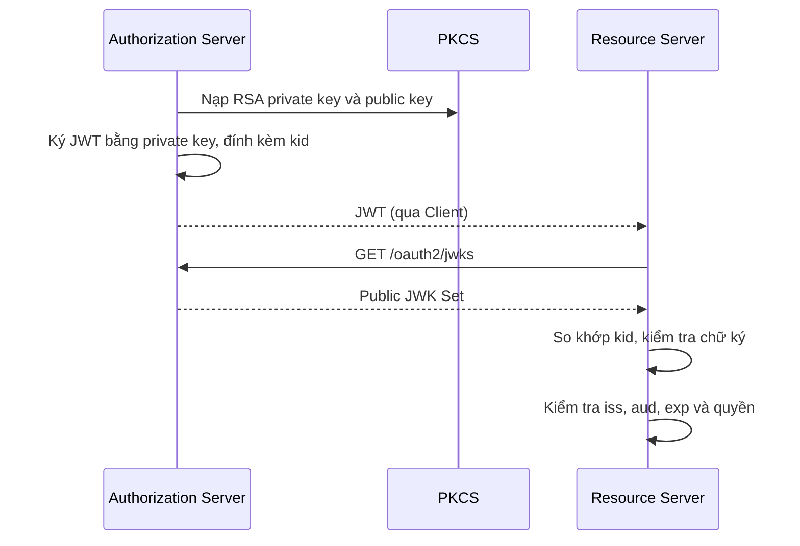
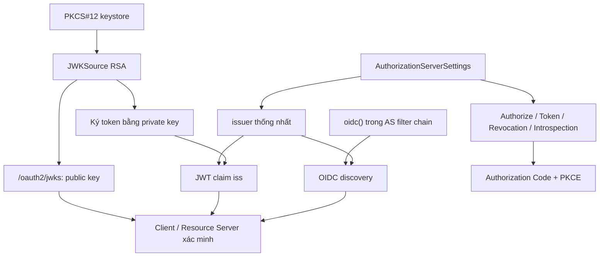

# Chuẩn bị khóa ký, issuer và cấu hình endpoint cho môi trường local

## 1. Mục tiêu

Trong chương **Khởi tạo dự án** thuộc module **Spring Security OAuth2 OIDC Authorization Server**, bước này thiết lập nền tảng để ứng dụng **Spring Boot + Spring Authorization Server (SAS)** có thể phát hành token, công bố public key và trả thông tin cấu hình OAuth 2.0/OpenID Connect (OIDC). Mục tiêu là hiểu cách thiết kế, cấu hình, bảo mật và kiểm thử môi trường local trước khi triển khai sang môi trường vận hành thật.

Ba cấu hình phải khớp với nhau:

- **Khóa ký:** Authorization Server (AS) giữ private key để ký JWT; client hoặc Resource Server dùng public key từ JWK Set (JWKS) để xác minh.
- **Issuer:** URI định danh AS, được công bố trong discovery metadata và trong claim `iss` của JWT.
- **Endpoint:** đường dẫn cho authorization, token, JWK Set, metadata, revocation, introspection và các chức năng OIDC được kích hoạt.

Bài này sử dụng một bộ địa chỉ nhất quán:

| Thành phần | Giá trị local | Mục đích |
| --- | --- | --- |
| Authorization Server | `http://localhost:9000` | HTTP server do Spring Boot chạy. |
| Issuer | `http://localhost:9000` | Giá trị so khớp khi xác minh token. |
| Authorization | `http://localhost:9000/oauth2/authorize` | Đăng nhập/consent để cấp authorization code. |
| Token | `http://localhost:9000/oauth2/token` | Đổi code hoặc thực hiện grant đã cho phép. |
| JWKS | `http://localhost:9000/oauth2/jwks` | Công bố public signing key. |
| OIDC discovery | `http://localhost:9000/.well-known/openid-configuration` | Mô tả issuer và endpoint OIDC. |
| OAuth2 client minh họa | `local-web` | Client được đăng ký trên AS. |
| Redirect URI của client | `http://127.0.0.1:8080/login/oauth2/code/local-web` | Client nhận callback sau khi authorize. |

**Phiên bản mẫu:** Các đoạn Java minh họa API thường gặp ở **Spring Security 6.x / Spring Authorization Server 1.x** trong hệ sinh thái **Spring Boot 3.x**. Ở các thế hệ mới hơn, package hoặc cách cấu hình có thể thay đổi; cần sử dụng bộ dependency và API tương thích với bản dự án chọn. Không gán cứng phiên bản SAS khác thế hệ Spring Security.

## 2. Bản đồ các thành phần



AS có thể khởi động được nhưng giao thức vẫn lỗi nếu một thành phần lệch: dùng issuer khác hostname; khóa dùng để ký không có public key tương ứng trong JWKS; endpoint được đổi mà client chưa cập nhật; hoặc `/login` không được chain ứng dụng xử lý.

Để bài tập local dễ lặp lại, chúng ta dùng **RSA key được lưu trong PKCS#12**. Cách sinh khóa RSA mới vào bộ nhớ ở mỗi lần chạy phù hợp demo ngắn, nhưng gây thay đổi signing key khi restart và làm token trước đó không còn kiểm tra được.

## 3. Chuẩn bị cặp khóa ký

### 3.1. Private key, public key, `kid`

Với JWT ký bằng RS256:

1. **Private RSA key** chỉ có AS biết, dùng để tạo chữ ký số.
2. **Public RSA key** được trình bày dưới dạng JWK và công bố tại `/oauth2/jwks` để verifier xác minh chữ ký.
3. JWT header mang `kid` để verifier chọn đúng khóa trong JWK Set; `kid` phải liên hệ duy nhất với một cặp khóa trong một giai đoạn sử dụng.
4. JWK RSA công khai có thể chứa `kty=RSA`, `kid`, `n`, `e` và `alg=RS256`; không được có các tham số private như `d`, `p`, `q`.



**JWT signing key khác TLS certificate.** Chứng thư tự ký trong keystore dưới đây là cách lưu public key đi cùng private key; nó không tự cấu hình HTTPS cho cổng HTTP của Spring Boot.

### 3.2. Tạo keystore local với `keytool`

Trên Windows PowerShell, dùng `keytool` có sẵn trong JDK:

```powershell
$keyDir = Join-Path $env:USERPROFILE ".oauth2-local"
New-Item -ItemType Directory -Force -Path $keyDir | Out-Null
$keyStore = Join-Path $keyDir "as-signing.p12"

keytool -genkeypair -alias as-signing -keyalg RSA -keysize 3072 -sigalg SHA256withRSA -storetype PKCS12 -keystore $keyStore -validity 365 -dname "CN=localhost,OU=Learning,O=Local,C=VN"

keytool -list -v -storetype PKCS12 -keystore $keyStore -alias as-signing
```

Lệnh tạo khóa yêu cầu mật khẩu PKCS#12; trong ví dụ dùng mật khẩu đó để mở keystore và lấy private key theo alias `as-signing`. Nếu tệp đã tồn tại với alias này, không vô tình ghi đè khóa đang được sử dụng.

| Tham số | Vì sao cần |
| --- | --- |
| `-keyalg RSA`, `-keysize 3072` | Sinh cặp RSA đủ mạnh cho bài thực hành; chính sách production phải theo yêu cầu bảo mật riêng. |
| `-sigalg SHA256withRSA` | Thuật toán ký chứng thư do `keytool` sinh; JWT signing algorithm được khai báo riêng là `RS256`. |
| `-storetype PKCS12` | Tệp chứa cặp khóa và chứng thư. |
| `-alias as-signing` | Tên bản ghi để Java truy xuất đúng khóa. |
| `-validity 365` | Thời hạn chứng thư tự ký, **không phải** thời hạn JWT. |

Lưu `as-signing.p12` **ngoài repository**, chỉ cấp quyền đọc cho tài khoản chạy AS. Không commit private key, mật khẩu, client secret hoặc access token vào Git, ngay cả trong dự án học tập.

### 3.3. Truyền cấu hình bí mật cho local

Dùng biến môi trường trong phiên PowerShell sẽ chạy Spring Boot:

```powershell
$env:LOCAL_AS_KEYSTORE = $keyStore

function Read-LocalSecret([string]$prompt) {
    $secure = Read-Host -Prompt $prompt -AsSecureString
    $handle = [Runtime.InteropServices.Marshal]::SecureStringToBSTR($secure)
    try {
        return [Runtime.InteropServices.Marshal]::PtrToStringBSTR($handle)
    } finally {
        [Runtime.InteropServices.Marshal]::ZeroFreeBSTR($handle)
    }
}

$env:LOCAL_AS_KEYSTORE_PASSWORD = Read-LocalSecret "PKCS12 password"
$env:LOCAL_AS_CLIENT_SECRET = Read-LocalSecret "Local client secret"
$env:LOCAL_AS_USER_PASSWORD = Read-LocalSecret "Local user password"
```

Các biến môi trường vẫn là dữ liệu plaintext bên trong tiến trình, nên cách này chỉ phục vụ local. Mật khẩu được nhập mà không hiện ký tự trên màn hình hoặc xuất hiện thành literal trong lịch sử lệnh. Có thể thay bằng thiết lập secret riêng của IDE hoặc hệ thống quản lý secret. Trên Linux/macOS, cách tạo biến môi trường khác nhưng tên biến giữ nguyên.

## 4. Cố định issuer và đường dẫn endpoint

### 4.1. `application.yml`

Trong `src/main/resources/application.yml`, tạo cấu hình minh họa:

```yaml
server:
  port: 9000

app:
  auth:
    issuer: ${LOCAL_AS_ISSUER:http://localhost:9000}
    key-store: ${LOCAL_AS_KEYSTORE}
    key-store-password: ${LOCAL_AS_KEYSTORE_PASSWORD}
    key-alias: as-signing
    key-id: local-rsa-v1
    local-client-secret: ${LOCAL_AS_CLIENT_SECRET}
    local-user-password: ${LOCAL_AS_USER_PASSWORD}
```

Lưu ý: `LOCAL_AS_ISSUER` để trống thì dùng `http://localhost:9000` theo biểu thức default. Các biến khác không có default; ứng dụng phải từ chối khởi động nếu thiếu credential/keystore cần thiết.

**Các quy tắc về issuer:**

- `issuer` là **URI tuyệt đối**, ví dụ `http://localhost:9000`, không phải `localhost` hoặc `http://localhost:9000/oauth2/token`.
- Discovery metadata và claim `iss` trong JWT phải trùng issuer, bao gồm scheme, hostname, cổng và path nếu có.
- `http://localhost:9000` và `http://127.0.0.1:9000` là **hai issuer khác nhau về mặt chuỗi** mặc dù cùng trỏ về loopback.
- Client callback `http://127.0.0.1:8080/...` thuộc cấu hình client, **không phải issuer**.
- Khi AS chạy sau reverse proxy, issuer phải là URL public ổn định (thường HTTPS). Forwarded headers chỉ được tin khi gateway/proxy được kiểm soát.

### 4.2. Bean `AuthorizationServerSettings`

Các endpoint OAuth2/OIDC chuẩn do SAS triển khai; không cần tạo controller riêng:

```java
@Bean
AuthorizationServerSettings authorizationServerSettings(
        @Value("${app.auth.issuer}") String issuer) {

    return AuthorizationServerSettings.builder()
            .issuer(issuer)
            .authorizationEndpoint("/oauth2/authorize")
            .tokenEndpoint("/oauth2/token")
            .jwkSetEndpoint("/oauth2/jwks")
            .tokenRevocationEndpoint("/oauth2/revoke")
            .tokenIntrospectionEndpoint("/oauth2/introspect")
            .build();
}
```

Những path trên là giá trị mặc định quen thuộc, được khai báo tường minh để người học quan sát. Việc đổi path phải đi kèm cập nhật client/gateway/test và kiểm tra lại metadata. Bật OIDC trong security config sẽ kích hoạt các endpoint OIDC được framework hỗ trợ theo cấu hình.

### 4.3. Danh sách endpoint và trách nhiệm

| Endpoint | Phương thức chính | Vai trò | Mức truy cập/cấu hình |
| --- | --- | --- | --- |
| `/oauth2/authorize` | GET | Xác thực người dùng, nhận consent, cấp authorization code | Kiểm tra registered client, redirect URI, scope, PKCE; thường có browser/login. |
| `/oauth2/token` | POST | Đổi authorization code hoặc thực hiện grant khác | Yêu cầu xác minh client và grant đúng chính sách. |
| `/oauth2/jwks` | GET | Phát JWK Set **public** | Cần `JWKSource<SecurityContext>`; không công bố private key. |
| `/.well-known/oauth-authorization-server` | GET | OAuth 2.0 metadata | Công bố issuer/endpoint tương ứng khi hỗ trợ. |
| `/.well-known/openid-configuration` | GET | OIDC Provider Discovery | Phải bật OIDC. |
| `/oauth2/revoke` | POST | Thu hồi token theo RFC 7009 | Chỉ cho client được phép; không phải trang public nhập token tùy ý. |
| `/oauth2/introspect` | POST | Tra trạng thái token theo RFC 7662 | Yêu cầu xác thực/ủy quyền của bên gọi. |
| `/userinfo` | GET/POST theo cấu hình | Trả claim của người dùng OIDC | Yêu cầu access token phù hợp và OIDC được bật. |
| `/connect/logout` | Theo cấu hình | OIDC logout | Liên quan session và chính sách logout/redirect. |
| `/oauth2/device_authorization`, `/oauth2/device_verification` | Theo giao thức | Device grant | Chỉ khi client và phiên bản SAS hỗ trợ. |
| `/connect/register` | POST | OIDC Dynamic Client Registration | Nhạy cảm; không mặc định bật chỉ vì đã bật OIDC. |

Chỉ kiểm tra một request trả HTTP 200 là chưa đủ: metadata cần chứa đúng issuer và endpoint URL; token cần ký bằng key tương ứng JWKS; và endpoint phải thực thi quy tắc giao thức.

## 5. Cấu hình Spring Security cho AS và login

Phần mã dưới đây trình bày các bean cần đặt trong class `LocalAuthorizationServerConfig` có `@Configuration(proxyBeanMethods = false)` và `@EnableWebSecurity`. Các import được lược bỏ để tập trung vào quan hệ giữa cấu hình; IDE có thể thêm import theo dependency tương thích.

### 5.1. Hai `SecurityFilterChain`

```java
@Configuration(proxyBeanMethods = false)
@EnableWebSecurity
public class LocalAuthorizationServerConfig {

    @Bean
    @Order(1)
    SecurityFilterChain authorizationServerChain(HttpSecurity http)
            throws Exception {

        OAuth2AuthorizationServerConfigurer authorizationServer =
                OAuth2AuthorizationServerConfigurer.authorizationServer();

        http
            .securityMatcher(authorizationServer.getEndpointsMatcher())
            .with(authorizationServer, configurer ->
                    configurer.oidc(Customizer.withDefaults()))
            .authorizeHttpRequests(authorize ->
                    authorize.anyRequest().authenticated())
            .exceptionHandling(exceptions ->
                    exceptions.defaultAuthenticationEntryPointFor(
                            new LoginUrlAuthenticationEntryPoint("/login"),
                            new MediaTypeRequestMatcher(MediaType.TEXT_HTML)))
            .oauth2ResourceServer(oauth2 ->
                    oauth2.jwt(Customizer.withDefaults()));

        return http.build();
    }

    @Bean
    @Order(2)
    SecurityFilterChain applicationChain(HttpSecurity http)
            throws Exception {

        http
            .authorizeHttpRequests(authorize ->
                    authorize.anyRequest().authenticated())
            .formLogin(Customizer.withDefaults());

        return http.build();
    }

    // Đặt các @Bean ở các mục tiếp theo trong class này.
}
```

**Vì sao hai chain?** `/oauth2/authorize` thuộc AS chain; `/login` thường thuộc application chain. Khi user chưa xác thực, AS chuyển browser đến trang login do ứng dụng cung cấp. Nếu matcher hoặc `@Order` sai, browser có thể nhận 404/403 hoặc lặp chuyển hướng. `oauth2ResourceServer().jwt()` hỗ trợ các chức năng OIDC cần xử lý Bearer token, ví dụ UserInfo.

Không tắt CSRF toàn cục để tránh lỗi: form login và consent có tương tác browser cần kiểm tra CSRF thích hợp.

### 5.2. Nạp RSA key từ keystore vào `JWKSource`

Thêm vào cùng class cấu hình:

```java
@Bean
JWKSource<SecurityContext> jwkSource(
        @Value("${app.auth.key-store}") String path,
        @Value("${app.auth.key-store-password}") String password,
        @Value("${app.auth.key-alias}") String alias,
        @Value("${app.auth.key-id}") String keyId) throws Exception {

    KeyStore store = KeyStore.getInstance("PKCS12");

    try (InputStream stream = Files.newInputStream(Path.of(path))) {
        store.load(stream, password.toCharArray());
    }

    Key key = store.getKey(alias, password.toCharArray());
    Certificate cert = store.getCertificate(alias);

    if (!(key instanceof RSAPrivateKey) ||
            cert == null ||
            !(cert.getPublicKey() instanceof RSAPublicKey)) {
        throw new IllegalStateException(
                "Key alias must contain a matching RSA key pair");
    }

    RSAKey rsaJwk = new RSAKey.Builder(
            (RSAPublicKey) cert.getPublicKey())
            .privateKey((RSAPrivateKey) key)
            .keyID(keyId)
            .keyUse(KeyUse.SIGNATURE)
            .algorithm(JWSAlgorithm.RS256)
            .build();

    JWKSet keySet = new JWKSet(rsaJwk);
    return (selector, context) -> selector.select(keySet);
}

@Bean
JwtDecoder jwtDecoder(JWKSource<SecurityContext> jwkSource) {
    return OAuth2AuthorizationServerConfiguration.jwtDecoder(jwkSource);
}
```

**Các import cần có:**

- Java: `java.io.InputStream`, `java.nio.file.Files`, `java.nio.file.Path`, `java.security.Key`, `java.security.KeyStore`, `java.security.cert.Certificate`, `java.security.interfaces.RSAPublicKey`, `java.security.interfaces.RSAPrivateKey`.
- Nimbus: `com.nimbusds.jose.JWSAlgorithm`, `com.nimbusds.jose.jwk.KeyUse`, `com.nimbusds.jose.jwk.RSAKey`, `com.nimbusds.jose.jwk.JWKSet`, `com.nimbusds.jose.jwk.source.JWKSource`, `com.nimbusds.jose.proc.SecurityContext`.
- Spring: `org.springframework.security.oauth2.jwt.JwtDecoder`, `org.springframework.security.oauth2.server.authorization.config.annotation.web.configuration.OAuth2AuthorizationServerConfiguration`.

`JWKSource` trong ứng dụng được phép giữ private key để ký JWT; riêng **response JWKS chỉ công bố public members**. Tránh tự viết REST controller trả trực tiếp toàn bộ đối tượng RSA JWK vì có thể vô tình làm lộ private material.

Thêm bean `AuthorizationServerSettings` ở mục 4.2 vào class này. Trong project thật không được đăng ký hai bean settings mâu thuẫn.

### 5.3. Client, người dùng và state cho bài thực hành

Để hoàn tất Authorization Code + PKCE cần nguồn người dùng, đăng ký client và dịch vụ lưu authorization/consent. Các bean sau vẫn đặt trong class cấu hình:

```java
@Bean
PasswordEncoder passwordEncoder() {
    return new BCryptPasswordEncoder();
}

@Bean
UserDetailsService userDetailsService(
        PasswordEncoder encoder,
        @Value("${app.auth.local-user-password}") String password) {

    UserDetails user = User.withUsername("alice")
            .password(encoder.encode(password))
            .roles("USER")
            .build();

    return new InMemoryUserDetailsManager(user);
}

@Bean
RegisteredClientRepository registeredClientRepository(
        PasswordEncoder encoder,
        @Value("${app.auth.local-client-secret}") String secret) {

    RegisteredClient localClient = RegisteredClient
            .withId(UUID.randomUUID().toString())
            .clientId("local-web")
            .clientSecret(encoder.encode(secret))
            .clientAuthenticationMethod(
                    ClientAuthenticationMethod.CLIENT_SECRET_BASIC)
            .authorizationGrantType(
                    AuthorizationGrantType.AUTHORIZATION_CODE)
            .authorizationGrantType(
                    AuthorizationGrantType.REFRESH_TOKEN)
            .redirectUri(
                    "http://127.0.0.1:8080/login/oauth2/code/local-web")
            .scope(OidcScopes.OPENID)
            .scope(OidcScopes.PROFILE)
            .clientSettings(ClientSettings.builder()
                    .requireProofKey(true)
                    .requireAuthorizationConsent(true)
                    .build())
            .build();

    return new InMemoryRegisteredClientRepository(localClient);
}

@Bean
OAuth2AuthorizationService authorizationService() {
    return new InMemoryOAuth2AuthorizationService();
}

@Bean
OAuth2AuthorizationConsentService authorizationConsentService() {
    return new InMemoryOAuth2AuthorizationConsentService();
}
```

Các class đến từ Spring Security/SAS, như `RegisteredClient`, `RegisteredClientRepository`, `InMemoryRegisteredClientRepository`, `ClientSettings`, `AuthorizationGrantType`, `ClientAuthenticationMethod`, `OidcScopes`, `OAuth2AuthorizationService` và `OAuth2AuthorizationConsentService`.

Ở cấu hình này:

- `local-web` là **confidential client**, nên client xác thực tại token endpoint bằng HTTP Basic với client ID và secret.
- `requireProofKey(true)` buộc Authorization Code Flow sử dụng PKCE; nên sử dụng `S256`.
- `requireAuthorizationConsent(true)` yêu cầu sự đồng ý của user trước khi cấp những scope tương ứng.
- Scope `openid` là tín hiệu yêu cầu OIDC; `profile` là nhóm scope thông tin người dùng.
- `InMemory*` phục vụ local. Authorization code/consent đang tồn tại sẽ mất khi restart; triển khai nhiều instance cần persistence chung.
- Tài khoản `alice` và secret phải dùng dữ liệu demo, được truyền qua biến môi trường và không hard-code credential thật.

Như vậy phần **key/issuer/endpoints** có thể kiểm tra độc lập bằng metadata/JWKS; phần authorization đầy đủ cần client callback đang chạy ở cổng 8080.

## 6. Kiểm tra issuer và JWKS sau khi khởi động

Trên PowerShell, dùng `curl.exe` để tránh trường hợp `curl` là alias của `Invoke-WebRequest`.

### 6.1. OIDC discovery

```powershell
curl.exe -i http://localhost:9000/.well-known/openid-configuration
curl.exe -i http://localhost:9000/.well-known/oauth-authorization-server
```

Khi OIDC được bật và cấu hình đúng, một phần JSON metadata trông như sau (đã lược bớt các field khác):

```json
{
  "issuer": "http://localhost:9000",
  "authorization_endpoint": "http://localhost:9000/oauth2/authorize",
  "token_endpoint": "http://localhost:9000/oauth2/token",
  "jwks_uri": "http://localhost:9000/oauth2/jwks"
}
```

Phải so sánh **giá trị thực tế** trong metadata với `app.auth.issuer` và các endpoint đã cấu hình. Có thể có thêm `response_types_supported`, `grant_types_supported`, `id_token_signing_alg_values_supported` và nhiều trường khác.

### 6.2. JWKS public key

```powershell
curl.exe -i http://localhost:9000/oauth2/jwks
```

Phản hồi minh họa:

```json
{
  "keys": [
    {
      "kty": "RSA",
      "kid": "local-rsa-v1",
      "use": "sig",
      "alg": "RS256",
      "n": "PUBLIC_MODULUS_BASE64URL",
      "e": "AQAB"
    }
  ]
}
```

`n` trong ví dụ đã viết ngắn để minh họa, không phải giá trị thực. Cần kiểm tra:

- `kid` khớp `app.auth.key-id` và key ID trong JWT header sau này.
- `kty=RSA` và public parameters có thể được verifier dùng.
- Không xuất hiện `d`, `p`, `q`, `dp`, `dq`, `qi` hoặc bất kỳ private parameter nào.

Nếu restart ứng dụng rồi lấy JWKS lại, public key của cùng keystore và alias phải giữ nguyên. Thay `kid` mà không thay cặp khóa không được coi là rotation.

## 7. Kiểm tra Authorization Code + PKCE với OIDC

Tạo hoặc chạy một OAuth2/OIDC client `local-web` tại `http://127.0.0.1:8080`. Cấu hình client đó đọc issuer `http://localhost:9000`, sử dụng đúng client secret và redirect URI được đăng ký. Nếu chưa chạy client, chỉ nên kiểm tra discovery/JWKS và HTTP response của authorize; callback sẽ không có ứng dụng nhận.

Có thể sinh `code_verifier` và `code_challenge` thủ công bằng PowerShell để hiểu PKCE:

```powershell
$bytes = New-Object byte[] 32
[System.Security.Cryptography.RandomNumberGenerator]::Create().GetBytes($bytes)

$verifier = [Convert]::ToBase64String($bytes).TrimEnd('=').Replace('+','-').Replace('/','_')
$sha256 = [System.Security.Cryptography.SHA256]::Create()
$hash = $sha256.ComputeHash([System.Text.Encoding]::ASCII.GetBytes($verifier))
$challenge = [Convert]::ToBase64String($hash).TrimEnd('=').Replace('+','-').Replace('/','_')

$state = [guid]::NewGuid().ToString('N')
$nonce = [guid]::NewGuid().ToString('N')
$redirect = [uri]::EscapeDataString(
    "http://127.0.0.1:8080/login/oauth2/code/local-web")

$url = "http://localhost:9000/oauth2/authorize?response_type=code&client_id=local-web&redirect_uri=$redirect&scope=openid%20profile&state=$state&nonce=$nonce&code_challenge=$challenge&code_challenge_method=S256"
Start-Process $url
```

Luồng dự kiến:

1. Browser mở authorize endpoint, AS xác minh `local-web`, redirect URI, scope và yêu cầu PKCE.
2. Nếu chưa đăng nhập, AS chuyển đến `/login` do application filter chain xử lý.
3. User demo `alice` đăng nhập; AS hiển thị consent nếu cần.
4. Sau khi được đồng ý, AS redirect đến callback mang `code` và `state`.
5. Client kiểm tra `state` đã lưu, dùng `code_verifier` tương ứng với code challenge để đổi code tại token endpoint.
6. Với scope `openid`, phản hồi thành công có thể có ID token bên cạnh access token; refresh token tùy chính sách.

Nếu một client library tự sinh `state`/PKCE, dùng **toàn bộ giá trị do chính client đó quản lý**. Không lấy `verifier` từ đoạn PowerShell rồi ghép với code của một authorization request khác.

Để hiểu token endpoint bằng request thủ công (trong phiên PowerShell đang giữ `verifier` của chính flow này):

```powershell
$code = Read-Host "Authorization code"

curl.exe --user local-web --data-urlencode "grant_type=authorization_code" --data-urlencode "code=$code" --data-urlencode "redirect_uri=http://127.0.0.1:8080/login/oauth2/code/local-web" --data-urlencode "code_verifier=$verifier" http://localhost:9000/oauth2/token
```

`--user local-web` khiến `curl.exe` hỏi client secret qua prompt thay vì gắn secret thẳng vào dòng lệnh. Code chỉ sử dụng **một lần**, có thời hạn ngắn. Token, authorization code và client secret không nên in vào log hoặc gửi ra dịch vụ bên ngoài.

**Các trường hợp cần thử:** thiếu `code_verifier`, verifier sai, `redirect_uri` khác giá trị đăng ký, client secret sai, code đã sử dụng. Server phải từ chối và không cấp token khi kiểm tra thất bại. Không vô hiệu hóa PKCE hay kiểm tra redirect URI chỉ để request thử nghiệm thành công.

## 8. Ghép Resource Server vào issuer

Resource Server thường là API ở process hoặc cổng khác. Với JWT access token và Spring Security Resource Server, cấu hình khởi đầu ở API:

```yaml
spring:
  security:
    oauth2:
      resourceserver:
        jwt:
          issuer-uri: http://localhost:9000
```

Spring Security có thể đọc metadata/JWKS để xác minh chữ ký và issuer theo cấu hình. Resource Server vẫn cần kiểm tra **audience** (`aud`) và **scope/authority** đúng với API; chữ ký hợp lệ không có nghĩa là token được sử dụng cho mọi API. Nếu AS phát opaque token, cân nhắc introspection thay vì xác minh chữ ký JWT offline.

**Lưu ý Docker:** `localhost:9000` từ trong container là loopback của container, không tự trỏ về máy host. Khi chuyển giữa host/container hoặc thêm reverse proxy, cần cấu hình đường truyền phù hợp **mà vẫn giữ issuer trong metadata và JWT nhất quán**.

## 9. Các lỗi thường gặp

| Hiện tượng | Nguyên nhân có thể | Hướng kiểm tra |
| --- | --- | --- |
| Không khởi động được vì keystore | Sai đường dẫn, alias, mật khẩu hoặc quyền đọc | Kiểm tra biến môi trường, kết quả `keytool -list`, quyền filesystem. |
| `/oauth2/jwks` trả 404 | Thiếu `JWKSource`, path bị đổi hoặc chain AS không khớp | Đối chiếu settings và filter chain. |
| OIDC discovery trả 404 | OIDC chưa bật hoặc endpoint không được hỗ trợ theo cấu hình | Kiểm tra `oidc(Customizer.withDefaults())` và đường dẫn. |
| Login bị redirect lặp | Application chain, session hoặc entry point không đúng | Kiểm tra thứ tự `@Order` và request `/login`. |
| Authorize trả `invalid_request` | Client, redirect URI, scope hoặc PKCE không hợp lệ | So giá trị request với `RegisteredClient`, tránh redirect wildcard. |
| Token trả `invalid_client` | Client authentication method hoặc secret không khớp | Kiểm tra `CLIENT_SECRET_BASIC` và secret đã cấu hình. |
| Token trả `invalid_grant` | Code hết hạn, đã dùng, sai verifier hoặc redirect URI không khớp | Tạo flow mới, kiểm tra PKCE S256, không dùng lại code. |
| Resource Server báo invalid issuer | `iss` khác `issuer-uri` theo hostname/scheme/cổng | So sánh token `iss` với metadata `issuer` và cấu hình API. |
| Invalid signature sau restart | Thay private key hoặc cache JWKS cũ | Bảo đảm dùng cùng keystore; khi rotate phải thay `kid` và công bố public key đúng. |
| Metadata công bố URL nội bộ sau proxy | Issuer hoặc trusted forwarded headers sai | Đặt issuer là public URL và cấu hình proxy đúng. |
| `/userinfo` trả 401 | Token không hợp lệ hoặc thiếu xử lý resource server JWT/OIDC | Kiểm tra bearer token, scope và `oauth2ResourceServer().jwt()`. |

Phân biệt lỗi do **giao thức OAuth2** với lỗi HTTP security: `invalid_client`, `invalid_grant` là lỗi token endpoint; lỗi `404` có thể do filter matcher/path; redirect loop có thể do session hoặc login chain. Xác định chặng thất bại rồi mới sửa bean liên quan.

## 10. Khi chuyển khỏi môi trường local

| Hạng mục | Local | Production |
| --- | --- | --- |
| Giao thức mạng | HTTP loopback | HTTPS public hostname, TLS và proxy đáng tin cậy. |
| Signing key | PKCS#12 ngoài repository | Kho khóa được quản trị, KMS/HSM nếu cần, rotation và backup an toàn. |
| Issuer | `http://localhost:9000` | URL HTTPS cố định, khớp metadata/JWT và cấu hình verifier. |
| Dữ liệu client/authorization | `InMemory*` | Repository bền vững, chia sẻ giữa các instance. |
| Người dùng | `alice` demo | Identity store, password policy, MFA, session và audit. |
| Vận hành | Curl và kiểm thử local | Metrics, giám sát lỗi, giới hạn truy cập, log đã che token/secret. |

Với **key rotation**, không thể chỉ thay `kid` trong file YAML. Cần tạo cặp khóa mới với `kid` mới; chuyển signing sang khóa mới; trong giai đoạn overlap vẫn công bố public key cũ để xác minh những token cũ còn hiệu lực; sau khi token và cache hết thời gian cần thiết mới loại bỏ public key cũ. Khi nhiều AS instance chạy song song, tất cả phải dùng cấu hình khóa, issuer và trạng thái authorization tương thích.

### Checklist nghiệm thu

- [ ] AS chạy ở cổng 9000, issuer cố định `http://localhost:9000`.
- [ ] Keystore PKCS#12 tồn tại ngoài Git, alias và mật khẩu chính xác, nạp được RSA private key.
- [ ] Discovery OIDC trả đúng `issuer`, `authorization_endpoint`, `token_endpoint` và `jwks_uri`.
- [ ] JWKS trả public RSA JWK với `kid=local-rsa-v1` và không có private parameters.
- [ ] Authorization endpoint dẫn browser tới login và consent theo cấu hình client.
- [ ] Token endpoint cấp token khi code/PKCE/client đúng và từ chối mã không hợp lệ.
- [ ] Resource Server kiểm tra issuer/chữ ký và có chính sách audience/scope riêng.
- [ ] Restart AS vẫn công bố đúng public key của cùng keystore.
- [ ] Không lưu client secret, private key, code hoặc token thực vào Git/log.

## 11. Bản đồ ghi nhớ



Ba cấu hình **khóa ký – issuer – endpoint** là một bộ thống nhất. Khi metadata, JWKS và Authorization Code + PKCE flow đều hoạt động đúng, môi trường local đã có nền tảng để đi sâu vào thiết kế client, consent, token lifecycle, kiểm thử bảo mật và vận hành Authorization Server bằng Spring Security và Spring Authorization Server.
