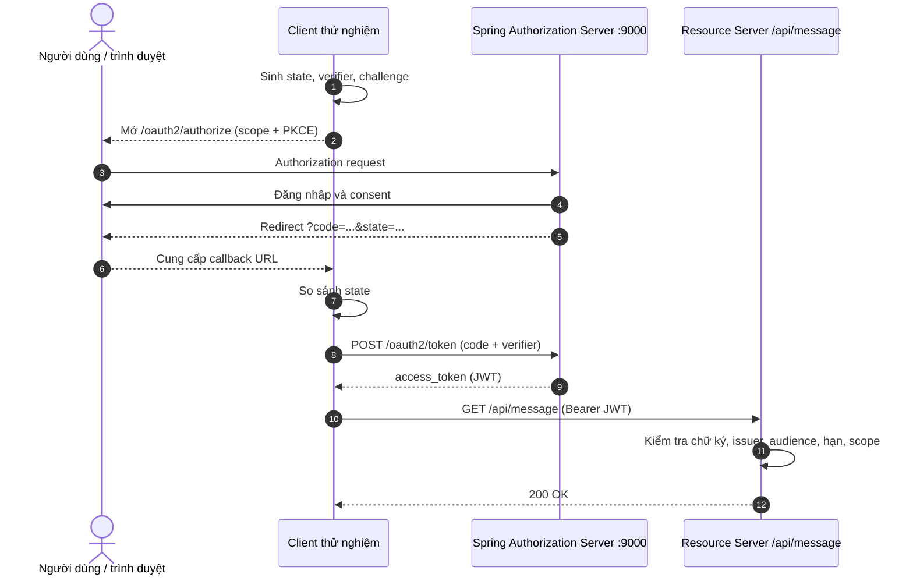

# Chạy một vòng Authorization Code và xác minh token đầu tiên

## 1. Mục tiêu và kết quả cần đạt

Bài thực hành thuộc chương **Khởi tạo dự án** của mô-đun **SPRING_SECURITY_OAUTH2_OIDC_AUTHORIZATION_SERVER**. Mục tiêu là tự tay cấu hình một **OAuth 2.0 Authorization Server** bằng **Spring Security**, **Spring Authorization Server** và **Spring Boot**, thực hiện một vòng **Authorization Code Flow có PKCE**, sau đó **xác minh access token thực sự được chấp nhận** trước khi truy cập API.

Ở cuối bài, bạn sẽ có thể:

1. Chạy một Authorization Server trên `http://localhost:9000`; đăng nhập bằng tài khoản thử nghiệm.
2. Đăng ký client được phép dùng `authorization_code`, có redirect URI, scope và PKCE.
3. Tạo `state`, `code_verifier`, `code_challenge` rồi gửi authorization request qua trình duyệt.
4. Nhận một `authorization code`, kiểm tra `state` và đổi code thành access token tại token endpoint.
5. Kiểm tra chữ ký JWT, issuer, audience, thời hạn và scope bằng **Spring Security Resource Server** trong API minh họa.
6. Kiểm tra trạng thái token qua introspection và phân biệt access token với ID Token của OpenID Connect (OIDC).

Để giữ thao tác ngắn gọn, ví dụ đặt **Authorization Server** và **API thử nghiệm (Resource Server)** trong **cùng một ứng dụng Spring Boot**. Đây là bố cục dành cho phòng lab để kiểm chứng ngay token đầu tiên; triển khai thực tế thường tách hai vai trò thành dịch vụ độc lập.

### Kết quả quan sát được

| Bước | Endpoint / hành vi | Dấu hiệu thành công |
| --- | --- | --- |
| Khám phá cấu hình | `GET /.well-known/openid-configuration` | JSON khai báo `issuer` và các endpoint |
| Yêu cầu ủy quyền | `GET /oauth2/authorize` | Màn hình đăng nhập/consent; redirect có `code` và `state` |
| Đổi mã lấy token | `POST /oauth2/token` | JSON chứa `access_token`, `token_type: Bearer` |
| Xác minh token | `GET /api/message` với Bearer token | HTTP `200` và thông tin chủ thể |
| Kiểm tra token tại AS | `POST /oauth2/introspect` | JSON có `"active": true` nếu token còn hợp lệ |



## 2. Chuẩn bị môi trường

Bài dùng **Java 17+**, **Maven 3.9+**, trình duyệt và **PowerShell** có `curl.exe` (Windows). Mã cấu hình dưới đây dùng **Spring Boot 3.5.7** làm mốc phiên bản thực hành cụ thể; starter của Boot quản lý phiên bản tương thích của Spring Security và Spring Authorization Server. Nếu dùng phiên bản Boot khác, kiểm tra hướng dẫn tương ứng trước khi thay API cấu hình.

Các địa chỉ cố định để tránh nhầm lẫn:

| Thành phần | Giá trị trong bài |
| --- | --- |
| Issuer/Authorization Server | `http://localhost:9000` |
| Authorization endpoint | `http://localhost:9000/oauth2/authorize` |
| Token endpoint | `http://localhost:9000/oauth2/token` |
| Redirect URI của client | `http://127.0.0.1:8080/callback` |
| Client ID | `demo-client` |
| Client secret | `demo-secret`, chỉ để học |
| Tài khoản Resource Owner | `alice / password`, chỉ để học |
| Scope truy cập API | `demo.read` |
| Audience của access token | `demo-api` |
| API dùng để xác minh token | `http://localhost:9000/api/message` |

**Quan trọng:** `localhost:9000` và `127.0.0.1:8080` giữ đúng như ví dụ. Redirect URI phải **trùng chính xác với URI đã đăng ký**. Không có web app lắng nghe ở cổng 8080 trong bài, nên khi redirect, trình duyệt có thể báo không kết nối được; **URL trên thanh địa chỉ vẫn chứa `code` và `state`** để sao chép thủ công. Chỉ áp dụng cách này trong môi trường thử nghiệm cục bộ.

### Cấu trúc thư mục

```text
auth-server-demo/
├── pom.xml
└── src/main/
    ├── java/com/example/authserver/
    │   ├── AuthServerApplication.java
    │   ├── SecurityConfig.java
    │   └── MessageController.java
    └── resources/
        └── application.yml
```

## 3. Tạo ứng dụng Spring Boot có Authorization Server

### 3.1. Tạo `pom.xml`

```xml
<?xml version="1.0" encoding="UTF-8"?>
<project xmlns="http://maven.apache.org/POM/4.0.0"
         xmlns:xsi="http://www.w3.org/2001/XMLSchema-instance"
         xsi:schemaLocation="http://maven.apache.org/POM/4.0.0 https://maven.apache.org/xsd/maven-4.0.0.xsd">
    <modelVersion>4.0.0</modelVersion>
    <parent>
        <groupId>org.springframework.boot</groupId>
        <artifactId>spring-boot-starter-parent</artifactId>
        <version>3.5.7</version>
        <relativePath/>
    </parent>
    <groupId>com.example</groupId>
    <artifactId>auth-server-demo</artifactId>
    <version>0.0.1-SNAPSHOT</version>
    <properties>
        <java.version>17</java.version>
    </properties>
    <dependencies>
        <dependency>
            <groupId>org.springframework.boot</groupId>
            <artifactId>spring-boot-starter-web</artifactId>
        </dependency>
        <dependency>
            <groupId>org.springframework.boot</groupId>
            <artifactId>spring-boot-starter-security</artifactId>
        </dependency>
        <dependency>
            <groupId>org.springframework.boot</groupId>
            <artifactId>spring-boot-starter-oauth2-authorization-server</artifactId>
        </dependency>
        <dependency>
            <groupId>org.springframework.boot</groupId>
            <artifactId>spring-boot-starter-oauth2-resource-server</artifactId>
        </dependency>
    </dependencies>
    <build>
        <plugins>
            <plugin>
                <groupId>org.springframework.boot</groupId>
                <artifactId>spring-boot-maven-plugin</artifactId>
            </plugin>
        </plugins>
    </build>
</project>
```

- `spring-boot-starter-oauth2-authorization-server` cung cấp các endpoint OAuth 2.0/OIDC và mô hình cấp token.
- `spring-boot-starter-security` cung cấp đăng nhập, filter chain và kiểm soát truy cập.
- `spring-boot-starter-oauth2-resource-server` cho phép API kiểm tra Bearer JWT được cấp.
- Không khai báo phiên bản riêng cho Spring Authorization Server khi đang dùng dependency management của Spring Boot.

### 3.2. Main class

```java
package com.example.authserver;

import org.springframework.boot.SpringApplication;
import org.springframework.boot.autoconfigure.SpringBootApplication;

@SpringBootApplication
public class AuthServerApplication {
    public static void main(String[] args) {
        SpringApplication.run(AuthServerApplication.class, args);
    }
}
```

### 3.3. Cấu hình cổng và tên ứng dụng

Tạo `src/main/resources/application.yml`:

```yaml
server:
  port: 9000

spring:
  application:
    name: auth-server-demo
```

Trong bài, issuer được cấu hình trực tiếp qua `AuthorizationServerSettings` ở bước tiếp theo. **Issuer** là định danh mà client và Resource Server phải tin cậy và so khớp; đừng vô tình đổi thành tên host khác khi thử nghiệm.

### 3.4. Cấu hình bảo mật, đăng ký client và ký JWT

Tạo `SecurityConfig.java`:

```java
package com.example.authserver;

import com.nimbusds.jose.jwk.JWKSet;
import com.nimbusds.jose.jwk.RSAKey;
import com.nimbusds.jose.jwk.source.ImmutableJWKSet;
import com.nimbusds.jose.jwk.source.JWKSource;
import com.nimbusds.jose.proc.SecurityContext;
import org.springframework.context.annotation.Bean;
import org.springframework.context.annotation.Configuration;
import org.springframework.core.annotation.Order;
import org.springframework.http.MediaType;
import org.springframework.security.config.Customizer;
import org.springframework.security.config.annotation.web.builders.HttpSecurity;
import org.springframework.security.core.userdetails.User;
import org.springframework.security.core.userdetails.UserDetails;
import org.springframework.security.core.userdetails.UserDetailsService;
import org.springframework.security.crypto.bcrypt.BCryptPasswordEncoder;
import org.springframework.security.crypto.password.PasswordEncoder;
import org.springframework.security.oauth2.core.AuthorizationGrantType;
import org.springframework.security.oauth2.core.ClientAuthenticationMethod;
import org.springframework.security.oauth2.core.DelegatingOAuth2TokenValidator;
import org.springframework.security.oauth2.core.OAuth2Error;
import org.springframework.security.oauth2.core.OAuth2TokenValidator;
import org.springframework.security.oauth2.core.OAuth2TokenValidatorResult;
import org.springframework.security.oauth2.core.oidc.OidcScopes;
import org.springframework.security.oauth2.jwt.Jwt;
import org.springframework.security.oauth2.jwt.JwtDecoder;
import org.springframework.security.oauth2.jwt.JwtValidators;
import org.springframework.security.oauth2.jwt.NimbusJwtDecoder;
import org.springframework.security.oauth2.server.authorization.OAuth2TokenType;
import org.springframework.security.oauth2.server.authorization.client.InMemoryRegisteredClientRepository;
import org.springframework.security.oauth2.server.authorization.client.RegisteredClient;
import org.springframework.security.oauth2.server.authorization.client.RegisteredClientRepository;
import org.springframework.security.oauth2.server.authorization.config.annotation.web.configuration.OAuth2AuthorizationServerConfiguration;
import org.springframework.security.oauth2.server.authorization.config.annotation.web.configurers.OAuth2AuthorizationServerConfigurer;
import org.springframework.security.oauth2.server.authorization.settings.AuthorizationServerSettings;
import org.springframework.security.oauth2.server.authorization.settings.ClientSettings;
import org.springframework.security.oauth2.server.authorization.token.JwtEncodingContext;
import org.springframework.security.oauth2.server.authorization.token.OAuth2TokenCustomizer;
import org.springframework.security.oauth2.server.resource.web.BearerTokenAuthenticationEntryPoint;
import org.springframework.security.web.SecurityFilterChain;
import org.springframework.security.web.authentication.LoginUrlAuthenticationEntryPoint;
import org.springframework.security.web.util.matcher.MediaTypeRequestMatcher;

import java.security.KeyPair;
import java.security.KeyPairGenerator;
import java.security.interfaces.RSAPrivateKey;
import java.security.interfaces.RSAPublicKey;
import java.util.List;
import java.util.UUID;

@Configuration
public class SecurityConfig {
    private static final String ISSUER = "http://localhost:9000";

    // Chain rieng cho cac endpoint OAuth 2.0 va OIDC.
    @Bean
    @Order(1)
    SecurityFilterChain authorizationServerSecurityFilterChain(HttpSecurity http)
            throws Exception {
        OAuth2AuthorizationServerConfigurer as =
                OAuth2AuthorizationServerConfigurer.authorizationServer();

        http
            .securityMatcher(as.getEndpointsMatcher())
            .with(as, configurer -> configurer.oidc(Customizer.withDefaults()))
            .authorizeHttpRequests(auth -> auth.anyRequest().authenticated())
            .exceptionHandling(ex -> ex.defaultAuthenticationEntryPointFor(
                    new LoginUrlAuthenticationEntryPoint("/login"),
                    new MediaTypeRequestMatcher(MediaType.TEXT_HTML)))
            .oauth2ResourceServer(rs -> rs.jwt(Customizer.withDefaults()));

        return http.build();
    }

    // Chain cho form dang nhap va API minh hoa trong cung ung dung.
    @Bean
    @Order(2)
    SecurityFilterChain applicationSecurityFilterChain(HttpSecurity http)
            throws Exception {
        http
            .authorizeHttpRequests(auth -> auth
                    .requestMatchers("/api/**").hasAuthority("SCOPE_demo.read")
                    .anyRequest().authenticated())
            .formLogin(Customizer.withDefaults())
            .oauth2ResourceServer(rs -> rs.jwt(Customizer.withDefaults()))
            .exceptionHandling(ex -> ex.defaultAuthenticationEntryPointFor(
                    new BearerTokenAuthenticationEntryPoint(),
                    request -> request.getRequestURI().startsWith("/api/")));

        return http.build();
    }

    @Bean
    PasswordEncoder passwordEncoder() {
        return new BCryptPasswordEncoder();
    }

    @Bean
    UserDetailsService users(PasswordEncoder encoder) {
        UserDetails alice = User.withUsername("alice")
                .password(encoder.encode("password"))
                .roles("USER")
                .build();
        return new org.springframework.security.provisioning.InMemoryUserDetailsManager(alice);
    }

    @Bean
    RegisteredClientRepository registeredClients(PasswordEncoder encoder) {
        RegisteredClient client = RegisteredClient.withId(UUID.randomUUID().toString())
                .clientId("demo-client")
                .clientSecret(encoder.encode("demo-secret"))
                .clientAuthenticationMethod(ClientAuthenticationMethod.CLIENT_SECRET_BASIC)
                .authorizationGrantType(AuthorizationGrantType.AUTHORIZATION_CODE)
                .authorizationGrantType(AuthorizationGrantType.REFRESH_TOKEN)
                .redirectUri("http://127.0.0.1:8080/callback")
                .scope("demo.read")
                .scope(OidcScopes.OPENID)
                .scope(OidcScopes.PROFILE)
                .clientSettings(ClientSettings.builder()
                        .requireProofKey(true)
                        .requireAuthorizationConsent(true)
                        .build())
                .build();
        return new InMemoryRegisteredClientRepository(client);
    }

    // Khoa RSA tam thoi: khoi dong lai se tao cap khoa moi.
    @Bean
    JWKSource<SecurityContext> jwkSource() throws Exception {
        KeyPairGenerator generator = KeyPairGenerator.getInstance("RSA");
        generator.initialize(2048);
        KeyPair keyPair = generator.generateKeyPair();

        RSAKey rsaKey = new RSAKey.Builder((RSAPublicKey) keyPair.getPublic())
                .privateKey((RSAPrivateKey) keyPair.getPrivate())
                .keyID(UUID.randomUUID().toString())
                .build();

        return new ImmutableJWKSet<>(new JWKSet(rsaKey));
    }

    // Gan audience vao access token de API xac minh dung nguoi nhan.
    @Bean
    OAuth2TokenCustomizer<JwtEncodingContext> tokenCustomizer() {
        return context -> {
            if (OAuth2TokenType.ACCESS_TOKEN.equals(context.getTokenType())) {
                context.getClaims().audience(List.of("demo-api"));
            }
        };
    }

    // Kiem tra chu ky, issuer, thoi gian va audience cho JWT.
    @Bean
    JwtDecoder jwtDecoder(JWKSource<SecurityContext> jwkSource) {
        NimbusJwtDecoder decoder = (NimbusJwtDecoder)
                OAuth2AuthorizationServerConfiguration.jwtDecoder(jwkSource);

        OAuth2TokenValidator<Jwt> issuerAndTime =
                JwtValidators.createDefaultWithIssuer(ISSUER);
        OAuth2TokenValidator<Jwt> correctAudience = jwt ->
                jwt.getAudience().contains("demo-api")
                    ? OAuth2TokenValidatorResult.success()
                    : OAuth2TokenValidatorResult.failure(
                            new OAuth2Error("invalid_token",
                                    "Required audience demo-api", null));

        decoder.setJwtValidator(
                new DelegatingOAuth2TokenValidator<>(issuerAndTime, correctAudience));
        return decoder;
    }

    @Bean
    AuthorizationServerSettings authorizationServerSettings() {
        return AuthorizationServerSettings.builder()
                .issuer(ISSUER)
                .build();
    }
}
```

**Đọc cấu hình theo chức năng:**

- `@Order(1)` chọn filter chain xử lý Authorization Server; `@Order(2)` xử lý trang đăng nhập và `/api/**`. Đây là cách phân tách endpoint trong một ứng dụng.
- `RegisteredClientRepository` mô tả client được phép làm gì; `requireProofKey(true)` buộc client cung cấp PKCE, `requireAuthorizationConsent(true)` bật bước đồng ý khi thích hợp.
- `UserDetailsService` tạo tài khoản Resource Owner `alice`. Client secret và mật khẩu người dùng là **hai loại thông tin xác thực độc lập**.
- `JWKSource` sinh cặp khóa RSA: **private key** ký JWT tại AS; **public key** được công bố qua JWKS để bên kiểm tra xác minh chữ ký.
- `OAuth2TokenCustomizer` đặt `aud=demo-api` trong **access token**. `JwtDecoder` trong ví dụ xác minh chữ ký, `iss`, thời gian và `aud`; rule `SCOPE_demo.read` kiểm tra quyền truy cập API.
- `oidc(Customizer.withDefaults())` bật hỗ trợ OpenID Connect. Bài đầu tiên vẫn chạy OAuth 2.0 đơn thuần với scope `demo.read` để quan sát rõ access token.

### 3.5. Tạo API để kiểm chứng access token

Tạo `MessageController.java`:

```java
package com.example.authserver;

import org.springframework.security.core.annotation.AuthenticationPrincipal;
import org.springframework.security.oauth2.jwt.Jwt;
import org.springframework.web.bind.annotation.GetMapping;
import org.springframework.web.bind.annotation.RestController;

import java.util.Map;

@RestController
public class MessageController {
    @GetMapping("/api/message")
    public Map<String, Object> message(@AuthenticationPrincipal Jwt jwt) {
        return Map.of(
                "message", "Bearer token da duoc xac minh",
                "subject", jwt.getSubject(),
                "issuer", jwt.getIssuer().toString(),
                "audience", jwt.getAudience());
    }
}
```

**Tại sao cần API này?** Chỉ giải mã phần payload của JWT là chưa đủ để biết token đáng tin. Với cấu hình trên, trước khi controller được gọi, Spring Security kiểm tra chữ ký và các claim bắt buộc qua `JwtDecoder`, đồng thời kiểm tra authority `SCOPE_demo.read`. Kết quả HTTP 200 từ API là bằng chứng có thể quan sát được rằng **token đã qua bộ xác minh** của Resource Server minh họa.

## 4. Khởi chạy và kiểm tra metadata

Tại thư mục chứa `pom.xml`, chạy:

```powershell
mvn spring-boot:run
```

Giữ tiến trình này chạy. Mở một terminal PowerShell **khác** và kiểm tra discovery/JWKS:

```powershell
curl.exe -sS http://localhost:9000/.well-known/openid-configuration
curl.exe -sS http://localhost:9000/oauth2/jwks
```

Trong metadata, đối chiếu:

```json
{
  "issuer": "http://localhost:9000",
  "authorization_endpoint": "http://localhost:9000/oauth2/authorize",
  "token_endpoint": "http://localhost:9000/oauth2/token",
  "jwks_uri": "http://localhost:9000/oauth2/jwks"
}
```

Đây là **trích đoạn các trường cần tìm**, không phải toàn bộ JSON thực tế. JWKS phải chứa public JWK, thường có `kty=RSA`, `kid`, `n` và `e`; **không có private key**. Nếu `issuer` trong metadata không phải `http://localhost:9000`, kiểm tra lại cấu hình và địa chỉ dùng để truy cập.

## 5. Tạo PKCE và gửi Authorization Request

### 5.1. Sinh `code_verifier`, `code_challenge` và `state`

Trong terminal PowerShell thứ hai, chạy **nguyên khối**:

```powershell
function ConvertTo-Base64Url([byte[]] $bytes) {
    return [Convert]::ToBase64String($bytes).TrimEnd('=').Replace('+', '-').Replace('/', '_')
}

$rng = [System.Security.Cryptography.RandomNumberGenerator]::Create()
$verifierBytes = New-Object byte[] 32
$stateBytes = New-Object byte[] 16
$rng.GetBytes($verifierBytes)
$rng.GetBytes($stateBytes)
$rng.Dispose()

$verifier = ConvertTo-Base64Url $verifierBytes
$state = ConvertTo-Base64Url $stateBytes

$sha = [System.Security.Cryptography.SHA256]::Create()
$hash = $sha.ComputeHash([System.Text.Encoding]::ASCII.GetBytes($verifier))
$sha.Dispose()
$challenge = ConvertTo-Base64Url $hash

$authorizeUrl = "http://localhost:9000/oauth2/authorize?" +
    "response_type=code&client_id=demo-client" +
    "&redirect_uri=http%3A%2F%2F127.0.0.1%3A8080%2Fcallback" +
    "&scope=demo.read&state=$state" +
    "&code_challenge=$challenge&code_challenge_method=S256"

Write-Output "Authorization URL: $authorizeUrl"
Start-Process $authorizeUrl
```

Khi copy lệnh, giữ lại `$verifier` và `$state` **trong cùng phiên PowerShell** để tiếp tục đổi code lấy token. Đoạn mã sinh:

```text
code_verifier   = chuỗi ngẫu nhiên client giữ riêng
code_challenge  = BASE64URL_NO_PADDING(SHA256(ASCII(code_verifier)))
state           = giá trị ngẫu nhiên để ràng buộc callback với phiên yêu cầu
```

Authorization request qua trình duyệt chỉ gửi **challenge**, không gửi `code_verifier` hoặc client secret:

```http
GET /oauth2/authorize?response_type=code&client_id=demo-client&redirect_uri=http%3A%2F%2F127.0.0.1%3A8080%2Fcallback&scope=demo.read&state=...&code_challenge=...&code_challenge_method=S256 HTTP/1.1
Host: localhost:9000
```

`response_type=code` chỉ định loại authorization response; token request ở bước sau mới dùng `grant_type=authorization_code`.

### 5.2. Đăng nhập, chấp thuận và nhận code

Trình duyệt mở trang đăng nhập của Authorization Server. Dùng tài khoản học tập `alice` / `password`; nếu được hỏi consent, chấp thuận scope `demo.read`. Sau đó trình duyệt được chuyển tới URL dạng:

```text
http://127.0.0.1:8080/callback?code=CODE_DUOC_CAP&state=STATE_DA_GUI
```

Do chưa chạy ứng dụng client ở cổng 8080, trình duyệt có thể hiển thị lỗi kết nối. **Hãy sao chép `code` và `state` từ URL**, không lấy giá trị placeholder ở ví dụ. Một authorization code có thời hạn ngắn, chỉ đổi thành token được **một lần**; đừng giữ quá lâu trước bước tiếp theo.

Trong PowerShell **đang giữ `$verifier` và `$state`**, nhập:

```powershell
$code = Read-Host "Dan gia tri code trong callback URL"
$returnedState = Read-Host "Dan gia tri state trong callback URL"

if ($returnedState -cne $state) {
    throw "State mismatch: tu choi authorization response"
}
if ([string]::IsNullOrWhiteSpace($code)) {
    throw "Khong nhan duoc authorization code"
}
```

Ứng dụng client thực tế phải tự lưu và đối chiếu `state` với phiên khởi tạo; thao tác thủ công này giúp nhìn rõ vai trò của `state`. Nếu callback có `error=access_denied` thay vì code, người dùng đã từ chối hoặc yêu cầu ủy quyền không thành công; xử lý lỗi, không gửi token request với code trống.

## 6. Đổi Authorization Code lấy access token

Gửi **Token Request** đến `/oauth2/token` bằng HTTP POST. Client này thuộc loại **confidential**, vì thế phải xác thực bằng `client_secret_basic`. Khác với authorization request, thao tác này không yêu cầu trình duyệt chuyển hướng:

```powershell
$tokenJson = curl.exe -sS `
    -u "demo-client:demo-secret" `
    -H "Content-Type: application/x-www-form-urlencoded" `
    --data-urlencode "grant_type=authorization_code" `
    --data-urlencode "code=$code" `
    --data-urlencode "redirect_uri=http://127.0.0.1:8080/callback" `
    --data-urlencode "code_verifier=$verifier" `
    "http://localhost:9000/oauth2/token"

$tokenResponse = $tokenJson | ConvertFrom-Json
if (-not $tokenResponse.access_token) {
    throw "Token request that bai: $tokenJson"
}
$accessToken = $tokenResponse.access_token
$tokenResponse | Select-Object token_type, expires_in, scope
```

Ví dụ cấu trúc token response:

```json
{
  "access_token": "eyJhbGciOiJSUzI1NiIsImtpZCI6Ii4uLiJ9...",
  "token_type": "Bearer",
  "expires_in": 300,
  "scope": "demo.read",
  "refresh_token": "..."
}
```

Các giá trị token và thời gian sống trong ví dụ chỉ minh họa; response thực tế phụ thuộc cấu hình phát hành token. `refresh_token` có thể xuất hiện với confidential client được phép dùng refresh token nhưng không phải bảo đảm cho mọi client. Khi request chỉ xin `demo.read`, **không có `id_token`** vì chưa yêu cầu OIDC.

AS kiểm tra đồng thời: client credentials, grant type đã đăng ký, code hợp lệ/chưa dùng/chưa hết hạn, redirect URI khớp và `code_verifier` giải ra đúng `code_challenge` lưu từ bước trước. Sau khi code đổi thành token thành công, **không thể đổi lại cùng code**.

## 7. Xác minh token đầu tiên

### 7.1. Đọc claim để hiểu token, chưa phải kiểm chứng

Access token do cấu hình trên phát hành mặc định là một **JWT** ba phần `header.payload.signature`. Có thể xem phần payload cục bộ bằng PowerShell:

```powershell
function ConvertFrom-Base64Url([string] $value) {
    $base64 = $value.Replace('-', '+').Replace('_', '/')
    switch ($base64.Length % 4) {
        0 { }
        2 { $base64 += '==' }
        3 { $base64 += '=' }
        default { throw "JWT segment khong hop le" }
    }
    return [System.Text.Encoding]::UTF8.GetString(
        [Convert]::FromBase64String($base64))
}

$parts = $accessToken.Split('.')
if ($parts.Length -ne 3) { throw "Access token khong co dinh dang JWT" }
$claims = ConvertFrom-Base64Url $parts[1] | ConvertFrom-Json
$claims | Select-Object iss, sub, aud, scope, iat, exp
```

Những claim đáng chú ý:

| Claim | Giá trị kỳ vọng | Ý nghĩa |
| --- | --- | --- |
| `iss` | `http://localhost:9000` | Authorization Server đã phát hành token |
| `sub` | Danh tính được ủy quyền, thường `alice` | Chủ thể của token |
| `aud` | Chứa `demo-api` | Token dành cho API nào |
| `scope` | Chứa `demo.read` | Quyền đã được cấp |
| `iat` | Thời điểm phát hành (Unix time) | Phục vụ kiểm tra thời gian |
| `exp` | Thời điểm hết hạn (Unix time) | Token không còn hợp lệ sau mốc này |

**Giải mã payload không xác minh chữ ký**: bất kỳ ai cũng có thể tạo một chuỗi trông giống JWT. Không dựa vào `sub`, `scope` hoặc `aud` vừa giải mã để quyết định phân quyền cho đến khi có bộ kiểm tra chữ ký và claim đáng tin cậy.

### 7.2. Gọi Resource Server để xác minh thật

Vẫn ở terminal chứa `$accessToken`, gọi API:

```powershell
curl.exe -i `
    -H "Authorization: Bearer $accessToken" `
    "http://localhost:9000/api/message"
```

Nếu token hợp lệ, response giống:

```http
HTTP/1.1 200 OK
Content-Type: application/json

{
  "message": "Bearer token da duoc xac minh",
  "subject": "alice",
  "issuer": "http://localhost:9000",
  "audience": ["demo-api"]
}
```

Đường đi bên trong Spring Security là:

1. `BearerTokenAuthenticationFilter` nhận token từ header `Authorization`.
2. `JwtAuthenticationProvider` gọi `JwtDecoder`; decoder dùng khóa RSA phù hợp từ `JWKSource` để **xác minh chữ ký**, rồi chạy validator cho thời hạn, `iss` và `aud`.
3. `JwtAuthenticationConverter` mặc định ánh xạ scope thành authority như `SCOPE_demo.read`.
4. Rule `hasAuthority("SCOPE_demo.read")` cho phép gọi `MessageController` nếu scope đạt yêu cầu.

Như vậy, HTTP 200 từ `/api/message` chứng minh token **được xác minh và được cấp quyền truy cập** trong hệ thống mẫu. Nó không có nghĩa mọi API khác đều phải chấp nhận token; mỗi Resource Server cần kiểm tra đúng issuer, audience và quyền của mình.

### 7.3. Kiểm tra trạng thái token qua introspection

Spring Authorization Server còn cung cấp OAuth 2.0 Token Introspection Endpoint. Client hợp lệ xác thực với AS để hỏi token còn active không:

```powershell
curl.exe -sS `
    -u "demo-client:demo-secret" `
    -H "Content-Type: application/x-www-form-urlencoded" `
    --data-urlencode "token=$accessToken" `
    "http://localhost:9000/oauth2/introspect"
```

Phản hồi thành công với token đang hợp lệ có thể bao gồm:

```json
{
  "active": true,
  "scope": "demo.read",
  "client_id": "demo-client",
  "token_type": "Bearer"
}
```

Đó là **trích đoạn**; danh sách claim thực tế phụ thuộc chính sách AS. Introspection giúp hỏi trạng thái token ở Authorization Server, đặc biệt hữu ích với opaque token hoặc khi cần biết token đã bị thu hồi hay chưa. Với JWT, Resource Server có thể xác minh chữ ký và claim cục bộ qua JWKS, nhưng nếu cần xử lý thu hồi ngay lập tức thì phải thiết kế thêm chiến lược phù hợp (introspection, token lifetime ngắn, hoặc quản lý phiên/token).

### 7.4. Kiểm tra các đường lỗi quan trọng

| Thử nghiệm | Cách làm | Kết quả mong đợi |
| --- | --- | --- |
| Thiếu access token | Gọi `/api/message` mà không gửi Bearer token | Không được vào API; ví dụ cấu hình có thể trả `401` |
| Sửa một ký tự trong chữ ký JWT | Thay đổi token trước khi gọi API | `401 invalid_token` hoặc từ chối xác thực |
| Dùng mã authorization code lần thứ hai | Lặp lại token request với cùng `code` | `invalid_grant` |
| Sai PKCE | Dùng `code_verifier` khác trong lần đổi code **đầu tiên** | `invalid_grant` |
| Sai client secret | Đổi `-u` sang secret sai | `invalid_client`; thường HTTP `401` |
| Sai redirect URI | Token request chứa URI khác request ban đầu | `invalid_grant` |
| Sai `state` ở callback | Cố tình thay `state` trước khi client so sánh | Client phải từ chối và không đổi code |
| Token không có `demo.read` | Dùng token hợp lệ nhưng thiếu scope cần thiết | `403 Forbidden` ở Resource Server |

**Lưu ý khi tự thử lỗi PKCE:** mỗi authorization code chỉ dùng được một lần. Muốn kiểm tra riêng PKCE sai, hãy tạo **một authorization request mới** rồi cố tình gửi verifier khác trong lần token request đầu tiên, nếu không bạn chỉ đang kiểm tra việc code đã được sử dụng.

## 8. Mở rộng: nhận ID Token qua OpenID Connect

Spring Authorization Server trong ví dụ đã bật OIDC và RegisteredClient đã cho phép `openid` cùng `profile`. Để chạy thêm một lượt có đăng nhập OIDC, hãy tạo **bộ PKCE và state mới**, rồi đổi `scope=demo.read` trong authorization URL thành:

```text
scope=openid%20profile%20demo.read
```

Với OIDC, có thể gửi thêm `nonce` ngẫu nhiên và kiểm tra claim `nonce` trong ID Token sau khi token request thành công. Mẫu token response sẽ có thêm `id_token` khi yêu cầu OIDC hợp lệ:

```json
{
  "access_token": "...",
  "token_type": "Bearer",
  "scope": "openid profile demo.read",
  "id_token": "eyJhbGciOiJSUzI1NiIs...",
  "expires_in": 300
}
```

Phân biệt rõ:

- **Access token**: dùng khi gọi `/api/message` hoặc Resource Server khác; phải kiểm tra audience và scope phù hợp API.
- **ID Token**: dành cho **OAuth/OIDC client (Relying Party)** để chứng minh kết quả xác thực; client phải xác minh chữ ký, `iss`, `aud` (client ID), hạn token và `nonce` nếu đã gửi. **Không dùng ID Token thay access token khi gọi API.**
- **Authorization code**: mã trung gian một lần để client đổi lấy token; không phải token được phép gọi API.

Một client OIDC production thường sử dụng Spring Security OAuth2 Client hoặc thư viện OIDC phù hợp để tự động thực hiện flow và xác minh ID Token, thay cho việc sao chép code và decode JWT thủ công như trong phòng lab.

## 9. Gỡ lỗi theo đúng bước

| Hiện tượng | Nguyên nhân có thể | Nơi kiểm tra |
| --- | --- | --- |
| `/oauth2/authorize` trả lỗi redirect | Redirect URI không trùng registration | Cùng một URI ở `RegisteredClient` và authorize URL |
| Không hiển thị trang đăng nhập hoặc lặp redirect | Filter chain hoặc endpoint matcher cấu hình sai | Thứ tự `@Order(1)`/`@Order(2)`, URL `/login` |
| Token endpoint trả `invalid_client` | Basic auth client ID/secret sai hoặc sai phương thức | `clientAuthenticationMethod`, `-u` trong `curl.exe` |
| Token endpoint trả `invalid_grant` | Code hết hạn/dùng lại, verifier sai, redirect URI sai | Tạo flow mới; giữ nguyên verifier ban đầu |
| Token endpoint trả `unauthorized_client` | Client không được đăng ký grant | `authorizationGrantType(AUTHORIZATION_CODE)` |
| `/api/message` trả `401` | Token sai chữ ký, hết hạn, issuer/audience sai | JWT decoder, JWKS, `iss`, `aud`, `exp` |
| `/api/message` trả `403` | Token hợp lệ nhưng thiếu `demo.read` | Rule `SCOPE_demo.read` và scope thực tế |
| Token trước khi restart không dùng được nữa | Khóa RSA, token/consent và client lưu trong bộ nhớ | Chạy lại flow sau mỗi lần restart demo |
| `/.well-known/openid-configuration` hoặc `/oauth2/jwks` không có | OIDC/Authorization Server chưa cấu hình đủ hoặc sai cổng | Filter chain AS, issuer, starter dependency |

Khi phân tích lỗi, nên xem HTTP status, OAuth error code và log server ở mức phù hợp. **Không ghi nguyên access token, refresh token, authorization code, code verifier, client secret hoặc mật khẩu vào log, issue tracker hay ảnh chụp màn hình**.

## 10. Từ bài lab đến thiết kế hệ thống thật

Bài thực hành chủ đích dùng cấu hình đơn giản để quan sát một vòng giao thức. Trước khi đưa Authorization Server vào môi trường thực tế:

1. **HTTPS bắt buộc**: thay HTTP localhost bằng HTTPS cho browser redirect, token request, metadata/JWKS và truy cập API.
2. **Lưu trữ bền vững**: thay `InMemoryRegisteredClientRepository` và các dịch vụ lưu authorization/consent trong bộ nhớ bằng cơ chế lưu trữ phù hợp, chẳng hạn JDBC; kiểm thử trường hợp restart và nhiều instance.
3. **Quản lý khóa**: không sinh khóa ký mới ở mỗi lần khởi động production; lưu private key an toàn, công bố public key qua JWKS, quản lý `kid`, rotation và thời gian tồn tại token cũ.
4. **Quản lý secrets**: không hard-code client secret hay mật khẩu người dùng; dùng secret manager, cơ chế mã hóa và chính sách xác thực phù hợp. Public client không được giả định có thể giấu client secret.
5. **Bảo vệ Authorization Code Flow**: dùng PKCE `S256`; kiểm tra state; đăng ký và đối chiếu redirect URI chặt; kiểm soát consent và scope tối thiểu.
6. **Tách Resource Server**: mỗi API xác minh chữ ký token, issuer, audience, thời hạn và quyền cần thiết. Nếu cần thu hồi token có hiệu lực tức thời, xác định chiến lược riêng.
7. **Kiểm thử bảo mật**: kiểm tra code dùng lại, PKCE sai, CSRF/state, redirect lạ, client/grant chưa đăng ký, token giả mạo, scope sai, khóa ký thay đổi và token hết hạn.

### Checklist hoàn tất bài

- [ ] Ứng dụng khởi chạy trên cổng 9000 và discovery có issuer đúng.
- [ ] JWKS công bố public key và không lộ private key.
- [ ] Trang authorize cho phép đăng nhập `alice`; callback có code và state.
- [ ] Client kiểm tra state khớp trước khi gọi token endpoint.
- [ ] Token request gửi đúng `grant_type=authorization_code`, `code_verifier`, redirect URI và client authentication.
- [ ] Token response có `access_token`; payload có `iss`, `aud=demo-api` và `scope=demo.read`.
- [ ] `GET /api/message` với Bearer token hợp lệ trả HTTP 200.
- [ ] Introspection trả `active=true` với token chưa hết hạn.
- [ ] Thử token sai hoặc code đã dùng bị từ chối.

**Kiến thức cần giữ lại:** Authorization request diễn ra qua trình duyệt để nhận **authorization code**; token request dùng code và PKCE verifier để đổi thành **access token**; Resource Server chỉ chấp nhận access token sau khi xác minh chữ ký, issuer, audience, thời gian và quyền. Đây là chuỗi thao tác tối thiểu để tự kiểm chứng Authorization Server đầu tiên bằng Spring Security và Spring Authorization Server.

## Tài liệu tham chiếu

- [Spring Authorization Server Reference](https://docs.spring.io/spring-authorization-server/reference/) — cấu hình Authorization Server, endpoints, RegisteredClient, OIDC.
- [Spring Security Reference — OAuth 2.0 Resource Server JWT](https://docs.spring.io/spring-security/reference/servlet/oauth2/resource-server/jwt.html) — JWT decoder, claim validation và scope authorities.
- [RFC 6749 — OAuth 2.0 Authorization Framework](https://www.rfc-editor.org/rfc/rfc6749) — Authorization Code Grant, authorization request và token request.
- [RFC 7636 — Proof Key for Code Exchange (PKCE)](https://www.rfc-editor.org/rfc/rfc7636) — sinh và kiểm tra verifier/challenge.
- [RFC 7662 — OAuth 2.0 Token Introspection](https://www.rfc-editor.org/rfc/rfc7662) — kiểm tra trạng thái token.
- [OpenID Connect Core 1.0](https://openid.net/specs/openid-connect-core-1_0.html) — ID Token và xác thực OIDC.
