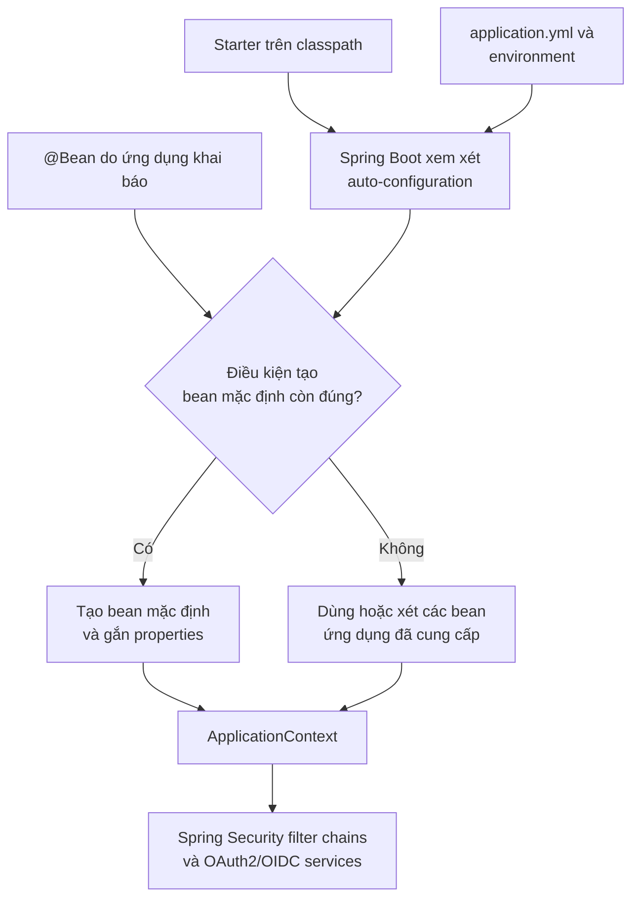
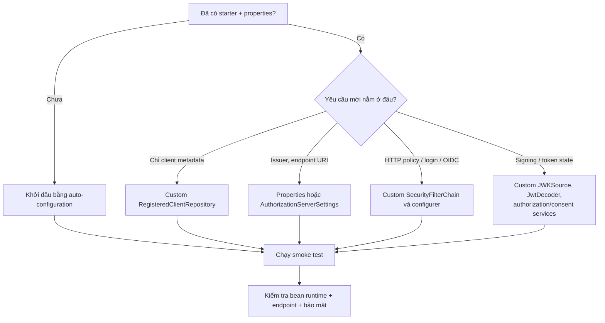

# Phân biệt cấu hình tự động của Spring Boot với các bean khai báo tường minh

## 1. Bối cảnh và mục tiêu

Khi khởi tạo **Spring Security OAuth2/OIDC Authorization Server** bằng Spring Boot và Spring Authorization Server, có hai cách thường gặp để đưa các thành phần bảo mật vào ứng dụng:

1. **Spring Boot auto-configuration:** thêm starter và khai báo các thuộc tính trong `application.yml`/`application.properties`; Boot kiểm tra điều kiện rồi đăng ký các bean phù hợp.
2. **Khai báo tường minh:** lập trình viên cung cấp `@Configuration` và các phương thức `@Bean` để quyết định cách đăng ký OAuth client, issuer, khóa ký, endpoint hoặc các `SecurityFilterChain`.

Hai cách này **có thể phối hợp**, nhưng cần hiểu phạm vi mà mỗi bean tự định nghĩa sẽ ảnh hưởng. Nếu không, dự án có thể gặp tình huống nhìn thấy cấu hình trong YAML nhưng không có hiệu lực, Authorization Endpoint trả 404, Token Endpoint xử lý sai hoặc phát token bằng khóa ký không mong muốn.

Sau bài học, bạn cần trả lời được:

- Bean nào do Spring Boot tự tạo; bean nào do Spring Authorization Server hoặc Spring Security cung cấp thông qua configuration mặc định?
- Khi nào một `@Bean` khiến auto-configuration tương ứng **back off** (không còn tạo bean mặc định)?
- Vì sao tự khai báo `SecurityFilterChain` khác với tự khai báo `RegisteredClientRepository`?
- Nên đi từ cấu hình tối thiểu đến cấu hình phục vụ production như thế nào, và kiểm chứng bean nào đang thực sự được sử dụng?

Phạm vi bài viết là **Authorization Server dạng Servlet** trong Spring Boot. Ví dụ Java dùng hướng tiếp cận của **Spring Boot 3.5 / Spring Authorization Server 1.5**; với Spring Boot 4.x / Spring Security 7.x, phải đối chiếu API và package của phiên bản đang dùng. Để Boot quản lý các phiên bản tương thích, ưu tiên dependency management/BOM của Spring Boot thay vì tự ghép các phiên bản Spring Security hoặc Spring Authorization Server.

## 2. Cơ chế auto-configuration hoạt động như thế nào?

### 2.1. Các khái niệm căn bản

- **Auto-configuration**: tập hợp lớp cấu hình của Spring Boot với các điều kiện dựa trên classpath, loại ứng dụng, thuộc tính và bean đã tồn tại. Mục tiêu là cung cấp bộ mặc định hợp lý để ứng dụng khởi động nhanh.
- **Bean**: đối tượng trong Spring `ApplicationContext`, có thể do Boot đăng ký tự động, do framework khai báo hoặc do chính ứng dụng khai báo bằng `@Bean`/cơ chế bean registration khác.
- **Conditional/back off**: ví dụ `@ConditionalOnMissingBean` cho phép auto-configuration bỏ qua việc tạo một bean khi context đã có bean khớp điều kiện. **Điều kiện thực tế khác nhau giữa các cấu hình và phiên bản**, không nên suy luận mọi bean đều hoạt động giống nhau.
- **Configuration properties**: Boot ánh xạ các khóa `spring.*` trong YAML hoặc environment sang cấu hình Java. Một property chỉ có tác dụng khi có thành phần thật sự **đọc** nó và chuyển thành bean/cấu hình runtime.



Một nguyên tắc thực hành quan trọng: **có khai báo YAML không có nghĩa mọi bean mặc định sẽ luôn được tạo**. Ví dụ khi bạn tự cung cấp `RegisteredClientRepository` sử dụng JDBC, các mục `spring.security.oauth2.authorizationserver.client.*` không nhất thiết còn là nguồn dữ liệu registration của repository đó. Cần nhìn vào bean thực tế, không chỉ nhìn file cấu hình.

### 2.2. Các lớp trách nhiệm

| Lớp | Làm gì? | Ví dụ |
| --- | --- | --- |
| **Spring Boot** | Đọc properties, kiểm tra điều kiện, cung cấp bean mặc định khi thích hợp. | Tạo `InMemoryRegisteredClientRepository` từ YAML, thiết lập một số bean hỗ trợ Authorization Server. |
| **Spring Authorization Server / Spring Security** | Định nghĩa giao thức, endpoint filters, authentication providers, token services, model và các configurer. | `RegisteredClient`, `OAuth2AuthorizationServerConfigurer`, `OAuth2AuthorizationService`. |
| **Ứng dụng của bạn** | Quyết định chính sách bảo mật, dữ liệu production, authentication, signing keys, persistence, integrations. | Bean `JdbcRegisteredClientRepository`, `AuthorizationServerSettings` và filter chains riêng. |

**Cần phân biệt “Boot không tự tạo bean” với “Spring Authorization Server không thể hoạt động”.** Khi một phần auto-configuration bị thay thế, các thành phần còn lại có thể được Boot hoặc Spring Security cung cấp, miễn là đủ điều kiện. Ngược lại, chỉ khai báo vài bean chức năng không tự động tạo ra một luồng đăng nhập OAuth/OIDC hoàn chỉnh.

## 3. Cách A — Khởi động với auto-configuration và YAML

### 3.1. Dependency và cấu hình tối thiểu

Với dự án Spring Boot dùng Gradle:

```groovy
dependencies {
    implementation 'org.springframework.boot:spring-boot-starter-oauth2-authorization-server'
    testImplementation 'org.springframework.boot:spring-boot-starter-test'
}
```

Hoặc Maven:

```xml
<dependency>
    <groupId>org.springframework.boot</groupId>
    <artifactId>spring-boot-starter-oauth2-authorization-server</artifactId>
</dependency>
```

Ví dụ `application.yml` sau đây phục vụ **phát triển cục bộ**. Không tái sử dụng tài khoản/secret trong ví dụ cho production:

```yaml
server:
  port: 9000

spring:
  security:
    user:
      name: dev-user
      password: dev-password-only
    oauth2:
      authorizationserver:
        issuer: http://127.0.0.1:9000
        client:
          portal:
            registration:
              client-id: portal
              client-secret: "{noop}dev-client-secret-only"
              client-authentication-methods:
                - client_secret_basic
              authorization-grant-types:
                - authorization_code
                - refresh_token
              redirect-uris:
                - http://127.0.0.1:8080/login/oauth2/code/portal
              scopes:
                - openid
                - profile
            require-authorization-consent: true
```

Với classpath và điều kiện phù hợp, Boot đăng ký các thành phần cần thiết để bắt đầu dùng Authorization Server mà không cần viết sẵn các bean tương ứng. Ví dụ, các client ở `spring.security.oauth2.authorizationserver.client.*` được dùng tạo repository in-memory. Phần còn lại của ứng dụng và cách bật các extension OIDC vẫn phụ thuộc vào phiên bản và cấu hình bảo mật.

**Chú ý dữ liệu nhạy cảm:** `{noop}` chỉ được đưa vào ví dụ học tập để minh họa định dạng lưu secret qua `PasswordEncoder`. Với hệ thống thật, cần giá trị đã băm phù hợp với encoder (chẳng hạn chứa tiền tố `{bcrypt}`), lấy từ secret manager hoặc cấu hình được bảo vệ; không commit client secret hay mật khẩu production. Mã hóa TLS và cấu hình issuer công khai phải tương thích với địa chỉ người dùng truy cập thực tế.

### 3.2. Boot tạo gì, và những gì chưa nên dựa vào mặc định?

Theo Spring Boot Reference, các điểm tùy biến quan trọng của Authorization Server gồm:

| Thành phần | Vai trò | Auto-configuration / điểm can thiệp |
| --- | --- | --- |
| `RegisteredClientRepository` | Lưu cấu hình `client_id`, phương thức xác thực client, grants, redirect URIs, scopes. | Boot có thể tạo `InMemoryRegisteredClientRepository` từ cấu hình client; tự khai báo bean để dùng JDBC hoặc nguồn khác. |
| `AuthorizationServerSettings` | Định nghĩa issuer và các URL tương đối của protocol endpoints. | Boot đọc cấu hình tương ứng; có thể thay bằng bean riêng. |
| `SecurityFilterChain` | Kết nối các HTTP request với bộ lọc và quy tắc bảo mật, bao gồm endpoint OAuth/OIDC. | Khi tự khai báo, phải chủ động xem xét cả chuỗi của Authorization Server và chuỗi login/application. |
| `JWKSource<SecurityContext>` | Cung cấp khóa ký/khóa công khai cho token/JWK Set Endpoint khi dùng JWT. | Có thể cung cấp bean riêng để kiểm soát khóa, xoay vòng và lưu trữ an toàn. |
| `JwtDecoder` | Giải mã và xác thực JWT trong các luồng cần decoder, đặc biệt với OIDC. | Có thể tùy biến bean; phải tương thích với bộ khóa và issuer. |
| `OAuth2AuthorizationService` | Lưu trạng thái cấp quyền: authorization code, access token, refresh token… | Cần xem xét persistence do framework/cấu hình đang cung cấp; production thường cần lưu bền vững. |
| `OAuth2AuthorizationConsentService` | Lưu consent đã cấp bởi người dùng. | Cần cấu hình lưu trữ phù hợp khi yêu cầu nhớ consent lâu dài. |

Năm dòng đầu là **nhóm điểm ghi đè được Spring Boot nêu trực tiếp** cho Authorization Server. Hai dòng cuối nhắc các dịch vụ quan trọng của **Spring Authorization Server** cần rà soát khi chuyển sang production; đừng mặc định rằng có `JdbcRegisteredClientRepository` thì authorization và consent cũng tự động chuyển sang JDBC.

**Auto-configuration được thiết kế để khởi đầu nhanh.** Việc dùng bộ lưu trữ in-memory, tài khoản mặc định hoặc khóa ký chỉ tồn tại trong một vòng đời process cần được đánh giá lại khi chạy nhiều instance, cần thu hồi/tra cứu token, duy trì đăng nhập qua restart hoặc có yêu cầu audit.

## 4. Cách B — Chỉ thay một bean bằng cấu hình tường minh

Đây là cách thường hợp lý khi dự án đã chạy được bằng YAML và muốn nâng cấp từng phần. Giả sử client registration phải tồn tại trong cơ sở dữ liệu để quản trị và cập nhật mà không chỉnh file cấu hình.

### 4.1. Đăng ký `RegisteredClientRepository` bằng JDBC

Thêm dependency cho JDBC và driver của database tương ứng, cấu hình `DataSource` và chuẩn bị schema theo đúng phiên bản Spring Authorization Server đang dùng. Sau đó khai báo:

```java
import org.springframework.context.annotation.Bean;
import org.springframework.context.annotation.Configuration;
import org.springframework.jdbc.core.JdbcTemplate;
import org.springframework.security.oauth2.server.authorization.client.JdbcRegisteredClientRepository;
import org.springframework.security.oauth2.server.authorization.client.RegisteredClientRepository;

@Configuration(proxyBeanMethods = false)
public class ClientPersistenceConfiguration {

    @Bean
    RegisteredClientRepository registeredClientRepository(JdbcTemplate jdbcTemplate) {
        return new JdbcRegisteredClientRepository(jdbcTemplate);
    }
}
```

**Hiệu ứng:** bean `RegisteredClientRepository` trong application context bây giờ là implementation JDBC do bạn cung cấp. Cấu hình đăng ký client bằng YAML không còn được Boot chuyển thành một repository in-memory song song để “bổ sung” các client còn thiếu. Muốn client `portal` hoạt động, phải tạo bản ghi tương ứng trong database, bao gồm grant, redirect URI, scopes và client authentication settings.

Không nên kỳ vọng cấu hình này tự chạy migration, tạo bảng, di chuyển registration từ YAML, tạo resource owner account hay lưu `OAuth2Authorization` và consent vào database. Các phần đó cần triển khai riêng theo mô hình dữ liệu và yêu cầu production.

### 4.2. Tùy biến issuer bằng `AuthorizationServerSettings`

Nếu yêu cầu đổi endpoint hoặc muốn issuer lấy từ lớp cấu hình riêng, có thể khai báo:

```java
import org.springframework.context.annotation.Bean;
import org.springframework.context.annotation.Configuration;
import org.springframework.security.oauth2.server.authorization.settings.AuthorizationServerSettings;

@Configuration(proxyBeanMethods = false)
public class IssuerConfiguration {

    @Bean
    AuthorizationServerSettings authorizationServerSettings() {
        return AuthorizationServerSettings.builder()
                .issuer("https://auth.example.com")
                .tokenEndpoint("/oauth2/token")
                .build();
    }
}
```

Khi đã tự tạo bean này, **đừng mặc nhiên cho rằng mọi property về issuer/endpoint vẫn được Boot gắn vào nó**. Giá trị cuối cùng là những gì bạn truyền vào builder hoặc code của chính bạn. Mọi thành phần liên quan—OIDC discovery, giá trị `iss`, OAuth client, Resource Server và reverse proxy—phải thống nhất issuer công khai. Không để issuer vô tình thay đổi theo Host header hoặc địa chỉ nội bộ giữa các instance.

Một lần nữa, **thay repository** và **thay settings** là hai quyết định độc lập. Có thể chỉ thay một trong hai, hoặc thay cả hai.

### 4.3. Giữ tập trung vào một nguồn cấu hình

Ví dụ sai về mặt kỳ vọng:

```yaml
spring:
  security:
    oauth2:
      authorizationserver:
        client:
          portal:
            registration:
              client-id: portal
              # ...
```

Trong khi ứng dụng đã có:

```java
@Bean
RegisteredClientRepository registeredClientRepository(JdbcTemplate jdbcTemplate) {
    return new JdbcRegisteredClientRepository(jdbcTemplate);
}
```

Khi đó hãy xem database là nguồn registration chính thức, không hy vọng Boot âm thầm hợp nhất bản ghi YAML vào JDBC. Nếu muốn bootstrap dữ liệu mẫu, hãy dùng migration/seed script có kiểm soát hoặc một thủ tục khởi tạo idempotent phù hợp.

## 5. Cách C — Tự khai báo `SecurityFilterChain`: ảnh hưởng rộng hơn

### 5.1. Vì sao đây là ranh giới quan trọng?

Spring Security dùng `FilterChainProxy` và một hoặc nhiều `SecurityFilterChain` để bảo vệ HTTP requests. Nếu tự khai báo một filter chain để chặn `/admin/**`, cấu hình bảo mật web mặc định của Boot có thể back off. Với Authorization Server, phải bảo đảm **có chain thực sự gắn OAuth2AuthorizationServerConfigurer và match đúng các protocol endpoints**, cùng với chain phục vụ login của người dùng.

Ví dụ chỉ có:

```java
@Bean
SecurityFilterChain applicationChain(HttpSecurity http) throws Exception {
    http.authorizeHttpRequests(authorize ->
            authorize.anyRequest().authenticated());
    return http.build();
}
```

**không đủ để kết luận** Authorization Server đã có các endpoint như `/oauth2/authorize` và `/oauth2/token`. Chain này mới chỉ áp dụng quy tắc truy cập, chưa cho thấy configurer xử lý giao thức OAuth2 đã được kích hoạt. Tùy kết quả auto-configuration, endpoint có thể không tồn tại hoặc request rơi vào chain sai.

### 5.2. Cấu hình minh họa đầy đủ hai chain

Ví dụ dưới đây sử dụng API tương ứng Spring Authorization Server 1.5/Spring Security 6.x và giả định đã có `RegisteredClientRepository` cùng các thành phần cần thiết khác. Đặt `@Order(1)` cho các endpoint giao thức và `@Order(2)` cho trang đăng nhập/application.

```java
import org.springframework.context.annotation.Bean;
import org.springframework.context.annotation.Configuration;
import org.springframework.core.annotation.Order;
import org.springframework.http.MediaType;
import org.springframework.security.config.Customizer;
import org.springframework.security.config.annotation.web.builders.HttpSecurity;
import org.springframework.security.oauth2.server.authorization.config.annotation.web.configurers.OAuth2AuthorizationServerConfigurer;
import org.springframework.security.web.SecurityFilterChain;
import org.springframework.security.web.authentication.LoginUrlAuthenticationEntryPoint;
import org.springframework.security.web.util.matcher.MediaTypeRequestMatcher;

@Configuration(proxyBeanMethods = false)
public class AuthorizationServerSecurityConfiguration {

    @Bean
    @Order(1)
    SecurityFilterChain authorizationServerSecurityFilterChain(HttpSecurity http)
            throws Exception {
        OAuth2AuthorizationServerConfigurer authorizationServer =
                OAuth2AuthorizationServerConfigurer.authorizationServer();

        http
                .securityMatcher(authorizationServer.getEndpointsMatcher())
                .with(authorizationServer, as ->
                        as.oidc(Customizer.withDefaults()))
                .authorizeHttpRequests(authorize ->
                        authorize.anyRequest().authenticated())
                .exceptionHandling(exceptions -> exceptions
                        .defaultAuthenticationEntryPointFor(
                                new LoginUrlAuthenticationEntryPoint("/login"),
                                new MediaTypeRequestMatcher(MediaType.TEXT_HTML)));

        return http.build();
    }

    @Bean
    @Order(2)
    SecurityFilterChain applicationSecurityFilterChain(HttpSecurity http)
            throws Exception {
        http
                .authorizeHttpRequests(authorize -> authorize
                        .requestMatchers("/assets/**").permitAll()
                        .anyRequest().authenticated())
                .formLogin(Customizer.withDefaults());

        return http.build();
    }
}
```

Ý nghĩa:

1. `securityMatcher(authorizationServer.getEndpointsMatcher())` giới hạn chain thứ nhất vào những endpoint giao thức do configurer quản lý. Chain này có **độ ưu tiên cao** hơn chain application.
2. `with(authorizationServer, ...)` gắn bộ filter/provider xử lý OAuth2; `oidc(Customizer.withDefaults())` bật các endpoint/chức năng OIDC tương ứng khi đáp ứng điều kiện phụ thuộc.
3. `LoginUrlAuthenticationEntryPoint("/login")` định hướng người dùng chưa xác thực sang trang đăng nhập cho request HTML thích hợp.
4. Chain thứ hai cung cấp form login và xử lý các request ứng dụng nằm ngoài phạm vi endpoint của Authorization Server. Login page không tự sinh ra nếu không bật hoặc không triển khai cơ chế login phù hợp.

**Không tùy tiện tắt CSRF toàn ứng dụng** để “sửa” các lỗi POST của token endpoint. Spring Authorization Server configurer biết các endpoint giao thức và xử lý các cơ chế liên quan theo cấu hình của nó. Đối với các form và session thuộc ứng dụng, vẫn cần CSRF protection theo đúng luồng.

**Tránh cấu hình trùng:** không đồng thời sao chép nhiều chain cùng match mọi URL, không vô tình để chain chung chạy trước chain Authorization Server và không cho rằng `@Order` chỉ là yếu tố thẩm mỹ. Spring Security chọn **chain đầu tiên khớp request**, vì vậy thứ tự và matcher có tác động trực tiếp.

### 5.3. Có nhất thiết phải tự khai báo toàn bộ bean?

Không. Tự khai báo `SecurityFilterChain` không bắt buộc phải tự viết mọi `RegisteredClientRepository`, `JWKSource`, `AuthorizationServerSettings` và các service ngay lúc đó, miễn là các bean cần thiết thực sự tồn tại trong context. Tuy nhiên, cấu hình riêng khiến bạn **chịu trách nhiệm kiểm chứng** các dependency này. Sự hiện diện của lớp `@Configuration` không chứng minh toàn bộ Authorization Server vận hành đúng.

## 6. Chọn mức độ can thiệp cho từng yêu cầu

| Yêu cầu | Cách ưu tiên | Điều phải kiểm chứng |
| --- | --- | --- |
| Dựng demo OAuth/OIDC nhanh | Starter + Boot properties | Issuer, endpoint discovery, login, client registration. |
| Đăng ký vài client cố định cho môi trường thử nghiệm | YAML dưới prefix Authorization Server | Redirect URI và secret phù hợp môi trường. |
| Quản lý client bằng database | Custom `RegisteredClientRepository` | Schema, dữ liệu seed, quy tắc credential, không còn phụ thuộc YAML registration. |
| Đổi issuer hoặc endpoint | Custom `AuthorizationServerSettings` hoặc Boot properties nếu đủ | Discovery và issuer bên ngoài trùng giá trị kỳ vọng; không cấu hình hai nguồn khác nhau. |
| Custom form login, consent, authorization rules | Custom `SecurityFilterChain` / configurer | Matchers, chain order, CSRF, request authentication và login handling. |
| Dùng khóa ký quản lý tập trung, rotation | Custom `JWKSource`, xem xét `JwtDecoder` | Khóa tồn tại qua restart, JWK Set Endpoint, `kid`, JWT validation. |
| Bảo toàn authorization, consent qua restart | Custom authorization/consent services | Lưu bền vững, transaction, concurrency, token revocation. |

Sơ đồ quyết định nhanh:



## 7. Những nhầm lẫn dễ mắc khi dùng YAML và `@Bean`

| Nhầm lẫn | Điều xảy ra thực tế và cách xử lý |
| --- | --- |
| “Cứ khai báo YAML là Boot sẽ dùng.” | Auto-configuration phải đủ điều kiện; bean do bạn định nghĩa có thể khiến phần mặc định back off. Đối chiếu bean thực tế và nguồn cấu hình. |
| “`@Bean` luôn ghi đè bean cùng tên một cách an toàn.” | Bean overriding theo tên có thể bị từ chối; cách Spring Boot back off theo **điều kiện**, không phải cơ chế ghi đè tên tùy tiện. Đừng bật override để che mâu thuẫn cấu hình. |
| “Gắn `@Primary` là thay thế auto-configuration.” | `@Primary` hỗ trợ chọn bean khi inject theo type nhưng không tự xóa các bean khác hoặc sửa thứ tự `SecurityFilterChain`. |
| “Dùng repository JDBC thì consent/token cũng lưu JDBC.” | Repository client, authorization service và consent service là các trách nhiệm khác nhau. |
| “Viết một chain `anyRequest().authenticated()` là đủ.” | Chain đó có thể không gắn Authorization Server configurer và không mở protocol endpoints. |
| “Mọi cấu hình Spring Security phải viết Java.” | Boot properties phù hợp cho cấu hình đơn giản; bean riêng hợp lý khi cần chính sách hoặc hạ tầng bổ sung. |
| “Cài starter thì tự có tài khoản production.” | Cấu hình user mặc định chỉ nhằm khởi đầu; production cần cơ chế xác thực, credential management và kiểm soát truy cập. |
| “`spring.security.oauth2.client.registration` đăng ký client lên Authorization Server.” | Đây là cấu hình **OAuth2 Client của ứng dụng đang tiêu thụ**, khác `spring.security.oauth2.authorizationserver.client.*` quản lý client **được đăng ký tại AS**. |
| “Thay signing key sau restart không có tác động.” | Nếu key không ổn định, token đã cấp có thể không còn xác minh được; cần cơ chế rotation và publish keys phù hợp. |

### Phân biệt ba namespace rất dễ nhầm

```text
# Ứng dụng này là Authorization Server và quản lý client được phép nhận token
spring.security.oauth2.authorizationserver.client.*

# Ứng dụng này là OAuth2 Client đăng nhập qua provider/Authorization Server khác
spring.security.oauth2.client.registration.*

# Ứng dụng này là Resource Server và xác minh access token
spring.security.oauth2.resourceserver.jwt.*
```

Một Spring Boot process *có thể* đảm nhận nhiều vai trò, nhưng các namespace vẫn phục vụ những trách nhiệm khác nhau. Hãy chỉ rõ vai trò đang cấu hình trước khi sửa YAML.

## 8. Kiểm chứng runtime: lấy bằng chứng thay vì đoán

### 8.1. Đọc Condition Evaluation Report

Chạy ứng dụng với cờ debug của Spring Boot (chỉ trong môi trường cho phép):

```bash
java -jar authorization-server.jar --debug
```

Hoặc đặt mức log phù hợp cho `org.springframework.boot.autoconfigure`. Trong **Condition Evaluation Report**, tìm những mục auto-configuration liên quan OAuth2 Authorization Server và lý do được áp dụng hoặc không. Tên lớp/điều kiện có thể thay đổi theo phiên bản; đọc thông điệp điều kiện thay vì trông chờ một tên class cố định.

Nếu sử dụng Spring Boot Actuator, endpoint `/actuator/conditions` cũng có thể giúp điều tra, nhưng chỉ bật và bảo vệ trong môi trường quản trị phù hợp. Đừng công khai các endpoint chẩn đoán có thể lộ cấu trúc ứng dụng hoặc cấu hình.

### 8.2. Nhìn vào bean đang sử dụng

Kiểm tra application context trong test hoặc lúc chẩn đoán. Ví dụ với Spring Boot Test:

```java
import org.junit.jupiter.api.Test;
import org.springframework.beans.factory.annotation.Autowired;
import org.springframework.boot.test.context.SpringBootTest;
import org.springframework.security.oauth2.server.authorization.client.RegisteredClientRepository;

import static org.assertj.core.api.Assertions.assertThat;

@SpringBootTest
class ClientRepositoryWiringTest {

    @Autowired
    RegisteredClientRepository repository;

    @Test
    void clientRepositoryIsAvailable() {
        assertThat(repository).isNotNull();
        // Nếu dự án dùng JDBC, thêm assertion đúng implementation:
        // assertThat(repository).isInstanceOf(JdbcRegisteredClientRepository.class);
    }
}
```

Test trên mới xác nhận repository có mặt; để xác nhận **client đã đăng ký**, phải kiểm tra tiếp `repository.findByClientId("portal")` theo môi trường test và dữ liệu fixture. Với nhiều implementation/bean decorations, kiểm tra chức năng thực tế đáng tin cậy hơn so sánh mỗi class.

### 8.3. Smoke test endpoint

Khi OIDC được bật và issuer khớp cấu hình, khám phá metadata:

```bash
curl -i http://127.0.0.1:9000/.well-known/openid-configuration
```

Kiểm tra phản hồi metadata có `issuer`, `authorization_endpoint`, `token_endpoint` và `jwks_uri` đúng với môi trường. Nếu dùng HTTPS/reverse proxy, kiểm tra thông qua **URL công khai** thay vì chỉ kiểm tra `localhost`.

Thử một yêu cầu token không hợp lệ để xác nhận endpoint thực sự được xử lý; ví dụ sau **không nhằm nhận token thành công**:

```bash
curl -i -X POST http://127.0.0.1:9000/oauth2/token \
  -H "Content-Type: application/x-www-form-urlencoded" \
  --data "grant_type=client_credentials"
```

Với client credentials thiếu, mong đợi một **OAuth error** thích hợp (thường là lỗi xác thực client), không coi 401/400 là bằng chứng hệ thống đã hỏng. Ngược lại, 404 hoặc HTML login cho một request token có thể cho thấy endpoint chưa đăng ký hoặc request match nhầm security chain. Cần đối chiếu HTTP status, body, security logs và condition report trước khi kết luận.

### 8.4. Kiểm thử theo tình huống

| Kịch bản | Dấu hiệu PASS |
| --- | --- |
| Không khai báo custom repository | Context có repository phù hợp và tìm được client từ YAML. |
| Khai báo custom JDBC repository | Context dùng repository do ứng dụng cung cấp và lấy client từ database đã seed. |
| Tự khai báo Authorization Server chain | Authorization, token và metadata endpoints được match đúng; form login vẫn hoạt động. |
| Sửa `issuer` | Discovery/issued token thể hiện issuer đúng; Resource Server xác minh thành công khi có token hợp lệ. |
| Restart hoặc scale nhiều instance | Tồn tại khóa ký, authorization state và consent theo đúng yêu cầu nghiệp vụ. |
| Client hoặc redirect không hợp lệ | Yêu cầu bị từ chối; không cấp code/token ngoài phạm vi registration. |

## 9. Tình huống thực tế: từ demo đến production

Giả sử đội phát triển bắt đầu với `spring-boot-starter-oauth2-authorization-server`, một OAuth client cấu hình YAML và tài khoản demo. Ứng dụng chạy được, nhưng sau đó cần quản lý hàng trăm đối tác, chạy nhiều instance và cập nhật khóa ký định kỳ.

Một lộ trình hợp lý:

1. **Giữ các cấu hình có thể kiểm chứng:** cố định issuer công khai, client authentication methods, redirect URIs và grant types; kiểm tra metadata và đường đi đăng nhập.
2. **Tách quản lý client:** thêm `JdbcRegisteredClientRepository` hoặc repository riêng; migration/seed rõ ràng; không còn coi YAML client registration là kho chính thức.
3. **Lưu state bền vững:** chọn `OAuth2AuthorizationService`, `OAuth2AuthorizationConsentService` phù hợp database; bảo đảm transaction, cleanup token hết hạn và khả năng thu hồi.
4. **Quản lý signing keys:** cung cấp `JWKSource` từ kho khóa an toàn, hỗ trợ rotation, bảo vệ private keys và publish public keys qua JWKS với `kid` ổn định.
5. **Kiểm soát giao thức và login:** chỉ custom `SecurityFilterChain` hoặc endpoint configurer khi có yêu cầu thực tế; giữ thứ tự và matcher đúng, xem xét MFA, CSRF, session và consent.
6. **Thêm kiểm tra vận hành:** test khởi động context, smoke test OAuth/OIDC flows, thử restart/scale, giám sát `invalid_client`/`invalid_grant` và ghi log không lộ credential/token.

Tại mỗi bước, hãy thay đổi **một trách nhiệm có chủ đích**, kiểm chứng bean runtime rồi mới đi tiếp. Không có lợi ích từ việc sao chép toàn bộ cấu hình mặc định sang Java nếu chưa cần thay đổi nó; nhưng cũng không nên tiếp tục dùng các mặc định in-memory một khi yêu cầu production đã vượt quá khả năng của chúng.

## 10. Ghi nhớ cốt lõi

| Câu hỏi cần trả lời | Quy tắc thực hành |
| --- | --- |
| “Ai tạo bean?” | Phân biệt Boot auto-configuration, các bean mặc định của Spring Security/Authorization Server và bean ứng dụng. |
| “YAML có còn tác dụng?” | Xác định component nào đọc property; kiểm tra conditional và bean đang tồn tại. |
| “Tự khai báo một bean có tắt toàn bộ Boot không?” | Không có quy tắc chung như vậy. Hiệu ứng thường theo **điều kiện và loại bean**, riêng `SecurityFilterChain` ảnh hưởng đến toàn bộ HTTP security matching. |
| “Khi nào viết Java?” | Khi cần persistence, chính sách endpoint/login, issuer phức tạp, khóa ký hoặc tích hợp riêng vượt quá properties. |
| “Làm sao biết đã đúng?” | Dựa trên condition report, context beans, OAuth/OIDC discovery, request/response và kiểm thử các tình huống bị từ chối. |

## 11. Tài liệu tham khảo

- [Spring Boot 3.5 — Spring Security, Authorization Server auto-configuration](https://docs.spring.io/spring-boot/3.5/reference/web/spring-security.html): danh sách các bean có thể thay thế cấu hình mặc định và lưu ý về `InMemoryRegisteredClientRepository`.
- [Spring Boot — OAuth2/Authorization Server](https://docs.spring.io/spring-boot/reference/security/oauth2.html#security.oauth2.authorization-server): ví dụ cấu hình các client và các thành phần có thể custom ở bản tài liệu Boot hiện hành.
- [Spring Boot 3.5 — Common Application Properties](https://docs.spring.io/spring-boot/3.5/appendix/application-properties/index.html): danh sách các property `spring.security.oauth2.authorizationserver.*`, gồm issuer và endpoint paths.
- [Spring Authorization Server 1.5 — Getting Started](https://docs.spring.io/spring-authorization-server/reference/getting-started.html): ví dụ sử dụng starter và chuyển sang khai báo đầy đủ bean.
- [Spring Authorization Server 1.5 — Configuration Model](https://docs.spring.io/spring-authorization-server/reference/configuration-model.html): `OAuth2AuthorizationServerConfigurer`, `AuthorizationServerSettings` và các integration points.
- [Spring Security 7 — Getting Started](https://docs.spring.io/spring-security/reference/servlet/oauth2/authorization-server/getting-started.html): đối chiếu API khi nâng lên các phiên bản Spring Security mới.

**Tư duy quan trọng nhất khi khởi tạo Spring Authorization Server:** auto-configuration là một tập hợp quyết định có điều kiện; `@Bean` tường minh là cách bạn nhận quyền kiểm soát một hoặc nhiều quyết định đó. Hãy mô tả rõ ai sở hữu từng bean quan trọng, cấu hình nào còn hiệu lực và phép kiểm tra nào chứng minh hệ thống đang chạy theo thiết kế.
