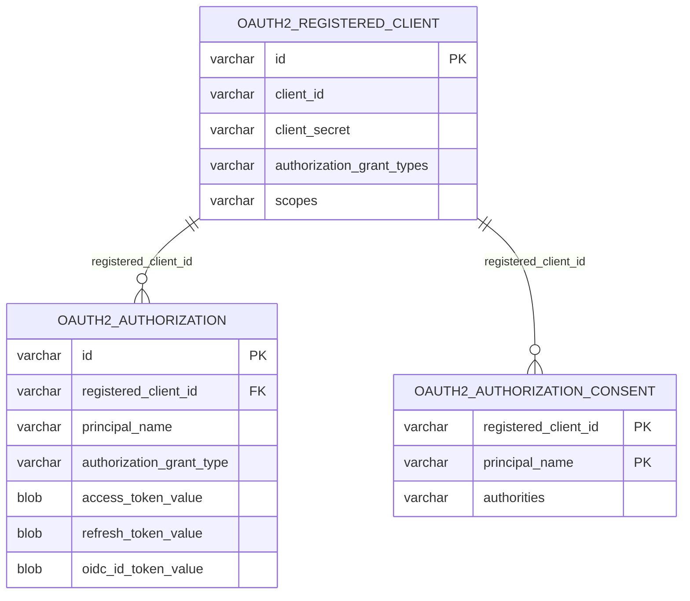
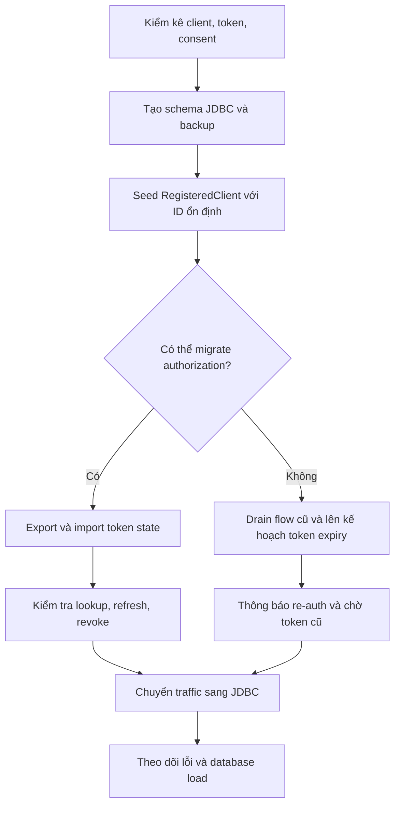

# Chuyển từ các thành phần in-memory sang lưu trữ bền vững

Spring Authorization Server cần lưu trạng thái của client, authorization và consent trong suốt vòng đời OAuth 2.0/OpenID Connect. Khi dùng implementation in-memory, dữ liệu chỉ tồn tại trong bộ nhớ của tiến trình. Sau khi ứng dụng khởi động lại, các node không chia sẻ trạng thái với nhau và những authorization đang hoạt động có thể không còn được tra cứu. Điều này gây lỗi khi đổi node xử lý request, refresh token, introspection hoặc revocation.

Để triển khai ổn định, hãy chuyển các thành phần lõi sang JDBC và dùng cơ sở dữ liệu dùng chung. Spring Authorization Server cung cấp ba implementation JDBC:

- `JdbcRegisteredClientRepository` lưu đăng ký OAuth client;
- `JdbcOAuth2AuthorizationService` lưu authorization cùng token và metadata;
- `JdbcOAuth2AuthorizationConsentService` lưu consent mà người dùng cấp cho client.

Ba implementation này sử dụng `JdbcOperations` và có schema SQL đi kèm thư viện. Chúng giúp chuyển đổi nhanh từ in-memory sang database mà không phải tự viết repository. Tuy nhiên, tài liệu Spring Authorization Server mô tả chúng là implementation JDBC đơn giản; đặc biệt `JdbcOAuth2AuthorizationService` có thể không đáp ứng hệ thống cần throughput rất cao. Hãy đánh giá truy vấn, kiểu dữ liệu, transaction và tải thực tế trước khi đưa vào production.

Bài thuộc chương **Lưu trữ JDBC** trong mô-đun **SPRING_SECURITY_OAUTH2_OIDC_AUTHORIZATION_SERVER**. Mục tiêu là chuyển các thành phần in-memory sang lưu trữ bền vững, quản lý schema bằng migration, giữ nguyên liên kết giữa client và authorization, kiểm thử việc khôi phục trạng thái và vận hành database an toàn.

## 1. Vì sao cần lưu trữ bền vững?

### 1.1. Hạn chế của bộ nhớ tiến trình

Một implementation in-memory giữ object trong heap của một JVM. Khi ứng dụng dừng, dữ liệu biến mất. Khi chạy hai instance, mỗi instance có một bản sao độc lập.

Ví dụ: Authorization Server A phát access token và lưu authorization vào memory của A. Request introspection hoặc refresh token tiếp theo được load balancer chuyển sang Server B. B không tìm thấy authorization tương ứng nên có thể từ chối token dù token được A phát hợp lệ.

Các vấn đề thường gặp:

- Restart làm mất client registrations được tạo động;
- Authorization Code đã phát không còn trạng thái để đổi token;
- Opaque access token không còn record để introspection;
- Refresh token không còn record để kiểm tra và rotate;
- Revocation ở node này không được node khác nhìn thấy;
- Consent đã lưu trong memory không còn sau restart;
- Rolling deployment tạo ra thời điểm các node có trạng thái khác nhau.

In-memory phù hợp với demo, unit test hoặc môi trường phát triển có vòng đời ngắn. Một Authorization Server production cần kho trạng thái dùng chung và bền vững.

### 1.2. Những gì cần chuyển sang JDBC

| Thành phần | Trách nhiệm | JDBC implementation |
|---|---|---|
| Client registry | Tra cứu client, secret, grant, redirect URI, scope và settings | `JdbcRegisteredClientRepository` |
| Authorization store | Lưu authorization, authorization code, access/refresh token, ID Token, device code và metadata | `JdbcOAuth2AuthorizationService` |
| Consent store | Lưu các authorities/scopes người dùng đã chấp thuận cho từng client | `JdbcOAuth2AuthorizationConsentService` |

`RegisteredClientRepository` là thành phần **bắt buộc** của mô hình lõi. `OAuth2AuthorizationService` và `OAuth2AuthorizationConsentService` là thành phần tùy chọn trong cấu hình framework và có thể mặc định dùng implementation in-memory nếu ứng dụng không cung cấp bean thay thế.

Vì vậy, chỉ chuyển client registry sang JDBC vẫn chưa đủ. Nếu authorization service hoặc consent service vẫn là in-memory, hệ thống vẫn mất trạng thái tương ứng khi restart hoặc khi request chuyển sang node khác.

### 1.3. JDBC không đồng nghĩa mọi trạng thái ứng dụng đã bền vững

Ba bảng JDBC của Spring Authorization Server không tự động lưu:

- User account, password hash hoặc MFA state;
- HTTP session đăng nhập của người dùng;
- Signing key/JWK private key;
- Cấu hình issuer, domain, redirect policy hoặc secret của hạ tầng;
- Rate limit, cache hoặc trạng thái nghiệp vụ của Resource Server.

Các thành phần đó có vòng đời và cơ chế lưu trữ riêng. Ví dụ, nếu cần chia sẻ HTTP session giữa nhiều instance, hãy đánh giá Spring Session JDBC/Redis. Nếu cần signing key ổn định, dùng kho khóa được quản lý riêng như keystore, KMS hoặc HSM. Không nhầm ba bảng authorization-server với một giải pháp lưu trữ toàn bộ ứng dụng.

## 2. Hiểu dữ liệu được lưu

### 2.1. RegisteredClient

`RegisteredClient` mô tả một OAuth 2.0 client đã đăng ký. Các trường quan trọng gồm:

- ID nội bộ duy nhất của registration;
- `clientId` công khai;
- `clientSecret` đã được encode;
- Thời điểm phát hành và hết hạn secret;
- Client authentication methods;
- Authorization grant types;
- Redirect URI và post-logout redirect URI;
- Scopes;
- Client settings, ví dụ yêu cầu PKCE hoặc consent;
- Token settings, ví dụ TTL và access-token format.

`JdbcRegisteredClientRepository` ánh xạ object này vào bảng `oauth2_registered_client`. Các tập hợp như grant type, redirect URI và scope được lưu thành chuỗi; settings được serialize thành dữ liệu JSON theo mapper của framework.

**Giữ ổn định ID nội bộ của RegisteredClient.** Bảng authorization lưu `registered_client_id` tham chiếu tới `RegisteredClient.id`, không phải lúc nào cũng là `client_id` mà người dùng nhìn thấy. Khi chuyển dữ liệu, phải giữ đúng ID nội bộ để authorization cũ tìm lại được registration.

### 2.2. OAuth2Authorization

`OAuth2Authorization` đại diện cho trạng thái authorization được cấp cho một client. Nó chứa:

- Authorization ID;
- Registered client ID;
- Principal name của resource owner hoặc client;
- Authorization grant type;
- Authorized scopes;
- Các token đã phát và metadata đi kèm;
- Attributes liên quan đến authorization request hoặc principal.

Tùy grant type, authorization có thể chứa authorization code, access token, refresh token, OIDC ID Token, device code và user code. Các token có thời điểm phát hành, hết hạn, loại token, scope và metadata.

`JdbcOAuth2AuthorizationService` lưu object vào bảng `oauth2_authorization`. Schema mặc định dùng cấu trúc tương đối phẳng: nhiều cột dành riêng cho từng loại token và các trường metadata/attributes dạng LOB. Cách này giúp implementation mặc định tra cứu theo loại token mà không cần tự thiết kế mô hình quan hệ.

Một authorization không chỉ là bản ghi “user đã đăng nhập”. Nó là trạng thái protocol cần thiết để xử lý các request tiếp theo, như refresh, introspection, revocation và device authorization.

### 2.3. OAuth2AuthorizationConsent

`OAuth2AuthorizationConsent` ghi lại quyết định của resource owner đối với một client. Một consent được định danh bằng cặp:

- `registered_client_id`;
- `principal_name`.

Nó chứa tập authorities được cấp. Authorities có thể biểu diễn scopes hoặc quyền/claim mà người dùng đã chấp thuận.

Ví dụ người dùng đồng ý cho client `portal-bff` đọc `profile` và `email`. Consent store giữ quyết định đó để authorization request sau có thể kiểm tra và hiển thị consent phù hợp. Consent bị thu hồi hoặc thay đổi phải được cập nhật vào kho dùng chung để mọi instance nhìn thấy cùng trạng thái.

### 2.4. Quan hệ giữa ba nhóm dữ liệu



Sơ đồ thể hiện quan hệ khái niệm; nhãn FK biểu diễn liên kết logic, không khẳng định schema SQL mặc định đã tạo physical foreign-key constraint. Tên và kiểu cột thực tế phải theo schema của đúng phiên bản Spring Authorization Server và hệ quản trị cơ sở dữ liệu đang sử dụng.

## 3. Chọn implementation phù hợp

### 3.1. Dùng implementation JDBC có sẵn

Dùng ba implementation JDBC có sẵn khi:

- Muốn chuyển từ in-memory nhanh;
- Mô hình dữ liệu chuẩn của framework đáp ứng nhu cầu;
- Khối lượng request và số authorization nằm trong khả năng của database;
- Không cần truy vấn nghiệp vụ phức tạp trên từng claim/token;
- Có thể dùng schema tương thích với JDBC mapper mặc định.

Ưu điểm là giảm lượng code cần tự bảo trì. Mapper, serialization và truy vấn cơ bản đã được framework cung cấp.

### 3.2. Khi nào cần implementation riêng?

Cân nhắc triển khai service riêng hoặc mở rộng mapper khi:

- Throughput cao và truy vấn token trở thành bottleneck;
- Cần partition/sharding theo tenant hoặc issuer;
- Cần audit, retention hoặc archive theo policy đặc thù;
- Cần token lookup qua hash/index thay vì lưu token value ở cột LOB;
- Cần mô hình hóa dữ liệu theo hệ quản trị hoặc chuẩn dữ liệu nội bộ;
- Cần transaction và concurrency semantics riêng.

Các interface chính để thay thế là:

- `RegisteredClientRepository`;
- `OAuth2AuthorizationService`;
- `OAuth2AuthorizationConsentService`.

Khi tự triển khai, phải giữ đúng contract của framework, bao gồm các phương thức lookup, save và remove. `OAuth2AuthorizationService.findByToken` đặc biệt quan trọng: các endpoint introspection, revocation và những grant xử lý token có thể dựa vào khả năng tìm authorization theo credential và token type.

### 3.3. Không tự chuyển sang JPA chỉ vì ứng dụng đã dùng JPA

Spring Authorization Server cung cấp JDBC implementations chính thức. Nếu muốn dùng JPA, cần ánh xạ đầy đủ domain object, serialize attributes/settings/metadata và triển khai ba service/repository tương ứng. Tài liệu Spring Authorization Server có hướng dẫn JPA như một điểm bắt đầu, nhưng đây là phần triển khai do ứng dụng chịu trách nhiệm.

Đừng tạo JPA entity chỉ chứa một vài cột rồi bỏ qua token metadata hoặc grant types chưa dùng ở bản demo. Khi bật thêm device authorization, token exchange hoặc OIDC, schema và mapper vẫn phải lưu được trạng thái của các flow đó.

## 4. Chuẩn bị dependency và DataSource

### 4.1. Dependency JDBC

Với Spring Boot, cần JDBC starter và driver của database. Ví dụ PostgreSQL:

```xml
<dependency>
    <groupId>org.springframework.boot</groupId>
    <artifactId>spring-boot-starter-jdbc</artifactId>
</dependency>

<dependency>
    <groupId>org.postgresql</groupId>
    <artifactId>postgresql</artifactId>
    <scope>runtime</scope>
</dependency>
```

Ứng dụng cũng cần dependency Spring Authorization Server tương thích với Spring Boot/Spring Security đang dùng. Hãy quản lý phiên bản qua BOM hoặc dependency management của dự án; tránh trộn các phiên bản Spring Security và Authorization Server không tương thích.

### 4.2. Cấu hình DataSource

Ví dụ cấu hình:

```yaml
spring:
  datasource:
    url: jdbc:postgresql://db.internal:5432/auth_server
    username: auth_server_app
    password: DB_PASSWORD_FROM_SECRET_STORE
    hikari:
      maximum-pool-size: 20
      minimum-idle: 5
      connection-timeout: 3000
      validation-timeout: 1000
```

Tên database, tài khoản và pool size chỉ là ví dụ. Secret phải được cấp từ secret manager hoặc cơ chế cấu hình runtime an toàn. Không commit password vào source control hoặc ghi JDBC URL chứa credential vào log.

Spring Boot thường tự cấu hình `DataSource` và `JdbcTemplate` khi có JDBC starter, driver và datasource properties. `JdbcTemplate` triển khai `JdbcOperations`, là dependency mà ba JDBC services cần.

### 4.3. Dùng chung DataSource

Thông thường ba service nên dùng cùng một DataSource và transaction manager của Authorization Server. Điều này giúp các thao tác protocol truy cập cùng một database và cho phép ứng dụng xác định transaction boundary nhất quán.

Nếu tách client registry, authorization và consent sang các database khác nhau, cần thiết kế rõ cách định tuyến, transaction và tính nhất quán. Các JDBC implementation mặc định nhận `JdbcOperations`; chúng không tự giải quyết distributed transaction giữa nhiều database.

## 5. Tạo schema bằng migration

### 5.1. Ba SQL resource chính thức

Spring Authorization Server cung cấp ba SQL resource trong classpath:

| Thành phần | Resource |
|---|---|
| Registered clients | `org/springframework/security/oauth2/server/authorization/client/oauth2-registered-client-schema.sql` |
| Authorizations | `org/springframework/security/oauth2/server/authorization/oauth2-authorization-schema.sql` |
| Authorization consents | `org/springframework/security/oauth2/server/authorization/oauth2-authorization-consent-schema.sql` |

Các JDBC implementation yêu cầu đúng table definitions tương ứng. Ví dụ `JdbcRegisteredClientRepository` cần bảng `oauth2_registered_client`; `JdbcOAuth2AuthorizationService` cần bảng `oauth2_authorization`; `JdbcOAuth2AuthorizationConsentService` cần bảng `oauth2_authorization_consent`.

Hãy lấy schema từ đúng version artifact mà ứng dụng đang chạy. Không sao chép một file SQL từ nhánh main hoặc một phiên bản khác rồi mặc định rằng cấu trúc cột không thay đổi.

### 5.2. Quản lý bằng Flyway hoặc Liquibase

Trong production, nên đưa schema vào migration có version và quản lý cùng source code. Ví dụ với Flyway:

```text
src/main/resources/
└── db/
    └── migration/
        └── V1__authorization_server_jdbc_schema.sql
```

File migration chứa nội dung của ba schema resource sau khi đã điều chỉnh cho database mục tiêu. Việc tạo bảng phải chạy trước khi các JDBC beans được sử dụng.

Migration giúp:

- Theo dõi version schema đã áp dụng;
- Triển khai nhất quán giữa dev, staging và production;
- Review thay đổi schema trong pull request;
- Kiểm soát rollback/forward-fix;
- Tránh mỗi instance tự tạo schema khác nhau khi khởi động.

Không dựa vào việc ứng dụng tự chạy schema init mặc định để tạo bảng production. Việc thay đổi schema dữ liệu authorization phải được lên kế hoạch như một database migration có kiểm soát.

### 5.3. Thứ tự tạo bảng

Có thể tạo theo thứ tự:

1. `oauth2_registered_client`;
2. `oauth2_authorization`;
3. `oauth2_authorization_consent`.

Authorization và consent đều giữ ID nội bộ của RegisteredClient. Tạo client table trước giúp các ràng buộc logic và dữ liệu seed có thứ tự rõ ràng.

### 5.4. Schema không phải cấu hình tự động

Việc thêm `spring-boot-starter-jdbc` không tự tạo đầy đủ ba bảng trong mọi cấu hình. Tương tự, khai báo `JdbcOAuth2AuthorizationService` không tự chạy migration. Cần bảo đảm migration đã áp dụng thành công trên database đúng môi trường trước khi chuyển traffic.

## 6. Điều chỉnh schema theo hệ quản trị cơ sở dữ liệu

### 6.1. PostgreSQL và các cột BLOB

Schema authorization mặc định có các cột kiểu `blob` để lưu attributes, token values và metadata. PostgreSQL không có kiểu `blob` theo cú pháp của schema mẫu. Tài liệu schema của Spring Authorization Server hướng dẫn đổi các cột được khai báo `blob` sang `text` khi dùng PostgreSQL.

Khi tạo schema PostgreSQL, hãy điều chỉnh DDL trước khi chạy migration:

| Cột trong schema authorization | Kiểu trong schema mẫu | Kiểu thay thế cho PostgreSQL |
|---|---|---|
| `attributes` | `blob` | `text` |
| `authorization_code_value`, `authorization_code_metadata` | `blob` | `text` |
| `access_token_value`, `access_token_metadata` | `blob` | `text` |
| `oidc_id_token_value`, `oidc_id_token_metadata` | `blob` | `text` |
| `refresh_token_value`, `refresh_token_metadata` | `blob` | `text` |
| `user_code_value`, `user_code_metadata` | `blob` | `text` |
| `device_code_value`, `device_code_metadata` | `blob` | `text` |

Không chạy nguyên DDL có kiểu `blob` trên PostgreSQL rồi mới tìm cách `ALTER` sau đó; hãy sửa kiểu cột trong migration trước khi tạo bảng. Hãy so sánh toàn bộ file schema của version đang dùng để không bỏ sót cột LOB nào.

### 6.2. Kiểu thời gian

Các trường thời gian lưu thời điểm phát hành và hết hạn token. Hãy xem cách driver và database xử lý `Instant`, timezone và kiểu `timestamp`. Với PostgreSQL, cần cân nhắc kiểu `timestamptz` và cấu hình timezone nhất quán; với MySQL, cần xem hướng dẫn Connector/J về lưu trữ instant. Kiểm thử round-trip ở nhiều timezone thay vì chỉ kiểm tra trên máy phát triển.

### 6.3. Độ dài cột

Schema mẫu dùng các giới hạn như `varchar(500)`, `varchar(1000)` hoặc `varchar(2000)` cho một số trường. Các giá trị như scope list, redirect URI list, client settings, token settings, attributes và metadata có thể tăng theo cấu hình.

Khi vượt độ dài cột, lỗi có thể chỉ xuất hiện khi một client mới được đăng ký hoặc khi một grant đặc biệt phát sinh metadata lớn. Hãy đánh giá giới hạn dữ liệu thực tế và mở rộng schema nếu cần; nếu thay đổi kiểu cột, cần xác minh JDBC mapper vẫn đọc/ghi đúng.

### 6.4. Ràng buộc và chỉ mục

Schema mặc định có primary key. Khi triển khai thực tế, hãy kiểm tra thêm:

- `client_id` phải duy nhất;
- `registered_client_id` phải trỏ tới registration tồn tại;
- Consent có khóa chính ghép theo client ID và principal name;
- Các truy vấn lookup có phù hợp với index và kiểu cột hiện có;
- Kế hoạch truy vấn khi số lượng authorization tăng lớn.

Không thêm index một cách máy móc lên các cột LOB. Một số database không hỗ trợ index trực tiếp trên LOB hoặc có giới hạn kích thước index. Với workload cần tra cứu token tốc độ cao, có thể cần thiết kế cột hash/index riêng và implementation service tương ứng. Việc đó là custom persistence design, không phải tự động có trong JDBC service mặc định.

## 7. Khai báo ba JDBC service

### 7.1. RegisteredClientRepository

`JdbcRegisteredClientRepository` nhận một `JdbcOperations`:

```java
import org.springframework.context.annotation.Bean;
import org.springframework.context.annotation.Configuration;
import org.springframework.jdbc.core.JdbcOperations;

import org.springframework.security.oauth2.server.authorization.client.JdbcRegisteredClientRepository;
import org.springframework.security.oauth2.server.authorization.client.RegisteredClientRepository;

@Configuration(proxyBeanMethods = false)
public class AuthorizationServerPersistenceConfiguration {

    @Bean
    RegisteredClientRepository registeredClientRepository(
            JdbcOperations jdbcOperations) {
        return new JdbcRegisteredClientRepository(jdbcOperations);
    }
}
```

Bean này thay implementation in-memory của client registry. Khi framework cần xác thực client hoặc xử lý grant, repository sẽ đọc registration từ database.

### 7.2. OAuth2AuthorizationService

`JdbcOAuth2AuthorizationService` cần cả `JdbcOperations` và `RegisteredClientRepository`:

```java
import org.springframework.security.oauth2.server.authorization.JdbcOAuth2AuthorizationService;
import org.springframework.security.oauth2.server.authorization.OAuth2AuthorizationService;

@Bean
OAuth2AuthorizationService authorizationService(
        JdbcOperations jdbcOperations,
        RegisteredClientRepository registeredClientRepository) {

    return new JdbcOAuth2AuthorizationService(
            jdbcOperations,
            registeredClientRepository);
}
```

Repository client được truyền vào để service có thể khôi phục authorization và liên kết nó với registration tương ứng. Vì vậy, client record phải tồn tại trước khi load authorization tham chiếu tới nó.

### 7.3. OAuth2AuthorizationConsentService

Consent service cũng nhận `JdbcOperations` và `RegisteredClientRepository`:

```java
import org.springframework.security.oauth2.server.authorization.JdbcOAuth2AuthorizationConsentService;
import org.springframework.security.oauth2.server.authorization.OAuth2AuthorizationConsentService;

@Bean
OAuth2AuthorizationConsentService authorizationConsentService(
        JdbcOperations jdbcOperations,
        RegisteredClientRepository registeredClientRepository) {

    return new JdbcOAuth2AuthorizationConsentService(
            jdbcOperations,
            registeredClientRepository);
}
```

Sau khi khai báo cả ba bean, dữ liệu client, authorization và consent được lưu qua cùng database connection configuration.

### 7.4. Cấu hình hoàn chỉnh trong một class

Có thể đặt ba bean trong một class:

```java
package example.authserver.persistence;

import org.springframework.context.annotation.Bean;
import org.springframework.context.annotation.Configuration;
import org.springframework.jdbc.core.JdbcOperations;

import org.springframework.security.oauth2.server.authorization.JdbcOAuth2AuthorizationConsentService;
import org.springframework.security.oauth2.server.authorization.JdbcOAuth2AuthorizationService;
import org.springframework.security.oauth2.server.authorization.OAuth2AuthorizationConsentService;
import org.springframework.security.oauth2.server.authorization.OAuth2AuthorizationService;
import org.springframework.security.oauth2.server.authorization.client.JdbcRegisteredClientRepository;
import org.springframework.security.oauth2.server.authorization.client.RegisteredClientRepository;

@Configuration(proxyBeanMethods = false)
public class AuthorizationServerPersistenceConfiguration {

    @Bean
    RegisteredClientRepository registeredClientRepository(
            JdbcOperations jdbcOperations) {
        return new JdbcRegisteredClientRepository(jdbcOperations);
    }

    @Bean
    OAuth2AuthorizationService authorizationService(
            JdbcOperations jdbcOperations,
            RegisteredClientRepository registeredClientRepository) {
        return new JdbcOAuth2AuthorizationService(
                jdbcOperations, registeredClientRepository);
    }

    @Bean
    OAuth2AuthorizationConsentService authorizationConsentService(
            JdbcOperations jdbcOperations,
            RegisteredClientRepository registeredClientRepository) {
        return new JdbcOAuth2AuthorizationConsentService(
                jdbcOperations, registeredClientRepository);
    }
}
```

Đoạn code giả định Spring Boot đã cấu hình `DataSource` và `JdbcOperations`. Nếu ứng dụng có nhiều DataSource, phải chỉ định đúng bean bằng `@Qualifier` để không ghi dữ liệu Authorization Server vào database nghiệp vụ ngoài ý muốn.

## 8. Gắn persistence service vào Authorization Server

### 8.1. Dùng OAuth2AuthorizationServerConfigurer

Với Spring Authorization Server 1.5.x, có thể cấu hình các component trực tiếp trên `OAuth2AuthorizationServerConfigurer`:

```java
import org.springframework.context.annotation.Bean;
import org.springframework.core.annotation.Order;
import org.springframework.security.config.Customizer;
import org.springframework.security.config.annotation.web.builders.HttpSecurity;
import org.springframework.security.oauth2.server.authorization.OAuth2AuthorizationConsentService;
import org.springframework.security.oauth2.server.authorization.OAuth2AuthorizationService;
import org.springframework.security.oauth2.server.authorization.config.annotation.web.configurers.OAuth2AuthorizationServerConfigurer;
import org.springframework.security.oauth2.server.authorization.client.RegisteredClientRepository;
import org.springframework.security.web.SecurityFilterChain;

@Bean
@Order(1)
SecurityFilterChain authorizationServerSecurityFilterChain(
        HttpSecurity http,
        RegisteredClientRepository registeredClientRepository,
        OAuth2AuthorizationService authorizationService,
        OAuth2AuthorizationConsentService authorizationConsentService)
        throws Exception {

    OAuth2AuthorizationServerConfigurer authorizationServerConfigurer =
            OAuth2AuthorizationServerConfigurer.authorizationServer();

    http
        .securityMatcher(authorizationServerConfigurer.getEndpointsMatcher())
        .with(authorizationServerConfigurer, authorizationServer -> authorizationServer
            .registeredClientRepository(registeredClientRepository)
            .authorizationService(authorizationService)
            .authorizationConsentService(authorizationConsentService)
            .oidc(Customizer.withDefaults()))
        .authorizeHttpRequests(authorize -> authorize
            .anyRequest().authenticated());

    return http.build();
}
```

Đây là phần cấu hình protocol chain. Ứng dụng vẫn cần các cấu hình khác như login chain, issuer, JWK source, token generator và exception handling theo use case.

### 8.2. Kiểm tra bean nào đang thực sự được dùng

Khi ứng dụng có nhiều cấu hình hoặc nhiều bean cùng interface, cần bảo đảm protocol chain nhận đúng JDBC bean. Một bean JDBC được tạo nhưng không được gắn vào configurer sẽ không làm persistence tự chuyển đổi.

Có thể kiểm tra bằng:

- Startup logs và bean condition report;
- Integration test khởi động context với database thật;
- Gọi `findByClientId` sau khi seed client;
- Tạo authorization rồi xác minh bản ghi xuất hiện trong database;
- Restart application và thực hiện lookup lại.

Không coi việc context khởi động thành công là bằng chứng persistence đã hoạt động. Có thể bean được tạo nhưng migration chưa chạy, hoặc configurer vẫn đang dùng implementation in-memory khác.

## 9. Đăng ký client vào database

### 9.1. Tạo registration với ID ổn định

Ví dụ tạo confidential client:

```java
RegisteredClient portal = RegisteredClient
        .withId("portal-bff-registration-v1")
        .clientId("portal-bff")
        .clientSecret(passwordEncoder.encode(
                System.getenv("PORTAL_BFF_CLIENT_SECRET")))
        .clientAuthenticationMethod(
                ClientAuthenticationMethod.CLIENT_SECRET_BASIC)
        .authorizationGrantType(
                AuthorizationGrantType.AUTHORIZATION_CODE)
        .authorizationGrantType(
                AuthorizationGrantType.REFRESH_TOKEN)
        .redirectUri(
                "https://portal.example.com/login/oauth2/code/central")
        .scope(OidcScopes.OPENID)
        .scope(OidcScopes.PROFILE)
        .scope(OidcScopes.EMAIL)
        .clientSettings(ClientSettings.builder()
                .requireProofKey(true)
                .requireAuthorizationConsent(true)
                .build())
        .build();

registeredClientRepository.save(portal);
```

`passwordEncoder` phải là PasswordEncoder được cấu hình phù hợp với client secret. Không dùng `{noop}` hoặc lưu plaintext secret trong production. Secret ở ví dụ được đọc từ môi trường runtime; thực tế nên lấy từ secret manager.

### 9.2. Seed một lần, không tạo client mới mỗi lần restart

Nếu dùng `UUID.randomUUID()` cho ID mỗi lần khởi động, mỗi lần deploy có thể tạo registration mới và để lại client cũ. Hãy dùng ID ổn định và cơ chế bootstrap có kiểm tra tồn tại:

```java
if (registeredClientRepository.findByClientId("portal-bff") == null) {
    registeredClientRepository.save(portal);
}
```

Đoạn này chỉ minh họa việc tạo registration ban đầu. Khi cần cập nhật client settings, redirect URI, scope hoặc secret, hãy dùng quy trình quản trị client có kiểm soát. Không giả định mọi implementation repository đều tự động upsert khi gọi `save` lần nữa.

### 9.3. Bảo vệ vòng đời client

Client registration là cấu hình bảo mật quan trọng. Cần kiểm soát ai có thể:

- Tạo hoặc vô hiệu hóa client;
- Thay redirect URI;
- Thêm grant type hoặc scope;
- Đổi client authentication method;
- Rotate secret;
- Thay access token format hoặc TTL.

Không cho phép người dùng thông thường sửa các trường này qua một endpoint quản trị thiếu authorization. Lưu audit event cho các thay đổi registration.

## 10. Chuyển dữ liệu từ in-memory

### 10.1. Registered clients

Client registrations thường có thể được tái tạo từ cấu hình/bootstrap hoặc xuất từ hệ thống cũ. Khi nhập vào database:

1. Giữ nguyên `RegisteredClient.id` nếu các authorization cũ tham chiếu tới ID đó;
2. Giữ nguyên `clientId`;
3. Giữ authentication methods, grant types, redirect URI, post-logout URI và scopes;
4. Giữ các client settings/token settings;
5. Encode client secret bằng PasswordEncoder phù hợp;
6. Kiểm tra secret rotation và secret expiry.

Nếu đổi ID nội bộ, cần cập nhật mọi authorization record tham chiếu đến ID cũ theo migration đã kiểm chứng. Không đổi ID một cách tùy tiện rồi để authorization cũ trỏ tới registration không còn tồn tại.

### 10.2. Authorization và token đang hoạt động

Các authorization đang nằm trong `InMemoryOAuth2AuthorizationService` không tự động xuất hiện trong database mới. JDBC service không thể tự đọc heap của tiến trình cũ.

Có hai chiến lược:

- **Migrate trạng thái đang hoạt động:** cần export đầy đủ authorization, token values, issued/expiry timestamps, metadata, attributes và liên kết client. Phải giữ nguyên semantics serialization và xác minh lookup/refresh/revoke sau khi import.
- **Cutover có kiểm soát:** ngừng nhận grant mới trên hệ thống cũ, chờ authorization code/in-flight flow hoàn tất hoặc hết hạn, thông báo người dùng đăng nhập lại khi cần, và để token cũ hết hạn hoặc thu hồi theo kế hoạch.

Không chỉ copy access token string rồi coi là đã migrate. Refresh token, revocation state, authorization code, device code, token metadata và registered client association cũng cần nhất quán.

### 10.3. Khác biệt giữa JWT và opaque access token

Resource Server có thể xác minh self-contained JWT access token bằng chữ ký, issuer, audience và thời hạn mà không cần tra authorization database trong mỗi request. Vì vậy, một JWT đã phát có thể tiếp tục được chấp nhận đến khi hết hạn nếu signing key và validation policy vẫn còn hiệu lực.

Tuy nhiên, việc xác minh JWT offline không có nghĩa Authorization Server đã migrate trạng thái. Refresh, introspection, revocation, consent và các flow phụ thuộc authorization store vẫn cần record. Với opaque/reference token, việc tra cứu authorization store là thiết yếu.

Khi không migrate active authorization, phải lập kế hoạch cho token cũ: chờ hết TTL, thu hồi theo policy hoặc yêu cầu client xin token mới. Không tắt database cũ trước khi hiểu rõ tác động tới token còn hiệu lực.

### 10.4. Consent đang nằm trong memory

Consent có thể được tái tạo từ dữ liệu người dùng/client hoặc yêu cầu người dùng consent lại. Nếu export được, giữ đúng cặp registered client ID và principal name cùng tập authorities đã cấp.

Không tự động chuyển mọi scope đã yêu cầu thành scope đã được người dùng chấp thuận. Consent là quyết định của resource owner; chỉ nhập dữ liệu có nguồn gốc và bằng chứng hợp lệ.

### 10.5. Kế hoạch cutover mẫu



Thời gian drain phải dựa trên TTL của authorization code, access token, refresh token và device code trong hệ thống thực tế. Không dùng một khoảng chờ cố định cho mọi deployment.

## 11. Transaction và tính nhất quán

### 11.1. Dùng cùng transaction manager

Khi các service dùng cùng DataSource, Spring có thể tham gia transaction JDBC qua transaction manager tương ứng. Hãy xác định rõ transaction boundary cho các thao tác quản trị, bootstrap, migration và nghiệp vụ tùy chỉnh.

Đừng giả định mọi bước của một authorization flow luôn nằm trong cùng một transaction chỉ vì các repository dùng chung DataSource. Kiểm tra implementation và transaction semantics của phiên bản đang chạy, nhất là khi custom provider hoặc event listener thực hiện thêm ghi dữ liệu.

### 11.2. Concurrent requests

Nhiều request có thể đồng thời refresh, revoke hoặc cập nhật cùng authorization. Cần kiểm tra:

- Hai refresh request đồng thời có thể dùng cùng refresh token không;
- Chính sách refresh token reuse/rotation;
- Cách xử lý update đồng thời;
- Isolation level và lock behavior của database;
- Retry khi gặp deadlock hoặc optimistic conflict;
- Tính nhất quán giữa authorization và consent.

Không xử lý lỗi concurrency bằng cách retry vô hạn. Token rotation cần bảo đảm token cũ không bị sử dụng lại trái policy.

### 11.3. Idempotency và duplicate registration

Bootstrap client có thể chạy ở nhiều instance cùng lúc. Nếu hai node đồng thời thấy client chưa tồn tại rồi cùng insert, unique constraint có thể khiến một node nhận lỗi duplicate key. Hãy dùng migration/seed một lần trước khi mở traffic, hoặc thiết kế bootstrap idempotent có xử lý conflict.

Không dùng logic “check rồi insert” như một cơ chế đồng bộ phân tán duy nhất khi nhiều instance có thể thực thi đồng thời.

## 12. Chạy nhiều Authorization Server instance

### 12.1. Chia sẻ trạng thái

Khi chạy nhiều node, các instance cần dùng chung:

- Database chứa registered clients;
- Database chứa authorizations;
- Database chứa consents;
- Issuer và endpoint configuration nhất quán;
- Signing key/JWK set tương thích;
- User store và các policy cần thiết.

Khi một node phát authorization, node khác phải có khả năng tìm thấy record để xử lý refresh, introspection hoặc revocation.

### 12.2. Signing key phải ổn định

Ba JDBC services không tự lưu private signing key. Nếu mỗi lần restart ứng dụng lại sinh một key mới, JWT được ký trước đó có thể không còn xác minh được ở node mới hoặc sau khi deploy.

Hãy quản lý signing key riêng, duy trì key rotation có overlap phù hợp và công bố JWK Set chính xác. Không lưu private key vào bảng authorization hoặc log. Với production, cân nhắc KMS/HSM hoặc secret store theo mô hình vận hành.

### 12.3. HTTP session là một concern khác

JDBC authorization state không tự chia sẻ HTTP session đăng nhập giữa các node. Nếu login form, consent UI hoặc session của browser cần tồn tại khi request chuyển node, cần sticky session hoặc distributed session store phù hợp. Spring Session JDBC là một lựa chọn riêng; nó không thay thế ba JDBC services của Authorization Server.

## 13. Token lookup, revocation và introspection

### 13.1. Authorization service là nguồn trạng thái protocol

`OAuth2AuthorizationService` được dùng trong nhiều protocol flow: authorization grant processing, client authentication, token introspection, token revocation và các hoạt động liên quan. Lưu authorization bền vững giúp server tra cứu token và trạng thái invalidation sau restart hoặc trên node khác.

### 13.2. Lưu trạng thái token

Một authorization có thể giữ token value và metadata như issued-at, expires-at, token type, scopes, claims và trạng thái invalidated. Khi token bị revoke, framework cập nhật trạng thái liên quan trong authorization. Resource Server dùng introspection hoặc cơ chế kiểm tra trạng thái tương ứng sẽ thấy kết quả theo policy.

### 13.3. Không xóa record quá sớm

Xóa authorization ngay sau khi access token hết hạn có thể ảnh hưởng việc kiểm tra refresh token, revoke, audit hoặc truy vấn lịch sử. Retention phải tính tới tất cả token liên quan và yêu cầu audit. Với token đã hết hạn, có thể có job cleanup riêng sau thời gian retention an toàn.

### 13.4. Opaque token và JWT

| Đặc tính | Opaque/reference access token | JWT/self-contained access token |
|---|---|---|
| Xác minh tại Resource Server | Thường cần introspection hoặc lookup | Có thể xác minh chữ ký/claims offline |
| Phụ thuộc authorization store | Cao đối với lookup/introspection/revocation | Tùy cơ chế revocation và policy |
| Kích thước | Thường ngắn | Thường lớn hơn |
| Revocation tức thời | Có thể thông qua trạng thái/introspection | Cần denylist/introspection hoặc TTL ngắn |
| Persistence tại Authorization Server | Cần lưu token record để tra cứu | Vẫn cần lưu trạng thái cho refresh, revoke, introspection và quản trị |

Không hiểu JWT là “không cần database”. Authorization Server vẫn cần lưu trạng thái protocol và client/consent bền vững.

## 14. Bảo mật dữ liệu trong database

### 14.1. Coi bảng authorization là dữ liệu nhạy cảm

Bảng authorization có thể chứa access token, refresh token, authorization code, device code, ID Token và attributes. Ai đọc được database có thể có khả năng truy cập credential hoặc metadata nhạy cảm.

Áp dụng:

- TLS giữa ứng dụng và database;
- Tài khoản database riêng cho Authorization Server;
- Least privilege cho SELECT/INSERT/UPDATE/DELETE;
- Encryption at rest và backup encryption;
- Hạn chế quyền DBA và quyền đọc production;
- Audit truy cập và thay đổi dữ liệu nhạy cảm;
- Không log SQL bind parameters chứa token;
- Không export database vào môi trường dev thiếu masking.

### 14.2. Client secret

`JdbcRegisteredClientRepository` không tự encode client secret cho ứng dụng. Secret cần được encode trước khi gọi `save` bằng PasswordEncoder phù hợp. Khi rotate, quản lý thời gian overlap và expiry theo chính sách client.

Không nhầm encoding một chiều của secret với mã hóa token. Client secret được kiểm tra bằng PasswordEncoder; token values trong authorization store là dữ liệu protocol nhạy cảm cần bảo vệ ở tầng database và hạ tầng.

### 14.3. Backup và restore

Backup phải có mã hóa, access control và kiểm tra restore định kỳ. Khi restore database về thời điểm trước đó, có thể khôi phục cả refresh token hoặc authorization đã bị revoke sau thời điểm backup. Vì vậy, restore cần phối hợp với key state, token revocation policy và incident process.

Không chỉ kiểm tra “database restore thành công”. Hãy xác minh client registrations, consent, token status và issuer keys sau restore.

### 14.4. Retention và xóa dữ liệu

Định nghĩa thời gian lưu cho:

- Authorization đã hết hạn;
- Refresh token đã revoke;
- Authorization code đã dùng/hết hạn;
- Consent đã bị thu hồi;
- Client registration đã ngừng sử dụng;
- Audit records.

Không xóa RegisteredClient row đang được authorization còn hiệu lực tham chiếu. Có thể vô hiệu hóa client theo policy và giữ record cho tới khi các authorization liên quan hết vòng đời.

## 15. Hiệu năng và khả năng mở rộng

### 15.1. JDBC implementations là điểm khởi đầu

Spring mô tả các JDBC services là implementation đơn giản có thể dùng trong production, nhưng có giới hạn hiệu năng, đặc biệt khi throughput cao. Cần benchmark với:

- Số lượng client registration;
- Tốc độ phát access token;
- Tốc độ refresh;
- Tỷ lệ introspection/revocation;
- Kích thước token và metadata;
- Số authorization đồng thời;
- Số node và connection pool.

Đừng suy ra rằng một cấu hình H2 hoặc vài nghìn request thử nghiệm phản ánh được tải production.

### 15.2. Quan sát database

Theo dõi:

- Query latency p50/p95/p99;
- Connection pool active/idle/pending;
- Lock wait và deadlock;
- Table/index size;
- Disk IOPS và transaction log growth;
- Query plan cho lookup token/client/principal;
- Tỷ lệ lỗi connection và timeout;
- Thời gian backup/restore.

### 15.3. Thiết kế token lookup ở quy mô lớn

Các cột token value trong schema mặc định có thể là LOB. Không phải database nào cũng có thể index trực tiếp các cột đó hiệu quả. Khi query theo token trở thành bottleneck, có thể thiết kế một bảng lookup phụ chứa token hash đã chuẩn hóa cùng authorization ID và token type, sau đó lookup authorization theo ID.

Nếu làm cách này, phải bảo đảm:

- Hash algorithm ổn định và đủ mạnh;
- Không ghi raw token vào log;
- Token type được phân biệt;
- Insert/update/revoke/delete đồng bộ với authorization;
- Collision được xử lý bằng xác minh credential;
- Transaction giữ nhất quán giữa lookup index và authorization record.

Đây là kiến trúc custom. Không thêm bảng phụ rồi mong JDBC service mặc định tự sử dụng nó; cần custom service hoặc extension phù hợp.

### 15.4. Cleanup và archive

Authorization hết hạn có thể tích lũy nhanh. Lên lịch cleanup theo batch, giới hạn số bản ghi mỗi lần và tránh khóa bảng lớn. Nếu cần audit, chuyển dữ liệu cần giữ sang archive có policy rõ ràng trước khi xóa record operational.

Không xóa record chỉ dựa vào access token expiry nếu authorization còn refresh token hoặc token khác còn hiệu lực.

## 16. Kiểm thử persistence

### 16.1. Test repository round-trip

Với RegisteredClient:

- Save registration;
- Tìm theo client ID;
- Tìm theo internal ID;
- Khởi động lại context hoặc kết nối mới;
- Xác minh client settings, token settings, redirect URI, grant và scopes giữ nguyên.

Với authorization:

- Save authorization;
- Tìm theo authorization ID;
- Tìm theo từng loại token cần hỗ trợ;
- Kiểm tra issued-at, expires-at, scopes, metadata và invalidation state;
- Update/revoke và đọc lại để xác minh trạng thái.

Với consent:

- Save consent;
- Tìm theo registered client ID và principal name;
- Kiểm tra authorities;
- Remove consent và xác minh không còn record.

### 16.2. Integration test theo protocol flow

Test với database cùng loại với production nếu có thể. H2 có thể giúp test nhanh, nhưng khác biệt về LOB, timestamp, SQL dialect và index có thể che giấu lỗi khi chuyển sang PostgreSQL/MySQL.

Các flow cần kiểm thử tùy cấu hình:

| Flow/endpoint | Điều cần xác minh |
|---|---|
| Authorization Code + PKCE | Code được lưu, đổi token được và không dùng lại |
| Client Credentials | Client registry và authorization state hoạt động |
| Refresh Token | Refresh token được tìm lại, rotate/reuse theo policy |
| Token Introspection | Token status đọc từ authorization store |
| Token Revocation | Trạng thái invalidated được lưu và quan sát |
| OIDC | ID Token và authorization metadata tồn tại |
| Device Authorization | Device/user code được lưu nếu flow được bật |
| Consent | Consent tồn tại sau restart và được áp dụng ở request sau |

### 16.3. Test restart

Một test quan trọng là:

1. Khởi động Authorization Server;
2. Đăng ký hoặc load client;
3. Hoàn tất authorization flow và phát token;
4. Dừng context;
5. Khởi động context mới với cùng database;
6. Xác minh client, authorization và consent vẫn được đọc;
7. Thử refresh/introspection/revocation theo token đã phát.

Test này chứng minh dữ liệu đã thực sự được ghi xuống database thay vì chỉ nằm trong bean hoặc cache.

### 16.4. Test nhiều instance

Khởi chạy hai instance dùng cùng database và cùng key material:

- Instance A phát authorization;
- Instance B tra cứu token hoặc xử lý refresh;
- Instance B revoke token;
- Instance A kiểm tra lại trạng thái;
- Kiểm tra client disable/secret rotation được phản ánh theo policy.

Nếu dùng session store riêng, test browser login và consent UI qua hai instance nữa. Test database sharing không chứng minh HTTP session đã được chia sẻ.

### 16.5. Test migration và restore

Trên database thử nghiệm:

- Chạy migration từ schema trống;
- Chạy lại migration để xác nhận migration tool nhận diện version;
- Import dữ liệu mẫu;
- Kiểm tra unique constraints;
- Thử restore backup;
- Kiểm tra encoding, LOB, timestamp và token lookup;
- Thử rollback/forward-fix theo quy trình của nhóm.

Không chạy migration phá hủy trực tiếp trên production để “xem có lỗi không”.

## 17. Lỗi thường gặp

| Triệu chứng | Nguyên nhân khả dĩ | Cách xử lý |
|---|---|---|
| Không tìm thấy bảng `oauth2_registered_client` | Chưa chạy migration hoặc schema ở sai database | Kiểm tra DataSource và migration history |
| Lỗi bảng `oauth2_authorization` | Thiếu authorization schema | Áp dụng schema resource đúng version |
| PostgreSQL báo không có kiểu `blob` | Dùng nguyên DDL cho database khác | Đổi các cột blob sang text theo hướng dẫn |
| Lỗi ghi dữ liệu quá dài | Cột varchar không đủ | Đánh giá và mở rộng schema |
| Client tồn tại nhưng authorization không load | `registered_client_id` không khớp `RegisteredClient.id` | Khôi phục internal ID hoặc migrate liên kết |
| Client secret luôn sai | Secret lưu plaintext hoặc encode không tương thích | Dùng PasswordEncoder phù hợp và rotate theo policy |
| Client bị tạo trùng sau restart | Bootstrap tạo ID mới mỗi lần chạy | Dùng ID ổn định và seed idempotent |
| Refresh token không hoạt động sau deploy | Authorization cũ chỉ ở memory hoặc đã bị mất | Migrate token state hoặc thực hiện cutover/re-auth |
| JWT vẫn gọi API được nhưng revoke không hiệu lực | Resource Server xác minh JWT offline | Dùng introspection/denylist hoặc TTL và revocation policy phù hợp |
| Một node thấy token, node khác không | Các node dùng database khác nhau hoặc config sai | Dùng chung DataSource và issuer config |
| JDBC query chậm | Full scan/LOB lookup hoặc tải vượt khả năng built-in service | Đo query plan, tối ưu schema hoặc viết service riêng |
| Deadlock khi refresh đồng thời | Transaction/locking không phù hợp | Kiểm tra concurrency và retry có giới hạn |
| Consent xuất hiện lại sau khi revoke | Consent store vẫn in-memory hoặc node khác giữ trạng thái cũ | Chuyển consent sang JDBC và kiểm tra mọi instance |
| Token cũ không xác minh sau restart | Signing key thay đổi | Dùng key bền vững và quy trình rotation |
| Login mất session khi đổi node | HTTP session không được chia sẻ | Sticky session hoặc Spring Session riêng |
| Restore backup làm token đã revoke sống lại | Backup cũ hơn thời điểm revoke | Phối hợp restore với revocation/incident policy |

### 17.1. Phân biệt lỗi persistence với lỗi chữ ký

Nếu Resource Server từ chối JWT vì chữ ký hoặc issuer, hãy kiểm tra key set, issuer và clock. Nếu introspection không tìm thấy token, hãy kiểm tra authorization store, token type và dữ liệu migration. Hai nhóm lỗi này có nguyên nhân khác nhau dù cùng xuất hiện sau deploy.

### 17.2. Không dùng SQL sửa token tùy tiện

Token values và metadata có cấu trúc serialization mà JDBC mapper mong đợi. Sửa trực tiếp một vài cột để “mở khóa” token có thể làm trạng thái token không nhất quán. Với thao tác revoke, dùng endpoint/service protocol phù hợp; với migration, viết script có kiểm thử và backup.

## 18. Quy trình triển khai production

Một lần chuyển đổi có kiểm soát nên gồm các bước:

1. Kiểm kê client registrations, active authorizations, consents, token formats và TTL.
2. Chọn database, driver, connection pool, quyền truy cập và encryption policy.
3. Lấy ba schema SQL từ đúng version dependency.
4. Điều chỉnh schema cho database vendor, đặc biệt LOB và timestamp.
5. Tạo versioned migration và kiểm tra trên database rỗng.
6. Tạo JDBC beans và gắn rõ vào Authorization Server configurer.
7. Seed client registration với internal ID ổn định và secret đã encode.
8. Quyết định migrate active authorization hay cutover token cũ.
9. Kiểm thử restart, refresh, introspection, revocation, consent và nhiều instance.
10. Deploy theo giai đoạn, theo dõi query latency, connection pool và lỗi protocol.
11. Xác minh backup/restore, retention và cleanup.
12. Chỉ tắt kho in-memory cũ sau khi đã xác nhận traffic chuyển sang JDBC và token cũ được xử lý theo kế hoạch.

Có thể chạy database migration trước khi deploy application version mới. Với schema thay đổi tương thích ngược, ưu tiên expand-migrate-contract: thêm cấu trúc mới, deploy code tương thích, chuyển dữ liệu, rồi mới loại bỏ cột cũ ở một release sau.

## 19. Bài tập thực hành

**Bối cảnh:** Authorization Server Spring Boot đang dùng ba thành phần in-memory. Nó có client `portal-bff`, hỗ trợ Authorization Code + PKCE, Refresh Token và OIDC. Bạn cần chuyển sang PostgreSQL để chạy hai instance sau load balancer.

**Yêu cầu:**

1. Thêm JDBC starter và PostgreSQL driver tương thích.
2. Cấu hình DataSource dùng secret từ runtime.
3. Tạo Flyway migration từ ba SQL resource của đúng Spring Authorization Server version.
4. Điều chỉnh các cột BLOB của authorization schema sang kiểu phù hợp với PostgreSQL.
5. Tạo bean `JdbcRegisteredClientRepository`.
6. Tạo bean `JdbcOAuth2AuthorizationService` với `RegisteredClientRepository`.
7. Tạo bean `JdbcOAuth2AuthorizationConsentService` với `RegisteredClientRepository`.
8. Gắn cả ba service vào `OAuth2AuthorizationServerConfigurer`.
9. Seed `portal-bff` với internal ID ổn định và secret đã encode.
10. Kiểm thử lưu/đọc client, authorization và consent.
11. Phát token, restart server và xác minh refresh/introspection/revocation theo policy.
12. Chạy hai instance với cùng database và signing key để kiểm tra trạng thái dùng chung.
13. Xây dựng kế hoạch cho token đang hoạt động trong in-memory store cũ.
14. Kiểm tra log, backup, retention và quyền truy cập database.

**Tiêu chí nghiệm thu:** Sau khi restart hoặc chuyển request sang instance khác, client registration, authorization state và consent vẫn được tra cứu đúng; refresh, introspection và revocation phản ánh trạng thái được lưu; database không chứa secret plaintext; signing key và HTTP session được quản lý bằng cơ chế persistence phù hợp riêng.

## 20. Câu hỏi tự đánh giá

1. Vì sao in-memory repository gây lỗi khi chạy nhiều Authorization Server instance?
2. Ba thành phần lõi nào cần chuyển sang JDBC?
3. Thành phần nào là REQUIRED: RegisteredClientRepository hay OAuth2AuthorizationService?
4. Vì sao JdbcOAuth2AuthorizationService cần RegisteredClientRepository?
5. registered_client_id trong authorization tham chiếu đến ID nào?
6. Consent được định danh bởi cặp dữ liệu nào?
7. Ba SQL resource mặc định nằm ở các classpath path nào?
8. Vì sao PostgreSQL cần điều chỉnh các cột blob?
9. Vì sao phải quản lý schema bằng Flyway/Liquibase?
10. Tại sao không nên tạo RegisteredClient mới với UUID mới mỗi lần restart?
11. Dữ liệu authorization đang nằm trong memory có tự chuyển sang JDBC không?
12. JWT self-contained có thể tiếp tục được Resource Server xác minh sau cutover trong điều kiện nào?
13. Vì sao JWT offline validation không thay thế authorization store cho refresh và revocation?
14. Signing key có được lưu bởi ba JDBC services không?
15. JDBC authorization persistence có tự chia sẻ HTTP session không?
16. Những rủi ro nào xuất hiện khi xóa RegisteredClient còn được authorization tham chiếu?
17. Cần kiểm tra gì khi chạy hai instance cùng database?
18. Vì sao built-in JDBC authorization service có thể không phù hợp throughput rất cao?
19. Làm thế nào tối ưu token lookup nếu cột token value là LOB?
20. Những test nào chứng minh persistence vẫn hoạt động sau restart?

## 21. Tài liệu tham khảo chính thức

- [Spring Authorization Server — Core Model / Components](https://docs.spring.io/spring-authorization-server/reference/core-model-components.html): vai trò của RegisteredClientRepository, OAuth2AuthorizationService, OAuth2AuthorizationConsentService, in-memory và JDBC implementations.
- [Spring Authorization Server — JdbcRegisteredClientRepository API](https://docs.spring.io/spring-authorization-server/reference/api/java/org/springframework/security/oauth2/server/authorization/client/JdbcRegisteredClientRepository.html): constructor, JdbcOperations, schema requirement và lưu ý về secret encoding.
- [Spring Authorization Server — JdbcOAuth2AuthorizationService API](https://docs.spring.io/spring-authorization-server/reference/api/java/org/springframework/security/oauth2/server/authorization/JdbcOAuth2AuthorizationService.html): authorization persistence, schema requirement, token lookup và giới hạn throughput.
- [Spring Authorization Server — JdbcOAuth2AuthorizationConsentService API](https://docs.spring.io/spring-authorization-server/reference/api/java/org/springframework/security/oauth2/server/authorization/JdbcOAuth2AuthorizationConsentService.html): consent persistence, constructor và schema requirement.
- [Spring Authorization Server — How-to: Implement Multitenancy](https://docs.spring.io/spring-authorization-server/reference/guides/how-to-multitenancy.html): ví dụ cấu hình DataSource và ba schema resource.
- [Spring Authorization Server — How-to: Implement core services with JPA](https://docs.spring.io/spring-authorization-server/reference/guides/how-to-jpa.html): tham khảo khi cần tự triển khai persistence service với JPA.
- [PostgreSQL Documentation — Character Types](https://www.postgresql.org/docs/current/datatype-character.html): kiểu chuỗi text và varchar trong PostgreSQL.
- [MySQL Connector/J — Preserving Time Instants](https://dev.mysql.com/doc/connector-j/en/connector-j-time-instants.html): cấu hình driver để lưu trữ các giá trị thời gian nhất quán.
- [Spring Framework — JDBC](https://docs.spring.io/spring-framework/reference/data-access/jdbc.html): JdbcTemplate, JdbcOperations và transaction integration.

**Ghi nhớ:** Chuyển persistence của Authorization Server nghĩa là chuyển cả client registry, authorization state và consent. JDBC services dùng JdbcOperations và cần đúng ba schema tương ứng. Giữ ổn định RegisteredClient.id, mã hóa client secret trước khi lưu, quản lý DDL bằng migration và kiểm thử token state sau restart. Database không tự lưu signing key hoặc HTTP session; những thành phần đó cần cơ chế riêng. Built-in JDBC services là điểm khởi đầu tốt, nhưng workload lớn có thể cần schema, index và implementation chuyên biệt.
