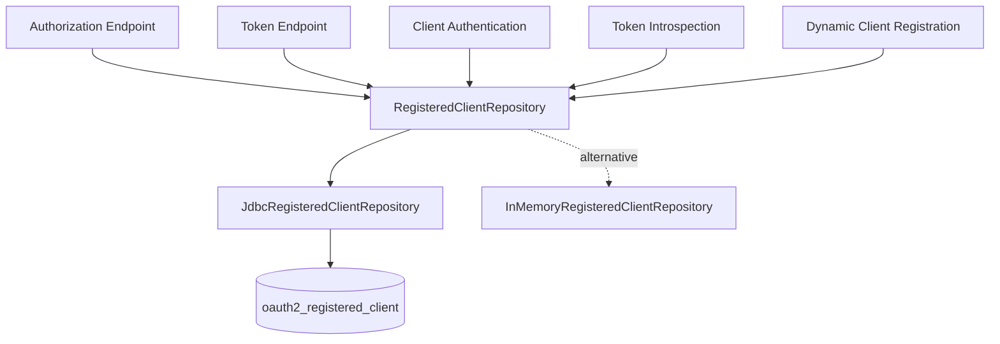

# JdbcRegisteredClientRepository và schema client

## 1. Vì sao Authorization Server cần lưu client registration vào database?

Một OAuth 2.0 Authorization Server phải biết client nào đang gửi yêu cầu, client được phép dùng grant type nào, redirect URI nào hợp lệ, scope nào được yêu cầu và cách client xác thực tại Token Endpoint. Tập thông tin đó được mô hình hóa trong Spring Authorization Server bằng **RegisteredClient**.

Trong ví dụ nhỏ, ứng dụng có thể khai báo client bằng InMemoryRegisteredClientRepository. Nhưng dữ liệu trong bộ nhớ mất khi process khởi động lại và không tự chia sẻ giữa nhiều instance. Khi chạy production, client registration thường cần được lưu bền vững trong database để:

- Giữ nguyên client ID, redirect URI, grant, scope và settings qua lần restart.
- Cho nhiều Authorization Server instance tra cứu cùng một tập client.
- Quản trị vòng đời client bằng migration, admin workflow và audit.
- Kết nối client registration với authorization, consent và các protocol endpoint.

Spring Authorization Server cung cấp **JdbcRegisteredClientRepository**, một implementation của RegisteredClientRepository dùng Spring JDBC để lưu và truy vấn RegisteredClient. Repository này phụ thuộc vào bảng **oauth2_registered_client** với schema đi kèm trong thư viện.

Bài thuộc chương **Lưu trữ JDBC** của module SPRING_SECURITY_OAUTH2_OIDC_AUTHORIZATION_SERVER. Mục tiêu tổng thể của module là **học cách thiết kế, cấu hình, bảo mật, kiểm thử và vận hành OAuth 2.0/OpenID Connect Authorization Server bằng Spring Security và Spring Authorization Server trong ứng dụng Spring Boot**.

### Mục tiêu học tập

Sau bài này, bạn có thể:

1. Giải thích vai trò của RegisteredClientRepository trong các protocol flow.
2. Phân biệt ID nội bộ của registration với client_id công khai.
3. Đọc và triển khai schema oauth2_registered_client.
4. Cấu hình JdbcRegisteredClientRepository bằng JdbcTemplate/JdbcOperations.
5. Ánh xạ các trường collection và settings JSON trong RegisteredClient.
6. Bảo vệ client secret và dữ liệu registration trong database.
7. Tổ chức schema bằng Flyway/Liquibase và điều chỉnh theo database vendor.
8. Kiểm thử save/findById/findByClientId, migration, constraint và dữ liệu biên.
9. Nhận biết giới hạn hiệu năng của implementation JDBC mặc định và khi nào cần repository riêng.

> **Phạm vi phiên bản:** Ví dụ sử dụng Spring Authorization Server 1.5.8 và Spring Security 6.x. Schema mẫu được lấy theo resource oauth2-registered-client-schema.sql của Spring Authorization Server. Nếu dùng bản khác, hãy đối chiếu resource đi kèm đúng dependency vì schema và API có thể thay đổi. SPECIAL_NOTE của bài được giao để trống.

## 2. RegisteredClientRepository nằm ở đâu trong kiến trúc?

RegisteredClientRepository là thành phần trung tâm để đăng ký client mới và truy vấn client đã có. Các protocol component sử dụng repository khi cần xác định client đang thực hiện một flow.



Ví dụ:

- Authorization Endpoint tra client để kiểm tra redirect URI, grant và scope.
- Client Authentication tra client để xác minh client ID, secret hoặc authentication method.
- Token Endpoint tra client để kiểm tra grant type được phép và token settings.
- Introspection hoặc Dynamic Client Registration có thể cần repository để tra cứu hoặc cập nhật client theo protocol.

RegisteredClientRepository là component **bắt buộc** của Authorization Server. Spring Authorization Server cung cấp hai implementation cơ bản:

| Repository | Lưu trữ | Phạm vi sử dụng |
| --- | --- | --- |
| InMemoryRegisteredClientRepository | Bộ nhớ của JVM | Development và testing |
| JdbcRegisteredClientRepository | Database qua JdbcOperations | Persistence JDBC cho ứng dụng |

Tài liệu Spring khuyến nghị InMemoryRegisteredClientRepository **chỉ dùng cho development/testing**. JdbcRegisteredClientRepository là implementation đơn giản có thể dùng trong production, nhưng tài liệu cũng cảnh báo nó có giới hạn hiệu năng và có thể không phù hợp hệ thống throughput cao.

### 2.1. RegisteredClient không phải OAuth2Authorization

Hai domain object có nhiệm vụ khác nhau:

| Domain object | Nội dung |
| --- | --- |
| RegisteredClient | Client registration: client ID, secret, grant, scope, redirect URI, client/token settings |
| OAuth2Authorization | Một authorization đã được cấp: principal, grant, authorized scopes, authorization code, access token, refresh token, ID Token, device code và metadata liên quan |
| OAuth2AuthorizationConsent | Consent của resource owner cho client và tập authority đã chấp thuận |

Bảng oauth2_registered_client **không lưu access token, refresh token, authorization code hoặc consent**. Các dữ liệu đó thuộc OAuth2AuthorizationService và OAuth2AuthorizationConsentService, có schema riêng.

Nếu chỉ cấu hình JdbcRegisteredClientRepository, client registration sẽ tồn tại qua restart nhưng trạng thái authorization/token vẫn có thể ở nơi khác. Một hệ thống JDBC hoàn chỉnh thường cần lựa chọn persistence cho cả ba core service phù hợp.

## 3. RegisteredClient có những trường nào?

RegisteredClient biểu diễn một client registration trong Authorization Server. Model có 13 trường chính:

| Field | Kiểu Java | Ý nghĩa |
| --- | --- | --- |
| id | String | ID nội bộ, duy nhất cho registration |
| clientId | String | Client identifier được client gửi trong protocol request |
| clientIdIssuedAt | Instant | Thời điểm cấp client ID |
| clientSecret | String hoặc null | Secret đã được encode nếu là confidential client |
| clientSecretExpiresAt | Instant hoặc null | Thời điểm secret hết hạn |
| clientName | String | Tên mô tả client, có thể hiển thị trên consent page |
| clientAuthenticationMethods | Set<ClientAuthenticationMethod> | Các phương thức client được phép dùng để xác thực |
| authorizationGrantTypes | Set<AuthorizationGrantType> | Các grant type được phép |
| redirectUris | Set<String> | Redirect URI đã đăng ký |
| postLogoutRedirectUris | Set<String> | URI được phép quay lại sau OIDC logout |
| scopes | Set<String> | Scope client được phép yêu cầu |
| clientSettings | ClientSettings | Cấu hình client như PKCE, authorization consent, JWK Set URL, signing algorithm |
| tokenSettings | TokenSettings | Cấu hình token TTL, refresh token reuse, token format, ID Token signing algorithm và các setting liên quan |

### 3.1. Phân biệt id và clientId

Đây là hai định danh có mục đích khác nhau:

- **id** là khóa registration nội bộ mà ứng dụng dùng để liên kết dữ liệu persistence.
- **clientId** là định danh OAuth công khai mà client gửi trong authorization request hoặc client authentication.

Ví dụ:

```java
RegisteredClient registeredClient = RegisteredClient.withId(
                "reg-7f8b3a")
        .clientId("orders-web")
        .clientSecret(encodedSecret)
        .clientAuthenticationMethod(
                ClientAuthenticationMethod.CLIENT_SECRET_BASIC)
        .authorizationGrantType(AuthorizationGrantType.AUTHORIZATION_CODE)
        .redirectUri("https://orders.example.com/login/oauth2/code/issuer")
        .scope("openid")
        .scope("orders.read")
        .build();
```

Ở đây, reg-7f8b3a là registration ID nội bộ; orders-web là client_id được gửi trong giao thức OAuth. Không dùng nhầm findById("orders-web") khi cần tìm client theo client ID.

### 3.2. Các trường collection

Client có thể có nhiều authentication method, grant type, redirect URI, post-logout redirect URI và scope. Trong Java, chúng được biểu diễn bằng Set để tránh phần tử trùng lặp.

Ví dụ:

```java
RegisteredClient registeredClient = RegisteredClient.withId(UUID.randomUUID().toString())
        .clientId("orders-web")
        .clientSecret(encodedSecret)
        .clientAuthenticationMethod(ClientAuthenticationMethod.CLIENT_SECRET_BASIC)
        .authorizationGrantType(AuthorizationGrantType.AUTHORIZATION_CODE)
        .authorizationGrantType(AuthorizationGrantType.REFRESH_TOKEN)
        .redirectUri("https://orders.example.com/callback")
        .postLogoutRedirectUri("https://orders.example.com/signed-out")
        .scope("openid")
        .scope("orders.read")
        .build();
```

Đừng tự viết SQL ghép các Set này bằng cách nối chuỗi tùy ý. Parameters mapper mặc định chịu trách nhiệm chuyển đổi RegisteredClient sang các cột database; RowMapper chuyển ngược dữ liệu thành object.

### 3.3. ClientSettings và TokenSettings

Hai trường settings chứa cấu hình có cấu trúc:

- ClientSettings có thể lưu yêu cầu PKCE, authorization consent, JWK Set URL, token endpoint authentication signing algorithm, X.509 certificate subject DN và các thiết lập client khác.
- TokenSettings có thể lưu thời gian sống authorization code/access token/refresh token/device code, reuse refresh token, access token format và ID Token signing algorithm.

Không nên tách rời các setting khỏi registration nếu ứng dụng vẫn cần SAS đọc chúng khi xử lý protocol. Nếu thay đổi cấu trúc JSON hoặc mapper, phải đảm bảo dữ liệu cũ vẫn đọc được.

## 4. Schema chuẩn oauth2_registered_client

JdbcRegisteredClientRepository phụ thuộc vào table definition nằm trong classpath:

```text
org/springframework/security/oauth2/server/authorization/client/
oauth2-registered-client-schema.sql
```

Schema chuẩn của SAS 1.5.x:

```sql
CREATE TABLE oauth2_registered_client (
    id varchar(100) NOT NULL,
    client_id varchar(100) NOT NULL,
    client_id_issued_at timestamp DEFAULT CURRENT_TIMESTAMP NOT NULL,
    client_secret varchar(200) DEFAULT NULL,
    client_secret_expires_at timestamp DEFAULT NULL,
    client_name varchar(200) NOT NULL,
    client_authentication_methods varchar(1000) NOT NULL,
    authorization_grant_types varchar(1000) NOT NULL,
    redirect_uris varchar(1000) DEFAULT NULL,
    post_logout_redirect_uris varchar(1000) DEFAULT NULL,
    scopes varchar(1000) NOT NULL,
    client_settings varchar(2000) NOT NULL,
    token_settings varchar(2000) NOT NULL,
    PRIMARY KEY (id)
);
```

Đây là schema mặc định mà repository JDBC sử dụng. Khi triển khai, dùng đúng file resource trong dependency đã khóa phiên bản; không copy schema từ một phiên bản khác mà chưa so sánh.

### 4.1. Mapping giữa RegisteredClient và SQL columns

| RegisteredClient | Database column | Vai trò |
| --- | --- | --- |
| id | id | Primary key của registration |
| clientId | client_id | OAuth client identifier |
| clientIdIssuedAt | client_id_issued_at | Thời điểm cấp ID |
| clientSecret | client_secret | Secret đã encode |
| clientSecretExpiresAt | client_secret_expires_at | Hạn secret |
| clientName | client_name | Tên hiển thị |
| clientAuthenticationMethods | client_authentication_methods | Các phương thức xác thực |
| authorizationGrantTypes | authorization_grant_types | Các grant type |
| redirectUris | redirect_uris | Redirect URI |
| postLogoutRedirectUris | post_logout_redirect_uris | Post-logout redirect URI |
| scopes | scopes | Scope được phép |
| clientSettings | client_settings | JSON settings của client |
| tokenSettings | token_settings | JSON settings của token |

### 4.2. Vì sao nhiều cột là VARCHAR?

Schema JDBC mặc định lưu các collection và settings vào cột dạng chuỗi:

- Các collection được serialize thành representation dạng text.
- ClientSettings và TokenSettings được serialize thành JSON.
- RowMapper đọc chuỗi và tái tạo Set/settings object.

Đây là cách triển khai gọn cho repository tổng quát, nhưng không phải mô hình chuẩn hóa tối ưu cho mọi hệ thống. Không query JSON settings bằng cách giả định cấu trúc nội bộ ổn định nếu ứng dụng không kiểm soát version/mapper.

### 4.3. Schema mặc định chỉ khai báo primary key id

DDL chuẩn khai báo PRIMARY KEY cho id. Trong production, nên bổ sung **unique constraint/index trên client_id** để database bảo vệ tính duy nhất của client identifier ngay cả khi có race condition giữa nhiều instance hoặc nhiều luồng đăng ký.

Ví dụ SQL minh họa:

```sql
CREATE UNIQUE INDEX ux_oauth2_registered_client_client_id
    ON oauth2_registered_client (client_id);
```

Trước khi thêm unique index vào database đang chạy, hãy tìm và xử lý dữ liệu client_id trùng lặp. Cú pháp index và cách khai báo constraint có thể khác giữa PostgreSQL, MySQL, Oracle và SQL Server.

Không tự đổi tên cột hoặc table khi vẫn dùng JdbcRegisteredClientRepository mặc định. Nếu schema phải khác, cần custom repository/SQL tương ứng.

## 5. Kích thước cột và giới hạn dữ liệu

Schema mặc định dùng độ dài hữu hạn:

| Column | Độ dài mẫu | Nội dung có thể tăng |
| --- | ---: | --- |
| id, client_id | 100 | Registration ID và client identifier |
| client_secret | 200 | Password hash/encoded secret |
| client_name | 200 | Tên client |
| client_authentication_methods | 1000 | Nhiều authentication methods |
| authorization_grant_types | 1000 | Nhiều grant types |
| redirect_uris | 1000 | Nhiều redirect URI dài |
| post_logout_redirect_uris | 1000 | Nhiều logout URI |
| scopes | 1000 | Nhiều scope |
| client_settings | 2000 | JSON settings |
| token_settings | 2000 | JSON settings |

### 5.1. Đừng để dữ liệu vượt chiều dài cột

Client có nhiều redirect URI, grant type hoặc scope có thể làm chuỗi serialize dài hơn 1000 ký tự. Một client dùng JWK Set URL dài, certificate subject DN hoặc settings mở rộng có thể khiến JSON settings vượt 2000 ký tự.

Lỗi có thể xuất hiện dưới dạng SQL data truncation, value too long hoặc database constraint violation khi save.

Biện pháp:

1. Xác định giới hạn metadata nghiệp vụ cho mỗi client.
2. Đo độ dài dữ liệu đã serialize ở các registration thực tế.
3. Tăng chiều dài cột hoặc dùng kiểu text phù hợp nếu cần.
4. Đảm bảo mapper/driver xử lý kiểu cột mới tương thích.
5. Viết integration test với metadata ở giới hạn tối đa.

Không tăng tất cả cột lên MAX hoặc CLOB một cách máy móc. Chọn kiểu dữ liệu theo query, index, giới hạn của database và kích thước dữ liệu.

### 5.2. client_secret phải được encode trước khi lưu

JdbcRegisteredClientRepository không tự mã hóa client secret. RegisteredClientRepository API yêu cầu ứng dụng encode dữ liệu nhạy cảm bên ngoài implementation.

Ví dụ:

```java
String encodedSecret = passwordEncoder.encode(rawClientSecret);

RegisteredClient registeredClient = RegisteredClient.withId(UUID.randomUUID().toString())
        .clientId("billing-worker")
        .clientSecret(encodedSecret)
        .clientAuthenticationMethod(ClientAuthenticationMethod.CLIENT_SECRET_BASIC)
        .authorizationGrantType(AuthorizationGrantType.CLIENT_CREDENTIALS)
        .scope("billing.read")
        .build();

registeredClientRepository.save(registeredClient);
```

Không lưu raw secret. Khi client authentication, Spring Security dùng PasswordEncoder phù hợp để đối chiếu giá trị gửi đến với hash đã lưu.

### 5.3. Kiểm soát quyền đọc database

Client secret hash vẫn là dữ liệu nhạy cảm. Hạn chế quyền SELECT table cho người dùng database, admin console, reporting và backup operator. Không log object RegisteredClient bằng cách in toàn bộ secret/settings. Mã hóa backup và kiểm soát truy cập database như một phần của credential management.

## 6. Khởi tạo schema bằng migration

Không nên phụ thuộc vào việc một file SQL tình cờ chạy trong môi trường local. Schema client là một phần của database contract và cần được quản lý qua Flyway, Liquibase hoặc quy trình migration có kiểm soát.

### 6.1. Dùng Flyway

Một migration ví dụ:

```text
src/main/resources/db/migration/
    V1_0_0__create_oauth2_registered_client.sql
```

Nội dung migration là DDL chuẩn đã được điều chỉnh cho database vendor đang dùng. Ví dụ PostgreSQL:

```sql
CREATE TABLE oauth2_registered_client (
    id varchar(100) PRIMARY KEY,
    client_id varchar(100) NOT NULL,
    client_id_issued_at timestamptz NOT NULL DEFAULT CURRENT_TIMESTAMP,
    client_secret varchar(200),
    client_secret_expires_at timestamptz,
    client_name varchar(200) NOT NULL,
    client_authentication_methods varchar(1000) NOT NULL,
    authorization_grant_types varchar(1000) NOT NULL,
    redirect_uris varchar(1000),
    post_logout_redirect_uris varchar(1000),
    scopes varchar(1000) NOT NULL,
    client_settings varchar(2000) NOT NULL,
    token_settings varchar(2000) NOT NULL,
    CONSTRAINT ux_oauth2_registered_client_client_id UNIQUE (client_id)
);
```

Đây là biến thể PostgreSQL có unique constraint và timestamp with time zone; không phải nội dung nguyên bản byte-for-byte của schema resource. Nếu dự án cần tương thích với schema chuẩn, giữ nguyên tên cột và mapping.

### 6.2. Dùng Liquibase

Liquibase có thể mô tả table/columns/index trong changelog XML, YAML hoặc SQL. Điều quan trọng là migration phải:

- Tạo đủ 13 cột repository mong đợi.
- Giữ đúng tên cột.
- Dùng kiểu dữ liệu tương thích với JDBC mapper.
- Thêm constraint/index cần thiết cho deployment.
- Có rollback hoặc kế hoạch forward-fix phù hợp.

Không để Hibernate tự đổi schema production theo entity nếu ứng dụng đang dùng JdbcRegisteredClientRepository. Repository JDBC không đọc annotation JPA.

### 6.3. Kiểm tra schema trước khi khởi động server

Pipeline deploy nên chạy migration trước khi đưa Authorization Server vào nhận traffic. Kiểm tra:

- Table và các cột cần thiết đã tồn tại.
- Unique constraint/index trên client_id có hiệu lực.
- Application database user có quyền SELECT/INSERT cần thiết.
- Kiểu timestamp và JSON/text phù hợp driver.
- Migration đã chạy đúng version trên tất cả môi trường.

## 7. Cấu hình JdbcRegisteredClientRepository

JdbcRegisteredClientRepository nhận một JdbcOperations. JdbcTemplate triển khai interface này và thường được tạo từ DataSource do Spring Boot cấu hình.

Ví dụ:

```java
@Configuration
class RegisteredClientPersistenceConfiguration {

    @Bean
    RegisteredClientRepository registeredClientRepository(
            JdbcTemplate jdbcTemplate) {
        return new JdbcRegisteredClientRepository(jdbcTemplate);
    }
}
```

Đảm bảo dependency JDBC và driver database đã có trong ứng dụng. Ví dụ với Spring Boot, starter JDBC cung cấp JdbcTemplate và DataSource auto-configuration khi cấu hình datasource hợp lệ.

### 7.1. Cấu hình datasource

Ví dụ PostgreSQL:

```yaml
spring:
  datasource:
    url: jdbc:postgresql://db.example.internal:5432/authorization
    username: auth_server
    password: DB_PASSWORD_FROM_SECRET_STORE
    driver-class-name: org.postgresql.Driver
```

Đây là cấu hình minh họa. Trong production, inject password qua secret manager/environment an toàn; bật TLS cho database connection nếu hạ tầng hỗ trợ và giới hạn quyền database user.

### 7.2. Gắn repository vào Authorization Server

Khi dùng OAuth2AuthorizationServerConfigurer:

```java
@Bean
@Order(1)
SecurityFilterChain authorizationServerSecurityFilterChain(
        HttpSecurity http,
        RegisteredClientRepository registeredClientRepository)
        throws Exception {

    OAuth2AuthorizationServerConfigurer authorizationServer =
            OAuth2AuthorizationServerConfigurer.authorizationServer();

    http
        .securityMatcher(authorizationServer.getEndpointsMatcher())
        .with(authorizationServer, server ->
            server.registeredClientRepository(registeredClientRepository)
        )
        .authorizeHttpRequests(authorize ->
            authorize.anyRequest().authenticated());

    return http.build();
}
```

Nếu RegisteredClientRepository đã được đăng ký như một bean theo cơ chế cấu hình mặc định, framework có thể lấy bean đó để cấu hình core service. Cấu hình tường minh hữu ích khi ứng dụng có nhiều repository hoặc nhiều issuer.

## 8. Tạo và lưu RegisteredClient

Ví dụ đăng ký confidential web client:

```java
RegisteredClient ordersWeb = RegisteredClient.withId(UUID.randomUUID().toString())
        .clientId("orders-web")
        .clientIdIssuedAt(Instant.now())
        .clientSecret(passwordEncoder.encode(rawSecret))
        .clientSecretExpiresAt(Instant.now().plus(365, ChronoUnit.DAYS))
        .clientName("Orders Web")
        .clientAuthenticationMethod(ClientAuthenticationMethod.CLIENT_SECRET_BASIC)
        .authorizationGrantType(AuthorizationGrantType.AUTHORIZATION_CODE)
        .authorizationGrantType(AuthorizationGrantType.REFRESH_TOKEN)
        .redirectUri("https://orders.example.com/login/oauth2/code/company")
        .postLogoutRedirectUri("https://orders.example.com/signed-out")
        .scope(OidcScopes.OPENID)
        .scope(OidcScopes.PROFILE)
        .scope("orders.read")
        .clientSettings(ClientSettings.builder()
                .requireProofKey(true)
                .requireAuthorizationConsent(true)
                .build())
        .tokenSettings(TokenSettings.builder()
                .accessTokenTimeToLive(Duration.ofMinutes(10))
                .refreshTokenTimeToLive(Duration.ofHours(8))
                .reuseRefreshTokens(false)
                .build())
        .build();

registeredClientRepository.save(ordersWeb);
```

Đây là ví dụ minh họa. Chọn TTL, consent, PKCE và refresh token policy theo risk model. Với public client, không tạo hoặc lưu client secret như thể ứng dụng browser có thể giữ bí mật.

### 8.1. ID nên ổn định

ID registration là khóa nội bộ. Khi tạo client mới, UUID ngẫu nhiên là lựa chọn phổ biến. Khi cập nhật metadata bằng admin workflow, giữ nguyên ID nếu vẫn là cùng một registration. Thay ID có thể làm hỏng các foreign key từ authorization/consent records hoặc các quan hệ domain khác.

### 8.2. Không đăng ký client trùng client_id

Trước khi tạo mới, kiểm tra:

```java
RegisteredClient existing =
        registeredClientRepository.findByClientId("orders-web");

if (existing != null) {
    throw new IllegalStateException("client_id already registered");
}

registeredClientRepository.save(ordersWeb);
```

Đây chỉ là kiểm tra thân thiện trước khi insert. Hai request đồng thời vẫn có thể cùng thấy chưa tồn tại; unique constraint trong database mới là hàng rào cuối cùng để ngăn trùng client_id.

## 9. findByClientId và findById

RegisteredClientRepository có ba method chính:

| Method | Input | Kết quả |
| --- | --- | --- |
| save(registeredClient) | RegisteredClient | Lưu registration |
| findById(id) | ID nội bộ | RegisteredClient hoặc null |
| findByClientId(clientId) | Client identifier | RegisteredClient hoặc null |

Ví dụ:

```java
RegisteredClient byClientId =
        registeredClientRepository.findByClientId("orders-web");

RegisteredClient byRegistrationId =
        registeredClientRepository.findById("reg-7f8b3a");
```

Hai truy vấn không tương đương. findByClientId phục vụ tra cứu theo định danh OAuth client; findById phục vụ tra cứu theo registration ID nội bộ.

### 9.1. Trả null khi không tìm thấy

API repository trả null nếu không có registration phù hợp. Application service có thể chuyển thành domain exception hoặc kết quả optional tùy cách thiết kế, nhưng không được coi client không tìm thấy là một client mặc định.

### 9.2. save không thay thế admin lifecycle API

RegisteredClientRepository interface chỉ định nghĩa save, findById và findByClientId. Nó không định nghĩa các method update/delete chuyên biệt. JdbcRegisteredClientRepository là implementation đơn giản, không phải một bộ công cụ quản trị client đầy đủ.

Nếu cần rotate secret, đổi redirect URI, disable client hoặc xóa registration, hãy thiết kế admin service/repository có kiểm soát và transaction. Khi thay đổi registration, cần đánh giá authorization/consent hiện có, token đã phát hành, cache và audit. Không giả định một lần save là cơ chế upsert hoặc tự thu hồi token cũ.

## 10. Mapper: chuyển RegisteredClient thành SQL parameters và ngược lại

JdbcRegisteredClientRepository dùng hai mapper:

1. **RegisteredClientParametersMapper**: chuyển RegisteredClient thành danh sách SqlParameterValue để ghi database.
2. **RegisteredClientRowMapper**: đọc ResultSet và tạo RegisteredClient.

Hai mapper mặc định xử lý collection, enum-like value và JSON settings. Khi cần tùy chỉnh representation, repository cho phép thay mapper.

### 10.1. Cấu hình mapper mặc định

Thông thường không cần tự tạo mapper:

```java
JdbcRegisteredClientRepository repository =
        new JdbcRegisteredClientRepository(jdbcTemplate);
```

Nếu cần custom:

```java
JdbcRegisteredClientRepository repository =
        new JdbcRegisteredClientRepository(jdbcTemplate);

repository.setRegisteredClientParametersMapper(customParametersMapper);
repository.setRegisteredClientRowMapper(customRegisteredClientRowMapper);
```

Custom mapper phải tương thích đầy đủ với schema và bảo toàn dữ liệu. Nếu parameters mapper ghi một representation khác, row mapper phải đọc đúng representation đó. Khi rollout phiên bản mới, cần hỗ trợ đọc dữ liệu cũ hoặc có migration chuyển đổi.

### 10.2. JSON settings cần Jackson modules phù hợp

ClientSettings và TokenSettings có thể chứa kiểu dữ liệu Spring Security/Spring Authorization Server như Duration, algorithm và OAuth2TokenFormat. Nếu tự tạo ObjectMapper cho custom mapper, cần đăng ký các Jackson modules cần thiết để serialize/deserialize đúng các type này.

Không dùng một ObjectMapper trống rồi mong mọi settings tự deserialize. Hãy kiểm tra round-trip với những cấu hình thực tế như:

- requireProofKey và requireAuthorizationConsent.
- accessTokenTimeToLive và refreshTokenTimeToLive.
- reuseRefreshTokens.
- accessTokenFormat.
- idTokenSignatureAlgorithm.
- token endpoint authentication signing algorithm.

### 10.3. Không chỉnh sửa representation trong database bằng tay

Các chuỗi collection và JSON settings là representation do mapper tạo. Nếu sửa trực tiếp bằng SQL mà không biết format, có thể tạo record mà RowMapper không đọc được hoặc làm mất settings.

Nếu cần migration dữ liệu, viết script chuyển đổi có test round-trip và backup trước khi chạy production.

## 11. Database vendor và kiểu dữ liệu thời gian

Schema chuẩn sử dụng cột timestamp cho Instant fields. Cách database/driver diễn giải timestamp phụ thuộc vendor và session timezone.

### 11.1. PostgreSQL

PostgreSQL hỗ trợ cả timestamp without time zone và timestamp with time zone (timestamptz). Với các field Java Instant biểu diễn thời điểm tuyệt đối, timestamptz thường là lựa chọn phù hợp hơn để tránh diễn giải nhầm timestamp theo timezone session.

Trong migration PostgreSQL, có thể thay các cột:

- client_id_issued_at
- client_secret_expires_at

từ timestamp sang timestamptz. Kiểm tra cách migration dữ liệu cũ chuyển timezone trước khi đổi kiểu.

### 11.2. MySQL

Với MySQL Connector/J, kiểm tra timezone connection và cấu hình preserveInstants theo hướng dẫn driver khi cần bảo toàn Instant. Ví dụ URL có thể thêm các tùy chọn:

```text
preserveInstants=true
connectionTimeZone=UTC
forceConnectionTimeZoneToSession=true
```

Các thuộc tính này phải được xác minh theo phiên bản Connector/J và cấu hình server. Không copy nguyên URL production mà chưa kiểm tra driver.

### 11.3. Kiểm thử timezone

Test nên ghi một Instant có offset khác UTC, đọc lại từ database và xác nhận cùng một thời điểm tuyệt đối. Không chỉ so sánh chuỗi hiển thị vì database có thể format timezone khác nhau.

## 12. Hiệu năng và giới hạn của JdbcRegisteredClientRepository

Tài liệu SAS mô tả JdbcRegisteredClientRepository là implementation JDBC đơn giản, có thể dùng trong production nhưng có thể không đáp ứng hệ thống yêu cầu throughput cao.

Những yếu tố ảnh hưởng:

- Client authentication và token flow có thể tra registration thường xuyên.
- Client metadata có nhiều collection/JSON settings.
- Mỗi lần lookup phải đi qua JDBC/database.
- Nhiều instance cùng truy vấn một table.
- Database connection pool và latency mạng.

### 12.1. Tối ưu database trước

Các biện pháp thường dùng:

1. Unique index trên client_id.
2. Primary key index trên id.
3. Connection pool có sizing theo concurrency thực tế.
4. Query plan cho findByClientId/findById.
5. Database latency, lock wait và pool saturation metrics.
6. Giới hạn metadata registration để tránh record quá lớn.

Không thêm index cho mọi cột text dài. Chỉ index các cột được dùng trong predicate/join và phù hợp collation/length của database.

### 12.2. Khi nào cần custom repository?

Nếu database lookup trở thành bottleneck, ứng dụng có thể implement RegisteredClientRepository riêng hoặc thêm cache có invalidation phù hợp.

Custom repository cần giữ đúng semantics:

- findByClientId trả đúng registration theo client ID.
- findById dùng registration ID nội bộ.
- save không tạo registration trùng.
- Secret được encode trước khi persist.
- Settings/collection được round-trip đầy đủ.
- Cache invalidation xảy ra khi admin thay đổi client.
- Nhiều instance nhìn thấy cập nhật theo consistency model đã chọn.

Không cache vô thời hạn nếu admin có thể disable/rotate client. Một client bị thu hồi nhưng cache còn hiệu lực có thể tiếp tục được xác thực trên một node.

### 12.3. Cache không thay thế persistence

Cache có thể giảm read latency nhưng database vẫn là nguồn dữ liệu bền vững. Khi restart, cache phải được warm/load lại hoặc tự phục hồi. Khi đổi secret/redirect URI, cần invalidate theo registration ID/client ID trên mọi node.

## 13. Bảo mật dữ liệu RegisteredClient

Client registration chứa thông tin có thể ảnh hưởng trực tiếp đến authorization:

- Client secret hash.
- Redirect URI và post-logout redirect URI.
- Client authentication method.
- Grant types và scopes.
- JWK Set URL hoặc X.509 subject DN.
- Token lifetime và token format settings.

Các nguyên tắc:

1. Encode client secret bằng PasswordEncoder trước khi save.
2. Không log raw secret hoặc toàn bộ RegisteredClient object.
3. Hạn chế database permissions theo least privilege.
4. Bảo vệ backup, snapshot và replica.
5. Audit mọi thay đổi registration.
6. Validate redirect URI chính xác, tránh wildcard/open redirect.
7. Validate metadata URL để hạn chế SSRF nếu server có fetch.
8. Dùng TLS giữa ứng dụng và database.
9. Rotate credential theo quy trình và theo dõi client_secret_expires_at.
10. Kiểm soát admin API có thể sửa grant/scope/authentication method.

### 13.1. Secret hash và PasswordEncoder

JdbcRegisteredClientRepository lưu giá trị clientSecret mà RegisteredClient cung cấp. Nếu ứng dụng đưa raw secret vào builder, repository có thể ghi raw secret xuống database.

Do đó:

```java
String encoded = passwordEncoder.encode(rawSecret);
RegisteredClient client = RegisteredClient.withId(UUID.randomUUID().toString())
        .clientId("service-client")
        .clientSecret(encoded)
        .clientAuthenticationMethod(ClientAuthenticationMethod.CLIENT_SECRET_BASIC)
        .authorizationGrantType(AuthorizationGrantType.CLIENT_CREDENTIALS)
        .scope("service.read")
        .build();
```

Không dùng NoOpPasswordEncoder trong production. Chọn PasswordEncoder phù hợp và đảm bảo client secret mới được hiển thị/chuyển giao an toàn một lần theo onboarding policy.

### 13.2. Disable client và token đã cấp

RegisteredClientRepository không phải authorization revocation service. Nếu admin disable một client, cần xác định:

- Ngăn client authentication mới.
- Xử lý access/refresh token đã cấp.
- Thu hồi authorization hoặc block token theo policy.
- Xử lý consent và session liên quan.
- Đồng bộ cache trên các instance.

Không giả định xóa một dòng RegisteredClient tự động xóa mọi OAuth2Authorization record hoặc token đã phát hành. Dùng các service quản lý authorization/revocation tương ứng.

## 14. Kiểm thử JdbcRegisteredClientRepository

Kiểm thử nên chạy với database thật hoặc Testcontainers tương thích production vendor. H2 có thể giúp test nhanh nhưng không đảm bảo mọi khác biệt SQL, timestamp, collation, JSON/text và index giống PostgreSQL/MySQL.

### 14.1. Test round-trip cơ bản

Pseudocode JUnit:

```java
RegisteredClient client = createRegisteredClient();
repository.save(client);

RegisteredClient byId = repository.findById(client.getId());
RegisteredClient byClientId = repository.findByClientId(client.getClientId());

assertThat(byId).isNotNull();
assertThat(byClientId).isNotNull();
assertThat(byId.getClientId()).isEqualTo(client.getClientId());
assertThat(byClientId.getId()).isEqualTo(client.getId());
assertThat(byId.getScopes()).containsExactlyInAnyOrderElementsOf(client.getScopes());
assertThat(byId.getRedirectUris()).containsExactlyInAnyOrderElementsOf(client.getRedirectUris());
assertThat(byId.getClientSettings()).isEqualTo(client.getClientSettings());
assertThat(byId.getTokenSettings()).isEqualTo(client.getTokenSettings());
```

Đây là pseudocode minh họa; createRegisteredClient và assertion helper thuộc test suite của ứng dụng.

### 14.2. Ma trận kiểm thử

| Ca kiểm thử | Dữ liệu/điều kiện | Kết quả mong đợi |
| --- | --- | --- |
| Migration schema | Database mới | Table và 13 cột được tạo |
| Repository bean | JdbcTemplate/DataSource hợp lệ | Bean khởi tạo thành công |
| Save client | Registration hợp lệ | Record được persist |
| Find by ID | ID nội bộ tồn tại | Đọc đúng registration |
| Find by client ID | Client ID tồn tại | Đọc đúng registration |
| ID và client ID khác nhau | Giá trị riêng biệt | Hai method tra đúng cột |
| Client không tồn tại | ID/client ID lạ | Trả null |
| Duplicate ID | ID đã có | Database từ chối |
| Duplicate client ID | Unique index bật | Database từ chối |
| Client secret | Secret đã encode | Database không chứa raw secret |
| Public client | Không có secret | Đọc lại clientSecret null |
| Secret expiration | Instant có giá trị | Round-trip thời gian đúng |
| Collection fields | Nhiều auth method/grant/scope/URI | Đọc lại đầy đủ |
| Post-logout redirect | Nhiều URI | Round-trip đúng |
| Client settings | PKCE/consent/JWK URL | JSON được đọc đúng |
| Token settings | TTL/refresh reuse/format | JSON được đọc đúng |
| Long client name | Vượt giới hạn | Validation/DB error được xử lý rõ |
| Long redirect URI set | Vượt cột 1000 | Test phát hiện overflow |
| Large settings JSON | Vượt cột 2000 | Test phát hiện overflow |
| PostgreSQL timestamp | timestamptz | Instant round-trip đúng |
| MySQL timezone | Connector/J config | Instant không lệch |
| Restart application | Database giữ dữ liệu | Client vẫn được tìm thấy |
| Restart database | Dữ liệu durable | Registration còn nguyên |
| Multi-instance lookup | Hai node cùng DB | Hai node đọc cùng registration |
| Concurrent duplicate save | Hai request cùng client ID | Chỉ một record tồn tại |
| Secret rotation | Cập nhật qua admin repository | Authentication dùng secret mới theo policy |
| Cache invalidation | Có cache layer | Các node thấy registration update |
| DB unavailable | Ngắt database | Lỗi được quan sát, không fallback im lặng sang in-memory |
| DB permission | User thiếu INSERT/SELECT | Deploy/test phát hiện quyền thiếu |
| Migration upgrade | Schema từ version cũ | Dữ liệu cũ vẫn đọc được |

### 14.3. Test database unavailable

Không tự động fallback sang InMemoryRegisteredClientRepository khi JDBC lỗi. Hành vi fallback có thể khiến các instance nhìn thấy tập client khác nhau và làm thay đổi authorization policy. Hãy fail startup hoặc fail request theo thiết kế availability rõ ràng.

## 15. Troubleshooting

| Hiện tượng | Nguyên nhân có thể | Cách xử lý |
| --- | --- | --- |
| Table oauth2_registered_client không tồn tại | Migration chưa chạy | Kiểm tra Flyway/Liquibase trước startup |
| Unknown column | Schema không đúng version | So sánh với resource SQL của dependency |
| SQL value too long | Cột VARCHAR quá ngắn | Đo serialized length và mở rộng cột/migration |
| Duplicate key trên id | Registration ID trùng | Sinh ID ổn định/duy nhất |
| Duplicate client ID | Thiếu unique constraint hoặc onboarding race | Thêm unique index và xử lý conflict |
| findByClientId trả null | Gọi nhầm client ID hoặc record chưa commit | Kiểm tra transaction/column mapping |
| findById trả null | Nhầm id nội bộ với client_id | Dùng đúng định danh |
| Client authentication sai sau restart | Data chưa persist hoặc secret hash sai | Kiểm tra DB, PasswordEncoder và migration |
| Settings deserialize lỗi | Jackson modules/representation không tương thích | Kiểm tra mapper và dữ liệu JSON |
| Redirect URI bị mất | Collection mapping/schema sai | Kiểm tra RowMapper và ParametersMapper |
| Instant lệch giờ | Timestamp/timezone driver mismatch | Dùng timestamptz hoặc cấu hình UTC/driver |
| DB connection pool cạn | Lookup chậm hoặc pool quá nhỏ | Phân tích latency/query/pool metrics |
| Một node thấy client, node khác không | Cache hoặc DB không đồng nhất | Kiểm tra datasource, replica lag và invalidation |
| Secret xuất hiện trong log | Log toàn object/request | Mask dữ liệu và kiểm soát log |
| Save không cập nhật registration | Interface không cung cấp update method | Dùng admin repository/custom persistence service |

Trình tự điều tra: **schema/migration → DataSource/JdbcTemplate → mapper → dữ liệu registration → unique constraint → PasswordEncoder → cache/replica → authorization flow**.

## 16. Tình huống tổng hợp: chuyển client registration từ memory sang JDBC

Một Authorization Server ban đầu có hai client được khai báo trong code:

- orders-web dùng Authorization Code + Refresh Token.
- billing-worker dùng Client Credentials.

Khi triển khai hai instance, team nhận thấy mỗi lần deploy phải thay source code và client registration có thể không đồng nhất giữa node.

Quy trình chuyển đổi:

1. Tạo migration cho oauth2_registered_client theo schema SAS đúng version.
2. Thêm unique constraint cho client_id sau khi kiểm tra dữ liệu trùng.
3. Tạo JdbcTemplate từ DataSource dùng chung.
4. Đăng ký JdbcRegisteredClientRepository bean.
5. Seed hai RegisteredClient ban đầu bằng migration hoặc bootstrap service có idempotency.
6. Encode client secret bằng PasswordEncoder trước khi save.
7. Chuyển Authorization Server sang repository JDBC.
8. Chạy integration tests cho findByClientId, findById và token flow.
9. Deploy node đầu tiên, xác minh lookup; sau đó mới mở node thứ hai.
10. Giám sát DB latency, pool, duplicate registration và secret authentication.

Khi chuyển xong, hai node dùng chung một nguồn client registration. Authorization/token/consent vẫn cần persistence service tương ứng; việc chuyển RegisteredClientRepository không tự động chuyển các bảng đó.

## 17. Checklist trước production

- [ ] Dùng đúng schema resource của Spring Authorization Server dependency đang chạy.
- [ ] Migration được quản lý bằng Flyway/Liquibase hoặc quy trình versioned tương đương.
- [ ] Table có đủ 13 cột repository yêu cầu.
- [ ] id là primary key và client_id có unique constraint/index.
- [ ] Kiểu timestamp được kiểm tra với database vendor và JDBC driver.
- [ ] Độ dài VARCHAR phù hợp dữ liệu registration thực tế.
- [ ] client_secret được encode bằng PasswordEncoder trước khi persist.
- [ ] Không log raw secret hoặc toàn bộ registration object.
- [ ] JdbcRegisteredClientRepository được tạo từ JdbcOperations/JdbcTemplate đúng datasource.
- [ ] Repository được gắn vào Authorization Server configuration.
- [ ] findById và findByClientId được dùng đúng mục đích.
- [ ] ClientSettings/TokenSettings round-trip đúng với Jackson modules.
- [ ] Có test duplicate client ID và concurrent registration.
- [ ] Có backup/restore test cho client registration.
- [ ] Database user có least privilege và connection được bảo vệ bằng TLS.
- [ ] Có metrics cho query latency, connection pool và database errors.
- [ ] Có kế hoạch cache invalidation nếu dùng cache.
- [ ] Có persistence riêng cho OAuth2Authorization và OAuth2AuthorizationConsent khi cần.
- [ ] Có quy trình admin disable/rotate client và xử lý token đã cấp.

## 18. Tổng kết

JdbcRegisteredClientRepository giúp Spring Authorization Server lưu RegisteredClient qua JDBC. Những điểm quan trọng:

1. RegisteredClientRepository là core component bắt buộc để Authorization Server quản lý client.
2. JdbcRegisteredClientRepository sử dụng JdbcOperations và phụ thuộc schema oauth2_registered_client.
3. Schema lưu 13 trường RegisteredClient; các collection và settings được mapper chuyển đổi giữa Java object và database representation.
4. id là registration ID nội bộ; client_id là OAuth identifier công khai.
5. Client secret phải được encode trước khi lưu; repository không tự mã hóa secret.
6. Schema mặc định chỉ có primary key id; production nên bảo vệ tính duy nhất của client_id bằng database constraint.
7. Cần điều chỉnh chiều dài cột, timestamp và mapper theo database vendor/khối lượng thực tế.
8. Implementation JDBC mặc định đơn giản; hệ thống throughput cao có thể cần repository/cache riêng và invalidation nhất quán.
9. Client registration, authorization/token state và consent là ba nhóm dữ liệu khác nhau, cần persistence tương ứng.

Hãy xem schema client là một phần của protocol contract giữa Spring Authorization Server và database. Giữ đúng tên cột/mapping, quản lý migration có version, bảo vệ credential và kiểm thử round-trip trên database production-compatible trước khi đưa Authorization Server vào vận hành.

### Tài liệu tham khảo

- [Spring Authorization Server 1.5.8 — Core Model / Components](https://docs.spring.io/spring-authorization-server/reference/core-model-components.html)
- [Spring Authorization Server 1.5.8 — JdbcRegisteredClientRepository API](https://docs.spring.io/spring-authorization-server/reference/api/java/org/springframework/security/oauth2/server/authorization/client/JdbcRegisteredClientRepository.html)
- [Spring Authorization Server 1.5.8 — RegisteredClientRepository API](https://docs.spring.io/spring-authorization-server/reference/api/java/org/springframework/security/oauth2/server/authorization/client/RegisteredClientRepository.html)
- [Spring Authorization Server 1.5.8 — RegisteredClient API](https://docs.spring.io/spring-authorization-server/reference/api/java/org/springframework/security/oauth2/server/authorization/client/RegisteredClient.html)
- [Spring Authorization Server 1.5.8 — JdbcRegisteredClientRepository RegisteredClientParametersMapper API](https://docs.spring.io/spring-authorization-server/reference/api/java/org/springframework/security/oauth2/server/authorization/client/JdbcRegisteredClientRepository.RegisteredClientParametersMapper.html)
- [Spring Authorization Server 1.5.8 — Configuration Model](https://docs.spring.io/spring-authorization-server/reference/configuration-model.html)
- [Spring Authorization Server 1.5.8 — How-to: Implement Core Services with JPA](https://docs.spring.io/spring-authorization-server/reference/guides/how-to-jpa.html)
