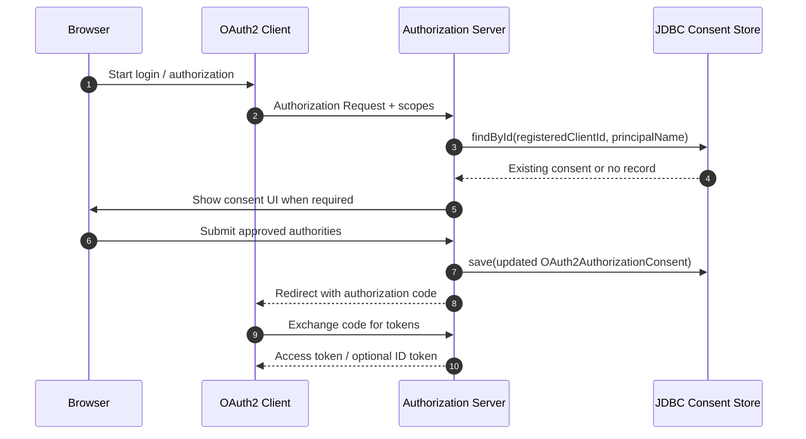
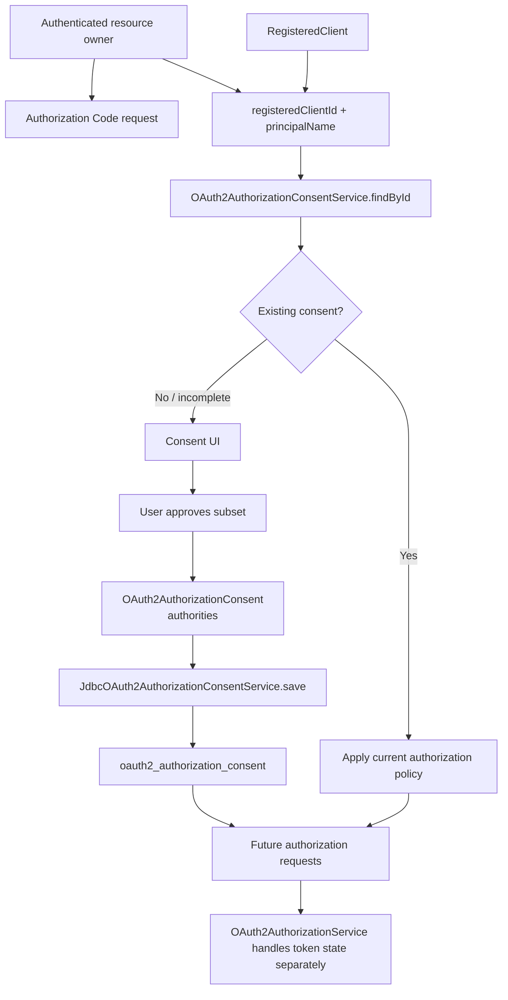

# JdbcOAuth2AuthorizationConsentService và schema consent

## 1. Mục tiêu và bối cảnh

Trong chương **Lưu trữ JDBC** của module **SPRING_SECURITY_OAUTH2_OIDC_AUTHORIZATION_SERVER**, Authorization Server phải ghi nhớ quyết định cấp quyền mà người dùng đã đưa ra khi một OAuth 2.0 client yêu cầu truy cập tài nguyên. Quyết định này được gọi là **authorization consent**. Với Spring Authorization Server (SAS), mô hình consent được biểu diễn bằng `OAuth2AuthorizationConsent` và được quản lý qua `OAuth2AuthorizationConsentService`.

SAS cung cấp hai implementation chính:

- `InMemoryOAuth2AuthorizationConsentService`: lưu consent trong bộ nhớ, phù hợp cho development và testing.
- `JdbcOAuth2AuthorizationConsentService`: lưu consent trong cơ sở dữ liệu thông qua Spring JDBC.

Bài học này tập trung vào cách triển khai JDBC consent bằng `JdbcOAuth2AuthorizationConsentService`, hiểu đúng schema mặc định, tích hợp với `RegisteredClientRepository` và Authorization Server, quản lý vòng đời consent, cũng như vận hành bảng consent an toàn trong production.

Sau bài học, bạn có thể:

- Giải thích consent lưu những gì và vì sao consent được định danh bằng client registration cùng principal.
- Phân biệt `OAuth2AuthorizationConsent` với `OAuth2Authorization` và token state.
- Đọc schema `oauth2_authorization_consent` và hiểu khóa chính tổng hợp.
- Cấu hình `JdbcOAuth2AuthorizationConsentService` bằng `JdbcOperations` và `RegisteredClientRepository`.
- Kết nối consent service với `OAuth2AuthorizationServerConfigurer`.
- Tạo, đọc, cập nhật và xóa consent qua API domain.
- Thiết kế principal name ổn định, xử lý multi-tenant và tránh tái sử dụng danh tính.
- Triển khai schema bằng Flyway/Liquibase, quản lý transaction, backup và migration.
- Kiểm thử consent persistence, revocation, restart, nhiều instance và lỗi database.
- Xác định khi nào JDBC implementation mặc định cần được thay bằng implementation riêng.

**Phạm vi phiên bản:** Các ví dụ hướng tới **Spring Authorization Server 1.5.x**, **Spring Security 6.x** và **Spring Boot 3.x**. API cụ thể có thể thay đổi ở các phiên bản khác. Schema được trình bày theo resource chuẩn `oauth2-authorization-consent-schema.sql` đi kèm SAS 1.5.x. Luôn đối chiếu dependency thực tế trước khi thay đổi schema hoặc custom mapper.

## 2. Authorization consent là gì?

Consent là quyết định của resource owner về những quyền mà một client được phép sử dụng trong ngữ cảnh OAuth 2.0 authorization flow. Trong Authorization Code Flow, client có thể yêu cầu nhiều scopes nhưng người dùng chỉ đồng ý một phần.

Ví dụ, client `portal-web` yêu cầu:

```text
openid
profile
email
orders.read
orders.write
```

Người dùng có thể chỉ chấp thuận:

```text
openid
profile
orders.read
```

AS cần lưu lại quyết định để những lần authorization tiếp theo có thể xác định quyền nào đã được chấp thuận, có cần hiển thị màn hình consent hay không và quyền nào có thể được sử dụng trong authorization flow.

### 2.1. Consent không phải access token

Consent là **quyết định cấp quyền có tính bền vững** theo cặp client và principal. Access token là credential có thời hạn được phát hành trong một authorization cụ thể.

| Thành phần | Vai trò | Dữ liệu điển hình |
| --- | --- | --- |
| `OAuth2AuthorizationConsent` | Lưu quyết định người dùng đã chấp thuận cho client | Registered client ID, principal name, granted authorities |
| `OAuth2Authorization` | Lưu trạng thái một authorization cụ thể | Client, principal, grant type, scopes, authorization code, access/refresh token và metadata |
| `OAuth2AccessToken` | Credential truy cập resource | Token value, issued/expiry, scopes, token type |
| `RegisteredClient` | Metadata của client được đăng ký | Client ID, auth methods, grants, redirect URIs, scopes, settings |

Consent có thể tồn tại lâu hơn một access token. Một consent được lưu không có nghĩa access token cũ vẫn còn hiệu lực; một access token đã hết hạn cũng không tự xóa consent.

### 2.2. Consent thường được dùng ở Authorization Code Flow

Khi client được cấu hình yêu cầu authorization consent, AS hiển thị trang xác nhận cho người dùng. Sau khi người dùng chọn quyền, SAS xây dựng hoặc cập nhật `OAuth2AuthorizationConsent` và lưu qua `OAuth2AuthorizationConsentService`.

Consent service được dùng chủ yếu trong các thành phần xử lý authorization request flow, ví dụ Authorization Code Grant. Đây là lý do bảng consent là một phần riêng của persistence layer.

### 2.3. Consent có thể chứa nhiều loại authority

Tên trường `authorities` không chỉ giới hạn ở OAuth scope. Một `GrantedAuthority` có thể biểu diễn:

- Scope như `SCOPE_profile` hoặc `SCOPE_orders.read`.
- Claim được cho phép chia sẻ.
- Permission hoặc role theo policy của ứng dụng.
- Một quyền tùy chỉnh mà AS cần lưu trong consent model.

Với scope, SAS dùng prefix `SCOPE_`. API `getScopes()` của `OAuth2AuthorizationConsent` trích các scope từ authorities; `getAuthorities()` trả toàn bộ tập authority.

## 3. Mô hình dữ liệu OAuth2AuthorizationConsent

Domain object có ba thuộc tính cốt lõi:

```java
public final class OAuth2AuthorizationConsent implements Serializable {

    private final String registeredClientId;
    private final String principalName;
    private final Set<GrantedAuthority> authorities;

    // ...
}
```

Ý nghĩa:

| Thuộc tính | Ý nghĩa | Nguồn giá trị |
| --- | --- | --- |
| `registeredClientId` | ID nội bộ xác định duy nhất một `RegisteredClient` | `RegisteredClient.getId()` |
| `principalName` | Tên định danh của principal đã cấp consent | `Authentication.getName()` theo identity model |
| `authorities` | Tập quyền mà principal chấp thuận cho client | Consent decision/policy |

**Điểm dễ nhầm:** `registeredClientId` là giá trị `RegisteredClient.getId()`, không phải OAuth `client_id` mà client gửi trong protocol request. `RegisteredClient` có cả ID nội bộ và Client Identifier; schema consent liên kết với ID nội bộ.

### 3.1. Khóa logic của consent

Một consent được xác định bằng cặp:

```text
(registeredClientId, principalName)
```

Ví dụ:

| RegisteredClient ID | Client ID | Principal name | Consent |
| --- | --- | --- | --- |
| `rc-001` | `portal-web` | `user-42` | `openid, profile` |
| `rc-002` | `portal-mobile` | `user-42` | `openid, email` |
| `rc-001` | `portal-web` | `user-84` | `openid` |

Cùng một người dùng có thể có consent khác nhau cho từng client. Cùng một client có thể có consent riêng cho từng người dùng.

### 3.2. Vì sao principal name cần ổn định?

SAS dùng principal name làm một phần định danh consent. Nếu `Authentication.getName()` là email hoặc username có thể đổi, sau khi người dùng đổi email/username, AS có thể không tìm thấy consent cũ và hiển thị consent lại.

Rủi ro nghiêm trọng hơn xuất hiện nếu username/email cũ được cấp cho một người khác. Khi đó principal name tái sử dụng có thể làm dữ liệu consent cũ gắn nhầm người mới.

Thực hành tốt:

- Dùng immutable internal user ID hoặc subject identifier ổn định làm principal name.
- Không dùng display name, email có thể đổi hoặc số điện thoại làm khóa chính.
- Không tái cấp principal ID đã bị xóa cho người dùng khác.
- Nếu multi-tenant, đưa tenant namespace vào định danh principal khi cần tách danh tính.
- Giữ cùng quy tắc canonicalization trong toàn bộ các node AS.

### 3.3. Tenant và issuer boundary

Schema mặc định không có cột tenant hoặc issuer riêng. Nếu một database phục vụ nhiều issuer/tenant, phải bảo đảm `principalName` hoặc `registeredClientId` phân biệt được phạm vi dữ liệu.

Ví dụ principal name có namespace:

```text
tenant:acme:user:01J4ABC...
tenant:contoso:user:01J4XYZ...
```

Chỉ dùng tenant ID đã được xác minh từ authentication context. Không lấy tenant namespace trực tiếp từ query parameter hoặc input không tin cậy. Nếu mô hình multi-tenant phức tạp cần truy vấn/report theo tenant, có thể thiết kế repository/schema riêng thay vì nhồi metadata vào principal name.

## 4. Schema consent mặc định của SAS

`JdbcOAuth2AuthorizationConsentService` phụ thuộc bảng `oauth2_authorization_consent`. Resource SQL đi kèm thư viện có định nghĩa:

```sql
CREATE TABLE oauth2_authorization_consent (
    registered_client_id varchar(100) NOT NULL,
    principal_name varchar(200) NOT NULL,
    authorities varchar(1000) NOT NULL,
    PRIMARY KEY (registered_client_id, principal_name)
);
```

Đây là schema chuẩn cần được tạo trong database trước khi service hoạt động.

### 4.1. Ý nghĩa từng cột

| Cột | Kiểu mặc định | Ý nghĩa |
| --- | --- | --- |
| `registered_client_id` | `varchar(100) NOT NULL` | ID của RegisteredClient |
| `principal_name` | `varchar(200) NOT NULL` | Tên principal sở hữu consent |
| `authorities` | `varchar(1000) NOT NULL` | Biểu diễn tập GrantedAuthority |

Khóa chính tổng hợp:

```sql
PRIMARY KEY (registered_client_id, principal_name)
```

Khóa này bảo đảm một registration và một principal chỉ có một consent record tại một thời điểm.

### 4.2. Không cần cột ID riêng

Vì cặp `registered_client_id` và `principal_name` đã xác định duy nhất consent, schema mặc định không cần cột surrogate ID. Khi truy vấn, service dùng hai giá trị này để tìm consent.

### 4.3. Cột authorities không phải JSON document

Trong model SAS, authorities là tập `GrantedAuthority`. JDBC implementation có mapper để chuyển tập này thành dữ liệu lưu trong cột `authorities` và chuyển ngược lại khi đọc.

Không tự ghi JSON tùy ý vào cột này rồi mong default row mapper hiểu được. Nếu cần định dạng lưu trữ khác, phải thay mapper tương ứng một cách nhất quán ở cả chiều ghi và đọc.

### 4.4. Giới hạn độ dài

Schema mặc định quy định:

- Registered client ID tối đa 100 ký tự.
- Principal name tối đa 200 ký tự.
- Serialized authorities tối đa 1000 ký tự.

Nếu ứng dụng có principal ID dài, tenant namespace hoặc custom authorities, hãy kiểm tra độ dài thực tế trước khi triển khai. Tăng kích thước cột cần migration có kiểm soát và kiểm thử với JDBC mapper. Không cắt chuỗi để vừa cột vì có thể tạo collision hoặc làm mất authority.

### 4.5. Schema không tự định nghĩa foreign key

DDL mặc định chỉ tạo composite primary key, không khai báo foreign key tới bảng registered client. Về mặt domain, `registered_client_id` phải tham chiếu một registration có thật.

Nếu thêm foreign key trong schema riêng, hãy thiết kế hành vi khi client bị xóa: xóa consent trước, dùng cascade phù hợp hoặc áp dụng soft-delete. Không để constraint mới làm hỏng quy trình deprovisioning đang dùng.

## 5. Cấu hình JdbcOAuth2AuthorizationConsentService

Constructor chính của SAS 1.5.x:

```java
JdbcOAuth2AuthorizationConsentService(
        JdbcOperations jdbcOperations,
        RegisteredClientRepository registeredClientRepository)
```

Hai dependency:

- `JdbcOperations`: thực hiện câu lệnh SQL và mapping kết quả.
- `RegisteredClientRepository`: tra cứu registration tương ứng với `registeredClientId`.

`JdbcTemplate` triển khai `JdbcOperations`, vì vậy có thể inject `JdbcTemplate` hoặc interface `JdbcOperations`.

### 5.1. Khai báo bean

```java
@Configuration(proxyBeanMethods = false)
public class AuthorizationConsentPersistenceConfig {

    @Bean
    OAuth2AuthorizationConsentService authorizationConsentService(
            JdbcOperations jdbcOperations,
            RegisteredClientRepository registeredClientRepository) {

        return new JdbcOAuth2AuthorizationConsentService(
                jdbcOperations,
                registeredClientRepository);
    }
}
```

Cấu hình này giả định đã có `DataSource`, `JdbcTemplate`/`JdbcOperations` và `RegisteredClientRepository`. Không tự tạo một DataSource riêng cho consent nếu hệ thống cần cùng transaction manager và cùng persistence boundary.

### 5.2. RegisteredClientRepository phải nhất quán

`JdbcOAuth2AuthorizationConsentService` nhận `RegisteredClientRepository` để map consent về registration tương ứng. Bởi vậy:

- Registered client phải được lưu trước khi consent được sử dụng.
- ID nội bộ của registration phải ổn định qua restart.
- Mọi node AS phải truy cập cùng registration repository.
- Không dùng một in-memory client repository riêng trong production khi consent nằm trong JDBC.

Nếu consent row tồn tại nhưng registration đã bị xóa, việc đọc consent có thể không thể khôi phục đầy đủ domain object. Xử lý client deletion phải phối hợp với consent records.

## 6. Kết nối consent service vào Authorization Server

SAS cung cấp extension point trên `OAuth2AuthorizationServerConfigurer` để cấu hình `OAuth2AuthorizationConsentService`.

```java
@Configuration(proxyBeanMethods = false)
@EnableWebSecurity
public class AuthorizationServerSecurityConfig {

    @Bean
    @Order(1)
    SecurityFilterChain authorizationServerSecurityFilterChain(
            HttpSecurity http,
            OAuth2AuthorizationConsentService authorizationConsentService)
            throws Exception {

        OAuth2AuthorizationServerConfigurer authorizationServer =
                OAuth2AuthorizationServerConfigurer.authorizationServer();

        http
            .securityMatcher(authorizationServer.getEndpointsMatcher())
            .with(authorizationServer, server ->
                    server.authorizationConsentService(
                            authorizationConsentService))
            .authorizeHttpRequests(authorize ->
                    authorize.anyRequest().authenticated());

        return http.build();
    }

    @Bean
    @Order(2)
    SecurityFilterChain applicationSecurityFilterChain(
            HttpSecurity http) throws Exception {

        http
            .authorizeHttpRequests(authorize ->
                    authorize.anyRequest().authenticated())
            .formLogin(Customizer.withDefaults());

        return http.build();
    }
}
```

Đây là khung cấu hình cho Authorization Server. Ứng dụng còn cần các bean khác như `RegisteredClientRepository`, `OAuth2AuthorizationService`, key source, user authentication và `AuthorizationServerSettings`.

### 6.1. Vì sao cần wire tường minh?

`OAuth2AuthorizationConsentService` là optional component. Nếu không cấu hình, SAS mặc định dùng `InMemoryOAuth2AuthorizationConsentService`. Việc chỉ khai báo một bean JDBC trong application context không nên được hiểu là đã chắc chắn thay thế service mặc định trong mọi cấu hình. Hãy wire qua configurer và xác minh bean thực tế được sử dụng.

### 6.2. Consent service khác authorization service

Cấu hình:

```java
server.authorizationConsentService(authorizationConsentService);
```

chỉ thay thế nơi lưu **consent decision**. Token/code state vẫn thuộc `OAuth2AuthorizationService` và cần persistence riêng nếu muốn toàn bộ Authorization Server hoạt động bền vững qua restart.

Một cấu hình production thường có ít nhất:

```text
RegisteredClientRepository
    -> client registrations

OAuth2AuthorizationService
    -> authorization code, access token, refresh token,
       ID token metadata và authorization state

OAuth2AuthorizationConsentService
    -> consent decisions của resource owner
```

## 7. Consent được tạo và đọc như thế nào?

### 7.1. Tạo consent bằng builder

Ví dụ domain object:

```java
OAuth2AuthorizationConsent consent =
        OAuth2AuthorizationConsent.withId(
                    registeredClient.getId(),
                    principalName)
                .scope("openid")
                .scope("profile")
                .scope("orders.read")
                .build();

authorizationConsentService.save(consent);
```

`scope(...)` tạo `SimpleGrantedAuthority` với prefix `SCOPE_`. Ví dụ scope `orders.read` được lưu như authority `SCOPE_orders.read`.

`principalName` trong ví dụ phải là định danh ổn định của principal, thường tương ứng với `Authentication.getName()` trong identity model của AS.

### 7.2. Đọc consent

```java
OAuth2AuthorizationConsent consent =
        authorizationConsentService.findById(
                registeredClient.getId(),
                principalName);

if (consent == null) {
    // Chưa có consent cho cặp client/principal này.
} else {
    Set<String> grantedScopes = consent.getScopes();
    Set<GrantedAuthority> authorities = consent.getAuthorities();
}
```

`findById` trả `null` khi không có record. Không nhầm kết quả null với database error; lỗi kết nối hoặc mapping thường được ném thành exception.

### 7.3. Authorities tùy chỉnh

Ngoài scope, có thể lưu authority bổ sung nếu domain policy cần:

```java
OAuth2AuthorizationConsent consent =
        OAuth2AuthorizationConsent.withId(
                    registeredClient.getId(),
                    principalName)
                .scope("openid")
                .authority(
                        new SimpleGrantedAuthority("CLAIM_email"))
                .authority(
                        new SimpleGrantedAuthority("PERMISSION_orders.read"))
                .build();
```

Custom authority phải có naming convention, ý nghĩa và policy kiểm tra rõ ràng. Không dùng consent để lưu password, secret, access token hoặc dữ liệu profile đầy đủ.

### 7.4. Consent rỗng

Builder yêu cầu có ít nhất một `GrantedAuthority`. Nếu người dùng từ chối tất cả quyền, đừng cố tạo một consent rỗng bằng default builder. Xử lý theo authorization flow: không cấp grant, xóa consent cũ nếu người dùng chủ động thu hồi toàn bộ hoặc trả kết quả từ chối phù hợp.

## 8. Cập nhật và thu hồi consent

Consent có thể thay đổi khi người dùng cấp thêm hoặc thu hồi quyền.

### 8.1. Cấp thêm scope

Giả sử trước đây người dùng đã cấp:

```text
openid
profile
```

Lần sau client yêu cầu thêm `email`. Nếu người dùng đồng ý, tập authority mới phải phản ánh đầy đủ quyền hiện tại:

```java
OAuth2AuthorizationConsent updatedConsent =
        OAuth2AuthorizationConsent.withId(
                    registeredClient.getId(),
                    principalName)
                .scope("openid")
                .scope("profile")
                .scope("email")
                .build();

authorizationConsentService.save(updatedConsent);
```

Hãy xây dựng tập authority cuối cùng từ consent đã có và lựa chọn mới theo logic authorization flow. Không giả định lời gọi save tự động merge mọi scope cũ với scope mới theo cách nghiệp vụ mong muốn.

### 8.2. Thu hồi một phần

Nếu người dùng bỏ chọn `profile` nhưng vẫn giữ `openid` và `email`, lưu consent với tập authority còn được chấp thuận:

```java
OAuth2AuthorizationConsent updatedConsent =
        OAuth2AuthorizationConsent.withId(
                    registeredClient.getId(),
                    principalName)
                .scope("openid")
                .scope("email")
                .build();

authorizationConsentService.save(updatedConsent);
```

Không chỉ thêm authority mới mà quên bỏ authority đã bị thu hồi.

### 8.3. Thu hồi toàn bộ

Dùng `remove` để xóa consent record:

```java
OAuth2AuthorizationConsent consent =
        authorizationConsentService.findById(
                registeredClient.getId(),
                principalName);

if (consent != null) {
    authorizationConsentService.remove(consent);
}
```

Thao tác này xóa quyết định consent. Nó **không tự động đồng nghĩa** với thu hồi mọi access token hoặc refresh token đã được phát trước đó. Nếu policy yêu cầu thu hồi token, cần xử lý thêm qua `OAuth2AuthorizationService`/revocation flow và cơ chế token validation tương ứng.

### 8.4. Consent removal và token revocation là hai nghiệp vụ

| Thao tác | Tác động |
| --- | --- |
| Remove consent | Xóa quyền đã được lưu cho lần authorization tiếp theo |
| Revoke refresh token | Ngăn refresh token tiếp tục cấp access token mới |
| Invalidate authorization | Đánh dấu token/code thuộc authorization không còn active theo implementation |
| Disable client | Ngăn client tiếp tục hoạt động theo policy của AS |

Khi người dùng thu hồi consent, cần quyết định rõ token hiện có còn được phép dùng tới expiry hay phải revoke ngay. Với JWT offline, Resource Server có thể vẫn chấp nhận token đã phát cho đến khi hết hạn nếu không có introspection/denylist hoặc cơ chế cập nhật trạng thái.

## 9. JDBC implementation hoạt động ra sao?

`JdbcOAuth2AuthorizationConsentService` triển khai interface `OAuth2AuthorizationConsentService` với các thao tác:

| API | Mục đích |
| --- | --- |
| `findById(registeredClientId, principalName)` | Đọc consent theo khóa tổng hợp |
| `save(authorizationConsent)` | Lưu consent |
| `remove(authorizationConsent)` | Xóa consent |
| `setAuthorizationConsentRowMapper(...)` | Thay mapper ResultSet → domain object |
| `setAuthorizationConsentParametersMapper(...)` | Thay domain object → SQL parameters |

### 9.1. JdbcOperations

`JdbcOperations` trừu tượng hóa thao tác JDBC. `JdbcTemplate` cung cấp implementation phổ biến, xử lý PreparedStatement, binding parameter, exception translation và mapping kết quả.

Không tự nối chuỗi SQL với principal name hoặc client ID. Dùng JDBC parameter binding để tránh SQL injection và xử lý đúng kiểu dữ liệu.

### 9.2. RowMapper

`OAuth2AuthorizationConsentRowMapper` mặc định đọc row và dựng `OAuth2AuthorizationConsent`. Constructor của row mapper nhận `RegisteredClientRepository` để liên kết consent với registration tương ứng.

Nếu schema được tùy biến, cần kiểm tra mapper đọc đúng column names/types và có thể khôi phục `RegisteredClient`. Không thay schema một phía mà quên row mapper.

### 9.3. ParametersMapper

`OAuth2AuthorizationConsentParametersMapper` mặc định chuyển consent object thành danh sách SQL parameters. Có thể thay bằng `setAuthorizationConsentParametersMapper` nếu schema hoặc serialization format riêng.

Nếu thay mapper, phải bảo đảm tương thích giữa dữ liệu mới và dữ liệu đã lưu, thứ tự SQL parameters và kiểu JDBC. Thay mapper là một thay đổi persistence contract, cần migration và test round-trip.

### 9.4. Không thao tác trực tiếp bảng trong business flow

Application code nên gọi `OAuth2AuthorizationConsentService` thay vì tự viết SQL insert/update/delete ở controller. Service giữ contract domain và cho phép thay implementation sau này.

SQL trực tiếp vẫn hữu ích cho migration, cleanup, audit query hoặc báo cáo có kiểm soát, nhưng không nên trở thành một đường ghi song song không đồng bộ với SAS.

## 10. Triển khai schema bằng Flyway

Không nên phụ thuộc vào việc tự động chạy schema thư viện ở mỗi lần khởi động production. Dùng migration versioned để tạo bảng một lần và theo dõi lịch sử thay đổi.

Ví dụ file:

```text
src/main/resources/db/migration/V2026_01_01_01__create_oauth2_authorization_consent.sql
```

Nội dung:

```sql
CREATE TABLE oauth2_authorization_consent (
    registered_client_id varchar(100) NOT NULL,
    principal_name varchar(200) NOT NULL,
    authorities varchar(1000) NOT NULL,
    PRIMARY KEY (registered_client_id, principal_name)
);
```

Tên migration chỉ là ví dụ. Hãy dùng convention/versioning của repository đang triển khai.

### 10.1. Thứ tự migration

Nếu schema có các bảng liên quan, thứ tự triển khai thường là:

1. Bảng registered client.
2. Bảng authorization consent.
3. Bảng authorization/token state.
4. Index, foreign key hoặc constraint bổ sung của ứng dụng.
5. Data migration nếu thay đổi principal naming hoặc authorities format.

Default consent schema không yêu cầu foreign key, nhưng application vẫn phải bảo đảm client registration được tạo và tồn tại trước khi consent được dùng.

### 10.2. Database dialect

Kiểu `varchar` và composite primary key trong script mặc định tương thích với nhiều hệ quản trị quan hệ. Tuy nhiên cần kiểm tra:

- Quy tắc collation/case sensitivity của `principal_name`.
- Giới hạn độ dài index của database.
- Encoding ký tự.
- Hành vi transaction và isolation.
- Quy tắc migration của PostgreSQL, MySQL, MariaDB, SQL Server hoặc Oracle.
- Khả năng tương thích của JDBC driver.

Nếu dùng database có collation không phân biệt hoa thường, hai principal names khác nhau về chữ hoa/thường có thể bị coi là cùng khóa. Điều này đặc biệt quan trọng nếu principal name mang semantics case-sensitive.

### 10.3. Mở rộng schema

Nếu tăng độ dài cột, migration cần được triển khai trước phiên bản ứng dụng phát sinh dữ liệu dài hơn. Với rolling deployment, ưu tiên expand-and-contract:

1. Mở rộng schema tương thích ngược.
2. Deploy ứng dụng mới.
3. Xác minh dữ liệu và index.
4. Chỉ thu hẹp/xóa cấu trúc cũ khi mọi node đã chuyển.

Không thay kiểu cột trực tiếp trong giờ cao điểm nếu chưa đánh giá lock, table rewrite và replication lag.

## 11. Transaction và tính nhất quán

Một consent update thường là một thao tác persistence đơn lẻ, nhưng có thể đi cùng audit event, account state hoặc application-owned records.

### 11.1. Dùng cùng DataSource và transaction manager

Nếu cần atomically lưu consent cùng một thay đổi nghiệp vụ khác, hãy dùng cùng transaction manager và cùng database transaction boundary. Ví dụ:

```java
@Service
public class ConsentAdministrationService {

    private final OAuth2AuthorizationConsentService consentService;
    private final ConsentAuditRepository auditRepository;

    public ConsentAdministrationService(
            OAuth2AuthorizationConsentService consentService,
            ConsentAuditRepository auditRepository) {
        this.consentService = consentService;
        this.auditRepository = auditRepository;
    }

    @Transactional
    public void revoke(
            RegisteredClient registeredClient,
            String principalName,
            String actor) {

        OAuth2AuthorizationConsent consent =
                consentService.findById(
                        registeredClient.getId(),
                        principalName);

        if (consent != null) {
            consentService.remove(consent);
            auditRepository.recordRevocation(
                    registeredClient.getId(),
                    principalName,
                    actor);
        }
    }
}
```

`ConsentAuditRepository` là thành phần ứng dụng tự xây dựng. Ví dụ giả định cả hai repository dùng cùng DataSource/transaction manager. Nếu audit nằm ở hệ thống khác, cần outbox/event pattern hoặc quy trình nhất quán phân tán.

### 11.2. Không giữ transaction trong lúc chờ người dùng

Không mở transaction database rồi chờ user tương tác trên consent page. Transaction chỉ nên bao quanh bước xử lý và lưu quyết định sau khi user gửi lựa chọn. Giữ transaction dài sẽ gây lock contention và tiêu thụ connection pool.

### 11.3. Concurrent consent updates

Hai tab browser hoặc hai request đồng thời có thể cập nhật cùng cặp client/principal. Composite primary key ngăn hai row trùng nhau, nhưng không tự giải quyết mọi lost update nghiệp vụ.

Với ứng dụng có concurrency cao, cân nhắc optimistic version, locking hoặc custom service dùng atomic upsert/transaction. Cần xác định chính sách khi hai consent decision xảy ra đồng thời: last-write-wins, merge theo quyền hay yêu cầu user xác nhận lại.

### 11.4. Retry có kiểm soát

Retry có thể phù hợp với lỗi transient như connection reset hoặc failover. Không retry mù các lỗi constraint/data mapping. Với save/remove, hãy đánh giá idempotency và trạng thái hiện tại trước khi thử lại.

## 12. Bảo mật dữ liệu consent

Consent record không chứa access token, nhưng vẫn là dữ liệu nhạy cảm vì nó thể hiện quan hệ giữa một người dùng và một client cùng các quyền được chấp thuận.

### 12.1. Least privilege cho database account

Tài khoản database của AS chỉ cần quyền cần thiết trên các bảng persistence liên quan. Tách migration user khỏi runtime user:

- Migration identity có quyền DDL.
- Runtime AS identity có quyền SELECT/INSERT/UPDATE/DELETE cần thiết.
- Reporting identity chỉ đọc các view/bản sao đã được phê duyệt.
- Không dùng database owner/superuser cho application runtime.

### 12.2. Bảo vệ principal name

Principal name có thể là pseudonymous ID hoặc PII tùy hệ thống. Không mặc định nó vô hại. Hạn chế quyền đọc bảng, log truy vấn có redaction và không đưa principal name vào metrics labels.

### 12.3. Bảo vệ authorities

Authorities cho biết user đã chấp thuận scopes/claims/permissions nào. Dữ liệu này có thể tiết lộ quan hệ với dịch vụ hoặc mục đích xử lý dữ liệu. Hạn chế export, backup access và query trực tiếp.

### 12.4. Encryption và backup

- Dùng TLS giữa ứng dụng và database.
- Bật encryption at rest theo khả năng database/storage.
- Bảo vệ backup và snapshot như dữ liệu production.
- Quản lý quyền restore riêng.
- Xác định retention cho consent records và audit history.
- Không ghi raw consent payload vào log ứng dụng.

Nếu cần audit lịch sử đồng ý/rút lại, nên có bảng audit append-only riêng với retention và access policy rõ. Bảng consent hiện tại chỉ biểu diễn trạng thái đang lưu, không phải lịch sử đầy đủ.

## 13. Consent, privacy và yêu cầu pháp lý

Consent OAuth2 là quyết định authorization trong giao thức. Nó không tự động thay thế mọi cơ sở pháp lý hoặc consent theo luật bảo vệ dữ liệu cá nhân.

Cần phân biệt:

- Người dùng cho phép client truy cập scope/claim trong OAuth flow.
- Người dùng đồng ý xử lý dữ liệu theo privacy notice hoặc luật áp dụng.
- Client được AS cấp quyền kỹ thuật để yêu cầu một scope.
- AS thực tế release dữ liệu theo policy, consent và claim rules.

Một scope `email` được lưu không chứng minh tổ chức đã có đầy đủ legal basis cho mọi hoạt động xử lý email. Hãy kết nối OAuth consent với privacy governance, nhưng không đồng nhất hai khái niệm.

### 13.1. Thu hồi consent

Khi người dùng thu hồi consent qua portal hoặc account settings:

1. Xác minh người dùng và quyền thực hiện.
2. Xác định đúng RegisteredClient và principal.
3. Cập nhật hoặc xóa consent theo lựa chọn.
4. Áp dụng token revocation nếu policy yêu cầu.
5. Ghi audit event phù hợp.
6. Xóa cache liên quan nếu có.
7. Thông báo tới hệ thống downstream khi cần.

Không cho phép client tự xóa consent của người dùng khác chỉ bằng client ID.

### 13.2. Consent scope không phải consent toàn cục

Consent gắn với một client registration và một principal. Việc user đồng ý `profile` cho `portal-web` không tự động cấp cùng quyền cho `partner-app`. Đây là ranh giới quan trọng khi thiết kế consent UI và data sharing.

## 14. Tích hợp consent với Authorization Code Flow

Flow đơn giản:



### 14.1. requireAuthorizationConsent

Một RegisteredClient có thể được cấu hình:

```java
RegisteredClient registeredClient =
        RegisteredClient.withId(UUID.randomUUID().toString())
                .clientId("portal-web")
                .clientAuthenticationMethod(
                        ClientAuthenticationMethod.CLIENT_SECRET_BASIC)
                .authorizationGrantType(
                        AuthorizationGrantType.AUTHORIZATION_CODE)
                .redirectUri(
                        "https://portal.example.com/login/oauth2/code/portal")
                .scope("openid")
                .scope("profile")
                .scope("email")
                .clientSettings(
                        ClientSettings.builder()
                                .requireAuthorizationConsent(true)
                                .build())
                .build();
```

Cấu hình này yêu cầu consent theo client setting. Cần kết hợp UI/endpoint xử lý consent của ứng dụng và service đã được cấu hình. Đừng suy ra mọi authorization request đều phải hiện màn hình nếu client setting không yêu cầu hoặc policy đã cho phép consent trước đó.

### 14.2. Người dùng chỉ chấp thuận một phần

Nếu client yêu cầu `openid profile email` nhưng user chỉ chọn `openid profile`, AS phải phát hành authorization dựa trên quyền được chấp thuận theo flow. Consent persistence ghi nhận đúng lựa chọn này để lần sau policy có thể đánh giá lại.

Không ghi lại toàn bộ scopes client yêu cầu như thể user đã đồng ý tất cả.

### 14.3. Cập nhật consent và token đã phát

Consent thay đổi ở lần authorization mới không tự động sửa claims/scopes trong access token cũ. Token cũ có authorized scopes riêng. Cần policy token revocation/expiry để bảo đảm thay đổi consent có hiệu lực đúng thời điểm mong muốn.

## 15. Multi-instance và vận hành production

### 15.1. Shared database

Nếu Authorization Server chạy nhiều replicas, mọi node phải dùng chung consent store. Nếu mỗi node có in-memory consent service riêng:

- Node A ghi consent nhưng node B không thấy.
- User bị hỏi consent lặp lại khi request đi sang replica khác.
- Quyết định thu hồi không nhất quán.
- Restart node làm mất dữ liệu in-memory.

Dùng JDBC persistence chung giúp các node đọc cùng trạng thái consent.

### 15.2. Connection pool

Consent read thường diễn ra trong Authorization Code Flow. Cần theo dõi:

- Active/idle connections.
- Connection acquisition latency.
- Query latency và error rate.
- Pool exhaustion.
- Database failover/recovery.
- Slow queries và lock waits.

Không đặt pool size quá lớn theo số thread một cách máy móc; căn cứ giới hạn database và concurrency thực tế.

### 15.3. Index và query plan

Composite primary key trên `(registered_client_id, principal_name)` hỗ trợ truy vấn theo đúng hai giá trị. Kiểm tra query plan với database thực tế và dữ liệu có quy mô production.

Nếu có màn hình admin tra consent theo principal trên toàn client, có thể cần index phụ theo `principal_name`. Chỉ thêm index khi query pattern thực tế cần; mỗi index làm tăng chi phí ghi và storage.

### 15.4. Backup và restore

Consent store cần backup đồng bộ với các registration mà nó tham chiếu. Khi restore:

- Restore client registrations trước hoặc cùng transactionally consistent snapshot.
- Kiểm tra client IDs còn tồn tại.
- Kiểm tra principal naming version.
- Xác minh authorities được deserialize.
- Chạy smoke test authorization/consent.
- Kiểm tra cache và replication lag sau restore.

Restore consent mà thiếu registered clients có thể khiến service không map được record.

## 16. Khi nào cần custom OAuth2AuthorizationConsentService?

`JdbcOAuth2AuthorizationConsentService` là implementation đơn giản dựa trên JDBC và schema cố định. Tài liệu SAS lưu ý implementation này có thể dùng trong production nhưng có hạn chế hiệu năng; hệ thống throughput cao có thể cần implementation riêng.

Cân nhắc custom service khi:

- Lượng consent read/write rất lớn.
- Cần sharding theo tenant hoặc region.
- Cần lưu thêm consent version, source, policy version, timestamp hoặc audit state.
- Cần optimistic locking hoặc concurrency semantics cụ thể.
- Cần mã hóa field/authority đặc biệt.
- Cần query/report theo principal/client với index riêng.
- Cần tích hợp consent vào data governance service.

### 16.1. Implement interface

Interface cốt lõi chỉ có ba thao tác:

```java
public interface OAuth2AuthorizationConsentService {

    void save(OAuth2AuthorizationConsent authorizationConsent);

    void remove(OAuth2AuthorizationConsent authorizationConsent);

    OAuth2AuthorizationConsent findById(
            String registeredClientId,
            String principalName);
}
```

Một custom implementation phải giữ đúng semantics của domain object và bảo đảm tính nhất quán với authorization flow. Không đổi meaning của `registeredClientId` hoặc `principalName`.

### 16.2. Giữ compatibility

Nếu chuyển từ JDBC service sang custom implementation:

1. Đọc schema và serialization hiện tại.
2. Viết mapper tương thích dữ liệu cũ.
3. Chạy dual-read hoặc migration theo kế hoạch.
4. Kiểm thử consent hiện có được giữ nguyên.
5. Chuyển bean/service wiring.
6. Theo dõi consent lookup misses sau rollout.
7. Có rollback plan nếu custom mapper đọc sai.

Không đổi principal naming hoặc authorities format cùng một lần nếu không có migration rõ ràng.

## 17. Kiểm thử JdbcOAuth2AuthorizationConsentService

### 17.1. Integration test với database

Dùng database test tương thích production (ví dụ Testcontainers) để xác minh schema và JDBC behavior. H2 có thể hữu ích cho test nhanh, nhưng không thay thế test dialect/constraint thực tế nếu production dùng PostgreSQL, MySQL hoặc SQL Server.

Ví dụ skeleton:

```java
@SpringBootTest
@Transactional
class JdbcAuthorizationConsentServiceTests {

    @Autowired
    OAuth2AuthorizationConsentService consentService;

    @Autowired
    RegisteredClientRepository registeredClientRepository;

    @Test
    void savesAndLoadsConsent() {
        RegisteredClient client = registeredClientRepository
                .findByClientId("portal-web");

        String principalName = "user-42";

        OAuth2AuthorizationConsent consent =
                OAuth2AuthorizationConsent.withId(
                            client.getId(),
                            principalName)
                        .scope("openid")
                        .scope("profile")
                        .build();

        consentService.save(consent);

        OAuth2AuthorizationConsent loaded =
                consentService.findById(
                        client.getId(),
                        principalName);

        assertThat(loaded).isNotNull();
        assertThat(loaded.getScopes())
                .containsExactlyInAnyOrder("openid", "profile");
    }
}
```

Đây là skeleton; test cần registration fixture và schema migration thực tế. `@Transactional` giúp rollback dữ liệu test khi transaction manager quản lý cùng datasource.

### 17.2. Ma trận test bắt buộc

| Test case | Kỳ vọng |
| --- | --- |
| findById với cặp key chưa tồn tại | Trả null |
| save consent mới | Lưu đúng client/principal/authorities |
| findById sau save | Đọc lại đầy đủ authority |
| save cùng cặp key với tập authority mới | Trạng thái consent phản ánh quyết định mới |
| remove consent | Record không còn |
| Hai client, một principal | Hai consent độc lập |
| Một client, hai principal | Hai consent độc lập |
| RegisteredClient ID không tồn tại | Xử lý lỗi mapping theo contract, không trả consent sai |
| Principal name dài hơn cột | Migration/validation ngăn lỗi dữ liệu |
| Authorities dài hơn cột | Không truncate; lỗi được quan sát và xử lý |
| Database unavailable | Authorization flow không giả vờ consent đã lưu |
| AS restart | Consent vẫn tồn tại |
| Node A ghi, node B đọc | Nhìn thấy cùng consent |
| User đổi username nhưng giữ immutable principal | Consent vẫn được tìm thấy |
| Username bị tái sử dụng | Không kế thừa consent của user cũ |
| Remove consent và token còn hiệu lực | Token behavior theo revocation policy riêng |

### 17.3. Test consent và token revocation riêng biệt

Integration test cần chứng minh hai điều độc lập:

1. Xóa consent khiến consent lookup trả null hoặc quyền đã bị xóa.
2. Token đã phát được xử lý theo chính sách revoke/expiry riêng.

Không dùng test remove consent như bằng chứng rằng access token cũ đã bị vô hiệu.

### 17.4. Test nhiều instance

Khởi động hai Authorization Server instances cùng DataSource. Thực hiện consent ở node A, sau đó authorization request qua node B. Node B phải đọc được consent tương ứng. Test này phát hiện cấu hình nhầm InMemory service hoặc database/schema không chia sẻ.

## 18. Troubleshooting

| Triệu chứng | Nguyên nhân có thể | Hướng kiểm tra |
| --- | --- | --- |
| Bảng không tồn tại | Chưa chạy migration | Kiểm tra Flyway/Liquibase và schema |
| Lỗi SQL khi save consent | Column/table name hoặc quyền DB sai | So sánh với schema SAS |
| Lỗi duplicate primary key | Hai request tạo cùng consent đồng thời hoặc insert/update path | Kiểm tra transaction/concurrency |
| Consent không được tìm thấy sau restart | Vẫn dùng InMemory service hoặc sai datasource | Kiểm tra configurer wiring và bean |
| User bị hỏi consent liên tục | principalName thay đổi giữa các lần login | Dùng immutable principal ID |
| User A thấy consent của user B | Principal name bị tái sử dụng hoặc mapping sai | Kiểm tra identity uniqueness và tenant |
| Consent gắn sai client | Dùng client_id thay registeredClient.getId() | Kiểm tra key khi build/find |
| Consent mất khi xóa client | Deprovisioning xóa registration/consent không phối hợp | Thiết kế cleanup/FK policy |
| Authorities không đọc lại đúng | Mapper/serialization không tương thích | Kiểm tra row mapper và parameters mapper |
| Vượt giới hạn authorities | Nhiều custom authorities hoặc column quá ngắn | Đo độ dài và migration schema |
| Node khác không thấy consent | Local DB/InMemory hoặc replica lag | Kiểm tra shared store và read routing |
| Thu hồi consent nhưng token cũ vẫn dùng | Consent và authorization token là hai store | Revoke authorization/token theo policy |
| Hệ thống chậm ở authorization page | DB latency, connection pool hoặc query contention | Metrics, pool, query plan |
| Restore database làm mất consent | Backup snapshot không đồng bộ | Restore registration + consent cùng mốc |
| Custom authority không xuất hiện trong scopes | Authority không có prefix SCOPE_ | Dùng getAuthorities hoặc chuẩn hóa scope |
| Dùng SQL update trực tiếp gây lỗi | Serialization không đúng default mapper | Dùng service API hoặc mapper contract |

## 19. Checklist nghiệm thu production

- [ ] Consent được hiểu là quyết định cấp quyền, không phải access token.
- [ ] Phân biệt `OAuth2AuthorizationConsent` với `OAuth2Authorization`.
- [ ] `registeredClientId` lấy từ `RegisteredClient.getId()`.
- [ ] `principalName` là định danh ổn định, không dựa vào email/username dễ đổi.
- [ ] Principal names được namespace đúng nếu multi-tenant.
- [ ] Bảng `oauth2_authorization_consent` đã được migration.
- [ ] Composite primary key đúng thứ tự/cột.
- [ ] Độ dài cột phù hợp dữ liệu thật.
- [ ] `JdbcOperations` và `RegisteredClientRepository` dùng đúng DataSource/repository.
- [ ] `JdbcOAuth2AuthorizationConsentService` được wire qua configurer.
- [ ] Production không dùng InMemory consent service.
- [ ] Mọi AS replicas truy cập cùng consent store.
- [ ] Consent update lưu đúng tập authority sau quyết định user.
- [ ] Consent removal không bị nhầm với token revocation.
- [ ] Transaction boundary và concurrency semantics đã được kiểm thử.
- [ ] DB user runtime có quyền tối thiểu.
- [ ] TLS, encryption at rest, backup và restore đã được kiểm tra.
- [ ] PII/authority không bị ghi vào logs hoặc metrics labels.
- [ ] Có audit riêng nếu cần lịch sử consent.
- [ ] Có cleanup khi RegisteredClient bị disable/delete.
- [ ] Có integration tests trên database dialect production.
- [ ] Có monitoring cho query latency, connection pool, error và lookup miss.
- [ ] Có custom service/performance plan nếu throughput vượt khả năng implementation mặc định.

## 20. Bản đồ ghi nhớ



**`JdbcOAuth2AuthorizationConsentService` là lớp persistence cho quyết định consent của người dùng trong Spring Authorization Server.** Schema chuẩn dùng khóa chính tổng hợp `(registered_client_id, principal_name)` và lưu tập `authorities`. Cần cấu hình đúng `JdbcOperations`, `RegisteredClientRepository`, migration và Authorization Server configurer; đồng thời giữ principal name ổn định và phân biệt consent với token state. Khi schema, transaction, identity, backup và revocation policy được quản lý nhất quán, consent sẽ tồn tại bền vững qua restart và nhiều Authorization Server instances mà vẫn giữ đúng ranh giới quyền giữa từng client và từng người dùng.

## 21. Tài liệu tham khảo

- [Spring Authorization Server 1.5.8 — Core Model / Components](https://docs.spring.io/spring-authorization-server/reference/core-model-components.html)
- [JdbcOAuth2AuthorizationConsentService — API 1.5.8](https://docs.spring.io/spring-authorization-server/reference/api/java/org/springframework/security/oauth2/server/authorization/JdbcOAuth2AuthorizationConsentService.html)
- [OAuth2AuthorizationConsentService — API 1.5.8](https://docs.spring.io/spring-authorization-server/reference/api/java/org/springframework/security/oauth2/server/authorization/OAuth2AuthorizationConsentService.html)
- [OAuth2AuthorizationConsent.Builder — API 1.5.8](https://docs.spring.io/spring-authorization-server/reference/api/java/org/springframework/security/oauth2/server/authorization/OAuth2AuthorizationConsent.Builder.html)
- [oauth2-authorization-consent-schema.sql — Spring Security source](https://github.com/spring-projects/spring-security/blob/main/oauth2/oauth2-authorization-server/src/main/resources/org/springframework/security/oauth2/server/authorization/oauth2-authorization-consent-schema.sql)
- [How-to: Implement core services with JPA](https://docs.spring.io/spring-authorization-server/reference/guides/how-to-jpa.html)
