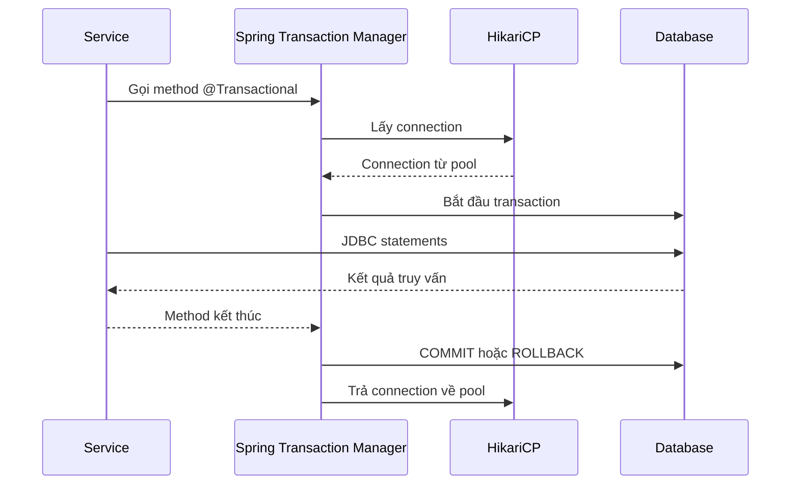

# Transaction, connection pool và xử lý lỗi cơ sở dữ liệu

## 1. Vì sao transaction và connection pool quan trọng?

Trong chương **Lưu trữ JDBC** của module **SPRING_SECURITY_OAUTH2_OIDC_AUTHORIZATION_SERVER**, chúng ta học cách thiết kế, cấu hình, bảo mật, kiểm thử và vận hành OAuth 2.0/OpenID Connect Authorization Server bằng Spring Security và Spring Authorization Server trong ứng dụng Spring Boot.

Authorization Server lưu nhiều trạng thái có ảnh hưởng trực tiếp đến bảo mật: client đã đăng ký, authorization request, authorization code, access token, refresh token, consent và metadata liên quan. Một thao tác phát hành token có thể cần đọc client, xác thực grant, cập nhật authorization state và ghi dữ liệu. Nếu các thay đổi liên quan không được quản lý đúng, hệ thống có thể để lại trạng thái dở dang hoặc xử lý đồng thời một credential nhiều lần.

JDBC connection pool giải quyết một vấn đề khác: tạo và đóng kết nối vật lý tới database cho từng request rất tốn chi phí. Pool giữ một số kết nối đã được mở, cấp kết nối cho request khi cần và thu hồi chúng sau khi công việc hoàn tất. Pool quá nhỏ gây chờ đợi; pool quá lớn có thể làm database quá tải.

Ba lớp trách nhiệm cần phối hợp:

1. **Transaction** xác định nhóm thao tác database phải cùng commit hoặc rollback.
2. **Connection pool** giới hạn và phân phối số kết nối đồng thời.
3. **Error handling** quyết định lỗi nào có thể retry, lỗi nào phải từ chối request và cách phục hồi khi database gián đoạn.

### Mục tiêu học tập

Sau bài này, bạn có thể:

- Xác định transaction boundary cho thao tác lưu authorization state.
- Dùng Spring transaction management đúng với JdbcTemplate và Spring Authorization Server.
- Chọn propagation và isolation phù hợp với nghiệp vụ.
- Hiểu vòng đời connection trong transaction và cách HikariCP quản lý pool.
- Tính pool size theo ngân sách kết nối của database và tải ứng dụng.
- Phân loại lỗi database và thiết kế retry có giới hạn, backoff và idempotency.
- Theo dõi connection acquisition, pool saturation, query latency và lock contention.
- Kiểm thử rollback, concurrent token use, database outage và recovery.

## 2. Những dữ liệu JDBC của Authorization Server

Spring Authorization Server cung cấp các thành phần JDBC phổ biến:

| Thành phần | Dữ liệu |
| --- | --- |
| `JdbcRegisteredClientRepository` | Client ID, client secret đã encode, grant types, redirect URIs, scopes và settings. |
| `JdbcOAuth2AuthorizationService` | Authorization, authorization code, access token, refresh token, ID Token và metadata liên quan. |
| `JdbcOAuth2AuthorizationConsentService` | Consent của resource owner dành cho client. |

Các service này dùng JDBC operations để đọc/ghi dữ liệu theo schema của Spring Authorization Server. Khi dùng chúng, cần bảo đảm schema tương thích với phiên bản thư viện và database engine.

Không nên giả định chỉ vì ứng dụng dùng JDBC repository thì toàn bộ OAuth flow đã tự động nằm trong một transaction nghiệp vụ duy nhất. Một lệnh SQL đơn lẻ có thể được database thực hiện atomic, nhưng một use case có nhiều lần đọc/ghi hoặc cập nhật thêm bảng riêng cần transaction boundary rõ ràng ở tầng service.

Ví dụ: một nghiệp vụ nội bộ tạo registration, ghi audit và tạo bản ghi onboarding. Nếu ba thao tác phải cùng thành công, hãy đặt chúng trong một transaction phù hợp. Nếu audit được gửi tới hệ thống ngoài database, cân nhắc transactional outbox thay vì gọi mạng trong lúc đang giữ transaction.

### 2.1. Mô hình dữ liệu và tính nhất quán

```text
HTTP request
    |
    v
Application / domain service
    |
    +-- Transaction boundary
    |      |
    |      +-- RegisteredClientRepository
    |      +-- OAuth2AuthorizationService
    |      +-- OAuth2AuthorizationConsentService
    |      +-- Application-owned tables
    |
    v
DataSource -> Connection pool -> JDBC connection -> Database
```

Transaction chỉ bao phủ các thao tác tham gia cùng transaction manager và cùng transactional resource. Một lần gọi REST API khác, gửi message tới broker hoặc ghi sang database thứ hai không tự động trở thành một phần của transaction JDBC hiện tại.

### 2.2. Dữ liệu nhạy cảm trong database

Authorization state có thể chứa credential hoặc token material. Vì vậy:

- Bảo vệ database bằng network isolation, authentication và least privilege.
- Mã hóa storage/backup theo chính sách tổ chức.
- Không ghi raw authorization code, access token, refresh token hoặc client secret vào log.
- Dùng PasswordEncoder cho client secret theo cách Spring Authorization Server yêu cầu.
- Hạn chế quyền đọc các bảng authorization và consent.
- Thiết lập retention và xóa dữ liệu theo vòng đời token/client.

Transaction bảo đảm tính nhất quán dữ liệu; nó không thay thế các biện pháp bảo vệ dữ liệu lưu trữ.

## 3. Chọn transaction boundary

### 3.1. Một nghiệp vụ, một transaction

Transaction boundary nên phản ánh một đơn vị nghiệp vụ cần atomic. Ví dụ một dịch vụ quản trị client có thể:

1. Kiểm tra tenant và quyền tạo client.
2. Kiểm tra client ID chưa tồn tại.
3. Lưu RegisteredClient.
4. Lưu metadata tenant và audit outbox event.

Nếu bước 3 thành công nhưng bước 4 thất bại, trạng thái không mong muốn có thể xuất hiện. Đặt các thao tác database này trong cùng transaction giúp database commit tất cả hoặc rollback tất cả.

```java
import org.springframework.stereotype.Service;
import org.springframework.transaction.annotation.Transactional;

@Service
public class ClientProvisioningService {

    private final RegisteredClientRepository registeredClients;
    private final ClientTenantRepository tenantRepository;
    private final OutboxRepository outboxRepository;

    public ClientProvisioningService(
            RegisteredClientRepository registeredClients,
            ClientTenantRepository tenantRepository,
            OutboxRepository outboxRepository) {
        this.registeredClients = registeredClients;
        this.tenantRepository = tenantRepository;
        this.outboxRepository = outboxRepository;
    }

    @Transactional
    public void provision(
            RegisteredClient client,
            String tenantId,
            String eventId) {

        registeredClients.save(client);
        tenantRepository.attachClient(tenantId, client.getClientId());
        outboxRepository.insertClientRegistered(eventId, client.getClientId());
    }
}
```

Các repository trong ví dụ cần dùng cùng DataSource và transaction manager. Tên repository phụ là abstraction minh họa của ứng dụng, không phải class có sẵn trong Spring Authorization Server.

### 3.2. Đừng giữ transaction lâu hơn cần thiết

Một transaction dài giữ connection và có thể giữ row lock hoặc snapshot lâu hơn. Tránh thực hiện những việc sau bên trong transaction:

- Gọi HTTP tới service khác.
- Chờ người dùng nhập OTP hoặc xác nhận consent.
- Gửi email hoặc gọi hệ thống notification đồng bộ.
- Tải logo, JWKS hoặc tài liệu từ URL bên ngoài.
- Chạy tác vụ tính toán lớn không cần database connection.
- Chờ một tác vụ async hoặc một message khác.

Thay vào đó, hoàn tất validation ngoài transaction khi có thể, mở transaction ngắn để ghi trạng thái, rồi phát side effect qua outbox hoặc cơ chế retry độc lập.

### 3.3. Transaction cho OAuth authorization state

Authorization code và refresh token là credential có vòng đời. Với các thao tác custom có nhiều bước, cần thiết kế sao cho:

- Trạng thái grant và token được ghi nhất quán.
- Việc tiêu thụ authorization code chỉ thành công một lần.
- Refresh token rotation không để hai request đồng thời cùng sử dụng một refresh token theo cách vượt policy.
- Consent update không để lại authorization state không tương thích.
- Lỗi ghi database khiến request không trả về thành công như thể token đã được lưu.

Không tự bọc mọi method của các JDBC service mặc định trong transaction lớn nếu chưa hiểu luồng gọi và thời gian giữ connection. Đo transaction thực tế và đặt boundary tại service nghiệp vụ cần atomic.

## 4. Spring transaction management với JDBC

### 4.1. Transaction manager

Spring JDBC thường sử dụng một trong các transaction manager dựa trên DataSource:

- DataSourceTransactionManager.
- JdbcTransactionManager ở các phiên bản Spring Framework có cung cấp implementation này.

Spring Boot có thể tự cấu hình transaction manager phù hợp khi ứng dụng có JDBC và một DataSource. Nếu khai báo nhiều DataSource hoặc nhiều transaction manager, phải chỉ rõ manager được dùng cho từng service bằng @Transactional(transactionManager = "...").

Các JDBC operations phải tham gia cùng transaction manager và DataSource để cùng commit/rollback. Hai DataSource khác nhau không trở thành một transaction phân tán chỉ vì cùng nằm trong một method có @Transactional.

### 4.2. Dùng @Transactional

Ví dụ:

```java
@Transactional(
        transactionManager = "transactionManager",
        timeout = 5
)
public void saveAuthorizationState(AuthorizationRecord record) {
    authorizationRepository.save(record);
    auditOutboxRepository.insert(record.id(), "AUTHORIZATION_SAVED");
}
```

Khi method được gọi qua Spring proxy, transaction được mở trước khi method chạy. Nếu method hoàn tất bình thường, Spring commit. Nếu có exception phù hợp rollback rule, Spring rollback.

Các điểm cần nhớ:

- Mặc định, runtime exception và error làm transaction rollback.
- Checked exception không mặc định làm rollback; dùng rollbackFor nếu nghiệp vụ yêu cầu.
- timeout là giới hạn thời gian transaction theo khả năng của transaction manager/database; nó không thay thế query timeout hay socket timeout.
- readOnly = true là hint cho transaction manager/driver/database; không nên coi đó là hàng rào bảo mật ngăn mọi lệnh ghi.
- Nếu method tự gọi một method khác trong cùng object (self-invocation), lời gọi đó thường không đi qua proxy nên annotation transaction ở method được gọi có thể không được áp dụng.
- Trong proxy mode, hãy đặt transaction trên method được gọi từ bean khác và dùng visibility phù hợp.

Nếu bắt exception rồi bỏ qua bên trong transaction, transaction có thể tiếp tục commit nếu chưa bị đánh dấu rollback-only. Chỉ catch khi có cách xử lý nghiệp vụ rõ ràng; nếu thao tác đã thất bại và dữ liệu không còn nhất quán, hãy rethrow hoặc đánh dấu rollback.

### 4.3. JdbcTemplate tham gia transaction thế nào?

JdbcTemplate dùng cơ chế lấy connection tương thích với Spring transaction. Khi transaction đã bind connection vào thread, các JDBC operations dùng cùng DataSource có thể tham gia connection đó.

Ví dụ:

```java
@Repository
public class AuthorizationStateRepository {

    private final JdbcTemplate jdbcTemplate;

    public AuthorizationStateRepository(JdbcTemplate jdbcTemplate) {
        this.jdbcTemplate = jdbcTemplate;
    }

    public void insert(String id, String state) {
        jdbcTemplate.update(
                "insert into app_authorization_state (id, state) values (?, ?)",
                id,
                state
        );
    }
}
```

Không tự gọi dataSource.getConnection() rồi giả định connection đó sẽ tự tham gia transaction của Spring. Với code JDBC thủ công, dùng JdbcTemplate hoặc DataSourceUtils để lấy/release connection đúng cách.

### 4.4. Transaction gắn với thread trong imperative JDBC

Spring transaction management cho JDBC imperative thường gắn connection với thread hiện tại. Không giả định transaction tự truyền qua:

- @Async hoặc executor thread khác.
- Callback chạy trên thread khác.
- Tác vụ được gửi sang message broker.
- Một HTTP request độc lập.

Nếu cần transaction trong async worker, worker phải mở transaction của chính nó. Reactive transaction management dùng cơ chế context khác; không trộn JdbcTemplate imperative với reactive transaction và kỳ vọng cùng một transaction tự động.

## 5. Transaction propagation

Propagation quyết định method tham gia transaction hiện có hay tạo transaction mới.

| Propagation | Hành vi | Khi nào cân nhắc |
| --- | --- | --- |
| REQUIRED | Tham gia transaction hiện có; nếu chưa có thì tạo mới. | Lựa chọn mặc định cho phần lớn service nghiệp vụ. |
| REQUIRES_NEW | Tạm dừng transaction hiện tại và mở transaction độc lập. | Ghi dữ liệu cần commit độc lập, nhưng phải đánh giá connection và semantics. |
| NESTED | Dùng savepoint trong transaction hiện tại nếu manager/driver hỗ trợ. | Rollback một phần công việc JDBC trong transaction lớn. |
| SUPPORTS | Tham gia nếu có; nếu không thì chạy không transaction. | Truy vấn có thể hoạt động cả trong và ngoài transaction. |
| MANDATORY | Yêu cầu caller đã có transaction. | Hàm chỉ hợp lệ bên trong một unit of work lớn hơn. |
| NOT_SUPPORTED | Tạm dừng transaction hiện tại và chạy không transaction. | Tác vụ không nên giữ transaction đang mở. |
| NEVER | Từ chối nếu caller đang có transaction. | Bảo đảm một thao tác không chạy trong transaction. |

### 5.1. Cẩn trọng với REQUIRES_NEW

REQUIRES_NEW có thể cần một connection thứ hai trong khi transaction bên ngoài vẫn giữ connection của nó. Nếu nhiều request cùng giữ connection ngoài rồi chờ connection trong, pool có thể cạn và tạo ra tình trạng chờ dây chuyền.

Không dùng REQUIRES_NEW chỉ để “chắc chắn lưu được”. Hãy xác định rõ dữ liệu nào thực sự cần commit độc lập, thời gian giữ connection và hậu quả nếu transaction ngoài rollback nhưng transaction trong đã commit.

### 5.2. NESTED không phải transaction phân tán

NESTED thường dựa trên JDBC savepoint. Nó chỉ cho phép rollback về savepoint trong transaction hiện tại; commit cuối cùng vẫn phụ thuộc transaction ngoài. Hỗ trợ phụ thuộc transaction manager và JDBC driver. Không phải mọi database hoặc mọi transaction manager đều hỗ trợ giống nhau.

## 6. Isolation và xử lý truy cập đồng thời

### 6.1. Các mức isolation

| Isolation | Đặc điểm khái quát | Lưu ý |
| --- | --- | --- |
| DEFAULT | Dùng isolation mặc định của database. | Hành vi phụ thuộc engine và cấu hình DB. |
| READ_UNCOMMITTED | Có thể đọc dữ liệu chưa commit. | Ít phù hợp với trạng thái OAuth nhạy cảm. |
| READ_COMMITTED | Chỉ đọc dữ liệu đã commit; hai lần đọc có thể thấy kết quả khác nhau. | Phổ biến, nhưng vẫn cần xử lý race condition. |
| REPEATABLE_READ | Giữ ổn định dữ liệu đã đọc trong transaction theo semantics của DB. | Khả năng ngăn phantom và locking khác nhau giữa engine. |
| SERIALIZABLE | Yêu cầu kết quả tương đương thực thi tuần tự. | Có thể tăng contention và phát sinh serialization failure. |

Không có một isolation level duy nhất tối ưu cho mọi database. DEFAULT có thể là READ_COMMITTED trên engine này nhưng là mức khác trên engine khác. Đọc tài liệu DB đang dùng và kiểm thử dưới tải thực tế.

### 6.2. Không dùng isolation cao để thay thế constraint

Nếu client ID phải duy nhất, tạo unique constraint trong database. Kiểm tra exists trước khi insert không đủ để chống hai request đồng thời:

```text
Request A: SELECT client_id -> chưa tồn tại
Request B: SELECT client_id -> chưa tồn tại
Request A: INSERT -> thành công
Request B: INSERT -> duplicate
```

Unique constraint là hàng rào cuối cùng. Ứng dụng bắt DuplicateKeyException/DataIntegrityViolationException và trả lỗi phù hợp thay vì tin rằng bước SELECT đã khóa được dữ liệu.

### 6.3. Dùng conditional update cho credential dùng một lần

Với custom state machine, có thể dùng conditional update để chỉ một request chuyển trạng thái thành công:

```sql
UPDATE app_authorization_code
SET status = 'CONSUMED',
    consumed_at = CURRENT_TIMESTAMP
WHERE code_hash = ?
  AND status = 'ACTIVE'
  AND expires_at > CURRENT_TIMESTAMP;
```

Sau đó kiểm tra số dòng bị cập nhật:

- 1: request này đã tiêu thụ code thành công.
- 0: code không tồn tại, hết hạn hoặc đã được tiêu thụ.

Đây là mẫu cho bảng trạng thái do ứng dụng quản lý; không phải SQL schema mặc định của Spring Authorization Server. Không tự sửa bảng nội bộ của framework theo ví dụ này nếu chưa thiết kế migration và repository tương ứng.

### 6.4. Optimistic và pessimistic locking

Khi nhiều request cập nhật cùng một authorization record:

- **Optimistic locking** dùng cột version hoặc điều kiện version để phát hiện lost update.
- **Pessimistic locking** dùng row lock khi đọc/ghi nếu DB và query hỗ trợ.
- **Unique constraint** bảo vệ invariant duy nhất.
- **Conditional update** bảo vệ state transition một lần.

Chọn cơ chế theo contention và semantics. Row lock quá rộng hoặc transaction quá dài làm giảm throughput; optimistic locking có thể phát sinh conflict và cần xử lý retry có kiểm soát.

## 7. Vòng đời JDBC connection

### 7.1. Từ pool tới transaction



Với JdbcTemplate, connection được lấy và giải phóng qua cơ chế tương thích transaction. Khi transaction kết thúc, connection được trả về pool để request khác sử dụng; không nhất thiết đóng physical socket.

### 7.2. Không giữ connection thủ công

Với JDBC API thuần, cần đóng ResultSet, Statement và trả connection đúng cách. Ưu tiên JdbcTemplate vì nó quản lý resource và dịch SQLException sang Spring DataAccessException.

Không giữ connection trong field của singleton service, không truyền connection qua request, không cache connection và không dùng một connection đồng thời từ nhiều thread.

### 7.3. Không gọi mạng khi đang giữ connection

Nếu một transaction mở connection rồi gọi HTTP mất 3 giây, connection vẫn bị giữ trong suốt thời gian chờ. Dưới tải cao, nhiều request như vậy có thể chiếm hết pool dù database query rất nhanh.

Tách bước:

1. Thực hiện truy vấn/validation cần thiết.
2. Commit transaction ngắn.
3. Gửi side effect qua outbox hoặc worker.
4. Nếu side effect thất bại, retry độc lập bằng event ID/idempotency key.

## 8. Connection pool và HikariCP

### 8.1. Pool làm gì?

Connection pool quản lý số lượng physical database connections có thể được ứng dụng sử dụng đồng thời. Khi một thread cần connection:

1. Pool trả một connection idle nếu có.
2. Nếu chưa đạt giới hạn, pool có thể tạo connection mới.
3. Nếu đã đạt maximum và không có connection rảnh, thread chờ đến acquisition timeout.
4. Khi transaction kết thúc, connection được trả về pool.

Pool không làm query chậm trở nên nhanh hơn và không thay thế database capacity planning. Pool chỉ kiểm soát cạnh tranh connection ở phía ứng dụng.

### 8.2. Những tham số HikariCP quan trọng

| Thuộc tính | Ý nghĩa | Cách chọn |
| --- | --- | --- |
| maximumPoolSize | Số connection tối đa của pool. | Tính theo ngân sách connection toàn hệ thống. |
| minimumIdle | Số connection idle mục tiêu. | Có thể để pool co giãn hoặc đặt gần max cho tải ổn định. |
| connectionTimeout | Thời gian tối đa chờ lấy connection. | Đặt theo latency budget của request. |
| validationTimeout | Thời gian tối đa kiểm tra connection hợp lệ. | Phải nhỏ hơn connection timeout. |
| idleTimeout | Thời gian connection idle có thể bị loại bỏ khi pool co giãn. | Chỉ có ý nghĩa khi minimum idle nhỏ hơn maximum. |
| maxLifetime | Tuổi thọ tối đa của connection trong pool. | Đặt thấp hơn timeout do DB/proxy/network áp dụng. |
| keepaliveTime | Chu kỳ kiểm tra/giữ connection idle sống. | Dùng khi hạ tầng có thể đóng connection nhàn rỗi; phải nhỏ hơn max lifetime. |
| leakDetectionThreshold | Ngưỡng cảnh báo connection bị giữ quá lâu. | Dùng để điều tra; không phải cơ chế tự thu hồi connection. |

Tên property và giới hạn chính xác phụ thuộc phiên bản HikariCP/Spring Boot. Kiểm tra tài liệu phiên bản đang dùng trước khi áp dụng cấu hình production.

### 8.3. Cấu hình Spring Boot minh họa

```yaml
spring:
  datasource:
    url: jdbc:postgresql://db.internal:5432/authorization_server
    username: ${DB_USERNAME}
    password: ${DB_PASSWORD}
    hikari:
      pool-name: authorization-server-pool
      maximum-pool-size: 16
      minimum-idle: 4
      connection-timeout: 2000
      validation-timeout: 1000
      idle-timeout: 300000
      max-lifetime: 1500000
      keepalive-time: 120000
```

Các con số chỉ là điểm khởi đầu minh họa, không phải khuyến nghị áp dụng nguyên trạng. Hãy đo acquisition latency, transaction duration, database capacity và số replica trước khi chốt. Username/password lấy từ secret manager hoặc environment injection; không commit credential thật vào source.

### 8.4. Pool size là ngân sách toàn hệ thống

Giả sử:

| Thành phần | Số instance | Max pool mỗi instance | Tổng tối đa |
| --- | ---: | ---: | ---: |
| Authorization Server | 4 | 16 | 64 |
| Admin API | 2 | 5 | 10 |
| Worker | 3 | 4 | 12 |
| Migration/monitoring reserve | — | — | 8 |
| **Tổng có thể dùng** | | | **94** |

Nếu database chỉ cho phép 100 connection và cần giữ 15 connection cho quản trị, monitoring hoặc failover, cấu hình ví dụ này đã vượt ngân sách. Hãy tính tổng pool của tất cả replica và workload, không chỉ một application instance.

Một cách ước lượng tải là Little's Law:

```text
Concurrent DB connections (ước lượng)
    ≈ DB operations per second
      × average connection hold time (seconds)
```

Ví dụ 120 DB operations/second, mỗi operation giữ connection trung bình 0,05 giây:

```text
120 × 0.05 = 6 connections đang bận trung bình
```

Đây là mức trung bình. Khi sizing phải xét peak traffic, burst, transaction dài, lock wait, replica count và giới hạn database. Không tăng pool chỉ để che một query chậm hoặc transaction giữ connection quá lâu.

### 8.5. Vì sao pool quá lớn có thể làm hệ thống chậm hơn?

Nhiều connection đồng thời làm database phải quản lý nhiều session, memory, lock và runnable query hơn. Khi CPU hoặc I/O đã bão hòa, tăng pool có thể làm context switching và contention nặng hơn.

Pool size tốt là mức vừa đủ để database xử lý tải đồng thời hiệu quả, có headroom cho spike và không vượt giới hạn của các workload khác.

## 9. Timeout phải được thiết kế cùng nhau

Một request có thể đi qua nhiều timeout:

| Timeout | Giới hạn |
| --- | --- |
| HTTP/request deadline | Tổng thời gian request được phép chạy. |
| Connection acquisition timeout | Thời gian chờ connection từ pool. |
| Transaction timeout | Thời gian transaction được phép tồn tại theo transaction manager. |
| Query timeout | Thời gian một câu SQL được phép chạy. |
| Socket/network timeout | Thời gian chờ phản hồi từ database/network. |

Các giới hạn nên phối hợp với nhau. Ví dụ, nếu request deadline là 3 giây mà connection acquisition đã chờ 5 giây, request không còn cơ hội hoàn tất đúng hạn. Query timeout dài hơn toàn bộ request deadline cũng không có ý nghĩa với caller.

Đặt acquisition timeout đủ ngắn để pool saturation được phát hiện sớm và trả lỗi có kiểm soát. Đặt query timeout theo đặc điểm query và SLA; không áp một giá trị quá thấp khiến query hợp lệ thường xuyên bị hủy.

## 10. Tối ưu query và thời gian giữ connection

### 10.1. Tìm query chậm trước khi tăng pool

Theo dõi query latency p50/p95/p99, số round trip trong một request, execution plan, index usage, lock wait, deadlock, rows scanned/returned và transaction duration.

Một query lookup authorization theo token có thể được gọi trên đường request nóng. Cần kiểm tra index của các cột tra cứu mà schema framework cung cấp, không tự thêm index trùng lặp hoặc thay schema mà chưa đo.

### 10.2. Giữ transaction ngắn

Không thực hiện N+1 queries không cần thiết, không tải toàn bộ bảng registration để tìm một client, và không giữ transaction khi chờ remote API. Dùng prepared statements/parameter binding; không nối chuỗi dữ liệu request vào SQL.

### 10.3. Tránh lock contention

Lock contention thường tăng khi nhiều request cập nhật cùng một authorization record hoặc cùng một hàng metadata. Giảm contention bằng cách giữ transaction ngắn, cập nhật đúng row, dùng index phù hợp, thống nhất thứ tự cập nhật nhiều bảng, dùng optimistic concurrency nếu xung đột hiếm và đặt timeout phù hợp.

## 11. Phân loại lỗi database

Spring JDBC thường dịch SQLException thành hệ thống DataAccessException. Nhờ đó service có thể xử lý theo loại lỗi thay vì phụ thuộc hoàn toàn vào vendor-specific exception.

| Nhóm lỗi | Ví dụ | Hành động |
| --- | --- | --- |
| Constraint/integrity | Unique key, foreign key, not-null violation | Thường không retry nguyên trạng; trả lỗi nghiệp vụ hoặc conflict. |
| Transient concurrency | Deadlock, serialization failure, lock timeout | Có thể retry toàn transaction nếu thao tác idempotent và retry budget còn. |
| Connection/resource | DB unavailable, connection reset, pool acquisition timeout | Fail request an toàn, cảnh báo và phục hồi theo health policy. |
| Query timeout | SQL chạy vượt giới hạn | Điều tra query/lock; chỉ retry nếu nguyên nhân tạm thời và thao tác an toàn. |
| SQL/schema/configuration | Sai column, thiếu migration, sai quyền DB | Không retry liên tục; cần sửa cấu hình/schema/permission. |
| Unknown commit outcome | Mất kết nối trong lúc commit | Không biết chắc DB đã commit hay chưa; cần idempotency/reconciliation. |

### 11.1. Các exception Spring thường gặp

- DuplicateKeyException: vi phạm unique key hoặc duplicate key.
- DataIntegrityViolationException: vi phạm constraint dữ liệu.
- TransientDataAccessException: nhóm lỗi có thể tạm thời.
- CannotAcquireLockException: không lấy được lock theo thời gian cho phép.
- DataAccessResourceFailureException: lỗi truy cập resource database.
- QueryTimeoutException: query timeout được dịch thành exception tương ứng.

Mapping cụ thể phụ thuộc driver, SQLState, vendor error code và phiên bản Spring. Không dựa vào tên exception duy nhất để quyết định retry nếu chưa kiểm tra semantics của database đang dùng.

### 11.2. Không biến mọi lỗi thành HTTP 500 chung chung

Ở ranh giới API, phân loại lỗi theo nguyên nhân:

- Client gửi metadata trùng hoặc không hợp lệ: trả lỗi client phù hợp.
- Client authentication thất bại: dùng protocol error tương ứng.
- Database tạm thời không khả dụng: trả lỗi server/service unavailable phù hợp với endpoint và retry policy.
- Lỗi lập trình/schema: báo lỗi server, log correlation ID và cảnh báo vận hành.

Không trả SQL, tên bảng nội bộ, connection string hoặc stack trace cho caller.

## 12. Retry có giới hạn và idempotency

### 12.1. Khi nào có thể retry?

Retry có thể phù hợp với deadlock, serialization failure hoặc lỗi kết nối tạm thời, nhưng chỉ khi lỗi được phân loại là transient, transaction lần trước đã rollback hoặc kết quả commit đã được xác định, toàn bộ unit of work chạy lại an toàn và retry budget còn.

Không retry lỗi validation, unique constraint do dữ liệu trùng, sai schema hoặc thiếu quyền database.

### 12.2. Retry toàn transaction

Nếu lỗi xảy ra giữa transaction, transaction hiện tại có thể đã bị rollback-only hoặc connection không còn dùng được. Không tiếp tục chạy thêm SQL trong transaction hỏng. Hãy để transaction kết thúc, sau đó bắt đầu một transaction mới cho lần thử tiếp theo.

Một cấu trúc dễ kiểm soát là đặt retry facade bên ngoài bean transactional:

```java
@Service
public class RetryingClientProvisioningFacade {

    private final TransactionalClientProvisioner worker;

    public RetryingClientProvisioningFacade(TransactionalClientProvisioner worker) {
        this.worker = worker;
    }

    public void provision(ClientRequest request) {
        int maxAttempts = 3;

        for (int attempt = 1; ; attempt++) {
            try {
                worker.provisionOnce(request);
                return;
            } catch (TransientDataAccessException ex) {
                if (attempt >= maxAttempts) {
                    throw ex;
                }
                backoffWithJitter(attempt);
            }
        }
    }

    private void backoffWithJitter(int attempt) {
        // Dùng scheduler/backoff policy có giới hạn trong ứng dụng thực tế.
    }
}

@Service
public class TransactionalClientProvisioner {

    @Transactional
    public void provisionOnce(ClientRequest request) {
        // Mỗi lời gọi qua Spring proxy mở một transaction mới.
        // Tạo/lưu client và metadata trong cùng unit of work.
    }
}
```

Ví dụ minh họa ranh giới retry/transaction. Trong production, backoff phải có thời gian tối đa, jitter, metric và cancellation theo request deadline. Hai class cần là hai Spring bean riêng để lời gọi worker.provisionOnce() đi qua transaction proxy.

### 12.3. Vì sao cần idempotency?

Một kết nối có thể bị ngắt ngay sau khi database commit nhưng trước khi ứng dụng nhận được kết quả. Ứng dụng không biết chắc thao tác đã thành công hay chưa. Nếu retry một thao tác tạo client mà không có idempotency, có thể tạo duplicate registration.

Thiết kế idempotency:

- Registrar gửi idempotency key duy nhất cho một yêu cầu đăng ký.
- Database lưu key cùng kết quả hoặc registration ID.
- Unique constraint bảo đảm key chỉ được xử lý một lần.
- Retry cùng key trả lại kết quả đã lưu hoặc trạng thái đang xử lý.
- Cùng key nhưng payload khác phải bị từ chối.

Với OAuth authorization code/refresh token, không tự retry toàn bộ flow như một request idempotent. Credential có thể đã được tiêu thụ. Cần xác định trạng thái thực tế hoặc buộc client thực hiện flow mới theo protocol.

### 12.4. Retry không thay thế giới hạn tải

Khi database đang quá tải, retry liên tục làm tăng số request và khiến sự cố nặng hơn. Cần bounded retry, exponential backoff, jitter, concurrency limit và circuit breaker nếu phù hợp. Circuit breaker phải fail closed cho các thao tác phát hành/xác minh state cần database; không dùng cache stale như thể đó là trạng thái có thẩm quyền.

## 13. Xử lý lỗi ở authorization flow

### 13.1. Database lỗi khi phát hành token

Nếu authorization state không lưu được, Authorization Server không nên trả response như thể token đã được phát hành thành công. Client cần nhận lỗi phù hợp và có thể thực hiện lại flow theo protocol.

Không phát token dựa trên dữ liệu chỉ tồn tại trong memory rồi hy vọng database sẽ tự đồng bộ sau. Với stateful authorization, database là nguồn dữ liệu có thẩm quyền.

### 13.2. Database lỗi khi đọc client

Nếu không đọc được RegisteredClient, server không thể xác minh client policy, redirect URI, grant type hoặc auth method một cách đáng tin cậy. Từ chối request an toàn và phát cảnh báo; không fallback sang một client cache cũ không có chiến lược consistency rõ ràng.

### 13.3. Database lỗi khi refresh token

Refresh token rotation thường liên quan việc đọc authorization hiện tại, kiểm tra token và lưu token mới/trạng thái cũ. Khi update thất bại, không trả token mới mà chưa xác định trạng thái lưu trữ. Cần kiểm thử concurrent refresh và bảo đảm policy reuse detection không bị phá vỡ bởi retry.

### 13.4. Không nuốt lỗi persistence

Một anti-pattern nguy hiểm:

```java
try {
    authorizationService.save(authorization);
} catch (DataAccessException ex) {
    log.warn("Could not persist authorization", ex);
    // Tiếp tục trả token như thể lưu thành công.
}
```

Cách này có thể trả credential mà Authorization Server không thể tra cứu hoặc thu hồi đúng cách. Hãy để lỗi đi tới error handler phù hợp, rollback transaction và không báo thành công khi persistence thất bại.

## 14. Nhiều DataSource, outbox và side effect

### 14.1. Nhiều DataSource không tự atomic

Nếu RegisteredClient lưu ở database A còn audit lưu ở database B, @Transactional gắn với manager A không bảo đảm database B rollback cùng lúc. Có thể dùng XA/JTA khi thực sự cần distributed transaction và chấp nhận chi phí vận hành; nhiều hệ thống web chọn outbox/saga để giảm coupling.

### 14.2. Transactional outbox

Nếu cần phát event sau khi client/authorization được lưu:

1. Trong một JDBC transaction, lưu domain record và outbox event.
2. Commit cả hai.
3. Worker đọc event chưa gửi và publish tới broker.
4. Đánh dấu event đã gửi.
5. Nếu worker crash sau publish nhưng trước khi đánh dấu, event có thể được gửi lại; consumer phải idempotent theo event ID.

Outbox bảo đảm event được ghi cùng transaction với dữ liệu chính. Nó không bảo đảm message chỉ được gửi đúng một lần ở mọi tình huống.

### 14.3. Không gửi message trong transaction đang mở

Gọi broker đồng bộ khi giữ JDBC transaction làm tăng connection hold time và tạo bài toán dual-write. Ghi outbox rồi publish sau commit giúp database transaction ngắn hơn và có thể retry độc lập.

## 15. Health, metrics và cảnh báo

### 15.1. Metrics cần theo dõi

Với HikariCP, theo dõi các metric tương ứng:

| Metric | Ý nghĩa khi tăng cao |
| --- | --- |
| Active connections | Nhiều connection đang được sử dụng. |
| Idle connections | Connection rảnh trong pool. |
| Pending threads | Request đang chờ lấy connection. |
| Connection acquisition time | Pool cấp connection chậm. |
| Connection usage time | Connection được giữ lâu. |
| Connection timeout count | Request không lấy được connection đúng hạn. |
| Pool total | Tổng connection đang mở. |

Kết hợp với DB metrics: active sessions, query latency, lock wait, deadlock, CPU, IOPS, transaction age và connection limit.

### 15.2. Phân biệt pool exhaustion với database saturation

- **Pool exhaustion:** active đạt max, pending tăng; có thể do transaction dài, connection leak hoặc pool quá nhỏ.
- **Database saturation:** CPU/I/O/lock wait cao; tăng pool có thể làm tình hình tệ hơn.
- **Network issue:** acquisition hoặc connection creation timeout dù DB còn capacity.
- **Slow query:** usage time cao, execution plan hoặc lock wait có vấn đề.

Chẩn đoán bằng cả metrics ứng dụng và database, không chỉ nhìn một chỉ số active connection.

### 15.3. Readiness và liveness

Nếu Authorization Server cần database để xử lý protocol request, readiness nên phản ánh khả năng truy cập dependency thiết yếu. Khi database không khả dụng, instance có thể bị loại khỏi traffic. Liveness nên phát hiện process bị treo hoặc hỏng thực sự; không nên khiến orchestrator restart liên tục mọi instance chỉ vì database đang bảo trì.

Health check không được chạy query nặng hoặc tạo nhiều connection liên tục. Dùng timeout và tần suất phù hợp.

### 15.4. Leak detection

HikariCP leak detection có thể cảnh báo connection bị giữ lâu hơn ngưỡng. Đây là tín hiệu điều tra, không phải cơ chế tự đóng connection bị leak. Kiểm tra stack trace acquisition, transaction duration, code JDBC thủ công và đường exception không release resource.

## 16. Database outage và phục hồi

### 16.1. Khi database mất kết nối

Ứng dụng nên:

- Dừng nhận traffic cần database nếu readiness thất bại.
- Trả lỗi server phù hợp, không trả dữ liệu authorization stale.
- Giới hạn retry và tránh retry storm.
- Giữ log có correlation ID, SQLState/vendor code đã được sanitize.
- Theo dõi pool pending/timeout và database recovery.
- Không xóa pool hoặc restart toàn bộ service liên tục nếu DB chưa phục hồi.

### 16.2. Khi database phục hồi

Connection pool có thể loại connection hỏng và tạo connection mới theo cấu hình. Tuy nhiên, cần xác minh DNS/network đã ổn định, credentials còn hợp lệ, schema/migration tương thích, pool tạo được connection mới, request đang chạy đã kết thúc an toàn và retry không tạo duplicate hoặc lặp side effect.

### 16.3. Không dùng fallback memory cho dữ liệu có thẩm quyền

Không chuyển tạm RegisteredClientRepository hoặc OAuth2AuthorizationService sang in-memory store khi DB down rồi tiếp tục phát token. Các instance sẽ có trạng thái khác nhau, dữ liệu mất sau restart và token có thể được chấp nhận ở node này nhưng không được node khác nhận diện.

## 17. Migration và rolling deployment

Schema JDBC cần tương thích với code đang chạy. Khi deploy nhiều instance:

1. Dùng chiến lược expand/contract cho thay đổi schema có ảnh hưởng.
2. Thêm cột/bảng tương thích trước khi code mới bắt đầu ghi.
3. Triển khai code đọc được cả trạng thái cũ và mới khi cần.
4. Backfill dữ liệu theo batch có giới hạn.
5. Chỉ xóa cột/schema cũ sau khi mọi instance đã chuyển.

Chạy migration bằng một quy trình có kiểm soát, tránh để mọi application replica cùng thực hiện migration đồng thời khi startup. Tài khoản migration có thể cần quyền cao hơn tài khoản runtime; tách hai vai trò này.

Không sửa schema mặc định của Spring Authorization Server tùy tiện. Nếu cần thêm index/column, ghi rõ migration, version compatibility, rollback/forward-fix và kiểm thử trên database engine thực tế.

## 18. Kiểm thử transaction, pool và database error

| Nhóm kiểm thử | Cách thực hiện | Kỳ vọng |
| --- | --- | --- |
| Commit | Ghi nhiều bảng trong một transaction. | Tất cả dữ liệu được commit. |
| Rollback | Cố ý ném exception sau thao tác ghi đầu tiên. | Không còn dữ liệu dở dang. |
| Checked exception | Ném checked exception trong method transaction. | Rollback đúng theo rollbackFor đã cấu hình. |
| Self invocation | Gọi method transaction qua cùng object. | Test cho thấy proxy semantics; refactor nếu boundary không được áp dụng. |
| REQUIRED | Gọi service con trong transaction ngoài. | Cùng transaction theo thiết kế. |
| REQUIRES_NEW | Transaction con commit rồi transaction ngoài rollback. | Dữ liệu con vẫn tồn tại; đánh giá semantics có chủ ý. |
| Unique race | Hai request đồng thời tạo cùng client ID. | Một request thành công, request còn lại nhận conflict; DB không có duplicate. |
| One-time code | Hai request cùng tiêu thụ một code. | Chỉ một transition thành công. |
| Concurrent refresh | Hai request dùng cùng refresh token. | Kết quả tuân theo rotation/reuse policy. |
| Pool saturation | Giới hạn pool nhỏ và tạo tải đồng thời. | Pending/timeout được quan sát; request thất bại có kiểm soát. |
| Leak investigation | Giữ connection lâu hơn threshold trong test. | Leak detection cảnh báo. |
| Query timeout | Chạy query vượt timeout. | Transaction được xử lý rollback/failure theo policy. |
| DB outage | Dừng database hoặc chặn kết nối. | Readiness và protocol error đúng; không fallback memory. |
| Recovery | Khôi phục database. | Pool kết nối lại, request mới hoạt động, không duplicate. |
| Commit uncertainty | Ngắt kết nối quanh thời điểm commit. | Idempotency/reconciliation tránh tạo bản ghi trùng. |
| Migration | Upgrade schema khi có nhiều version app. | Rolling deployment tương thích theo kế hoạch. |

### 18.1. Dùng database thật trong integration test

H2 hoặc database in-memory hữu ích cho test nhanh, nhưng không luôn mô phỏng đúng SQL dialect, locking, isolation, JSON column, index và constraint của production DB. Với các hành vi transaction/concurrency quan trọng, nên chạy integration test trên cùng engine và phiên bản tương thích, có thể dùng Testcontainers.

### 18.2. Cẩn thận với test tự rollback

Test method có @Transactional thường rollback khi kết thúc. Điều này tiện cho isolation giữa các test nhưng có thể che lỗi xảy ra lúc commit thật hoặc khi transaction kết thúc ở thread khác.

Để kiểm tra commit/rollback thực tế, dùng TransactionTemplate, transaction boundary riêng hoặc test đọc từ connection/transaction khác sau khi transaction đã commit.

## 19. Troubleshooting thường gặp

| Triệu chứng | Nguyên nhân có thể | Hướng điều tra |
| --- | --- | --- |
| Connection is not available | Pool hết connection hoặc DB không cấp thêm. | Xem active/idle/pending, usage time và DB session limit. |
| Request chậm nhưng query nhanh | Chờ connection hoặc transaction giữ connection quá lâu. | Đo acquisition time và transaction duration. |
| Pool luôn active gần max | Tải cao, query chậm, lock wait hoặc leak. | So sánh DB CPU/lock wait với connection usage. |
| Deadlock | Hai transaction khóa resource theo thứ tự khác nhau. | Đọc deadlock graph, chuẩn hóa thứ tự cập nhật, retry có giới hạn. |
| Duplicate client | Chỉ kiểm tra tồn tại trước insert, thiếu unique constraint/idempotency. | Thêm constraint và xử lý conflict. |
| Token đã trả nhưng không tìm thấy authorization | Persistence lỗi bị nuốt hoặc commit thất bại. | Fail closed, kiểm tra transaction và error path. |
| Sau DB restart có nhiều lỗi connection | Connection cũ bị đóng, pool đang tạo lại. | Kiểm tra network, credential, max lifetime và recovery. |
| @Transactional không rollback | Self invocation, checked exception hoặc sai transaction manager. | Kiểm tra proxy call, rollback rules và DataSource. |
| REQUIRES_NEW gây timeout | Transaction ngoài giữ connection trong lúc transaction trong chờ connection khác. | Giảm nested usage hoặc tính lại pool capacity. |
| Retry tạo duplicate record | Retry không idempotent hoặc commit outcome chưa rõ. | Dùng idempotency key và unique constraint. |
| Migration lỗi khi rolling deploy | Code/schema không tương thích giữa các version. | Áp dụng expand/contract và kiểm tra thứ tự deploy. |

## 20. Bài tập thực hành và checklist

### Bài tập 1 — Transaction boundary

Tạo service ghi RegisteredClient, bảng tenant mapping và outbox event. Cố ý làm bước thứ ba thất bại, xác minh hai bước trước rollback. Sau đó bỏ @Transactional để quan sát trạng thái dở dang trong môi trường test.

### Bài tập 2 — Pool sizing

Giả sử database cho phép 120 connections, cần reserve 20 cho quản trị và workload khác. Authorization Server chạy 5 replica, mỗi replica có pool tối đa 12. Tính số connection còn lại và đề xuất pool size nếu có thêm worker.

### Bài tập 3 — Connection hold time

Tạo endpoint test có transaction bao quanh một truy vấn và một HTTP call chậm. Đo active connection/usage time. Refactor để network call chạy ngoài transaction và so sánh.

### Bài tập 4 — Concurrent one-time code

Tạo hai request đồng thời sử dụng cùng authorization code trong custom state table. Dùng conditional update và kiểm tra chỉ một request tiêu thụ thành công.

### Bài tập 5 — Transient failure và retry

Mô phỏng deadlock/serialization failure. Retry toàn transaction với bounded backoff và xác nhận dữ liệu không duplicate. Thử cùng kịch bản với một lỗi unique constraint và bảo đảm ứng dụng không retry vô ích.

### Bài tập 6 — DB outage và recovery

Ngắt database trong môi trường test. Xác minh readiness, lỗi protocol, pool metrics và hành vi sau khi database phục hồi. Kiểm tra Authorization Server không phát token dựa trên state chưa được lưu.

### Checklist hoàn thành

- [ ] Xác định transaction boundary theo đơn vị nghiệp vụ cần atomic.
- [ ] Hiểu JdbcTemplate tham gia Spring transaction qua DataSource.
- [ ] Dùng đúng transaction manager cho DataSource.
- [ ] Hiểu propagation REQUIRED, REQUIRES_NEW và NESTED.
- [ ] Chọn isolation theo database và concurrency requirement.
- [ ] Dùng unique constraint/conditional update để bảo vệ invariant.
- [ ] Không giữ connection khi gọi HTTP hoặc chờ người dùng.
- [ ] Cấu hình HikariCP theo ngân sách connection toàn hệ thống.
- [ ] Phối hợp acquisition, transaction, query và network timeout.
- [ ] Phân loại lỗi transient, integrity, resource và schema.
- [ ] Retry toàn transaction với backoff, jitter và idempotency.
- [ ] Fail closed khi không đọc/ghi được authorization state.
- [ ] Theo dõi pool metrics, query latency, lock wait và database capacity.
- [ ] Kiểm thử commit, rollback, concurrency, pool saturation, outage và recovery trên DB phù hợp.
- [ ] Triển khai migration tương thích với rolling deployment.

## 21. Tài liệu tham khảo

- [Spring Framework — Transaction Management](https://docs.spring.io/spring-framework/reference/data-access/transaction.html) — transaction abstraction, declarative transaction và propagation.
- [Spring Framework — JDBC](https://docs.spring.io/spring-framework/reference/data-access/jdbc.html) — JdbcTemplate, exception translation và DataSource integration.
- [Spring Boot — SQL Databases](https://docs.spring.io/spring-boot/reference/data/sql.html) — DataSource, JDBC, transaction manager và connection pool configuration.
- [Spring Authorization Server — Core Model Components](https://docs.spring.io/spring-authorization-server/reference/core-model-components.html) — RegisteredClient, authorization service và consent service.
- [Spring Authorization Server — Getting Started](https://docs.spring.io/spring-authorization-server/reference/getting-started.html) — cấu hình persistence và schema JDBC.
- [HikariCP — Configuration](https://github.com/brettwooldridge/HikariCP#configuration-knobs-baby) — pool sizing, timeout, lifetime và leak detection.
- [PostgreSQL — Transaction Isolation](https://www.postgresql.org/docs/current/transaction-iso.html) — semantics isolation của PostgreSQL.
- [PostgreSQL — Explicit Locking](https://www.postgresql.org/docs/current/explicit-locking.html) — row/table locks và deadlocks.
- [Testcontainers for Java](https://java.testcontainers.org/) — integration test với database engine thực tế.

**Kết luận:** Transaction xác định dữ liệu nào phải commit hoặc rollback cùng nhau; connection pool giới hạn số kết nối database được sử dụng đồng thời; error handling quyết định cách hệ thống thất bại và phục hồi. Với Authorization Server, hãy giữ transaction ngắn, bảo vệ state chuyển đổi một lần bằng constraint/conditional update, sizing pool theo ngân sách của toàn hệ thống và chỉ retry lỗi transient khi toàn bộ thao tác có thể chạy lại an toàn. Khi persistence không khả dụng, server phải xử lý lỗi có kiểm soát và không phát hành token dựa trên trạng thái chưa được lưu.
