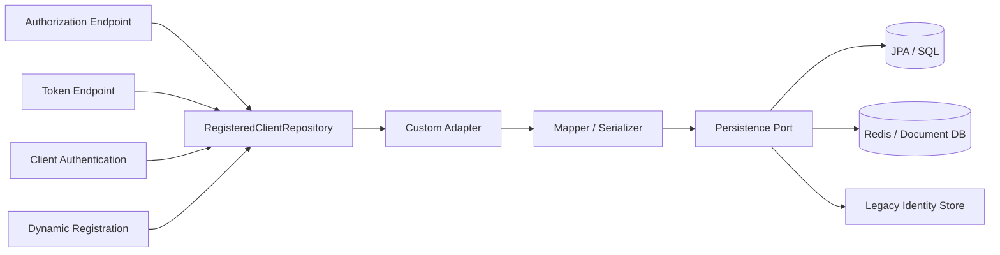

# Thiết kế RegisteredClientRepository cho nguồn dữ liệu riêng

## 1. Bài toán: khi nào cần repository riêng?

Spring Authorization Server (SAS) cung cấp RegisteredClientRepository để lưu và tra cứu client registration. Với ứng dụng nhỏ, InMemoryRegisteredClientRepository có thể đủ cho development/test; với persistence JDBC thông thường, JdbcRegisteredClientRepository là lựa chọn sẵn có. Nhưng một hệ thống thực tế có thể cần lưu client trong JPA, Redis, MongoDB, dịch vụ quản lý identity, database legacy hoặc kho dữ liệu đa tenant.

Khi đó, ứng dụng cần tự triển khai **RegisteredClientRepository** để chuyển đổi giữa domain model của Spring Authorization Server và mô hình lưu trữ của hệ thống.

Thách thức chính không nằm ở việc viết ba câu query. Repository này nằm trên đường xử lý OAuth/OIDC: Authorization Endpoint dùng client registration để kiểm tra request; Token Endpoint dùng để xác thực client và kiểm tra grant; các endpoint khác cũng cần tra client. Một lỗi mapping hoặc dữ liệu stale có thể làm thay đổi quyền mà client được phép sử dụng.

Bài này hướng dẫn cách thiết kế adapter cho nguồn dữ liệu riêng, bảo toàn contract của SAS, chọn cấu trúc dữ liệu, xử lý mapping, bảo vệ secret, kiểm soát tenant và kiểm thử repository.

Bài thuộc chương **Lưu trữ tùy chỉnh** của module **SPRING_SECURITY_OAUTH2_OIDC_AUTHORIZATION_SERVER**. Mục tiêu tổng thể của module là **học cách thiết kế, cấu hình, bảo mật, kiểm thử và vận hành OAuth 2.0/OpenID Connect Authorization Server bằng Spring Security và Spring Authorization Server trong ứng dụng Spring Boot**.

### Mục tiêu học tập

Sau bài này, bạn có thể:

- Giải thích contract ba method của RegisteredClientRepository.
- Thiết kế persistence model riêng để lưu đầy đủ RegisteredClient.
- Viết adapter chuyển đổi domain model và entity.
- Lưu các collection, ClientSettings và TokenSettings an toàn, có version.
- Cấu hình JPA hoặc Redis làm nguồn lưu trữ.
- Phân biệt registration ID với client ID.
- Xử lý unique constraint, transaction, concurrency và cache invalidation.
- Thiết kế repository cho nhiều issuer/tenant mà không rò dữ liệu chéo tenant.
- Viết contract tests và integration tests cho adapter.

> **Phạm vi phiên bản:** Các ví dụ dựa trên Spring Authorization Server 1.5.8 và Spring Security 6.x. API và model có thể thay đổi ở phiên bản khác. SPECIAL_NOTE của bài được giao để trống.

## 2. RegisteredClientRepository là một port của Authorization Server

RegisteredClientRepository là thành phần trung tâm để đăng ký client mới và truy vấn client hiện có. SAS sử dụng repository khi xử lý các protocol flow như client authentication, authorization grant processing, token introspection và dynamic client registration.

Interface có ba method:

```java
public interface RegisteredClientRepository {

    void save(RegisteredClient registeredClient);

    RegisteredClient findById(String id);

    RegisteredClient findByClientId(String clientId);
}
```

Đây là contract nhỏ có chủ ý:

| Method | Ý nghĩa | Quy ước kết quả |
| --- | --- | --- |
| save(registeredClient) | Lưu registration | Ném lỗi nếu không thể lưu; không được bỏ qua lỗi |
| findById(id) | Tìm theo ID nội bộ của registration | Trả RegisteredClient hoặc null nếu không tìm thấy |
| findByClientId(clientId) | Tìm theo OAuth client identifier | Trả RegisteredClient hoặc null nếu không tìm thấy |

Hai phương thức find trả null khi không có dữ liệu. Không trả một RegisteredClient mặc định hoặc một client giả để che lỗi.

### 2.1. Interface không phải CRUD service đầy đủ

RegisteredClientRepository không có method list, search, delete, disable, rotate secret hoặc update metadata chuyên biệt. Nếu ứng dụng cần quản trị client, hãy xây dựng application service riêng với authorization, audit, validation và transaction phù hợp.

Method save chỉ nói rằng repository lưu RegisteredClient. Interface không mô tả chi tiết mọi chiến lược insert/update/upsert. Custom implementation cần chọn semantics nhất quán và ghi rõ:

- ID mới thì tạo registration mới.
- ID đã tồn tại thì có cho phép cập nhật hay trả conflict.
- clientId trùng với một ID khác thì từ chối.
- Thay đổi grant, redirect URI hoặc secret có ảnh hưởng đến authorization đã cấp hay không.

Không tự suy luận rằng save là API quản trị client an toàn cho mọi loại thay đổi.

### 2.2. RegisteredClientRepository không lưu token và consent

RegisteredClient mô tả **client registration**: client ID, secret, grant, scope, redirect URI và settings. Nó khác với:

- OAuth2Authorization: trạng thái một authorization cụ thể, bao gồm authorization code, access token, refresh token, ID Token, device code và metadata.
- OAuth2AuthorizationConsent: consent/authority mà resource owner đã cấp cho một client.

Nếu thay nguồn lưu RegisteredClient, các core service khác vẫn cần persistence phù hợp. Không gộp authorization/token state vào RegisteredClient chỉ vì cả hai đều có liên kết client.

## 3. Kiến trúc adapter cho nguồn dữ liệu riêng

Nên giữ domain model của Spring Authorization Server ở biên adapter. Phần nghiệp vụ/persistence nội bộ có thể dùng entity, document hoặc record riêng.



Luồng đọc:

1. SAS gọi findByClientId hoặc findById.
2. Adapter truy vấn persistence port.
3. Mapper chuyển entity/document thành RegisteredClient.
4. SAS nhận domain object đã được dựng đầy đủ.

Luồng ghi:

1. SAS hoặc application service gọi save.
2. Adapter kiểm tra input và policy persistence.
3. Mapper chuyển RegisteredClient thành entity/document.
4. Persistence layer lưu dữ liệu trong transaction thích hợp.

### 3.1. Không để entity JPA đi vào protocol layer

Không trả JPA entity hoặc Redis document trực tiếp cho SAS. RegisteredClient là domain type mà framework hiểu; entity là chi tiết lưu trữ. Tách hai loại model giúp:

- Thay JPA bằng Redis mà không thay protocol configuration.
- Thay schema mà không thay code xử lý OAuth.
- Kiểm soát serialization của settings.
- Viết test mapper độc lập với database.
- Không làm lộ field nội bộ như tenant metadata, audit columns hoặc database version.

### 3.2. Adapter phải fail closed

Nếu database lỗi, JSON settings bị hỏng hoặc tenant không xác định, adapter phải báo lỗi rõ ràng. Không trả null như thể client không tồn tại khi thực chất storage đang lỗi; điều đó làm khó điều tra và có thể tạo hành vi không nhất quán giữa các node.

Chỉ trả null khi truy vấn thành công và không tìm thấy registration.

## 4. Thiết kế persistence model cho RegisteredClient

RegisteredClient có 13 trường chính. Custom store phải bảo toàn tất cả trường mà ứng dụng sử dụng.

| RegisteredClient field | Nội dung | Cách lưu gợi ý |
| --- | --- | --- |
| id | Registration ID nội bộ | Primary key |
| clientId | OAuth client identifier | Cột riêng, unique index |
| clientIdIssuedAt | Thời điểm cấp ID | Timestamp/Instant |
| clientSecret | Secret đã encode hoặc null | Cột bảo vệ như credential |
| clientSecretExpiresAt | Thời điểm hết hạn secret | Timestamp nullable |
| clientName | Tên hiển thị | String |
| clientAuthenticationMethods | Tập phương thức xác thực | JSON hoặc bảng con |
| authorizationGrantTypes | Tập grant type | JSON hoặc bảng con |
| redirectUris | Tập redirect URI | JSON hoặc bảng con |
| postLogoutRedirectUris | Tập post-logout URI | JSON hoặc bảng con |
| scopes | Tập scope | JSON hoặc bảng con |
| clientSettings | ClientSettings | JSON/versioned document |
| tokenSettings | TokenSettings | JSON/versioned document |

### 4.1. Hai định danh phải được lưu riêng

id là khóa nội bộ của registration. clientId là định danh OAuth client được gửi trong protocol request. Không dùng clientId thay cho id nếu các bảng authorization/consent khác liên kết bằng registration ID.

Nên tạo:

- Primary key trên id.
- Unique constraint trên clientId trong phạm vi đúng issuer/tenant.
- Index cho các cột thực sự được truy vấn.

Trong hệ multi-tenant, unique key có thể là (tenant_id, client_id) nếu client ID chỉ cần duy nhất trong từng tenant. Nếu client ID phải duy nhất toàn hệ thống, constraint phải phản ánh quy tắc đó.

### 4.2. Lưu collection: JSON hay bảng quan hệ?

Có hai cách thường dùng:

| Cách lưu | Ưu điểm | Đánh đổi |
| --- | --- | --- |
| JSON column/document | Đơn giản, round-trip toàn bộ Set, phù hợp adapter | Khó query từng phần tử; cần serializer và versioning |
| Bảng con chuẩn hóa | Query/index từng grant, scope hoặc URI dễ hơn | Nhiều bảng, join và transaction phức tạp hơn |

Tránh nối các giá trị bằng dấu phẩy nếu dữ liệu có thể chứa dấu phẩy hoặc cần escaping. Ví dụ redirect URI có thể chứa query string; một serializer delimiter đơn giản dễ tạo dữ liệu không thể round-trip chính xác.

Với JSON, serialize các Set thành array JSON. Với bảng con, dùng foreign key về registration ID và unique constraint cho từng phần tử.

### 4.3. ClientSettings và TokenSettings là cấu hình có cấu trúc

Không chỉ lưu hai object này dưới dạng chuỗi toString. Chúng có nhiều key/value và có thể chứa Duration, token format, JWS algorithm hoặc các kiểu Spring Security.

Chọn một trong các chiến lược:

- JSON với Jackson modules tương thích Spring Security và SAS.
- Các cột typed riêng nếu schema nội bộ ổn định và có nhu cầu query.
- Một cấu trúc document có schema version.

Nếu tự tạo ObjectMapper, đăng ký các module cần thiết như SecurityJackson2Modules và OAuth2AuthorizationServerJackson2Module. Test deserialize sau khi restart và sau khi nâng version.

## 5. Quy tắc mapping phải bảo toàn semantics

Mapping không chỉ là sao chép field. Một số trường là tập giá trị, một số có thể null, một số chứa custom value.

### 5.1. Giữ nguyên grant type và authentication method mở rộng

AuthorizationGrantType và ClientAuthenticationMethod có thể biểu diễn giá trị mở rộng. Khi đọc dữ liệu, không chỉ nhận diện một danh sách hẹp các constant chuẩn rồi bỏ qua giá trị chưa biết.

Có thể dựng lại theo value:

```java
AuthorizationGrantType grantType =
        new AuthorizationGrantType(storedGrantTypeValue);

ClientAuthenticationMethod authenticationMethod =
        new ClientAuthenticationMethod(storedAuthenticationMethodValue);
```

Điều này giúp custom grant/authentication method vẫn round-trip được. Tuy nhiên, việc một value được lưu thành công không có nghĩa SAS đã có provider hỗ trợ nó. Protocol support phải được cấu hình riêng.

### 5.2. Giữ nguyên null và giá trị mặc định

Các trường như clientSecret và clientSecretExpiresAt có thể null. Không tự thay null bằng chuỗi rỗng hoặc thời gian hiện tại. ClientSettings và TokenSettings cần được dựng lại với đầy đủ settings đã lưu, tránh rơi về default ngoài ý muốn.

### 5.3. Không sửa đổi tập collection từ persistence

RegisteredClient thường cung cấp các collection không nên bị thay đổi tại adapter. Mapper nên tạo collection mới, tránh giữ reference mutable từ entity hoặc cache.

### 5.4. Version hóa JSON

Khi settings có thêm field ở phiên bản framework mới, dữ liệu JSON cũ phải đọc được. Có thể lưu thêm schema_version hoặc dùng chiến lược migration tương thích:

1. Đọc document theo version.
2. Áp dụng migration/normalization nếu cần.
3. Dựng ClientSettings/TokenSettings.
4. Chỉ ghi lại theo version mới trong transaction đã kiểm soát.

Không xóa key không nhận diện được nếu ứng dụng có custom setting cần giữ.

## 6. Ví dụ JPA: entity và repository riêng

Spring Authorization Server có hướng dẫn chính thức minh họa việc triển khai core services bằng JPA. Cấu trúc cơ bản là một entity lưu các trường RegisteredClient, một Spring Data repository tra cứu theo id/clientId và một adapter triển khai RegisteredClientRepository.

Ví dụ entity rút gọn:

```java
@Entity
@Table(
    name = "oauth2_client",
    uniqueConstraints = @UniqueConstraint(
        name = "uk_oauth2_client_client_id",
        columnNames = "client_id"
    )
)
class ClientEntity {

    @Id
    @Column(length = 100)
    private String id;

    @Column(name = "client_id", nullable = false, length = 100)
    private String clientId;

    private Instant clientIdIssuedAt;
    private String clientSecret;
    private Instant clientSecretExpiresAt;
    private String clientName;

    @Lob
    private String clientAuthenticationMethodsJson;

    @Lob
    private String authorizationGrantTypesJson;

    @Lob
    private String redirectUrisJson;

    @Lob
    private String postLogoutRedirectUrisJson;

    @Lob
    private String scopesJson;

    @Lob
    private String clientSettingsJson;

    @Lob
    private String tokenSettingsJson;

    // Constructors, getters and setters omitted.
}
```

Đây là ví dụ minh họa. Kiểu @Lob và cách map text/JSON phụ thuộc JPA provider/database. Với PostgreSQL có thể dùng jsonb qua mapping phù hợp; với database khác có thể dùng text/CLOB. Hãy kiểm tra schema migration thực tế thay vì phụ thuộc tự sinh DDL trong production.

Spring Data repository:

```java
interface ClientEntityRepository
        extends JpaRepository<ClientEntity, String> {

    Optional<ClientEntity> findByClientId(String clientId);
}
```

Unique constraint ở database là hàng rào cuối cùng chống clientId trùng. Kiểm tra trước bằng findByClientId giúp trả lỗi nghiệp vụ thân thiện nhưng không thay thế constraint vì hai request có thể chạy đồng thời.

## 7. Cấu hình ObjectMapper cho Spring Security settings

ClientSettings và TokenSettings có thể chứa các kiểu dữ liệu thuộc Spring Security/SAS. Không nên dùng ObjectMapper mặc định mà chưa đăng ký module cần thiết.

Ví dụ cấu hình tương tự hướng dẫn JPA chính thức:

```java
import com.fasterxml.jackson.databind.Module;
import com.fasterxml.jackson.databind.ObjectMapper;
import java.util.List;
import org.springframework.security.jackson2.SecurityJackson2Modules;
import org.springframework.security.oauth2.server.authorization.jackson2.OAuth2AuthorizationServerJackson2Module;

ObjectMapper objectMapper = new ObjectMapper();
ClassLoader classLoader = getClass().getClassLoader();

List<Module> securityModules =
        SecurityJackson2Modules.getModules(classLoader);

objectMapper.registerModules(securityModules);
objectMapper.registerModule(
        new OAuth2AuthorizationServerJackson2Module());
```

Trong ứng dụng Spring, nên quản lý ObjectMapper như dependency được cấu hình tập trung thay vì tạo mới trong mỗi lần gọi repository. Nếu dùng custom ObjectMapper riêng cho adapter, cần ghi rõ modules và test dữ liệu được serialize bởi phiên bản trước.

### 7.1. Serialize settings

```java
String writeSettings(Map<String, Object> settings) {
    try {
        return objectMapper.writeValueAsString(settings);
    } catch (JsonProcessingException ex) {
        throw new IllegalStateException(
                "Cannot serialize RegisteredClient settings", ex);
    }
}
```

### 7.2. Deserialize settings

```java
Map<String, Object> readSettings(String json) {
    try {
        return objectMapper.readValue(
                json,
                new TypeReference<Map<String, Object>>() {});
    } catch (JsonProcessingException ex) {
        throw new DataRetrievalFailureException(
                "Cannot deserialize RegisteredClient settings", ex);
    }
}
```

Không catch lỗi rồi trả map rỗng. Nếu settings không đọc được, adapter không thể đảm bảo chính sách client; phải báo lỗi để sửa dữ liệu hoặc migration.

## 8. Triển khai JpaRegisteredClientRepository

Adapter cần thực hiện ba thao tác và chuyển đổi giữa entity với RegisteredClient.

```java
final class JpaRegisteredClientRepository
        implements RegisteredClientRepository {

    private final ClientEntityRepository repository;
    private final RegisteredClientMapper mapper;

    JpaRegisteredClientRepository(
            ClientEntityRepository repository,
            RegisteredClientMapper mapper) {
        Assert.notNull(repository, "repository cannot be null");
        Assert.notNull(mapper, "mapper cannot be null");
        this.repository = repository;
        this.mapper = mapper;
    }

    @Override
    public void save(RegisteredClient registeredClient) {
        Assert.notNull(registeredClient,
                "registeredClient cannot be null");
        repository.save(mapper.toEntity(registeredClient));
    }

    @Override
    public RegisteredClient findById(String id) {
        Assert.hasText(id, "id cannot be empty");
        return repository.findById(id)
                .map(mapper::toDomain)
                .orElse(null);
    }

    @Override
    public RegisteredClient findByClientId(String clientId) {
        Assert.hasText(clientId, "clientId cannot be empty");
        return repository.findByClientId(clientId)
                .map(mapper::toDomain)
                .orElse(null);
    }
}
```

Đây là skeleton cho adapter. RegisteredClientMapper chịu trách nhiệm serialize/deserialize đầy đủ field; nó không nên chứa authorization policy hoặc logic HTTP. Đăng ký adapter một lần bằng @Bean hoặc component scanning; không dùng đồng thời cả hai cách cho cùng một implementation.

### 8.1. Mapping entity sang RegisteredClient

Phác thảo:

```java
RegisteredClient toDomain(ClientEntity entity) {
    Set<String> methods = readStringSet(entity.getClientAuthenticationMethodsJson());
    Set<String> grants = readStringSet(entity.getAuthorizationGrantTypesJson());
    Set<String> redirects = readStringSet(entity.getRedirectUrisJson());
    Set<String> postLogouts = readStringSet(entity.getPostLogoutRedirectUrisJson());
    Set<String> scopes = readStringSet(entity.getScopesJson());

    return RegisteredClient.withId(entity.getId())
            .clientId(entity.getClientId())
            .clientIdIssuedAt(entity.getClientIdIssuedAt())
            .clientSecret(entity.getClientSecret())
            .clientSecretExpiresAt(entity.getClientSecretExpiresAt())
            .clientName(entity.getClientName())
            .clientAuthenticationMethods(values ->
                    methods.forEach(value ->
                            values.add(new ClientAuthenticationMethod(value))))
            .authorizationGrantTypes(values ->
                    grants.forEach(value ->
                            values.add(new AuthorizationGrantType(value))))
            .redirectUris(values -> values.addAll(redirects))
            .postLogoutRedirectUris(values -> values.addAll(postLogouts))
            .scopes(values -> values.addAll(scopes))
            .clientSettings(ClientSettings.withSettings(
                    readSettings(entity.getClientSettingsJson())).build())
            .tokenSettings(TokenSettings.withSettings(
                    readSettings(entity.getTokenSettingsJson())).build())
            .build();
}
```

Đoạn code minh họa giả định helper readStringSet/readSettings đã được triển khai và entity có các accessor tương ứng. Dựng lại grant type và authentication method theo value giúp bảo toàn cả custom values.

### 8.2. Mapping RegisteredClient sang entity

Phác thảo:

```java
ClientEntity toEntity(RegisteredClient client) {
    ClientEntity entity = new ClientEntity();
    entity.setId(client.getId());
    entity.setClientId(client.getClientId());
    entity.setClientIdIssuedAt(client.getClientIdIssuedAt());
    entity.setClientSecret(client.getClientSecret());
    entity.setClientSecretExpiresAt(client.getClientSecretExpiresAt());
    entity.setClientName(client.getClientName());

    entity.setClientAuthenticationMethodsJson(
            writeStringSet(client.getClientAuthenticationMethods().stream()
                    .map(ClientAuthenticationMethod::getValue)
                    .collect(Collectors.toSet())));
    entity.setAuthorizationGrantTypesJson(
            writeStringSet(client.getAuthorizationGrantTypes().stream()
                    .map(AuthorizationGrantType::getValue)
                    .collect(Collectors.toSet())));
    entity.setRedirectUrisJson(writeStringSet(client.getRedirectUris()));
    entity.setPostLogoutRedirectUrisJson(
            writeStringSet(client.getPostLogoutRedirectUris()));
    entity.setScopesJson(writeStringSet(client.getScopes()));
    entity.setClientSettingsJson(
            writeSettings(client.getClientSettings().getSettings()));
    entity.setTokenSettingsJson(
            writeSettings(client.getTokenSettings().getSettings()));
    return entity;
}
```

Đây cũng là phác thảo. Hãy kiểm tra builder/entity thực tế của dự án và dùng một serializer thống nhất cho cả hai chiều. Không bỏ sót postLogoutRedirectUris, clientSettings hoặc tokenSettings.

## 9. Triển khai bằng Redis hoặc document store

Với Redis, có thể lưu một entity riêng cho RegisteredClient, đánh dấu clientId là indexed field và tạo Spring Data repository để tìm theo clientId.

Ví dụ:

```java
@RedisHash("oauth2_registered_client")
class OAuth2RegisteredClientDocument {

    @Id
    private String id;

    @Indexed
    private String clientId;

    private Instant clientIdIssuedAt;
    private String clientSecret;
    private Instant clientSecretExpiresAt;
    private String clientName;
    private Set<String> clientAuthenticationMethods;
    private Set<String> authorizationGrantTypes;
    private Set<String> redirectUris;
    private Set<String> postLogoutRedirectUris;
    private Set<String> scopes;
    private Map<String, Object> clientSettings;
    private Map<String, Object> tokenSettings;
}

interface OAuth2RegisteredClientDocumentRepository
        extends CrudRepository<OAuth2RegisteredClientDocument, String> {

    OAuth2RegisteredClientDocument findByClientId(String clientId);
}
```

Sau đó tạo RedisRegisteredClientRepository adapter tương tự JPA adapter:

- save: map RegisteredClient thành document rồi persist.
- findById: đọc document theo id rồi map thành RegisteredClient.
- findByClientId: query indexed clientId rồi map thành RegisteredClient.

Đây là pattern được tài liệu Redis của SAS minh họa. Cần cấu hình Redis durability, replication, persistence, ACL/TLS và backup theo yêu cầu. Không coi Redis cache thuần volatile là nguồn đăng ký bền vững nếu client registration phải tồn tại qua restart.

### 9.1. Không tự đặt TTL cho registration

RegisteredClient không tự hết hạn theo access token TTL. Nếu document Redis có TTL, client registration có thể biến mất trong khi authorization/token vẫn còn tham chiếu đến nó. Chỉ đặt TTL khi đó là yêu cầu nghiệp vụ rõ ràng và có quy trình xử lý authorization, token và audit liên quan.

## 10. Đăng ký custom repository vào Authorization Server

Custom implementation phải được đăng ký như bean RegisteredClientRepository và được sử dụng bởi Authorization Server.

Ví dụ:

```java
@Configuration
class CustomClientPersistenceConfiguration {

    @Bean
    RegisteredClientRepository registeredClientRepository(
            ClientEntityRepository entityRepository,
            RegisteredClientMapper mapper) {
        return new JpaRegisteredClientRepository(entityRepository, mapper);
    }
}
```

Nếu ứng dụng chỉ có một bean RegisteredClientRepository, SAS có thể sử dụng bean đó theo cơ chế cấu hình Spring. Có thể cấu hình tường minh trong OAuth2AuthorizationServerConfigurer khi cần:

```java
OAuth2AuthorizationServerConfigurer authorizationServer =
        OAuth2AuthorizationServerConfigurer.authorizationServer();

http.with(authorizationServer, server ->
        server.registeredClientRepository(registeredClientRepository));
```

Tránh đăng ký đồng thời nhiều bean cùng type mà không có qualifier/primary rõ ràng. Nếu SAS lấy nhầm InMemory repository trong khi ứng dụng dự kiến dùng custom store, các node có thể nhìn thấy tập client khác nhau.

## 11. Multi-tenancy: interface không truyền tenantId

RegisteredClientRepository chỉ nhận id hoặc clientId; nó không có tham số tenant. Nếu mỗi issuer có một tập client riêng, adapter phải xác định tenant từ security/protocol context đáng tin cậy.

SAS có hướng dẫn multi-tenancy dùng AuthorizationServerContextHolder để lấy issuer hiện tại, rồi delegate tới repository được đăng ký cho issuer đó.

Có hai mô hình lưu trữ phổ biến:

| Mô hình | Cách cô lập |
| --- | --- |
| Database/schema riêng mỗi tenant | Mỗi issuer có một repository/DataSource riêng |
| Shared table | Mọi query bắt buộc có tenant_id; unique key và index có tenant scope |

### 11.1. Delegating repository theo issuer

Luồng khái niệm:

```java
RegisteredClientRepository repositoryForCurrentIssuer() {
    AuthorizationServerContext context =
            AuthorizationServerContextHolder.getContext();

    if (context == null || !StringUtils.hasText(context.getIssuer())) {
        throw new IllegalStateException("Issuer context is required");
    }

    RegisteredClientRepository repository =
            approvedIssuerRegistry.get(context.getIssuer());

    if (repository == null) {
        throw new IllegalStateException("Issuer is not configured");
    }
    return repository;
}
```

Đây là pseudocode minh họa. Registry phải dùng issuer canonical đã được allowlist; không lấy tenant tùy ý từ query parameter hoặc header do client gửi. Nếu không tìm được issuer/repository, fail closed.

### 11.2. Shared table cần tenant predicate ở cả ba method

Với shared table:

- save phải ghi tenant_id từ context đáng tin cậy.
- findById phải lọc cả tenant_id và id.
- findByClientId phải lọc cả tenant_id và client_id.
- Unique constraint thường là (tenant_id, client_id).

Không chỉ lọc tenant ở findByClientId rồi quên findById. Authorization object có thể tham chiếu registration bằng ID nội bộ; nếu ID có thể tra chéo tenant thì vẫn có rủi ro data leak.

### 11.3. Background jobs cần tenant context tường minh

Các tác vụ seed client, rotate secret hoặc audit có thể chạy ngoài HTTP request nên AuthorizationServerContextHolder không có issuer. Với tác vụ đó, truyền tenant/issuer rõ ràng vào service quản trị rồi gọi repository chuyên biệt theo tenant; không dùng fallback tenant mặc định.

## 12. Transaction, uniqueness và concurrency

Client registration có thể được tạo đồng thời bởi Dynamic Client Registration, admin service hoặc deployment automation. Kiểm tra tồn tại trước khi save không đủ để chống race condition.

Biện pháp:

1. Unique constraint/index trên clientId hoặc (tenantId, clientId).
2. Transaction bao quanh thao tác persist.
3. Xử lý duplicate-key exception thành conflict rõ ràng.
4. ID nội bộ được tạo ổn định và duy nhất.
5. Nếu save là upsert, xác định quy tắc cập nhật và optimistic locking.
6. Không để hai request cùng ghi các phiên bản client khác nhau mà không có conflict policy.

### 12.1. Save nên có semantics rõ ràng

JPA repository save thường có semantics persist/merge tùy entity state. Mongo/Redis có semantics khác. RegisteredClientRepository không quy định chi tiết cách xử lý conflict, vì vậy custom adapter nên thống nhất:

- DCR tạo client mới: từ chối clientId đã tồn tại.
- Admin update: gọi application service riêng, kiểm tra quyền và version.
- Secret rotation: ghi version/rotation metadata và audit.

Nếu ứng dụng chủ ý cho phép save cập nhật cùng ID, cần ngăn thay đổi clientId hoặc kiểm soát việc đổi clientId rất chặt.

### 12.2. Transaction với authorization data

RegisteredClient được tham chiếu bởi OAuth2Authorization và OAuth2AuthorizationConsent qua registration ID. Khi sửa hoặc xóa client, cần xem xét các record liên quan:

- Có authorization còn hiệu lực không?
- Có refresh token cần revoke không?
- Có consent cần giữ hoặc xóa không?
- Có cache client registration trên node khác không?

Không xóa client entity một cách độc lập nếu hệ thống cần xử lý token/consent theo transaction hoặc workflow liên quan.

## 13. Bảo vệ client secret và dữ liệu nhạy cảm

RegisteredClientRepository API yêu cầu thông tin nhạy cảm được encode bên ngoài implementation, ví dụ clientSecret. Adapter không nên tự giả định chuỗi nhận được là raw secret hay encoded secret.

### 13.1. Encode secret trước khi save

Ví dụ tại service tạo client:

```java
String encodedSecret = passwordEncoder.encode(rawSecret);

RegisteredClient client = RegisteredClient.withId(UUID.randomUUID().toString())
        .clientId("orders-service")
        .clientSecret(encodedSecret)
        .clientAuthenticationMethod(
                ClientAuthenticationMethod.CLIENT_SECRET_BASIC)
        .authorizationGrantType(AuthorizationGrantType.CLIENT_CREDENTIALS)
        .scope("orders.read")
        .build();

registeredClientRepository.save(client);
```

Không lưu raw client secret. Không dùng NoOpPasswordEncoder trong production. Khi client authentication, PasswordEncoder phù hợp sẽ đối chiếu secret được gửi với giá trị đã encode.

### 13.2. Không log toàn bộ RegisteredClient

RegisteredClient có thể chứa clientSecret, JWK Set URL và settings. Tránh log object đầy đủ hoặc log request/response DCR không mask. Audit nên ghi clientId, registration ID, actor, tenant, thay đổi grant/scope/redirect URI và correlation ID, không ghi credential.

### 13.3. Mã hóa at rest và backup

Hash secret không bảo vệ các dữ liệu nhạy cảm khác như URI nội bộ, metadata tenant hoặc private configuration. Hạn chế database permission, dùng TLS, encryption at rest và bảo vệ backup/replica. Nếu lưu tham chiếu tới secret manager, chỉ lưu reference ID; không đưa secret thật vào document.

## 14. Cache và nhất quán giữa các instance

RegisteredClient thường được tra cứu trên đường xử lý token/authorization. Cache có thể giảm latency, nhưng registration thay đổi cần được nhìn thấy nhất quán.

Nếu cache:

- Cache theo issuer/tenant và clientId/id.
- Có TTL hợp lý và cơ chế invalidation khi update/disable.
- Phát sự kiện invalidation tới các node.
- Không cache null lâu khiến client mới không được nhìn thấy.
- Không giữ client cũ sau khi secret/grant/redirect URI bị thay đổi.
- Theo dõi cache hit/miss và stale-read.

Với hệ thống nhiều node, cache cục bộ không tự đồng bộ. Dùng distributed cache hoặc event bus/invalidation mechanism phù hợp. Nếu không chứng minh được invalidation, cân nhắc đọc trực tiếp từ source of truth.

## 15. Hiệu năng và lựa chọn nguồn dữ liệu

| Nguồn dữ liệu | Khi phù hợp | Điểm cần kiểm tra |
| --- | --- | --- |
| JPA/Relational DB | Đã có database giao dịch, cần constraint và admin query | Index, transaction, serialization JSON, N+1 và pool |
| Redis | Lookup nhanh, dữ liệu dạng document/key-value, cần shared store | Durability, index, TTL, backup, serialization |
| MongoDB/document DB | Metadata linh hoạt, schema evolution | Unique index, consistency, document size, atomic update |
| Legacy identity store | Client registry đã tồn tại ở hệ thống khác | API latency, availability, mapping, version và retry |
| Configuration service | Client được quản lý tập trung và phát hành theo version | Cache, rollout, rollback, availability và stale config |

### 15.1. Không gọi remote service không kiểm soát ở mỗi request

RegisteredClientRepository có thể được gọi nhiều lần trong một protocol flow. Nếu mỗi findByClientId gọi một REST service bên ngoài, latency và availability của Authorization Server phụ thuộc trực tiếp vào service đó.

Nếu phải dùng remote store:

- Đặt timeout rõ ràng và giới hạn retry.
- Tránh retry không idempotent cho save.
- Dùng connection pooling.
- Cache có invalidation nếu policy cho phép.
- Có circuit breaker/failure handling phù hợp.
- Không trả null khi remote service timeout.

### 15.2. Chỉ index những trường lookup

Hai truy vấn chính là theo id và clientId. Tạo index tương ứng. Với tenant, index/unique constraint cần bao gồm tenant. Không index mọi field JSON hoặc scope nếu ứng dụng không truy vấn theo chúng.

## 16. Tách RegisteredClientRepository khỏi admin lifecycle

Một hệ thống thường cần thêm các use case ngoài ba method của interface:

| Use case | Thành phần nên xử lý |
| --- | --- |
| Tạo client từ onboarding | Admin/registration service gọi repository.save sau validation |
| Đổi redirect URI | Admin service có approval, audit và validation |
| Rotate client secret | Credential service + PasswordEncoder/secret manager + repository |
| Disable client | Client lifecycle service và policy kiểm tra trạng thái |
| Xóa client | Admin workflow kiểm tra authorization/consent/token trước |
| Liệt kê client | Admin query service/repository riêng có pagination |
| Lịch sử thay đổi | Audit store/event log |

Không mở một REST CRUD API trực tiếp lên RegisteredClientRepository. Các thao tác quản trị có thể thay đổi khả năng xác thực và cấp token, vì vậy phải có quyền quản trị riêng và audit.

### 16.1. Disable client cần được thực thi trong lookup/authentication

Nếu model nội bộ có trạng thái ACTIVE/DISABLED, adapter không nên âm thầm bỏ client disabled khỏi mọi query nếu việc đó làm mất khả năng xử lý authorization/token cũ theo policy. Cần quyết định:

- Client disabled có bị từ chối authentication mới không?
- Token đã cấp còn được introspect/refresh không?
- Authorization code đang chờ có được đổi không?
- Metadata discovery có còn công bố client không? (Thông thường discovery là capability server, không phải client listing.)

Có thể lưu trạng thái trong domain store và tích hợp policy kiểm tra ở lớp thích hợp. Không nhét trạng thái tùy chỉnh vào RegisteredClient nếu framework không có field tương ứng mà không có cơ chế truy cập đáng tin.

## 17. Kiểm thử custom repository

Không chỉ test mapper. Cần test contract của RegisteredClientRepository bằng cùng bộ dữ liệu qua adapter thực tế.

### 17.1. Ma trận kiểm thử contract

| Test | Kết quả mong đợi |
| --- | --- |
| save rồi findById | Đọc lại đúng registration |
| save rồi findByClientId | Đọc đúng registration theo clientId |
| Unknown id | Trả null |
| Unknown clientId | Trả null |
| Null input | Bị từ chối rõ ràng |
| Empty ID/clientId | Bị từ chối rõ ràng |
| ClientId duplicate | Unique constraint/conflict được xử lý |
| ClientId khác ID | Hai lookup không bị nhầm |
| Nhiều grant types | Round-trip đầy đủ |
| Custom grant type | Value được bảo toàn |
| Nhiều auth methods | Round-trip đầy đủ |
| Custom auth method | Value được bảo toàn |
| Redirect URI có query/comma | Serialize/deserialize không mất dữ liệu |
| Post-logout URI | Round-trip đầy đủ |
| Scopes | Round-trip đầy đủ |
| ClientSettings | PKCE/consent/JWK settings giữ nguyên |
| TokenSettings | TTL, format, refresh policy giữ nguyên |
| Nullable secret/expiry | Null được giữ nguyên |
| Secret encoding | Raw secret không xuất hiện trong storage |
| JSON cũ | Đọc được theo schema version/migration |
| JSON hỏng | Báo lỗi persistence, không trả settings rỗng |

### 17.2. Integration tests với database thật

Với JPA, dùng Testcontainers hoặc database tương thích production. Kiểm tra:

- Unique constraint thực sự tồn tại.
- Transaction rollback khi mapper/database lỗi.
- Concurrent create cùng clientId chỉ có một registration.
- JSON column/CLOB lưu đủ dữ liệu.
- Restart ứng dụng vẫn đọc được registration.
- Thay đổi registration được các instance khác nhìn thấy.

Với Redis, kiểm tra index clientId, serialization converter, restart/recovery, replication và hành vi khi key hết hạn hoặc Redis mất kết nối.

### 17.3. Test nhiều tenant

Tạo hai issuer với cùng clientId nhưng metadata khác nhau:

- findByClientId ở issuer A phải trả registration A.
- findByClientId ở issuer B phải trả registration B.
- findById không được đọc registration của tenant khác.
- Không có issuer context phải fail closed.
- Issuer không nằm trong allowlist phải bị từ chối.

Đây là kiểm thử bảo mật dữ liệu, không chỉ kiểm thử routing.

## 18. Troubleshooting

| Hiện tượng | Nguyên nhân có thể | Cách xử lý |
| --- | --- | --- |
| Client tồn tại nhưng findByClientId trả null | Query sai field hoặc index/tenant predicate sai | Kiểm tra mapper và query |
| findById không tìm thấy | Dùng clientId thay registration ID | Kiểm tra hai định danh |
| Custom grant bị mất | Mapper chỉ nhận diện constant chuẩn | Dựng AuthorizationGrantType theo stored value |
| Auth method lạ bị bỏ qua | Mapper whitelist cứng | Bảo toàn ClientAuthenticationMethod value và policy hỗ trợ |
| Settings về default sau restart | JSON module/deserialize sai | Đăng ký Spring Security/SAS Jackson modules |
| Redirect URI bị mất một phần | Lưu bằng delimiter không escape | Dùng JSON array hoặc bảng con |
| Duplicate clientId | Thiếu unique constraint | Thêm unique key theo tenant scope |
| Node A thấy client, node B không | Cache hoặc store không dùng chung | Kiểm tra invalidation/replication |
| Tenant A đọc được client B | Query thiếu tenant predicate | Cô lập mọi method theo issuer/tenant |
| Storage timeout bị hiểu là client không tồn tại | Adapter catch lỗi rồi trả null | Propagate lỗi storage |
| Save tạo bản ghi trùng | Không có transaction/unique constraint | Xử lý conflict tại database |
| Client disabled vẫn dùng được | Cache stale hoặc policy chưa được áp dụng | Invalidate cache và kiểm tra auth flow |
| JSON settings mới không đọc được | Schema version/compatibility thiếu | Viết migration và backward-compatible reader |
| Database lỗi nhưng server fallback in-memory | Có fallback không kiểm soát | Fail closed hoặc triển khai degraded mode có chủ đích |

Trình tự điều tra: **issuer/tenant context → repository bean → lookup key → persistence query → mapper/serializer → unique constraint → transaction → cache → client authentication flow**.

## 19. Tình huống tổng hợp: chuyển RegisteredClient từ JDBC sang JPA

Một tổ chức đang dùng JdbcRegisteredClientRepository nhưng muốn lưu registration trong schema JPA chung với dữ liệu onboarding và audit.

Quy trình:

1. Xác định contract ba method của RegisteredClientRepository.
2. Thiết kế ClientEntity với đủ 13 trường domain và unique clientId.
3. Chọn JSON arrays cho collection và JSON settings cho ClientSettings/TokenSettings.
4. Tạo ClientEntityRepository với findByClientId.
5. Viết RegisteredClientMapper hai chiều, giữ custom grant/auth method.
6. Cấu hình ObjectMapper với Spring Security/SAS modules.
7. Viết JpaRegisteredClientRepository adapter.
8. Encode client secret trước khi save.
9. Đăng ký custom repository bean và bỏ bean JDBC cũ để tránh wiring nhầm.
10. Chạy contract tests, migration tests, concurrency tests và OAuth end-to-end flow.
11. Chuyển dữ liệu bằng migration có kiểm đếm số record và đối chiếu field.
12. Deploy theo chiến lược rollback; không để hai repository cùng ghi một tập client trong thời gian cutover nếu không có đồng bộ hai chiều.

Sau chuyển đổi, Authorization Endpoint và Token Endpoint vẫn dùng RegisteredClient domain model. Chỉ adapter/persistence implementation thay đổi.

## 20. Checklist trước production

- [ ] Adapter triển khai đủ save, findById và findByClientId.
- [ ] Không trả null khi storage gặp lỗi.
- [ ] Lưu đủ 13 trường RegisteredClient đang được sử dụng.
- [ ] id và clientId được phân biệt rõ.
- [ ] Có unique constraint trên clientId theo phạm vi issuer/tenant.
- [ ] Collection được serialize không mất dữ liệu hoặc delimiter.
- [ ] ClientSettings/TokenSettings được serialize bằng module tương thích.
- [ ] Custom grant/authentication method được bảo toàn.
- [ ] clientSecret được encode trước khi persist.
- [ ] Không log raw secret hoặc toàn bộ RegisteredClient.
- [ ] Transaction và concurrency behavior được xác định.
- [ ] Có migration/schema version và backup.
- [ ] Có cache invalidation nếu dùng cache.
- [ ] Multi-tenant lookup fail closed và kiểm tra tenant ở mọi method.
- [ ] Admin lifecycle nằm trong service có authorization/audit riêng.
- [ ] Có contract tests và integration tests trên storage thực.
- [ ] OAuth/OIDC end-to-end flows vẫn hoạt động sau khi thay repository.

## 21. Tổng kết

Thiết kế RegisteredClientRepository cho nguồn dữ liệu riêng là xây một adapter giữa domain model của Spring Authorization Server và persistence model của ứng dụng.

1. Contract chỉ gồm save, findById và findByClientId; hiểu đúng semantics của ba method trước khi triển khai.
2. Lưu đủ RegisteredClient, gồm collection, ClientSettings và TokenSettings.
3. Dùng mapper hai chiều và serializer có module tương thích; không nối chuỗi tùy tiện.
4. Bảo toàn custom grant/authentication method và nullable fields.
5. Encode client secret bên ngoài repository trước khi lưu.
6. Dùng unique constraint, transaction và concurrency policy để bảo vệ registration.
7. Với multi-tenancy, resolve repository theo issuer tin cậy hoặc luôn áp dụng tenant predicate.
8. Tách admin lifecycle, audit và token revocation khỏi interface repository hẹp.
9. Test round-trip, lỗi storage, cache, tenant isolation và OAuth flow thực tế.

Hãy giữ RegisteredClientRepository nhỏ và ổn định, còn schema, entity, serializer và công nghệ lưu trữ nằm sau adapter. Khi thay JPA bằng Redis hoặc một dịch vụ riêng, protocol layer vẫn làm việc với cùng domain model và không cần biết chi tiết persistence.

### Tài liệu tham khảo

- [Spring Authorization Server 1.5.8 — Core Model / Components](https://docs.spring.io/spring-authorization-server/reference/core-model-components.html)
- [Spring Authorization Server 1.5.8 — RegisteredClientRepository API](https://docs.spring.io/spring-authorization-server/reference/api/java/org/springframework/security/oauth2/server/authorization/client/RegisteredClientRepository.html)
- [Spring Authorization Server 1.5.8 — RegisteredClient API](https://docs.spring.io/spring-authorization-server/reference/api/java/org/springframework/security/oauth2/server/authorization/client/RegisteredClient.html)
- [Spring Authorization Server 1.5.8 — How-to: Implement Core Services with JPA](https://docs.spring.io/spring-authorization-server/reference/guides/how-to-jpa.html)
- [Spring Authorization Server 1.5.8 — How-to: Implement Core Services with Redis](https://docs.spring.io/spring-authorization-server/reference/guides/how-to-redis.html)
- [Spring Authorization Server 1.5.8 — How-to: Implement Multitenancy](https://docs.spring.io/spring-authorization-server/reference/guides/how-to-multitenancy.html)
- [Spring Security — Jackson Modules](https://docs.spring.io/spring-security/reference/servlet/integrations/jackson.html)
