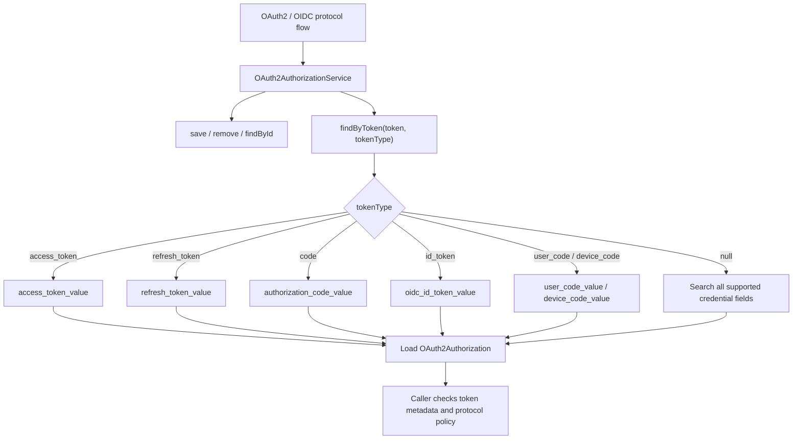

# Triển khai OAuth2AuthorizationService và tra cứu theo từng loại token

## 1. Mục tiêu và bối cảnh

Trong chương **Lưu trữ tùy chỉnh** của module **SPRING_SECURITY_OAUTH2_OIDC_AUTHORIZATION_SERVER**, Authorization Server phải lưu trạng thái của các authorization đã tạo và tìm lại trạng thái đó trong suốt OAuth 2.0/OpenID Connect flow. Trạng thái này bao gồm client, principal, grant type, scopes, authorization code, access token, refresh token, ID Token, device code, user code, metadata và các attributes liên quan.

Spring Authorization Server (SAS) tập hợp dữ liệu đó trong domain object `OAuth2Authorization` và giao trách nhiệm persistence cho interface `OAuth2AuthorizationService`. Implementation có thể lưu bằng JDBC, JPA, Redis, document database hoặc một kho dữ liệu phân tán, miễn là giữ đúng contract và semantics của framework.

Bài học tập trung vào hai việc phải làm đúng khi tự triển khai service:

1. Lưu, cập nhật, xóa và dựng lại một `OAuth2Authorization` đầy đủ.
2. Tìm đúng authorization từ token credential và `OAuth2TokenType`, kể cả trường hợp không truyền loại token.

Sau bài học, bạn có thể:

- Giải thích cấu trúc `OAuth2Authorization` và vai trò của `OAuth2AuthorizationService`.
- Phân biệt authorization record, token object, grant type và token type.
- Triển khai bốn thao tác `save`, `remove`, `findById` và `findByToken`.
- Xử lý tra cứu access token, refresh token, authorization code, ID Token, user code, device code và state.
- Hiểu ý nghĩa của `tokenType == null` và cách xử lý token type không hỗ trợ.
- Dùng `JdbcOAuth2AuthorizationService`, mapper mặc định và schema SAS.
- Thiết kế implementation JPA hoặc repository tùy chỉnh theo hướng dẫn của Spring.
- Tối ưu token lookup bằng index hoặc bảng tra cứu riêng.
- Bảo vệ token values, metadata và serialized attributes.
- Giữ nhất quán khi cấp token, refresh, revoke, chạy nhiều instance và dọn dữ liệu hết hạn.
- Kiểm thử đúng contract bằng integration tests và database thực tế.

**Phạm vi phiên bản:** Các API minh họa hướng tới **Spring Authorization Server 1.5.x**, **Spring Security 6.x** và **Spring Boot 3.x**. Tài liệu Spring hiện hành tại thời điểm biên soạn là SAS 1.5.8. Hãy đối chiếu phiên bản dependency của dự án vì schema, Jackson integration và một số API có thể thay đổi giữa các major/minor release. Các entity/repository tùy chỉnh trong bài là ví dụ kiến trúc, không phải implementation hoàn chỉnh có thể copy vào production mà không điều chỉnh.

## 2. OAuth2AuthorizationService nằm ở đâu?

`OAuth2AuthorizationService` là thành phần trung tâm để lưu authorization mới và truy vấn authorization đã tồn tại. Các thành phần giao thức gọi service khi cần tìm lại trạng thái trước đó, ví dụ:

- Client authentication và xử lý authorization grant.
- Đổi authorization code lấy token.
- Refresh access token.
- Token introspection và token revocation.
- Device Authorization Grant.
- OpenID Connect và các flow mở rộng.
- Dynamic Client Registration hoặc custom grant khi có tích hợp với authorization state.

Nếu service trả sai authorization, một request có thể gắn nhầm token với client/principal khác, không nhận ra token đã bị invalidated hoặc không hoàn tất được grant flow.

### 2.1. Contract của interface

Interface có bốn thao tác chính:

```java
public interface OAuth2AuthorizationService {

    void save(OAuth2Authorization authorization);

    void remove(OAuth2Authorization authorization);

    OAuth2Authorization findById(String id);

    OAuth2Authorization findByToken(
            String token,
            OAuth2TokenType tokenType);
}
```

| Method | Ý nghĩa | Kết quả |
| --- | --- | --- |
| `save(authorization)` | Lưu authorization mới hoặc trạng thái cập nhật | Không trả giá trị |
| `remove(authorization)` | Xóa authorization theo định danh | Không trả giá trị |
| `findById(id)` | Tìm authorization theo ID nội bộ | Object hoặc `null` |
| `findByToken(token, tokenType)` | Tìm authorization chứa token/credential được cung cấp | Object hoặc `null` |

`findByToken` nhận `tokenType` nullable. Vì vậy implementation phải hỗ trợ cả tra cứu theo loại cụ thể và tra cứu không chỉ định loại.

### 2.2. Service mặc định

SAS cung cấp hai implementation chính:

| Implementation | Cách lưu | Mục đích |
| --- | --- | --- |
| `InMemoryOAuth2AuthorizationService` | Bộ nhớ của process | Development và testing |
| `JdbcOAuth2AuthorizationService` | JDBC qua `JdbcOperations` | Persistence quan hệ |

Nếu không cấu hình service riêng, component này có thể mặc định dùng `InMemoryOAuth2AuthorizationService`. Đây là điều dễ bỏ sót: ứng dụng vẫn chạy qua restart trong lúc thử nghiệm, nhưng authorization state biến mất khi process dừng hoặc request đi sang instance khác.

`JdbcOAuth2AuthorizationService` là implementation đơn giản có thể dùng trong một số production deployment, nhưng tài liệu SAS cảnh báo nó có giới hạn hiệu năng và có thể không phù hợp môi trường throughput cao. Khi cần tối ưu theo tải, database, token format hoặc mô hình phân tán, ứng dụng có thể cung cấp implementation riêng.

## 3. Mô hình OAuth2Authorization

`OAuth2Authorization` đại diện cho một authorization được cấp cho client bởi resource owner, hoặc bởi chính client trong trường hợp `client_credentials`.

Các thuộc tính chính:

| Thuộc tính | Ý nghĩa |
| --- | --- |
| `id` | ID duy nhất của authorization record |
| `registeredClientId` | ID nội bộ của `RegisteredClient` |
| `principalName` | Principal name của resource owner hoặc client |
| `authorizationGrantType` | Grant type đã tạo authorization |
| `authorizedScopes` | Các scope đã được authorize |
| `tokens` | Các OAuth2Token cùng metadata tương ứng với grant |
| `attributes` | Attributes bổ sung như principal, authorization request và trạng thái flow |

Một authorization có thể chứa nhiều token khác loại. Ví dụ Authorization Code Flow với OIDC có thể chứa authorization code, access token, refresh token và ID Token. Device Authorization Grant có thể chứa device code và user code trước khi access token được phát hành.

### 3.1. Token được bọc cùng metadata

SAS lưu mỗi token trong `OAuth2Authorization.Token<T>`. Wrapper này giữ token object và metadata, ví dụ:

- Token có bị invalidated hay không.
- Token có hết hạn hay chưa.
- Token có đang active hay đang trước thời điểm sử dụng hay không.
- Claims của token nếu token hỗ trợ `ClaimAccessor`.
- Metadata tùy chỉnh gắn với token.

Ví dụ truy cập token:

```java
OAuth2Authorization.Token<OAuth2AccessToken> accessToken =
        authorization.getAccessToken();

if (accessToken != null && accessToken.isActive()) {
    String value = accessToken.getToken().getTokenValue();
}
```

Không chỉ lưu raw token value rồi bỏ metadata. Khi dựng lại authorization, cần khôi phục issued-at, expires-at, scopes, claims và invalidation state để các provider xử lý đúng.

### 3.2. Authorization record không đồng nghĩa một token

Một authorization có thể có nhiều token cùng vòng đời. Xóa authorization sẽ xóa toàn bộ token state được lưu trong record. Ngược lại, invalidate một token có thể chỉ làm token đó inactive trong khi authorization còn token khác vẫn active.

Ví dụ refresh flow có thể invalidate refresh token cũ hoặc thay token theo chính sách rotation, nhưng authorization record vẫn được giữ để chứa access token mới và refresh token mới.

### 3.3. ID nội bộ và client ID

`registeredClientId` là `RegisteredClient.getId()`, không phải public `client_id` gửi trong protocol. Khi dựng lại authorization, service phải tra cứu `RegisteredClient` bằng ID nội bộ và gắn object registration vào builder.

Nếu registration không còn tồn tại, không được tự dựng một client giả từ chuỗi ID. Hãy báo lỗi dữ liệu rõ ràng (ví dụ `DataRetrievalFailureException`) để phát hiện lỗi deprovisioning hoặc dữ liệu tham chiếu không nhất quán.

## 4. Token type và token lookup

`findByToken(token, tokenType)` là phần quan trọng nhất khi triển khai custom service. Tham số thứ hai cho biết credential cần tìm thuộc loại nào, để repository truy vấn đúng trường.

### 4.1. Token type không phải grant type

Hai khái niệm khác nhau:

- **Grant type** mô tả cách authorization được tạo, ví dụ `authorization_code`, `client_credentials`, `refresh_token` hoặc `urn:ietf:params:oauth:grant-type:device_code`.
- **Token type** mô tả credential hoặc giá trị cần tra cứu, ví dụ `access_token`, `refresh_token`, `code`, `id_token`, `user_code`, `device_code`.

Không dùng `AuthorizationGrantType.AUTHORIZATION_CODE` để truyền vào `findByToken`. Method này nhận `OAuth2TokenType`.

### 4.2. Các giá trị lookup phổ biến

`OAuth2TokenType` trong SAS định nghĩa hai hằng số chuẩn:

- `OAuth2TokenType.ACCESS_TOKEN` với value `access_token`.
- `OAuth2TokenType.REFRESH_TOKEN` với value `refresh_token`.

Các loại còn lại được biểu diễn bằng `OAuth2TokenType` khởi tạo từ value tương ứng, ví dụ `new OAuth2TokenType(OAuth2ParameterNames.CODE)` hoặc `new OAuth2TokenType(OidcParameterNames.ID_TOKEN)`.

Bảng ánh xạ theo các trường authorization phổ biến:

| `tokenType.getValue()` | Giá trị | Trường lưu trữ | Ngữ cảnh |
| --- | --- | --- | --- |
| `access_token` | Access token | `access_token_value` | Introspection, resource access, revocation |
| `refresh_token` | Refresh token | `refresh_token_value` | Refresh grant, revocation |
| `code` | Authorization code | `authorization_code_value` | Đổi code lấy token |
| `id_token` | OIDC ID Token | `oidc_id_token_value` | OIDC/logout hoặc lookup liên quan |
| `user_code` | Device user code | `user_code_value` | Người dùng xác nhận thiết bị |
| `device_code` | Device code | `device_code_value` | Polling token endpoint trong device flow |
| `state` | Authorization state | `state` | Lookup flow theo state nếu thành phần gọi cần |

`state` là giá trị trạng thái của authorization request, không phải OAuth token. Tuy vậy, JDBC/JPA implementations có thể hỗ trợ tra cứu nó qua cùng method để phục vụ các luồng liên quan.

### 4.3. Tra cứu theo loại cụ thể

Khi `tokenType` khác null, implementation nên truy vấn đúng cột tương ứng:

```java
OAuth2Authorization authorization =
        authorizationService.findByToken(
                presentedAccessToken,
                OAuth2TokenType.ACCESS_TOKEN);
```

Đối với authorization code:

```java
OAuth2TokenType authorizationCodeType =
        new OAuth2TokenType(OAuth2ParameterNames.CODE);

OAuth2Authorization authorization =
        authorizationService.findByToken(
                code,
                authorizationCodeType);
```

Đối với OIDC ID Token:

```java
OAuth2TokenType idTokenType =
        new OAuth2TokenType(OidcParameterNames.ID_TOKEN);

OAuth2Authorization authorization =
        authorizationService.findByToken(
                idTokenValue,
                idTokenType);
```

Dùng token type cụ thể giúp query có thể tận dụng index riêng, tránh quét nhiều cột và tránh nhận nhầm một giá trị token trùng ở cột khác.

### 4.4. Khi tokenType là null

Khi `tokenType == null`, caller không chỉ định loại credential. Implementation phải tìm trong tất cả token/credential types mà service hỗ trợ. Với model SAS thông dụng, cần xét:

- `state`
- Authorization code
- Access token
- OIDC ID Token
- Refresh token
- User code
- Device code

JDBC implementation và hướng dẫn JPA của SAS đều thể hiện lookup rộng này. Nếu ứng dụng thêm token type riêng, cần quyết định cách lookup khi type được chỉ định và khi type null.

Không được chỉ tìm access token khi nhận null. Điều đó làm hỏng các luồng gọi service mà không biết trước credential thuộc cột nào.

### 4.5. Token type không được hỗ trợ

Nếu nhận một `OAuth2TokenType` mà custom implementation không ánh xạ được, hành vi phù hợp là trả `null`/không tìm thấy, trừ khi ứng dụng có token type mở rộng đã được đăng ký rõ ràng.

Không fallback mọi type không biết sang access token. Cách đó dễ làm một credential bị tra cứu ở cột sai và che giấu lỗi cấu hình.

### 4.6. Ví dụ hàm phân loại token type

```java
private static String resolveLookupField(OAuth2TokenType tokenType) {
    if (tokenType == null) {
        return "ANY";
    }

    String value = tokenType.getValue();

    if (OAuth2TokenType.ACCESS_TOKEN.getValue().equals(value)) {
        return "ACCESS_TOKEN";
    }
    if (OAuth2TokenType.REFRESH_TOKEN.getValue().equals(value)) {
        return "REFRESH_TOKEN";
    }
    if (OAuth2ParameterNames.CODE.equals(value)) {
        return "AUTHORIZATION_CODE";
    }
    if (OidcParameterNames.ID_TOKEN.equals(value)) {
        return "ID_TOKEN";
    }
    if (OAuth2ParameterNames.USER_CODE.equals(value)) {
        return "USER_CODE";
    }
    if (OAuth2ParameterNames.DEVICE_CODE.equals(value)) {
        return "DEVICE_CODE";
    }
    if (OAuth2ParameterNames.STATE.equals(value)) {
        return "STATE";
    }

    return "UNSUPPORTED";
}
```

Đây là helper minh họa cho dispatch logic. Trong repository thực tế, hãy dùng enum/strategy hoặc query methods cố định; không nối trực tiếp tên cột từ input thành SQL.

## 5. findByToken trả về authorization, không phải token đã xác minh

`findByToken` trả về `OAuth2Authorization` chứa credential có giá trị khớp. Method này không tự khẳng định token còn active, chưa hết hạn, chưa bị revoke hoặc hợp lệ về audience/issuer.

Sau lookup, caller/provider cần kiểm tra token wrapper và các điều kiện giao thức tương ứng.

Ví dụ:

```java
OAuth2Authorization authorization =
        authorizationService.findByToken(
                tokenValue,
                OAuth2TokenType.ACCESS_TOKEN);

if (authorization == null) {
    // Không tìm thấy authorization chứa token.
    return;
}

OAuth2Authorization.Token<OAuth2AccessToken> token =
        authorization.getToken(tokenValue);

if (token == null || !token.isActive()) {
    // Token hết hạn, invalidated hoặc không còn active.
    return;
}
```

`OAuth2Authorization.Token.isActive()` xét trạng thái token theo thời gian và metadata invalidation. Các endpoint còn phải áp dụng validation phù hợp: client binding, audience/resource, scopes, signature nếu JWT, và chính sách nghiệp vụ.

Không đưa điều kiện “chỉ trả token active” vào `findByToken` một cách tùy tiện. Một số luồng cần tìm record của token đã invalidated hoặc hết hạn để xử lý revocation, audit, refresh hoặc cleanup.

## 6. save, remove và findById

### 6.1. save: insert hoặc update

Trong vòng đời SAS, cùng một authorization có thể được lưu nhiều lần khi token state thay đổi. Ví dụ:

1. Tạo authorization code và lưu authorization.
2. Đổi code thành access token/refresh token.
3. Cập nhật metadata hoặc invalidation state.
4. Refresh token và cập nhật token mới.
5. Revoke token và lưu trạng thái đã invalidated.

Vì vậy `save` cần xử lý cả record mới và record đã tồn tại. JDBC implementation mặc định tìm theo ID rồi insert hoặc update. Custom service nên dùng upsert hoặc transaction để tránh race giữa kiểm tra tồn tại và insert.

### 6.2. remove: xóa toàn bộ authorization record

`remove` xóa record theo `authorization.getId()`. Điều này thường được dùng khi authorization cần được dọn khỏi store hoặc khi ứng dụng triển khai chính sách deprovisioning.

Không nhầm remove authorization với invalidate một token. Nếu cần giữ audit hoặc hỗ trợ token khác trong cùng authorization, có thể cần cập nhật metadata/invalidation thay vì xóa record.

### 6.3. findById: lookup theo ID nội bộ

`findById` dùng khi thành phần khác đã biết authorization ID. Nó không phải lookup theo token hoặc client ID.

ID cần duy nhất, ổn định và được lưu cùng record. Có thể tạo bằng UUID hoặc random identifier có entropy phù hợp. Không dùng token value làm authorization ID.

### 6.4. Mẫu cập nhật authorization

Builder `OAuth2Authorization.from` tạo builder từ authorization đã có. Khi refresh/revoke, có thể tạo bản cập nhật giữ nguyên thuộc tính cần thiết:

```java
OAuth2Authorization updated =
        OAuth2Authorization.from(existingAuthorization)
                .invalidate(oldRefreshToken)
                .token(newAccessToken)
                .token(newRefreshToken)
                .build();

authorizationService.save(updated);
```

Đoạn code minh họa ý tưởng; chỉ invalidate token cũ khi flow/policy yêu cầu, và giữ metadata/token còn hiệu lực. Không tự tạo authorization mới cho mỗi lần cập nhật nếu điều đó làm mất liên kết với grant/principal hoặc token state trước đó.

## 7. Schema JDBC mặc định của SAS

`JdbcOAuth2AuthorizationService` dùng bảng `oauth2_authorization` theo resource SQL:

```text
classpath:org/springframework/security/oauth2/server/authorization/oauth2-authorization-schema.sql
```

Schema được thiết kế dạng flattened record: một hàng đại diện cho một authorization và chứa các cột dành cho từng loại token.

### 7.1. Nhóm cột chính

| Nhóm | Các cột tiêu biểu |
| --- | --- |
| Identity | `id`, `registered_client_id`, `principal_name`, `authorization_grant_type` |
| Authorization context | `authorized_scopes`, `attributes`, `state` |
| Authorization code | `authorization_code_value`, `authorization_code_issued_at`, `authorization_code_expires_at`, `authorization_code_metadata` |
| Access token | `access_token_value`, `access_token_issued_at`, `access_token_expires_at`, `access_token_metadata`, `access_token_type`, `access_token_scopes` |
| OIDC ID Token | `oidc_id_token_value`, `oidc_id_token_issued_at`, `oidc_id_token_expires_at`, `oidc_id_token_metadata` |
| Refresh token | `refresh_token_value`, `refresh_token_issued_at`, `refresh_token_expires_at`, `refresh_token_metadata` |
| Device user code | `user_code_value`, `user_code_issued_at`, `user_code_expires_at`, `user_code_metadata` |
| Device code | `device_code_value`, `device_code_issued_at`, `device_code_expires_at`, `device_code_metadata` |

Khóa chính là `id`. Schema không tự tạo một bảng riêng cho mỗi token; mỗi authorization giữ các token tương ứng với grant type.

### 7.2. Kiểu dữ liệu token và metadata

Token values, attributes và metadata có thể dài hơn các chuỗi thông thường, đặc biệt khi access token là JWT hoặc attributes chứa authorization request/principal. Script mặc định dùng các kiểu LOB như BLOB cho một số cột.

Đừng thay LOB bằng `varchar(255)` một cách máy móc. Token hoặc metadata bị truncate sẽ gây lỗi lookup, deserialize hoặc signature validation.

### 7.3. Khác biệt database dialect

Tài liệu schema SAS có ghi chú theo database:

- Với PostgreSQL, đổi các cột `blob` sang kiểu phù hợp như `text`; đổi `timestamp` sang `timestamptz` để lưu instant chính xác.
- Với MySQL, cấu hình JDBC URL/driver để giữ đúng instant/time zone theo hướng dẫn của MySQL Connector/J.
- Với Oracle, SQL Server hoặc database khác, kiểm tra kiểu LOB, timestamp, index và giới hạn độ dài theo dialect.

Schema tùy chỉnh phải được kiểm thử với JDBC driver và database production thực tế. Không suy từ việc H2 chạy thành công rằng schema tương thích hoàn toàn với PostgreSQL/MySQL.

## 8. Cấu hình JdbcOAuth2AuthorizationService

Constructor phổ biến của SAS 1.5.8:

```java
JdbcOAuth2AuthorizationService(
        JdbcOperations jdbcOperations,
        RegisteredClientRepository registeredClientRepository)
```

Ngoài ra có overload nhận `LobHandler` để xử lý large object.

### 8.1. Khai báo bean

```java
@Configuration(proxyBeanMethods = false)
public class AuthorizationPersistenceConfiguration {

    @Bean
    OAuth2AuthorizationService authorizationService(
            JdbcOperations jdbcOperations,
            RegisteredClientRepository registeredClientRepository) {

        return new JdbcOAuth2AuthorizationService(
                jdbcOperations,
                registeredClientRepository);
    }
}
```

Cấu hình giả định đã có datasource, JDBC operations và registered client repository. Bảng schema phải được tạo trước khi service hoạt động.

### 8.2. Wire vào configurer

`OAuth2AuthorizationService` là optional component và SAS có thể mặc định dùng in-memory service. Cần cấu hình rõ vào Authorization Server:

```java
@Bean
@Order(1)
SecurityFilterChain authorizationServerSecurityFilterChain(
        HttpSecurity http,
        OAuth2AuthorizationService authorizationService)
        throws Exception {

    OAuth2AuthorizationServerConfigurer authorizationServer =
            OAuth2AuthorizationServerConfigurer.authorizationServer();

    http
        .securityMatcher(authorizationServer.getEndpointsMatcher())
        .with(authorizationServer, server ->
                server.authorizationService(authorizationService))
        .authorizeHttpRequests(authorize ->
                authorize.anyRequest().authenticated());

    return http.build();
}
```

Đây là phần cấu hình liên quan đến persistence; ứng dụng còn cần các bean về registered clients, consent, token generator, JWK, user authentication và Authorization Server settings.

### 8.3. RowMapper và ParametersMapper

`JdbcOAuth2AuthorizationService` có hai extension point:

- `setAuthorizationRowMapper(...)`: chuyển ResultSet thành `OAuth2Authorization`.
- `setAuthorizationParametersMapper(...)`: chuyển `OAuth2Authorization` thành danh sách SQL parameters.

Mặc định, mapper của SAS xử lý token values, timestamps, metadata, attributes và liên kết `RegisteredClient`. Nếu schema được tùy chỉnh, phải sửa cả hai chiều và kiểm thử round-trip.

Không chỉ đổi SQL column names rồi giữ mapper mặc định nếu cấu trúc lưu trữ không còn tương thích.

### 8.4. Giới hạn hiệu năng

JDBC implementation mặc định dùng flattened table và logic truy vấn tổng quát. Tài liệu API SAS lưu ý implementation này có thể không đạt hiệu năng cần thiết ở môi trường throughput cao.

Khi cần tối ưu, hãy đo:

- Latency của `findByToken` theo từng loại.
- Số lượng row và kích thước LOB.
- Query plan, index usage và database I/O.
- Tần suất save/update cùng authorization.
- Connection pool, lock wait và transaction duration.
- Tỷ lệ token lookup miss/hit theo endpoint.

Chỉ thay implementation khi có số liệu cho thấy bottleneck nằm ở persistence layer.

## 9. Thiết kế custom persistence bằng JPA

Hướng dẫn JPA chính thức của SAS trình bày một cách triển khai core services bằng entity, Spring Data repository và mapper giữa entity với domain object. Đây là điểm khởi đầu để tùy chỉnh schema, không phải một mô hình bắt buộc cho mọi ứng dụng.

### 9.1. Entity authorization

Một entity flattened có thể có các trường:

```java
@Entity
@Table(name = "oauth2_authorization")
public class AuthorizationEntity {

    @Id
    private String id;

    private String registeredClientId;
    private String principalName;
    private String authorizationGrantType;

    @Column(length = 1000)
    private String authorizedScopes;

    @Lob
    private String attributes;

    private String state;

    @Lob
    private String authorizationCodeValue;
    private Instant authorizationCodeIssuedAt;
    private Instant authorizationCodeExpiresAt;
    @Lob
    private String authorizationCodeMetadata;

    @Lob
    private String accessTokenValue;
    private Instant accessTokenIssuedAt;
    private Instant accessTokenExpiresAt;
    @Lob
    private String accessTokenMetadata;
    private String accessTokenType;
    @Column(length = 1000)
    private String accessTokenScopes;

    @Lob
    private String refreshTokenValue;
    private Instant refreshTokenIssuedAt;
    private Instant refreshTokenExpiresAt;
    @Lob
    private String refreshTokenMetadata;

    @Lob
    private String oidcIdTokenValue;
    private Instant oidcIdTokenIssuedAt;
    private Instant oidcIdTokenExpiresAt;
    @Lob
    private String oidcIdTokenMetadata;
    @Lob
    private String oidcIdTokenClaims;

    @Lob
    private String userCodeValue;
    private Instant userCodeIssuedAt;
    private Instant userCodeExpiresAt;
    @Lob
    private String userCodeMetadata;

    @Lob
    private String deviceCodeValue;
    private Instant deviceCodeIssuedAt;
    private Instant deviceCodeExpiresAt;
    @Lob
    private String deviceCodeMetadata;
}
```

Đây là entity rút gọn để minh họa cấu trúc. Cần bổ sung getter/setter, constructor, column mapping, dialect-specific LOB type và các field còn lại theo authorization model/version đang dùng. Không copy schema JPA minh họa rồi cho rằng nó trùng từng kiểu dữ liệu với resource JDBC mặc định.

### 9.2. Repository

Có thể tạo các phương thức truy vấn theo token field:

```java
public interface AuthorizationRepository
        extends JpaRepository<AuthorizationEntity, String> {

    Optional<AuthorizationEntity> findByState(String state);

    Optional<AuthorizationEntity> findByAuthorizationCodeValue(String value);

    Optional<AuthorizationEntity> findByAccessTokenValue(String value);

    Optional<AuthorizationEntity> findByRefreshTokenValue(String value);

    Optional<AuthorizationEntity> findByOidcIdTokenValue(String value);

    Optional<AuthorizationEntity> findByUserCodeValue(String value);

    Optional<AuthorizationEntity> findByDeviceCodeValue(String value);

    Optional<AuthorizationEntity>
    findByStateOrAuthorizationCodeValueOrAccessTokenValueOrRefreshTokenValueOrOidcIdTokenValueOrUserCodeValueOrDeviceCodeValue(
            String value);
}
```

Phương thức OR cuối cùng hỗ trợ trường hợp không truyền token type. Với dữ liệu lớn, cân nhắc thay derived query bằng JPQL/native query hoặc token index table có index riêng.

### 9.3. Khung custom service

```java
@Service
public class JpaOAuth2AuthorizationService
        implements OAuth2AuthorizationService {

    private final AuthorizationRepository repository;
    private final RegisteredClientRepository registeredClients;

    public JpaOAuth2AuthorizationService(
            AuthorizationRepository repository,
            RegisteredClientRepository registeredClients) {
        this.repository = repository;
        this.registeredClients = registeredClients;
    }

    @Override
    public void save(OAuth2Authorization authorization) {
        repository.save(toEntity(authorization));
    }

    @Override
    public void remove(OAuth2Authorization authorization) {
        repository.deleteById(authorization.getId());
    }

    @Override
    public OAuth2Authorization findById(String id) {
        return repository.findById(id)
                .map(this::toObject)
                .orElse(null);
    }

    @Override
    public OAuth2Authorization findByToken(
            String token, OAuth2TokenType tokenType) {

        Optional<AuthorizationEntity> result =
                findEntityByToken(token, tokenType);

        return result.map(this::toObject).orElse(null);
    }

    private Optional<AuthorizationEntity> findEntityByToken(
            String token, OAuth2TokenType tokenType) {
        // Dispatch theo tokenType như phần tiếp theo.
        throw new UnsupportedOperationException("Implement lookup");
    }

    private AuthorizationEntity toEntity(
            OAuth2Authorization authorization) {
        // Map domain object, tokens, metadata và attributes.
        throw new UnsupportedOperationException("Implement mapping");
    }

    private OAuth2Authorization toObject(
            AuthorizationEntity entity) {
        // Resolve RegisteredClient và dựng lại domain object.
        throw new UnsupportedOperationException("Implement mapping");
    }
}
```

Khung trên thể hiện boundary và bốn method của interface. Hai mapper không thể bỏ qua trong implementation thực tế: `toEntity` phải giữ mọi token/metadata cần thiết; `toObject` phải khôi phục đúng domain object.

## 10. Triển khai dispatch findByToken trong JPA

Đây là đoạn logic cốt lõi để tra cứu đúng token column:

```java
private Optional<AuthorizationEntity> findEntityByToken(
        String token, OAuth2TokenType tokenType) {

    Assert.hasText(token, "token cannot be empty");

    if (tokenType == null) {
        return repository
                .findByStateOrAuthorizationCodeValueOrAccessTokenValueOrRefreshTokenValueOrOidcIdTokenValueOrUserCodeValueOrDeviceCodeValue(
                        token);
    }

    String type = tokenType.getValue();

    if (OAuth2ParameterNames.STATE.equals(type)) {
        return repository.findByState(token);
    }
    if (OAuth2ParameterNames.CODE.equals(type)) {
        return repository.findByAuthorizationCodeValue(token);
    }
    if (OAuth2TokenType.ACCESS_TOKEN.getValue().equals(type)) {
        return repository.findByAccessTokenValue(token);
    }
    if (OidcParameterNames.ID_TOKEN.equals(type)) {
        return repository.findByOidcIdTokenValue(token);
    }
    if (OAuth2TokenType.REFRESH_TOKEN.getValue().equals(type)) {
        return repository.findByRefreshTokenValue(token);
    }
    if (OAuth2ParameterNames.USER_CODE.equals(type)) {
        return repository.findByUserCodeValue(token);
    }
    if (OAuth2ParameterNames.DEVICE_CODE.equals(type)) {
        return repository.findByDeviceCodeValue(token);
    }

    return Optional.empty();
}
```

Đoạn code dựa trên token types mà SAS core persistence thường lưu. Nếu ứng dụng thêm custom token type, cần thêm cột/index hoặc token index record và bổ sung nhánh dispatch. Khi `tokenType` null, query tổng hợp cũng phải tìm custom token nếu service cam kết hỗ trợ lookup rộng cho loại đó.

### 10.1. Vì sao không dùng một query tùy tiện?

Một truy vấn `WHERE token_value = ?` trên nhiều bảng hoặc nhiều field có thể khó tối ưu, và một authorization có nhiều token columns. Query rõ theo token type cho phép database dùng index đúng.

Khi type null, cần lookup rộng nhưng phải bảo đảm giá trị token không xuất hiện ở nhiều authorization/credential khác nhau. Token values nên có entropy cao và uniqueness được bảo vệ ở persistence layer.

### 10.2. Collision và uniqueness

Nếu một giá trị trùng trong hai cột hoặc hai authorization, lookup không chỉ định type có thể trở nên mơ hồ. Trong hệ thống custom, nên:

- Sinh credential ngẫu nhiên với entropy cao.
- Tạo unique index cho từng token column nếu database hỗ trợ phù hợp.
- Nếu dùng token index table, đặt unique constraint trên digest và type; cân nhắc ràng buộc uniqueness toàn cục nếu lookup không truyền type.
- Xử lý nhiều kết quả như lỗi integrity thay vì âm thầm chọn row đầu tiên.

Không dùng một token ngắn, tuần tự hoặc có thể đoán làm authorization code/device code.

## 11. Dựng lại OAuth2Authorization từ entity

Khi repository tìm thấy entity, custom service phải khôi phục object domain. Quy trình thường gồm:

1. Resolve `RegisteredClient` bằng `entity.getRegisteredClientId()`.
2. Khôi phục ID, principal name, grant type và authorized scopes.
3. Deserialize attributes.
4. Khôi phục state nếu có.
5. Dựng từng token object theo loại.
6. Khôi phục metadata cho từng token.
7. Gắn các token vào builder và build authorization.

Ví dụ phần khởi tạo builder:

```java
RegisteredClient registeredClient =
        registeredClients.findById(entity.getRegisteredClientId());

if (registeredClient == null) {
    throw new DataRetrievalFailureException(
            "RegisteredClient not found: "
                    + entity.getRegisteredClientId());
}

OAuth2Authorization.Builder builder =
        OAuth2Authorization.withRegisteredClient(registeredClient)
                .id(entity.getId())
                .principalName(entity.getPrincipalName())
                .authorizationGrantType(
                        resolveGrantType(entity.getAuthorizationGrantType()))
                .authorizedScopes(parseScopes(entity.getAuthorizedScopes()));
```

Với access token, ví dụ:

```java
if (entity.getAccessTokenValue() != null) {
    OAuth2AccessToken accessToken = new OAuth2AccessToken(
            OAuth2AccessToken.TokenType.BEARER,
            entity.getAccessTokenValue(),
            entity.getAccessTokenIssuedAt(),
            entity.getAccessTokenExpiresAt(),
            parseScopes(entity.getAccessTokenScopes()));

    builder.token(accessToken, metadata ->
            metadata.putAll(
                    parseMap(entity.getAccessTokenMetadata())));
}
```

Các token khác cần khôi phục đúng class:

- `OAuth2AuthorizationCode` cho authorization code.
- `OAuth2RefreshToken` cho refresh token.
- `OidcIdToken` cho ID Token, bao gồm claims.
- `OAuth2UserCode` cho user code.
- `OAuth2DeviceCode` cho device code.

Không dựng mọi credential thành `OAuth2AccessToken`. Kiểu token quyết định cách provider sử dụng credential.

### 11.1. Khôi phục token metadata

Khi ghi entity, dùng `authorization.getToken(TokenClass.class)` để lấy wrapper và lưu cả token lẫn metadata. Khi đọc, truyền metadata vào builder:

```java
builder.token(token, metadata ->
        metadata.putAll(parsedMetadata));
```

Nếu metadata chứa cờ invalidated mà mapper bỏ qua, token đã revoke có thể được dựng lại như token active. Đây là lỗi bảo mật nghiêm trọng.

### 11.2. Serialize attributes an toàn

`OAuth2Authorization.getAttributes()` có thể chứa Authentication, authorization request và object framework khác. Không nên dùng JSON mapper mặc định mà thiếu Spring Security/SAS modules.

Hướng dẫn JPA SAS minh họa việc đăng ký:

```java
ClassLoader classLoader =
        JpaOAuth2AuthorizationService.class.getClassLoader();

List<Module> securityModules =
        SecurityJackson2Modules.getModules(classLoader);

objectMapper.registerModules(securityModules);
objectMapper.registerModule(
        new OAuth2AuthorizationServerJackson2Module());
```

Đây là cách làm cho stack Jackson 2 tương ứng với phiên bản guide. Dùng module đúng phiên bản framework, cấu hình type handling chặt chẽ và chỉ deserialize dữ liệu do hệ thống tin cậy tạo ra. Không bật polymorphic default typing rộng trên dữ liệu database có thể bị sửa bởi bên ngoài.

## 12. Lưu token value: raw, encrypted hay hash?

Token values là credential. Nếu database bị đọc trái phép, kẻ tấn công có thể sử dụng token còn hiệu lực nếu token được lưu raw và không có lớp bảo vệ khác.

Có ba hướng thiết kế thường gặp:

| Cách lưu | Ưu điểm | Đánh đổi |
| --- | --- | --- |
| Raw token value | Dễ dựng lại authorization; tương thích với JDBC mapper | DB leak có thể làm lộ bearer credential |
| Encrypted token value | Có thể khôi phục raw token khi cần; bảo vệ dữ liệu at rest | Cần key management, rotation và chi phí decrypt |
| One-way digest/index | Tra cứu equality nhanh, không lộ trực tiếp raw token | Không tự dựng lại token object nếu không có raw token ở nơi khác |

### 12.1. Chỉ lưu hash có thể chưa đủ

`OAuth2AuthorizationService` không chỉ là token lookup index. `findById` cần dựng lại authorization, và các flow có thể cần token object cùng value/metadata. Nếu chỉ lưu hash một chiều, service không thể khôi phục raw token từ database.

Một kiến trúc phù hợp hơn khi cần giảm lộ token:

- Lưu authorization payload/token value được mã hóa bằng envelope encryption.
- Tạo lookup digest riêng để tìm record mà không phải scan/decrypt toàn bảng.
- Dùng HMAC-SHA-256 với key quản lý trong KMS/HSM cho lookup digest nếu threat model cần chống offline guessing.
- Lưu key version để hỗ trợ rotation.
- Giữ raw token chỉ trong memory của request; không ghi log.

Với token có entropy cao, SHA-256 digest cũng khó bị brute force, nhưng HMAC cung cấp lớp bảo vệ tốt hơn nếu token format/entropy không đồng đều. Lựa chọn phải xét key rotation, index migration và performance.

### 12.2. Token index table

Một bảng phụ có thể ánh xạ digest + type tới authorization ID:

```sql
CREATE TABLE oauth2_authorization_token_index (
    token_digest varbinary(32) NOT NULL,
    token_type varchar(40) NOT NULL,
    authorization_id varchar(100) NOT NULL,
    PRIMARY KEY (token_digest, token_type),
    INDEX idx_token_index_authorization (authorization_id)
);
```

DDL trên mang tính minh họa; kiểu binary/index syntax cần điều chỉnh theo database. Nếu `tokenType` null, lookup theo digest trên mọi type và cần xử lý trường hợp nhiều kết quả. Nếu muốn uniqueness toàn cục, có thể thiết kế unique key chỉ theo digest nhưng cần xem xét các token type có thể trùng giá trị và yêu cầu tương thích.

### 12.3. Không log token

Không ghi access token, refresh token, authorization code, device code, user code, registration credential hoặc ID Token nguyên vẹn vào logs, tracing, metrics hay exception message. Dùng authorization ID/correlation ID và digest rút gọn chỉ khi có nhu cầu điều tra được kiểm soát.

## 13. Index và tối ưu token lookup

Token lookup thường nằm trên đường đi của introspection, revocation, refresh và grant processing. Một table scan có thể làm latency tăng nhanh khi authorization records tích lũy.

### 13.1. Index theo token column

Nếu lưu raw token ở từng cột và database hỗ trợ index trên kiểu dữ liệu tương ứng, cân nhắc index cho:

- `access_token_value`
- `refresh_token_value`
- `authorization_code_value`
- `oidc_id_token_value`
- `user_code_value`
- `device_code_value`
- `state` khi workload thực sự tra cứu theo state

LOB/BLOB thường có giới hạn index riêng. Không tạo index trực tiếp trên BLOB nếu database không hỗ trợ hoặc phải index prefix không đủ uniqueness.

### 13.2. Token digest index

Với token index table, query có thể theo:

```sql
SELECT authorization_id
FROM oauth2_authorization_token_index
WHERE token_digest = ?
  AND token_type = ?;
```

Sau đó load authorization theo primary key. Đây là cách tách lookup index khỏi payload lớn, đặc biệt hữu ích khi authorization attributes/claims lớn.

### 13.3. Tránh tải payload quá sớm

Khi chỉ cần biết token có tồn tại, có thể query index trước. Nhưng khi service contract yêu cầu trả `OAuth2Authorization`, cuối cùng vẫn cần dựng object đầy đủ.

Một implementation có thể tối ưu projection, cache hoặc lazy load nội bộ, nhưng phải tránh trả object thiếu token/metadata mà caller kỳ vọng. Đừng đổi semantics của interface để tiết kiệm I/O.

### 13.4. Cache

Cache authorization có thể giảm DB reads, nhưng phải invalidation khi:

- Token bị revoke hoặc invalidate.
- Refresh token rotation xảy ra.
- Authorization được cập nhật.
- Client bị disable hoặc registration thay đổi.
- Authorization bị xóa.

Cache key nên gắn với authorization ID hoặc digest + token type. Không cache trạng thái active lâu hơn giới hạn chấp nhận được nếu revocation cần có hiệu lực nhanh. Với nhiều instance, cần distributed invalidation hoặc TTL phù hợp.

## 14. Gắn service vào các protocol flow

`OAuth2AuthorizationService` được gọi ở nhiều thời điểm khác nhau. Mỗi flow dựa vào lookup đúng token type.

| Flow/endpoint | Credential được tìm | Token type thường dùng |
| --- | --- | --- |
| Authorization Code token exchange | Authorization code | `code` |
| Access token introspection | Access token | `access_token` |
| Token revocation | Access/refresh token tùy request | Type tương ứng hoặc lookup rộng theo implementation |
| Refresh Token Grant | Refresh token | `refresh_token` |
| Device Authorization Grant | Device code/user code | `device_code` / `user_code` |
| OIDC flow liên quan ID Token | ID Token | `id_token` |
| Lookup không biết trước loại | Credential bất kỳ được hỗ trợ | `null` |

Bảng mô tả lookup pattern phổ biến. Token type thực tế được truyền bởi provider/endpoint implementation; khi tích hợp custom grant hoặc endpoint, kiểm tra code path của phiên bản đang dùng.

### 14.1. Authorization Code Flow

Khi authorization thành công, AS tạo authorization record và lưu authorization code. Khi client đổi code, provider gọi service để tìm authorization theo code. Sau khi xác thực client, redirect URI và trạng thái code, flow cập nhật record với access/refresh token và invalidation metadata của code.

Nếu custom service chỉ tìm access token, authorization code exchange sẽ thất bại.

### 14.2. Refresh Token Grant

Refresh provider tìm authorization bằng refresh token. Nó cần token metadata để biết token có active không, authorization thuộc client nào và principal/scopes ban đầu là gì.

Nếu rotation bật, service phải lưu trạng thái mới và invalidation của refresh token cũ một cách nguyên tử. Hai request refresh đồng thời cần concurrency control để không phát hành hai nhánh token ngoài policy.

### 14.3. Introspection và revocation

Introspection cần tra cứu access token để trả trạng thái active/inactive và các claims theo policy. Revocation có thể nhận access token hoặc refresh token; token type hint có thể giúp lookup nhanh hơn, nhưng server không nên coi hint là bằng chứng token thuộc loại đó.

Không nhầm `token_type_hint` trong RFC 7009 với grant type. Khi không tìm thấy ở type hint, implementation endpoint có thể thực hiện lookup rộng theo semantics protocol. Custom service phải tuân cách gọi thực tế của provider.

### 14.4. Device Authorization Grant

Device flow cần lưu cả `device_code` và `user_code`. Device code được client polling tại Token Endpoint; user code được người dùng nhập trên browser để xác nhận.

Nếu không persist hai giá trị này hoặc chỉ lookup access token, device flow sẽ không thể hoàn tất sau khi process restart hoặc khi polling đi sang instance khác.

## 15. Transaction, concurrency và tính nhất quán

### 15.1. Save phải an toàn với update

JDBC implementation mặc định kiểm tra authorization theo ID rồi insert hoặc update. Nếu hai request cùng nhìn thấy record chưa tồn tại, có thể xảy ra insert race. Custom service cần chọn chiến lược phù hợp:

- Upsert native có điều kiện theo database.
- Optimistic locking/version column.
- Transaction với unique primary key và retry có giới hạn.
- Pessimistic lock khi có lý do và đã đo contention.

Không bắt exception duplicate key rồi bỏ qua mà không đọc lại record mới nhất.

### 15.2. Token rotation cần atomicity

Khi refresh token rotation, cập nhật token cũ sang invalidated và gắn token mới cần cùng transaction. Nếu lưu hai bước riêng và process crash ở giữa, hệ thống có thể chấp nhận token cũ hoặc mất token mới không đúng trạng thái dự kiến.

Cần xác định transaction boundary từ authorization provider/service layer. Nếu authorization repository và token index table nằm ở cùng database, cập nhật cả hai trong cùng transaction.

### 15.3. Version và lost update

Có thể thêm cột version cho entity JPA:

```java
@Version
private long version;
```

Optimistic locking giúp phát hiện hai instance cùng cập nhật một authorization. Khi conflict, không tự ghi đè trạng thái token mới nhất; hãy load lại và xử lý theo chính sách grant/replay.

### 15.4. Idempotency và retry

Database timeout có thể xảy ra sau khi commit nhưng trước khi ứng dụng nhận được response. Retry save phải không tạo authorization duplicate hoặc token index duplicate. Dùng authorization ID ổn định, unique constraints và logic upsert để đảm bảo retry an toàn.

## 16. Bảo mật và bảo vệ dữ liệu authorization

Authorization store chứa bearer credentials và dữ liệu nhận diện principal/client. Đây là kho dữ liệu bảo mật cao.

### 16.1. Quyền truy cập database

- Dùng database account runtime riêng, chỉ có quyền cần thiết.
- Tách DDL/migration user khỏi runtime user.
- Dùng TLS giữa ứng dụng và database.
- Bật encryption at rest cho data files, snapshots và backups.
- Giới hạn quyền đọc token tables cho admin/support.
- Audit các truy vấn truy xuất token payload.

### 16.2. Mã hóa token và attributes

Token values có thể được mã hóa at rest nếu kiến trúc cần. Attributes có thể chứa authentication details hoặc authorization request; không nên giả định chúng là dữ liệu vô hại.

Nếu dùng envelope encryption:

- Mã hóa bằng data encryption key riêng cho môi trường.
- Quản lý key encryption key trong KMS/HSM.
- Lưu key version để decrypt dữ liệu cũ.
- Có quy trình rotation/re-encryption.
- Không đặt key trong database cùng ciphertext.
- Test backup restore khi key đã rotate.

### 16.3. Không tin dữ liệu deserialize

Authorization attributes thường được serialize thành JSON. Database có thể bị sửa bởi lỗi vận hành hoặc truy cập trái phép. Chỉ deserialize kiểu đã được framework/module cho phép; không bật polymorphic deserialization rộng và không coi JSON trong database là input luôn đáng tin.

### 16.4. Principal và client isolation

Mỗi authorization phải giữ đúng registered client ID, principal name, grant type và scopes. Query token không được bỏ qua client/tenant constraints nếu mô hình ứng dụng yêu cầu isolation bổ sung.

Không trả toàn bộ authorization object cho API quản trị nếu caller chỉ cần một trạng thái tổng quát. Tạo projection an toàn cho dashboard thay vì serialize token values.

## 17. Cleanup, expiry và retention

Authorization record có thể chứa nhiều token có thời hạn khác nhau. Không xóa record chỉ vì access token hết hạn nếu refresh token vẫn active hoặc flow còn cần state.

### 17.1. Điều kiện dọn dữ liệu

Một cleanup policy có thể xét:

- Authorization code hết hạn và đã sử dụng/invalidated.
- Access token hết hạn hoặc bị revoke.
- Refresh token hết hạn/revoke.
- Device/user code hết hạn hoặc device flow đã kết thúc.
- Không còn token active trong authorization.
- Thời gian retention cho audit, troubleshooting và incident response.

### 17.2. Không xóa token state quá sớm

Nếu xóa authorization ngay khi access token hết hạn nhưng refresh token vẫn còn hiệu lực, refresh flow sẽ không tìm được authorization. Nếu xóa code ngay sau lần đổi code, có thể làm mất dữ liệu phục vụ kiểm tra replay/audit theo policy.

Hãy xác định retention theo loại grant và token lifecycle.

### 17.3. Batch cleanup

Cleanup nên chạy theo batch có giới hạn, dùng index trên expiry columns, tránh lock toàn bảng. Với tải lớn, có thể partition theo thời gian hoặc archive authorization hết hạn. Xóa token index entries phải đồng bộ với authorization payload.

### 17.4. JWT offline validation

JWT access token có thể được Resource Server xác minh offline mà không gọi introspection. Điều đó không làm authorization store trở nên không cần thiết: SAS vẫn có thể cần state cho refresh, revocation, introspection, grant processing và audit.

Nếu cần revoke JWT có hiệu lực tức thời, Resource Server phải có cơ chế kiểm tra trạng thái (introspection/denylist/event) hoặc dùng access token TTL ngắn phù hợp.

## 18. Multi-instance và disaster recovery

### 18.1. Shared persistent store

Tất cả Authorization Server instances phải đọc/ghi cùng authorization state hoặc dùng một cơ chế đồng bộ nhất quán. Nếu mỗi node dùng InMemory service riêng:

- Code được tạo ở node A nhưng đổi ở node B sẽ không tìm thấy.
- Refresh token có thể hoạt động tùy node.
- Revocation trên node A không lan sang node B.
- Restart làm mất trạng thái.

Production cần shared database/cache phù hợp và transaction/consistency semantics được kiểm thử.

### 18.2. Read replicas

Có thể dùng read replica cho một số query, nhưng token state thường cần read-after-write consistency. Authorization code vừa tạo có thể được đổi ngay; nếu đọc replica bị lag, code sẽ không được tìm thấy.

Không route lookup nhạy cảm sang replica eventual-consistent nếu không có fallback/consistency strategy.

### 18.3. Backup và restore

Backup phải bao gồm authorization table, token index và registered client records có liên quan. Khi restore, kiểm tra:

- Registered clients được khôi phục đúng ID.
- Authorization records trỏ tới client còn tồn tại.
- Token metadata/claims deserialize được.
- Encryption keys vẫn có thể giải mã.
- Token lookup index khớp payload.
- Timestamps/time zones được lưu đúng.
- Cache đã được flush hoặc rebuild.

## 19. Kiểm thử custom OAuth2AuthorizationService

### 19.1. Unit test contract

Kiểm thử tối thiểu:

- `save` lưu authorization mới.
- `save` cập nhật record đã tồn tại.
- `findById` trả đúng authorization hoặc null.
- `remove` xóa record.
- `findByToken` tìm đúng token type.
- `findByToken` với null tìm mọi token types được hỗ trợ.
- Unknown token type trả không tìm thấy.
- Registered client không tồn tại gây lỗi dữ liệu rõ ràng.
- Metadata invalidation được giữ sau round-trip.

### 19.2. Ma trận token type

| Test | Dữ liệu lưu | Lookup | Kỳ vọng |
| --- | --- | --- | --- |
| Access token | `access_token_value` | `ACCESS_TOKEN` | Đúng authorization |
| Refresh token | `refresh_token_value` | `REFRESH_TOKEN` | Đúng authorization |
| Authorization code | `authorization_code_value` | `code` | Đúng authorization |
| ID Token | `oidc_id_token_value` | `id_token` | Đúng authorization |
| User code | `user_code_value` | `user_code` | Đúng authorization |
| Device code | `device_code_value` | `device_code` | Đúng authorization |
| State | `state` | `state` | Đúng authorization |
| Lookup rộng | Bất kỳ trường hỗ trợ nào | `null` | Tìm thấy record |
| Token không tồn tại | Không có giá trị khớp | Bất kỳ type | `null` |
| Unknown type | Không có mapping | Custom type lạ | `null`/empty |
| Cùng token ở hai loại | Dữ liệu collision giả lập | `null` | Phát hiện ambiguity theo policy |

### 19.3. Integration test với database

Dùng Testcontainers hoặc database tương thích production để kiểm tra:

- Schema và kiểu LOB.
- Index/query plan.
- Save/read round-trip với authorization code, access/refresh token và ID Token.
- Device/user code persistence.
- Token metadata invalidation.
- Transaction rollback khi một bước ghi thất bại.
- Concurrent save/refresh.
- Node A ghi và node B đọc.
- Cleanup không xóa authorization còn refresh token active.
- Restore/deserialize từ dữ liệu đã lưu.

H2 có thể hữu ích cho test nhanh nhưng không thay thế test dialect production nếu hệ thống dùng PostgreSQL, MySQL hoặc SQL Server.

### 19.4. Ví dụ kiểm thử lookup theo access token

```java
@Test
void findByTokenUsesRequestedTokenType() {
    OAuth2Authorization authorization =
            authorizationFixture.withAccessToken("access-123");

    authorizationService.save(authorization);

    OAuth2Authorization found =
            authorizationService.findByToken(
                    "access-123",
                    OAuth2TokenType.ACCESS_TOKEN);

    assertThat(found).isNotNull();
    assertThat(found.getId()).isEqualTo(authorization.getId());
}
```

Fixture phải tạo `RegisteredClient` và token metadata hợp lệ. Đây là skeleton; cần kiểm thử cả các token type còn lại và null lookup.

### 19.5. Test lookup rộng

```java
@Test
void findByTokenWithoutTypeSearchesSupportedTokenFields() {
    OAuth2Authorization authorization =
            authorizationFixture.withRefreshToken("refresh-456");

    authorizationService.save(authorization);

    OAuth2Authorization found =
            authorizationService.findByToken("refresh-456", null);

    assertThat(found).isNotNull();
    assertThat(found.getId()).isEqualTo(authorization.getId());
}
```

Test này phát hiện implementation sai khi `tokenType == null` chỉ tìm access token.

## 20. Troubleshooting

| Triệu chứng | Nguyên nhân có thể | Hướng xử lý |
| --- | --- | --- |
| Authorization code exchange trả invalid_grant | Không lookup code hoặc code bị mất sau restart | Kiểm tra `code` dispatch, persistence và schema |
| Access token introspection trả inactive dù token mới | Lookup sai cột, row mapper hoặc read replica lag | Kiểm tra access token index và read-after-write |
| Refresh token không tìm thấy | Không persist refresh token hoặc type dispatch sai | Kiểm tra `refresh_token` mapping |
| Device flow không hoàn tất | Thiếu user_code/device_code persistence | Kiểm tra hai cột và token type |
| ID Token metadata bị mất | Mapper không lưu claims/metadata | Round-trip test ID Token |
| Token đã revoke vẫn active sau restart | Invalidation metadata không được lưu | Kiểm tra mapper và transaction |
| Token value bị truncate | Cột token quá ngắn | Dùng LOB/column type phù hợp |
| `findByToken(token, null)` trả null | Chỉ tìm access token hoặc bỏ sót loại | Search mọi token fields hỗ trợ |
| Token type custom luôn null | Chưa thêm dispatch/index | Thêm persistence mapping rõ ràng |
| RegisteredClient not found | Registration bị xóa hoặc ID mapping sai | Đồng bộ lifecycle registered client |
| JPA deserialize lỗi | Thiếu Security/SAS Jackson modules hoặc schema format drift | Dùng mapper tương thích version |
| Save bị duplicate key | Insert race hoặc save không upsert | Transaction, unique constraint, optimistic lock |
| DB lookup chậm | Thiếu index, OR query quét bảng, payload lớn | Token index table và query plan |
| Node khác không thấy token | InMemory/local database | Shared persistent store |
| Token cũ còn active sau refresh rotation | Cập nhật không atomic hoặc cache stale | Transaction và cache invalidation |
| Cleanup xóa authorization còn refresh token | Retention chỉ dựa access token expiry | Kiểm tra mọi token trong record |
| PostgreSQL lỗi kiểu blob | Chưa chuyển schema LOB sang kiểu hỗ trợ | Điều chỉnh migration theo dialect |
| Token raw xuất hiện trong logs | HTTP/JDBC logging thiếu redaction | Mask token và giới hạn log |

## 21. Checklist nghiệm thu production

- [ ] `OAuth2AuthorizationService` được wire rõ ràng vào Authorization Server configurer.
- [ ] Production không dùng InMemory authorization service.
- [ ] `save` hỗ trợ insert và update an toàn.
- [ ] `remove` xóa theo authorization ID và phối hợp retention.
- [ ] `findById` khôi phục đầy đủ domain object.
- [ ] `findByToken` hỗ trợ tokenType cụ thể.
- [ ] `findByToken` với null tìm state/code/access/ID/refresh/user/device code theo phạm vi hỗ trợ.
- [ ] Unknown token type không fallback sang sai cột.
- [ ] Token type không bị nhầm với grant type.
- [ ] Token metadata, invalidation, claims và timestamps được round-trip.
- [ ] RegisteredClient được resolve bằng registeredClientId ổn định.
- [ ] Schema LOB/timezone phù hợp database dialect.
- [ ] Index phục vụ token lookup và cleanup.
- [ ] Token values được bảo vệ at rest và không xuất hiện trong logs.
- [ ] Jackson serialization/deserialization dùng module tương thích và type handling an toàn.
- [ ] Refresh rotation và revocation cập nhật trong transaction phù hợp.
- [ ] Concurrency/race conditions được kiểm thử.
- [ ] Multi-instance dùng shared store và read-after-write consistency.
- [ ] Cleanup không xóa authorization còn token active.
- [ ] Backup/restore bao gồm registration, authorization, token index và encryption keys.
- [ ] Có metrics cho lookup latency, misses, DB errors và connection pool.
- [ ] Có integration tests trên database production dialect.
- [ ] Có runbook cho token lookup failure, database outage, key rotation và restore.

## 22. Bản đồ ghi nhớ



**`OAuth2AuthorizationService` là kho trạng thái trung tâm của OAuth 2.0/OpenID Connect Authorization Server.** Một implementation đúng phải lưu được authorization cùng toàn bộ token metadata, khôi phục được object domain và tìm token ở đúng trường theo `OAuth2TokenType`. Khi `tokenType` là null, service cần tìm trên mọi credential type mà hệ thống hỗ trợ; khi type cụ thể được truyền vào, nó nên tra cứu chính xác cột/index tương ứng. Với SAS, `JdbcOAuth2AuthorizationService` và JPA guide là điểm tham chiếu tốt, nhưng hệ thống throughput cao hoặc có yêu cầu storage riêng cần thiết kế index, serialization, transaction, encryption, cleanup và consistency phù hợp. Khi contract này được giữ vững, authorization code exchange, refresh, introspection, revocation và device flow có thể hoạt động nhất quán qua restart và nhiều Authorization Server instances.

## 23. Tài liệu tham khảo

- [Spring Authorization Server 1.5.8 — Core Model / Components](https://docs.spring.io/spring-authorization-server/reference/core-model-components.html)
- [OAuth2AuthorizationService — API 1.5.8](https://docs.spring.io/spring-authorization-server/reference/api/java/org/springframework/security/oauth2/server/authorization/OAuth2AuthorizationService.html)
- [OAuth2Authorization — API 1.5.8](https://docs.spring.io/spring-authorization-server/reference/api/java/org/springframework/security/oauth2/server/authorization/OAuth2Authorization.html)
- [OAuth2TokenType — API 1.5.8](https://docs.spring.io/spring-authorization-server/reference/api/java/org/springframework/security/oauth2/server/authorization/OAuth2TokenType.html)
- [JdbcOAuth2AuthorizationService — API 1.5.8](https://docs.spring.io/spring-authorization-server/reference/api/java/org/springframework/security/oauth2/server/authorization/JdbcOAuth2AuthorizationService.html)
- [How-to: Implement core services with JPA](https://docs.spring.io/spring-authorization-server/reference/guides/how-to-jpa.html)
- [oauth2-authorization-schema.sql — Spring Security source](https://github.com/spring-projects/spring-security/blob/main/oauth2/oauth2-authorization-server/src/main/resources/org/springframework/security/oauth2/server/authorization/oauth2-authorization-schema.sql)
